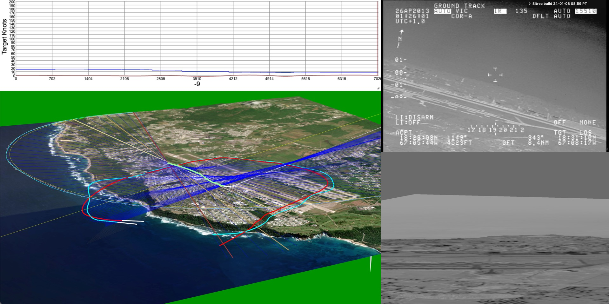

# Sitrec2

Sitrec (Situation Recreation) is a web application for the real-time, interactive 3D recreation of a real-world event, so that you can line the recreation up against a video or a photo. It was created to analyze the US Navy UAP/UFO videos (Gimbal, GoFast and FLIR1/Nimitz), and now covers many other situations. A **sitch** (short for *situation*) is one Sitrec scene: a place, a span of time, and the camera, tracks, objects and video that recreate an event. You can save and share a sitch, but it is a sitch before you save it. Sitrec is written mostly by [Mick West](https://github.com/MickWest), with a lot of input from the members of [Metabunk](https://www.metabunk.org).

The goal is a tool that analyzes UAP/UFO videos and reports, and shares that analysis in a way that people can understand. So Sitrec runs in real time (30 fps or faster), and it is interactive both in viewing and in exploring the parameters of a sitch.

- Use it at [Sitrec on Metabunk](https://www.metabunk.org/sitrec).
- A [serverless copy on GitHub Pages](https://mickwest.github.io/Sitrec2/) has no server, and you need no key to use it. The files you load never leave your browser. With no action from you it contacts only the two map-tile providers and a public AI model price list; a sitch with no set position, such as Night Sky, also asks a location service for an approximate position. Other requests start when you use a feature, and some of those need your own key for that service. See [Deploying Sitrec on GitHub Pages](docs/dev/Deploying-on-GitHub-Pages.md) and [The User Data Egress Check](docs/UserDataEgressCheck.md).
- To run your own copy, see [Run your own Sitrec](#run-your-own-sitrec) below.

## New to Sitrec? Start here

If you have a video, a photo or a claim to check:

1. Read [Getting Started](docs/CustomSitchTool.md). It says what Sitrec can and cannot tell you, and it takes you from a video or photo to a first recreation.
2. Open [Sitrec](https://www.metabunk.org/sitrec) and watch a featured sitch, then build your own. [User Interface](docs/UserInterface.md) explains the menus and the views. [Time, Frames and Syncing](docs/TimeAndSync.md) lines the video up with the clock and with the tracks.
3. Put a possible explanation in the sky: an aircraft track from [KML Data Sources](docs/KMLDataSources.md), satellites from [The Satellites Menu](docs/Satellites.md), or a meteor from [Recorded fireballs](docs/RecordedFireballs.md). For a balloon, or anything else that drifts with the wind, see [How the Balloon Algorithms Work](docs/BalloonAlgorithms.md).
4. Before you read a result, read [The Ideas Behind the Traverse Analysis](docs/TraverseConcepts.md). A camera gives a direction, not a distance.
5. Keep and share your work: [Saving and Loading Sitches](docs/SavingAndLoading.md).

In the app, **Help → Documentation** has the same pages, **Help → AI Assistant** answers questions and operates the app, and **K** shows the keyboard shortcuts in a custom sitch (one that you build yourself).

## User documentation

Use **Help → Documentation → Search Documentation** to search page titles and text and open a matching section. It works from the documentation packaged with each build.

**Help → Documentation**, the Help folder at the top of a menu, and the reading list of the AI assistant are built from one list, [`src/docsRegistry.js`](https://github.com/MickWest/Sitrec2/blob/main/src/docsRegistry.js). This README is written by hand and has its own groups. If you add a user page, add it to the registry with a label in `src/i18n/en.js`, and link it here: `tests/docsRegistry.test.js` fails if the README link is missing.

The shared webpack build regenerates `docs/search-index.json` from those registered pages on every build, including the production builds used by ship. The index is a generated build asset, not a source file to commit. To measure index generation alone, run `node scripts/buildDocumentationIndex.js --check`.

### Basics

- [Getting Started](docs/CustomSitchTool.md) — what Sitrec does and cannot do, and a first recreation from a video or photo, by three routes: you filmed it from the ground; it was filmed from an aircraft and you have the flight track; or the video has metadata embedded in it.
- [User Interface](docs/UserInterface.md) — menus, sliders, views, measurements, units, settings, and moving around the 3D main view.
- [Time, Frames and Syncing](docs/TimeAndSync.md) — the Time menu, frames and frame rates, the In and Out frames, and lining video up with tracks, with a recipe to sync a video to a flight track.
- [Keyboard Shortcuts](docs/KeyboardShortcuts.md) — the keys, grouped by what they do.
- [Glossary](docs/Glossary.md) — Sitrec's vocabulary, and the acronyms in UAP source data.
- [The AI Assistant](docs/AIAssistant.md) — the built-in assistant, with nothing to install: it answers questions and operates the app. What it cannot see, and choosing a model.
- [What's New](docs/WhatsNew.md) — recent changes, newest first.
- [What's New (Details)](docs/WhatsNew-Details.md) — the full changelog.

### Tracks, objects and data

- [Loading and Filtering Tracks](docs/Tracks.md) — formats, importing by drag-and-drop or the File menu, filtering bad data, smoothing, altitude, hand-drawn tracks, multi-track setups and live feeds.
- [KML Data Sources](docs/KMLDataSources.md) — where to get an aircraft track as a KML or KMZ file (ADS-B Exchange, FlightAware, FlightRadar24), and which export option to choose.
- [Recorded fireballs](docs/RecordedFireballs.md) — check whether a Global Meteor Network fireball matches the time and place of a sighting, and load its path.
- [Adding Objects and Tracks](docs/SceneObjects.md) — the right-click ground menu: a camera or target position, pins, 3D objects, tracks, balloons, buildings, clouds, ground overlays and measurement grids.
- [Objects and 3D Models](docs/CustomModels.md) — built-in models, preset vehicles, imported GLB and PLY models, flocks of birds, and preparing a model in Blender.

### The world: camera, terrain and sky

- [The Camera and Target Menus](docs/CameraAndTarget.md) — where the camera is, where it points, its field of view, and the target.
- [Camera View Modes: Normal and Satellite](docs/satcam.md) — the two orientation modes of the look camera, and the 0-360 option for Pan.
- [Fisheye (Allsky) Projection](docs/Fisheye.md) — match an allsky camera or another fisheye lens, with fields of view of 180° and more.
- [Panoramic Camera](docs/PanoramicCamera.md) — the look view as one wide image, up to 360° around the camera.
- [GIS Concepts in Sitrec](docs/GIS.md) — what an altitude means (MSL, HAE, AGL), coordinates, and how to recognize a datum error.
- [Terrain and Elevation](docs/Terrain.md) — map and elevation sources, 3D buildings, and which surface a ground query hits.
- [Atmospheric Refraction](docs/Refraction.md) — why distant things appear higher than straight-line geometry says, and what that does to the horizon.
- [Wind in Sitrec](docs/Wind.md) — wind at the camera platform and at the target, real atmospheric data, streamlines and arrows.
- [The Lighting Menu](docs/Lighting.md) — sun and ambient light, shadows, sky and distance haze, exposure, halos, city lights and eclipses.
- [Celestial Display](docs/Celestial.md) — stars and planets, constellation lines and labels, horizon compass, vectors, shadows, eclipses, halos and extra sky views.
- [Atmospheric Aerial Perspective](docs/AtmosphericAerialPerspective.md) — distance haze in the look view, how it is computed, and what the model leaves out.
- [Clouds](docs/Clouds.md) — volumetric cloud layers lit by the Sun: types, presets, wind, quality levels, and what the model leaves out.
- [Lunar Eclipses](docs/LunarEclipse.md) — the Earth's shadow on the Moon, and the controls that shape it.
- [Historic Skies](docs/HistoricSkies.md) — the sky for dates back to 1700, how to reach a date, and what stays accurate there.
- [The Satellites Menu](docs/Satellites.md) — loading orbital data, choosing which satellites show, brightness and flares, labels, and the sky views.
- [Investigating Starlink Flares With Sitrec](docs/Starlink.md) — what Starlink looks like in the sky (a launch train in a line, a typical pass, a horizon flare), and a step-by-step recreation of a horizon flare; most steps also apply to other sightings from a fixed place on the ground. To predict flares for your town, use the [Starlink Flare Predictor](https://www.metabunk.org/sitrec/tools/shf/).

### Video

To ask whether a shape comes from the camera or from the file: Diffraction Glare (spikes from the aperture), Video QP Graph (how hard each frame was compressed), and the forensic tools in Loading and Adjusting Video. Lens Ghost is for administrators only.

- [Loading and Adjusting Video](docs/LoadingVideo.md) — formats, frame rate and length, rotation, the video view, and the adjustment, processing and forensic tools.
- [Masking](docs/Masking.md) — mark the parts of the frame that an analysis should ignore, by hand or automatically.
- [Point Tracking](docs/PointTrack.md) — follow an object through the video automatically, get a line of sight from it, and stabilize on it.
- [Frequency Analysis](docs/FrequencyAnalysis.md) — look for repeating brightness changes such as wing flapping; understand the controls, frame and pixel limits, and the DFT/FFT calculation.
- [Motion Analysis](docs/MotionAnalysis.md) — measure how the whole picture moves, export the motion, stabilize, and make panoramas.
- [Star Tracker](docs/StarTracker.md) — find the stars in a night-sky video, identify them, and get the camera's pointing, field of view and roll from them.
- [Long Exposure/Stacking](docs/LongExposure.md) — simulate a long exposure or a brightest-pixel stack of the 3D scene, so that moving lights leave trails.
- [Video QP Graph](docs/VideoQPGraph.md) — how hard each frame of an H.264 video was compressed.
- [Video Tonal Range Graph](docs/VideoTonalRange.md) — how the recorded brightness levels are spread in each frame, and a tracked object against its local background.
- [Video Noise Pattern Detection](docs/VideoNoisePattern.md) — noise that appears again in later frames, such as a looping noise layer.
- [Lens Ghost](docs/LensGhost.md) — simulate a Sun reflection inside a mirror telescope (beta, administrators only).
- [Diffraction Glare](docs/DiffractionGlare.md) — modelling a camera's diffraction spikes.
- [Rendering and Exporting Video](docs/Video.md) — get a video file or a still frame out of Sitrec; also video with MISB metadata.
- [Scripted Camera Moves](docs/ScriptedVideo.md) — drive a cinematic camera from a text script, and render the result.
- [MQ9 Tracking Simulation](docs/MQ9TrackingSimulation.md) — simulate an operator acquiring and following a scene object behind the MQ-9 sensor overlay, for demonstrations and test videos.

### Save, share and link

- [Saving and Loading Sitches](docs/SavingAndLoading.md) — server saves with version history and a share link, or a local folder on your computer.
- [Sitch Chapters](docs/SitchChapters.md) — several setups of one sitch, each with its own views, cameras, time, frame and markers.
- [URL Parameters](docs/URLParameters.md) — open Sitrec with a sitch, a file, a place, a time or a tool already set.

## Analysis: the traverse and the benchmarks

A **traverse** is a 3D path for an object, found by combining the camera's lines of sight with a physical assumption. Start here to ask how far away an object was. Read the first page first; the others go deeper.

- [The Ideas Behind the Traverse Analysis](docs/TraverseConcepts.md) — read this first: rays, residual, parallax, priors, conditioning and the verdict, one idea and one picture each.
- [Ground Track](docs/GroundTrack.md) — points placed on the ground behind the object. When the object passes in front of terrain, they give a line of sight that does not need the field of view, and a ceiling on how far away the object can be.
- [Traverse Methods](docs/TraverseMethods.md) — each method: what it computes, what you must assume, and what it does not establish.
- [How the Balloon Algorithms Work](docs/BalloonAlgorithms.md) — test whether an object could be a balloon, or another object that drifts with the wind: how to read the result, then the drift models, wind treatments and numerical search behind it, with a worked example.
- [Traverse Analysis and the Verdict](docs/TraverseAnalysis.md) — what **Traverse → Analyze Traverse Methods...** produces: the verdict, the gallery, the ranking and the report.
- [LOS Error Analysis](docs/LOSErrorAnalysis.md) — measure a recorded line of sight against a known target, fit a model of the error, and generate new error sequences from it.
- [Doppler Geolocation](docs/DopplerGeolocation.md) — preview, for logged-in users, of audio spectrograms and aircraft Doppler curve matching; reference validation remains in progress.

Benchmarks (BOT stands for Bearings-Only Traversal). To test the analysis, use BOTBench. These pages describe the tool and how to run a test; they report no results:

- [BOTBench](docs/BOTBench.md) — run the traverse analysis over a folder of files with a known answer, or over many real clips, and table the results.
- [BOTBench Scenario Files](docs/BOTBenchScenarios.md) — where the scenario files come from, what each set was built to answer, and how to regenerate them.
- [Build the Mundane, Extreme, and Anomalies datasets](docs/BuildingMotionDatasets.md) — the commands that generate the synthetic track datasets from a repository checkout.
- [BOTBench Result Charts](docs/BOTBenchCharts.md) — charts of a result set, and the same figures exported for a paper.

## Walkthroughs and worked examples

- [Recreating Gimbal from Drag-and-Drop + UI](docs/gimbal-recreate.md) — rebuild the Gimbal scene in a custom sitch with menu buttons. A build guide, not an analysis.
- [Nimitz "Tic Tac" Encounter Reconstruction](docs/Nimitz.md) — a worked example of handling sources that disagree.
- [Lens Ghost Case Study — the Pr055 Clip](docs/LensGhostCaseStudy.md) — the Lens Ghost tool on one real video: the setup and what the fit output.

## Keys, automation and other references

- [Your API Keys](docs/APIKeys.md) — your own provider keys: where they are stored, what protects them, and what does not.
- [Control Sitrec from an AI assistant (MCP Bridge)](docs/MCPBridge.md) — connect an AI tool that runs outside Sitrec, through MCP (the Model Context Protocol), so that it can read and change the open sitch. Needs a Chrome extension and a small program on your computer.
- [Control Sitrec with ChatGPT site tools](docs/WebMCP.md) — a smaller set of controls for the page open in the ChatGPT desktop app's browser, with no bridge or extension.
- [Fit Points API](docs/FitPointsAPI.md) — drive **Fit Camera to Points** from a script or through the MCP Bridge.
- [Local Custom Sitches](docs/LocalCustomSitches.md) — hand-written sitch files (deprecated).
- [Football](docs/Football.md) — the controls of the Football scenario (**Physics → Scenarios → Football**).

## Standalone tools

Open a tool from **Sitrec → Extra Tools** or the [Tools page](https://www.metabunk.org/sitrec/tools/). If you downloaded Sitrec, serve the tools from a web server; they do not open as files from disk.

- [Sitrec Tools](https://github.com/MickWest/Sitrec2/blob/main/tools/README.md) — the index of the tools, the LOS CSV Viewer, and the tile download scripts.
- [Starlink Flare Predictor](https://github.com/MickWest/Sitrec2/blob/main/tools/shf/README.md) — when Starlink horizon flares happen and which way to look, for a place or along a flight path.
- [Diffraction PSF Studio](https://github.com/MickWest/Sitrec2/blob/main/tools/psf/README.md) — build an aperture mask, compute its diffraction point spread function, and export it for a Sitrec camera.
- [Vehicle Designer](https://github.com/MickWest/Sitrec2/blob/main/tools/vehicles/README.md) — build aircraft, drones, cars, balloons and sky lanterns from presets and sliders, and export GLB models.
- [XML Wind Profile Analyzer](https://github.com/MickWest/Sitrec2/blob/main/tools/xml-wind/README.md) — find the settings that make Sitrec read an XML weather file with a vertical wind profile.
- [PX4 ULog Viewer](https://github.com/MickWest/Sitrec2/blob/main/tools/PX4_README.md) — show a PX4 drone flight log in 3D, and export it as CSV.
- [SitrecBridge](https://github.com/MickWest/Sitrec2/blob/main/tools/SitrecBridge/README.md) — the technical reference for the MCP server and the Chrome extension. To install it, read the MCP Bridge page above.
- [Sitrec Local Compute](https://github.com/MickWest/Sitrec2/blob/main/tools/SitrecBridge/local-compute/README.md) — the optional helper that runs Motion Analysis in native Python/OpenCV on your own computer, for local hosts only.

## Run your own Sitrec

Sitrec runs as a container, as a static serverless site, as a Node.js server, or behind your own web server with PHP. To run it on one computer, start with Installing Sitrec. For a public website on your own domain, use Deploying Sitrec on a VPS (a VPS is a rented server).

- [Installing Sitrec](docs/dev/Installing-and-configuring.md) — from a one-line Docker install to a production server: configuration, Podman, offline install, Kubernetes, the serverless and standalone builds, and building from source.
- [Sitrec Serverless Build](https://github.com/MickWest/Sitrec2/blob/main/SERVERLESS.md) — the frontend without PHP, accounts or uploads, for static hosting or the included Node.js helper. You still need something to serve the files; to use Sitrec with nothing to install, open the GitHub Pages copy above.
- [Deploying Sitrec on a VPS with Podman and Caddy](docs/dev/Deploying-on-a-VPS.md) — a public site on its own domain from the released container image, with HTTPS and self-applying updates.
- [Deploying Sitrec on GitHub Pages](docs/dev/Deploying-on-GitHub-Pages.md) — how the serverless copy is built and published, what it can and cannot do, and how to fork it.
- [Sitrec on Kubernetes — example manifests](docs/dev/k8s-example/README.md) — the copy-paste manifests for the Kubernetes section of the install guide.
- [Shipped and Beta releases](docs/dev/ReleaseChannels.md) — the two frontend channels of a channel-enabled server, and which changes need the full release process.
- [Custom map, elevation, and water sources](docs/dev/CustomTerrainSources.md) — configure your own tile sources, including WMS.
- [File rehosting and object references](docs/dev/FileRehosting.md) — storing rehosted files on the filesystem or in S3-compatible storage, and server authentication.
- [Object References](docs/ObjectReferences.md) — how a saved sitch and a share link point to stored files, and what a person with a link can read.

### Hardened deployments

- [The Secure Build](docs/dev/Secure-Build.md) — the production build with outbound features removed or closed at compile time, for an isolated network.
- [Installing Hardened Sitrec on AWS](docs/dev/Installing-Hardened-Sitrec-on-AWS.md) — the secure build behind a load balancer with client certificate authentication, a private bucket, and no route to the internet.
- [Sitrec on AWS: the hardened deployment module](https://github.com/MickWest/Sitrec2/blob/main/deploy/aws/README.md) — the Terraform for that shape.

### Security

- [Security Requirements](docs/dev/SecurityRequirements.md) — what the project holds itself to, how each requirement is implemented, and how it is verified.
- [Security Headers](docs/dev/SecurityHeaders.md) — the response headers Sitrec sets, and the ones you must set yourself.
- [Server audit logging](docs/dev/AuditLogging.md) — JSON records of certificate authentication and of the reads, writes and refusals of the server APIs.
- [Container Security Review](docs/dev/Container-Security-Review.md) — an automated review of a built container image, with a report for whoever accepts the image.
- [The User Data Egress Check](docs/UserDataEgressCheck.md) — where Sitrec sends data, for each kind of install, and the check that runs on every push to `main`.
- [Vulnerability Handling](docs/dev/VulnerabilityHandling.md) — what the project does after something is found, and how it learns from it.
- [Security Policy](https://github.com/MickWest/Sitrec2/blob/main/SECURITY.md) — how to report a vulnerability privately.

## For developers

To build from source, see the *Docker Build from Source* and *Local Web Server Installation* sections of Installing Sitrec, above.

- [How to Add a User Setting](docs/dev/ADDING_NEW_SETTINGS.md) — the places a persisted setting touches.
- [Settings Manager](docs/dev/SettingsManager.md) — per-user preferences: defaults, the persisted allowlist, and the storage path.
- [Dynamic GUI Mirroring](docs/dev/dynamic-gui-mirroring.md) — the two layers that mirror lil-gui controls.
- [MISB Timing & Sync](docs/dev/misb-timing.md) — how video frames are synchronized to KLV telemetry in MISB files.
- [Wind: data flow, formats, and sources](docs/Wind-Internals.md) — companion to Wind in Sitrec: the data sources, and the on-disk and in-memory formats.
- [Transition to ECEF](docs/TransitionToECEF.md) — the record of the move to an Earth-centered render frame. Current behaviour is in GIS Concepts in Sitrec.
- [Adding A Sitch in Code](docs/dev/AddSitchInCode.md) — the older in-code method, for a sitch that needs custom code.
- [Fast visual-regression harness](https://github.com/MickWest/Sitrec2/blob/main/tests_regression/fast-regression/README.md) — run the visual regression pass over the sitches tagged Regression, with `npm run test-fast`.

## What Sitrec reads

- ADS-B aircraft tracks in KML or KMZ format from ADS-B Exchange, FlightAware, FlightRadar24 and others
- Satellite orbital data (mostly Starlink) as CCSDS OMM in CSV, or as legacy Two/Three Line Element (TLE) files
- The Hipparcos star catalogue
- Video in MP4, MOV, M4V and transport-stream (.ts, .m2ts, .mts) files, and raw H.264. H.264 is the safest codec; H.265 plays only where the browser and the computer can decode it
- DJI drone tracks from Airdata as .csv
- 3D models as GLB (binary glTF) or PLY
- Generic custom data in .csv
- DJI subtitle tracks (.srt), GeoJSON, ASTERIX radar captures (PCAP), STANAG 4676 XML, NITF images with sensor metadata, FlightClub rocket trajectories, and weather-balloon soundings
- PBA (Pico Balloon Archive) .txt files
- MISB style 3D track data in KLV or CSV format
- Global Meteor Network trajectory summaries (.txt)
- Image files (jpg, png, etc) as single-frame videos or ground overlays
- Image overlays in KMZ format

The full list of track formats is in [Supported Track Formats](docs/Tracks.md#supported-track-formats).

A typical sitch shows three views: the video, the 3D recreation of that video (the look view), and the 3D world from another viewpoint with a movable camera (the main view), plus graphs and readouts. Here is the [Aguadilla video](https://www.metabunk.org/sitrec/?sitch=agua):

Some types of situations covered:

- UAP videos
  - Taken from a plane where a target object's azimuth and elevation are known ("angles only")
  - Taken from a plane of another plane
  - Taken from a plane looking in a particular direction
  - From a fixed position
- Viewing the sky (with accurate planets and satellites)

## License and credits

Sitrec is released under its own [license](https://github.com/MickWest/Sitrec2/blob/main/LICENSE). City location and population data from https://simplemaps.com/data/us-cities.
