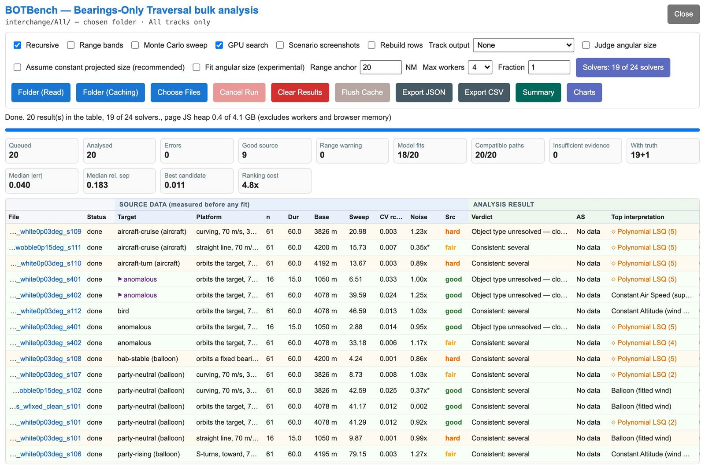
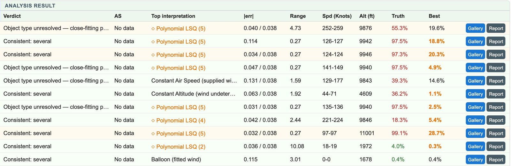

# BOTBench — Bearings-Only Traversal Bulk Analysis

BOTBench runs Sitrec's [traverse](#traverse) analysis over a whole folder of
files and tables the results side by side. Use it to test the analysis on files
with a known answer, or to compare many real clips.

**BOT** stands for **Bearings-Only Traversal**: reconstructing where something
was, and how it moved, from pointing directions alone — a camera tells you
which way it was looking, never how far away the object was. The
[traverse](#traverse) is Sitrec's name for a reconstructed target path, and
"bearings-only" is the standard term for this class of problem.

Open it from **File → File Analysis → BOTBench...**, or add `?action=botbench` to
the Sitrec address, for example `https://www.metabunk.org/sitrec/?action=botbench`.
That route starts Sitrec on its neutral custom sitch and opens the BOTBench
window as soon as setup finishes. BOTBench runs in your browser and reads files
from your own disk. It needs no local build of Sitrec.

For what the analysis itself computes and how to read a verdict, see
[Traverse Analysis and the Verdict](TraverseAnalysis.md). For how each fitting
method works, see [Traverse Methods](TraverseMethods.md). Technical terms used
below link to the [glossary](#glossary) at the end of this page.

---

## What it is for

The interactive **Analyze Traverse Methods** button answers a question about one
sitch: *given these [sightlines](#sightline), what could the object have been?* BOTBench asks
the question that comes before trusting that answer: *how good is the analysis
itself?* It runs the **same analysis code** as that button over many files in
one sitting, so you can:

- **Score the analysis against known truth.** BOT benchmark scenarios carry the
  true target position for every frame. Run a folder of them and the table
  shows, file by file, how close the top-ranked interpretation came. The score
  measures one selected path in one generated scenario: a simulated camera over
  a flat plane, with a declared pointing error. It does not give the accuracy of
  an analysis of a real video. It does not test the verdict, which can say that
  several classes fit while the selected path is far from truth.
- **Triage real footage in bulk.** Point it at a folder of [MISB](#misb-and-klv)
  [FMV](#fmv) clips (`.ts` / `.klv`) and every clip gets the full analysis, without building a
  sitch per clip.
- **Compare source data quality.** Half the table is measured *before any fit
  runs* — it describes what each file's geometry can support.
- **Catch defects in the analysis itself.** Running hundreds of scenarios whose
  answers are known surfaces failures no single sitch would reveal, including
  ranking and convergence defects. See
  [Why a good fit can still read "Unresolved"](#why-a-good-fit-can-still-read-unresolved).

This page describes the tool. It gives no benchmark results.

Every file keeps its own native sample rate. A benchmark
scenario of 51 samples at [1 Hz](#hertz-hz) is analysed as 51 measurements — not resampled
onto a 30 fps video timeline where 29 of every 30 "measurements" would be
interpolation.

## Run your first test

The scenario files are not shipped with Sitrec. In a clone of the
[repository](https://github.com/MickWest/Sitrec2), these commands make the
smallest set, about twenty scenarios, in `benchmarks/botbench/results/interchange/`:

```bash
npm install
npm run bench-bot-interchange
```

1. Open **File → File Analysis → BOTBench...**.
2. Leave **Recursive** on and press **Folder (Caching)**. Pick the `interchange`
   folder and allow write access. Folder picking needs a Chromium-family browser.
   In another browser, drag the `interchange` folder onto the window. That run
   keeps no cache.
3. A dialog lists the [solvers](#choosing-the-solvers). Press
   **Run with 19 solver(s)**. This button starts the run. The number follows the
   ticked solvers.
4. Rows fill in as files finish. When the run ends, the status line starts with
   *Done*.
5. Read **Median rel. sep** in the [summary tiles](#the-summary-tiles): how far
   the top interpretations were from truth, as a fraction of the true range.
   Each row's **Truth** column gives the same figure for one file, as a
   percentage.

The other sets are on [BOTBench Scenario Files](BOTBenchScenarios.md).

## What it accepts

Anything that records **where the camera was** and **which way it pointed**,
mixed freely in one folder:

- **BOT interchange scenarios** — `<name>.input.csv` or `<name>.all.csv`, each
  optionally paired with a `<name>.scenario.json` [sidecar](#sidecar) and, on
  the answer-key side, a `<name>.truth.json` *labels* sidecar. Both are matched
  by filename automatically and are never queued as rows of their own. They can
  sit beside the CSV or in a `meta/` folder next to its folder. The columns
  identify a BOT file, so a plain name such as `All/extreme001.csv` also works.
  A `<name>.truth.csv` is recognised as an answer key (positions, no sightlines)
  and ignored, so it never appears as an error row. Its truth is not used. To
  score a scenario, run the `.all.csv`. The format is described
  [below](#the-bot-interchange-format).
- **MISB FMV clips** — `.ts`, `.mts`, `.m2ts`, `.mpg` or `.mpeg` transport
  streams, or bare `.klv` files, whose [KLV](#misb-and-klv) metadata carries camera position, platform attitude and
  gimbal angles. The sightline is rebuilt from those angles with the same
  rotation code the live MISB track nodes use. A clip carrying no gimbal angles
  but recording a **frame centre** — the ground point under the optical axis —
  gets its sightline built as camera → centre instead; where a row has both,
  the angles win.
- **Track CSVs that carry camera pointing** — any CSV Sitrec itself can import
  as a track, through the same import dispatch the File menu uses: MISB-column
  exports, Airdata drone logs, and the rest. A position-only CSV
  refuses *with that as the reason* rather than being analysed as though it had
  pointed somewhere.
- **DJI `.srt` sidecars** that carry gimbal angles. The extension alone cannot
  tell those from ordinary subtitles, so a folder walk **reads** each `.srt`
  before queuing it — the one content check in an otherwise name-based sweep.
- **[STANAG 4676](#stanag-4676) tracks** (`.csv`, or `.xml` when you pick the
  file by hand). The sightline is the platform-and-ground endpoint pair each
  track point carries. The producer's own target estimate lies on that same ray
  and is deliberately **not** scored as truth.

Ordinary video files (`.mp4`, `.mov`, …) are *not* queued: they carry no
sightline metadata, so each one would only ever produce an error row. `.xml` is
not walked, because XML files are often unrelated to sightline data, but *is* accepted when you pick the file yourself.

Where the sample timing has gaps, BOTBench analyses only the longest uniformly
sampled span and adds a warning to the row, so **n** can be lower than the
file's row count. A span of fewer than 10 frames is refused.

Files that cannot be trusted are **refused with the reason** rather than
analysed anyway: a `.scenario.json` that exists but does not parse, a
`.scenario.json` that fails to state its coordinate frame, a `Time` column that never advances, a truth-only
file with nothing to analyse. A file that yielded no usable samples says whether
it was **pointing** or **position** that was missing, with a count per cause. An
error row tells you
what was wrong with the file; it never silently falls back to guesses.

Besides the window's own pickers, a run can start from the
**Track Browser**'s *Open in BOTBench* button, which hands over the files it
has already walked, with the sidecars beside them.

---

## The window, top to bottom

The window is a title with a **Close** button, a controls row, a status line and
progress bar, a row of summary tiles, and then the results table — one row per
file, its columns split into a **SOURCE DATA** group (measured before any fit
runs) and an **ANALYSIS RESULT** group. **Close** closes the window and restores
the playback state Sitrec was in before it opened. Results are discarded (export
first if you want them).



*Layout example from a generated set. A narrow window scrolls the table.*

### The controls row

- **Recursive** — descend into subfolders of a chosen or dropped folder (on by
  default). The folder you explicitly hand over is always scanned; the checkbox
  only controls whether folders *inside* it are. Where a folder holds `All/`,
  `Input/` and `Truth/` side by side, as the interchange layout does, only `All/`
  is read. It carries every scenario once, with its truth, while `Input/` repeats
  the same tracks without truth and `Truth/` holds only the answer key. Any `meta/`
  folder is still read for the sidecars, and the line under the title adds *All tracks
  only*. Files you pick with **Choose Files**, or send from the Track Browser, are
  analysed as picked.
- **Range bands** — after each [physics-model](#physics-models) fit, re-fit the model at a ladder
  of held ranges to find the whole range interval it still admits, exactly as
  the live analysis's solution-families option does. Several extra fits per
  model — roughly triples the time per file.
- **Monte Carlo sweep** — add the two [Monte Carlo](#monte-carlo) curve-fit
  strategies across [polynomial orders](#polynomial-order). This is a method diagnostic (it shows how sensitive the
  polynomial fits are to their order), adds ten candidates per file, and is the
  bulk of the sweep's cost. It is off by default.
- **GPU search** — enabled by default. Search the fixed-wing fits and the
  fitted-wind quadcopter fit on the graphics card (WebGPU), as the live
  analysis's *GPU search (WebGPU)* option does: many
  independent searches with large populations, testing hundreds of times more
  candidate solutions, with the final numbers still computed on the CPU at full
  precision. Balloon fits and the supplied-wind quadcopter fit use the CPU. It
  can find better fits than the normal search, so results can
  differ from a CPU run, and those fits are cached separately from CPU fits.
  Where WebGPU is unavailable the same fits run on the CPU; the `searchBackend`
  column (`webgpu`, `cpu` or `mixed`) and the summary report say where each
  file's searches ran, and `optGpuSearch` records the option.
- **Scenario screenshots** — off by default. Also save a picture of each scenario
  into a `SitrecImage` folder beside it, so the Track Browser and the charts'
  hover labels can show the scene. Each file is imported into the live 3D view,
  which **replaces what is loaded in Sitrec**. An existing picture is kept unless
  it is older than its scenario file. It needs **Folder (Caching)** and takes
  about a second per file.
- **Rebuild rows** — do not show a remembered row as it is; rebuild every row
  from the stored fits, which takes a fraction of a second a file. The fits
  themselves are still reused. Use it after a change to the candidates, the
  ranking or the verdict, which the cache's check can miss (see
  [the result cache](#the-result-cache)).
- **Track output** — optionally save the fitted tracks for each analysed file as
  CSV or Parquet. See [Track output](#track-output).
- **Judge angular size**, **Assume constant projected size (recommended)** and
  **Fit angular size (experimental)** — off by default. See
  [Optional angular-size judging and fitting](#optional-angular-size-judging-and-fitting).
- **Range anchor … NM** — the start distance the [search bracket](#range-bracket) is centred on,
  identical for **every file in the run** (default 20 [NM](#nautical-mile-nm),
  clamped to 0.3–90 NM). The interactive analysis anchors its bracket on the *Tgt Start
  Dist* slider. BOTBench uses one fixed anchor for every file, so the bracket does
  not depend on any per-file setting. If
  you type a value outside the clamp, the box shows the value actually used.
- **Max workers** — limit how many files are processed at once: 1, 2, 4, 8 or
  16, with a default of 4. The choice is remembered in this browser. Fewer
  workers reduce memory pressure but may take longer; try 2 if a long run has
  exhausted memory. The actual count also depends on available CPU cores and
  whether fits are already cached. The limit applies to simultaneous file reads
  too. Changing it preserves cache reuse and does not change analysis options.
- **Fraction** — analyse every nth file in file order. The default, **1**, uses
  all files; **3** selects files 3, 6, 9, and so on. Only selected files can start
  fits, appear in **Charts**, or produce scenario screenshots. Other files are
  marked **skipped**, even when they have valid cached results. Fraction does not
  change solver settings or invalidate cached results.
- **Solvers** — choose which [solvers](#choosing-the-solvers) the next run fits
  and ranks. The button shows the current choice, for example
  *Solvers: 19 of 24 solvers*. Every run started from the window opens the same
  dialog first.
- **Folder (Read)** — pick a folder to scan, with **read-only** access. Caches
  already in the folder are still *reused*, but no new ones are written. Folder
  picking needs a Chromium-family browser. In any browser you can drag a folder
  from your file manager anywhere onto the window, or use **Choose Files**. A
  dropped folder reuses no cache, writes none, and cannot write **Track output**
  or screenshots. Use **Folder (Caching)** for those.
- **Folder (Caching)** — the same scan, but granting the page **write** access
  to the folder and everything under it (the browser will ask). Results are then
  cached in the folder so a re-run skips the optimizers — see
  [the result cache](#the-result-cache) below.
- **Choose Files** — pick individual files. Like a dropped folder, this uses
  no cache. Note that BOT files chosen without
  their `.scenario.json` sidecars fall back to the standard scenario set's default site
  for the coordinate origin, and take their sample rate from the CSV's own
  `Time` column (recorded as a warning on the row) — fine for the standard
  scenarios, wrong for files generated at another site. They also keep only the
  noise in the CSV's `LOSUncertainty` column, which is blank for
  [correlated wobble](#correlated-wobble), so such a file has no declared noise.
  In a set with a `meta/` folder, such as a botset, picking the `All/` or
  `Input/` folder alone has the same effect, so
  [pick the folder above](BOTBenchScenarios.md#the-botsets--eight-swept-grids).
  The interchange set keeps its sidecars beside the CSVs.
- **Cancel Run** — stop the run. Every file in progress is abandoned and its row
  is marked *cancelled*. Rows that already finished keep their results. Files not
  yet started get no row.
- **Clear Results** — empty the table and start fresh.
- **Flush Cache** — delete the cache from every folder this window has used since
  it opened, including folders from earlier runs and cleared results, so the next
  run over them fits everything from scratch. It first counts what it would delete —
  folders, fitted units, bytes, and the fitting time the cache records — and asks
  you to type **Flush** before it does anything; folders opened read-only are
  listed as skipped. Rarely needed: a stale cache normally detects itself and
  re-runs (see below).
- **Export JSON** — save every row's measurements and conclusions (not the
  fitted tracks) for machine consumption.
- **Export CSV** — one row per file, for a spreadsheet.
- **Summary** — open a combined overview report: what the run covered, how the
  source data scored, where the analysis landed, and the run's option settings.
- **Charts** — open the rows as interactive figures. See
  [Charting the results](#charting-the-results).

While the window is open, Sitrec's playback stays paused. During a run the option
controls are locked, so every file in the run is analysed with the same settings.

### Long runs and memory

A long run keeps every row in the table, but not every row's full analysis. Each
file's analysis holds its dataset and every candidate's track for every frame,
which on a large folder runs to gigabytes and makes each file slower than the one
before. So only the six most recently finished or opened rows keep theirs.
Pressing **Gallery**, **Report** or **Open solutions in Sitrec** on an older row rebuilds its
analysis first, which takes a moment. It reads the row's fits from the folder
cache where they are stored and fits the rest. With no stored fits, it fits the
file again. It then compares the rebuilt row with the row in the table. If they
differ, it writes a warning to the browser console, and the gallery and report
show the rebuilt analysis. The numbers in the table do not change. The table draws
only the rows in view, so a run of thousands of files stays responsive. Exports,
the summary and the charts still read every row.

### Track output

**Track output** in the controls row saves the fitted tracks for each analysed
file as CSV or Parquet. It needs write access, so choose it before choosing
**Folder (Caching)**. The choices are:

- **None** (the default) — no files.
- **Best Track** — the **Top interpretation**, selected without truth, as
  `output/<source>.csv`.
- **All Tracks Combined** — every candidate that has finite positions, in one
  file for each source file, as `output/AllTracks/<source>.csv`: one block of
  rows for each candidate, in the order of the ranking without truth (best
  first), so the first block is the best track.
- **All Tracks Separate CSVs** — the same candidates, one file each, in a
  folder for each source file:
  `output/AllTracksSeparate/<source>/<source>_<method>.csv`, where `<method>`
  is the `AlgorithmID` without `sitrec_` (for example
  `bot-0001.input_lantern_fittedWind.csv`). Each file holds the rows of one
  block of the combined file.
- **Best Track (Parquet)** — the same top candidate as **Best Track**, as
  `output/<source>.parquet`.
- **All Tracks (Parquet)** — the same candidates and order as **All Tracks
  Combined**, in one file per source, as `output/AllTracks/<source>.parquet`.

For CSV, `<source>` is the source filename, with `.csv` added when it does not
already end in `.csv` (`clip.ts` gives `clip.ts.csv`; `track.csv` stays `track.csv`).
A source folder or a separate file name leaves out that final `.csv`. Parquet
replaces a final `.csv` with `.parquet`, or adds `.parquet` to other filenames
(`track.csv` gives `track.parquet`; `clip.ts` gives `clip.ts.parquet`). If
`All/` or `Input/` was reached through its parent, `output/` is a sibling
folder; otherwise `output/` is created inside the track folder. Existing
output files are replaced. Scans skip every folder named `output`, in any case,
so do not keep source files in a folder with that name. Cached fits are reused,
with the candidate paths rebuilt for export.

Columns are `TrackID,Time,AlgorithmID,EstimatedPositionX,EstimatedPositionY,EstimatedPositionZ,CovarianceXX,CovarianceYY,CovarianceZZ,CovarianceXY,CovarianceXZ,CovarianceYZ`.
BOT `TrackID` and `Time` values match the retained input samples at their native
rate, including a nonzero start time. XYZ coordinates are metres in the input's
local frame. `AlgorithmID` is `sitrec_` followed by the method's key, then the
wind mode for a model fitted with one (`_suppliedWind`, `_fittedWind`,
`_correctedWind`) and the order for a polynomial sweep candidate (`_order3`),
for example `sitrec_lantern_fittedWind`. The wind variants of one model share
a key, so the wind mode is what tells them apart. A candidate has the same
`AlgorithmID` in every choice.
The optional covariance cells are blank in CSV and null in Parquet because
calibrated position covariance is unavailable. Parquet stores `TrackID` and
`AlgorithmID` as strings and the numeric columns as double-precision numbers.
Other input formats use their source label as `TrackID` and
the fitted sample clock, starting at zero, as `Time`; positions are in the
analysis's local ENU frame. No best-track file is written for a direction-only
winner or a missing/incomplete track. The all-tracks choices leave out those
candidates and write the others; they write nothing when no candidate is left.
A file from an earlier run that the current run does not write is removed (for
separate files, a method that the run no longer fits), so an old result is
never read as the current one. The status line counts the source files written,
skipped and failed, and for separate files the number of files; hover a row's
status for its path or reason.

### Choosing the solvers

A run starts with a dialog listing the twenty-four solvers, one checkbox each,
grouped as the candidates are: the sightline fits (Constant Air Speed,
Constant Altitude, Horizontal Speed Valley, Minimum Acceleration,
Minimum Speed), the object models
(Fixed-Wing Aircraft, Balloon, Quadcopter, Drone (flown inputs)), the geometry
checks (Ground Object, Stationary Point / Fixed Point in the Sky), and the
curve fits (direct Constant Velocity and Constant Acceleration, the Kalman
smoother, and the five polynomial orders), plus five GPU Monte Carlo presets.
The nineteen solvers outside that GPU group are
selected initially; the GPU Monte Carlo presets can be selected individually or with **All**.
The last choice is remembered.

**Monte Carlo (GPU)** offers **Monte Carlo 50k (GPU)** through **Monte Carlo 1M
(GPU)**: five budgets from 50,000 through 1,000,000 trials (`mc_50k` to `mc_1M`
in exports). Each uses polynomial order **1** and LOS uncertainty **0.1°**. These sample blind ranges along
randomly perturbed sightlines and retain the path with the lowest mean angular
error. They need no constant-velocity seed or range-anchor sweep. The search
range is ten times the camera path's largest per-axis span (with a one-metre floor),
capped by each sampled observation's positive `MaxRange`. Those caps constrain
the sampled points; they do not guarantee that the whole fitted path stays
inside the limits.

Each preset runs and caches separately, using a fixed random seed. WebGPU is
required for these solvers, independently of the **GPU search** checkbox for
the physics models. An unavailable GPU is reported as a failed fit and retried
on a later run. The GPU scores trials in single precision; the best candidates
are checked in double precision. These are curve-fit diagnostics.

The same presets appear in Sitrec's **Traverse** selector as **Monte Carlo
50k (GPU)** through **Monte Carlo 1M (GPU)**. They fit the In/Out range and show
status, angular error, and fit time in the traverse menu. **Traverse → Traverse
Analysis Tweaks → Monte Carlo GPU** adds one preset or all five to the analysis gallery,
where **Use exact result** applies the fitted track. The existing **Monte Carlo
sweep** remains the separate comparison across polynomial orders.

Only the ticked solvers are fitted, and only their candidates are ranked, so
the top candidate, the verdict and every truth score are those of the
selection. A run of one solver gives a table whose top candidate is that
solver on every file, which is the direct way to measure one method.

Some solvers need a fit that another one produces. Constant Air Speed, Constant
Altitude, Minimum Acceleration, Minimum Speed and the fixed-wing model search
inside the [range bracket](#range-bracket) that the constant-air-speed sweep
resolves, so selecting any of them runs (or reads) that sweep. Horizontal Speed
Valley needs no sweep. The balloon and drone-control fits start from the Kalman smoother's track, so selecting either
runs (or reads) the smoother. Those supporting fits are made and stored, but
their own candidates appear only when they are selected too. A run whose
solvers need no sweep still builds a row; its report says what it cannot show.
The **Monte Carlo sweep** and **Range bands** options stay options. The Monte
Carlo sweep runs inside the polynomial sweep, so it needs at least one polynomial
order selected. It then adds all ten candidates, whichever orders are ticked.
With no order ticked, it adds none. Range bands are traced when Fixed-Wing
Aircraft, Balloon or Quadcopter is selected, but not for Drone (flown inputs).
The option then runs all three object-model fits and the sweep, whichever of the
three is ticked. Their candidates appear only when ticked.

The Kalman smoother is the same Rauch-Tung-Striebel smoother the live
analysis offers as *Global Fit: Kalman Smoother*, seeded from the
least-squares constant-velocity fit with a range floor. It is graded as a
curve fit: a row it wins is marked [range-blind](#range-blind), like a polynomial
win. The Kalman smoother and the direct Constant Velocity and Constant
Acceleration fits carry the generic [reference residual](#reference-residual), so
a run of those is graded as multiples of the scene's own reference. A selection
made only of polynomial orders, Monte Carlo presets and geometry checks carries
no reference residual, so its candidates are graded on fixed residual limits.

The selection is recorded with each row (`optSolvers` in the CSV, `solvers` in
the JSON option set), and the summary report names it.

### The status line and progress bar

The status line gives the count of finished files, the number of workers and the
solver selection. When the run ends it gives the number of results in the table.
Each row's **Status** cell shows that file's progress. The progress bar spans the
queued files.

Where the browser exposes it, **page JS heap** reports the page's JavaScript
memory against its heap limit. It excludes analysis workers and other browser
memory, so a low value does not rule out a memory-related browser crash. On
Windows, check Task Manager's **Performance → Memory → Committed** used/limit
figures to see system-wide memory commitments.

### The summary tiles

- **Queued** — files started so far, including files skipped by **Fraction**. It
  reaches the full count when a run completes.
- **Analysed** — files that produced a result.
- **Errors** — files that could not be ingested or analysed. Hover an error
  row's Status cell for the reason.
- **Good source** — files whose source data has no flag: enough frames, a real
  camera [baseline](#baseline), a sightline that actually swept, good
  [conditioning](#conditioning-and-rcond), regular sample timing with no gaps,
  and, for BOT files, a sidecar that states the coordinate frame (see the **Src**
  column below). This does not show that range can be recovered.
- **Range warning** — files flagged by the camera-span check (`rangeUnobservable`
  in the CSV). This is a limited geometry warning, not a calibrated observability
  test. A file with no flag does not show that range can be recovered.
- **Model fits** — shown as n/m: files with at least one tested interpretation
  class that passes its fit and completion checks, out of the files with this
  assessment recorded. It uses no truth, and it counts fitting explanations, not
  identified objects or correct reconstructions.
- **Compatible paths** — shown as n/m: files with at least one completed,
  close-fitting path inside a physical class's measured limits, out of the files
  with this assessment recorded. This is not identification.
- **Insufficient evidence** — files whose executive assessment says the evidence
  is insufficient. Fitting paths can still exist.
- **MaxRange conflicts** — shown only when above zero: files whose top candidate
  exceeds the file's declared `MaxRange` (the longest distance the file says its
  camera could plausibly have been measuring at). It does not show that every
  other candidate conflicts.
- **With truth** — files whose conclusion can be scored: either a true position
  per frame, or a direction truth for a target that has a bearing but no finite
  range (a celestial object). The two are scored in different units and never
  averaged together; the tile shows them as *positional+direction*. Running the
  challenge `Input/` folder alone shows 0 here — the input files deliberately
  carry no truth (see [file generation](BOTBenchScenarios.md)).
- **Median |err|** — [median](#median) line-of-sight [residual](#residual) of
  the top-ranked interpretation across the run, in degrees: how well the
  winning candidates fit their sightlines.
- **Median rel. sep** — shown when truth exists: the median, over the scored
  files, of the top interpretation's mean 3D separation from truth divided by
  the mean true range. It is scale-free, so a 2 km scenario and a 50 km
  scenario compare on the same axis. 0.1 means "on average within 10% of the
  true range of the right place"; 1.0 means "as far from the truth as the truth
  is from the camera".
- **Best candidate** — the same measure, but for the *closest candidate any
  method produced* on each file. Truth picks that winner, so this is an
  [oracle](#oracle): no ranking of these candidates can score a smaller error.
  It shows which candidates existed. Read it beside *Median rel. sep*: that tile
  scores the **selected** path, this one the **closest** path.
- **Ranking cost** — the median, over files with a positive best error, of (top
  interpretation's error ÷ closest candidate's error). `1.0x` means that on at
  least half of the files the top interpretation's error was within about 5% of
  the closest candidate's. It says nothing about the other half. Truth chooses the closest candidate, so a large figure
  shows that a closer candidate existed. It does not show that the observations
  alone could identify that candidate. Read it beside **Best candidate**, which
  shows how close that candidate was.

### The results table — SOURCE DATA columns

These are measured from the file **before any fit runs**. They describe what
the data can support.

- **File** — path relative to the chosen folder, or the scenario's *descriptive
  name* where an answer-key sidecar supplies one (the path then moves to the
  tooltip). **Click it to choose Open solutions in Sitrec or Open file in Sitrec**. See
  [Opening a row in Sitrec](#opening-a-row-in-sitrec).
- **Status** — progress while running, then the final state: `done` (every fit
  made in this run), `partly cached` (some fits read from the folder cache,
  the rest made now), `rebuilt` (every fit read from the cache and the row
  built from them), `cached` (a remembered row shown as it is), `adopted` (a
  remembered row from an earlier build, shown after a checked sample), `skipped`
  (excluded by **Fraction**), `cancelled`, `output skipped` or `output failed`
  (the file was analysed, but its [Track output](#track-output) was not written),
  or an error; hover for detail.
- **Target** — what the object **actually was and what it was doing**, read from
  the answer-key sidecar. A flag marks a scenario *declared anomalous* in its
  answer key. A matched control keeps its anomalous twin's target kind, so its
  cell reads *anomalous* with no flag. It is not declared anomalous. Its event is
  smaller than the twin's, or zero, and the cell's tooltip and the CSV's
  `eventDescription` column call it a sham. Blank on challenge files, which carry
  no answer by design. Nothing derived from this column reaches any fit. It is
  shown so a verdict can be judged against what was true.
- **Platform** — the path the platform flew: declared by the sidecar where there is
  one, otherwise **measured** from the camera path (straightness and sweep) and
  shown in *italics* to mark it as inferred. The platform's path determines the
  available parallax.
- **n** — usable samples in the file, at its own native rate.
- **Dur** — clip duration in seconds.
- **Base** — spatial extent of the camera's own path, in metres, or kilometres
  from 10 km. This is the
  [baseline](#baseline) available for camera-motion [parallax](#parallax).
- **Sweep** — total angular path travelled by the sightline, in degrees.
  A constant bearing does not by itself establish the target's distance or
  motion along that sightline.
- **CV rcond** — [conditioning](#conditioning-and-rcond) of the
  [Constant Velocity (CV) family](#constant-velocity-cv-family)'s fit design
  (0–1, higher is better; the same diagnostic the live analysis computes).
  It answers one narrow question: *could a linear fit determine range here?*
  It is one-way — poor rcond warns that this fit's range is unreliable, but good
  rcond is not a promise, and [physics](#physics-models) or
  [stationary-point](#stationary-point-methods) methods may still work where
  it is poor.
- **Noise** — the pointing noise **measured from the sightlines**, divided by
  the noise the file **declares**: a ratio, so `1.0` means the sightlines carry
  the error they claim. The measurement uses no model of the target —
  it is the median angle by which each sightline deviates from the direction
  midway between its two neighbours, converted to a [sigma](#sigma) under an
  explicit assumption ([isotropic Gaussian](#gaussian) pointing error on a
  locally straight path). Both raw figures are in the tooltip. A ratio outside
  0.7–1.4 on a white-noise declaration is highlighted. A trailing `*` marks a
  [**correlated** error model](#correlated-wobble) — slow wobble rather than
  white jitter — whose declared amplitude is a *deadband amplitude*, not a
  standard deviation: the ratio there is not like-for-like and reads far below
  1. That gap is the signature of wobble, not a bug, and the column never
  highlights it. The ratio shows with an `x`, for example `1.02x`. When the file
  declares no pointing noise, the cell shows the measured value in degrees, with
  no `x`. Every FMV row is like this.
- **Src** — a one-word triage of everything to the left: **good** (nothing
  flagged), **fair** (minor flags: marginal conditioning, irregular timing,
  timing gaps, or a missing sidecar), **hard** (conditioning poor — the linear
  route to range is closed), **weak** (a fundamental degeneracy: fewer than 10
  frames, a camera that barely moved, or a sightline that barely swept). It is
  a sort key, not a calibrated score — hover it for the specific reasons. The tooltip also carries the
  earth and ground models actually in force for this file, and the
  [geometry probe](#geometry-probe): whether pure geometry *pinned* a range with
  no speed assumption involved, pinned one whose implied speed exceeded twice
  the fit's target speed (reported as **recoverable**), or left range genuinely ambiguous so the fit fell
  back to its speed prior. The probe speaks for geometry only; physics and
  [stationary-point](#stationary-point-methods) methods may still succeed where
  it says "prior". The row tint follows **Src**.

### The results table — ANALYSIS RESULT columns



*Example rows from the same generated set as the window above, run with 19 solvers. The values show how the columns read. They do not measure Sitrec's accuracy.*

- **Verdict** — the [executive verdict](#executive-verdict) for this file,
  shortened to fit the cell; hover for the full headline. The wordings are in
  [The executive verdict](TraverseAnalysis.md#the-executive-verdict).
- **AS** — the angular-size check on the top interpretation. With **Judge
  angular size** on, the cell shows the check's status (`compatible`, `conflict`
  or `unavailable`). With only **Fit angular size** on, it shows `Fit only`. With
  both off, it shows `Off (n)`, where n is the number of size observations, or
  `No data`. Hover for sample counts, conflicts and the projected-size assumption.
- **Top interpretation** — the highest-ranked candidate, for example *Balloon
  (fitted wind)*, *Constant Altitude (supplied wind)* or *Quadcopter (fitted
  wind)*. Hover for its full name and rank tier, the broad screening grade such
  as *Passes broad screen*. Ranking is **blind**: truth, even when the file
  carries it, plays no part in choosing the winner — it is only used afterwards,
  to score the choice. First place comes from the screening checks and then the
  [BOT Score](#bot-score). It is not a probability or an identification. See
  [How the tiles are ranked](TraverseAnalysis.md#how-the-tiles-are-ranked). Two
  marks can lead the cell. ◇ marks a [range-blind](#range-blind) candidate, whose
  **Range** cell is not a measurement. ⚠ marks a candidate that goes beyond the
  file's declared `MaxRange`. Hover for the detail.
- **|err|** — the top interpretation's mean line-of-sight
  [residual](#residual) in degrees, and after the slash the
  **[noise floor](#noise-floor)** — the mean residual a *perfect* track is
  expected to score, given the file's declared pointing error (independent
  Gaussian errors). It is an average over noise samples, not a lower bound: a
  good fit scores near the floor, and a residual below it does not by itself
  show overfitting. Residuals near the floor do not distinguish between
  candidates, because the residual is nearly **invariant to where along the
  sightline a track sits**. No floor is shown unless the file declares a
  positive pointing sigma and its sidecar states that the error is uncorrelated.
- **Range** — the top interpretation's start range, in nautical miles.
- **Spd (Knots)** — the top interpretation's air speed over the clip, min–max.
- **Alt (ft)** — the top interpretation's mean altitude.
- **Truth** — where truth exists: the top interpretation's
  [relative separation](#relative-separation) from it (the per-file version of
  *Median rel. sep*), or, for a direction-only target, its bearing error in
  degrees. Green is at most 10% or 1°.
- **Best** — the same measure for the **closest candidate any method produced**.
  Truth picks that winner, so it is an [oracle](#oracle) and not an achievable
  score. A small **Best** beside a large **Truth** means a close candidate
  existed but was not ranked first, which the Truth column alone cannot
  distinguish from never finding it at all.
  Orange: **Truth** is over 3 times **Best**.
  Hover for which method produced it.
- **Gallery** / **Report** (last column) — **Gallery** opens the full-screen
  candidate gallery for this file, the same view the live Analyze button
  produces; **Report** builds and opens the full HTML analysis report.
  An older row is rebuilt first: see [Long runs and memory](#long-runs-and-memory).
  Both work on cached rows, and are disabled only for a row with no analysis (an error or a
  cancelled run). One difference from the live gallery: **Use exact result** is
  disabled for bulk rows, with a note explaining why — the fitted track lives in
  some other file's local coordinate frame at its own epoch, and applying it to
  the currently loaded sitch would silently corrupt it.

### Why a good fit can still read "Unresolved"

A candidate badged **Optimizer incomplete** is *ineligible* and counts as an
incomplete search. The [executive verdict](#executive-verdict) counts a class as
consistent only when one of its candidates is complete, close and ordinary. That
test is stricter than eligibility: a load-bearing bound pin or an internal model
clamp also fails it. If no other candidate of the class passes, the badge reaches
the **Verdict** column and the **Model fits** tile.

**What the optimizer is doing.** The balloon and quadcopter fits start with a
global search (differential evolution) and finish with **Nelder-Mead**, a
derivative-free search. The drone-control fit uses Nelder-Mead alone. The
fixed-wing fit finishes with a pattern search, so the simplex detail below does not
apply to it. It can still carry the badge, when a probe inward from a search limit
finds a better fit. For a model with *n* free parameters, Nelder-Mead keeps *n*+1 trial parameter sets — the [**simplex**](#simplex) — and repeatedly throws out
the worst one, reflecting it through the others, so the whole shape crawls
downhill and shrinks around a minimum. Two different things can therefore be
said to have converged: the **costs** at the vertices can all be nearly equal (a
*flat objective*), and the **vertices themselves** can be nearly coincident (a
*collapsed simplex*).

Sitrec's line-of-sight fits require **both**. Cost-only stopping is unsafe here:
an unobservable parameter can span most of its allowed range while every vertex
scores identically, and stopping on cost alone would report that parameter as
determined when the data never constrained it at all.

The consequence is that hitting the iteration budget is **not** by itself an
unfinished search. Two ways of hitting it do not mean that, and each is
recognised explicitly:

- **The cost settled, and only a balloon's life-cycle parameters are still wide.**
  This exception covers the balloon fit only. That is an *identifiability* limit,
  not an optimizer failure — those parameters were not measured. A sky lantern
  whose solved flame-out lies beyond the end of the clip never exercises its sink
  and cool-down parameters, so nothing can ever close the simplex along those
  axes. Every simplex vertex must place flame-out at or past the clip end. The
  tile says so, naming the unconstrained parameters, and never claims convergence
  for them.
- **Every parameter collapsed, but the cost spread never settled.** The simplex
  has nowhere left to move, so no further iteration could shrink the cost spread.
  This is convergence.

Any other iteration-limit stop keeps the warning. That includes a stop where the
cost settled but another parameter stayed wide. Where the per-parameter spreads
are missing entirely, the warning is also kept.

### Plotting two columns against each other

Every numeric column header is clickable, and assigns that column to a scatter
plot axis: **left-click = X**, **right-click = Y**, **middle-click = dot size**.
Choose an X and a Y and the run plots as a sized scatter in a floating graph
window, light-themed so it prints. Hovering a dot outlines and scrolls to its
table row. The extractors pull the **raw** value from each result rather than
parsing the formatted cell, so a column that switches between metres and
kilometres in the table still plots on one consistent axis. The plot extends
itself as further rows complete, so it can be opened mid-run.

### Opening a row in Sitrec

Clicking a row's **File** cell offers two choices:

1. **Open solutions in Sitrec** — open the source file with the analysis's
   candidate tracks in a fresh Sitrec window, rebuilding cached solutions if needed.
2. **Open file in Sitrec** — open the source file alone in a fresh Sitrec window,
   without loading or rebuilding analysis candidates. Camera and truth tracks
   already in the file remain part of the import, and sidecars are included as Notes.

With **Open solutions in Sitrec**, the new window loads:

- the **camera track** with its sightlines, and the **truth track** where one
  exists (drawn with the usual ground-truth marker);
- the analysis's own **consistent candidates**, as ordinary tracks named
  `c_<type>` — one per candidate type, the best-ranked standing for its family
  and the rest counted in the sitch Notes. Where nothing passed the consistency
  screen the **weak** band travels instead, named `w_<type>` with the reason it
  was declined in the Notes. That is a *fallback*, not an addition, so a candidate
  pinned at a search limit never stands beside one that passed.
- The camera and heading are claimed by the **camera's own** track and recorded
  angles once that track exists. A clip that records its field of view uses that
  value. A BOT CSV records none, so **Open solutions in Sitrec** sets the field of
  view so that the closest candidate or truth marker spans 3% of the view's width.

The sidecars travel as **Notes**, not as files. The new window therefore dates
and places the scenario from the interchange format's defaults (epoch
2025-02-01T20:00:00Z, the default site), whatever the sidecar declares, and the
candidates are written on that same clock and at that same site so that they
line up with it. When the sidecar declared something else, the notes say what
was ignored. The conversion from the scenario's local frame back to
latitude/longitude uses the interchange format's own flat-plane rule, the same
rule the analysis scores with.

### The result cache

Choosing a folder with **Folder (Caching)** lets a run store its work in the
folder itself: a `.botbench-cache.json` index per leaf folder, plus a
`.botbench-cache/` folder of fits. **What is stored is each fit, one per fit
unit**, not the finished answer. The expensive part of a run is the
fits, the optimizers; everything after them, the candidate set, its
grading, the verdict, the truth scores and the row, is cheap arithmetic that
a later run rebuilds from the stored fits in the same worker, by the same
code. So:

- a run that selects more solvers than the last one fits only the units it
  lacks, and a run that selects fewer reads what it needs;
- a change to one solver's code invalidates that unit and nothing else;
- a new build never fits again what it can show it reproduces.

The stored units are the solvers' fits, with a separate unit for each wind
variant, one polynomial sweep for all five orders, one unit for each selected
Monte Carlo preset, and the range bands when that option is on. The Ground Object and the
stationary point are closed-form fits made while the candidates are built and
need nothing stored. A fit whose index line was lost, because the tab closed or
crashed, is found again on the next run and is not fitted twice. An index file
that cannot be read is left as it is, and the status line says so.

A stored unit is used only when the input hashes, the unit's version and the
options that shape it (the range anchor, **Fit angular size** when it is on, and
its own option where it has one) all match. The fixed-wing units, the fitted-wind
quadcopter unit and the range-band unit also carry the
**GPU search** option when it is on, so GPU and CPU fits of the same file are
stored side by side and never stand in for each other. A GPU run whose fit ran on
the CPU instead (no WebGPU, or a GPU error) is not stored, and neither is its
row, so a later run with WebGPU fits it again. Every new build of Sitrec has a new app version, and fitting
code can change without its unit version being bumped, so on a run of more
than 20 files whose stored units come from another build, BOTBench first
fits 5 of those files for real and compares each unit with its stored copy.
A unit that reproduces on every sampled file is reused everywhere; one that
differs is fitted again for every file, and the others are still reused. On a
run of 20 files or fewer, or with fewer than 5 such files, there is no sample:
units from another build are fitted again, and their rows are rebuilt. The
comparison allows floating-point noise. The final status names how many units
were reused and how many were fitted again.
Use **Flush Cache** before the run when every fit must be recomputed.

The finished row is remembered too, under the solver selection and options
that produced it, for the last few selections of each file. A remembered row
is shown as it is when this build made it, or when the same sample of five
files showed the rebuilt rows identical; otherwise the row is rebuilt from
the fits, which takes a fraction of a second a file. The chart facts (the
[parallax aperture](#parallax-aperture), every candidate's error against truth,
the **Sensor turn** value)
are kept with the row, so the charts open on a remembered run without opening
a blob. A new build compares only the five sampled rows, so a change to the
candidates, the ranking or the verdict can pass that check if it alters none of
them. The **Rebuild rows** option rebuilds every row from the stored fits when
such a change is known.

A cache written before fits were stored per unit (one blob per file holding
all its fits) comes from another build, so the sample check above applies. A run
in which the check clears a unit splits each old blob into the units it holds,
fits every other unit the selection needs, writes them all as units, and removes
the old blob. Those other units include the fitted-wind and supplied-wind copies,
and some of them are full searches. With no sample, a run does not read the old
blob: it fits those units again and leaves the blob in place. A folder opened
read-only is read the same way, and nothing is written.

---

## What a bulk run deliberately does not do

The fits are identical to the live button's; the *environment* is not, because
there is no loaded scene. Every difference is stated with the results rather
than left to be discovered:

- **Flat terrain.** A BOT scenario is generated on a flat plane, so the ground
  is a level surface at the site elevation — exactly as the scenario generator
  defines it. An FMV clip has no scene either, so its ground plane is taken from
  the **file's own frame-centre elevations**: the producer's recorded terrain
  height under the optical axis, median over the clip. With fewer than five
  samples, or a median at or above the lowest camera height, the ground plane
  falls back to [mean sea level (MSL)](GIS.md#three-kinds-of-height). Over high terrain that plane is far below the real
  surface, so a buried candidate can pass the underground screen and the Ground
  Object fit can sit far under the road. The row records which model was used
  (hover **Src**).
- **No wind field.** A bulk run has no scene wind. The supplied-wind and
  corrected-wind fits use the sidecar's analyst wind estimate, or zero wind when
  the file has none. The fitted-wind fits infer their own wind. Each report states
  which wind was used.
- **No ground-contact mode.** A run uses the *Airborne (any)* setting: no
  candidate must touch the ground. The Ground Object solver still runs, and the
  Ground Vehicle candidate is not fitted.
- **No scene [hypotheses](#hypothesis).** No astronomy sweep, no satellite catalogue, no live
  line-of-sight-fitting method nodes from the interactive scene. These are
  listed in the **Summary**, in **Export JSON** under `absentHypotheses`, and in
  each report's run manifest, so a report shows which hypothesis types were not
  tested.
- **One range anchor for the whole run** (see the Range anchor control above).

## How ordinary is the answer?

Alongside the residual, every candidate carries an **ordinariness** score: how
far outside the envelope of the nearest real object class it sits, in
[decades](#decades-order-of-magnitude). `0` means one real class holds every
tested quantity at once. The score adds the decades for size, speed and peak
acceleration. So `1` means one decade in total, for example a factor of ten on
one quantity, or about a factor of three on each of two.

It shows on each gallery tile as **Physical compatibility**. When classes fit, the
line lists them, for example *Within tested limits: balloon, bird.* When none
fits, it names the closest class and each quantity that carries the cost, for
example *No class is within all tested limits. Closest envelope: light aircraft;
12× outside on acceleration.* A bulk run carries the **same score from the
same function**: three columns in the **Summary** report, and in the CSV export
the per-term breakdown (`ordTopSize`, `ordTopSpeed`, `ordTopG`) beside the
`ordTop` total, since a total alone cannot say which term carried it.

**The general envelope score is disclosure and does not move the ranking.**
The separate, optional angular-size check described below can deprioritize a
size-conflicting path when explicitly enabled. It does not add this envelope
score to [BOT Score](#bot-score).

With **Judge angular size** off, which is the default, the score has no size term.
It tests speed and acceleration only, and `ordTopSize` in the CSV export is 0. When
the file has size data, the gallery line says *Size not assessed: angular-size
judging is off.*

With judging on, the score is **joint**: each class is tested on size, speed and
acceleration together. A size test on its own cannot refute a solution that has
collapsed toward the camera: a candidate at 500 m implies an object 0.28 m across, and 0.28 m is a perfectly
ordinary size. What refutes it is the **pair** — 0.28 m sustaining 300 knots. A
bird is the right size and impossibly fast; an aircraft is the right speed and
impossibly small. So each class is judged on all of its quantities at once and
the candidate keeps the *best* class it can find: a candidate is as mundane as
the most ordinary object that could have produced it.

The three columns are three different claims:

- **Ord** (`ordTop` in the CSV) — how ordinary the candidate the ranking **picked** is.
- **OrdMin** (`ordMin`) — how ordinary the data **allows** any candidate to be, anywhere in
  the gallery.
- **OrdErr** (`ordMinErrDeg`) — that most-ordinary candidate's own residual, and it must be read
  with **OrdMin**, because OrdMin is ungated by residual. A low OrdMin at a high
  OrdErr is an ordinary explanation that *does not fit*. A bare `0.00` with no
  OrdErr beside it would read as though one did.

On a bearings-only problem **OrdMin can be far below Ord**, which a single
column would not show. When OrdMin is low and OrdErr is also low, a candidate
inside an ordinary object envelope fits the sightlines **at a different range**
from the top candidate, and the sightlines alone cannot choose between them. A
low residual shows only that a candidate is consistent with the sightlines;
candidates at different ranges can have nearly equal residuals.

The tool is designed to ask whether a mundane explanation *exists* — never
which explanation it would prefer.

## Optional angular-size judging and fitting

**Judge angular size** enables the same size checks used by the traverse results
browser. The **AS** column reports the top path's result; hover for sample counts,
conflicts and the projected-size assumption. With judging on, absolute
measurements test the implied physical size against broad class envelopes; they do
not by themselves identify an object. A size conflict can move a candidate below
others with the same broad grade. That candidate can then no longer make its class
consistent, though another candidate of the class can. So the **Top
interpretation**, **Verdict** and **Truth** columns can change. CSV exports include
the judging/fitting mode, compatibility status and constant projected-size setting.

**Assume constant projected size (recommended)** is optional and initially off.
Select it when shape and orientation remain stable. It has an effect only with
**Judge angular size** or **Fit angular size** on. Relative size, and changes in
absolute size, then constrain range changes.

**Fit angular size (experimental)** adds size-change information to supported CPU
searches on the next run. It needs **Assume constant projected size** and
size-change evidence: lower-and-upper measurements at more than one frame, or
relative size bounds. `AngularDiameterMaxDeg` alone is not enough, so a generated
BOT file stays LOS-only and the **AS** tooltip reports *Not used* with the reason.
Each gallery result reports whether its method used size
or remained LOS-only. Judging changes can reuse existing fits. Fitting options have
separate cache entries. The [BOT Score](#bot-score) formula and raw LOS residual
remain unchanged.

See [Optional angular-size evidence](TraverseAnalysis.md#optional-angular-size-evidence)
for supported solvers, input columns, sparse/relative sidecar syntax, the fitting
loss, and the limits of the constant projected-size assumption.

### Implied object size

When **Judge angular size** is enabled, recorded size bounds constrain the
physical size each candidate range would imply. The AS column shows available
observation counts even when judging is off; its tooltip gives the sample counts.

`AngularDiameterMaxDeg` alone supplies an upper limit, regardless of whether
camera resolution is known. The implied physical size is `0 ≤ D ≤ 2R tan(θmax/2)`.
The analysis does not infer an unreported lower limit from the generator's
formula or treat changes in the upper limit as measured size ratios.

An upper bound can reject a class if even its smallest object exceeds that
limit at the candidate range. It cannot constrain range changes for an unknown
physical size by itself. Lower-and-upper measurements at multiple frames, or
relative size bounds, can do so with the explicit constant projected-size
assumption. Judging and fitting remain separate opt-in settings.

---

## Scoring against truth

Truth is quarantined at ingest: the `TruePosition` columns are read into a
separate structure that nothing in the analysis path can see, attached only
after the hypotheses are built, and used only to score them. For a positional
truth the score is **relative separation** — mean 3D distance between the
candidate track and the truth track, divided by the mean true range (see
[relative separation](#relative-separation)). For a
direction-only truth (Venus, effectively at infinity) the score is the bearing
error in degrees. The two are never pooled.

---

## The BOT interchange format

The full specification (currently **v1.2**) ships with the benchmark as
[`benchmarks/botbench/BOT-Interchange-Format.html`](https://github.com/MickWest/Sitrec2/blob/main/benchmarks/botbench/BOT-Interchange-Format.html).
GitHub shows it as source; download it to view it as a page. The short version:

One schema, three views of the same data:

| File | Columns | Role |
|---|---|---|
| `<name>.input.csv` | `TrackID, TrackSource, Time, SensorPositionX/Y/Z, LOSUnitVectorX/Y/Z, MaxRange, LOSUncertainty, AngularDiameterMaxDeg` | the challenge |
| `<name>.truth.csv` | `TrackID, Time, TruePositionX/Y/Z` | the answer key |
| `<name>.all.csv` | input columns + truth columns | both, joined row-for-row |

`AngularDiameterMaxDeg` (new in v1.2) is an **upper bound** on the target's
observed angular diameter — never the exact subtended angle. Paired with a
*minimum plausible diameter* for an assumed object class it gives a range
**floor**, approximately `R ≥ D_min / θ` for small angles in radians. This
uses a class-size assumption in addition to the bearings. It is
deliberately a bound: publishing the exact `D/R` would let any consumer that
assumes a diameter read range straight off, so only a bound is published. The bound can never be tighter than one
[IFOV](#ifov), so a target far enough away to be sub-pixel still reports about
two IFOVs including the measurement margin — read `sensor.pixelsAcross` in the sidecar to know what that is. Blank
where the scenario declares no target size, and blank for direction-only
targets, which have no finite range.

Positions are metres in a **local [ENU frame](#enu-frame)** (the sidecar declares
`axisOrder: "X=East, Y=North, Z=Up"` explicitly, because a consumer that
guesses X=North gets a mirrored scene that is perfectly consistent with its own
bearings). Scenarios are generated on a **flat plane**: altitude is Z plus the
site's ground elevation at any horizontal distance. The truth columns are
deliberately empty for a direction-only target.

The `<name>.scenario.json` sidecar carries everything the CSV cannot: the frame
origin (latitude, longitude, ground elevation), the [epoch](#epoch), the sample
rate, the declared line-of-sight error model ([white sigma](#white-noise) or
[correlated wobble](#correlated-wobble) — the `*` in the Noise column), the
camera field of view **and its width in pixels**, a list of invalid frames, and
an **analyst wind estimate** (a forecast-style wind value, separate from the
generator's true wind).
It also carries SHA-256 hashes of the input file and
[*commitments*](#hash-commitment) to the truth files, so a scored release can
later prove the truth was fixed before anyone ran it.

Answer-key folders additionally carry a `<name>.truth.json` **labels** sidecar:
what the object was, its class, its *true* physical diameter, whether it was
declared anomalous, and the events spliced into it with their onset times. That
is what fills the **Target** column, and it is why a bulk run can flag "this
scenario was declared anomalous" without any of it reaching a fit.

You can also **drop a BOT CSV straight into Sitrec** like any other track file:
an input file becomes a camera track with its sightlines, a truth file becomes
a target track, an all file gives you both. That path is for *looking* at a
scenario in 3D — it places the flat-plane data on the real ellipsoid (a
curvature difference of ~2 m at 5 km, ~196 m at 50 km) and always assumes the
standard set's default site and epoch, because the importer does not read a
`.scenario.json`. BOTBench scores with the flat-plane
rule; the drop-in path does not.

## Where the scenario files come from

The scenario files are generated by the BOTBench benchmark suite
(`benchmarks/botbench/`) in the source repository. They are not shipped with Sitrec.

That has its own page: **[BOTBench Scenario Files](BOTBenchScenarios.md)** —
the curated interchange set, the swept botsets, `rock_v3`, the Mundane, Extreme
and Anomalies v1 sets and the video set, what each was built to answer, the
sealed-release commitment, and the commands that build them. The steps for the
v1 sets are on [Build the Mundane, Extreme, and Anomalies datasets](BuildingMotionDatasets.md).

## Charting the results

The table answers "what happened to this file". To see what happened across the
whole set — how accuracy moves with clip length and pointing error, what the
verdict actually concluded, and how much the blind ranking cost — press
**Charts** in the controls row. It can export SVG or a 300 dpi PNG for a paper.

That has its own page too: **[BOTBench Result Charts](BOTBenchCharts.md)** — the
figures and what each answers, how to read a box (Tukey whiskers on the raw
values by default, with a log-space option), why the confidence intervals are wider than the usual ones,
and the optional command-line renderer.

---

## Glossary

Terms as used on this page. Sitrec-wide vocabulary (sitch, node, track, and so
on) is in the main [Glossary](Glossary.md).

#### Traverse

Sitrec's name for a reconstructed path of the target object. Given the
camera's sightlines, a traverse is one candidate answer to "where was the
object along each line, moment by moment".

#### Sightline

The direction from the camera to the object at one instant — also called a
*line of sight* (LOS) or a *bearing*. Bearings-only data is a series of
sightlines with no distances attached: each one says "the object was somewhere
along this line", and nothing more.

#### Range

The distance from the camera to the object. Bearings-only data does not measure
it.

#### Range bracket

The span of start distances a fit searches. BOTBench builds it from the **Range
anchor**, and the constant-air-speed sweep can widen it when its best result sits
on an edge.

#### Range-blind

A polynomial, Monte Carlo or Kalman smoother candidate. These curve fits carry no
independent range information, so the **Range** cell of such a row is not a
measurement.

#### Parallax

The apparent shift caused by moving the viewpoint — near things shift more
than far things for the same sideways displacement. Here the motion is a
change in the camera's **position**, not just a pan or rotation. Camera-motion
parallax can constrain distance under a target-motion assumption. A specified
target turn can also constrain range with a straight-flying camera; see
[curved targets and constrained turns](TraverseConcepts.md#a-curved-target-with-a-straight-flying-camera).

#### Parallax aperture

The angle at the target, at mid-clip, between the first and the last camera
position, in degrees. It is not the **Sweep** column. Sweep adds up the whole
path of the sightline, which includes the target's own motion and any orbit by
the platform. A full orbit around a hovering target has an aperture near 0° and
a large Sweep.

#### Baseline

The spatial extent of the camera positions while recording, rather than the
distance accumulated along its path. Little baseline means little
camera-motion parallax; it does not by itself settle what a stronger target
model or an independent measurement could determine. A large baseline does not
give the range by itself. With a camera that flies straight at constant speed, a
fit that accepts any constant velocity cannot place a target that moves at
constant velocity.

#### Residual

How badly a candidate track disagrees with the measured sightlines, expressed
as the mean angle (in degrees) between each measured sightline and the
direction to the candidate's position at that moment. A small residual means
the candidate is *consistent* with the data — not that it is the truth; many
different candidates can all have small residuals.

#### Reference residual

The residual of a generic constant-acceleration path with no object assumed.
Sitrec grades candidates as multiples of this figure. It is a scale for the scene,
not a measured noise level.

#### Hypothesis

One possible explanation fitted to the sightlines — a balloon drifting in the
wind, an aircraft at cruise speed, a drone, an object at constant altitude.
Also called a *candidate* or an *interpretation*. The analysis fits many and
ranks them; the **Top interpretation** column shows the winner.

#### Executive verdict

The one-line overall assessment the analysis issues for a file ("Consistent with a
wind-blown balloon, but not identified.", "Consistent with several conventional interpretations.",
"Unresolved — no completed tested conventional model passes the current screen.",
…). The exact wordings, and precisely what each one does and does not claim, are
documented in [The executive verdict](TraverseAnalysis.md#the-executive-verdict).

#### BOT Score

Sitrec's weighted score for comparing candidate paths after screening. It combines
motion, angular-fit and platform-match terms. Lower is preferred. It is not a
probability or an object-identification confidence level.

#### Constant Velocity (CV) family

**CV itself** models the target as moving at one fixed velocity vector in
world coordinates: both its speed and direction stay constant. The camera's
known motion is a separate input. A straight, steady climb is allowed.

"CV family" also groups related or CV-seeded methods that can share its
collapse problem, including CA, the Kalman smoother and polynomial fits.
Those methods do not all require constant target velocity. The **CV rcond**
diagnostic tests the CV design system, not every family member's motion model.

#### Conditioning and rcond

How well-posed a fitting problem is: whether the data pins the answer down, or
whether tiny changes in the input swing the answer enormously. `rcond`
(reciprocal condition number) scores this from 0 to 1 for the
[CV design system](#constant-velocity-cv-family): higher is better. Sitrec grades
below about 0.003 as poor, 0.003 to 0.01 as marginal, and 0.01 or more as good,
so a good value can still look small. A poor value warns that the fit can be
unstable or degenerate, making its range unreliable. This is a warning about the specified fit, not proof that every
target model fails. Good rcond does not show that the target follows the
assumed motion or guarantee an accurate range.

#### Degenerate

Data whose geometry cannot distinguish between very different answers — for
example, a platform that flew dead straight produces sightlines equally
consistent with a near-slow object and a far-fast one.

#### Free-range methods

Fitting methods that treat the object's distance as an unknown to be
determined from the data, rather than assuming it. A **Range warning** does not exclude every stronger target-motion assumption.
For example, a stationary-target model or a specified turn model can add
constraints absent from a generic moving-target fit.

#### Stationary-point methods

Fits that model the object as not moving at all — a hovering or fixed object
whose apparent motion is entirely the camera's own. These can succeed on data
whose [conditioning](#conditioning-and-rcond) defeats the linear moving-object
fits.

#### Physics models

The fitting methods that model a *specific kind of object* with its real-world
constraints — a wind-blown balloon, a sky lantern, a fixed-wing aircraft, a
multirotor drone — rather than a generic motion pattern. See
[Traverse Methods](TraverseMethods.md).

#### Monte Carlo

A fitting strategy that runs many randomized trials and keeps the best,
useful for search landscapes where a single deterministic fit can get stuck.
Named after the casino.

#### Polynomial order

The highest power of time allowed in the fitted **target position**, with
the camera track treated as known. Degree 1 gives constant target velocity;
degree 2 allows constant target acceleration; degree 3 allows constant jerk,
so acceleration changes linearly with time. Higher degrees add coefficients,
not a specified number of bends or arbitrary manoeuvres. The models are
nested: the extra coefficients can be zero.

This fit setting is distinct from the benchmark's **maximum observable
dynamics order**, a conditioning grade for models of degree 1–3. That grade's
value **0** means the CV check failed, not that the target is stationary or
accelerating. A grade does not identify the target's actual motion. See
[dynamics order](TraverseConcepts.md#15-dynamics-order-which-target-motion-models-pass-the-check).

#### Sigma

Standard deviation — here, the typical size of the pointing error, in degrees.
A sigma of 0.03° means most individual sightlines point within a few
hundredths of a degree of where they should.

#### White noise

Measurement error that is independent from sample to sample: each frame's
pointing error is a fresh random draw, with no memory of the previous frame.
A "white sigma" is the [sigma](#sigma) of such noise. This is the simplest —
and most optimistic — error model.

#### Correlated wobble

Measurement error that drifts slowly, so neighbouring frames share most of
their error — think of a camera swaying on a mast rather than jittering, or an
operator chasing a target and over-correcting. Its declared amplitude is a
*deadband amplitude*, **not** comparable to a white sigma (the `*` in the
**Noise** column marks it), and it is much harder on the fits: averaging more
frames does not average it away. It is nonetheless **zero-mean** — it recentres
— which is what separates it from [drift](#drift-error).

#### Drift error

Pointing error that slides steadily **one way** off the target instead of
wobbling about it. Not zero-mean, and therefore the error a short clip cannot
absorb: over twenty seconds a slow slide is indistinguishable from the target
genuinely drifting — which is exactly the question a balloon scenario exists to
ask. The generator offers it as an observation model; the published botsets
use [wobble](#correlated-wobble) at every rung (an earlier balloon ladder used
drift).

#### Gaussian

The bell-curve probability distribution that standard deviation describes.
*Isotropic* Gaussian pointing error means the error is equally likely in every
direction — no preferred axis.

#### Median

The middle value of a list — half the values are above it, half below. Used
here instead of the mean because one catastrophically bad file should not
drag the run-wide summary around.

#### Relative separation

How far a candidate track is from the truth, divided by how far away the truth
actually was: mean 3D separation ÷ mean true range. 0.1 means the candidate
tracked within 10% of the true distance; 1.0 means it was off by as much as
the whole distance to the object. Being scale-free, it lets a 2 km scenario
and a 50 km scenario share one axis.

#### ENU frame

A local **E**ast-**N**orth-**U**p coordinate system: X metres east, Y metres
north, Z metres up, all measured from a stated origin point. The BOT files
carry positions in ENU; the sidecar states where on Earth the origin is.

#### Epoch

The absolute date and time the file's clock starts at. Sightline data is
timestamped relative to it; celestial scenarios (Venus) are only meaningful at
their stated epoch.

#### Sidecar

A small companion file carrying metadata *about* a data file, matched to it by
name — here, `bot-0001.scenario.json` riding alongside `bot-0001.input.csv`.

#### FMV

**F**ull **M**otion **V**ideo — the term for video with embedded camera metadata: where the camera was, and which way it pointed, recorded
frame by frame inside the video file itself.

#### MISB and KLV

**MISB** is the Motion Imagery Standards Board, which defines the US standard
for embedding camera metadata in [FMV](#fmv). **KLV** (Key-Length-Value) is
the binary encoding that metadata is written in. A `.ts` file is an MPEG
*transport stream*, a container that carries the video and its KLV metadata
together; a bare `.klv` file is the metadata alone.

#### Hertz (Hz)

Samples per second. The interchange scenario files are 1 Hz — one measurement
per second; the [botsets](#botset) are 10 Hz; video is typically 25–30 Hz.
Files are analysed at their own rate and are not interpolated to a video frame
rate. Some searches use a subset of the samples to save time.

#### Nautical mile (NM)

1,852 metres — the standard unit for aviation distances. The **Range** column
and the range anchor use it.

#### G-force (g)

Acceleration in multiples of Earth's gravity. A "20 g pulse" is a burst of
acceleration twenty times stronger than gravity — far beyond what birds,
balloons or conventional aircraft can produce, which is what makes it an
anomaly scenario.

#### Aerostat

Any lighter-than-air craft — balloons and blimps. A *HAB* is a high-altitude
balloon, one that flies in the stratosphere.

#### Simplex

The set of *n*+1 trial parameter sets a **Nelder-Mead** search carries for a
model with *n* free parameters — a triangle in two dimensions, a tetrahedron in
three, and so on. Each step replaces the worst vertex by reflecting it through
the rest, so the shape walks downhill and shrinks. A **collapsed** simplex is
one whose vertices have converged onto essentially the same point: there is no
movement left in it, which is why a collapse counts as convergence even if the
costs at those vertices never flattened out. Sitrec gives no warning for a
collapsed simplex. When a local fit reaches its iteration budget without
collapsing, the warning states how much of the parameter bounds the simplex still
spans.

#### Botset

One of the eight large **swept grids** of generated scenarios — a full taxonomy
crossed with a duration or geometry axis and an error ladder (a series of
pointing-error levels, or *rungs*), published as its own folder tree. The point of a swept set rather than a curated one is that a
result reads as a *curve* across the ladder: not "the analysis scored 0.2", but
"the analysis holds to the 0.1° rung and collapses at 0.5°".

#### Angular-diameter bound

An **upper bound** on how large the target appeared, in degrees, published per
frame in the `AngularDiameterMaxDeg` column. The column is blank where the
scenario declares no target size, and for a direction-only target. Combined with a minimum plausible diameter
for an assumed object class it gives a range **floor**: `R ≥ D_min / θ`. It is
the only measurement in the interchange format that pushes back against the
scale degeneracy of bearings-only data. A bright unresolved source blooms across neighbouring pixels, so
its apparent extent *overstates* true size — the safe direction here, since
overstating θ only weakens the floor it implies.

#### IFOV

**I**nstantaneous **F**ield **O**f **V**iew: the angle one pixel covers —
the field of view divided by the frame width in pixels. It is the resolution
limit of the whole measurement. An
[angular-diameter bound](#angular-diameter-bound) can never be tighter than the
IFOV, and is published with a further pixel of margin, so a target too far away
to resolve ("sub-pixel") reports a floor of about two IFOVs.
`AngularDiameterMaxDeg` alone gives an implied-size interval with an upper end
only, whether the target is resolved or not.

#### Decades (order of magnitude)

Factors of ten. The ordinariness score is measured in decades outside the
nearest real object class's envelope. `0` means one class holds every quantity.
`1` means the best class misses by one decade in total, summed over size, speed
and acceleration, and `2` by two decades. If only one quantity misses, those
totals are factors of ten and a hundred.

#### Noise floor

The mean [residual](#residual) a **perfect** track is expected to score against
a file's own declared pointing error — `sigma x sqrt(pi/2)`, because the
pointing error is two independent Gaussians in the tangent plane and its
magnitude follows a Rayleigh distribution. It is an average, not a lower bound:
a perfect track scores near the floor, and a residual below it does not by
itself show overfitting. It is shown after the slash in the **|err|** column so
the residual can be compared with it. A file with
[correlated wobble](#correlated-wobble) has no floor and shows no slash.

#### Oracle

A score computed **using the answer** — here, the *closest candidate any method
produced*, chosen by comparing every candidate against truth. It shows which
candidates existed. No ranking of those candidates can score a smaller error, and
no ranking can use truth to find it. The **Ranking cost** tile compares the two
file by file. The gap between the two median tiles is not that cost, because each
median is taken over a different set of values.

#### Geometry probe

A data-quality check made by **attempting the extraction** rather than by
grading entry conditions. The Minimum Acceleration fit's first stage tries to
pin a range from pure trajectory smoothness, with no assumption about the
object's speed; whether it succeeded appears in the **Src** tooltip of every row
that ran Minimum Acceleration.
Three outcomes: geometry pinned a range; geometry pinned one whose implied
speed exceeded twice the fit's target speed, so the fit fell back to its prior
(reported as *recoverable*); or geometry left range genuinely ambiguous. It speaks for geometry
only.

#### STANAG 4676

The NATO standard for exchanging tracks. Each track point carries the producer's
estimate of the target. Files from GXP InMotion also carry two proprietary
positions per point, the two ends of the sightline: the platform and the ground
point. BOTBench builds the sightline from that endpoint pair, so a file without
these endpoints gives it no sightline. The producer's own estimate of the target sits on the same
ray, which is why it is never scored as truth.

#### Hash commitment

A way to prove a file existed unchanged before some event, without revealing
it: publish the file's SHA-256 *hash* (a digital fingerprint that changes
completely if even one byte changes), and later reveal the file — anyone can
re-compute the fingerprint and confirm the match. The sealed release uses
this so entrants can verify the answers were fixed before they started. The
*salt* is a secret random value mixed in so scenario identities cannot be
guessed by brute force. The salt is released with the answers, so anyone can then
re-compute the fingerprints.
