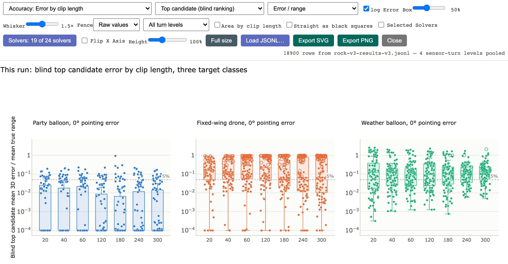
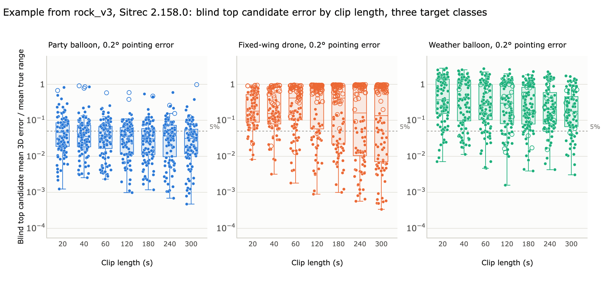
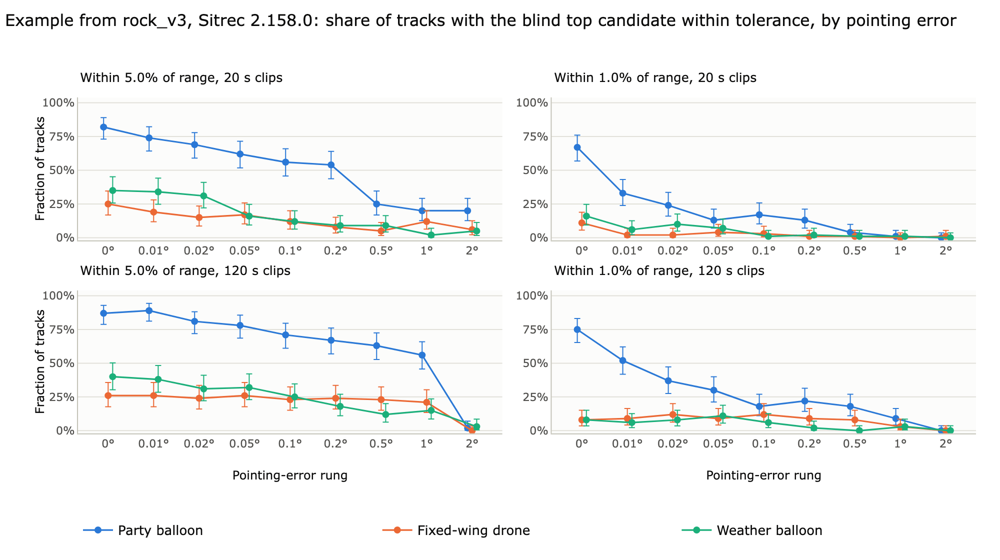
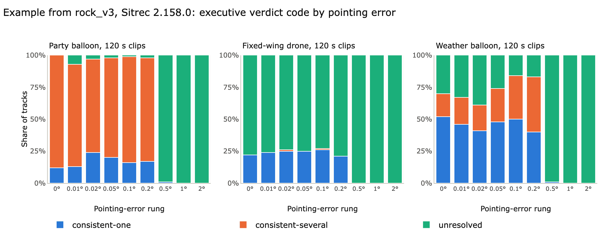
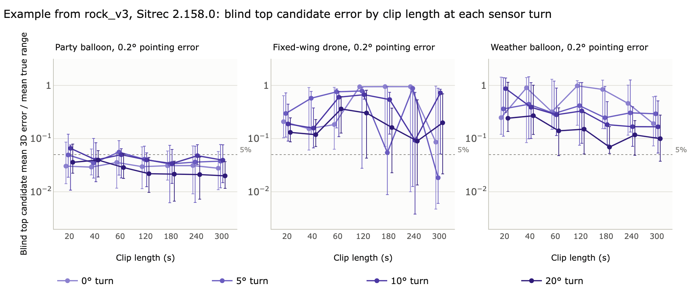
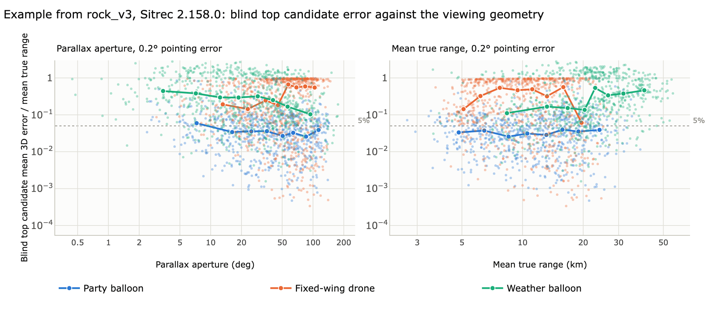
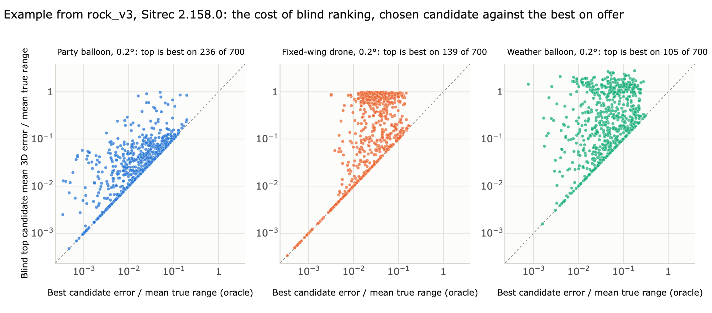
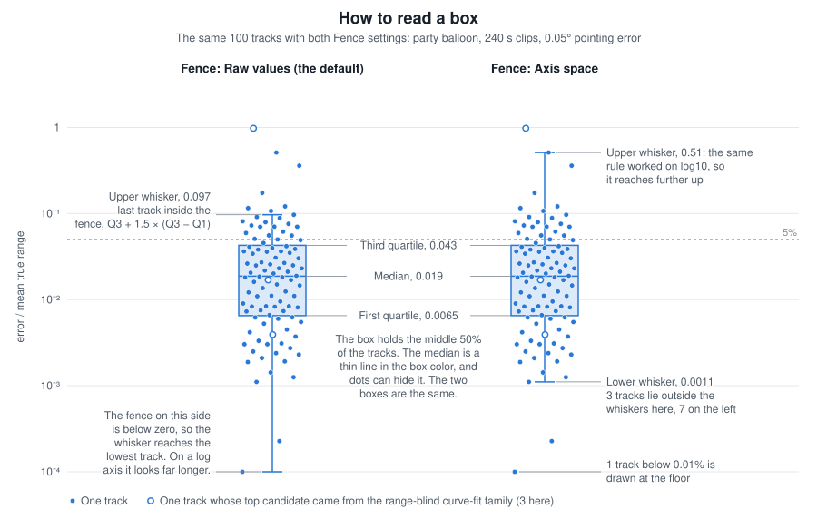

# BOTBench Result Charts

The Result Charts window compares [BOTBench](BOTBench.md) results across a whole
dataset. It shows how accuracy changes with clip length and pointing error, what
the [executive verdict](BOTBench.md#executive-verdict) concluded, and how much the
blind ranking cost against the best candidate it had on offer. You can export each
figure for a paper.

Open it with the **Charts** button after a BOTBench run. **File → File Analysis →
Result Charts...** opens an empty window that waits for a results file.



*The Result Charts window. On the first row, from the left, are the figure picker and the candidate and unit
dropdowns. The turn dropdown is on the second row. The rows shown come from an earlier build: see
[Examples](#examples).*

The figures were designed around
[rock_v3](BOTBenchScenarios.md#rock_v3--one-fixed-set-of-300-tracks-at-every-length-and-rung),
which has three target classes. Other datasets get the figures their rows support.

Terms on this page:

- **Target class**: the kind of object a scenario was generated from: party
  balloon, fixed-wing drone or weather balloon.
- **Rung**: one level of the pointing-error ladder, such as 0.2°.
- **Cell**: all the tracks at one clip length and one rung.
- **Solver**: one fitting method ([Choosing the solvers](BOTBench.md#choosing-the-solvers)).
  A **candidate** is the track that a solver produced for a scenario.
- **Blind ranking**: the order of the candidates, made without truth. The **top
  candidate** is the one it put first.
- **Best candidate**: the candidate closest to truth. This is an
  [oracle](BOTBench.md#oracle) pick, because it uses truth.
- **[Parallax aperture](BOTBench.md#parallax-aperture)**: the angle at the
  target, at mid-clip, between the first and the last camera position.

## Getting data in

The window needs one row per analysed scenario. There are two ways to give it
some.

**Open it from a finished BOTBench run** with the **Charts** button. This is the
normal route. The rows are built from the run itself. The clip length comes from a
`batch_<N>sec` folder name, else from the answer key (the `.truth.json`
[sidecar](BOTBench.md#sidecar)), else from the analysis. The parallax aperture comes
from the analysis. So neither needs a sidecar. Three values can need more:

- **Pointing error** comes from a folder name such as `0.2deg` in the path, or
  else from the value that the scenario sidecar or the CSV declares. A CSV leaves
  the value blank for [correlated wobble](BOTBench.md#correlated-wobble), as the
  rock_v3 rungs above 0° do. Without a value, the charts still draw, and they say
  the pointing error is unstated.
- **Target class** comes from the answer key, or from a file name such as
  `balloon_017`, `drone_017` or `weather_balloon_017`. A numbered name such as
  `mundane001` needs the answer key. An answer key for another kind of object, such
  as an aircraft or a bird, gives no target class. Rows with no target class form
  one group under the dataset name. The figures that judge the verdict against the
  true class leave these rows out, but they keep a row whose answer key says
  `aircraft`. When no row has a class, the picker says dataset instead of target
  class.
- **Sensor-turn level**, how far the platform that carries the camera changes
  heading over the clip, comes only from the answer key. Without it there is no turn
  dropdown and there are no sensor-turn figures.

In a botset or in rock_v3, the sidecars sit in a `meta` folder beside `All`, so
choosing `All` on its own leaves them behind. Choose the folder above `All`, with
Recursive on, to pair them. The analysis reads them too:
[BOTBench Scenario Files](BOTBenchScenarios.md#the-botsets--eight-swept-grids) gives
the rule.

**Drop a joined results file on the window**, or use **Load JSONL…**. This is a
JSON Lines file with one flattened result per line. Each line carries the analysis
result together with the generation-side inputs it is being judged against, so the
charts can group by target class, clip length, batch duration and pointing-error
rung. Sitrec does not include a tool that writes this file. BOTBench's **Export
JSON** and **Export CSV** are different formats and do not load here.

## The figures

Which figures appear depends on the rows. A run over one folder is a single cell
when its files share one clip length and one pointing error, so it is compared
across target classes. In a folder of files with different lengths, each length
(rounded to 0.1 s) is its own group. A set that spans several rungs or clip lengths
is compared along them, so the five **by target class** figures do not appear. Some
other figures pool rungs, clip lengths or target classes on purpose, and each
caption says what it pools.

A figure with one panel per clip length uses 20 s and 120 s, whichever the set has,
and otherwise the two shortest lengths it has. A figure with one panel per rung uses
the 0° and 0.2° rungs, whichever the set has, and otherwise the two lowest rungs. So
a sweep of the pointing-error ladder at one clip length still gets its rung figures.
The figures that compare clip lengths need at least two.

The picker puts a group name before each figure, for example **Accuracy: Error by
solver**.

| Figure | What it shows |
|---|---|
| Error by target class | One cell: the blind top candidate's error, one box per target class |
| Within tolerance, by target class | One cell: the share inside 5% and 1% of true range, with exact 95% intervals |
| What the verdict says, by target class | One cell: true class viable, only other classes viable, or nothing viable |
| Verdict code, by target class | One cell: the executive verdict mix per class |
| First-ranked hypothesis, by target class | One cell: which hypothesis family the ranking placed first |
| Error by clip length | The blind top candidate's error against clip length, one panel per target class and rung, followed by an **All Pointing Errors** panel row that pools every available error level |
| Error by Duration | The same error against the duration named by a `batch_<N>sec` or `batch_<N>s` folder. On a BOTBench run, clip length comes from the same folder name, so this figure and **Error by clip length** plot the same groups. A run with no such folders does not get this figure |
| Error by pointing error | The same error against the pointing-error ladder, one panel per class and clip length |
| Error by true distance | The same error in six equal-width bands of mean platform-to-target distance, one box per band, with target classes, clip lengths and rungs pooled. All its dots use one color |
| Mean absolute error vs. mean true range | One dot per track: its mean absolute error in metres against its mean true range, on a linear range axis from zero. With **log Error** on, the error axis is logarithmic and clamped at 1 mm: a smaller error, an exact zero included, is drawn at the floor and its hover label keeps the value. With it off, the error axis is linear from zero with no floor |
| Error by clip length, per sensor turn | Median error against clip length, one line per sensor-turn level, with quartile bars. A flat line means median error does not change with clip length at that turn level |
| Error by sensor turn, per clip length | The same medians against the turn level, one line per clip length, up to four lines |
| Within tolerance, by length | Share of tracks inside 5% and 1% of true range, against clip length, with exact 95% intervals |
| Within tolerance, by pointing error | The same shares against the pointing-error rung |
| Error by solver | Every candidate's error against truth, whether or not the ranking chose it, one box per solver. There is one panel per target class and rung, three across, with all clip lengths pooled, plus an **All Pointing Errors** panel row that pools every available error level |
| Error by solver (Sorted) | The same solver comparison and pooled panels, with each panel's X axis ordered from lowest to highest median error in that panel |
| Error by solver (Custom) | The same solver comparison and pooled panels, with `ca`, `cv`, `kf`, `mc_100k`, `mc_1M`, `mc_250k`, `mc_500k` and `mc_50k` first in that fixed order when present, followed by the remaining selected solvers in analysis order. With **Mean absolute error (m)** chosen as the unit, the Y axis is fixed from 10^0.5 m (3.16 m) to 10^6.2 m (about 1,585 km), and a value outside that range is off the chart |
| Error against geometry | Error against parallax aperture and against true range, with a median trend line over equal-count bins |
| What the verdict says about the class | True class viable, only other classes viable, or nothing viable |
| Verdict code | The executive verdict by rung, ordered by how far it narrows the answer |
| First-ranked hypothesis | Which hypothesis family the ranking placed first without seeing truth |
| Cost of blind ranking | The chosen candidate against the candidate that was closest to truth |

In the verdict figures, the [executive verdict](TraverseAnalysis.md#the-executive-verdict)
lists the interpretation classes that still pass the screen, and a class on that
list is *viable*. A party or weather balloon is judged against the balloon class,
and a drone or aircraft against the fixed-wing class. *True class viable* means the
list contains the true class. *Only other classes viable* means the list names
classes but not the true one. *Nothing viable* means the list is empty. The verdict
is then unresolved, or insufficient when the camera gives no usable parallax. Neither
is an anomaly claim.

Every figure carries its own caption. Counts, medians and ranges in a caption are
computed from the rows on screen. Some captions also carry fixed text about how
the benchmark sets were built.

### Solver names

The three **Error by solver** figures use the compact name registered with each
solver: for example `ca`, `cv`, `kf`, `mc_100k`, `fixed_wing`, and `flown_drone`.
Wind variants have suffixes: `/FW` for fitted wind, `/GW` for supplied wind,
`/GW+` for supplied wind plus correction, and `/UW` when wind is undetermined.
For example, `balloon/FW` and `balloon/GW` are separate boxes. Results described
as "Possible sky lantern (rise then fall)" share one `lantern` box that pools
their wind variants, retaining every candidate error.
The full solver name remains in each point's hover label. The boxes in these figures
use a darker class-color fill and translucent class-color points, with thin black
outlines and whiskers for contrast.

### Hover labels

Hovering a dot that stands for one track names the track by its path under the
folder that was scanned, so files with the same name in different folders can be
told apart. Rows loaded from a JSONL file give the file's path when the file
carries one, and otherwise its base name. When the run made a scenario screenshot
for it (**Scenario screenshots** in BOTBench), the screenshot shows beside the
label. Rows loaded from a JSONL file have no screenshots.

Each track dot's tooltip also names the solver that produced its error. For the
top or best candidate, this can differ from track to track; when a solver is
selected, the tooltip names that solver. The ranking-cost chart also names the
best solver used for comparison.

## Chart controls

### Error controls

The error controls above the figure apply to every error figure at once:

- The candidate dropdown, which starts on **Top candidate (blind ranking)**, picks
  whose error is plotted: the top candidate, **Best candidate (oracle)**, or any
  one solver's candidate on every track.
- The unit dropdown, which starts on **Error / range**, picks the unit: the mean 3D
  error as a share of the mean true range, the same distance in metres, the mean
  angle between the candidate and the truth as seen from the camera, the mean 2D
  heading error in degrees, or the mean 3D velocity error in metres per second. The
  two motion units compare the tracks frame by frame: velocities are the differences
  between consecutive positions times the frame rate, the velocity error is the mean
  magnitude of the 3D velocity difference, and the heading error is the mean absolute
  difference between the two horizontal headings, 0 to 180 degrees, over the frames
  where both tracks move faster than 0.5 m/s across the ground (a slower track has
  no heading).
  A range error changes both motion units when the camera moves. A candidate at a
  constant k times the true range has a velocity of (1-k) times the camera velocity
  plus k times the target velocity, so its speed and its heading both differ from
  the truth. For a stationary camera, the candidate's heading matches the truth and
  its speed is k times the true speed. The heading error
  is bounded, so its figures use a fixed linear axis from 0 to 180 degrees in steps
  of 25, with the box whiskers computed on the values themselves; the other units
  default to a log axis that the data sets, with a drawing floor.
- **log Error** starts checked. Uncheck it to use linear error axes starting at
  zero, with zero errors shown at zero. Box whiskers then use the raw values.
  Heading error keeps its fixed 0–180 degree scale. The cost-of-ranking chart
  switches both error axes; the absolute-error-versus-range chart keeps its
  linear range axis. Exports retain the selected scale.
- **Box**, **Whisker** and **Fence** show only on a figure that draws boxes. **Box**
  controls the central percentage enclosed by each box, from 20% to 90%. The default
  50% is the conventional first-to-third-quartile box.
- **Whisker** controls the fence distance from 0 to 3 times the box span. The
  default is 1.5×. [How to read a box](#how-to-read-a-box) gives the rule.
- **Fence** appears for logarithmic error axes. **Raw values**, the default,
  applies the rule before the logarithmic drawing transform. **Axis space** applies
  the fence after taking `log10`, making it visually symmetric on the chart.

These controls rebuild every box chart. Most captions state their settings. A
setting that is not the default also goes in the status line and the exported file
name.

The tolerance figures always use a share of range, for the chosen candidate. The
solver figures already show every candidate, so only the unit applies to them. The
cost of blind ranking compares the chosen candidate with the best one, so it is not
drawn when the best candidate is the choice. A solver's own error, the angle and the
two motion units come from the candidate lists a BOTBench run keeps, so a JSONL file
without candidate lists (`r_candidates`) offers the top and best candidates only, in
a share of range or in metres, and draws no solver figures. A run cached before these
units existed rebuilds its rows once, from the stored fits, to add them.

### Solver and turn filters

**Selected Solvers** limits candidate-backed charts to the solvers ticked in the
adjacent **Solvers** button. The selector is the same one used by
BOTBench and remembers the same choice. Within the selected subset, the charts
recalculate the truth-free top candidate and the closest-to-truth best candidate;
the three **Error by solver** figures omit every unticked solver. Uncheck it to show
all candidates present in the result. Verdict and class-outcome figures continue
to show the conclusion stored by the original analysis run, because changing a
chart filter does not run the solvers or executive assessment again.

A dropdown that starts on **All turn levels** appears above the figure when the
rows hold more than one sensor-turn level, as the
[rock_v3 set](BOTBenchScenarios.md#rock_v3--one-fixed-set-of-300-tracks-at-every-length-and-rung)
does. Choosing one level limits every figure to it, and the figure's title and
exported file name say which level it shows. The two sensor-turn figures always use
every level, since comparing the levels is their purpose. A JSONL row has a level only when it carries `d_turnDeg`.

### Dot marks

Two check boxes mark the dots in every figure that draws one dot per track. Both
start off, when every dot is a circle of one size in its target class color.

- **Area by clip length** gives each dot an area in proportion to its clip length.
  The scale is set once from all the rows, so a 300 s dot has 15 times the area of
  a 20 s dot in every figure, and the middle clip length keeps the usual size.
- **Straight as black squares** draws a track whose platform flew straight as a
  black square: its turn level is 0, or, without a level, its platform turned less
  than 1 degree. A square has the same area as the circle it replaces, so only
  the shape and color change. Tracks that turned keep their circles.

A caption says which marks are on.

### Height and axis direction

**Height** scales the current chart from 50% to 200% of its designed height.
It starts at 100%, remains set while the charts window is open, and applies when
you switch figures. SVG and PNG exports use the selected height. **Full size**
continues to fit the figure to the browser window.

**Flip X Axis** reverses every X axis in the current chart. It starts unchecked,
remains set while the charts window is open, and applies when you switch figures.
SVG and PNG exports use the same direction and add `flipx` to the file name.

## Examples

These examples show how each chart looks. They are not a rating of Sitrec. They use actual output from an earlier
build, Sitrec 2.158.0 of September 2026, on
[rock_v3](BOTBenchScenarios.md#rock_v3--one-fixed-set-of-300-tracks-at-every-length-and-rung), a generated test set:
simulated flights with a known true path, seen from a simulated aircraft. The ranking and the list of solvers have
changed since then.

The examples show a filtered part of the file, so that they fit this page. Four use only the 0.2° rung, one uses only
the 120 s clips, and one uses all the rows. The window has no such filter, and it draws every panel of a figure. It
also prints a caption under every figure, which these examples leave out.

**Error by clip length.** Each box is one clip length, with one panel per target class. The vertical axis is the
error as a share of the true distance, so 0.1 is 10% and 1 is 100%. Each dot is one track, and the dashed line marks
5%. A candidate very close to the camera has an error of about the whole true distance, so such tracks collect near
1. [How to read a box](#how-to-read-a-box) explains the other marks.



**Within tolerance, by pointing error.** Each point is the share of tracks in that group whose top candidate lies
inside 5% or 1% of true range. Each bar is the exact 95% interval of that share. See
[Confidence intervals](#confidence-intervals).



**Verdict code.** Each bar is one group of tracks, split by the executive verdict. In this example every bar reaches
100%, so read the size of each color. Here the colors mean verdict codes, not target classes. `consistent-one` leaves
a single viable interpretation class, `consistent-several` leaves more than one, and `unresolved` means that no tested
conventional model passed the screen, which is not an anomaly claim. A code does not say whether the true class is
among those that remain: **What the verdict says about the class** shows that.



**Error by clip length, per sensor turn.** Each point is the median of the 25 tracks at that turn level, and its bar
runs from the lower to the upper quartile. The lines sit a little apart so that one bar does not hide another.



**Error against geometry.** Each faint dot is one track. The heavy line is the median of bins that hold about equal
numbers of tracks, one line per target class.



**Cost of blind ranking.** Each dot is one track. Across is the error of the best candidate. Up is the error of the
top candidate. A dot on the dashed diagonal means that the ranking chose a candidate as good as the best one, and the
panel title counts the tracks where it chose the best one. Both axes are logarithmic, so the height above the diagonal
shows, as a factor, what the choice cost on that track.



## How to read a box



The figure shows one group of 100 tracks with both **Fence** settings.

Each box summarizes one group of tracks. The line inside it is the
[median](BOTBench.md#median): half the values are smaller and half are larger. It is a thin line in the box color,
and dots can hide it. In the solver figures it is black. With
the default settings, the box holds the middle half of the values. Lower on an error
axis means a smaller error. Logarithmic error axes are labelled in powers of ten,
one label per decade, so each label is ten times the one below it.

Sitrec computes each box itself, then gives the numbers to the chart library.

**By default, the box runs from the first to the third quartile.** This is the
middle 50% of the raw values, with the median inside it. A quarter of the values
lie below the first quartile, and a quarter lie above the third. Sitrec uses NumPy's
default linear percentile interpolation: percentile `p`, as a fraction from 0 to 1,
lies at `(n-1)p` between the neighboring ordered observations. The **Box** control
replaces the 25th and 75th percentiles with an equally centered interval; for
example, 80% uses the 10th and 90th percentiles. The median does not move.

**Sitrec's default whiskers use Tukey's 1.5× rule on the raw values.** The fence is
a limit 1.5 times the interquartile range (IQR) beyond each box edge, and the IQR is
the third quartile minus the first. The quartiles and the fence are calculated in
the original unit, then the completed box plot is transformed onto a logarithmic
axis for drawing. This is how ordinary Matplotlib, Plotly and base-R box plots behave
when their axis is made logarithmic, although it can look strongly asymmetric over
several orders of magnitude. **Fence: Axis space** instead calculates the fence after
taking `log10`, making its distance visually symmetric. A whisker reaches the most
extreme observation between its box edge and fence. If there is no observation
there, it stays at the box edge; it is not drawn to an unobserved mathematical
fence value.

Other plotting tools use other quartile and whisker rules. Check a tool's rule
before you compare its box plot with a figure here.

**Every observation is drawn as a dot**, jittered sideways so they do not stack.
Because every point is already there, no separate outlier marks are drawn. When the
top candidate is plotted, a hollow dot means it came from the range-blind curve-fit
family: the polynomial and Monte Carlo fits or the Kalman smoother.

**A drawing floor is applied only when drawing a log error axis.** Values below the
floor are drawn at it so the axis stays readable. The caption states the floor, and
most captions say how many values were moved. The statistics behind the box never
see the floor.

The three **Error by solver** figures and **Error by true distance** also have a
**drawing ceiling**: a thousand times the mean true range, 10,000 km in metres, 10
km/s, or 180 degrees. A candidate past it is drawn at the ceiling and the caption
counts it. On the solver figures its hover label gives the value itself. So one
runaway fit cannot stretch the axis to 10^59.

## Confidence intervals

The bar on a within-tolerance point shows how uncertain that share is, given the
number of tracks in the group. These figures use exact Clopper-Pearson intervals at
95%. They are conservative by construction, meaning their true coverage is at least
95% and usually a little more. They are wider than the score intervals often used
for the same job. A track with no error/range value for the chosen candidate counts
as outside the tolerance rather than being dropped.

## Full size

**Full size** shows the figure on its own, drawn to fill the browser window.
The panels grow with the window and the caption re-wraps to its width; the
title, legend and caption keep their size. The toolbar keeps only the choices the
figure reads. The figure picker, the file loader and **Height** are hidden until
**Exit full size**. Resizing the window redraws the figure. The exports do not
change: they keep the figure's own layout width and the **Height** setting.

## Exporting for a paper

**Export SVG** gives vector output with the text kept as text, so labels can
be restyled.

**Export PNG** gives a raster at three times the layout size: 4500, 3900 or 3150
pixels wide, depending on the figure. This is past 300 dpi for a full-page figure.

Both run in the browser you already have open. Neither needs any extra tool.

## The command-line renderer

Optional, for producing the figures unattended, in a build or across several
result sets at once. It reads only a joined results file, which Sitrec does not
write (see [Getting data in](#getting-data-in)).

```bash
npm run bot-charts -- --input <joined-results.jsonl> --out-dir <dir> --format both --index
```

| Option | Meaning |
|---|---|
| `--input <file>` | The joined results JSONL. Required. |
| `--out-dir <dir>` | Where images go. Always pass this option: the default is a development folder. |
| `--format svg\|png\|both` | Defaults to SVG. |
| `--scale <n>` | PNG pixel multiplier, default 3. |
| `--only <keys>` | Comma-separated figure keys. Defaults to all. |
| `--index` | Also write an `index.html` showing every figure. |
| `--turn <deg>` | Limit the figures to one sensor-turn level, as the window's turn dropdown does; the sensor-turn figures always use every level. |
| `--marks area,straight` | The dot marks: area by clip length, straight tracks as black squares. |
| `--suffix <text>` | Added to every file name, so variants of one figure can sit side by side. |
| `--list` | Print the figure keys and exit. |

A relative path in `--input` or `--out-dir` starts at the repository root, not at
the current folder.

This path drives a headless browser, because Plotly has no server-side
renderer: its only static export routes are a real browser or a Python tool that
itself requires one. It uses Playwright's Chromium, the same browser the regression
tests use, so it adds no npm dependency, but it does make the command-line path
slower and heavier than the in-app export. `npm install` does not fetch the browser:
on a fresh clone, run `npx playwright install chromium` once first.

## Where the code lives

| File | Role |
|---|---|
| `src/analysis/charts/ChartStats.js` | The statistics: quantiles, box statistics, Clopper-Pearson intervals, equal-count binning. No charting library, no DOM. |
| `src/analysis/charts/RockV3ChartSpecs.js` | Each figure as a plain specification object. No charting library import. |
| `src/analysis/charts/PlotlyLoader.js` | Loads the charting library from `libs/` on first use, so nothing is downloaded until a chart is opened. |
| `src/analysis/charts/BotBenchChartRows.js` | Builds chart rows from a finished run or a JSONL file, including the parallax aperture measured from the run's own positions. No DOM. |
| `src/analysis/charts/RockV3ChartsUI.js` | The window and the export buttons. |
| `benchmarks/botbench/render-charts.mjs` | The command-line renderer. |

The specifications are plain data with no library import, which is what lets the
app, the export and the command-line tool all draw the same figure from one
definition.

The charting library is loaded on demand as its own download of about 1.5 MB. It
is not part of the main application bundle, so a session that never opens a
chart never pays for it. The build copies it to `libs/plotly-cartesian-<version>.min.js`,
a name that carries only the library's version. So a page that was already open
when Sitrec was rebuilt or updated can still open its charts; only an upgrade of
the charting library changes the name.

## Checking the numbers

[tests/ChartStats.test.js](https://github.com/MickWest/Sitrec2/blob/main/tests/ChartStats.test.js)
pins the statistics to reference values: quantiles against NumPy's default method,
and Clopper-Pearson intervals against SciPy, to at least nine decimal places.
