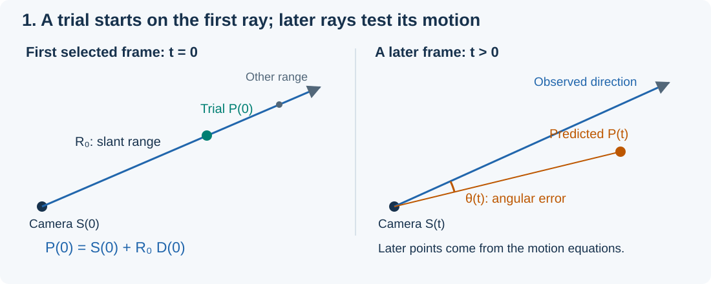
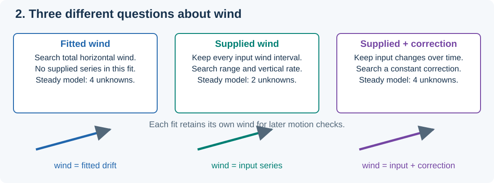
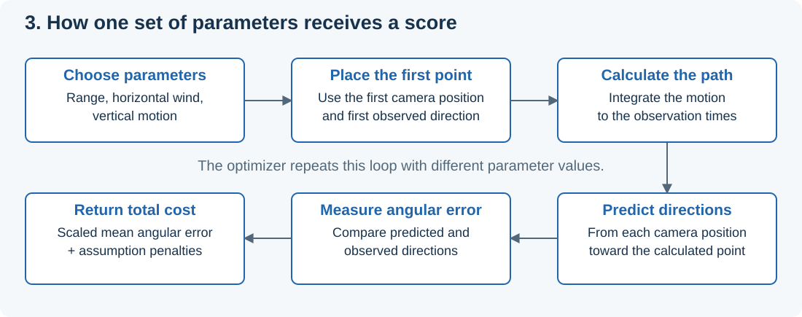
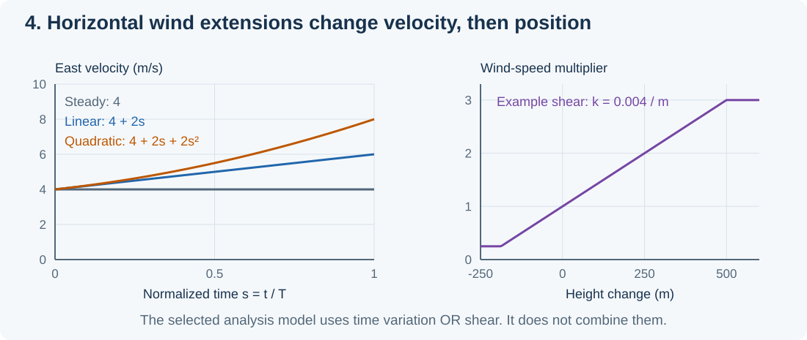
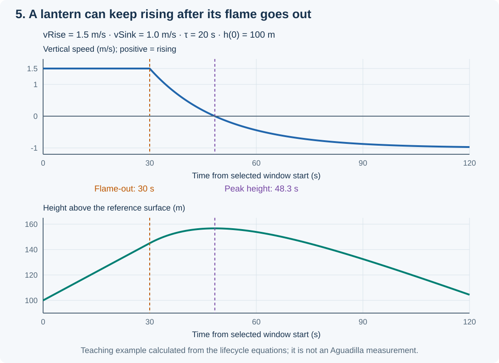
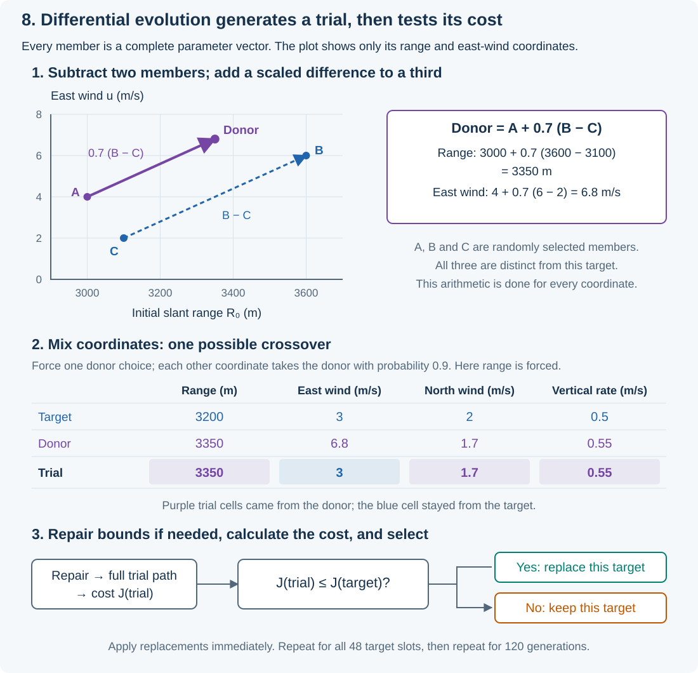
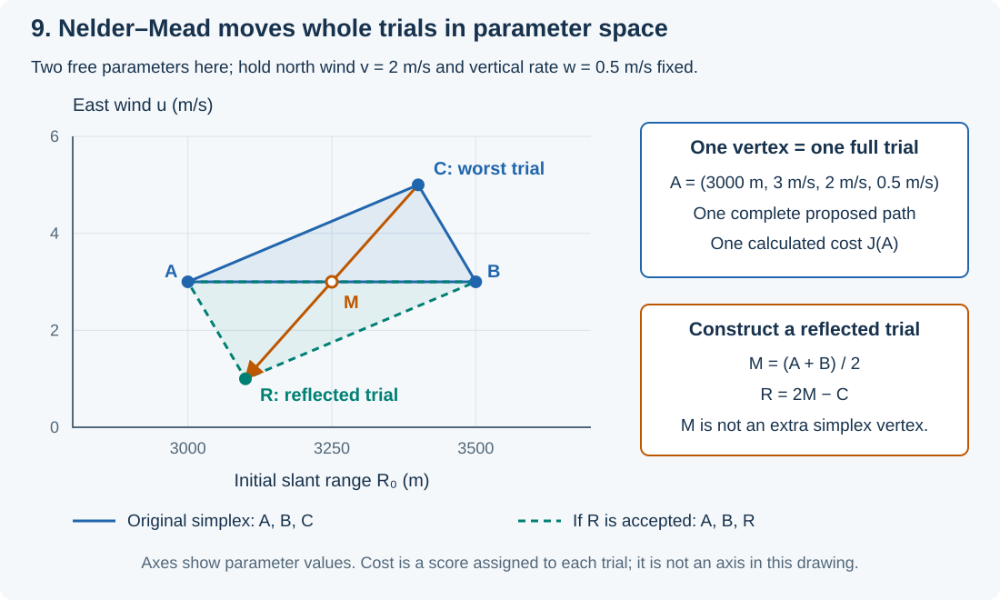
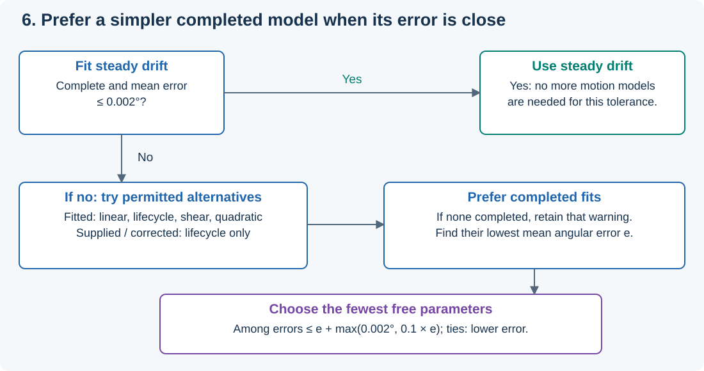
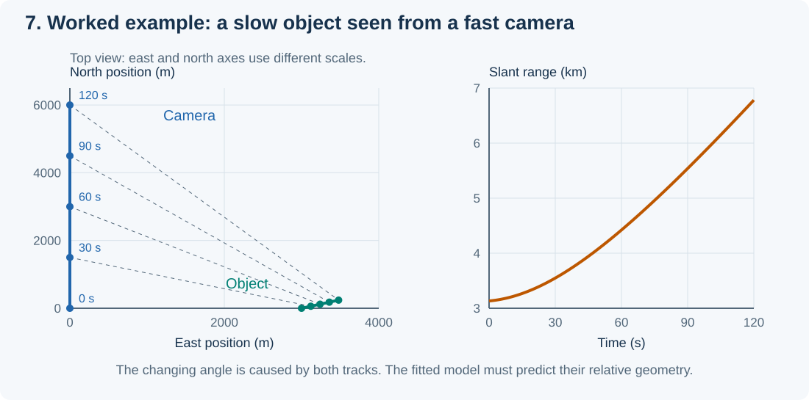

# How the Balloon Algorithms Work

The **Balloon** results in **Traverse ▸ Analyze Traverse Methods...** test a
specific explanation: an object drifts horizontally with the wind while it
rises, stays at the same height, or descends. Sitrec calculates paths under
that assumption and compares them with the camera's recorded directions.
To **fit** a model means to adjust its parameters so its predicted directions
agree as closely as possible with the observations, subject to the stated
assumptions.

This guide explains the calculation, the search, and the selection of a result.
It assumes basic algebra. Terms are defined when they first appear. The diagrams
and numerical examples are teaching examples, calculated from the equations
below. They are not measurements from a recorded case.

For the other traverse methods, see [Traverse Methods](TraverseMethods.md).
For the gallery and its ratings, see
[Traverse Analysis and the Verdict](TraverseAnalysis.md).

## 1. Which Balloon algorithm?

Several Sitrec tools can produce a drifting path. They solve different problems.

| Tool | What it calculates | How it uses the observed directions |
|---|---|---|
| **Balloon**, in the analysis gallery | Selects from a small set of drift and vertical-motion models, under three wind treatments | Fits the model parameters to directions throughout the selected window |
| **Global Fit: Physics → Sky Lantern** | Fits the broader lantern model, which has a rise/cooling/descent profile and can combine wind variation with altitude shear | Fits a physical-motion model to the selected directions; it does not use the reduced Balloon model-selection procedure |
| **Global Fit: Wind Tracer** | Fits passive drift with a separately solved initial 3D position and a model of camera pointing motion | Solves the position in closed form within its search and allows specified forms of pointing error |
| **Windblown Object (on first LOS)** | Starts at the supplied distance and moves with the supplied wind | Uses the first direction only; later directions do not alter its path |
| **Add Balloon**, from the ground context menu | Generates a flight from a chosen release point, launch delay, ascent rate, wind field and optional gusts | Does not fit camera directions |

The main subject of this guide is the first row. Section 12 explains the other
tools in more detail. **LOS** means **line of sight**: a ray that starts at the
camera and extends in the observed direction.

## 2. What the camera supplies

For each selected frame, the analysis needs:

- A time, measured in seconds.
- A camera position, called **S**.
- An observed direction, called **D**.

Bold letters here denote **vectors**: quantities with components along three
coordinate axes. The analysis uses local **east, north, up (ENU)** coordinates.
A position `(x, y, z)` gives distance east, north and up from that coordinate
system's origin, in metres. A **unit vector** has length one, so multiplying it
by a distance gives a displacement of that length.

The camera position comes from the selected camera track. The direction comes
from the selected LOS source. It can include a tracked pixel's offset from the
camera centre. Errors in track timing, camera pointing or pixel tracking become
errors in these inputs.

Time `t = 0` means the first frame of the selected analysis window. It need not
be the beginning of the video. For `N` consecutive frames at effective `fps`
frames per simulated second, the elapsed span is `T = (N − 1) / fps`. At the
normal simulation speed this is the video's frame rate. If simulation speed
is changed, effective `fps = video fps / simulation speed`. Analyze needs at least ten
selected frames. A useful fit usually needs a much longer span and suitable
camera motion.

### A direction does not give a distance

Every positive distance `R` gives a possible point on one observed ray:

```text
P = S + R D
```

**P** is the proposed object position. `R` is **slant range**: straight-line
distance from camera to object. It is not the horizontal distance over the
ground.

The Balloon model starts with this equation on the first selected ray:

```text
P(0) = S(0) + R₀ D(0)
```

`R₀` is a parameter that the search adjusts. A **parameter** is a number held
fixed during one trial calculation, then changed between trials. The first
point is exactly on the first ray. The model's motion equations calculate every
later point. Those later points can miss their observed rays.



*Figure 1. The fit searches the first range, then asks whether the proposed
motion predicts the later camera directions.*

## 3. The basic model: steady drift

A **passive wind tracer** has no powered horizontal motion through the air.
The Balloon model assumes that its horizontal ground velocity equals the
horizontal wind velocity. It does not calculate a delay while the object
accelerates to match the wind.

The simplest model has four parameters:

| Parameter | Meaning | Units |
|---|---|---|
| `R₀` (`initialRange`) | Slant range on the first selected ray | m |
| `u` (`windE`) | Wind velocity toward east | m/s |
| `v` (`windN`) | Wind velocity toward north | m/s |
| `w` (`verticalSpeed`) | Constant rate of height change; positive up, negative down | m/s |

Its equations, expressed using height `h`, are:

```text
x(t) = x₀ + u t
y(t) = y₀ + v t
h(t) = h₀ + w t
```

The subscript `0` means the starting value. For example, `u = 4` means 4 metres
east each second. `w = −0.5` means descent at 0.5 metres per second. Zero is a
valid value: a level drifting object needs no rise or descent lifecycle.

Horizontal ground speed is `sqrt(u² + v²)`. Horizontal **airspeed** is speed
relative to the moving air. It is zero in this passive model because the object
and air have the same horizontal velocity. Vertical motion is separate. A
rising balloon can therefore have zero horizontal airspeed and a nonzero total
speed relative to the air.

Wind components describe where the air moves **toward**. Weather reports give
the direction it comes **from**. Thus `u = 4, v = 0` is an eastward drift, or a
wind **from west**. One knot is about 0.514444 m/s.

### Height and the curved Earth

Local ENU `z` is distance above a tangent plane. Away from the origin it differs
from height above the curved Earth. The Balloon models use this approximation:

```text
h ≈ z + (x² + y²) / (2 Rearth)
Rearth = 6,371,000 m
```

For horizontal velocity `(u, v)` and prescribed height rate `w`, the corresponding
up-coordinate rate is:

```text
dz/dt = w − (x u + y v) / Rearth
```

The notation `dx/dt` means the rate at which `x` changes with time. This
correction lets a level drifting object follow the curved reference surface
instead of travelling in a flat tangent plane. It is a local approximation,
not a detailed Earth or terrain model. The fit's approximate reference height
must also be distinguished from height above local ground. Terrain checks use
the scene's terrain separately.

## 4. The three wind treatments

The gallery runs three related tests. They share the passive-drift assumption
but answer different questions about the wind.



*Figure 2. A wind value can be an unknown, a fixed input, or a fixed input plus
a fitted correction. These are different assumptions.*

| Result | Horizontal wind used to calculate the path | Steady-model unknowns |
|---|---|---|
| **Balloon (fitted wind)** | The fit searches wind without consuming the supplied wind series | `R₀, u, v, w`: four |
| **Balloon (supplied wind)** | The complete per-frame input wind series is fixed, including calm when selected | `R₀, w`: two |
| **Balloon (supplied wind + correction)** | The fixed input series plus a searched constant east/north correction | `R₀, Δu, Δv, w`: four |

The supplied series can change during the window. Sitrec retains each interval's
wind rather than replacing the series with its average. It captures that series
as an input to the fit. It does not resample the weather field at each proposed
object altitude while searching Balloon parameters. A later weather comparison
can sample independent weather at each candidate path's locations and heights.

For supplied horizontal wind, position is the starting position plus the sum of
all previous intervals' wind displacements. If an interval lasts `Δt` seconds,
its east displacement is `u_input × Δt`. The corrected fit adds `Δu × t` east
and `Δv × t` north to that accumulated drift. A constant correction preserves
all changes already present in the supplied series.

In the code, `dataset.W` stores displacement per frame, not velocity in m/s.
Multiplying it by `fps` recovers interval velocity. The integrator accumulates
the supplied displacements directly so a large numerical step cannot skip a
short wind change. If the supplied series has an up component, that displacement
is retained too; the fitted vertical rate describes motion in addition to it.

The fitted-wind result describes the **required wind under the motion model**.
It is not a weather measurement. The supplied-wind result tests compatibility
with the input weather. Its agreement with that weather cannot serve as an
independent confirmation, because the fit was required to use it.

## 5. How Sitrec scores one trial

An **optimizer** is a numerical search procedure. It tries parameter values and
uses a score, called the **cost**, to decide which trials to retain. Lower cost
is better.



*Figure 3. One trial calculates a complete proposed path. The optimizer repeats
the loop while changing the parameters.*

### Step 1: calculate positions

Place the initial point on the first observed ray. Then advance the motion
equations to the observation times. **Numerical integration** means calculating
position from a rate of motion in small time steps.

The shared physics fitter uses **fourth-order Runge–Kutta (RK4)**. At each step,
it evaluates the rate at the start, at two trial midpoints, and at a trial end.
It combines these four rates with weights `1, 2, 2, 1`, divided by six. This
gives a more accurate step than using only the starting rate when velocity
changes during the step. The steady equations also have the direct solutions
in section 3; the shared integrator lets all the models use the same fitting
procedure.

Default maximum substeps are 0.5 seconds for reduced drift models and 0.25
seconds for the lantern lifecycle. Observation times can make steps smaller.
Search options can use coarser steps during fitting; the final path uses the
model's own step limit.

### Step 2: predict a camera direction

At each observation time, subtract the camera position from the proposed
object position. Divide that vector by its length to get predicted unit
direction **Q**:

```text
Q(t) = [P(t) − S(t)] / length[P(t) − S(t)]
θ(t) = arccos[Q(t) · D(t)]
```

The dot `·` means multiply matching vector components and add the results.
For two unit vectors, that sum is the cosine of their angle. `arccos` converts
it back to an angle. The code limits the sum to `−1` through `1` to remove
small floating-point roundoff outside that valid interval.

The **angular residual** `θ` is the angle between predicted and observed
directions. It is zero when they agree. A point behind the camera has a large
angular error even if it lies on the same infinite line.

### Step 3: combine angular error with assumptions

The displayed mean LOS error is the arithmetic mean of these nonnegative
angles, in degrees. It is not root mean square (RMS), which would square the
angles before averaging and then take a square root.

The default search cost is:

```text
cost = mean angular error in degrees / 0.02°
       + model penalties
       + optional ground-contact and angular-size terms
```

The `0.02°` scale determines how much angular improvement can compensate for a
penalty. It is a tuning scale, not a claim that the camera has a known 0.02°
measurement error. Similarly, the cost is not a probability or a statistical
confidence value.

For example, take mean error `0.010°` and steady fitted wind `(4, 2)` m/s.
The angular cost is `0.010 / 0.02 = 0.5`. The default wind penalty is
`(4² + 2²) / 20² = 0.05`. If no other penalty applies, the total cost is
`0.55`. The displayed LOS error remains `0.010°`.

The distinction matters: a penalty can change which range and wind the fit
chooses, even though the displayed residual does not include that penalty.
Diagnostics disclose the model penalties separately, including their equivalent
cost in degrees.

### The default penalties

A **prior** is an assumption supplied before examining the answer. Here priors
appear as **regularization**: extra costs that discourage unnecessarily large
or variable values when several paths fit similarly well.

| Treatment | Wind penalty |
|---|---|
| Fitted steady drift | `(u² + v²) / 20²` |
| Fitted changing drift | Squared mean wind magnitude divided by `20²`, plus mean squared variation about that mean divided by `2²` |
| Fitted lifecycle | The same `20 m/s` component scale for its constant wind; time variation and shear are fixed to zero |
| Supplied wind | No penalty on the fixed supplied wind |
| Supplied wind + correction | `(Δu² + Δv²) / σcorrection²`; no calm-wind penalty on the total supplied wind |

The reduced changing-drift models evaluate their wind mean and variation at
17 equally spaced times, including both ends. The `20 m/s` and `2 m/s` scales
are analysis assumptions, not weather measurements. The correction scale
defaults to **15 knots per component**, about `7.71666 m/s`. It is also an
analyst assumption. Increasing it makes a given correction cheaper; decreasing
it makes that correction more expensive.

The models also discourage heights below their approximate `h = 0` reference
surface. At the same 17 times, they add the average of
`[min(0, h) / 8 m]²`. This is a soft cost, so a trial can cross that surface.
It neither follows terrain nor prevents passage through a hill. Terrain
screening and optional start/end ground-contact assumptions are separate.
Optional angular-size evidence adds another term; see
[Optional angular-size evidence](TraverseAnalysis.md#optional-angular-size-evidence).

## 6. Motion models beyond steady drift

The steady model may fail because the drift changes or the vertical rate
changes. The analysis then tries a limited set of alternatives. The fitted-wind
run treats each row below as a separate candidate. It does not combine all
their freedoms in one large model.

| Stage recorded in diagnostics | Horizontal motion | Vertical motion | Free parameters: fitted / supplied / corrected |
|---|---|---|---|
| `steady` | Constant fitted wind, or the supplied series | Constant signed height rate | 4 / 2 / 4 |
| `linear` | Wind changes linearly with time | Constant signed height rate | 6 / not tried / not tried |
| `lifecycle` | Constant fitted wind, or the supplied series | Rise, cooling and eventual descent | 7 / 5 / 7 |
| `shear` | Fitted wind speed changes with height; direction stays fixed | Constant signed height rate | 5 / not tried / not tried |
| `quadratic` | Wind has linear and quadratic time terms | Constant signed height rate | 8 / not tried / not tried |

Counts include the initial range. They describe the normal unlocked fits;
fixing a parameter for a range study reduces the searched count.

### Wind changing with time

Let `s = t / T`. This **normalized time** runs from zero to one over the window.
For east wind, the equations are:

```text
linear:     u(t) = u₀ + aE s
quadratic:  u(t) = u₀ + aE s + bE s²
```

North wind has the same form with coefficients `v₀, aN, bN`. In code,
`aE` and `aN` are `windDriftE` and `windDriftN`; `bE` and `bN` are
`windCurveE` and `windCurveN`.

These coefficients have units of m/s. In the linear model, `aE = 2` means
the east wind increases by 2 m/s across the whole window, regardless of its
duration. In the quadratic model, the total end-to-start change is `aE + bE`.
A quadratic **velocity** produces a cubic position term after integration:

```text
x(t) = x₀ + u₀ t + aE t² / (2T) + bE t³ / (3T²)
```

This permits a gently curved horizontal path. The variation penalty requires
the extra freedom to improve the fit enough to offset its cost.

### Wind changing with height: shear

**Wind shear** means a change in wind with height. This reduced shear model
changes speed while retaining the same horizontal direction:

```text
m(t) = clamp[1 + k w t, 0.25, 3]
u(t) = u₀ m(t)
v(t) = v₀ m(t)
```

`k` (`shearPerM`) is fractional change per metre. Since `h(t) − h₀ = w t`,
the multiplier depends on height change. `clamp` limits a value to the stated
minimum and maximum. The wind cannot reverse through this multiplier, and it
cannot become less than one quarter or more than three times its initial
value.

For example, `k = 0.004 / m` and a 100 m rise give multiplier `1.4`, until a
clamp is reached. At zero vertical speed the height does not change, so this
model cannot infer shear from the path. It does not represent wind direction
turning with height.



*Figure 4. Left: time changes wind velocity. Right: height change scales the
wind in the shear model. The analysis tries these explanations separately.*

### A lantern lifecycle: rise, cool, descend

The lifecycle alternative prescribes a vertical-speed curve. It uses four
vertical parameters:

- `vRise`: upward speed before flame-out, in m/s.
- `vSink`: eventual downward speed, expressed as a positive magnitude in m/s.
- `tBurn`: flame-out time, in seconds relative to the analysis window's start.
- `tauCool` (`τ`): the cooling time scale, in seconds.

```text
For t ≤ tBurn:
    dh/dt = vRise

For t > tBurn:
    dh/dt = −vSink + (vRise + vSink) exp[−(t − tBurn) / τ]
```

`exp(a)` means the exponential function `e` raised to the power `a`. Each
elapsed `τ` reduces the remaining difference from the final sink speed to
about 37% of its previous value. This creates a smooth change from rising to
descending. It does not stop the ascent at flame-out.

For positive `vSink`, vertical speed crosses zero at:

```text
tPeak = tBurn + τ ln[(vRise + vSink) / vSink]
```

`ln` is the natural logarithm, the inverse of `exp`. This time is the altitude
peak if it falls within the observed window. In Figure 5, flame-out is at
30 seconds but peak altitude is at 48.3 seconds.



*Figure 5. With rise speed 1.5 m/s, sink speed 1 m/s and cooling scale 20 s,
the object rises another 11.7 m after flame-out before descending.*

To calculate height after flame-out, first define an elapsed cooling time `q`
and its accumulated height change:

```text
F(q) = −vSink q + (vRise + vSink) τ [1 − exp(−q / τ)]
```

If flame-out occurs within or after the window starts, use:

```text
before flame-out: h(t) = h₀ + vRise t
after flame-out:  h(t) = h₀ + vRise tBurn + F(t − tBurn)
```

If `tBurn < 0`, cooling started before the window. Then:

```text
h(t) = h₀ + F(t − tBurn) − F(−tBurn)
```

The subtraction makes height equal `h₀` at `t = 0`. A negative `tBurn` does
not mean a negative physical burn duration. It locates flame-out before the
observations begin.

This is a prescribed motion curve. It does not solve flame power, gas
temperature, buoyancy forces, drag forces, envelope expansion or a burst.
Parameters such as a flame-out after the clip can remain poorly determined
because the camera never observes that part of the model.

## 7. How the search finds parameters

### Build a starting estimate

A **seed** is a starting estimate for a search. Balloon uses a geometric
approximation to the path: normally the Kalman smoother, with Minimum
Acceleration as a fallback. A **Kalman smoother** combines a motion assumption
with observations, using information from both earlier and later times to
reduce frame-to-frame noise.

The Balloon initializer estimates range from the seed's first point, horizontal
wind from its position changes, and vertical motion from its height changes.
It limits these starting values to the allowed search bounds. The smoother's
initial constant-velocity solution has a 500 m range floor to reduce collapse
onto the camera. That floor is a numerical assumption, not measured range, and
it does not replace Balloon's own range limits.

The seed helps the search reach a useful part of parameter space. It is not
independent evidence for that path. If no geometric seed is available, the
Balloon fitter can start from default parameter values. Convergence can then
differ. The fitted-wind fallback uses the free-wind Minimum Acceleration path;
the supplied-wind variants use the supplied-wind path.

### Search broadly, then refine locally

The first steady fit normally uses **differential evolution** to explore the
allowed parameter ranges. Its best result then receives **Nelder–Mead**
refinement. Both procedures work with points in **parameter space**: a space
with one coordinate axis for each free parameter. Each point is one complete
set of parameter values, which generates one complete proposed object path.
These points are not positions along that path or positions of the object in
the scene.

For the steady fitted-wind model, one point has four coordinates:

```text
q = (R₀, u, v, w)
Example: q = (3132.295 m, 4 m/s, 2 m/s, 0.5 m/s)
```

Changing the first coordinate changes the proposed starting range. Changing
the second changes the proposed east wind. For each complete vector `q`,
Sitrec calculates the whole trajectory and its single cost `J(q)`, using the
calculation in section 5. **Parameter space has four dimensions in this
example even though the resulting trajectory is a path through 3D space.**

#### Differential evolution: generate and compare parameter sets

Differential evolution keeps a **population**: a collection of complete
parameter vectors and their costs. The normal Balloon fit uses 48 members.
Each member represents a proposed explanation of the same observations.
They need not be close together in parameter space.

**1. Build and score the initial population.** For each member, choose each
coordinate independently and uniformly within its search interval. Uniform
means every equal-width part of that interval has the same chance of being
chosen. Replace the first member with the starting estimate described above,
limited to the search bounds. This gives one starting estimate and 47 random
candidates spread across the allowed box. Calculate each member's cost by
generating its trajectory and comparing it with the sampled observations,
including the penalties in section 5.

**2. Choose a target and three other members.** The **target** is the current
population member that might be replaced. Choose three other population
members at random, called **A**, **B** and **C**. Their indices must be distinct
from one another and from the target's index. They are not chosen because
they have the lowest costs.

**3. Form a donor by taking a vector difference.** Calculate:

```text
donor = A + F (B − C)
F = 0.7 in the normal Balloon search
```

Subtract matching coordinates of B and C, multiply each difference by `F`,
then add it to the corresponding coordinate of A. The dimensionless number
`F` is the **differential weight**: it sets the step size relative to the
separation of B and C. This is called **mutation**, meaning the construction
of a proposed parameter vector. “Differential” refers to subtraction between
population members; the method does not calculate derivatives of the cost.

The operation preserves units. A difference between two ranges is in metres;
a difference between two wind components is in m/s. As members become more
similar, their differences tend to produce smaller steps. Other parts of
the population can still propose different directions and step sizes.

For example, use the parameter order `(R₀, u, v, w)`:

```text
A = (3000, 4, 1, 0.2)
B = (3600, 6, 3, 0.8)
C = (3100, 2, 2, 0.3)

B − C         = (500, 4,   1,   0.5)
0.7 (B − C)   = (350, 2.8, 0.7, 0.35)
donor          = (3350, 6.8, 1.7, 0.55)
```

The first coordinate is in metres; the other three are in m/s. These are
illustrative population members, not results fitted to a recording.

**4. Mix donor and target coordinates.** Start the **trial** as a copy of
the target. Randomly select one coordinate and force it to take the donor
value. Each other coordinate independently takes the donor value with
probability `CR = 0.9`; otherwise it retains the target value. This mixing is
called **crossover**. The forced choice guarantees a donor assignment,
although its numerical value can happen to equal the target's.

For target `(3200, 3, 2, 0.5)`, one possible outcome is:

```text
Coordinate:          R₀      u      v      w
Target:             3200    3      2     0.5
Donor:              3350    6.8    1.7   0.55
Source chosen:      donor  target donor donor
Trial:              3350    3      1.7   0.55
```

Here range can be the forced donor coordinate. The trial retains the target's
east wind and takes the other three coordinates from the donor. Crossover
can also choose every coordinate from the donor; it is not required to retain
a target coordinate.

**5. Repair any copied value outside its search bounds.** A donor value can
fall outside the permitted interval even though A, B and C are inside it.
For a copied coordinate below its lower bound, choose a new random value
within the lowest 10% of that coordinate's allowed interval. For a value above
the upper bound, choose within the highest 10%. This avoids placing every
such value exactly on an edge. It is a random boundary repair, not the
geometric reflection used by Nelder–Mead. The example above needs no repair.

**6. Compare the complete trial with its own target.** Calculate `J(trial)`
using its whole proposed path, the sampled angular errors and the same model
penalties. Then apply this selection rule:

```text
If J(trial) ≤ J(target): replace this target with the trial.
Otherwise:              keep this target unchanged.
```

The trial does not have to beat the best member of the population. It only
has to match or improve its own target's cost. Population size stays at 48.
The retained cost at each population slot cannot increase, although different
parameter values can tie in cost.



*Figure 8. The upper plot shows range and east-wind coordinates of the example
vectors; their north and vertical coordinates are shown in the arithmetic
above. The table shows one possible crossover. Selection requires a new cost
calculation; the donor construction alone does not establish an improvement.*

A **generation** visits every population slot once, generating one trial for
each target. Sitrec applies an accepted replacement immediately, so later
targets in that generation can use the new member as A, B or C. The procedure
does not wait to create a separate complete population before updating.

The normal budget is 120 generations: `48 + 120 × 48 = 5808` differential
evolution cost evaluations if uninterrupted. The first 48 score the starting
population. This count excludes Nelder–Mead refinement and later diagnostics.
The generation limit is a work budget, not a test that the search has
converged. A broader search explores more possibilities than one local start,
but it still does not guarantee the global minimum.

The lowest-cost retained member starts Nelder–Mead. If the local refinement
returns a worse cost, the fitter keeps the differential evolution result.
The final all-frame angular error is recalculated separately, as described
below; selection within the search uses the composite cost `J`.

#### Nelder–Mead: refine a region of parameter space

Nelder–Mead keeps `p + 1` trial points, called **vertices**, for `p` free
parameters. The **simplex** is the straight-sided region spanned by those
vertices: a line segment for one parameter, a filled triangle for two, a
filled tetrahedron for three, and the corresponding higher-dimensional shape
for more parameters. A tetrahedron is a solid with four triangular faces.
The general name for such a flat-sided shape is a **polytope**. At full
dimension, the steady four-parameter Balloon fit therefore uses a 4D simplex
with five vertices. Each vertex has four coordinates. The simplex can flatten
or shrink during the search. See the
[formal simplex definition](https://reference.wolfram.com/language/ref/Simplex.html.en)
for the general geometry.



*Figure 9. Hold north wind and vertical rate fixed for this illustration, leaving
two free parameters: initial range and east wind. Three complete trials form a
triangle. If the reflected trial is accepted, it replaces C. The full
four-parameter fit uses five vertices in four dimensions.*

The method compares the costs at the vertices, then tries to replace the
highest-cost vertex. It calculates the **centroid** of the other vertices by
averaging each coordinate separately. In the two-parameter drawing this is
the midpoint of A and B. It first tests a **reflection** of C through that
centroid: `q_reflected = 2 × centroid − q_worst`. This moves every parameter
coordinate according to the same formula, then applies the search bounds.
The centroid is a construction point, not an extra simplex vertex.

If reflection gives a new best cost, the method tests a larger step in that
direction (**expansion**). If reflection is poor, it tests a smaller step
(**contraction**). If contraction also fails, it moves all other vertices
halfway toward the best vertex (**shrink**). It calculates costs for the new
trials and repeats. Normal convergence requires both similar costs and a
sufficiently small spread of parameter values. An iteration limit can stop
the search earlier. No derivative of the cost is needed.

The **cost surface** is different from the simplex. In a two-parameter
illustration, drawing cost as a height above the parameter plane would require
a third plotting coordinate. That height is the calculated score, not another
parameter to search. The algorithm stores parameter vectors and their costs;
it does not construct a continuous cost surface or calculate costs everywhere
inside the simplex. The axes also have different units, so distance across
this drawing is not a physical distance in the scene.

Once an earlier model has produced a fit, subsequent motion alternatives use
local refinement. They normally start from the best earlier parameters. The
lifecycle alternative returns to the geometric seed so a changing-wind fit's
range and wind do not determine the starting vertical lifecycle.

The Balloon search uses a fixed repeatable random seed by default, unless
explicitly overridden. The geometric starting estimate depends on the run
inputs. The supported calculation is repeatable for the same code, inputs and options.
It does not prove that the search found the best possible answer. A local
minimum is a result better than its nearby trials; another distant region can
still be better. Balloon model selection runs on the CPU, including when
WebGPU search is enabled for other gallery methods.

To reduce work, the normal physics search evaluates direction error at roughly
half-second spacing, with the last observation included. The retained path and
its reported mean error are then calculated at every observation frame.
Sampling and optimizer completion are recorded in diagnostics.

### Search bounds

| Parameter | Normal search interval |
|---|---|
| Initial slant range | 200 to 30,000 m |
| Each fitted east/north wind component, or each constant correction component | −40 to +40 m/s |
| Constant signed vertical speed | −4 to +4 m/s |
| Each linear or quadratic wind coefficient | −15 to +15 m/s |
| Shear coefficient | −0.004 to +0.008 per metre |
| Lifecycle rise and sink magnitudes | 0 to 4 m/s each |
| Lifecycle flame-out time | −1,200 to +600 s |
| Lifecycle cooling time scale | 10 to 240 s |

These are search limits. They are not universal physical limits for balloons.
The component bounds form a square: `(40, 40)` has magnitude about 56.6 m/s.
Time or shear terms can increase total drift beyond a base component value.
The supplied series is not clipped to these fitted-wind bounds. In corrected
mode, the bound applies to the correction, not to total supplied-plus-correction
wind.

A fitted value at an active bound can mean the search needs more space, or
the model needs a form of motion it cannot supply. It is not proof that every
balloon interpretation fails. Zero rise, zero sink or zero shear can instead
be legitimate simple cases. Read the completion and bound diagnostics together.

## 8. How Sitrec selects the motion model

Each wind treatment starts with steady drift. If that fit completes and its
mean angular error is at most `0.002°`, the analysis stops adding motion
models for that treatment.

Otherwise, fitted wind tries `linear`, `lifecycle`, `shear` and `quadratic`,
in that order. Supplied and corrected wind try only `lifecycle`; their input
series already specifies horizontal wind changes.



*Figure 6. The model with the smallest residual does not automatically win.
A simpler completed model can be preferred when its error is close.*

The selection rule is:

1. Use completed fits if any exist. If none complete, keep the completion
   warning and compare the available incomplete fits.
2. Find the lowest reported mean angular error `e` in that group.
3. Set tolerance `ε = max(0.002°, 0.1 × e)`.
4. Keep candidates with error at most `e + ε`.
5. Choose the one with the fewest free parameters. For equal counts, choose
   the lower error.

For a hypothetical fitted-wind run with best error `0.020°`, the tolerance
is `0.002°`. A completed steady fit at `0.021°` qualifies and beats a
six-parameter linear-wind fit at `0.020°` because steady uses four parameters.
A steady fit at `0.025°` does not qualify.

There are two distinct decisions here. Within each model, the optimizer
minimizes angular error **plus penalties**. Between those fitted models, the
selection rule uses completion, **pure reported angular error**, and free
parameter count. This is a practical rule for avoiding unnecessary complexity.
It is not a statistical significance test. The attempted alternatives and
their completion states remain in the result diagnostics.

## 9. A numerical example from start to finish

Consider a 120-second teaching scene. Use the local curved-surface
approximation from section 3.

The camera moves north at 50 m/s while maintaining reference height 1,000 m.
The object begins 3,000 m east of the origin at reference height 100 m. It
drifts east at 4 m/s and north at 2 m/s while rising at 0.5 m/s.

```text
Camera: xS(t) = 0;          yS(t) = 50t;   hS(t) = 1000
Object: xP(t) = 3000 + 4t;  yP(t) = 2t;    hP(t) = 100 + 0.5t
For each: z(t) = h(t) − [x(t)² + y(t)²] / (2 Rearth)
Observed direction: D(t) = [P(t) − S(t)] / length[P(t) − S(t)]
```

This defines noiseless directions generated by a known steady-drift model.
It is a forward calculation, not a claim that the optimizer uniquely recovers
these parameters.



*Figure 7. The object moves slowly, but the camera moves a long way. The
observed direction depends on both motions.*

| Time (s) | Camera north (m) | Object east (m) | Object north (m) | Object reference height (m) | Slant range (m, rounded) |
|---|---|---|---|---|---|
| 0 | 0 | 3,000 | 0 | 100 | 3,132 |
| 30 | 1,500 | 3,120 | 60 | 115 | 3,549 |
| 60 | 3,000 | 3,240 | 120 | 130 | 4,421 |
| 90 | 4,500 | 3,360 | 180 | 145 | 5,539 |
| 120 | 6,000 | 3,480 | 240 | 160 | 6,782 |

The known trial parameters are `R₀ ≈ 3132.295 m`, `u = 4 m/s`,
`v = 2 m/s`, `w = 0.5 m/s`.

For that trial, Sitrec places the first point at the stated range along `D(0)`.
The drift equations produce the table's subsequent positions. Subtracting the
camera positions produces the same directions that generated the observations,
so the angular residual is zero apart from numerical precision.

For a wrong trial, keep the same starting point, north wind and vertical rate,
but reduce east wind to `3 m/s`. At 60 seconds its predicted point is 60 m
west of the stated path. Its direction misses the observed direction by about
`0.5343°`. That is a **one-frame residual**, not the mean over the whole
window. The optimizer compares the combined cost across its sampled times
when it decides whether to change a parameter.

At 60 seconds, for example, the object has moved 240 m east, 120 m north
and 30 m higher. The camera has moved 3,000 m north. The view therefore changes
far more than the object's small drift alone would suggest. This is why apparent
motion across an image cannot be read directly as object ground speed.

The horizontal wind magnitude is `sqrt(4² + 2²) ≈ 4.47 m/s`, about 8.69 knots,
from roughly 243°. Horizontal airspeed is zero under the model. Vertical
airspeed is 0.5 m/s if the surrounding air has no vertical motion.

Now compare three assumptions:

- **Fitted wind:** `(4, 2)` is one exact geometric match. Its wind penalty is
  `0.05`, so the combined objective can prefer a slightly worse angular match
  with a lower penalty. This straight-camera example is also ambiguous in
  range, as explained below.
- **Supplied wind `(4, 2)` m/s:** that horizontal input is held fixed. The
  remaining steady parameters can reproduce this generated track.
- **Supplied wind `(3, 2)` m/s plus correction:** correction `(1, 0)` m/s restores
  the same drift. Its correction penalty is about `1 / 7.71666² = 0.0168`.
  This demonstrates what a correction does; it does not establish that the
  supplied weather was wrong.

### Why even this exact match does not establish range

**Parallax** is the change in viewing direction caused by a change in camera
position. Useful range information comes from how camera motion constrains
the permitted object motion. A straight-moving camera and a steady-moving
object can leave a scale ambiguity even while the sightlines sweep widely.

In a flat approximation, suppose both paths have constant velocity. For any
positive scale `λ`, construct:

```text
Pλ(t) = S(t) + λ [P(t) − S(t)]
```

Every such point lies on the same ray. Both `S(t)` and `P(t)` are straight
constant-velocity paths, so `Pλ(t)` is too. Its velocity is:

```text
Vλ = VS + λ (VP − VS)
```

A fitted-wind model can assign its horizontal wind to that new horizontal
velocity. Within its bounds, many scaled paths can therefore match the same
directions. Earth curvature changes this exact flat-geometry relation but does
not guarantee useful practical range accuracy. A camera turn or independently
supported wind can constrain the family. Their usefulness must be checked for
the actual scene.

This ambiguity is deliberate in the teaching example: it separates **generating
the correct directions** from **proving a unique solution**. A longer list of
frames does not remove a missing geometric constraint.

## 10. How to read the result

Read several quantities together:

| Quantity | What it answers | What it does not answer |
|---|---|---|
| Mean LOS error | How closely does this path reproduce the selected directions? | Whether its range or identity is correct |
| Selected motion stage | Which permitted model was preferred under the practical tolerance? | Whether that model is physically unique |
| Required, supplied or corrected wind | What wind does this particular calculation use? | Whether the weather is independently established |
| Prior costs | How strongly did the declared assumptions influence the retained solution? | A probability that the assumptions are true |
| Completion and bounds | Did the numerical search finish, and do active limits matter? | An exclusion of every path outside the search |
| Terrain and physical checks | Does this path pass the implemented compatibility checks? | A direct observation of the object's type |
| Balloon consistency | Does the path have sufficiently steady horizontal drift and vertical trend? | An identity probability; it also does not alter BOT Score |

The lifecycle result is labelled **Possible sky lantern (rise then fall)** only
when the fitted curve has appreciable rise and sink, a vertical reversal inside
the observed interval, and descent by the end. A lifecycle fit showing only
descent can remain labelled **Balloon**. Neither label identifies the object.

The fitted-wind Balloon can also receive a **conditional range family**. Sitrec
fixes a succession of starting ranges, retains the selected motion stage, and
refits the remaining parameters. This shows which ranges that model can admit.
It does not reselect the motion stage at each range. The supplied and corrected
variants do not currently get this same Balloon range-family calculation.
These bands are sensitivity results, not calibrated confidence intervals.

Independent weather can support or contradict the required wind, but a supplied
fit's agreement with its own input weather is circular. Likewise, directions
constructed from a known target test internal consistency rather than discover
that target independently. The gallery marks constructed LOS accordingly.

The executive verdict combines more than the best Balloon residual. An
affirmative Balloon verdict requires a viable complete free-wind fit,
independent supporting wind evidence, sufficient Balloon consistency, and the
analysis's geometry and competing-explanation checks. See
[The executive verdict](TraverseAnalysis.md#the-executive-verdict) for the
current gates. Three wind variants are tests of one interpretation class;
they are not three independent votes for a balloon.

## 11. A practical way to check a recording

1. Check the camera track, timestamps, field of view and LOS source. A fit
   cannot correct an unknown timing or pointing error simply by fitting well.
2. Select the In/Out window that you intend to analyze. Record it so another
   person can use the same observations.
3. Select the wind input and record its source. State whether it is measured,
   modelled, estimated or deliberately calm. Record the correction scale.
4. Run **Traverse ▸ Analyze Traverse Methods...**. Compare all three Balloon
   wind treatments and the competing motion models.
5. Inspect the selected stage, completion, active bounds, residual through
   time, prior costs, vertical rate, wind and terrain clearance. Check for a
   short bad segment hidden by a small overall mean.
6. Examine the range family where available. Repeat with reasonable changes
   to the window, pointing and weather assumptions. Record how range and wind
   move together.
7. Use independent information before naming an object: weather, size,
   release location, other cameras or another measured range constraint.

For a recording such as Aguadilla, the same procedure can test a descending
wind-driven path against other interpretations. A fitted negative flame-out
time would mean the lifecycle starts cooling before the chosen window. It
would not by itself establish a lantern, its launch time or its launch site.
The teaching values in this guide must not be substituted for case measurements.

## 12. How the related tools differ

### The live Physics Sky Lantern model

**Global Fit: Physics → Sky Lantern** uses the same basic passive horizontal
drift and vertical lifecycle equations, but its broader parameterization can
include both time-varying wind and altitude shear. It has twelve declared
parameters before any locks: range, two base wind components, shear, four
vertical lifecycle quantities, and four time-wind coefficients. Its priors
and solver configuration follow that live node's settings.

The reduced analysis Balloon procedure explicitly tests simpler alternatives
and selects among them. A statement about the broad live model's parameter
count or simultaneous freedoms does not describe the selected Balloon stage.

### Wind Tracer

Wind Tracer estimates a separate three-dimensional starting position using a
linear algebra solution inside its search, instead of searching only range
on the first ray. It also models specified camera-operator pointing motions.
That is an additional observation-error model, not another name for the Balloon
lifecycle fit. Its assumptions and limits are described in
[Traverse Methods](TraverseMethods.md#wind-tracer).

### Windblown Object on the first LOS

This forward calculation starts at the user-supplied distance on the first ray
and adds the supplied wind displacement each frame. Later directions can be
compared with its path, but they do not adjust it. It is useful for showing
what a stated release position and wind would predict.

### Add Balloon

The generated balloon holds at its selected release point until launch. After
launch, each frame adds local east and north wind displacement and the selected
vertical ascent displacement. The wind sampler receives the balloon's current
location, height and frame, so this generated flight can sample a changing wind
field along its path.

Optional seeded gusts add smooth horizontal variation. Gust targets change
every 3–8 seconds; the current gust approaches each target smoothly. The same
seed and inputs reproduce the same generated flight. This is a simulation
with chosen inputs, not an inversion of the camera observations. It has no
lantern cooling lifecycle or burst calculation.

## 13. Implementation references

These are the source files behind the explanation. Names such as `lantern`
remain in some internal result keys for historical reasons; the gallery's
Balloon label is broader than that key.

| Source | Responsibility |
|---|---|
| [BalloonFit.js](https://github.com/MickWest/Sitrec2/blob/main/src/BalloonFit.js) | Reduced motion equations, bounds, penalties and stage selection |
| [SkyLanternModel.js](https://github.com/MickWest/Sitrec2/blob/main/src/SkyLanternModel.js) | Lifecycle equations, seed extraction and broader live lantern model |
| [SuppliedWindModel.js](https://github.com/MickWest/Sitrec2/blob/main/src/SuppliedWindModel.js) | Fixed interval wind integration and constant-correction treatment |
| [PhysicsModel.js](https://github.com/MickWest/Sitrec2/blob/main/src/PhysicsModel.js) | Numerical integration and model interface |
| [LOSFitting.js](https://github.com/MickWest/Sitrec2/blob/main/src/LOSFitting.js) | Angular cost, sampling, parameter search and final residual |
| [TraverseWind.js](https://github.com/MickWest/Sitrec2/blob/main/src/TraverseWind.js) | Shared wind search and correction scales |
| [TraverseBattery.js](https://github.com/MickWest/Sitrec2/blob/main/src/TraverseBattery.js) | Analysis seeds, wind variants and conditional range studies |
| [TraverseHypotheses.js](https://github.com/MickWest/Sitrec2/blob/main/src/TraverseHypotheses.js) | Candidate metrics, labels and compatibility information |
| [BalloonPhysics.js](https://github.com/MickWest/Sitrec2/blob/main/src/BalloonPhysics.js) | Generated Add Balloon flight |

Related reading: [Traverse Concepts](TraverseConcepts.md),
[Traverse Methods](TraverseMethods.md),
[Traverse Analysis and the Verdict](TraverseAnalysis.md), and
[Wind](Wind.md).
