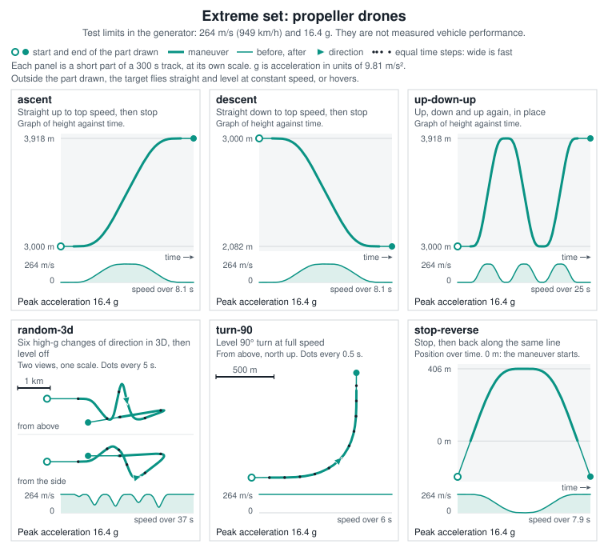
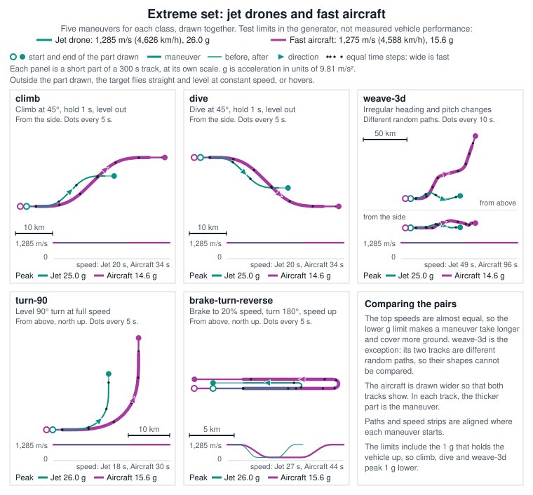
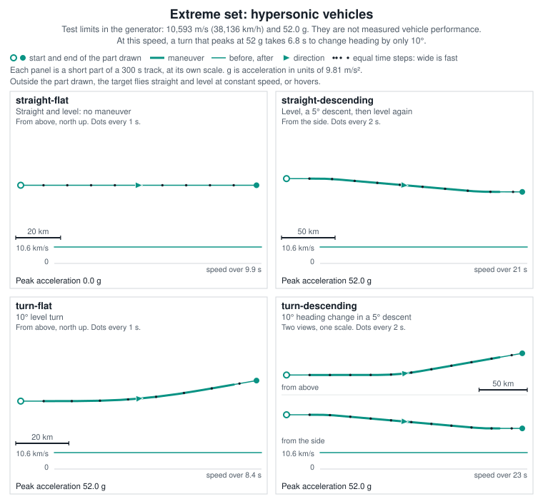
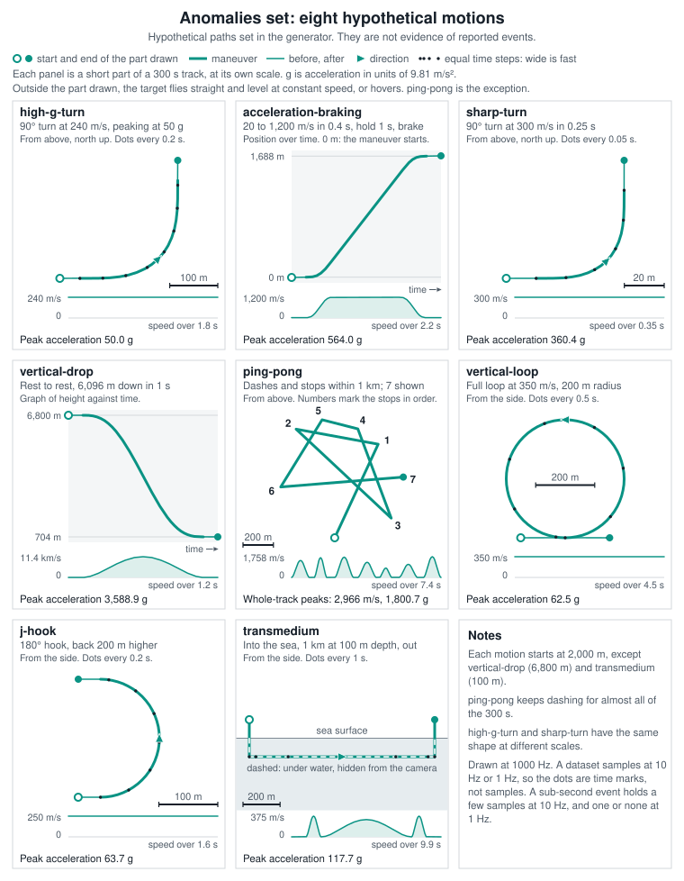

# Build the Mundane, Extreme, and Anomalies datasets

The commands on this page generate three families of synthetic track datasets
for [BOTBench](BOTBench.md): **Extreme** (high-performance maneuvers by drones,
fast aircraft, and hypersonic vehicles), **Anomalies** (hypothetical motions),
and **Mundane** (ordinary balloons, drones, and weather balloons). Sitrec does
not ship these files, so you build them from a repository checkout. This needs
Git and Node.js 22, but no build of the app. The index of all benchmark sets is
[BOTBench Scenario Files](BOTBenchScenarios.md).

## Extreme and Anomalies

You can generate four Extreme and Anomalies datasets, and open them in BOTBench or the Track Browser:
**Extreme full**, **Anomalies full**, **Extreme single**, and **Anomalies single**.
All four use the same platform paths and generation rules. Full sets cover every
duration and pointing-error level. Single sets contain all target/platform
combinations at one chosen duration, error, and sample rate.

Extreme contains 20 target maneuvers across propeller drones, jet-powered drones,
fast aircraft, and hypersonic vehicles. Anomalies contains eight hypothetical
motions: high-g turns, acceleration and braking, sharp turns, a vertical drop,
erratic ping-pong motion, a vertical loop, a J-hook, and transmedium travel.

The generator creates CSVs, metadata, manifests, and a README with the exact
build command for each dataset. No existing dataset, README, or patch is needed
as an input.

## What the targets do

The four figures below draw every Extreme and Anomalies target. The tracks come from the generator itself, at its
internal rate of 1,000 Hz. Each panel title is the last part of the target's name in descriptive filenames and
manifests. For example, the **turn-90** panel of the first figure is `propeller-drone-turn-90`.

Each panel shows only the seconds around the maneuver, at its own scale. Except for `ping-pong`, the rest of a
300-second track is straight, level flight at constant speed, or a hover. Apart from `ping-pong`, the longest maneuver
is `fast-aircraft-weave-3d`, which takes 78 seconds, so a shorter clip holds only part of it.

The dots in the figures are time marks, not dataset samples. A dataset samples each track at 10 Hz or 1 Hz, so a
sub-second event holds a few samples at 10 Hz, and one or none at 1 Hz.









The Extreme speed and acceleration limits are test settings, not measured vehicle performance. Each limit is 1.3
times one published reference, and the speed and the g limit of a class come from different vehicles. The hypersonic
speed is a reported claim, and its g limit comes from a simulation study. Each Extreme README lists the sources under
**Reference limits**.

The figures print inertial acceleration: the rate of change of velocity, in units of g (9.80665 m/s²). The
propeller-drone and hypersonic limits use the same measure. The jet-drone and fast-aircraft limits use specific force,
which combines that acceleration with the 1 g of support against gravity. A level turn therefore reaches almost the
full limit as acceleration, and climb, dive and weave-3d peak 1 g lower.

The generator works in a flat local frame. A 300-second hypersonic track is about 3,200 km long, so its ends are about
1,600 km from the center. The platform stays near the center, at a height of 7 km. A hypersonic track stays at about
50 km or lower. A straight line between those heights stays above the Earth for at most about 1,100 km, so on a round
Earth the ends of the track are below the platform's horizon.

## Clean-machine setup

Install **Git and Node.js 22 with npm** first. Use a POSIX shell on macOS, Linux,
or WSL, with an internet connection. No frontend build or server configuration
is required.

Run from a directory where a new `tracksFolder` can be created. Its `sitrec`
subdirectory must not already exist:

```sh
set -eu
mkdir -p tracksFolder
cd tracksFolder
git clone --filter=blob:none https://github.com/MickWest/Sitrec2.git sitrec
cd sitrec
npm ci
npm run build-extreme-full-v1 -- --fps 1,10 --generic-names --out ..
npm run build-anomalies-full-v1 -- --fps 1,10 --generic-names --out ..
npm run build-extreme-single-v1 -- --duration 120 --error 0.01 --fps 10 --generic-names --out ..
npm run build-anomalies-single-v1 -- --duration 120 --error 0.01 --fps 10 --generic-names --out ..
```

The next section lists what these commands create. Everything required comes
from the repository and npm. The generated READMEs are outputs of the source
template, rather than prerequisites.

Each generated README repeats this recipe for its own dataset, with a
`git checkout --detach` line that pins the generator commit. If the generator
source has local changes, or the commit is not on a remote branch, the README
shows a publication notice and omits that line.

## Build all four selections

From a repository checkout, install dependencies with
`npm ci`, then run these commands from the repository root. They place all
outputs beside the checkout. Single-set parameters are explicit even though
they are the defaults:

```sh
npm run build-extreme-full-v1 -- --fps 1,10 --generic-names --out ..
npm run build-anomalies-full-v1 -- --fps 1,10 --generic-names --out ..
npm run build-extreme-single-v1 -- --duration 120 --error 0.01 --fps 10 --generic-names --out ..
npm run build-anomalies-single-v1 -- --duration 120 --error 0.01 --fps 10 --generic-names --out ..
```

The full commands each produce two rate-specific folders; each single command
produces one. These four commands therefore create six folders:

| Output folder | Scenarios | Sample rate |
|---|---:|---:|
| `Extreme_full_v1_1Hz` | 12,600 | 1 Hz |
| `Extreme_full_v1_10Hz` | 12,600 | 10 Hz |
| `Anomalies_full_v1_1Hz` | 5,040 | 1 Hz |
| `Anomalies_full_v1_10Hz` | 5,040 | 10 Hz |
| `Extreme_single_v1_120s_0.01deg_10Hz` | 200 | 10 Hz |
| `Anomalies_single_v1_120s_0.01deg_10Hz` | 80 | 10 Hz |

Together these contain **35,560 scenarios** and **177,800 CSV/sidecar files**,
plus documentation and manifests. Allow roughly 11 GB for generated data,
plus space for the checkout, dependencies, and filesystem overhead.

Omit `--out ..` to write into `benchmarks/botbench/results` inside the checkout.
Single sets are generated directly; full sets do not need to exist first.
Matching settings and filename style produce identical CSVs and sidecars in a
single set and the corresponding cell of its full set.

## Optional: build mundane_v1

`mundane_v1` uses **the same 300 target definitions as
[rock_v3](BOTBenchScenarios.md#rock_v3--one-fixed-set-of-300-tracks-at-every-length-and-rung)**:
100 ordinary balloons, 100 drones, and 100 weather balloons. Its platform paths
are the shared paths described below, not the paths rock_v3 uses. Each target
gets one platform program, with 20 straight controls and 80 curved paths in each
class. Target sizes, winds, altitude distributions, and horizontal-range draws
stay the same. In Mundane, the range draw applies at second 150 of the 300-second
master track, the center of every clip: the platform is then that distance south
of where the target was at the start of the master. rock_v3 applies the draw at
its first frame, so the range at the start of a long clip differs from rock_v3.

From the repository root, after `npm ci`, optionally run either or both:

```sh
npm run build-mundane-v1 -- --fps 1,10 --generic-names --out ..
npm run build-mundane-single-v1 -- --duration 120 --error 0.01 --fps 10 --generic-names --out ..
```

The full command creates `mundane_v1_1Hz` and `mundane_v1_10Hz`, each with
**18,900 scenarios**: 300 tracks × seven durations × nine pointing-error levels.
The single command creates `mundane_single_v1_120s_0.01deg_10Hz`, with **300
scenarios**. Together these add 38,100 scenarios and 190,500 CSV/sidecar files,
using about 12 GB of additional disk space.
Use `--fps 10` on the full command if only that rate is needed. Omit `--out ..`
to use `benchmarks/botbench/results`.

Every shorter clip is a centered subset of its 300-second master. The target
master is the original rock_v3 300-second track at 10 Hz; the 1 Hz version
subsamples it, preserving the balloon integration exactly. A short rock_v3 clip
is instead the start of that track.
Platforms are at 7,000 m above the local ground plane. Ordinary balloons and
drones stay below them; weather balloons retain their original high-altitude
distribution and most are above them.

For a clean machine, use the setup recipe above and substitute these optional
commands, or add them beside the Extreme and Anomalies commands. All options in
the parameter table apply to Mundane too.

## Script parameters

Put options after npm's `--` separator. The same parameters apply to Mundane,
Extreme, and Anomalies:

| Option | Default | Meaning |
|---|---|---|
| `--fps` | Full: `1,10`; single: `10` | Full sets accept `1`, `10`, or `1,10`. Single sets accept one rate, `1` or `10`. Use a comma without spaces for both rates. |
| `--duration SECONDS` | Single: `120` | Single sets only. Any whole number from 20 through 300 seconds, cropped from the same 300-second master. Short crops can contain partial maneuvers. |
| `--error DEGREES` | Single: `0.01` | Single sets only. Any finite amplitude from 0 through 2 degrees; `0` gives clean bearings. This is the operator pointing deadband amplitude. |
| `--generic-names` | Off | Use numbered filenames such as `mundane001.csv`, `extreme001.csv`, and `anomaly001.csv`. Without it, Mundane retains rock_v3 class/index names; Extreme and Anomalies name the target and platform. |
| `--out DIRECTORY` | `benchmarks/botbench/results` in the checkout | Parent directory for dataset folders. Relative paths resolve from the current working directory. Quote paths containing spaces. |
| `--readme-only` | Off | Refresh existing datasets' READMEs and source provenance in their root manifests. Requires existing manifests; does not regenerate tracks. |

Supply each option once, with values separated by a space. Full sets use the
fixed duration/error grid; use a single-set command to choose one duration and
error. Seeds, target maneuvers, platform paths, and platform altitude are fixed
in the source.

Both command types use `benchmarks/botbench/run-motion-full-v1.mjs`. The npm
targets supply `--set mundane_v1`, `--set Extreme_full_v1`, or `--set Anomalies_full_v1`, plus
`--single` for a single set. An equivalent direct invocation is:

```sh
node benchmarks/botbench/run-motion-full-v1.mjs --set Extreme_full_v1 --single --duration 120 --error 0.01 --fps 10 --generic-names --out ..
```

## Other selections

Build the full sets at **10 Hz only**, along with the default single sets, to
produce exactly four output folders:

```sh
npm run build-extreme-full-v1 -- --fps 10 --generic-names --out ..
npm run build-anomalies-full-v1 -- --fps 10 --generic-names --out ..
npm run build-extreme-single-v1 -- --duration 120 --error 0.01 --fps 10 --generic-names --out ..
npm run build-anomalies-single-v1 -- --duration 120 --error 0.01 --fps 10 --generic-names --out ..
```

Build a **90-second Anomalies single set at 0.03 degrees and 1 Hz**:

```sh
npm run build-anomalies-single-v1 -- --duration 90 --error 0.03 --fps 1 --generic-names --out ..
```

This creates `Anomalies_single_v1_90s_0.03deg_1Hz`. A single set can use
duration/error values between those in the full grid.

Build **300-second Extreme single tracks** at the default error and rate:

```sh
npm run build-extreme-single-v1 -- --duration 300 --error 0.01 --fps 10 --generic-names --out ..
```

The 120-second set is exactly seconds 90 through 210 of these 300-second tracks.
Relative CSV time starts at zero in each clip, while absolute timestamps and
corresponding target/platform positions and sightlines match.

Build into another parent folder, or omit `--generic-names` for descriptive names:

```sh
npm run build-extreme-single-v1 -- --duration 120 --error 0.01 --fps 10 --out "$HOME/Track Data"
```

Use a fresh output location for each example if the selected dataset already
exists.

## Platform paths and coverage

Extreme and Anomalies pair every target with ten platform programs: **two straight
controls and eight curved paths**. Mundane assigns one of these programs per
target, cycling through all ten by the target's index (1–100) within each class.
Each class uses every program ten times. In the central 120-second window, the curved paths are left/right
versions of a 60-degree bend, a 120-degree bend, a 60-then-120-degree turn, and a
120-then-60-degree turn. Paired turns continue in the same direction, with a
short straight section between them.

Initial headings, individual turn rates, and intermediate straight durations
are seeded. Curved segments are slower than the 3-degree/second standard rate.
There are no reversing doglegs or full-circle arcs. Each curved 300-second
master has an additional 60-degree turn before and after its central 120 seconds.
No individual arc exceeds 120 degrees, and total heading change over a master
is at most 300 degrees. The two straight controls remain straight.

**Every shorter track is a centered subset of the same 300-second track.**
Positions, speeds, turn rates, and timestamps are preserved. Longer clips reveal
further turns; shorter clips can contain partial bends. Every curved variant
includes a turn even in a 20-second clip. The 1 Hz samples are exact subsamples
of the 10 Hz version, including the pointing-error trace.

| Setting | Coverage |
|---|---|
| Full-set durations | 20, 40, 60, 120, 180, 240, and 300 seconds |
| Full-set pointing-error amplitudes | 0, 0.01, 0.02, 0.05, 0.1, 0.2, 0.5, 1, and 2 degrees |
| Single-set defaults | 120 seconds, 0.01 degrees, 10 Hz |
| Platform speed and altitude | 70 m/s; 7,000 m above the local ground plane |
| Wind | Extreme/Anomalies: zero. Mundane: rock_v3's original per-target winds; balloon targets drift with them. |
| Sample count | Duration × sample rate + 1, including both endpoints |

The duration/error grid matches `rock_v3`. Error values specify operator pointing
deadband amplitude, rather than Gaussian standard deviation or measured RMS
error. Field of view starts at 3 degrees and widens to four times the error
amplitude where needed. A 120-second clip has 121 samples at 1 Hz or 1,201 at
10 Hz.

Platforms look down at most targets, but not all. All hypersonic tracks and most
weather balloons stay above the platform. Jet-drone and fast-aircraft climbs and
dives, the fast-aircraft `weave-3d`, and a few weather balloons cross its altitude.
All other tracks stay below it.

Extreme and Anomalies targets follow prescribed synthetic trajectories. All
datasets use a flat local frame, and atmospheric flight dynamics and camera slew
limits are not simulated. Earth curvature is not simulated either, except in
Mundane balloon paths, where it lowers a balloon by at most about 8 m. Anomalies are
hypothetical motions, not evidence of reported events. Extreme and Anomalies peak
metrics are evaluated at 1,000 Hz; short events can be undersampled at 1 Hz. Transmedium
tracks retain underwater truth but omit underwater sightlines. Each generated
README gives the maneuvers and model limitations. Mundane preserves rock_v3's
ordinary motion models: wind-drifting balloons, rising weather balloons in
sheared and veering winds, and ground-referenced drone circles, racetracks, and
rounded squares. Balloon integrations use a fixed 10 Hz step at both output rates.

## Files and importing

Full datasets contain seven duration folders, each with nine error folders.
Whole-number amplitudes keep one decimal in folder names: `0.0deg`, `1.0deg`,
and `2.0deg`. Single sets use the same layout with just the selected
duration/error cell:

```text
Extreme_single_v1_120s_0.01deg_10Hz/
    README.md
    manifest.json
    timing.json
    batch_120sec/
        0.01deg/
            Input/extreme001.csv
            Truth/extreme001.csv
            All/extreme001.csv
            meta/extreme001.scenario.json
            meta/extreme001.truth.json
            manifest.json
            ...
```

`Input` holds platform positions and measured sightlines. `Truth` holds true
target positions. `All` combines input and truth. The `meta` sidecars describe
coordinates, timing, camera settings, motion, and event windows. Manifests list
scenarios, paths, and file hashes. `timing.json` records generation time.

Generic names run from `extreme001` through `extreme200`, and from `anomaly001`
through `anomaly080`, within each duration/error cell. Mundane uses `mundane001`
through `mundane300`: 001–100 ordinary balloons, 101–200 drones, and 201–300
weather balloons. Without `--generic-names`, Mundane uses `balloon_001` through
`balloon_100`, `drone_001` through `drone_100`, and `weather_balloon_001` through
`weather_balloon_100`. The same number identifies
the same target/platform combination across full and single sets, durations,
errors, and rates. Keep enclosing folders to distinguish clips. Manifests and
sidecars retain identities even with generic filenames.

Extreme and Anomalies descriptive filenames use target/platform names. All
descriptive CSV names add a role suffix: `.input.csv`, `.truth.csv`, and `.all.csv`.

To analyze a dataset, open **File → File Analysis → BOTBench...** and choose the
dataset root with **Recursive** on, which is the default. BOTBench reads `All/`,
skips `Input/` and `Truth/`, and pairs each CSV with its `meta/` sidecars. See
[BOTBench](BOTBench.md) for analysis controls and interpretation.

To view tracks, open **File → File Analysis → Browse Track Folder...**, choose the
dataset root, and keep **Include subfolders** on, which is the default. **Import**
in the Track Browser reads only the CSV, not its `meta/` sidecars. The track loads
at one fixed date, 2025-02-01 20:00 UTC, not the date in `meta/`, and transmedium
tracks load at the default land site, not their ocean site.

## Repeat builds and documentation refresh

Generation refuses to overwrite a nonempty selected dataset folder. Use another
`--out` location for a repeat build or after an interrupted run. There is no
overwrite or resume option.

To refresh documentation without regenerating tracks, use the same generator
revision that created the dataset:

```sh
npm run build-extreme-full-v1 -- --fps 1,10 --readme-only --out ..
npm run build-anomalies-full-v1 -- --fps 1,10 --readme-only --out ..
npm run build-extreme-single-v1 -- --duration 120 --error 0.01 --fps 10 --readme-only --out ..
npm run build-anomalies-single-v1 -- --duration 120 --error 0.01 --fps 10 --readme-only --out ..
```

Select only rates that exist. Filename style is read from each manifest, so
`--generic-names` is unnecessary for refreshes. Refresh updates source provenance
as well as the README; do not run it from unrelated or modified generator code.

Extreme and Anomalies record generator revision `motion-full-v1.1`, which uses the
shared platform paths. Revision `motion-full-v1.0` uses other paths. Mundane records
`mundane-v1.0`. Its documentation can also be refreshed by appending
`--readme-only` to either command in the Mundane section. Generation time in
`timing.json` naturally varies between runs.
