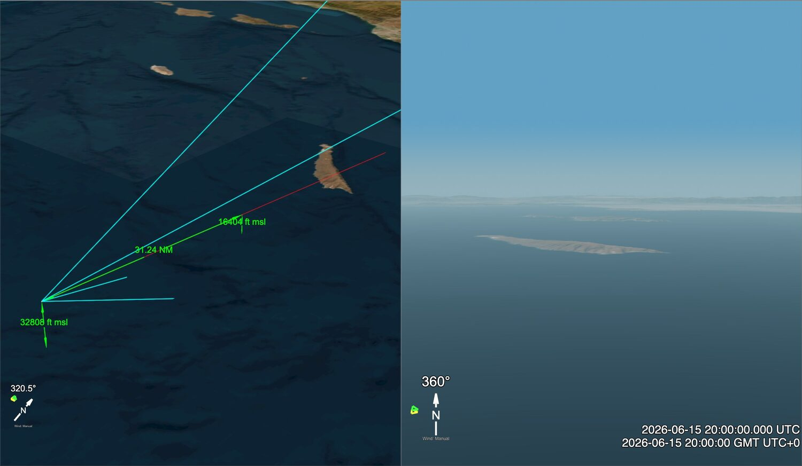
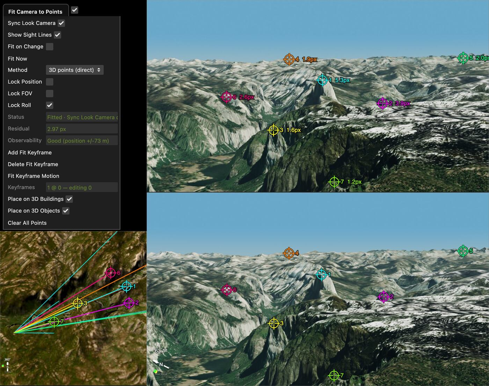

# The Camera and Target Menus

**Camera** and **Target** (menu bar)

The **Camera** menu controls the look camera: the camera that draws the look view, which
is the view you match against your video. The **Target** menu controls an optional target:
a point or a track that the camera can aim at.

*A new custom sitch with a daytime date, and **Camera Heading** set to **To Target**. The main view (left) is moved so that the camera position and the target position are both in the frame. The look view (right) is what the camera sees. The cyan lines meet at the camera. They are the edges of the frustum, which is the volume that the look camera sees, and the two lower edges stop at the sea. The red line is the line of sight. It goes from the camera through the target and ends at the sea, and it crosses the island that is near the center of the look view. The green marks are the default items in **Show → Measurements**: `32808 ft msl` is the camera altitude, `31.24 NM` is the distance, and `16404 ft msl` is the altitude at the far end. The last two measure the [traverse](Glossary.md), not the target. In a new sitch, the traverse starts at the target. Nothing marks the target itself in this view. It is at the `16404 ft msl` mark. From the camera to that mark, the green distance line lies on top of the red line.*

This page is a reference for every control in both menus in a custom sitch. For a first
walk-through, read [Getting Started](CustomSitchTool.md) first.

This page has five parts:

- **A. [How the camera is defined](#a-how-the-camera-is-defined)**: position, heading and field of view
- **B. [The Camera menu, folder by folder](#b-the-camera-menu-folder-by-folder)**
- **C. [The Target menu](#c-the-target-menu)**
- **D. [Recipes](#d-recipes)**
- **E. [See also](#e-see-also)**

---

## A. How the camera is defined

The look camera has three independent parts. Each part has its own folder in the Camera
menu, and each folder starts with a **source** selector: a drop-down that says what drives
that part.

| Part | Folder | Source selector | What it says |
|---|---|---|---|
| Position | **Camera → Location** | **Position** | Where the camera is |
| Heading | **Camera → Heading** | **Camera Heading** | Which way the camera points |
| Field of view | **Camera → FOV (Zoom)** | **Camera FOV** | How much of the scene the camera sees |

The manual controls under each selector (Lat/Lon/Alt, Pan/Tilt, VFOV and so on) only
drive the camera when the source is **Manual**. **Flight Sim** and **Orbit** also use the
Manual position, as their start point or their center.

When another source drives that part, the manual controls are greyed out but stay visible.
**Pan (Az)**, **Tilt (El)** and **Roll** follow the source on every frame. **Cam [C]
Lat/Lon/Alt** do not: they show an imported track's position at the frame where you
selected it, and they keep the Manual position during Flight Sim and Orbit.

Choose **Manual** again and the heading and field of view stay as the other source left
them. The position does too after an imported track. After Flight Sim or Orbit, the camera
goes back to the Manual position.

### Position sources (Camera → Location → Position)

| Choice | What it does |
|---|---|
| **Manual** | The camera stays at the fixed point in **Cam [C] Lat / Lon / Alt**. This is the default in a new sitch. |
| **Flight Sim** | The camera flies a simple simulated aircraft path. The path starts at the Manual position and is controlled from **Physics → Simple Flight Sim**. See [Flight Sim](#flight-sim). |
| **Orbit** | The camera circles a chosen track or point at a set radius, altitude and period. The settings are in **Camera → Camera Tweaks**. See [Orbit](#orbit). |
| *An imported track* | Each track you import is added to this list. In a new sitch, the first track you import is selected as the camera position. If that first import is one file with two or more tracks, and the file does not say which track is the camera, Sitrec asks first. See [Camera and Target from One File](Tracks.md#camera-and-target-from-one-file). After you set up the camera, time or position yourself, imported tracks do not change them, even after **Remove All Tracks**. |

Holding **C** with the pointer over a 3D view moves the Manual camera position to the
point under the pointer, and keeps its altitude. If the Position was following an imported track, this switches
it back to **Manual**. **Shift+C** also puts the camera 7 ft above the ground.

### Heading sources (Camera → Heading → Camera Heading)

| Choice | What it does |
|---|---|
| **Manual** | You aim the camera with **Pan (Az)**, **Tilt (El)** and **Roll**. This is the default. Pan 0 is north, unless **Relative Heading** is on. Tilt 0 is level. |
| **To Target** | The camera points at the target, which is set in the [Target menu](#c-the-target-menu). **Roll** still applies. When one file sets up both the camera and the target, Sitrec selects **To Target** for you. |
| **Celestial Lock** | The camera follows a sky object. Type its name (Moon, Sun, a planet or a named star) into **Celestial Object**, lower in the Heading folder. |
| **Horizon Flare Region** | The camera points toward the Sun's azimuth, just above the horizon, where Starlink horizon flares appear. |
| **Custom Az/El** | The camera follows azimuth and elevation columns from a CSV file. This choice appears only after you import a file with `az` or `el` columns. See [Camera Angle Tracks in Tracks](Tracks.md). |
| *A track with angles* | A track that carries its own pointing angles (a MISB file, for example) adds its own choice. |
| **Star Track** | Appears after the Star Tracker syncs the camera to a solved star field. See [Star Tracker](StarTracker.md). |

**Pan (Az)**, **Tilt (El)**, **Lock Forward Vector**, **Relative Heading**, **Satellite Mode**,
**Rotation** and **Use 0-360 for Pan** only work when **Camera Heading** is **Manual**. They are greyed out for every other
source. **Lock Forward Vector** is also greyed out while **Relative Heading** is on.
**Roll** works for **Manual** and **To Target**, and is greyed out for the others.

### Field of view sources (Camera → FOV (Zoom) → Camera FOV)

| Choice | What it does |
|---|---|
| **Manual** | The field of view comes from **VFOV (deg)** (or HFOV, or 35mm Equiv, which edit the same value). This is the default. |
| **FOV Editor** | The field of view comes from the FOV Editor curve (field of view against frame). Open the editor from **Show → Views → FOV Editor**. |
| *A track or file with FOV* | An imported file with an `fov` or `zoom` column, or a track that carries a field of view, adds its own choice. An `fov` or `zoom` column is selected as soon as it loads. |
| **Star Track** | Appears after the Star Tracker syncs the camera. |

Sitrec stores only the **vertical** field of view. The horizontal field of view and the
35mm equivalent are the same angle, read through the aspect ratio of the frame. See
[FOV (Zoom)](#camera--fov-zoom).

### Other camera modes, in short

- **Satellite Mode** (**Camera → Heading**) gives screen-space camera movement that works
  better when the camera looks almost straight up or down, for example at a satellite
  overhead. It hides Pan, Tilt and Roll, and shows **Rotation** instead. It only works
  when **Camera Heading** is **Manual**. See [Camera View Modes](satcam.md).
- **Fisheye** (**Camera → FOV (Zoom) → Fisheye**) renders the look view through a real
  fisheye lens curve, for all-sky and meteor cameras and fields of view of 180° or more.
  See [Fisheye (Allsky) Projection](Fisheye.md).
- **Panoramic Camera** (**Camera → FOV (Zoom) → Panoramic Camera**) renders an
  equirectangular view up to 360° wide, with angles spaced evenly across the image. See
  [Panoramic Camera](PanoramicCamera.md).

When Fisheye or Panoramic Camera is on, the normal FOV controls are hidden, because the
lens mode replaces them. Fisheye and Panoramic Camera cannot both be on.

---

## B. The Camera menu, folder by folder

The defaults below are for a new custom sitch. Loading a track, video or photo can change
them.

### Camera → Location

| Control | Default | What it does |
|---|---|---|
| **Position** | Manual | The position source. See [Position sources](#position-sources-camera--location--position). |
| **Cam [C] Lat** | 31.980814 | Latitude of the Manual position, in degrees. You can paste a full "lat, lon" pair in any format (decimal, degrees-minutes-seconds, N/S/E/W, MGRS, or ECEF x,y,z in meters). It fills both boxes. |
| **Cam [C] Lon** | -118.428486 | Longitude of the Manual position, in degrees. |
| **Cam [C] Alt** | 10,000 m (32,808 ft) | Altitude of the Manual position, [above mean sea level (MSL)](GIS.md#three-kinds-of-height). The label shows the current unit. |
| **Above Ground Level** | Off | When on, **Cam [C] Alt** is a height above the ground under the camera, not above sea level. Switching it does not move the camera: **Cam [C] Alt** changes to the same position measured the new way. If the ground under the camera has not loaded yet, the number stays as it is. |
| **Lookup** | (empty) | Type a place name or coordinates and press Enter. The camera, the terrain and the main view move there. If the text gives no altitude (a place name, or a plain lat, lon), the altitude is set to the ground height there. A lat, lon, alt entry or ECEF x,y,z keeps its own altitude. The serverless and desktop builds do not have this row: paste the coordinates into **Cam [C] Lat**, set **Cam [C] Alt**, then click **Go To the above position**. A pasted lat, lon does not change the altitude. |
| **Geolocate from browser** | — | Sets the position to an approximate location that the ipapi.co web service finds from your IP address. It does not use the browser's location permission. It also turns on **Above Ground Level**, sets **Cam [C] Alt** to 3 m, and moves the terrain and the main view there. |
| **Go To the above position** | — | Moves the main view to look down at the entered position from about 100 km up, and terrain loads there. It does not move the look camera. It is always available, whatever the Position source. |
| **Use Relative Altitude (N m)** | Hidden | Appears when you import a photo that records its height above takeoff (usually a drone photo). It puts the camera at the ground height under it plus that recorded height, instead of the absolute altitude in the photo. The absolute altitude in a drone photo can be less accurate than the relative height. |

The Lat, Lon, Alt, Above Ground Level, Lookup and Geolocate controls only work when
**Position** is **Manual**.

#### Flight Sim

Set **Camera → Location → Position** to **Flight Sim** to put the camera on a simulated
aircraft. The aircraft starts at the Manual position (**Cam [C] Lat/Lon/Alt**) and flies at the settings in
**Physics → Simple Flight Sim**: **TAS** (true airspeed, knots, default 500), **Jet
Heading**, **Turn Rate**, **Turn Rate Source**, **Leg Length** (seconds of straight
flight between 180° turns; 0 turns this off), **Transition Time**, **Climb Rate**
(feet per minute) and **Manual Bank**. **Leg Length** and **Transition Time** show only for
the **Manual Turn Rate** source, and **Manual Bank** only for the **Manual Bank** source.

The local wind (**Physics → Wind**) blows the aircraft along. It is 70 knots from 285° by
default, so set it to 0 for still air.

**Roll View with Bank** (also in **Physics → Simple Flight Sim**, default off) rolls the
look camera by the bank angle of the camera track, so the horizon tilts as a pilot would
see it. The bank angle is calculated from how the camera track turns, assuming a
coordinated turn. It works only when **Camera Heading** is **Manual** or **To Target**.
While it is on, it replaces the **Roll** value.

#### Orbit

Set **Camera → Location → Position** to **Orbit** to fly the camera in a circle. The circle is set in
**Camera → Camera Tweaks** (see [below](#camera--camera-tweaks)). Orbit only moves the
camera. To keep it looking at the center, also set **Camera Heading** to **To Target**
and put the target at the same place with **Shift+X**, or on the same track.

### Camera → Heading

| Control | Default | What it does |
|---|---|---|
| **Camera Heading** | Manual | The heading source. See [Heading sources](#heading-sources-camera--heading--camera-heading). |
| **Pan (Az)** | 0 | Azimuth in degrees from true north. 0 is north, 90 is east. A magnetic compass differs from this by the local magnetic declination. Manual only. |
| **Tilt (El)** | 0 | Elevation in degrees, from -89 to 89. Positive is up. Manual only. |
| **Roll** | 0 | Roll around the view axis, in degrees. Manual and To Target only. |
| **Lock Forward Vector** | Off | When on, moving the camera does not change the direction it points in space. Pan, Tilt and Roll (or the Satellite Mode angles) change to match the new position, so the stars and other sky objects stay where they are in the view. Changing Pan, Tilt or Roll yourself sets the new direction to hold. Manual only, and not with Relative Heading. |
| **Relative Heading** | Off | When on, Pan is measured from the direction the camera track is moving, not from north. Pan 0 then looks forward along the track, and -90 looks left. Only the heading is relative; Tilt is still measured from level. Manual only. |
| **Satellite Mode** | Off | Screen-space camera movement for high and low elevation angles. See [Camera View Modes](satcam.md). Manual only. |
| **Rotation** | 0 | Screen-space rotation around the view axis. Shown only in Satellite Mode. Manual only. |
| **Use 0-360 for Pan** | Off | Shows Pan as a 0 to 360 compass bearing instead of -180 to 180. It changes only how the angle is written, not where the camera points. Typing a value above 180 into Pan ticks it for you. Manual only. |
| **Celestial Object** | Moon | The sky object to follow. Shown only when **Camera Heading** is **Celestial Lock**. |
| **Render Camera Use Traverse Track** | Off | Aims the look view at the traverse object (the yellow cube) for display only. The lines of sight, and every traverse solution, still come from the selected Camera Heading, exactly as if this were off. |
| **Roll From MX-Style Camera** | Off | Rolls the look camera as an azimuth-elevation ball turret (WESCAM MX style) would. The roll combines the aircraft's bank and pitch, taken from the camera track, with where the turret is pointing. Unlike a roll-nod pod, such a turret adds no roll in level flight. It works with every heading source, because it changes only the roll. |
| **MX Roll Amount** | 1 | How much of that roll to apply. 1 is an unstabilized two-axis turret. 0 is a fully roll-stabilized turret with a level horizon. Real turrets can be partly stabilized, so set this by matching the horizon tilt in the video. |

If both **Roll From MX-Style Camera** and **Roll View with Bank** are on, the MX-style roll
wins, because it is applied last.

### Camera → FOV (Zoom)

| Control | Default | What it does |
|---|---|---|
| **Export for FOV Editor** | — | Samples the current FOV source on every frame and saves it as a `.fov.json` file of keyframes. Drop that file on Sitrec to load it into the FOV Editor. See [Tracks](Tracks.md). |
| **Camera FOV** | Manual | The FOV source. See [Field of view sources](#field-of-view-sources-camera--fov-zoom--camera-fov). |
| **VFOV (deg)** | 30 | Vertical field of view, across the full height of the frame. This is the value the camera stores. |
| **HFOV (deg)** | from VFOV | Horizontal field of view, across the full width of the frame. It is VFOV read through the **Aspect Ratio**. Editing it sets VFOV to match. |
| **35mm Equiv (mm)** | from VFOV | The lens that would give this field of view on a 36×24 mm full-frame camera, measured across the long side of the frame. Editing it sets HFOV and VFOV to match. The slider range grows when you push past its right end. |
| **Lens (EXIF)** | Hidden | Read only. The real focal length and lens recorded in an imported photo's EXIF data. This is the true focal length on that camera's sensor, not the 35mm equivalent. On a smaller sensor, the 35mm Equiv above is the larger number. |
| **Aspect Ratio** | from the view | Read only. Width divided by height of the frame that VFOV and HFOV refer to. With **Lock Aspect** on and a video loaded, it is the video's shape, shown with the video's own pixel dimensions. With **Lock Aspect** on and no video, it is the locked value. With **Lock Aspect** off, it follows the look view pane. |
| **Lock Aspect** | Off | Holds the aspect ratio fixed, so HFOV does not change when you resize the window. Loading a video turns it on at the video's aspect, because the video defines the frame. Turn it off to give HFOV for the look view pane instead. Turning it on again locks to the video's aspect if a video is loaded, and to the pane's current aspect if not. Turning it on or off does not move the camera, because VFOV is the value the camera stores. When you remove the video, the setting from before the video comes back, unless you turned the lock off. |
| **Fisheye** (folder) | Off | See [Fisheye (Allsky) Projection](Fisheye.md). |
| **Panoramic Camera** (folder) | Off | See [Panoramic Camera](PanoramicCamera.md). |

VFOV, HFOV and 35mm Equiv only work when **Camera FOV** is **Manual**.

**Lock Aspect** is not the same as **Match Video Aspect** (below). Lock Aspect changes what
the FOV numbers mean. Match Video Aspect changes how the look view is drawn.

### Camera → Lens

Hidden until the Star Tracker has fitted a lens. It then shows the fitted lens model. See
[Star Tracker](StarTracker.md).

### Camera → Camera Tweaks

Less common adjustments.

| Control | Default | What it does |
|---|---|---|
| **Free Look Camera** | Off | Fly the look camera by hand, like the main view camera. While it is on, the Location and Heading sources are suspended, but the field of view is not. Where you fly to is written into the Manual position. If **Position** was an imported track, your first move changes it to **Manual**, so the camera stays there when you turn Free Look off. With Flight Sim or Orbit, **Position** does not change: the camera goes back to that source, which now uses the moved Manual position. Touching a control in Location or Heading turns it off. See [User Interface](UserInterface.md). |
| **Switch to Ground Track at** | 0 | 0 turns this off. At any other frame, Sitrec finds where the camera's line of sight meets the ground at that frame, and aims at that ground point for every later frame. With refraction on, the line of sight is the straight line, and the camera aims at where the point is drawn (see [Atmospheric Refraction](Refraction.md#cameras-that-point-at-a-target)). |
| **Look View Orthographic** | Off | Draws the look view with a parallel (orthographic) projection instead of perspective. The size matches the current framing at the ground and scales as the camera moves. |
| **Main View Orthographic** | Off | The same, for the main view. |
| **Main Near Plane (m)** | 1 | Near clipping distance of the main view camera. Increase it to slice through buildings or terrain in front of the camera. Useful in orthographic mode. |
| **Look Y-comp** | 1 | Stretches the look view's frustum vertically, to fit more into the same height. This distorts the view. 1 is off. |
| **xOffset**, **yOffset** | 0 | Turn the look view off-center by this many degrees, horizontally or vertically (-20 to 20). Useful when the tracked object is not at the center of the video frame. |
| **Near Plane (m)** | 0.1 | Near clipping distance of the look camera. Sometimes useful for very close objects, or to cut out near objects. |
| **Diffraction Glare** (folder) | — | Adds glare from an imported point spread function. See [Diffraction Glare](DiffractionGlare.md). |
| **Orbit Target** | Manual Camera | What the Orbit position circles. **Manual Camera** is the Manual camera position (**Cam [C] Lat/Lon**). Imported tracks are added to the list. |
| **Orbit Radius (m)** | 5000 | Radius of the circle, in meters. |
| **Orbit Altitude (m)** | 1000 | Altitude of the camera while orbiting, in meters above the WGS84 ellipsoid (HAE). This is not sea level; the two differ by the local geoid offset, up to about 100 m. |
| **Start Angle (°)** | 0 | Compass bearing from the center to the camera at frame 0. 0 is north, 90 is east. |
| **Orbit Period (s)** | 120 | Seconds for one full circle, from 60 to 300. The camera moves clockwise as seen from above. |

The orbit settings only have an effect when **Camera → Location → Position** is **Orbit**.
The Orbit Radius, Altitude and Period controls always use meters and seconds, whatever
your unit setting.

### Camera → Smoothing

Smoothing for the camera position track (whatever the **Position** source is). It is
closed by default.

| Control | Default | What it does |
|---|---|---|
| **Smoothing Method** | savgol | none, moving, movingPolyEdge, sliding, savgol or spline. See [Smoothing and Interpolation in Tracks](Tracks.md). |
| **Camera Smooth Window** | 20 | Window size, in frames. Larger is smoother. |
| **Camera SavGol Poly Order** | 3 | Polynomial degree for savgol and spline. |
| **Camera Edge Fit Order** | 2 | Polynomial order of the fit at the ends of the track. |
| **Camera Edge Fit Window** | 100 | Window size of the fit at the ends of the track. |
| **Camera Catmull Intervals** | 20 | Spline setting. Shown only for spline. |

Only the controls that the selected method uses are shown. This smoothing is on by default.
It makes the camera move smoothly, but it also changes the data. To turn it off, set
**Smoothing Method** to none. An imported track also has its own smoothing, in the track's
folder. See [Tracks](Tracks.md).

### Camera → Tracking Wobble

Simulates a person keeping the camera on the target by hand. The aim drifts off center,
and when the drift passes **Amplitude**, the operator reacts and moves the camera back
toward center, not perfectly. It is added on top of the selected Camera Heading. The
wobble is repeatable: the same seed always gives the same pattern.

| Control | Default | What it does |
|---|---|---|
| **Tracking Wobble** (title checkbox) | Off | Turns the simulation on. |
| **Amplitude (deg)** | 0.5 | How far off center the aim drifts before the operator reacts. |
| **Drift Speed (deg/s)** | 0.3 | Random drift rate away from the target. |
| **Reaction Time (s)** | 0.4 | Delay between noticing the drift and starting the correction. |
| **Recenter Speed (deg/s)** | 2 | How fast the operator moves the camera back. |
| **Recenter Accuracy** | 0.7 | 1 stops the correction exactly on center. Lower values leave some error. |
| **Random Seed** | 1 | Change it for a different, but still repeatable, pattern. |

### Camera → Fit Camera to Points

Recovers an unknown camera position, heading and field of view from landmarks: points on
the video that you match to places in the world. It needs a loaded video.

1. Stop on a frame that shows landmarks you can identify, and tick the checkbox on the
   **Fit Camera to Points** title line.
2. Click a landmark on the video. Sitrec adds a control point, with one marker on the video
   and one on the ground.
3. In the main view or the look view, drag the ground marker to the real place of that
   landmark. A control point gives no information until you do this.
4. Do the same for more landmarks, spread across the frame. With the default settings, a
   fit needs at least 3 points.
5. Click **Fit Now**. Sitrec writes the result into the Manual position, **Pan (Az)**,
   **Tilt (El)** and **VFOV (deg)**. It also sets **Position**, **Camera Heading** and
   **Camera FOV** to **Manual**, so a camera that followed a track stops following it. If
   you already know the position or the field of view, tick **Lock Position** or **Lock
   FOV** first. A locked part keeps its source.
6. Read the result. **Residual** is the typical distance, in video pixels, between each
   video marker and the place where the fitted camera sees its ground point. **Observability**
   says if the points can fix all the values. A small residual alone does not show that the
   camera is right, so also compare the look view with the video.

*A fit on seven control points. The folder is dragged out of the Camera menu, and the views are rearranged so that all of them show. The video view (top right) holds one frame that Sitrec rendered from a known camera position, imported as a **Video Image**. Each video marker is a few pixels from its exact place, so that the fit has a residual. The look view is below the video view, and the main view is at the bottom left. A control point has the same number and color in all the views. In the video view, the rings are the video markers, and the value beside each ring is the residual of that point, shown after a fit. In the look view and the main view, the rings are the ground markers. In the main view, **Show Sight Lines** draws a colored line from the camera to each ground marker. Points 4 and 5 are outside the main view, so only their sight lines show there. The cyan lines with no ring are the frustum. Here, **Residual** is 2.97 px, and **Observability** is Good (position +/-73 m). The +/-73 m is an approximate error estimate from the fit, not a limit on the error. Here, the fitted camera is farther than that from the known position.*

To drive this tool from a script, see [Fit Points API](FitPointsAPI.md).

### Other items in the Camera menu

| Control | Default | What it does |
|---|---|---|
| **Export Camera as KML (Photo)** | — | Saves the look camera as a Google Earth PhotoOverlay (`.kmz`), with the current video frame as the photo. Open it in Google Earth Pro to check Sitrec's camera against Google's terrain, imagery and 3D buildings. If the sitch has a traverse, its path is included as a yellow line. With no video frame, it saves a plain `.kml` with only the camera viewpoint. |
| **Match Video Aspect** | Off | Crops the look view to the video's aspect ratio, and adjusts the camera frustum to match. |
| **MQ9 Tracking** (folder) | — | Simulates an operator acquiring and tracking a scene object. See [MQ9 Tracking Simulation](MQ9TrackingSimulation.md). |
| **IR/TV Mode Switches** (folder) | — | Marks the look view as infrared (IR) or visible light (TV) from a chosen frame onward. Each switch holds until the next one. The **WescamMXUI** and **ATFLIRUI** overlays (**Show → Views**) show the mode. On TV frames, the look view skips its infrared effects. An IR switch adds no infrared look: the look view keeps its own effects. |
| **Camera Data** (folder) | Hidden | Appears when a file of camera data is loaded. It shows the rows that came from the file, and has **Drive Look View** and **Remove Camera Data**. |
| **Help** (folder) | — | Links to the documentation for this menu. |

---

## C. The Target menu

The target is the point or track that the camera aims at when
**Camera → Heading → Camera Heading** is **To Target**. It is also used by the **Target Object** traverse method, and the target wind (**Physics → Wind**)
is measured at it.

| Control | Default | What it does |
|---|---|---|
| **Target [X] Lat** | 32.5 | Latitude of the fixed target, in degrees. Accepts a pasted "lat, lon" pair, like the camera's. |
| **Target [X] Lon** | -118.428486 | Longitude of the fixed target, in degrees. |
| **Target [X] Alt** | 5,000 m (16,404 ft) | Altitude of the fixed target, above mean sea level (MSL). The label shows the current unit. |
| **Above Ground Level** | Off | When on, **Target [X] Alt** is a height above the ground. Switching it does not move the target: **Target [X] Alt** changes to the same position measured the new way. |
| **Lookup** | (empty) | Works like the camera's **Lookup**: the fixed target, the terrain and the main view move there. If the text gives no altitude, the altitude is set to the ground height there. |
| **Geolocate from browser** | — | Works like the camera's **Geolocate from browser**, for the fixed target. It turns on **Above Ground Level** and sets **Target [X] Alt** to 3 m. |
| **Go To the above position** | — | Moves the main view to look down at the target position, and terrain loads there. |
| **Target Track** | Manual | What the target is. See the choices below. |
| **Stop At** | 0 | Appears once **Camera Heading** is **To Target**. After this frame, the camera keeps aiming at where the target was at this frame, even if the target track continues. Use it to simulate losing lock on a moving target. 0 turns it off. |

**Target Track** choices:

| Choice | What it does |
|---|---|
| **Manual** | The target stays at **Target [X] Lat/Lon/Alt** for the whole sitch. |
| **Manual + Wind** | The target starts at **Target [X] Lat/Lon/Alt** and drifts with the target wind (**Physics → Wind**). The target wind is 0 knots by default, so set a wind first. |
| *An imported track* | Each imported track is added here. Select one to make it the target. If the first import into a new sitch is one file with two or more tracks, and the file does not say which track is the camera, Sitrec asks whether to use them as camera and target. See [Camera and Target from One File](Tracks.md#camera-and-target-from-one-file). |

Holding **X** with the pointer over a 3D view moves the fixed target to the point under the
pointer, and keeps its altitude. **Shift+X** puts it 7 ft above the ground. The Target
Lat/Lon/Alt only have an effect when **Target Track** is **Manual** or **Manual +
Wind**.

---

## D. Recipes

### Camera on a plane, looking at another plane

1. Import the camera aircraft's track (drag it in, or **File → Import File**). It becomes
   the camera **Position**.
2. Import the other aircraft's track. Select it in **Target → Target Track**, and set
   **Camera → Heading → Camera Heading** to **To Target**, if Sitrec has not already done
   so. See [Tracks](Tracks.md).

   If both aircraft are in one file, import only that file. Sitrec asks whether to use
   the first track as the camera and the second as the target: choose **Use as camera
   and target**. For a file with three or more tracks, keep **Use the first two tracks as
   camera and target** on in the **Multiple Tracks Detected** dialog. If the tracks are the
   wrong way round, select them in **Camera → Location → Position** and **Target → Target
   Track**.
3. If the video shows a tilted horizon, try **Camera → Heading → Roll From MX-Style
   Camera** for a ball-turret camera, and adjust **MX Roll Amount** until the horizon
   matches. For a view from the cockpit, use **Roll View with Bank** in **Physics → Simple
   Flight Sim**.
4. If the camera shakes because the track is noisy, increase **Camera → Smoothing →
   Camera Smooth Window**.
5. To simulate the operator losing lock, set **Target → Stop At** to the frame where lock
   was lost.

### Camera on the ground at a known spot

1. Set **Camera → Location → Position** to **Manual**.
2. Type the address or coordinates into **Lookup** and press Enter. The camera moves
   there, at ground height, and the terrain follows. Or hold **Shift+C** with the pointer over the spot in the main
   view, to put the camera 7 ft above the ground there.
3. For a fixed height above the ground, tick **Above Ground Level** and set **Cam [C] Alt**
   to that height, for example 5.6 ft (1.7 m) for a standing person. The label shows the
   unit.
4. Aim the camera in one of two ways:
   - Leave **Camera Heading** on **Manual** and set **Pan (Az)** and **Tilt (El)**.
   - Or set **Target Track** to **Manual**, hold **Shift+X** over the thing the camera
     looks at, and set **Camera Heading** to **To Target**. Shift+X puts the target 7 ft
     above the ground there. Plain **X** keeps the target's altitude, which is 5,000 m
     (16,404 ft) in a new sitch.
5. Set the field of view with **VFOV (deg)**, or type the phone's or camera's 35mm
   equivalent focal length into **35mm Equiv (mm)**. Look for this number in the
   specification sheet, or in the details of a photo taken with the same lens. Digital
   zoom narrows the view, so treat the number as a start. With a video loaded, the aspect
   ratio comes from the video, unless you turn off **Lock Aspect**.
6. Set the date and time of the video. See [Time, Frames and Syncing](TimeAndSync.md).
7. Compare the horizon, ridges or buildings in the look view with the video. If they do
   not line up, change the position, the heading or the field of view.

### Camera on the ground, looking at an aircraft track

1. In a new sitch, import the aircraft's track first. It becomes the camera **Position**,
   and it sets the start time of the sitch.
2. Set **Camera → Location → Position** to **Manual**, and put the camera at the spot, as
   in [Camera on the ground at a known spot](#camera-on-the-ground-at-a-known-spot).
3. Select the track in **Target → Target Track**.
4. Set **Camera → Heading → Camera Heading** to **To Target**.

If you placed the camera before you imported the track, **Position** stays on **Manual**,
but the track does not set the start time. Set a time inside the track: until then, the
target does not move.

### Orbit around a point, for a presentation

1. Put the center of the orbit somewhere the camera can circle:
   - To circle a fixed place, set **Position** to **Manual** and hold **C** over the place
     (or type it into **Lookup**). Leave **Camera → Camera Tweaks → Orbit Target** on
     **Manual Camera**.
   - To circle a moving object, choose its track in **Orbit Target**.
2. Put the target at the same place: hold **Shift+X** over it with **Target Track** on
   **Manual**, or choose the same track in **Target Track**. Plain **X** keeps the
   target's altitude, which is 5,000 m (16,404 ft) in a new sitch.
3. Set **Orbit Radius (m)**, **Orbit Altitude (m)**, **Start Angle (°)** and **Orbit
   Period (s)** in **Camera → Camera Tweaks**.
4. Set **Camera → Location → Position** to **Orbit**.
5. Set **Camera → Heading → Camera Heading** to **To Target**.
6. Press play. The camera circles clockwise (as seen from above) and keeps the center in
   view.

Remember that **Orbit Altitude (m)** is above the ellipsoid, not above sea level or the
ground. With **Camera Heading** on **To Target**, the camera holds that altitude even where
the ground on the circle is higher, so it can fly below the terrain. Set **Orbit Altitude
(m)** above the highest ground on the circle.

---

## E. See also

- [Getting Started with Sitrec](CustomSitchTool.md): a first walk-through of Position,
  Heading, FOV and the target
- [Tracks](Tracks.md): importing camera and target tracks, Camera Angle Tracks
  (az/el/fov CSV files), smoothing methods and `.fov.json` files
- [Camera View Modes](satcam.md): Normal and Satellite Mode, and the 0-360 Pan setting
- [Fisheye (Allsky) Projection](Fisheye.md)
- [Panoramic Camera](PanoramicCamera.md)
- [Long Exposure/Stacking](LongExposure.md)
- [Diffraction Glare](DiffractionGlare.md): the Diffraction Glare folder in Camera Tweaks
- [MQ9 Tracking Simulation](MQ9TrackingSimulation.md): the MQ9 Tracking folder
- [Star Tracker](StarTracker.md): the Lens folder, and the Star Track heading and FOV
  sources
- [Keyboard Shortcuts](KeyboardShortcuts.md): C and X, WASD walking, and PageUp/PageDown
  for camera height
- [User Interface](UserInterface.md): Free Look, and the look view's header menu
- [Wind in Sitrec](Wind.md): the local and target winds used by Flight Sim and Manual + Wind
- [Ground Track](GroundTrack.md): lines of sight from points on the ground
