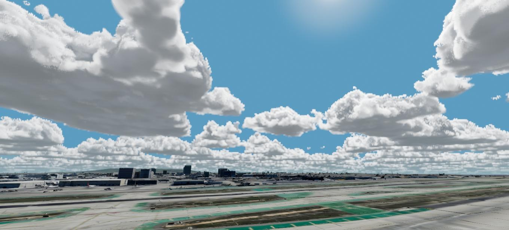
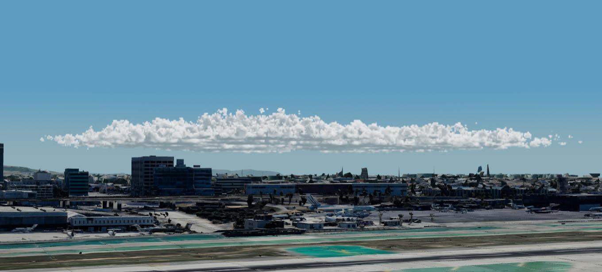
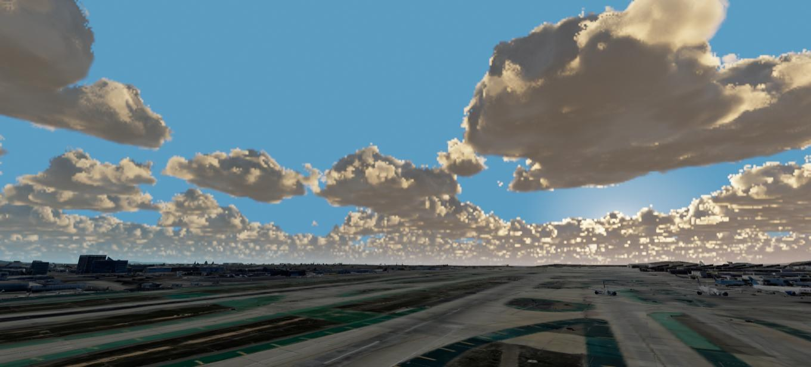

# Clouds

**Lighting → Clouds**

The Clouds folder adds layers of volumetric clouds to the sky of a custom sitch. The Sun lights
them: tops facing the Sun are bright, bases are gray, and edges toward the Sun glow. They drift
with the wind as the frames advance. Terrain in front of a cloud hides it, and distant clouds fade
into the same haze as distant terrain.

The cloud pattern is made from noise. It is not the real cloud cover for the date and place of the
sitch. Use it to show what a type of cloud at a given altitude looks like from the camera, or to
check what a cloud layer would hide.

*The **Scattered Cumulus** preset at the default quality, seen from the ground.*

This is a different feature from **Add Clouds** on the ground menu. **Add Clouds** places one round
patch of flat cloud images, which you can move and resize with handles. See
[Adding Objects and Tracks](SceneObjects.md#clouds).

- [Quick start](#quick-start)
- [The Clouds folder](#the-clouds-folder)
- [Layer settings](#layer-settings)
- [Cloud types](#cloud-types)
- [Wind](#wind)
- [Quality and cost](#quality-and-cost)
- [Light, haze and other effects](#light-haze-and-other-effects)
- [Limits](#limits)

---

## Quick start

1. Open **Lighting → Clouds**.
2. In **Preset**, choose a sky, for example **Scattered Cumulus**. The first time, Sitrec makes the
   noise textures that shape the clouds. **Status** shows when they are ready.
3. Look at the sky in the look view. Clouds are drawn in the look view only, unless you tick the
   **M** box on the folder's title row.
4. If the ground is high, for example in the mountains, raise each layer's **Base Altitude** by the
   height of the ground. The default altitudes are above the WGS84 ellipsoid, not above the ground,
   so they suit a place near sea level.
5. To change the clouds, open the layer's folder (for example **Layer 1: Cumulus**) and change its
   settings.

The clouds are saved with the sitch.

---

## The Clouds folder

| Control | Default | What it does |
|---|---|---|
| **M** box (title row) | off | Draw the clouds in the main view |
| **L** box (title row) | on | Draw the clouds in the look view, and in reflective water in the look view |
| **Quality** | Medium | How much work the GPU does for the clouds. See [Quality and cost](#quality-and-cost) |
| **Preset** | | Replaces all the layers with a ready-made sky. If there are layers already, Sitrec asks first. You can undo it |
| **Add Layer** | | Adds a cumulus layer. A sitch can have up to four layers |
| **Status** | | *Off* (neither view draws clouds), *No layers*, *Making noise textures...*, or *Ready* with the number of visible layers |
| **Measure** | | Measures the time the clouds add to a frame. See [Quality and cost](#quality-and-cost) |
| **Cost** | | The result of the last **Measure** |

The presets:

| Preset | Layers |
|---|---|
| **Clear** | none |
| **Few Cumulus** | cumulus, coverage 0.25 |
| **Scattered Cumulus** | cumulus, coverage 0.45 |
| **Broken Stratocumulus** | stratocumulus, coverage 0.78 |
| **Overcast Stratus** | stratus from 400 m to 900 m, full coverage |
| **Fog** | stratus from −100 m to 250 m, full coverage, density 0.6. Where the ground is higher than about 250 m, raise **Base Altitude** to the ground |
| **Cirrus Veil** | cirrus over a thin cirrostratus veil |
| **Towering Storm** | one cumulonimbus in a disc 7 km in radius, and a cumulus layer with coverage 0.25 |
| **Cumulus Under Cirrus** | cumulus, coverage 0.4, under cirrus |
| **Altocumulus** | altocumulus, coverage 0.65 |

A preset that has a disc, such as **Towering Storm**, puts the disc about 50 km in front of the look
camera.

---

## Layer settings

Each layer has its own folder, named for its number and type, for example **Layer 2: Cirrus**. The
checkbox on the folder's title row shows or hides the layer. Lengths and altitudes are shown in the
units set in **Physics → Units**.

| Control | What it does |
|---|---|
| **Type** | The kind of cloud. Changing it sets Base Altitude, Thickness, Coverage, Cloud Scale, Detail and Wind Skew to the values for that type. See [Cloud types](#cloud-types) |
| **Base Altitude** | The altitude of the bottom of the layer, above the WGS84 ellipsoid (HAE, see [GIS Concepts](GIS.md)), not above the ground. For a sheet type, the altitude of the sheet. A stratus layer with its base at or below the ground is fog |
| **Thickness** | The height from the base of the layer to the top of the tallest clouds. Not shown for sheet types |
| **Coverage** | The fraction of the sky the layer covers: 0.2 is few clouds, 0.45 scattered, 0.75 broken, 1 overcast |
| **Density** | Multiplies how much light the clouds stop. 1 is the normal value for the type. Lower values give thinner, more transparent clouds |
| **Cloud Scale** | The horizontal size of the patches of cloud. A bigger value gives fewer, larger clouds |
| **Detail** | How much the edges are broken into small puffs and wisps: 0 is smooth, 1 is ragged |
| **Wind Skew** | How far the tops lean downwind, as a fraction of the thickness. Not shown for sheet types |
| **Extent** | **Whole Sky**: the layer covers the whole sky. **Disc**: the layer covers only a round area, for example one storm cell |
| **Center Latitude**, **Center Longitude** | The center of the disc. Shown only for a disc |
| **Radius** | The radius of the disc. Shown only for a disc |
| **Feather** | The width of the soft edge of the disc, inside the radius. Shown only for a disc |
| **Center on View** | Moves the disc to a point on the ground about 50 km in front of the look camera. Shown only for a disc |
| **Seed** | Change it to get a different pattern of clouds with the same settings |
| **Wind** | The folder that sets the wind that moves this layer. See [Wind](#wind) |
| **Delete Layer** | Removes the layer, after asking you. You can undo it |

*A cumulus layer with **Extent** set to **Disc**, 12 km in radius, seen from about 50 km away.*

---

## Cloud types

There are two kinds of type. A **volume** type has a base and a top, and the camera can fly into it.
A **sheet** type is a thin layer at one altitude, drawn as a flat surface with a pattern.

| Type | Kind | Base altitude | Thickness | Coverage | Cloud Scale |
|---|---|---|---|---|---|
| **Cumulus** | volume | 1,500 m (4,921 ft) | 1,500 m | 0.45 | 4 km |
| **Stratocumulus** | volume | 1,200 m (3,937 ft) | 800 m | 0.75 | 3 km |
| **Stratus** | volume | 300 m (984 ft) | 400 m | 1 | 6 km |
| **Cumulonimbus** | volume | 1,000 m (3,281 ft) | 9,000 m | 0.7 | 9 km |
| **Altocumulus** | sheet | 4,000 m (13,123 ft) | | 0.6 | 1.5 km |
| **Cirrus** | sheet | 9,000 m (29,528 ft) | | 0.5 | 8 km |
| **Cirrostratus** | sheet | 8,000 m (26,247 ft) | | 1 | 20 km |
| **Cirrocumulus** | sheet | 7,000 m (22,966 ft) | | 0.6 | 700 m |

The values are the defaults that **Type** applies. You can change each of them after. The altitudes
are above the ellipsoid, so at a high place a layer can start below the ground: raise
**Base Altitude** by the height of the ground.

- **Cumulus** clouds have domed, lumpy tops and flat bases.
- **Stratocumulus** is a lower, flatter layer of joined clouds with gaps.
- **Stratus** is a flat gray layer. With full coverage it is an overcast sky, and with its base at or
  below the ground it is fog.
- **Cumulonimbus** is a storm cloud. It is tall, and it spreads out into an anvil near its top. Use
  it with **Extent** set to **Disc**.
- **Altocumulus** and **Cirrocumulus** are patterns of small cells with gaps between them.
- **Cirrus** is thin streaks along the wind.
- **Cirrostratus** is a thin, almost even veil.

*Four of the types, seen from the ground at the default quality.*

---

## Wind

Each layer moves with its own wind. The pattern of the clouds is the pattern at frame 0. At a later
frame, the clouds have moved by the wind over the time since frame 0. The same frame always shows
the same clouds.

In the layer's **Wind** folder:

| Control | What it does |
|---|---|
| **Source** | **Atmospheric Profile**: the wind at the layer's altitude from a loaded sounding, or Local Wind if no sounding is loaded. **Local Wind** and **Target Wind**: the sitch's wind settings, at the layer's altitude. **Custom**: the direction and speed below. **None**: the clouds do not move. The default is **Local Wind** |
| **From (°)** | The direction the wind comes *from*, in degrees true: 0 is north, 90 is east. Shown only for Custom |
| **Speed (knots)** | The wind speed. Shown only for Custom |

For a volume type, the wind is taken at the middle of the layer's thickness. For a sheet type, it is
taken at the sheet's altitude. When the Local Wind or Target Wind changes with time, the clouds
follow each change: they do not jump. To load a sounding, see [Wind in Sitrec](Wind.md).

---

## Quality and cost

Clouds take more work from the graphics processor (GPU) than most of the scene. **Quality** sets how
much. Every level shows the same clouds with the same brightness. A higher level adds detail and
sharpness, and takes more time.

| Level | Resolution of the clouds | What you get |
|---|---|---|
| **Low** | a quarter of the view's | The fastest. Soft, blocky edges, and no fine detail |
| **Medium** | three eighths of the view's | The default. Billows, and wisps near the cloud surfaces |
| **High** | half of the view's | Finer detail, and sharper shadows between the billows |
| **Ultra** | all of the view's | The slowest. For still images and exported video |

The clouds are calculated at the lower resolution and then enlarged to fill the view. The
enlargement uses the depth of the scene, so a cloud does not bleed over the edge of a nearer ridge.

*The same part of a cumulus cloud at the four levels, enlarged so that the pixels show.*

**Measure** shows what the clouds cost on your computer. It draws each view that shows clouds
several times with the clouds and without them, and shows the middle difference, for example
*Look view: 1.6 ms*. Pause the playback first. The measurement takes about a second. The cost
changes with the size of the view, the quality, the clouds in view and the computer.

A view that does not show the clouds costs nothing for them. This is why only the look view draws
clouds by default.

---

## Light, haze and other effects

- **Sunlight.** The Sun's direction and color come from the date, time and place of the sitch, as for
  the rest of the scene. Near sunrise and sunset the light on the clouds turns yellow and red. A high
  cloud can stay lit after the Sun has set on the ground, and a cloud in the Earth's shadow is dark.
- **Light through the cloud.** A thin cloud lets light through, so its base is light gray. A thick
  cloud has a darker base.
- **Night.** As the Sun goes from 6° to 12° below the horizon, the light on the clouds changes from
  sunlight to moonlight. With a bright Moon, the clouds are gray with moonlit tops. With no Moon,
  they are dark shapes against the stars. A cloud hides the stars behind it.
- **Eclipses.** During a solar eclipse, the sunlight on the clouds is dimmed by the eclipse. The amount
  is calculated at the camera.
- **Haze.** Distant clouds fade into the same haze as distant terrain, set by **Lighting →
  Atmosphere**. With Atmosphere off, the clouds have no haze. See
  [Atmospheric Aerial Perspective](AtmosphericAerialPerspective.md).
- **Terrain and objects.** Terrain and buildings in front of a cloud hide it. A cloud in front of
  terrain or a 3D model covers it.
- **Refraction.** When terrestrial refraction is on (**View** menu), the clouds are lifted by the same
  amount as the terrain at the same distance. See [Atmospheric Refraction](Refraction.md).
- **Projections.** The clouds are drawn in fisheye and orthographic views too. See
  [Fisheye (Allsky) Projection](Fisheye.md).

*The same layer of cumulus with the Sun low in the sky.*

---

## Limits

- The clouds cast no shadows on the ground, and one layer casts no shadow on another.
- There is no rain, snow or lightning.
- Sheet types are flat: the camera cannot fly into them.
- In a wide view, distant clouds close to the horizon can show a fine dotted texture at Medium and
  Low quality.
- The clouds can cover visibly less of the sky than the **Coverage** value.
- The clouds are not drawn in the physical thermal (infrared) image.
- In a VR headset, the clouds are drawn only where there is sky behind them. A cloud in front of
  terrain or an object is not drawn there.

---

## See also

- [The Lighting Menu](Lighting.md)
- [Atmospheric Aerial Perspective](AtmosphericAerialPerspective.md): the haze that distant clouds fade into
- [Wind in Sitrec](Wind.md): Local Wind, Target Wind and soundings
- [Adding Objects and Tracks](SceneObjects.md#clouds): the flat cloud patches of **Add Clouds**
