# Getting Started with Sitrec

Sitrec recreates a real-world event in an interactive 3D view, so you can line it up against a video or photo — terrain, sky, aircraft, satellites, the Sun, and stars, all at the right **place** and **time**. It was originally built to analyze US Navy videos of UAP (unidentified anomalous phenomena, a current term for UFOs). A **sitch** (short for *situation*) is one Sitrec scene: a place, a span of time, and the camera, tracks, objects and video that recreate an event. You can save and share a sitch, but it is a sitch before you save it.

This page is for new users. It takes you from a video or photo to a first recreation with the custom sitch tool.

## What Sitrec does, and what it cannot do

**A camera tells you the *direction* to an object. It never tells you the distance.** A light in the sky could be a drone 200 m away or an airliner 40 km away, and in the footage they can look identical. A single line of sight gives a direction, not a distance: from one fixed viewpoint, the bearing geometry alone does not fix the range.

So Sitrec does not work out what the object was. What it does is let you **test explanations**: put a plane, a satellite, a balloon or a lantern in the sky at the right place and the right time, and see whether it lands on your line of sight, moves the way the video shows, and looks right.

(Moving the camera helps. When the observer moves sideways relative to the object, the viewing direction changes. This is **parallax**. A camera on a moving aircraft can give you this. A phone on a tripod cannot. Parallax fixes the distance only for an object that does not move, or when you assume how it moves: see [The Ideas Behind the Traverse Analysis](TraverseConcepts.md). Other evidence can fix or limit the distance: contact with the ground, an object that passes behind something at a known distance, or a known size.)

## The four things you need

Whatever your footage, you are trying to pin down four things — the **DTLD**:

| | |
|---|---|
| **D**ate | Which day. Wrong day, wrong sky |
| **T**ime | As exact as you can. A low-orbit satellite moves more than 7 km in one second, and an airliner about 15 km in one minute. The Sun, Moon and stars move about 0.25° in one minute |
| **L**ocation | Where the camera was |
| **D**irection | Where it was pointing, and how zoomed in |

Often one or two are missing, and part of the work is using the others to recover them. If you have none of them, Sitrec cannot help you.

## Start by watching one

Before building anything, load a finished sitch and just watch it. This is the fastest way to understand what the views are:

1. In the **File** menu, open the **Server** folder (its title starts with "Server", and it can start closed), then click **Open**. This brings up the sitch browser. Choose the **Featured** category — these are hand-picked, complete scenarios. You do not need an account to browse and open these; you only need one to *save* your own.
2. Load one and press **spacebar** to play it. Or click straight through to the [Aguadilla sitch](https://www.metabunk.org/sitrec/?sitch=agua).
3. Drag inside the **main view** to look around. Drag the timeline in the playback bar at the bottom of the screen to scrub through time.

You are looking at, typically: the **main view** (the god's-eye 3D view), the **look view** (what the camera sees, simulated), the **video view** (the actual footage), and some graphs.

Before you build, read these parts of the [User Interface](UserInterface.md) guide: [Views/Windows](UserInterface.md#viewswindows), [Sliders](UserInterface.md#sliders) and [Navigating the Main View in 3D](UserInterface.md#navigating-the-main-view-in-3d). In particular, hold **`Q`** to move or resize a view.

Here's an informal video demonstrating many of the concepts described here:
<https://www.youtube.com/watch?v=EMjTDRKbK5U>

## Which of these are you?

To build your own, start a blank sitch. **File → New Sitch (Empty)** starts a fresh custom sitch, and the
**New Sitch** button on the start screen and in the sitch browser does the same. Or go straight to `?sitch=custom`. Then
follow whichever of these describes your situation:

### A. "I filmed it myself, from the ground"

The case with the least data. You have a video or photo, you know
roughly where you were standing and roughly when.

You will not be dragging in a track. The camera stays at one place on the ground, and you
check or set it by hand:

1. **Drag in the original file first**, before you change anything else. Many phones record the
   time and place in the video file. Sitrec uses those values only if you have not yet set the
   time or moved the camera. See
   [Time and location in a video file](LoadingVideo.md#time-and-location-in-a-video-file).
2. **Check the time** in the **Time** menu. If it is missing or wrong, set it: see
   [Setting the date and time](#setting-the-date-and-time).
3. **Check the location** in the Camera menu's **Location** folder. If it is missing or wrong, type
   a street address in **Lookup**: see
   [Setting the camera or target location by name](#setting-the-camera-or-target-location-by-name).
4. **Point the camera.** Drag in the **look view** to turn it, and use the mouse wheel to zoom. Find
   the direction from a landmark, a star or your memory of the scene. Zoom until the scene has the
   same size as in the video.
5. **Load what could have been there.** See [What was in the sky?](#what-was-in-the-sky)
6. **Compare** the look view with the video, frame by frame.

[Adding and Syncing Video](#adding-and-syncing-video) has more on video formats, the frame rate and
the sync. Also see
[Recreating a Starlink Situation (the steps apply to any ground sighting)](Starlink.md#recreating-a-starlink-situation).

### B. "It was filmed from an aircraft, and I have the flight track"

Drag the track in and Sitrec will put the camera on it. [Custom Sitch Basics](#custom-sitch-basics)
lists the formats Sitrec can read. Continue at [A Single Simple Track](#a-single-simple-track) below.

### C. "I have video with metadata embedded in it"

Military or drone footage that records where the camera was and where it was pointing. This is
the richest case — the geometry is largely given to you rather than set by hand.
[Custom Sitch Basics](#custom-sitch-basics) lists the formats Sitrec can read. Continue at
[Complex Tracks and Video](#complex-tracks-and-video).

---

## Custom Sitch Basics

A **sitch** (short for *situation*) is one Sitrec scene: a place, a span of time, and the camera, tracks, objects and video that recreate an event. A sitch that recreates a video has some fundamental components:

- The Camera Position
- The Camera Heading
- The Camera's field of view
- Other known objects in the scene
- A potential UAP

The position of the camera, and the other known objects, is defined by a **track** — just a list of positions at known times, sometimes with other data embedded in the same track, like where the camera is pointing.

> **Don't have a track?** That is fine and normal — see route **A** above. A fixed camera on
> the ground is set by hand, under **Camera → Location**, and needs no track at all.

To get a track into Sitrec, just import it (again, either with **File → Import File**, or by dragging and dropping it directly into the browser window). The currently supported track formats are:

- **KML or KMZ formatted ADS-B tracks.** *ADS-B* is the position signal airliners broadcast continuously; flight-tracking sites record it and let you export a flight as a KML file. These are typically exported from FlightRadar24, FlightAware.com, or ADS-B Exchange — see [KML Data Sources](KMLDataSources.md) for which export button to press on each, and which altitude option to choose.
- **ADS-B traces fetched by aircraft.** For a sighting within roughly the last 24 hours you can skip the file export: **Contents → Import ADS-B Track...** asks for the aircraft's ICAO 24-bit hex address (shown on most flight trackers) and fetches its recent positions directly from adsb.lol. Dragging in a downloaded readsb `trace_full_*.json` file works too.
- **DJI drone data.** The `.srt` subtitle file a DJI drone writes alongside its video can be dragged in directly. The flight log is different: it has to be extracted from the encrypted data file to CSV using an online service.
- **CSV files.** A generic CSV needs a time column, plus latitude and longitude or a grid column. Sitrec recognizes many common header names: see [Generic CSV](Tracks.md#generic-csv) for the list.
- **MISB KLV files.** *MISB* is a military standard for metadata recorded alongside video: where the camera was, where it was pointing, and its zoom. *KLV* is the binary container that metadata travels in, usually embedded in a `.TS` video file. To import it into Sitrec you need to extract it, for example with ffmpeg (`ffmpeg -i truck.ts -map 0:1 -c copy -f data output.klv`). These files vary in format.

This list covers the most common formats, not all of them. See [Loading and Filtering Tracks](Tracks.md) for the rest.

There are other ways a track can be created, for example from a file listing speed and bank angles of a plane over time. Importing a file like that is not currently supported in the custom sitch tool, as it generally requires custom code. For a simple jet track, the **Physics → Simple Flight Sim** folder (TAS, Turn Rate, Total Turn, Jet Heading) with the **Flight Sim** option in the Camera's **Position** selector can generate one.

(Sitrec is a work in progress, and I code largely around the data I have available. If there is a data format that is not supported that you have data available for, then I'd be happy to support it if you can give me the data. If you want it supported, but _can't_ give me the data, then that _might_ also be possible. Drop me a line: mick@mickwest.com )

# A Single Simple Track

So, you've got a track of a camera position, like an ADS-B track, just drag it in. You'll see something like this 
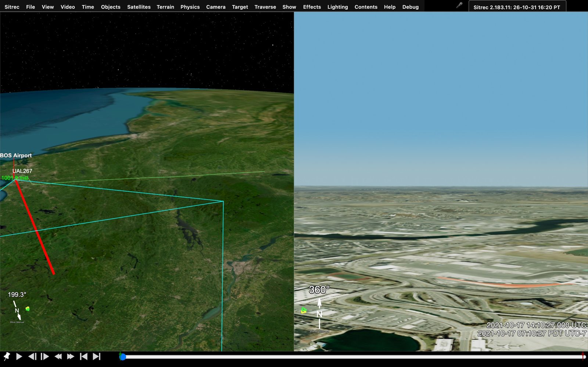

The main view is on the left, and the look view is on the right. The thin green line is the track, with its name beside it. The cyan outline is the camera's view, and the red line is its line of sight.

Sitrec will center the main view over the track you just loaded. The look view will initially be pointing North, but the camera will be locked to the start of the track you just loaded. The terrain around the start point will also be loaded.

If you zoom in you'll see more of the initial setup:
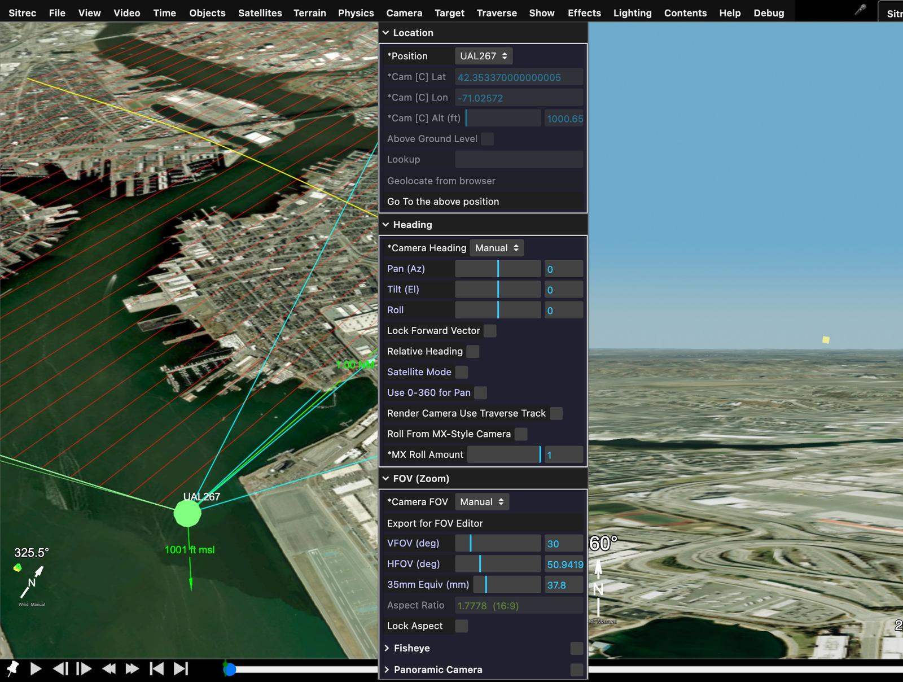

A * before a label in these pictures appears only on a local build. The public site does not show it.

In the main view, the green line is the camera's track, and the white line beside it is the part of the track that the sitch covers. The green ball marks the camera's position on the track. The cyan lines are the edges of the camera's view. The green arrow shows the camera's altitude, and the green line marked 1.00 NM shows the distance from the camera to the traverse. **LOS Traverse Method** is set to "Constant Altitude" here, so that the traverse shows as a path.

The Camera essentially has three sets of parameters: Position, Heading, and Field of View (FOV). You see these three sources in the Camera menu, which is organized into sub-folders: **Location** (led by the **Position** selector), **Heading** (led by the **Camera Heading** selector), and **FOV (Zoom)** (led by the **Camera FOV** selector). There's also a **Camera Tweaks** sub-folder for less-common adjustments. Each selector is a drop-down menu, because each one is a _data source_. [The Camera and Target Menus](CameraAndTarget.md) is the full reference for every source and control.

By default when you load a single simple track (i.e. a track with no heading or FOV info embedded in it), you get the following setup:

- **Position**: the loaded track's name (e.g. the flight number) - meaning the camera will move along the track you just loaded
- **Camera FOV**: Manual - meaning you manually control the FOV with the slider in the FOV (Zoom) folder
- **Camera Heading**: Manual - meaning you set the heading yourself with the PTZ (pan/tilt/roll) controls below

### Camera Heading: Manual & PTZ

You can adjust the camera heading using the PTZ controls. These default to absolute values (the "Relative Heading" check box is off). So a pan of 0° means north, and a tilt of 0° means level with the ground under the camera. A positive tilt goes up, negative goes down. Pan runs from -180° to +180°, so west is -90°; tick **Use 0-360 for Pan** if you would rather give it as a compass bearing (west = 270°). It is the same angle written two ways, and nothing but the slider changes. 

Changing the PTZ mode to "Relative Heading" (check the box) means that the heading is relative to the jet's path over the ground. This allows you to simulate looking forward (Pan = 0°), or to the pilot's left or right.

In the close-up image above you will see red lines. These are _lines of sight_ (LOS) — the camera's center axis at each frame, with the default **LOS Source** of **Camera Center** — showing where the plane's camera is looking. A line of sight passes through the object only when the camera points at it. See the [Glossary](Glossary.md).

There's also a yellow line, the **Traverse**. This is where the object would have been, *if* you accept one particular assumption.

**Traverse → LOS Traverse Method** selects how Sitrec calculates it. Most methods choose one path along the lines of sight, from one assumption: that the object held a constant altitude, or a constant speed, or drifted with the wind. A different assumption gives a different path that fits the same lines of sight. [Traverse Methods](TraverseMethods.md) lists what each one assumes.

The default method, "Target Object", is different: the traverse simply follows the target track, so it lies on the lines of sight only when the camera points at the target. With a fixed target it stays at one point, so you see no path until you select another method, such as "Constant Altitude". More on Traverses later — and see [Traverse Analysis and the Verdict](TraverseAnalysis.md).

In addition, there is the Traverse Object, which defaults to a cube. You can change this in the **traverseObject** folder of the Objects menu. For example if you wanted to simulate a plane flying 1NM to the pilot's left, you could:

- Tick **Relative Heading**
- Set **Pan (Az)** to -90° (i.e. 90° left of the plane)
- In the Traverse menu, set **LOS Traverse Method** to **Constant Distance**
- Set **Tgt Start Dist (NM)** to 1
- In the **traverseObject** folder, set **Model or Geometry** to "model"
- Set **Model** to "737 MAX 8 BA"

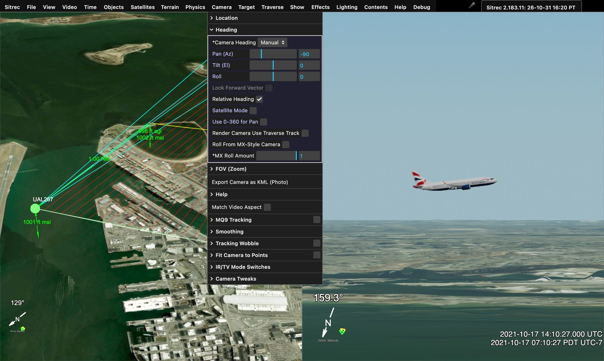

You might not see the plane in the main view, but if you zoom in it's there. The look view here is also zoomed in.

### Camera Heading: To Target

To point the camera at a target, set **Camera Heading** to **To Target**. The target can be another track (see later), or a fixed point: set **Target Track** to **Manual** in the Target menu. You can then adjust the Latitude, Longitude and Altitude to a particular spot. This can be done by editing the numbers directly, or by holding down the "X" key while pointing at a spot on the ground.

When moving the target (or, later, the camera) the altitude is kept constant. Hold "C" to move a fixed camera the same way. Press the Shift key in addition to "X" to drop the target to 7 ft above the ground. For example:
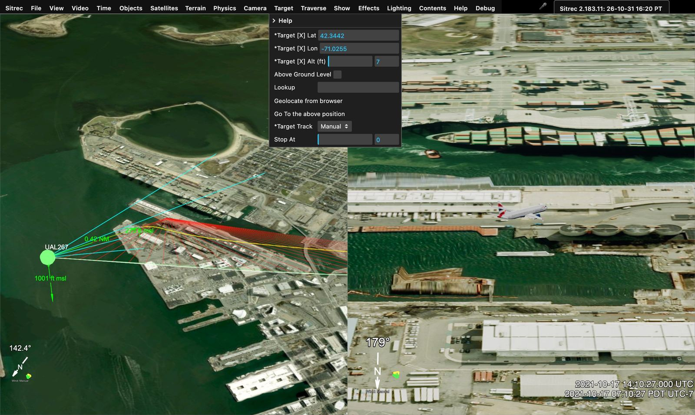
Here the target has been set on a pier. With the default method, "Target Object", the traverse object sits on the target. With a method such as "Constant Distance", it sits on the line of sight at that distance from the camera, as in this image.

### Fixed camera

You can fix the camera to a particular point by selecting "Manual" from the "Position" dropdown (in the Camera menu's Location folder).  You can leave the target fixed to create a static scene, or you can change the target track to the plane's track. Set **Camera Heading** to **To Target**, so that the camera follows the target.

Example:
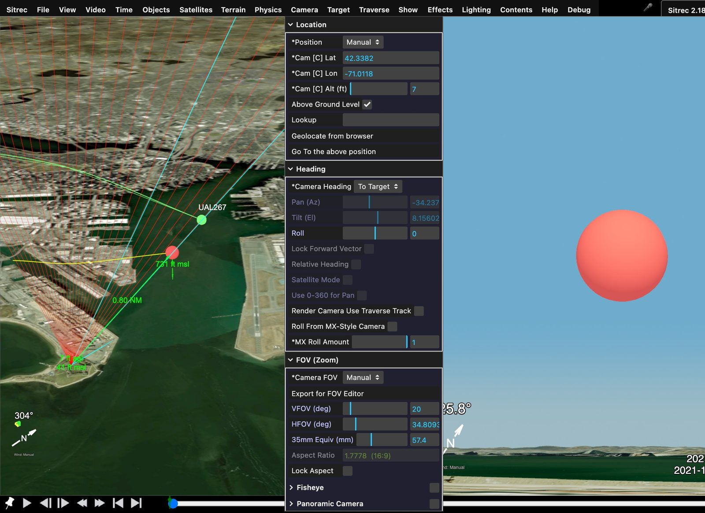

Here the camera is fixed on the ground, and the target track is set to the plane's track (UAL267, the flight number). The traverse is set to "constant altitude" and the traverse object is set to a large red balloon. In the main view, the green ball is the plane on its track, and the red ball is the traverse object, 0.80 NM from the camera on the line of sight.

With Camera Heading set to To Target, Pan and Tilt are greyed out, because the target sets the direction. Set the zoom with the "VFOV (deg)" slider in the Camera menu's FOV (Zoom) folder.

### Setting the camera or target location by name

You don't have to know coordinates. The **Camera** menu's **Location** folder (and, for the target, the **Target** menu) has three handy controls for positioning a fixed camera or target:

- **Lookup** — type a **place name** (e.g. "Phoenix, AZ"), `lat,lon` coordinates in any form (decimal degrees, degrees minutes seconds, hemisphere letters — see [Coordinate formats](GIS.md#coordinate-formats)), an MGRS grid reference, a `lat,lon,altitude` triple, or an ECEF `x,y,z` triple in metres, and Sitrec jumps there. The last two also set the altitude; everything else drops to ground level.
- **Geolocate from IP Address** — sets the position to an approximate location found from your IP address, 3 m above the ground. It does not use the browser's location permission.
- **Go To the above position** — moves the view to it.

### Placing things with a right-click

You can also place things straight onto the map. **Right-click the ground** in the main view or the look view to open the **Ground** menu. The top of it shows the location you clicked. Useful items to start with:

- **Set Camera Above** / **Set Camera on Ground** — move a fixed camera to that point, at its current altitude or at eye level, 2 m above the ground.
- **Set Target Above** / **Set Target on Ground** — the same for a fixed target, but on the ground, not at eye level.
- **Add 3D Object** — put an object that stays in one place, for example a known landmark or a candidate object.
- **Add Moving Object**, **Add Moving Object (In→Out)** and **Add Flight Path** — draw a new track by hand, starting at that point.

The same menu also adds pins, balloons, buildings, clouds, ground overlays and grids. See [Adding Objects and Tracks](SceneObjects.md) for all of it.

## Two Simple Tracks

The basic configurations above really become more powerful when you have two tracks (or a complex track, see later). With two tracks typically one will be the camera, and one will be the target (a potential UAP). 

To get two tracks into Sitrec, you can just drag them in. You can drag in two at once, but the order is important, so it's better to do them one at a time. The first track will be the camera track. Use the second as the target: set **Target Track** in the Target menu to it, and set **Camera Heading** to **To Target**, if they are not already set.  For example:
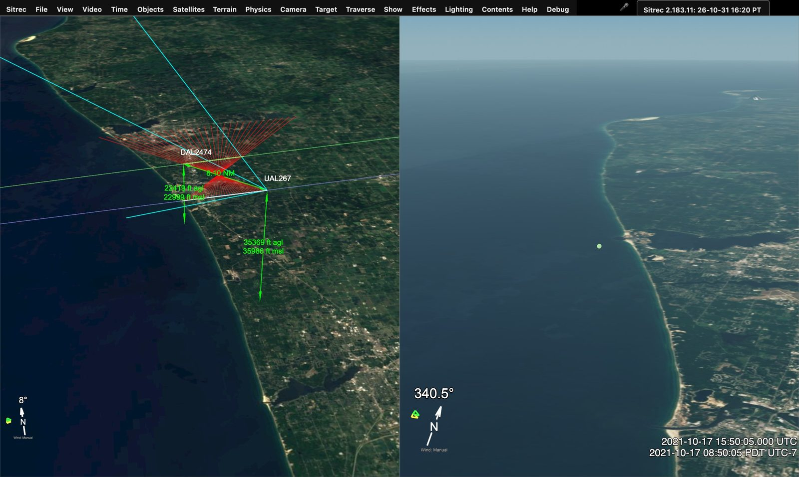
Here I dragged in two ADS-B tracks. The United flight is the one with the camera, looking down. The Delta flight, going in the opposite direction is the candidate UAP. I also set the time in the **Time** menu to 15:50:05 UTC, when the two flights are close to each other. Each track has its own color: here UAL267 is blue and DAL2474 is green. The green line marked 8.10 NM shows the distance between them. In the look view, the green dot at the center is DAL2474, the target.

**Map Type** in the **Terrain** menu is set to EOX in this picture and the next one. With ESRI World Imagery, the default, the water here shows a pale patch with hard edges. That patch is in the satellite imagery. It is not an object.

With the correct target set, we can add models, and zoom in. 
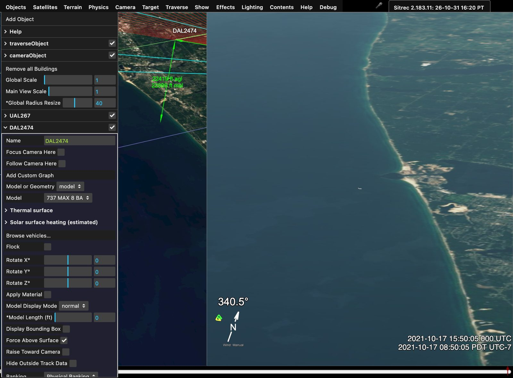

Here you can just barely see the 737 by the mouth of the estuary. At this range the 737 shows as a small shape with no visible wings. 

## Setting the date and time

Getting the time right is **crucial** — it determines where the Sun, Moon, stars, and satellites are, and how shadows fall. There are two key times, both shown at the top of the **Time** menu:

- **startTime** — the real-world time at frame 0 (the first frame of the video). A *frame* is one still image of the video.
- **nowTime** — the time at the *current* frame: the start time plus the elapsed frame time.

Both are shown in **UTC**, the world reference time.

The Year / Month / Day / Hour / Minute / Second sliders in the Time menu edit the **nowTime**; the timeline at the bottom of the screen (and the arrow keys) move you through the frames. A common workflow is to scrub (drag) to a frame with something distinctive on screen, then adjust the time until the simulation matches — Sitrec works out the start time for you. You'll do exactly this when syncing video, next.

**Use Time Zone in UI** is on by default, so these sliders show the selected **Time Zone**, not UTC. Select the zone that was in effect at your location on that date, then enter your local time. When the camera is at the right place, **Set Time Zone from Camera Location** selects that zone for you. See [Time zones](TimeAndSync.md#time-zones).

## Adding and Syncing Video

The example here continues from [Two Simple Tracks](#two-simple-tracks): a video filmed from an airliner, with ADS-B tracks for two flights. With a ground camera, you load the video and check the frame rate in the same way, but the sync uses whatever you can identify in your own video, such as stars. To load the video, just drag it in (or use **File → Import File**)
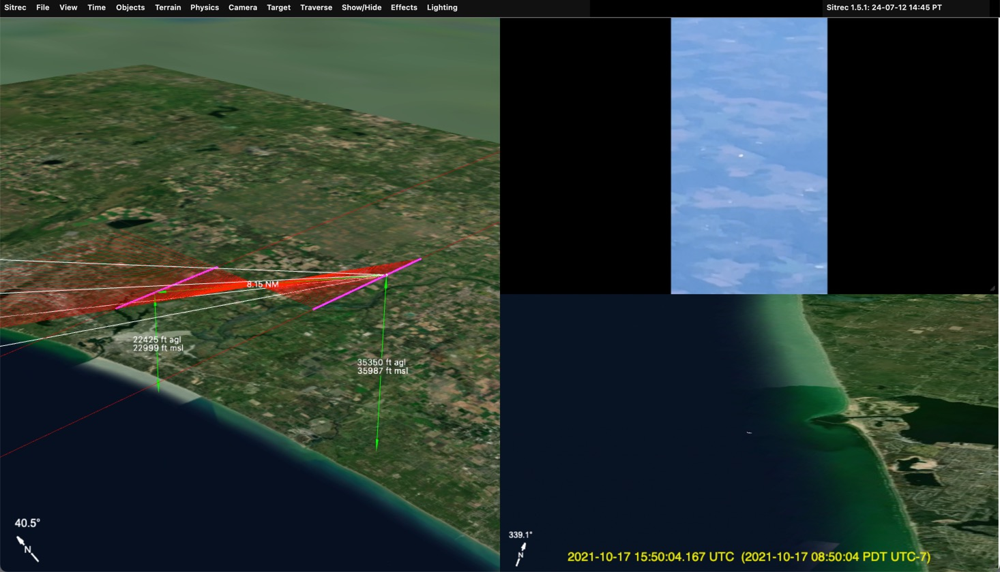

This screenshot and the next two are from an older version. The menu bar and the text on the views look different.

Note not all formats are supported. Try the original file first, with no edits, because a conversion or an edit can remove the recorded time and location (see [Time and location in a video file](LoadingVideo.md#time-and-location-in-a-video-file)). If it does not load, convert it to simple h264 .MP4 format with a constant frame rate. A dropped video file is read into memory in full (frames are decoded as you need them), so a converted copy is best kept small, 720p or 480p, and no longer than is needed. See [Loading and Adjusting Video](LoadingVideo.md) for the formats Sitrec can play.

**Check the frame rate and the length.** When a video loads, the sitch takes its length from it: in the **Time** menu, **Sitch Frames** becomes the number of frames in the video, and **Video FPS** becomes the frame rate Sitrec found in the file. Check that **Video FPS** is what you expect (for example 29.97 or 30). If the value is wrong, for example footage that was slowed down or sped up, type the correct value in **Video FPS**. **Sitch Duration** shows the same length as a time. See [Time, Frames and Syncing](TimeAndSync.md#length-and-frame-rate) and [Changing the frame rate](LoadingVideo.md#changing-the-frame-rate).

Here we see the "UAP" is similar in the look view and in the video, but the background is wrong. This is because the time so far is only an estimate from the tracks. That's not the actual start time of the video.

Complex videos (later) often have exact time code embedded. Here we have a simple video and two simple tracks, so we have to set the time manually. A good starting point is the time in the video file, but these times are often wrong or inaccurate.

To sync the time manually, use the timeline to advance the video to a distinctive point that will show up in the look view.
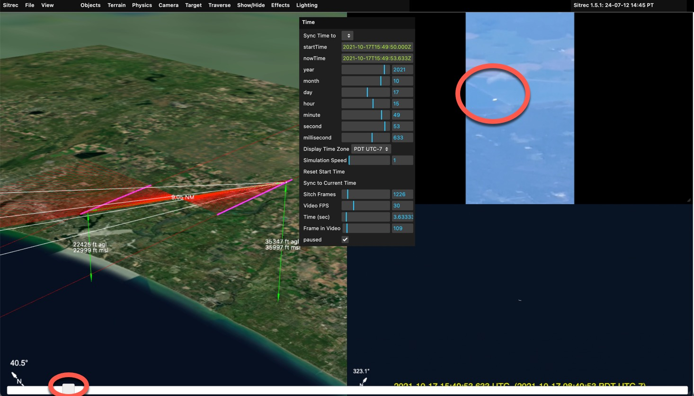
Here I moved it so the white object is over the boundary between two segments of a pond or reservoir. With that fixed, I now grab the **Second** or **Minute** slider in the Time Menu and drag it until it matches. I also adjust the zoom, and fine tune the **ms** slider
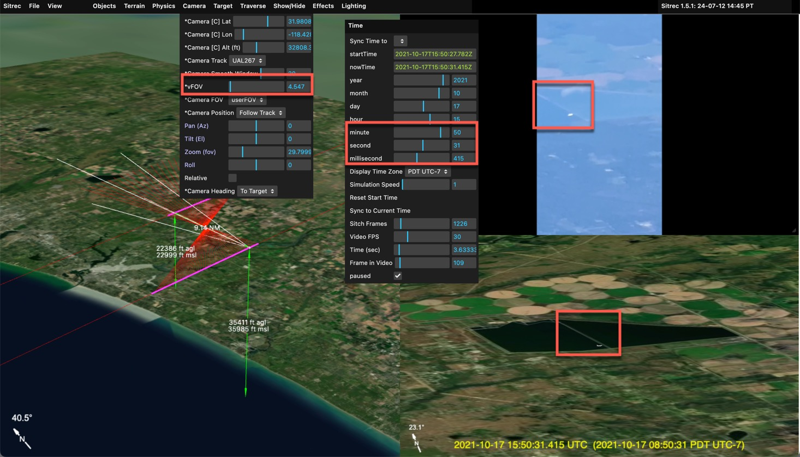

The target now lines up with the background. With the time now synced you can scrub back and forth on the timeline and observe that the target lines up with other distinctive parts of the background

With that you can adjust the effects to more closely match atmospheric, optical, and sensor effects. 
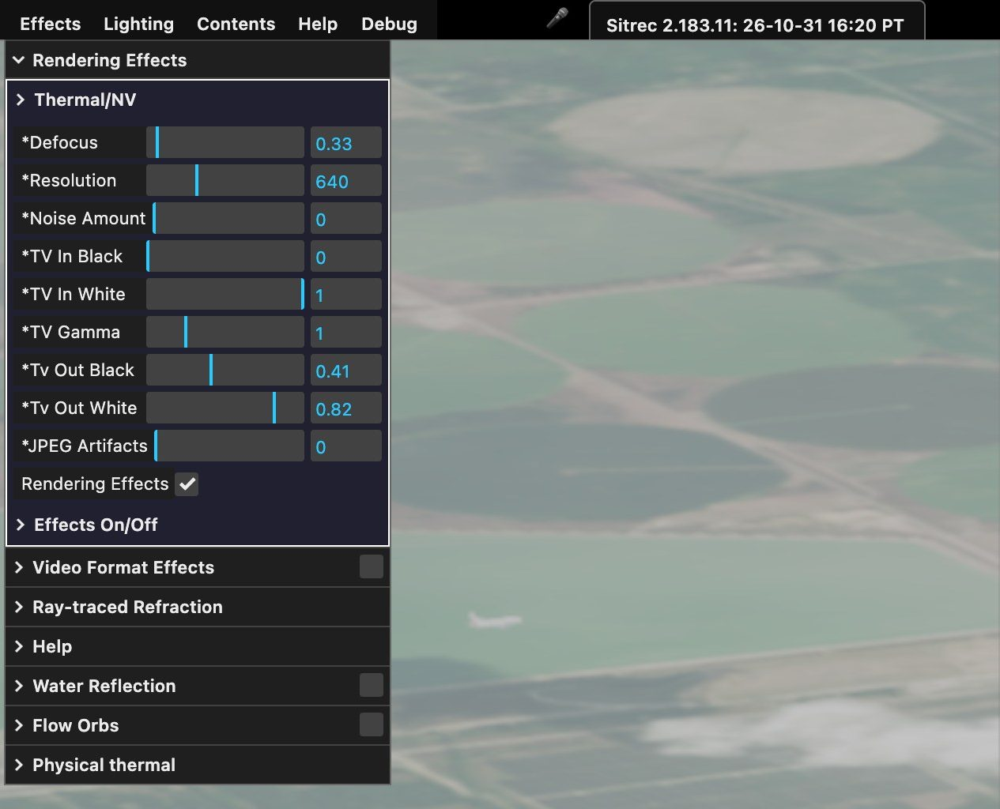

Here I bring in the Tv Out Black and White to simulate the haze. I also defocus slightly and reduced the resolution. 

For infrared or night-vision footage there are two dedicated sensor simulations in the effects menu: **Thermal** (white-hot/black-hot polarity, an Ironbow color palette, sensitivity, hot-spot bloom, and sensor noise) and **NightVision** (an image-intensifier look with phosphor green, gain, bloom, and a circular tube mask). Both live in the **Effects → Rendering Effects → Thermal/NV** folder — enable checkboxes and parameter sliders together. The enable checkboxes are labelled **Custom_Thermal** and **Custom_NightVision**. The **Rendering Effects** checkbox on the **Effects → Rendering Effects** folder is off in a new custom sitch; no effect in that folder shows until it is on.

NightVision also has an **NVG Sat Boost** slider (default 4). Real intensifier tubes show satellites the naked eye cannot, so while NightVision is enabled this multiplies satellite brightness in the look view — the same brightness the Sat Brightness slider controls. Set it to 1 for no boost.

Note in a situation like this, the target is often darker than anticipated. To match the brightness of the video, use **Scene Exposure** in the **Lighting** menu, and **Look Exposure** and **Highlight Rolloff** in **Lighting → Look View Output**. See [Match the video's exposure](Lighting.md#match-the-videos-exposure).

You can also drag in an image (for example JPG, PNG, GIF, WebP, BMP or TIFF) and it will act like a video. The current number of frames will not be changed. 

## Complex Tracks and Video

Some platforms, like DJI or other drones, or commercial and military cameras, encode additional data besides the camera position. Typically, this will include the direction the camera is pointing, possibly a track of the ground positions below the center cross-hairs, the field of view, and other things.

The MISB format is commonly used in military and law enforcement applications, but is not widely used by the public. However, MISB has a very rich data definition, covering everything you are likely to have in other formats. So I use MISB as an internal data representation. ADS-B tracks are converted to a MISB table (a spreadsheet) with just the position data. The DJI drone data contains FOV and heading data which likewise is converted into the relevant fields in an internal MISB table. 

Native MISB is also supported from original .TS files, or extracted in either KLV or CSV formats. I don't have many examples to work with, so if you've got any you can share, I'd appreciate it. Mick@mickwest.com

### Using a single MISB-style complex track. 

In the scenario where we have a single complex track, a plane or a drone is filming an object. So we will have the position of the camera, and then the heading and elevation angles, as well as FOV. We might also have a center track, which gives the ground point under the crosshair directly. 

Complex video is the original video file. You can use the original .TS file, or use it split into a data file (.CSV or .KLV) and a video file (.MP4). Splitting is useful as you can recode the video to fit in the size limits (and play back faster) Just drag the .TS file, or the extracted files, into Sitrec. Example:
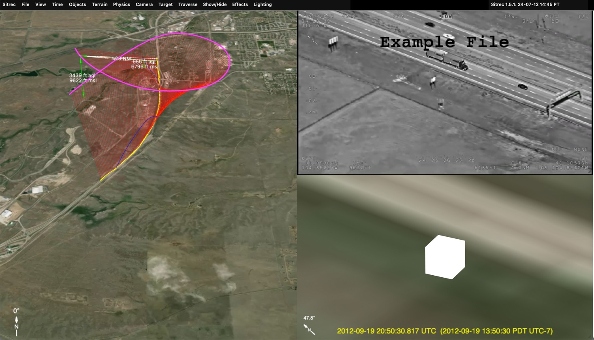

This screenshot is from an older version. Its menu bar looks different, and it shows the traverse in blue. The traverse is now yellow.

Here's what you see immediately after dragging in a MISB .TS file (or a .KLV and a .MP4). Since the MISB file contain time code information, it is automatically synced to the correct start time. The video file is used to set the length. This assumes the KLV and the Video start at the same time. If the video is just showing a portion of the MISB data, then you may have to manually adjust the start time.

In this instance we see the road is correct, but a bit low resolution. Zoom in, and Sitrec loads more detail: see below, and [Terrain and Elevation](Terrain.md).

## Adjusting the terrain

"Terrain" in Sitrec is the background graphics — i.e. the ground. Sitrec displays detailed background similar to Google Earth, controlled by the **Terrain** menu:

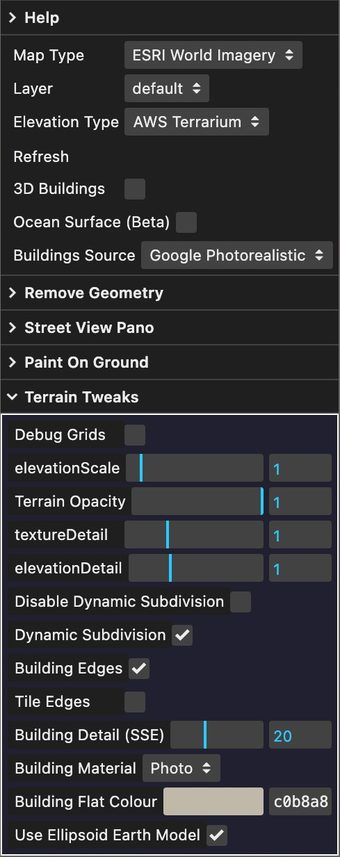

**Texture Detail**, **Elevation Detail**, **Disable Dynamic Subdivision** and **Building Detail (SSE)** appear only on a local build or for an admin. You will not see them on the public site.

By default, terrain uses **dynamic subdivision** (the **Dynamic Subdivision** checkbox in **Terrain → Terrain Tweaks**): as you move and zoom the camera, Sitrec automatically loads higher-resolution tiles where you're looking, so you don't normally need to set a center point or zoom level by hand. The main control you'll use is **Map Type**, which selects the imagery source (satellite, street map, etc.).

For **Elevation Type** and **3D Buildings**, see [Terrain and Elevation](Terrain.md).

For the MISB truck example the default terrain already covers the track; zooming in loads the detail automatically:

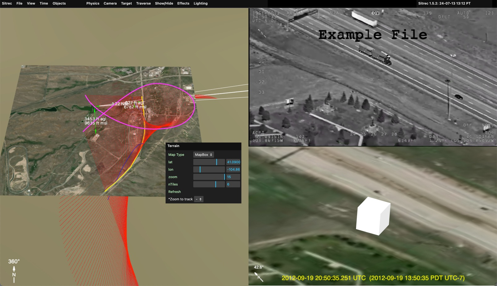

This screenshot is from an older version. Its Terrain panel and its terrain look different.

We see here the match between the video and the derived view. The center of both images is just below the road. We also see the shadow of the road sign in the upper left and the matching paths in the lower left. 

### MISB Traverse and Targets

This particular MISB file has a center track (meaning a track of the position of the ground behind the center crosshairs). Sitrec has taken this as the default target. Here's the setup immediately after dropping in the files:
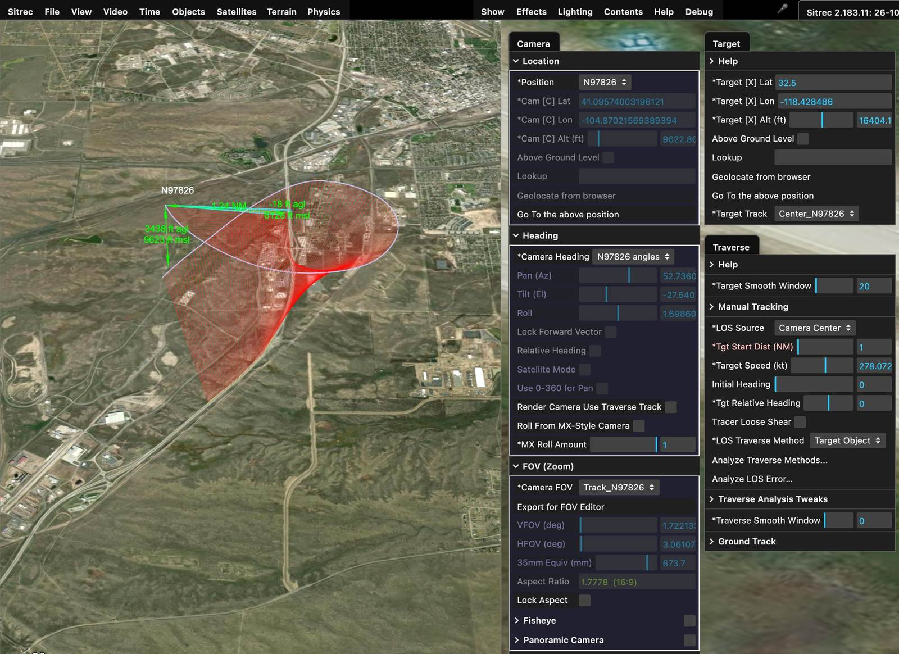

Here the Camera, Target and Traverse menus are dragged out of the menu bar, so that all three show.

The Camera track (the position of the camera) is set to the main position track in the MISB file, i.e. the "platform" (aircraft) position.

The file also has FOV data, so this is automatically selected for "Camera FOV" - you can change this back to manual if you like

The file also has the camera's own angles, so **Camera Heading** is set to the track's angles option (here "N97826 angles"). You can select **To Target** to aim at the center track instead.

The "Traverse" setup starts out as the default, "Target Object", with a start distance of 1 NM. This method does not use that distance. The traverse sits on the target, 1.24 NM from the camera here. The Lat, Lon and Alt rows in the Target menu are for a Manual target, so they do not apply here. Since we don't have a UAP in this case, and we know we are just following the truck, the traverse doesn't matter much here — the MISB center track is already used as the target (as noted above), so the traverse object simply drives along the road.

However, if we _did_ have a suspected UAP in the frame, then we would select one of the various LOS traverse methods (ways of traversing the lines of sight). For example, constant altitude:

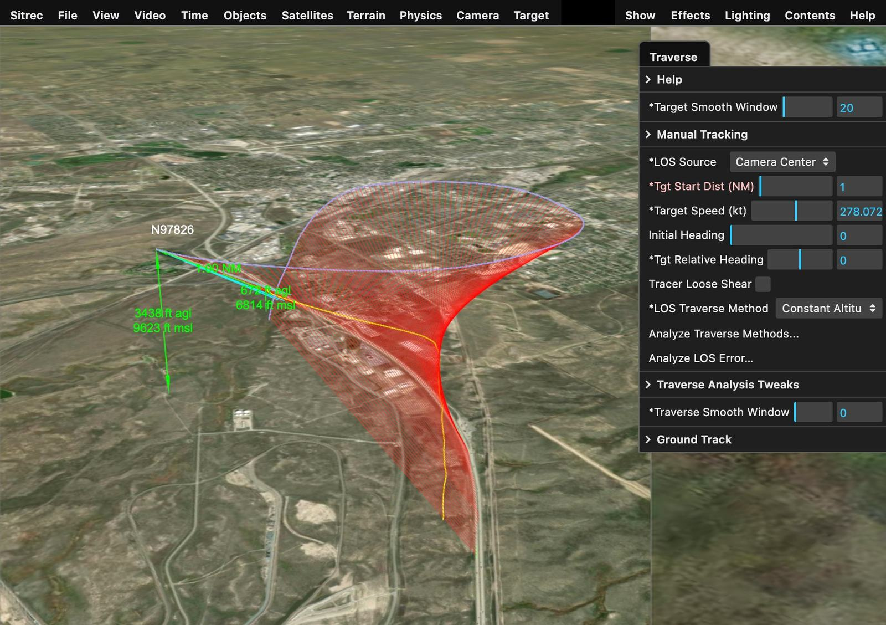

Here we still have a start distance of 1NM, and with the constraint that the altitude must remain constant, this creates the yellow path seen here. We can then add a traverse model to see what it looks like (again, this is assuming your video has some unidentified object in it)
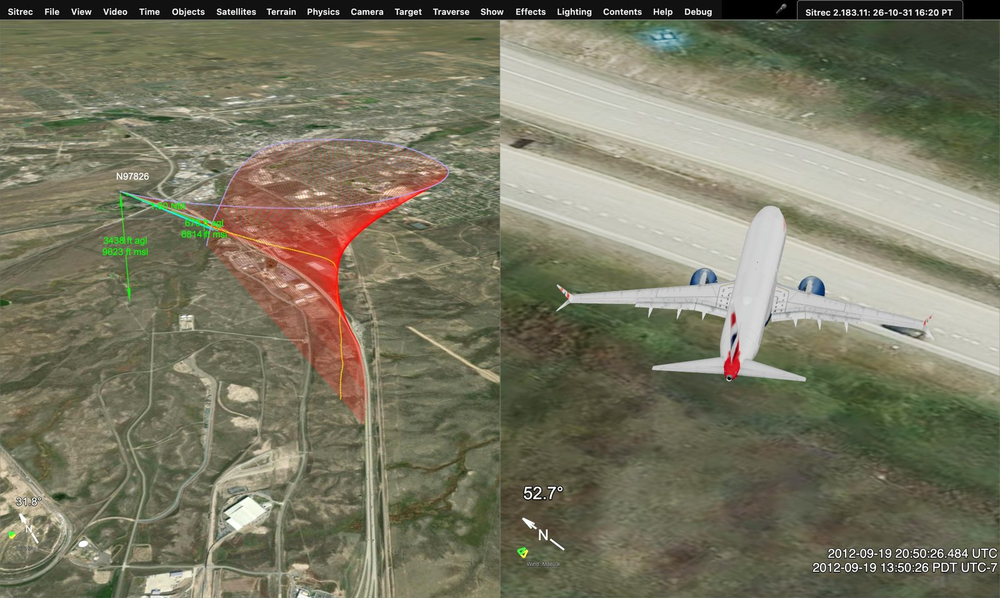

## Tracking an object and running the traverse analysis

When the object in your video is the unknown, the steps are:

1. **Line up the camera** with the video, as described above: position, heading, field of view and time.
2. **Mask the ground** if the object is over terrain, sea or cloud, so the tracking tools ignore those pixels: **Video → Masking**. See [Masking](Masking.md).
3. **Track the object**: **Video → Point Track**, then **Enable Point Track**, drag the yellow cursor onto the object, and **Start Point Track**. This gives the object's position in every frame. See [Point Tracking](PointTrack.md).
4. **Turn the track into lines of sight**: set **Traverse → LOS Source** to **Camera + Point Track**. Each frame now has a ray from the camera through the object.
5. **Test explanations**: **Traverse → Analyze Traverse Methods...** tries many assumptions against those rays and shows the results as a gallery, with a one-line verdict above it. See [Traverse Analysis and the Verdict](TraverseAnalysis.md).

With a camera that does not move there is no parallax. The verdict then reads *Insufficient evidence to discriminate.*, and the reported distances depend on each method's assumptions.

[The Ideas Behind the Traverse Analysis](TraverseConcepts.md) explains what the results mean.

## Adding satellites

Many sitches involve satellites — Starlink flares are one satellite scenario Sitrec supports in detail. Satellites are loaded from published orbital data, not from a file you usually provide:

- Set the date first. In the **Satellites** menu, click **Load LEO Satellites For Date** to download the low-Earth-orbit satellites for the simulation's current date/time — use this for past events. **Load ACTIVE Satellites** loads current, real-time positions instead. When the data has loaded, the text at the top right of the main view shows the date range of the data, then **In Range**: the percentage of the shown satellites that Sitrec can place at the sitch time. **In Range** does not measure accuracy, and data weeks from your date can show 100%. If the date range is far from your date, or **In Range** is red (below 95%) or missing, check the date and load again. See [Is the data good for this time?](Satellites.md#is-the-data-good-for-this-time)
- You can also **drag in your own orbital data file** if you have specific data — either CCSDS OMM in CSV, or a legacy TLE file. A TLE file does not need exact columns: one written with single spaces between fields, or without the international designator, is read field by field.
- For a single satellite you can **paste a TLE straight into Sitrec** (Ctrl/Cmd+V outside a text field, or press `G` and paste into the box) — the two element lines, with or without a name line above them. It is loaded exactly as a dropped TLE file would be, and saved with the sitch the same way. Indentation, tabs, blank lines and squeezed-out spaces do not matter: the elements are read field by field and written back out as a properly formatted TLE. Either way, if none of the satellites you load would show with the current satellite filters, **Other Satellites** is turned on so they do.
- **Show Satellites (Global)** toggles satellite display on and off.

Because orbital predictions drift over time, always load the data for the date you're investigating. **Load LEO Satellites For Date** never asks for a set newer than six days before today, so for an event in the last few days the set can end before the event — see [Investigating Starlink Flares With Sitrec](Starlink.md#wait-a-few-days-before-analysing-a-very-recent-event) for the full Starlink-flare workflow.

## What was in the sky?

With the time, location and direction set, the look view shows what the camera would see. To test a candidate, check that it is at the same place in the look view as the object in the video, on the same frame, and that it moves the same way when you scrub.

- **Stars and planets.** Open **Show → Celestial → Stars and Planets** for star and planet brightness, the star magnitude limit, and Physical Point Sources. The folder checkbox, **Render Stars and Planets**, hides or shows both, including the Sun and Moon and their name labels. Constellation lines and grids keep their separate switches.
- **Horizon compass.** Tick the **Show → Celestial → Horizon Compass** folder title to show compass directions and degree ticks along the sea-level horizon in the 3D views. Open the folder to adjust **Opacity** and **Text Size**. The ribbon follows camera direction, roll and zoom, and dips below the local horizontal at altitude. Hills can rise above it. Numbers stay upright and ticks stay vertical on screen. Degree labels normally appear every 10°, including beneath the cardinal directions.
- **Celestial lines.** Use **Show → Celestial → Lines** for constellation lines, the equatorial grids and their shared **Line Width** slider. The default width is 0.25 display pixels, adjustable in steps of 0.01.
- **Planets and stars.** In **Show → Celestial → Labels**, tick **Star/Planet Names in Look** to name the stars and planets in the look view. **Constellation Names** independently shows or hides constellation labels. Also tick **Planets Only in Look** to name only the planets.
- **Satellites.** Load them as in [Adding satellites](#adding-satellites), then tick **Satellite Labels (Look View)** in the **Satellites** menu.
- **Aircraft.** **Help → ADSB Replay for this time and location** and **Help → FlightRadar24 Replay Here** open a flight-tracking replay at the camera's position and the time of the current frame. Find the flights near you, then get a track for each one: see [KML Data Sources](KMLDataSources.md). Drag it in to see where that aircraft was.

## Save your sitch

Save often. **File → Server → Save** (or **Save As**) saves the sitch to the server, where you can reopen and share it; you need to be logged in. If you are not, the Server folder shows **Saving Disabled (click to log in)**: click it. On metabunk.org the login is a Metabunk forum account. To save to your own computer instead, use **File → Local → Select Local Sitch Folder** to choose a folder, then **Save Local**. See [Saving and Loading Sitches](SavingAndLoading.md).

## A few more basics

- **Units.** **Physics → Units** switches the displays between **Nautical**, **Imperial/US**, **Metric** and **Feet only**. See [Units](UserInterface.md#units).
- **Measuring.** **Show → Measurements → Add Measurement** shows an altitude, or a distance between two things, in the 3D views. See [Measurements](UserInterface.md#measurements).
- **Your own models.** Drag a `.glb` or `.ply` model file into the sitch to add your own 3D model. See [Objects and 3D Models](CustomModels.md).
- **Camera setup.** Every camera and target option is described in [The Camera and Target Menus](CameraAndTarget.md).

## Where to go next

**Basics**

- [User Interface](UserInterface.md) — menus, sliders, views, 3D navigation, units and settings.
- [Saving and Loading Sitches](SavingAndLoading.md) — keeping and sharing your work.
- [URL Parameters](URLParameters.md) — opening Sitrec with a sitch, file, location or time already set.

**Building the scene**

- [The Camera and Target Menus](CameraAndTarget.md) and [Camera View Modes: Normal and Satellite](satcam.md) — pointing the camera.
- [Adding Objects and Tracks](SceneObjects.md) — the ground right-click menu, buildings, clouds, overlays and grids.
- [Loading and Filtering Tracks](Tracks.md) — supported formats, filtering bad data, smoothing, and multi-track setups.
- [Objects and 3D Models](CustomModels.md) — built-in and imported 3D models.
- [The Lighting Menu](Lighting.md) — the Sun, exposure and atmosphere.

**Video and time**

- [Loading and Adjusting Video](LoadingVideo.md) — formats, frame rate, and the video view tools.
- [Time, Frames and Syncing](TimeAndSync.md) — the Time menu, In and Out frames, and syncing.
- [Motion Analysis](MotionAnalysis.md) — measuring how the picture moves, stabilizing, and ground tracks.
- [Rendering and Exporting Video](Video.md) — getting your recreation out as a video file.

**Analysis**

- [Point Tracking](PointTrack.md) and [Masking](Masking.md) — following the object through the video.
- [Traverse Methods](TraverseMethods.md), [The Ideas Behind the Traverse Analysis](TraverseConcepts.md) and [Traverse Analysis and the Verdict](TraverseAnalysis.md) — reconstructing and testing a target's path.

**Sky**

- [The Satellites Menu](Satellites.md) — loading and showing satellites.
- [Investigating Starlink Flares With Sitrec](Starlink.md) — a satellite scenario that has its own guide.
- [Star Tracker](StarTracker.md) — using the stars.
