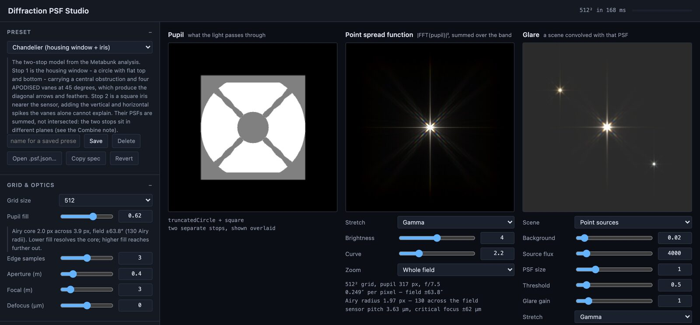

# Diffraction Glare

A bright point of light in a photograph rarely looks like a point. It grows spikes. Those
spikes are not in the sky — they are made by the camera, by the edges inside its aperture, and
their shape depends on the shape of that aperture.

Sitrec can reproduce this. You build a model of a camera's aperture in the **Diffraction PSF
Studio**, export it, and import it into a Sitrec camera. Every bright source in the look view
is then drawn with that camera's own diffraction pattern.

You can use it to compare a camera's modelled diffraction pattern with a bright source in
footage.

---

## The short version

1. Open the **Diffraction PSF Studio** from **Sitrec → Extra Tools**. It is at `tools/psf/`.
2. Pick a preset, or build the aperture: outer shape, central obstruction, spider vanes (the
   thin supports that hold a telescope's secondary mirror).
3. Press **Download .psf.json**.
4. In a custom sitch: **Camera → Camera Tweaks → Diffraction Glare → Import PSF…**
5. Tick **Rendering Effects** in **Effects → Rendering Effects**, then tick
   **Custom_DiffractionGlare** in **Effects → Rendering Effects → Thermal/NV**.
6. If the source is a star or a planet, turn on **Show → Celestial → Stars and Planets → Physical Point Sources**.
7. Aim the look camera at a bright source, such as a bright star at night, and narrow the field
   of view, for example to 0.5°. At a wide field the pattern covers only a pixel or two. The
   source then shows its pattern of spikes.
8. Adjust **Glare Gain (10^)** in the camera's Diffraction Glare folder. It starts at 3.

---

## Where the spikes come from

Light passing an edge spreads. The image of a point source is therefore not a point but a
pattern — the **point spread function**, or [PSF](Glossary.md) — and its shape is set entirely by the shape of
the opening the light came through.

Three rules describe the main features:

**A straight edge throws a spike perpendicular to itself.** A hexagonal iris throws six spikes.
A square stop (an opening that limits the light) throws four: a vertical pair and a horizontal
pair. A perfect circle has no straight edge anywhere, and throws no spikes at all — only the
faint concentric rings of the Airy pattern.

**Each spider vane throws one spike pair.** So N vanes give 2N spikes — *unless* they pair up
into straight lines. Four vanes at 90° are two straight lines, so they give four spikes, not
eight. Three vanes at 120° are not, so they give six. This is why a three-vane telescope
produces the six-pointed stars you see in a lot of astrophotography.

**A wavy or serrated vane edge smears its spike sideways.** A vane with a straight edge throws a
hairline. A vane whose edge waves has no single orientation, so its spike fans out into a broad
feather — an *aigrette*. Some instruments do this deliberately, to spread glare instead of
concentrating it.

And one more, which is why the spikes are colored: **the pattern scales with wavelength.** Blue
light diffracts less than red, so the blue copy of the pattern sits inside the red one. A spike
is therefore a spectrum smeared along its own length, reddening outwards.

Four presets from the Studio. The top row shows the shape of each opening, white where light passes. The bottom row shows its PSF. The plain circle gives rings and no spikes. Four straight vanes give four hairline spikes, and three vanes give six: in the Cassegrain panel, the vertical vane gives the horizontal spike pair. The serrated vanes give feathers. The line under each PSF gives the Studio's display settings. The faint square around each spiked pattern is where the Studio's computed field ends for most of the light. It is not part of the pattern, and the spikes stop there because the field stops. A shorter wavelength has a smaller field, so the band just inside the square is red. The circle uses a lower **Brightness** and **Zoom** 8×, because its rings are lost in the bright core at the other settings. Here each opening is scaled to one size. In the Studio, its size depends on **Pupil fill**.

---

## The Diffraction PSF Studio

`tools/psf/` — a standalone page, no install, nothing sent anywhere.

Three panels: the **pupil** you are building (the shape of the opening, as the light sees it),
the **PSF** it produces, and a **glare** preview showing a scene through that optic.

The Studio opens on the Chandelier preset, shown above, with its controls in the column on the left. This preset has two stops, so the **Pupil** panel overlays them: white is open in both stops, and gray is open in one. The **Glare** panel shows three point sources of different brightness.

### Presets

Every preset is a complete, editable starting point. Loading one fills the controls; change
anything you like from there, and **Save** it under your own name to keep it.

| Preset | What it shows |
|---|---|
| Unobstructed circle (Airy) | The reference case — no spikes at all |
| Newtonian, 4 straight vanes | Four vanes, four hairline spikes |
| Cassegrain, 3 vanes | Three vanes, six spikes |
| Camera iris, 6 blades | Spikes from the diaphragm blades alone |
| Square iris only | A vertical pair and a horizontal pair of spikes |
| Segmented hexagon + 3 vanes | Hexagonal pupil plus vanes |
| Apodised vanes (feathered spikes) | Serrated edges, and the feathers they produce |
| Chandelier (housing window + iris) | A two-stop model of a gimballed camera housing, after the Metabunk analysis in [PR038: The "Chandelier" UFO](https://www.metabunk.org/threads/pr038-the-chandelier-ufo.13307/). Its 0.40 m aperture is an assumed value |
| Mid-wave infrared, unobstructed | 3–5 µm, with an estimated 0.135 m entrance pupil and f/5 beam |
| Mid-wave infrared, catadioptric | The same band and aperture, with a central obstruction and four support vanes |
| Chandelier, infrared band | The Chandelier two-stop model with a 3–5 µm angular scale |

### Controls worth understanding

**Pupil fill** is how much of the computation grid the aperture occupies. It sets a trade-off
you cannot avoid: a small fill samples the bright core finely but covers a narrow field, a large
fill covers a wide field with a core only a pixel or two across. The panel warns you when the
core has become too small to be real.

**Aperture (m)** is the diameter of the entrance pupil: the limiting opening as seen from the
front of the optics. It is not the diameter of a housing. For a lens, it is the focal length
divided by the f-number. The control accepts 0.01 to 2 m, and the presets use 0.40 m unless the
table says otherwise. It applies to every camera: half the aperture makes the pattern twice as
wide on the sky.

**Obstruction** is the central blockage — the secondary mirror — as a fraction of the aperture
*diameter*. A 30% obstruction blocks 9% of the light, and pushes energy out of the core into the
rings.

**Vane width** changes how *bright* a spike is near the core, not how far it reaches. Further
out, wide and narrow vanes give about the same spike. Length is set by the aperture size, not
the vane.

**Wave depth** (apodisation, which shapes the vane edge) has a limit worth knowing. It is
measured as a fraction of the vane half-width. With the **Apodised vanes (feathered spikes)**
preset, past about 0.4 the edge slope fans the spike so widely that it drops *below* the light
between the spikes and vanishes. A shorter **Wave period** gives a steeper edge and reaches this
sooner: at 0.1 the spike is lost by about 0.25. If your spikes disappear when you turn up the
serration, that is why.

**Brightness** is in *decades*: 4 means a gain of ten thousand. It has to work this way. The
spikes are around a millionth of the peak, so nothing about them is visible at ordinary
exposures.

### Two stops

Real instruments can have more than one aperture in the path — a housing window at the front
and an iris near the sensor. **Combine** decides how the Studio treats them:

- **Sum the two PSFs** computes a separate pattern for each stop, gives each the same total
  light, and adds them. Each stop's **Weight** sets the balance, so the relative brightness of
  the two sets of spikes is a setting, not a result. The Chandelier preset uses this, as the
  Metabunk analysis did. It gives eight spikes: four from the vanes, four from the iris.
- **Intersect into one pupil** multiplies the two transmissions and computes one pattern, so
  light must pass both stops. The relative brightness of the spikes then comes from the geometry.
  Both masks are drawn in one plane at one scale, so this matches the optics only for stops in
  the same plane.

Light from one source passes through both stops in turn. For stops in different planes, neither
option calculates that path, so the choice is a modelling choice.

### Infrared bands

This section applies to infrared cameras. For a visible-light camera, skip it.

Under **Spectrum**, choose **Detector → Band (single channel)** for infrared. The wavelength
controls then use **µm**, with endpoints up to 14 µm. The band itself does not change, so
350–780 nm becomes 0.35–0.78 µm. Set **From (µm)** and **To (µm)** yourself, for example 3 and 5,
or start from an infrared preset. The PSF is a single response shown in gray. **Visible color**
uses the visible color weighting and white balance, and is the default.

**Source → Flat (Maskulator)** gives equal spectral energy per wavelength. **Blackbody** weights
the band using the temperature in kelvin. **Weighting → Photon**, the band default, multiplies
the energy spectrum by wavelength to represent a photon detector with constant quantum
efficiency, such as an idealized InSb detector. **Energy** weights by spectral energy directly.
A cooler blackbody puts more of its 3–5 µm signal toward the long end, and photon weighting
increases that preference. The band response has no visible white balance.

For a circular aperture, the first dark ring is at an angle of approximately **1.22 λ/D**,
where λ is wavelength and D is entrance-pupil diameter in the same units. At the same aperture,
4 µm light therefore makes a pattern about **7.27 times wider** than 550 nm light. The Studio
sets its computation grid from the band's longest wavelength. Broadband patterns also depend on
the relative bandwidth and the source and detector weights.

Set the band to the wavelengths transmitted by the optics and detected
by the sensor. The unobstructed infrared preset's 0.135 m aperture is **estimated** for a
mid-wave infrared turret, and its 0.675 m focal length gives f/5. The catadioptric preset is a
general example. Change these model values when instrument measurements are available.
Focal length changes focal-plane scale and defocus sensitivity; aperture and wavelength set
angular diffraction size. Band mode uses the band center for the displayed depth of focus.

The **Chandelier (housing window + iris)** preset uses a 350–780 nm band, as in the Metabunk
analysis. Choose **Chandelier, infrared band** for that geometry at a 3–5 µm scale, with the same
assumed 0.40 m aperture. Both export the same version-1 `.psf.json` format and use the same
camera import. Band files store equal red, green and blue channels and keep wavelengths in
nanometers internally.

---

## Using a PSF in Sitrec

**Camera → Camera Tweaks → Diffraction Glare.**

The PSF belongs to the camera, not to the view, because it describes that camera's optics. It is
saved with the sitch, so a shared sitch keeps the PSF and its settings.

The folder shows the imported PSF's name in a read-only **PSF** row, with **Import PSF…** and
**Clear PSF**. It is on the look camera only. The effect that draws the PSF exists only in a
custom sitch, so other sitches can show this folder with no **Custom_DiffractionGlare** checkbox.

To switch the effect on, tick **Rendering Effects** in **Effects → Rendering Effects**, then tick
**Custom_DiffractionGlare** in **Effects → Rendering Effects → Thermal/NV**. **Rendering Effects**
is the master switch for the look view's effects. Both are off by default in a custom sitch, and
the effect does nothing without an imported PSF. The controls below are all in the camera's
**Diffraction Glare** folder:

**Glare Gain (10^)** is in decades: 3 means a thousand times. With **Physical Point Sources**
off, the render clips a star at white, so the frame does not hold its full brightness. With it
on, the frame keeps stars and planets above white, but [magnitude](Glossary.md) 6 is only a chosen reference
value of 1.0. The total glare light also grows with the square of the pattern's width on screen,
so a gain chosen at one field of view does not hold at another. The optics do not set this
value, so the absolute brightness of a spike is a setting, not a result.

**Threshold** is the luminance a pixel must exceed before it glares. Raising it also removes the
part of the source the frame already draws correctly.

**Size ×** is 1 for the pattern's true angular size at the current field of view. Zooming in
makes the pattern bigger on screen, exactly as it does for everything else, because the pattern
has a fixed angular size on the sky.

At Size × 1 the pattern has its computed angular size. The whole Chandelier pattern is about
128 arcseconds wide. On a view 1000 pixels high it covers about 1 pixel at the default 30° field
of view and about 18 pixels at 2°. Below half a pixel Sitrec does not draw it. Narrow the field
of view, or raise Size × to exaggerate the pattern.

**Bright Pass ÷** sets the resolution reduction of the bright-pixel search, 8 by default. A
higher value costs less, but it separates close sources less finely.

---

## Physical point sources

**Show → Celestial → Stars and Planets → Physical Point Sources.** Off by default. Turn it on when the bright source is a star
or a planet. It does not change the Sun, the Moon, satellites or 3D objects.

Sitrec normally draws a star as a **disc whose radius grows with brightness**, with its color
clamped at white. That is the right compromise when the frame is the finished image — a star is
a point source of essentially zero angular size, and you cannot see a sub-pixel dot, so
brightness has to be expressed as area to be visible at all.

It is the wrong compromise once a PSF is being convolved over the frame, where every bright pixel
throws its own copy of the pattern. The convolution then reproduces a source thousands of times
larger than the real thing: a star's true angular diameter is milliarcseconds, and its drawn disc
on a narrow field is tens of arcseconds or more. All of the magnitude information is in the area,
none in the peak brightness. Convolving that gives a disc covered with a grid of dots instead of
one sharp pattern. A bright star throws more glare only because its disc covers more pixels, so the
glare does not follow its true flux.

With the mode on, every star is drawn as a fixed 3-pixel point with a soft edge, and its magnitude
is carried by **intensity**, on Pogson's true ratio — each magnitude is 2.512× in flux, so a
first-magnitude star is a hundred times a sixth-magnitude one (2.512⁵ ≈ 100). The apparent size
of a star becomes something the PSF produces, which is what produces it in a real instrument too.
Faint stars give spikes too faint to see.

Sirius in the look view at a 0.5° field of view, with the Chandelier PSF and **Glare Gain (10^)** at 3. Off: the star is a large disc. Each dot in the grid is the core of one copy of the pattern, one copy for each block of the bright-pixel search (**Bright Pass ÷**), and no spikes show. On: one pattern of spikes, with colored tips. The right side is enlarged two times.

With no PSF active the mode looks *worse* — nothing is left to turn the intensity back into
apparent size, so most of the sky becomes very small dots. That is why it is off by default.

### Planets

Planets get the same treatment from the same switch, but they are handled differently, because
a planet is genuinely *resolved* — it really does have an angular size worth drawing.

Normally a planet is sized by magnitude too, so its drawn disc is many times wider than its true
disc. Convolved with a PSF, that gives a striped smear, not a pattern.

With the mode on, a planet is drawn at its true angular diameter and given a **surface
brightness** — total flux divided by solid angle. It then convolves into a clean pattern with a
slightly extended core.

At a wide field a true-size planet goes sub-pixel, and a sub-pixel sprite can fall between
samples and vanish, so the drawn size is floored at 12 arcseconds with the light given back as
surface brightness. On a view 1000 pixels high, 12 arcseconds reaches one pixel only at about a
3.3° field, so this mode is meant for narrow fields.

---

## What it does and does not model

It models Fraunhofer (far-field) diffraction from an aperture, polychromatically, with defocus. That covers
the spikes, the rings, the feathers and their color. Band mode integrates a single-channel
optical response with the selected source spectrum and photon or energy weighting. It
normalizes the kernel; it does not calculate absolute radiance, detector charge, or temperature.

It does **not** model a [lens ghost](LensGhost.md), an image from reflections inside the camera.
It also does not model scattering from dust or scratches, sensor blooming or column bleed (bright
light that overflows into nearby pixels or along a pixel column), or any smearing from the
readout. Those produce their own artefacts, and several of them also look like streaks.

Four more limits. The glare is drawn on the rendered look view. It is not applied to a loaded
video, which has its own view. In the [Long Exposure/Stacking](LongExposure.md) render,
**HDR Point Sources** (on by default, and not the same as **Physical Point Sources**) gives point
sources a Gaussian point spread and no PSF pattern. The rest of that render keeps the glare, and
so does every source with that option off. The glare is *added* to a frame that already contains
the source, rather than replacing it — the standard compromise, and what Threshold is for. And
the gain, as above, is not derived from anything: the shape is physics, the absolute brightness
is a setting.

---

## Reading a real image

The workflow that this feature was built to support:

1. Find what you can about the instrument — aperture, obstruction, vane count and angle, whether
   the vanes are straight or serrated. Photographs of the hardware are often enough for
   proportions.
2. Build the pupil from those proportions and generate the PSF.
3. Compare *feature by feature* against the image: the number of spikes, their angles, the
   relative brightness of the diagonal against the vertical, the presence and shape of feathers,
   the shape of the central region.
4. Where they disagree, try a second stop or a different vane profile.
5. If they still disagree, the cause may be something this model leaves out. See
   [What it does and does not model](#what-it-does-and-does-not-model).

Spike count depends on aperture geometry. Spike angles also depend on how the aperture is rotated
in the image. Spikes are fixed to the aperture, so they turn with the aperture, not with the sky.
Sitrec draws the pattern at a fixed angle in the image. Brightness also depends on exposure,
compression and the display curve, and on the Glare Gain setting.

A match shows that an aperture of that shape can give that pattern. It does not show that the
instrument has that aperture, or what the source is.

---

## See also

**Related checks.** [Lens Ghost](LensGhost.md): a second image from a reflection inside the
camera. [Long Exposure/Stacking](LongExposure.md): what a long exposure of the simulated sky
looks like. [Video QP Graph](VideoQPGraph.md): how hard each frame was compressed.
[Video Noise Pattern Detection](VideoNoisePattern.md): noise that appears again in later frames.
