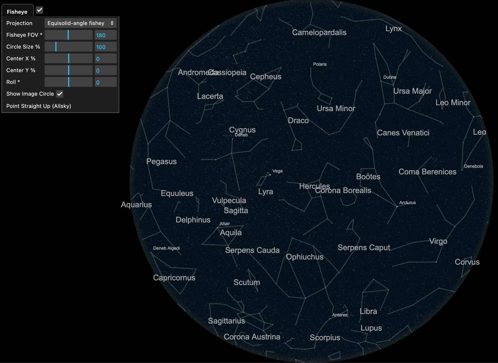

# Fisheye (Allsky) Projection

Use Fisheye to match video from an allsky camera or another fisheye lens.

Sitrec normally renders the look view as a pinhole camera — the same
rectilinear projection as a telephoto lens, where straight lines stay
straight. A pinhole cannot represent a field of view of 180° or more, and it
becomes badly distorted long before that. Real allsky cameras — the fisheye
cameras that watch the whole sky for meteors and satellites — use lenses with
a completely different radial mapping, and matching their footage needs that
mapping in the renderer.

**Camera → FOV (Zoom) → Fisheye** switches the look view to a true fisheye
projection, with fields of view up to and beyond 180°. Stars, satellites,
planets, tracks and terrain all render through the fisheye, and the night-sky
name labels follow. Terrain has a limit: see [Limitations](#limitations).

The look view after **Point Straight Up (Allsky)**, with the **Fisheye** folder dragged out of its menu. The tick beside the **Fisheye** title is **Fisheye Lens**. The disc is the image circle, and **Show Image Circle** masks everything outside it to black. With **Fisheye FOV °** at 180, the rim of the disc is the horizon. North is at the top: Polaris is above the centre. East is on the left, on the Pegasus side. The sky is at dusk, so that the disc shows against the black, and **Star Brightness** in the **View** menu is raised. **Constellation Lines** draws the lines and the large names. The small names come from **Star Names in Look**, limited to a few stars with **Show → Celestial → Label List**. Each name is drawn at its own point in the sky. Sitrec does not move names apart or cut them at the rim, so close neighbours can overlap, such as Andromeda and Cassiopeia, and a name near the rim can cross onto the black, such as Aquarius.

The Fisheye menu is available in custom sitches only, and the Starlink sitch is
one of them. To start a custom sitch, use **File → New Sitch** or open
`?sitch=custom`. Fisheye and [Panoramic Camera](PanoramicCamera.md) cannot be on
together: enabling one turns the other off.

## Controls

- **Fisheye Lens** (the checkbox on the **Fisheye** folder title) — enable the fisheye projection for the look view. The
  other controls in this folder appear only while it is on. The normal FOV
  controls in Camera → FOV (Zoom) (VFOV, HFOV, 35mm Equiv and the rest) are
  hidden while this is on, except the Panoramic Camera switch; turning Fisheye
  off shows them again with their values kept. The field of view comes from
  **Fisheye FOV** below, and the scroll wheel (or pinch, or the + and - keys)
  in the look view adjusts that instead of the normal FOV.
- **Projection** — the lens's radial mapping r(θ). r is the distance from the
  image centre, θ is the angle of a ray from the lens axis in radians, and f is
  the focal length. You do not enter f: Sitrec sets the image scale from
  **Fisheye FOV** and **Circle Size %**, so that the angle FOV/2 lands on the
  circle's edge. If you do not know the lens, try *Equisolid-angle fisheye* and
  *Equidistant fisheye* first.
  - *Equidistant fisheye* (r = fθ): image radius proportional to angle.
  - *Equisolid-angle fisheye* (r = 2f·sin(θ/2)): equal areas of sky get equal
    areas of image.
  - *Stereographic* (r = 2f·tan(θ/2)): preserves shapes locally; fields
    up to its 340° cap stay usable.
  - *Orthographic fisheye* (r = f·sin(θ)): compresses strongly toward the edge;
    caps at 180°.
  - *Rectilinear (pinhole)* (r = f·tan(θ)): the pinhole itself, included as a
    sanity check. With **Circle Size %** at 100, no offset or roll, and **Fisheye
    FOV** equal to the normal VFOV, it matches the normal render inside the
    image circle. Caps at 160°.
  - *General fisheye (curve k)*: one curve through all five above, set by the
    **Curve k** slider that appears when it is selected. For k above 0 it is
    r = f·sin(kθ)/k, for k = 0 r = fθ, and for k below 0 r = f·tan(−kθ)/(−k).
    k = 1 is orthographic, 0.5 equisolid-angle, 0 equidistant, −0.5
    stereographic and −1 rectilinear; values in between describe a real lens
    that lies between two of them. Selecting it starts k at the projection you
    had, so the view does not jump. Its FOV cap follows k.

  The Star Tracker uses the same lens curves. With the fisheye on, its **Lens**
  field names another projection when that projection fits the identified
  stars clearly better.
- **Fisheye FOV °** — the full field of view across the image circle's
  *diameter*. 180 puts the horizon exactly on the circle's edge for a camera
  pointing straight up. Values past 180 image sky (or ground) more than 90°
  from the lens axis, *behind* the camera. If the real image's circle edge is
  above the horizon, use less than 180.
- **Circle Size %** — the image circle's diameter as a percentage of the view
  height. 100 fits the circle exactly top-to-bottom. A 16:9 frame that
  *crops* the circle's top and bottom can need a larger value — for example,
  about 155.
- **Center X % / Center Y %** — offset of the image circle's centre from the
  frame centre, in percent of view height (both axes use height units, so
  equal numbers are equal pixels). Use these when the image circle is not
  centred in the frame.
- **Roll °** — rotate the fisheye image about its centre, matching a camera
  that was not mounted north-aligned. This is an image-plane rotation,
  independent of the camera's own orientation controls.
- **Show Image Circle** — mask everything outside the image circle to black,
  like the unexposed border of a real allsky frame. Turn it off to see the
  sky beyond the configured FOV (out to the projection's own limit).
- **Point Straight Up (Allsky)** — aim the look camera at the zenith in the
  allsky convention: **north at the top, east on the LEFT**. East and west
  are mirrored compared to a map because the camera looks *up*, not down —
  lie on your back with your head toward north and east is on your left.
  Use **Roll °** afterwards to match a camera that was not north-aligned.

## Matching an allsky video

1. Load the video and set the camera location and time, as in
   [Getting Started](CustomSitchTool.md#a-i-filmed-it-myself-from-the-ground).
2. Tick **Fisheye Lens** (the checkbox on the **Fisheye** folder title), then press **Point Straight Up (Allsky)**.
3. Tick **Camera → Match Video Aspect**, so that the look view has the shape
   of the video frame. Raise **Vid Overlay Trans %** in the **View** menu to see
   the video over the render. Set **Circle Size %** so the rendered circle
   matches the video's image circle (155 for a circle whose diameter is 1.55×
   the frame height), and the Center offsets if the video's circle is
   off-centre.
4. Turn on **Show → Celestial → Star Names in Look** and **Constellation Lines**
   to find the star pattern, and adjust **Roll °** until the cardinal directions
   line up.
5. Fine-tune **Fisheye FOV** and the **Projection** type until stars match
   from the centre all the way to the edge. If stars drift between the centre
   and the rim, the projection type or the FOV is wrong. Every projection puts
   the angle FOV/2 on the circle's edge, so a change of **Projection** leaves
   the rim in place and moves the stars inside it. Adjust **Fisheye FOV** again
   after each change.

## Star Tracker

With the fisheye on, a **Video → Star Tracker** run on a video clip uses this lens. It does not
fit a lens from the star motion, because that fit needs a camera that turns, and an allsky camera
does not turn. Tick **Fixed camera** in that folder for a mounted camera: the sky is then solved as
one rotation axis and one rate for the whole clip. A single still image, without **From timelapse**,
is analysed without this lens.

Press **Full Analysis**. It ends with the identification, which you can also run alone with
**Identify Stars (catalog)** in **Star Tracker Tweaks**. The named stars calibrate the lens. With
**Sync Camera to Star Field** ticked (the default), a successful identification sets **Fisheye FOV**,
**Center X %** and **Center Y %** from them and points the camera. The projection type and
**Circle Size %** stay as you set them. See
[Star Tracker → Allsky and fisheye footage](StarTracker.md#allsky-and-fisheye-footage).

For a single stacked image of star trails, tick **From timelapse** in the Star Tracker instead.
That fit also chooses the **Projection** — including the **General fisheye** curve and its
**Curve k**. If this render was off, the sync turns it on with the fitted lens and with **Show
Image Circle** off. See
[Star Tracker → Timelapse star trails](StarTracker.md#timelapse-star-trails).

## Limitations

- Geometry is still projected per-vertex, so a *line* spanning tens of
  degrees (constellation stick figures) draws as a straight chord rather than
  the gentle curve a real fisheye would show. Stars and satellites are
  projected one point at a time, so they follow the lens curve and have no
  chord error.
- Mouse picking and a few HUD overlays still use the pinhole projection, so
  clicking in a fisheye view may not land where expected. The night-sky name
  labels are fisheye-aware.
- Terrain tile selection still uses the pinhole view set by **VFOV (deg)**,
  which is hidden while Fisheye is on. Ground outside that view can be missing,
  or can appear only as coarse patches. For a camera aimed near the horizon,
  set **VFOV (deg)** to a wide value, such as 160, before you tick **Fisheye
  Lens**. A wide VFOV also selects coarser tiles.
- Fisheye and the Flat Earth scenario are not supported together.
