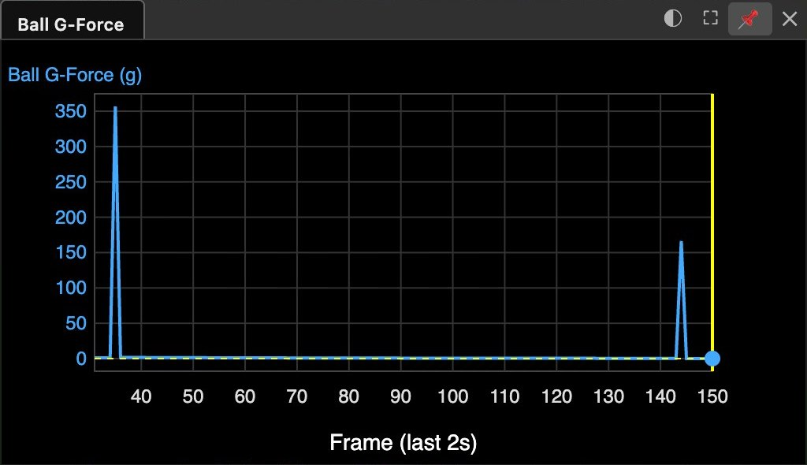

# Football (Physics → Scenarios → Football)

This page lists the controls of the Football scenario. The scenario launches a
football (soccer ball) from a point on any track, with ballistic physics —
quadratic drag, Magnus lift (the force from spin, at right angles to the
flight), ground bounces — plus a Spidercam-style cable cam whose four support
wires are drawn and checked for collision with the ball, a regulation pitch
ground overlay, and a fixed "broadcast" camera view.

**Enable Football Simulation** adds the scenario to the current custom sitch.
Save and Save As keep its settings, keyframes and pitch overlay.

## Preset: "Load England-Norway Goal Kick (WC 2026)"

This button enables the simulation and sets up a preset scene for a goal kick in
which contact with a cable-cam wire was reported and disputed: Hard Rock Stadium
terrain, the pitch frame (long axis on a compass heading of 121.4°, fitted against
the 3D building tiles), the match date and time (for the sun position), the kick
(35 m/s at 38° elevation, 300 rpm backspin, Cd 0.22, from the goal area), the
cable-cam path and aim keyframes, the pitch overlay, the look camera riding the
cable cam, the broadcast view and a ball g-force graph. It also hides the target
and camera marker boxes.

At 60 fps, the rate of the clip that the keyframes were matched to, the simulated
ball hits a wire about 22 m up, about 14 m short of halfway. The result depends on
the frame rate: at the 30 fps default of a new sitch, the ball misses the wire by
about 5 cm. The *Wire Contact* line then shows 0.17 m, the distance from the center
of the ball to the wire; a hit needs less than 0.118 m, the ball radius plus the
wire radius. To see the contact, set Time → Video FPS to 60, then click the button.

The stadium, date, kickoff time and pitch size are published values; the kick time
is kickoff plus 47 minutes. The dolly position, the exact kick spot and the
broadcast-camera position are estimates; no published value was found. The kick
speed, elevation, spin and drag coefficient are also estimates, and the wire anchors
sit at the estimated corners of the roof opening. The cable-cam keyframes were
matched frame by frame to a real-time broadcast clip, and the kick heading was tuned
to reproduce the reported flight. The simulated wire contact follows from these
inputs.

## Manual setup

1. Click **File → New Sitch (Empty)** to start a custom sitch. Open Physics → Scenarios →
   Football and click **Enable Football Simulation**.
2. **Pitch frame** — in the Football menu, open *Pitch Location* and set Pitch
   Center Lat, Lon and Alt (altitude
   [above mean sea level (MSL)](GIS.md#three-kinds-of-height)). Alt matters: the Target
   starts 5000 m up in a new sitch (the Alt row shows 16404 ft in the default
   units), and Enable copies its position, altitude included, to Pitch Center. To
   put Pitch Center on the ground, turn on *Above Ground Level* in the same folder
   and set Pitch Center Alt to 0. Then set *Pitch Heading (°)*, in the Football
   menu, to the compass bearing of the long axis. The cable-cam path, aim path, wire
   anchors and pitch overlay are defined in this frame and move with it. The launch
   point, *Kick Heading* (a compass bearing) and the broadcast camera do not, so set
   them again after you move the pitch.
3. **Launch point** — move the Target to the kick spot: hold X and move the pointer
   over a 3D view, with no mouse button pressed, or type its Lat, Lon and Alt. X
   keeps the altitude, so in a new sitch the Target stays 5000 m up. The ball
   bounces on a flat plane at the height of the launch point, not on the terrain,
   so put this point on the ground: in the Target menu, turn on *Above Ground
   Level* and set *Target [X] Alt* to 0. X then keeps the Target on the ground.
   *Launch From Track* defaults to **Target**; **Camera** is also an option. A track
   imported (KML/MISB drop) after you click Enable is added to this selector and to
   the broadcast *Position* selector, and in a new sitch it can also become the
   choice in both, so check them. A track imported before Enable is not added.
4. **Kick** — set *Launch Frame* (or click *Set Launch Frame = Now*), *Kick
   Heading*, *Elevation Angle*, *Speed*, *Spin* (+backspin/−topspin), *Spin
   Axis Tilt* (0 = backspin, ±90 = sidespin curving left/right), and *Air
   Drag Cd* (~0.2–0.25). Enable **Show Football** for the ball + trajectory.
5. **Cable cam** — set *Anchor Dist Long/Wide* and *Anchor Height* (the four
   wire anchors sit at (±long, ±wide, height) in the pitch frame), *Wire
   Sag*, and enable **Show Cable Cam** (dolly, path, wires). The wires draw
   in the main and broadcast views; *Wires in Look View* also renders them
   in the look view (off by default — wires sweeping past the lens of a
   dolly-riding camera read as judder). The dolly path and operator aim point
   are keyframed tracks (`{f, along, across, height}` in the pitch frame): f is
   a sitch frame, along is meters from Pitch Center in the Pitch Heading
   direction, across is meters to the right of that, and height is meters above
   Pitch Center. Motion between keys is eased. After Enable, both tracks hold
   the preset's keys. They are currently edited via the scenario or console:
   `NodeMan.get("footballCableCamTrack").setMotion([...])` and
   `NodeMan.get("footballCableCamAim").setMotion([...])`.
6. **Ride the spidercam** — Camera → Location → *Position* = **Cable Cam**,
   Camera → Heading → *Camera Heading* = **Cable Cam Aim**, Camera → FOV (Zoom) →
   *Camera FOV* = **Cable Cam**. The *Cable Cam FOV (°)* slider is in the Football menu. The
   look view then shows the scene from the dolly, aimed at the aim point.
7. **Collisions** — *Ball Bounces Off Wires* makes the ball deflect
   (inelastic; *Wire Bounce* sets restitution); off = pass-through but
   contacts still detected. *Wire Hit Offset (%)* is how far to the *side* of
   the ball's center the wire strikes (as a % of the radius). 0 = dead center,
   the hardest hit: in the preset contact at 60 fps, the ball falls from 14.2 to
   8.2 m/s and stops climbing. A positive offset strikes the ball's right side
   and pushes it left; a negative offset strikes the left side and pushes it
   right. The push is largest near ±70. It acts at right angles to both the
   flight path and the wire, so a sloping wire also moves the ball up or down.
   A graze near ±100 takes less speed than a dead-center hit. Whether the wire
   strikes the top or the underside of the ball follows from the flight
   direction (a climbing ball is struck on its upper face, a dropping one
   underneath).
8. **Reading the result**
   - The *Wire Contact* line reports the hit frame and wire, or the closest
     approach. While *Show Cable Cam* is on, red spheres mark contacts.
   - Both outcomes are always simulated: the non-selected one draws as a thin
     grey "what if" line (with deflection on, the grey line is the unimpeded
     flight; off, it's the deflected path), with a 50%-transparent ghost ball
     riding it.

     

     *The preset at the frame of the simulated wire contact, at 60 fps. The
     contact is a result of the estimated inputs that the preset section lists.
     It is not a measurement of the match. The white line is the flight of the
     ball, and the red sphere is the simulated contact. The thin grey line is
     the flight with no contact. Before the contact, it lies under the white
     line. It then leaves the sphere to the right, passes above the dolly and
     falls to the lower right. In this picture it stops near its first landing,
     because the pitch overlay hides the rest of the line. The orange line is
     the cable-cam path, the black box is the dolly, and the black lines are the
     wires. The striped grass is the pitch overlay. At this pitch heading the
     overlay does not cover the top-left corner of the pitch, so the map imagery
     shows there. For a clear picture, the main view was enlarged and moved to
     the side of the pitch, and the graph and broadcast windows were hidden.
     Lines of Sight, Camera View Frustum and Measurements in Main were turned
     off in the Show menu. The browser window was small, so the lines look
     thicker than in a full-size window.*

   - While *Show Football* is on, a **Ball G-Force** series is available to
     Custom Graphs (entity Football, measurement G-force). Frame by frame, it
     shows what an accelerometer in the ball would report: gravity alone does
     not register. The preset adds it as a rolling 2-second
     [custom graph](UserInterface.md#custom-graphs).
   - Sitrec converts each impact's change of velocity (Δv) to g with a fixed
     contact time of 10 ms. This time is an assumption, and the peak changes in
     inverse proportion to it. With this value, a 35 m/s kick reads as a
     one-frame spike of about 360 g, a dead-center wire hit as 166 g in the
     preset contact at 60 fps, a graze near ±100 as a few tens of g, and each
     ground bounce as a further spike. With *Ball Bounces Off Wires* off, a wire
     contact makes no spike. The in-flight baseline (about 1.6 g just after a
     35 m/s kick with the preset spin, decaying) is aerodynamic drag plus Magnus
     lift.

     

     *The Ball G-Force graph of the preset at 60 fps, stopped at frame 150. The
     first spike is the kick, just above 350 g. The second spike is the simulated
     wire contact, at about 165 g. At 30 fps the ball misses the wire, and this
     spike does not appear. The in-flight baseline between the two spikes is too
     small to read on this scale. The yellow lines and the blue dot mark the
     current frame.*

9. **Pitch overlay** — **Show Pitch Overlay** drapes a regulation 105×68 m
   pitch texture (`data/images/footballPitch.png`) centered on the pitch
   frame. It follows Pitch Center / Heading edits automatically.
10. **Broadcast view** — **Show Broadcast View** opens a fixed camera-1 style
    view aimed midway between the ball and the pitch center; position it via
    *Broadcast Camera Position* (a *Position* selector rides an imported
    track, as step 3 describes, or Manual Position with the Lat/Lon/Alt fields —
    greyed while a track drives it) and *Broadcast FOV*. (Renders capped at
    720p to keep three-view setups fast.)
11. **Video comparison** — drop a broadcast clip on the sitch; the sitch
    refits to the video timeline. The preset button converts its kick-relative
    times to frames at the current fps, once. Drop the clip first, and click the
    button again if the fps changes later. *Launch Frame* and keyframes that you
    set yourself are frame numbers, and they do not follow an fps change. For a
    slow-motion clip, set Time → Simulation Speed by hand (0.25 for quarter
    speed). The ball then flies at real speed on the clip's timeline. The
    cable-cam keyframes stay on their frame numbers, so scale them yourself.

## Physics notes

FIFA size-5 ball (m = 0.430 kg, r = 0.110 m), ρ = 1.225 kg/m³. Magnus lift
uses Cl = min(0.45, 0.62·S^0.7) (Goff & Carré) with S = rω/v. Integration is
semi-implicit Euler at 480 Hz substeps; wire contact uses swept
segment-vs-polyline distance with an anchor-chord coarse gate.
