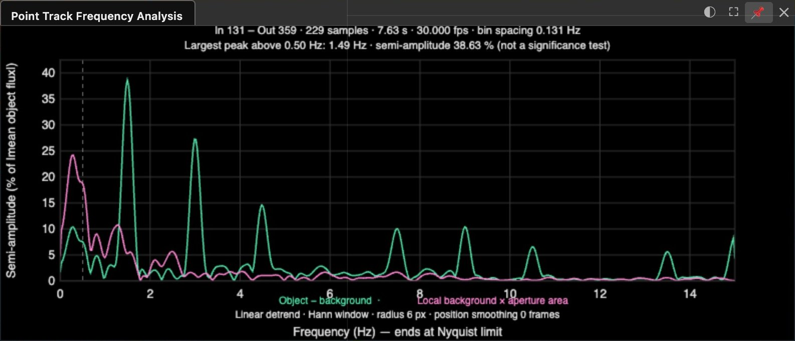
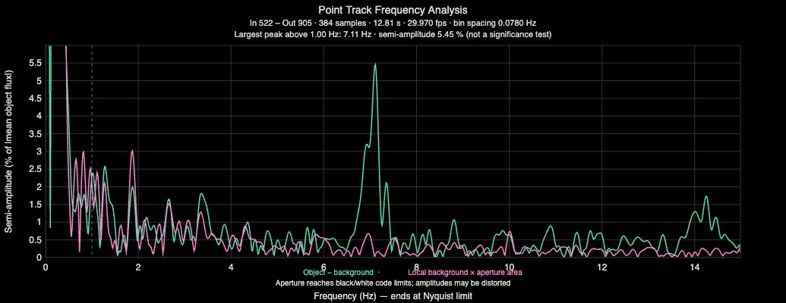
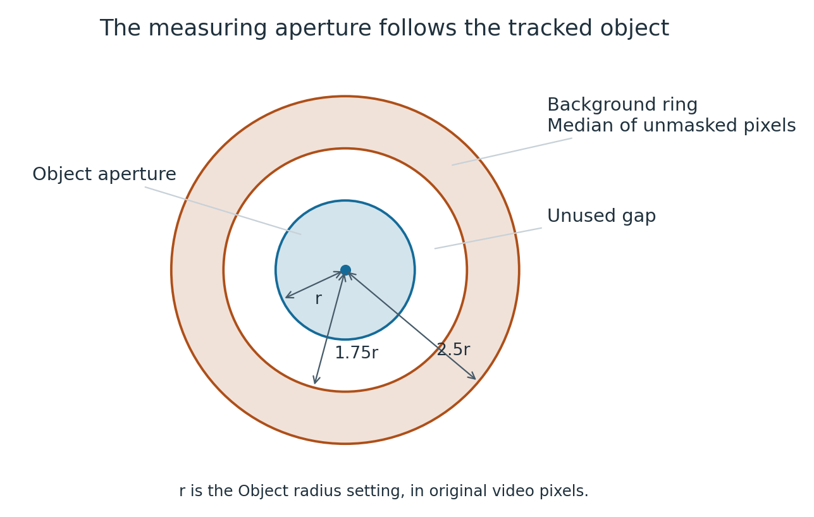
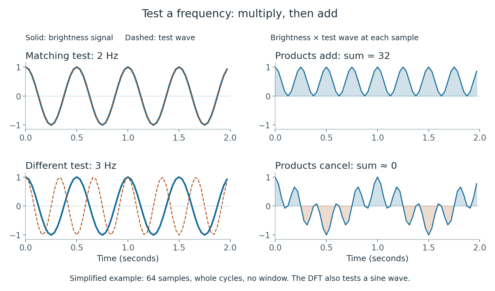
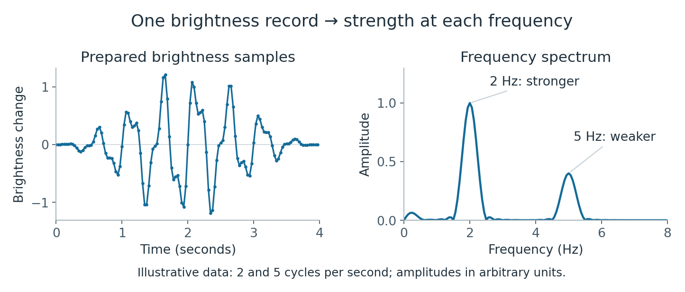
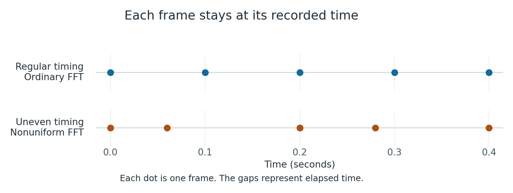
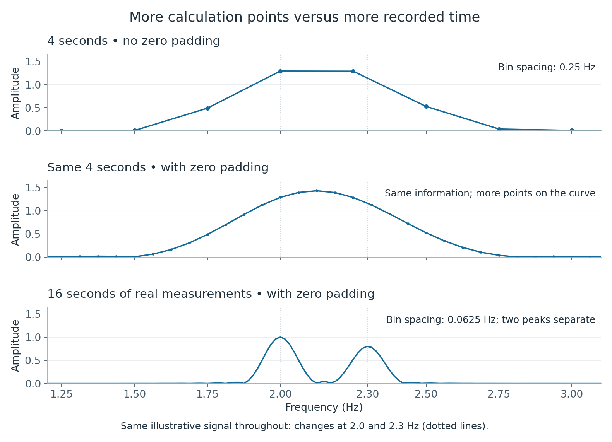
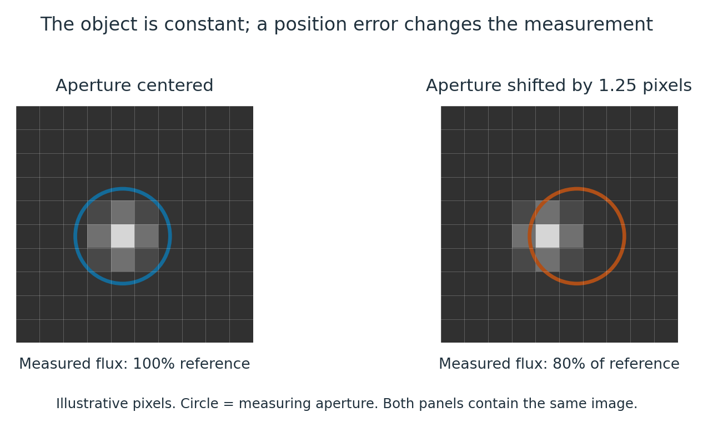

# Frequency Analysis

Frequency Analysis looks for repeating changes in a tracked object's brightness. Use it to
investigate fairly slow repetitions, such as wings flapping, a flashing light, or an object
turning and repeatedly presenting a brighter side. The result is a **spectrum**: a graph of
how strong the brightness change is at each repetition rate.

A frequency of **1 hertz (Hz)** means one cycle per second. A peak at 3 Hz means that the
recorded brightness has a component that repeats three times per second. It is a candidate
repetition rate, not an identification of the object. For example, wings might produce two
similar brightness changes during one complete flap, or produce too little brightness change
to measure at all. The brightness frequency need not equal the physical wingbeat rate.

Open the tool with **Video → Point Track → Frequency Analysis**. This guide covers:

- [Basic limits: frames, duration and pixels](#basic-limits-frames-duration-and-pixels)
- [Using the tool](#using-the-tool)
- [How the calculation works](#how-the-calculation-works)
- [Why small objects and noisy backgrounds cause problems](#why-small-objects-and-noisy-backgrounds-cause-problems)
- [Video compression and the DCT](#video-compression-and-the-dct)

To compare several objects, add their tracks in **Video → Point Track**. Under **Track List**,
turn on **Frequency Analysis** for each one. With **Single Graph** on (the default, in
**Frequency Analysis Settings**), one window draws every track's spectrum, each line in its
track color. A list at the top of the plot gives each track's line color, its largest peak,
and its radius and position smoothing. The light grey local background line is that of the
first track in the Track List. With **Single Graph** off, each track has its
own window, which shows its track name and remains attached to it when you switch
**Edit Track**. The main **Frequency Analysis** checkbox shows or hides all graphs.
**Frequency Analysis Settings** applies to all tracks, and **Refresh** measures all graphs
again. To give one track a different aperture, set
**Track List → [track name] → Frequency Radius** to a nonzero value. **0** uses the common
radius; a nonzero radius is at least 2 pixels. Choose **Edit Track** to select the CSV to
export. Track visibility and individual graph visibility remain independent.

All visible graphs use the same Y-axis range: the largest range needed by any of them,
including the displayed background curve and room for warnings. They also use the shared
In/Out interval. Shared settings, radius overrides, visibility and window positions are
saved with the sitch. Older per-track settings use the selected track's settings as the
common values; different aperture radii are preserved as explicit overrides.

## Basic limits: frames, duration and pixels

### Frame rate limits the highest usable frequency

A video measures brightness only once per source frame. It needs **more than two samples per
cycle** to distinguish a repeating signal below the theoretical limit. In practice, several
frames per cycle make a much more useful measurement.

The graph ends at the **Nyquist limit**, half the source frame rate:

| Source frame rate | Graph's upper limit | Frames per cycle for a 5 Hz change |
|---|---|---|
| 24 fps | 12 Hz | 4.8 |
| 30 fps | 15 Hz | 6 |
| 60 fps | 30 Hz | 12 |

The upper limit is not a promise of reliable measurement near that frequency. At exactly
half the frame rate, the result depends strongly on where the frames fall within the cycle.
A change above the limit can appear at a lower frequency. This is **aliasing**: different
repetition rates can give the same sampled values. A low-frequency peak therefore does not
prove that the original change was slow.

Each frame also collects light over an exposure time. A long exposure averages away fast
brightness changes. A higher frame rate helps only if the source recording preserves the
change. Slowing playback, repeating frames or exporting extra interpolated frames cannot
restore missing information. Use the original recording when possible.

### A longer interval helps separate nearby frequencies

Select an interval with several repetitions of the behavior you want to measure. Sitrec needs
at least **16 distinct, consecutive source frames**, but that minimum may contain far too few
cycles for your question. A 1 Hz change needs several seconds to repeat several times.

The independent frequency-bin spacing is approximately **1 / duration in seconds**. A bin is
one step between independent frequency samples. Four seconds gives 0.25 Hz spacing; sixteen
seconds gives 0.0625 Hz. Actual separation of peaks also depends on noise, their strengths and
the window used in the calculation. If the repetition rate changes during the interval, a
longer selection can spread it into a broad peak. Compare shorter intervals as well.

A longer interval also makes a steady repetition stand higher above the general level of the
spectrum. A peak that cannot be told from the bumps around it in 3 seconds can be clear in
12 seconds. This needs a good track and a steady repetition rate for the whole interval.

### The object must produce a measurable change in source pixels

An object only one or two pixels across may still work if it has strong contrast and a quiet
background. There is no fixed minimum object size that guarantees success. Small, faint
objects are difficult because position errors, pixel noise and compression can change their
measured brightness by as much as the behavior being studied. Zooming the video makes these
pixels easier to see; it adds no image detail. [Video compression](#video-compression-and-the-dct)
can hide a real repetition or introduce an apparent one.

The tool measures the total brightness difference inside a circle. To look for flapping, the
circle should include the object's image through the whole flap. A visible change of shape
will produce a spectrum only if it also changes the measured brightness. See
[small objects and noisy backgrounds](#why-small-objects-and-noisy-backgrounds-cause-problems)
for examples and checks.

## Using the tool

### Start an analysis

1. Load a video and use [Point Track](PointTrack.md) to measure the object's position through
   the interval of interest. Inspect the track for jumps, for estimated positions and for
   [frames with no tracked point](#frames-with-no-tracked-point). Step through
   the interval and make sure that the point stays on the object: where it does not, the
   spectrum describes the background at the point.
2. Set the **In** and **Out** markers around that interval.
3. Turn on **Video → Point Track → Frequency Analysis**.
4. Open **Frequency Analysis Settings** in the same Point Track folder. Set **Frequency Radius
   (px)** so the green measuring circle contains the whole object, with room for small tracking
   errors, while keeping [neighboring objects](#neighboring-objects) out of the circle and out
   of the background ring around it.
5. Wait for the analysis to finish. Compare the green object curve with the pink background
   curve, then try another interval and a slightly different radius.

The graph opens in a window that you can drag and resize. The green measuring circle follows
the Point Track on the video and scales with zoom. Its radius is independent of the tracking
and search circles. **Output Smoothing** affects the positions of the measuring circle; the
brightness measurements themselves are not smoothed.

The analysis uses a separate decoder in the background and leaves the playhead alone. Moving
In/Out, changing the track or its output smoothing, changing the radius, or changing the enabled
mask starts a fresh analysis. Hiding the graph cancels an unfinished calculation. The visible
graph's settings and layout are saved with the sitch.

### Read the graph



This screenshot uses a generated test clip with a regularly flashing object. It is not real
footage. The smaller peaks to the right of 1.49 Hz are harmonics: repetitions at multiples of
the main frequency.

- **Horizontal axis:** frequency in Hz, or flashes per minute, ending at half the source frame
  rate. This is a frequency axis, not a video timeline.
- **Vertical axis:** brightness **semi-amplitude**, half the peak-to-peak change of a sinusoid.
  For example, a smooth variation from 80 to 120 has a semi-amplitude of 20. The scale fits the
  largest value in the frequency range that the peak search covers. A curve that is taller at
  lower frequencies is cut off at the top of the plot.
- **Green — Object − background:** the spectrum of the object's brightness after local
  background subtraction.
- **Pink — Local background × aperture area:** the spectrum of the surrounding background,
  scaled to the same measuring area and amplitude units for comparison.
- **Header:** In/Out frames, sample count, duration, source frame rate, independent bin spacing
  and the largest eligible peak. The printed peak is not a significance test.
- **Single Graph:** each track's object curve is in its track color: the color of its line
  and name on the video. The track that you edit shows in the cursor colors on the video, but
  its curve keeps its track color. Only the first track in the Track List has a background
  curve, in light grey. A list at the top of the plot gives, for each track, a short line in
  its color, its largest eligible peak, its radius and its position smoothing. A track that
  has no spectrum shows its message there. With **Amplitude as percent** on, each curve is a
  percent of its own track's mean flux. If the mean flux of one track is zero, every curve on
  the single graph is in DN·pixels, because the graph has one vertical axis.


This screenshot uses a generated test clip in which three objects brighten and dim at 1.5, 2.5
and 4 Hz. It is not real footage. The light grey background curve stays near zero, because the
generated sky does not flicker.
- **Dashed vertical line:** the lowest frequency allowed by the peak search floor.
- **Warnings:** lines at the top of the plot. The red box is about
  [frames with no tracked point](#frames-with-no-tracked-point). The amber lines are about
  irregular frame timing and about pixels at the recorded limit; see
  [Messages and checks](#messages-and-checks). The vertical scale leaves room for them above
  the curves.

### Frames with no tracked point

A **tracked point** is a point that the tracker detected or that you placed. A frame of the
track can be without one:

- **Interpolated:** the frame has no point, and it is between two points. This occurs after
  you delete points, or when a run starts again at a later frame. The position of such a frame
  is on the straight line between the points on each side. These frames are red on the
  timeline and on the trail.
- **Estimated:** the tracker made the point without a detection. These frames are amber.

The analysis measures these frames too. It puts the measuring circle at that position and
measures the brightness there. On such a frame the circle on the video is dashed. The graph
then shows a red warning box:


This screenshot uses the generated test clip, with the points of two short stretches deleted.
Press the **×** of the box to close it. The box then stays closed until you change In or Out.
The warning gives:

- The number of frames with no tracked point, and the number of frames from In to Out.
- **gaps:** the number of groups of such frames, and the length of the longest group.
- **Trial beside the gaps:** a test of the interpolation. Beside each gap, Sitrec takes as
  many tracked frames as the gap has, puts a straight line across them, and measures how far
  the tracked points are from that line. The warning gives the largest distance, with the
  aperture radius. An object that moves at a constant speed gives a distance near zero, however
  fast it moves. If no gap has enough tracked frames beside it, the warning gives the distance
  that the track moves across a gap.

If the object is not inside the circle on those frames, their samples do not show the object.
To remove the warning, track the frames: **Go to Next Untracked** in the Point Track folder
goes to each gap in turn (see
[Frames with no point](PointTrack.md#frames-with-no-point)). Or move In/Out away from the gaps.

A frame with no position stops the analysis: a frame before the first point of the track or
after the last one, or a frame where the tracker did not find the object. The interval
between two points that has such a frame is not interpolated.

### Settings

| Control | What it does |
|---|---|
| **Frequency Analysis** | Shows or hides the graph and the green measuring circle. |
| **Frequency Radius (px)** | Measuring-circle radius in original video pixels. Default **4**, range **2–100**. The 2-pixel minimum is an aperture limit, not a minimum object diameter. |
| **Amplitude as percent** | On by default. Divides semi-amplitude by the absolute mean object-minus-background flux and multiplies by 100. Off uses **DN·pixels**, recorded pixel value times pixel area. Effectively zero mean flux also uses DN·pixels. |
| **Show local background** | On by default. Shows the pink comparison curve, using the same scale as the object. |
| **Peak search floor (Hz)** | Default **0.5 Hz**, range **0–30 Hz**. Limits which frequency gets the largest-peak label, and which frequencies set the vertical scale. It does not remove any part of the spectrum. |
| **Recalculate** | Measures the video frames again. Most input changes already trigger this automatically. |
| **Export CSV** | Saves the spectrum, analysis settings and individual frame measurements to `PointTrackFrequency.csv`. Available results are exported only once a spectrum exists. |
| **Flashes per minute** | Displays frequencies as **Hz × 60**. It changes the units only. Despite the label, these are brightness cycles per minute, whatever causes them. CSV frequencies stay in Hz. |
| **Widening In 1**, **Widening In 2**, **Widening Out 1**, **Widening Out 2** | The four frame numbers of **Render Widening Video**. See [Render a widening video](#render-a-widening-video). |
| **Widening Ping-Pong** | Off by default. On makes the widening video go back to its first In/Out region. |
| **Render Widening Video** | Renders a viewport video that holds the current frame and moves the In/Out region. |

Recorded pixel values are not calibrated light output or temperature. Percent amplitude is a
fraction of the object's mean **contrast above or below the background**, not a percentage of
the whole image's brightness. A weak mean contrast can make this percentage very large.

### Choose the peak search floor

The default floor, 0.5 Hz, keeps very slow brightness drift from taking the largest-peak label
in many ordinary cases. The whole spectrum still appears below the dashed line. The setting
always uses Hz, including when the axis shows flashes per minute.

The floor also sets the vertical scale. The scale fits the largest value at the frequencies
that the peak search covers, in the object curve and, when it is shown, the background curve.
A curve that is taller below the floor is cut off at the top of the plot, so the labeled peak
is not made small by slow drift.



This screenshot is from real footage of a small bright object that moves across a background
of changing brightness. Below 0.5 Hz the green curve reaches about 33 % and the pink curve
about 56 %, against 5.45 % for the labeled peak, so both are cut off at the top. See
[a changing background](#a-changing-background-can-look-like-a-slow-brightness-change) for the
cause of such peaks.

Keep the floor below the repetition rate you want to investigate. Set **0** to search from
about one independent frequency bin above zero. A floor at or above the Nyquist limit leaves
no eligible peak, and the graph explains why. The scale then fits the whole spectrum.

A flash or a complex brightness cycle can produce peaks at 2, 3, 4 and more times its basic
rate. These are **harmonics**, and one may be stronger than the basic rate. Raising the floor
above the basic rate can make a harmonic take the label. A label just above the floor can also
come from slow drift: move the floor and check whether the label follows it. The label alone
does not decide which peak represents a wingbeat or a flash cycle.

### Messages and checks

| Message or symptom | What to check |
|---|---|
| No Point Track position on some frames | Some frames from In to Out are before or after the track, or the tracker did not find the object there. Track them or narrow In/Out. |
| Red box: no tracked point on some frames | Those frames are measured at an interpolated or estimated position. See [Frames with no tracked point](#frames-with-no-tracked-point). |
| Fewer than 16 source frames | Widen the interval. Repeated playback frames do not count as additional measurements. |
| Skipped frames, missing timestamps or frames out of order | Use a continuous interval of the source video. The calculation needs a valid time for every sample. |
| Aperture overlaps mask or video edge, or too little background | Reduce or move the aperture, change the mask, or narrow In/Out. The background ring needs at least 16 unmasked pixels. |
| Aperture pixels at the black or white limit | Some pixels in the measuring circle have the lowest or the highest value that the video can record. The line gives the number of frames where this occurs and the largest part of the circle that is at a limit. Clipping can weaken or distort the measured variation and its harmonics; see [Bright objects and bright backgrounds](#bright-objects-and-bright-backgrounds). |
| Irregular frame timing | Sitrec uses the real timestamps. The warning shows the local frame-rate range; peaks above half the lowest frame rate may be aliases. |
| Peak moves when the radius changes | Inspect tracking, neighboring objects and background texture. The measurement may be dominated by what crosses the aperture. |
| Tall curves at the left that go off the top of the plot | Slow change below the peak search floor. If the green and pink curves both have it, see [a changing background](#a-changing-background-can-look-like-a-slow-brightness-change). |
| The label is just above the floor | It can be the edge of slow drift, which is wider in a short interval. Raise the floor and check whether the label follows it. |
| No peak where the video shows a repetition | Check that the point stays on the object, that no [neighboring object](#neighboring-objects) enters the circle or the ring, and that the object is not at the [recorded limit](#bright-objects-and-bright-backgrounds). Then try a longer interval. |
| Very large percent amplitude | Check whether mean contrast is near zero. Switch off **Amplitude as percent** to inspect DN·pixels. This changes the scale, not the quality of the measurement. |

The object aperture must stay clear of an enabled [mask](Masking.md). Masked pixels in the
background ring are omitted. The ring can reach the image boundary if enough usable background
pixels remain, but the object aperture itself must fit inside the image.

### CSV export

The CSV contains three tables separated by blank lines:

1. **Spectrum:** frequency in Hz, object and background semi-amplitudes in DN·pixels, and
   object semi-amplitude as a percentage when the mean permits it.
2. **Settings and timing:** In/Out, sample count, frame rate, duration, bin spacing, Nyquist
   limit, radius, position smoothing, mean signed flux, pixel representation, source bit depth,
   mask state, irregular timing, minimum/maximum frame rates, `peak_floor_hz` and
   `interpolated_frames`, the number of frames with no tracked point.
3. **Frame measurements:** source frame, time in seconds from the first selected sample,
   original-pixel X/Y position, signed object flux, local background, aperture area, clipped
   fraction and `position`. `position` is `tracked`, or `interpolated` for a
   [frame with no tracked point](#frames-with-no-tracked-point).

This allows you to inspect the brightness measurements separately from the spectrum. The
export is a set of three tables, not one rectangular table of identical rows.

### Render a widening video

A widening video shows how the spectrum changes while the In/Out region changes. It is a
[viewport render](Video.md#the-render-buttons), with one difference: the video stays on the
current frame, and the In/Out region moves for each video frame.


1. Show the views that you want in the video. Normally that is the video view and the
   Frequency Analysis graph. Keep **Enable Point Track** on if you want the track in the video.
2. Go to the frame that the video will show.
3. In **Frequency Analysis Settings**, set the four frames.

   | Control | Frame |
   |---|---|
   | **Widening In 1**, **Widening Out 1** | The In and Out frames at the start of the video |
   | **Widening In 2**, **Widening Out 2** | The In and Out frames at the end of the video |

4. Press **Render Widening Video**. The same render dialog opens as for the other renders.

In goes from **In 1** to **In 2** while Out goes from **Out 1** to **Out 2**, at a constant
rate. The one that moves more goes one frame for each video frame. For example, In 618 → 522
and Out 685 → 928 is 243 steps, which gives 244 video frames.

With **Widening Ping-Pong** on, In and Out then go back to **In 1** and **Out 1**. The video
is two times as long and ends where it started: 487 video frames in the example.

For each video frame:

- Frequency Analysis is calculated for the new In/Out region. Custom graphs are also updated,
  so a **Frame A→B** graph follows the region.
- The Point Track overlay, if it shows, draws the track from In to Out in place of the whole
  trail. The In frame number is at one end in green and the Out frame number is at the other
  end in red. An end that has no track point gets no number.
- The timeline is added below the views, with its In and Out markers and the same two numbers
  above them.

When the render ends, In and Out get the values that they had before. The video has no audio.

Until you set a value, **Widening In 2** and **Widening Out 2** show the In and Out frames,
and **Widening In 1** and **Widening Out 1** show the middle quarter of that region. The four
values are not saved with the sitch.

Each Out frame must be after its In frame. If a region includes frames without a measured
track point, or fewer than 16 frames, those video frames show the
[message](#messages-and-checks) of the graph and no spectrum.

## How the calculation works

### 1. Select source frames and their times

Sitrec maps the In/Out interval to distinct source frames. A frame held for several playback
slots contributes only once. Source presentation timestamps set the frequency scale, so
changing playback speed does not change the measured Hz.

The analysis reads decoded source pixels before Sitrec's display adjustments, stabilization,
zoom and overlays. Native luma, the brightness channel of the video, is used when available.
Higher bit depths are scaled and rounded to 0–255. Other decoder outputs use grayscale values
calculated from RGB as `0.299 R + 0.587 G + 0.114 B`. The representation stays consistent within
an analysis and is recorded in the CSV. See [Video Tonal Range](VideoTonalRange.md#what-the-values-mean)
for more about recorded levels and limited-range video.

### 2. Measure the object and subtract the background

The measuring circle is an **aperture**. This means an area of the image, not the camera's
lens aperture. A surrounding ring estimates the local background:



Inside the object aperture, Sitrec sums pixel values. Pixels partly covered by its edge receive
fractional weights, estimated with an 8 × 8 grid inside each edge pixel. This reduces abrupt
measurement changes when the aperture crosses the pixel grid. The sum of the weights is the
effective aperture area.

The background is the **median** pixel value in the ring from **1.75r to 2.5r**. The median is
the middle value after sorting. The gap between the circle and ring helps keep the object's
edge out of the background estimate.

For each frame:

```text
Object flux = weighted sum inside aperture − aperture area × median background
```

The result keeps its sign: a dark object has negative contrast. Mask overlap inside the object
aperture invalidates the sample rather than changing the measuring area from frame to frame.
A changing area could introduce flicker of its own. Any invalid sample prevents a spectrum
for that selected interval.

### 3. Remove a trend and taper the ends

Sitrec subtracts the mean and a fitted straight-line trend from the flux measurements. This
reduces a steady increase or decrease in brightness. It does not remove every slow change:
curved drift can still dominate the low-frequency end.

It then applies a **Hann window**, a smooth weight that falls to zero at both ends of the
interval. A finite recording can start and end at different brightness levels; the abrupt
boundary spreads a signal's energy into neighboring frequencies, called **spectral leakage**.
The taper reduces this effect, with the tradeoff of making peaks broader. Brightness samples
near the middle receive more weight than samples near the ends.

### 4. Understand the DFT and FFT

The **Discrete Fourier Transform (DFT)** describes a list of measurements in terms of smooth
repeating waves. Conceptually, it asks how much of each test frequency is present.

To test one frequency:

1. Make a sine wave at that frequency, evaluated at the measurement times.
2. Multiply each brightness sample by the corresponding sine value, then add the products.
3. Repeat with a cosine wave, shifted by a quarter cycle. Using both avoids missing a signal
   just because its cycle starts at a different point, called its **phase**.
4. Combine those two sums to obtain the magnitude at that frequency.

At a matching frequency, the products can reinforce one another. At a different frequency,
positive and negative products tend to cancel. The diagram shows a simplified cosine test:



The diagram uses an ideal signal and complete cycles, without a window, to make the
cancellation easy to see. Real records have noise, a finite interval and a taper, so the
response spreads around a frequency rather than being confined to one perfect line.

Written compactly, for prepared samples `s[n]` at times `t[n]`:

```text
C(f) = sum of s[n] × cos(2π f t[n])
S(f) = sum of s[n] × sin(2π f t[n])
Magnitude at f = sqrt(C(f)² + S(f)²)
```

The DFT repeats this for a grid of frequencies. The **Fast Fourier Transform (FFT)** is an
efficient way of calculating the same DFT. It reuses smaller calculations instead of testing
every sample against every frequency separately. Sitrec's ordinary FFT uses **radix-2**:
it repeatedly splits the calculation into halves, which requires a power-of-two array length.



These are generated measurements in arbitrary brightness units. The taper is visible at both
ends of the time plot. The spectrum describes the whole selected interval; it does not say
which individual frame produced a peak.

### 5. Account for uneven frame times

An ordinary FFT assumes evenly spaced measurements. Some videos have a **variable frame
rate**, so the time between adjacent source frames changes. Assigning those measurements equal
time steps would change the apparent repetition rate.



Sitrec detects timing differences beyond a small tolerance and uses a **nonuniform FFT**.
Each sample retains its actual time. To make this fast, each sample contributes to nearby
points on a fine calculation grid with a bell-shaped, Gaussian weight. Sitrec runs an FFT on
that grid, then corrects for the spreading. This is called **Gaussian gridding**.

This computes the Fourier sums at the original sample times without first interpolating the
video brightness to evenly spaced frames. Such interpolation can weaken fast variations.
The graph uses the mean source frame rate for its axis and reports the range of local frame
rates. The timing correction cannot recover changes that were never sampled.

### 6. Add calculation points with zero padding

Sitrec appends zeros to the prepared brightness sequence until its length is a power of two
and at least four times the number of measurements. This is **zero padding**. It produces
more closely spaced points along the spectrum, which makes the shape and peak location easier
to read. It adds no observations and cannot separate frequencies that the record does not
resolve.

For example, 128 source frames at 32 fps cover a four-second analysis interval. Padding to 512
entries gives plotted frequency steps of `32 / 512 = 0.0625 Hz`. The independent spacing
remains `32 / 128 = 0.25 Hz` because there are still only four seconds of measurements.



The first two plots use exactly the same measurements of an illustrative signal at 2.0 and
2.3 Hz. The third extends that same signal to sixteen seconds. More real recording time gives
closer independent bins; more zeros only give closer calculation points. The unpadded plot is
shown for explanation; Sitrec uses the padded calculation.

In general, with `N` real samples and an FFT length `M`:

```text
Plotted frequency step = source fps / M
Independent bin spacing = source fps / N
Reported duration = N / source fps
```

For uneven timing, source fps is the rate from the mean time between the selected frames.
The reported duration includes one mean frame step beyond the first-to-last timestamp span.
The bin spacing is a useful scale, not an error bar on the printed peak frequency.

### 7. Scale amplitudes and choose a label

Sitrec divides the transform magnitude by the total Hann-window weight and doubles the
positive-frequency values, except at zero and the Nyquist endpoint. This gives the plotted
**semi-amplitude** scale. It estimates a sinusoid's modulation amplitude; it is not the total
height of an individual flash. Nearby frequencies, clipping, noise and very slow trends can
affect the estimate.

Percent mode divides by the absolute mean signed object flux **before** trend removal. A
dark object therefore uses the same positive amplitude scale as a bright object. If that mean
is effectively zero, the graph uses DN·pixels instead.

The pink comparison is calculated separately from the ring's median brightness multiplied
by the mean aperture area. It receives the same detrending, window, frequency calculation and
display scale as the object.

Finally, Sitrec labels the largest amplitude on the frequency grid above both the chosen
floor and about one independent bin from zero. The vertical scale of the graph fits the
largest amplitude in that same range. It does not estimate a false-alarm probability,
test whether the object is a bird, or determine which peak is the fundamental physical cycle.

## Why small objects and noisy backgrounds cause problems

The FFT analyzes the measurements it receives, including measurement errors. A clean-looking
spectrum does not by itself show that those measurements describe a real brightness change.

### A position error can look like flicker

When an object covers only a few pixels, a small tracking error is large compared with its
image. An aperture that is too tight loses a changing fraction of the object. Pixel-edge
weighting reduces this problem but cannot recover brightness outside the circle.



This is a generated example with constant object brightness and identical pixels in both
panels. Only the measuring circle moves. If such an error repeats, the spectrum can show a
peak even though the source does not flicker.

### Background subtraction leaves noise

Subtracting the median ring level estimates and removes the local background level. Random
pixel fluctuations inside the object circle remain. Making the aperture larger can capture
more of the object, but once it contains the object, extra area mainly adds background noise.
For independent pixels with equal noise, the noise in a sum grows roughly with the square
root of the number of pixels. Background-estimation errors and correlated texture can be
worse than that simple model.

| Cause | What can happen | Useful check |
|---|---|---|
| Tight aperture or tracking jitter | A changing fraction of the object is included. | Inspect the track and compare modestly larger radii. Include the whole moving image. |
| Large aperture around a faint object | Background fluctuations dominate the object signal. | Compare smaller radii that still contain the object. |
| Ground, clouds, branches or other texture | The ring's background differs from what is underneath the object; movement changes that difference. | Compare another interval and inspect the video around both the aperture and ring. |
| Compression, pixel quantization or camera processing | Changes in a few pixel values become a large fraction of a tiny object's measured flux. | Prefer the original file; see [compression checks](#checks-for-compression-effects) and compare nearby background behavior. |
| Weak mean contrast | Percent amplitude becomes very large or unstable. | Inspect DN·pixels and the exported signed-flux samples. Changing units does not improve the signal. |
| Exposure or gain changes | The object and background levels change with the camera. | Compare the pink curve and the [Tonal Range Graph](VideoTonalRange.md). |
| Changing repetition rate or intermittent flapping | Energy spreads across frequencies or is diluted over a long selection. | Compare shorter intervals that still contain several cycles. |

Random noise often raises the general spectrum level and produces peaks that change between
intervals. Repeating errors, such as regular camera or tracking wobble across texture, can
produce a narrow peak. A matching peak in the pink curve suggests a shared influence. Its
absence does not prove the object peak is real: the ring samples different pixels.

### A changing background can look like a slow brightness change

The object flux is the object's pixels minus the local background level. The pixels of an
opaque object, and pixels at the recorded limit, do not get brighter when the background
behind them gets brighter. The flux then follows the background with the opposite sign: a
brighter background gives a smaller flux, although the object did not change.

This happens when the object moves across a background that is brighter in one part of the
picture than in another, for example a picture with a bright center. The green curve gets a
tall peak at a low frequency, and the pink curve has a peak at the same frequency. In the
[screenshot above](#choose-the-peak-search-floor) the object passed the bright center of the
picture two times in 12.8 seconds, which gave both curves a peak at 0.22 Hz.

To check for it:

1. Compare the green and pink curves at the low end of the graph.
2. Export the CSV and plot signed object flux against local background. Points near a
   straight line that falls to the right show that the flux follows the background.
3. Raise the peak search floor above the slow change. The label and the vertical scale then
   go to the faster repetition.

Percent amplitude divides by the mean flux of the whole interval. When the flux follows the
background, that mean is an average of different conditions. Compare intervals that have a
similar background level.

### Bright objects and bright backgrounds

Pixels at the recorded limit stay at the limit when the object gets brighter. Only the edge
and the area of such an object can show a change. A brighter background leaves less room
between the background level and the limit, so the same change of the object gives a smaller
change of flux. A repetition that is clear where the object is in front of a dark background
can be several times smaller, or absent from the spectrum, where the same object is in front
of a bright background. The amber line about pixels at the black or white limit tells you in
how many frames some aperture pixels are at a limit, and how much of the aperture at most. It
does not tell you how much of the change is lost.

### Neighboring objects

The measuring circle has radius **r**, and the background ring reaches **2.5 r**. A second
object changes the measurement when it comes into either one:

- Inside the circle, its light is added to the object flux.
- In the ring (from 1.75 r to 2.5 r), it raises the background level when it covers enough of
  the ring to move the median.
- Between them, its edge can reach the circle or the ring.

Objects in a group move a little against each other, so these contributions change from frame
to frame. The spectrum can then show the neighbor's repetition, or a peak that belongs to
neither object. Keep the nearest other object farther away than 2.5 r plus its own radius for
the whole interval: with the default 4-pixel radius, that is more than about 10 pixels plus
the size of the neighbor. If that is not possible, use a smaller radius that still holds the
object, or choose an interval in which the object is alone. Objects that are closer together
than about their own width cannot be measured one at a time.

### Before you interpret a peak

For a suspected steady repetition, look for a similar frequency across independent intervals
and sensible aperture sizes, while checking the actual footage and track. Consider harmonics,
aliasing and clipping before interpreting that frequency as wings flapping or any other
specific motion. Failure to find a peak also does not rule out that motion: the video may not
record a strong enough brightness change.

## Video compression and the DCT

Lossy video compression can weaken a real brightness variation or add a false one. Sitrec
measures the **decoded pixels**, including any compression errors. It does not use the
codec's transform coefficients to find wing-flapping frequencies.

### Spatial frequencies and temporal frequencies

The **Discrete Cosine Transform (DCT)** and the
[Discrete Fourier Transform (DFT)](#4-understand-the-dft-and-fft) are related mathematical
tools. Both describe values as combinations of repeating waves. The DCT uses cosine patterns;
the DFT uses sine and cosine components. In video compression and Frequency Analysis, these
tools work along different directions:

| | Video compression | Sitrec Frequency Analysis |
|---|---|---|
| What varies? | Pixel values across an image block | Measured brightness between frames |
| Frequency describes | Coarse shapes versus fine detail: **spatial frequency** | Slow versus fast changes: **temporal frequency**, in Hz |
| Transform | Often a DCT or a related integer transform | DFT, calculated with an FFT or a nonuniform FFT |

For example, H.264 uses DCT-like integer transforms on blocks of **prediction error**. This
is the difference between the image and the encoder's prediction, which can use nearby pixels
or other frames. The transform represents that difference as a set of coefficients. The
encoder then rounds those coefficients, often reducing small ones to zero. This rounding is
**quantization**, and it loses information. The transform mainly changes how the information
is represented. See the [H.264 encoding overview](https://www.vcodex.com/an-overview-of-h264-advanced-video-coding/)
and [transform and quantization explanation](https://www.vcodex.com/h264avc-4x4-transform-and-quantization/)
for the codec details.


The decoder reverses the stored representation, but it cannot recover the precision discarded
by quantization. Sitrec's spectrum therefore describes the reconstructed video.

### How compression affects a measurement

- **A real variation can disappear.** Small changes in wings, edges or brightness can be
  rounded away. When an object occupies only a few pixels, those changes may be most of its
  useful signal.
- **Extra variation can appear.** As an object moves, changing prediction and block
  reconstruction can change its measured brightness. On a noisy or textured background,
  reconstruction errors can enter the aperture, affect the background estimate, or move the
  tracker.
- **Repeating errors can produce peaks.** Encoders can use repeating patterns of frame types
  and compression strength. If these cause repeating brightness errors, the FFT detects them
  just as it detects a real brightness cycle. Such errors need not average away over more
  frames.

For example, **if** a compression error repeats every 60 frames in a 30 fps video, it repeats
every two seconds and can produce a **0.5 Hz** peak, possibly with harmonics. This is a possible
mechanism, not a rule that every keyframe causes flicker.

A short pattern puts its rate inside the range of the graph. A video with one large frame
followed by three small frames repeats every 4 frames: at 30 fps that is **7.5 Hz**. To tell a
brightness repetition from such a pattern rate, the two must be several independent bins
apart. A difference of 0.4 Hz needs an interval of about 10 seconds or more; in 3 seconds the
two fall into one broad peak.

Removing fine spatial detail does **not** impose a simple temporal cutoff in Hz. A blurred
object can still retain a strong, slow brightness variation. An aperture that contains its
whole image may still collect nearly the same total brightness even when fine detail is lost.
Compression does not automatically make every measurement unusable.

### Checks for compression effects

1. **Use the original recording when possible.** Repeated lossy encodes can discard more
   information. Upscaling or exporting at higher quality cannot restore detail already lost.
2. **Compare intervals, aperture sizes and the background curve.** Inspect the track and
   footage as well as the spectrum. A shared background peak suggests a common influence;
   its absence does not clear the object signal, because the ring samples different pixels.
3. **Inspect the exported brightness samples.** Look for repeated jumps or changes that
   coincide with visible block changes, tracking errors or changes in image quality.
4. **Use the [Video QP Graph](VideoQPGraph.md).** For supported H.264 files, open
   **Video → Forensics → QP Graph** to inspect compression strength and frame types. Count the
   frames in one repeat of the frame-type pattern and divide the frame rate by that number: the
   result is the pattern rate in Hz. A pattern
   that matches a suspicious brightness cycle is a clue, not proof of its cause. The graph
   gives whole-frame minimum, mean and maximum QP, not the QP at the tracked object. It also
   shows only the last encode; damage from earlier encodes can remain even when the current
   QP is low.

A narrow peak establishes that the **measured brightness repeats**. It does not establish that
the object's motion caused the repetition.

## See also

- [Point Tracking and Stabilization](PointTrack.md)
- [Loading and Adjusting Video](LoadingVideo.md)
- [Video Tonal Range Graph](VideoTonalRange.md)
- [Masking](Masking.md)
- [Video QP Graph](VideoQPGraph.md)
