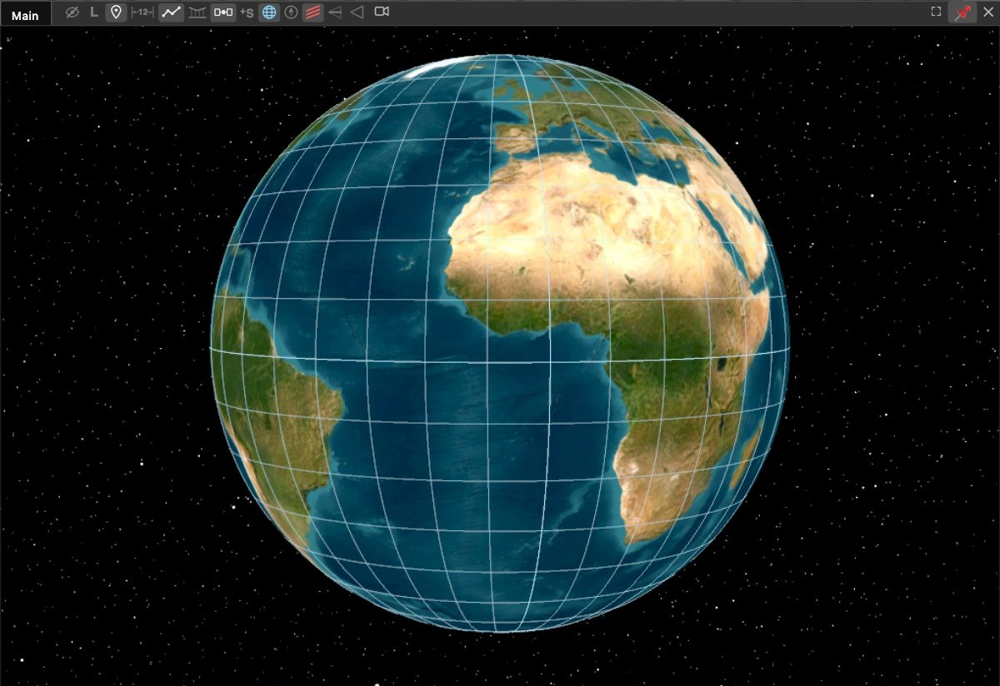

# GIS Concepts in Sitrec

This page explains what an altitude means and how Sitrec handles it. Read it if a track sits at the wrong height, or if you need to know what an altitude in a file refers to. The [Glossary](Glossary.md) defines terms such as HAE, MSL, AGL, QNE and QNH.

Sitrec works in height [above the WGS84 ellipsoid (HAE)](#three-kinds-of-height). The **Alt** boxes in the Camera and Target menus hold height above mean sea level (MSL), or height above ground level (AGL) when **Above Ground Level** is on. A KML track altitude and a CSV `ALTITUDE` column are read as MSL, and Sitrec converts them to HAE. A CSV `TPHAE` column is read as HAE. For the details, see [Altitude in the file](KMLDataSources.md#altitude-in-the-file) and [Altitude Handling](Tracks.md#altitude-handling).

A custom sitch uses the WGS84 ellipsoid. Most older built-in sitches use a sphere.

- A track at the wrong height: [How to tell you have a datum error](#how-to-tell-you-have-a-datum-error)
- What the altitude from a data source means: [What Each Source's Altitude Actually Means](#summary-what-each-sources-altitude-actually-means)
- How to enter a location: [Coordinate formats](#coordinate-formats)

## The WGS84 Ellipsoid

The **World Geodetic System 1984 (WGS84)** defines a reference ellipsoid that approximates the shape of the Earth. It is the coordinate system used by GPS and by most mapping services (Google Earth, Mapbox, Cesium, etc.).

Key parameters used in Sitrec (`LLA-ECEF-ENU.ts`):

| Parameter | Value |
|-----------|-------|
| Semi-major axis (equatorial radius, *a*) | 6,378,137 m |
| Inverse flattening (1/*f*) | 298.257223563 |
| Flattening (*f*) | 1/298.257223563 |
| Semi-minor axis (polar radius, *b = a(1-f)*) | 6,356,752.314 m |

The difference between the equatorial and polar radii is about 21.4 km. This is small relative to the Earth's size, but large enough to matter for precision work.

### Sphere or ellipsoid — and which one you are actually using

When `useEllipsoid` is **false**, Sitrec treats both radii as equal to *a*, degenerating to a sphere. When **true**, the real WGS84 polar radius is used.

A custom sitch uses the ellipsoid. So do the night-sky sitch and the sitches built on these two (Starlink Horizon Flares, FAA 2023). Every other legacy sitch (gimbal, gofast, aguadilla, Nimitz, chilean, …) runs on a sphere, for regression stability, because the code default is `false` (`CSituation.js`). The errors below apply only to sphere mode.

In sphere mode the radius differs from the ellipsoid by up to ~21 km, but that offset is *common-mode*: it moves the whole scene together and barely affects local geometry. The error that affects measurements is the **anisotropic horizontal scale error**. In sphere mode the geodetic latitude is used as if it were the spherical polar angle, so north–south and east–west distances are scaled differently:

| Latitude | N–S scale error | E–W scale error | Differential over a 50 km baseline |
|---|---|---|---|
| 0° | +0.674 % | 0.000 % | 337 m |
| 20° | +0.556 % | −0.039 % | 297 m |
| 34° (Southern California) | +0.358 % | −0.105 % | 231 m |
| 45° | +0.169 % | −0.167 % | 168 m |
| 60° | −0.083 % | −0.251 % | 84 m |

At 34°N a 50 km north–south baseline is stretched by about 179 m while a 50 km east–west baseline is compressed by about 52 m, so a 20 nm range is off by up to ~130 m depending on bearing.

Two things soften this in practice. Terrain, tracks and cameras all go through the same transform, so a sphere-mode scene is *internally* consistent — it is absolute distances and bearings that are distorted, not the alignment of one object against another. And Sitrec forces `useEllipsoid` on whenever 3D buildings are enabled (`CNodeTerrainUI.js`), because Google and Cesium tiles are true-ECEF and mixing them with a spherical ground would be far worse; the **Use Ellipsoid Earth Model** toggle (Terrain → Terrain Tweaks) then refuses to switch back. That is why the setting sometimes appears to move on its own.

The ellipsoid removes the scale errors in the table above.

Changing the Earth model at runtime updates the global radii, recalculates the node graph,
and refreshes terrain. Editable splines created from LLA or legacy local coordinates retain
an LLA copy of their control points and reproject it when the model changes. Raw ECEF inputs
remain raw ECEF by design: changing the model changes how geodetic coordinates are converted,
not the meaning of an already Cartesian position.

## The EGM96 Geoid

The ellipsoid is a smooth mathematical surface. The actual shape of sea level — driven by gravity variations from uneven mass distribution inside the Earth — is an irregular surface called the **geoid**.

**EGM96** (Earth Gravitational Model 1996) is a spherical harmonic model of the geoid. It defines the **geoid undulation** *N* at any point on Earth: the signed vertical distance between the geoid and the WGS84 ellipsoid. Across the whole Earth *N* runs from about **−107 m** to **+85 m**.

At a given location *N* is a nearly constant offset. Some values:

| Location | EGM96 *N* |
|---|---|
| Denver | −17.0 m |
| Seattle | −22.4 m |
| Miami | −27.5 m |
| New York | −32.7 m |
| Chicago | −34.1 m |
| Los Angeles | −35.1 m |
| Southern California, offshore | −38.6 m |
| Honolulu | +15.4 m |
| London | +46.1 m |
| Sydney | +22.9 m |

So a track whose altitudes were treated as the wrong datum sits off by the size of *N*: about 8–40 m in the continental US. The offset is almost constant over a short track and changes slowly over a long one. That signature is how you recognise the mistake; see "How to tell you have a datum error" below.

Sitrec looks *N* up from a compact EGM96 grid shipped with the app (`data/egm96/egm96-15.bin`, decoded lazily by `EGM96Geoid.js`). Sitrec waits for the grid before it builds a sitch. A lookup that still runs too early returns *N* = 0 and warns once in the console.

## Three Kinds of Height

There are three common ways to express the height of a point:

```
Ellipsoid height (h)   — height above the WGS84 ellipsoid
Orthometric height (H) — height above the geoid (i.e. above mean sea level)
Geoid undulation (N)   — height of the geoid above the ellipsoid

h = H + N
```

In plain terms:
- **Orthometric height (H)** is what most people mean by "altitude above sea level" (MSL). It is what you see on a topographic map. An altimeter shows a barometric value; see "The MSL Confusion Problem" below.
- **Ellipsoid height (h)**, or HAE (height above ellipsoid), is the height above the WGS84 reference ellipsoid. It is what GPS receivers natively measure.
- **Geoid undulation (N)** is the difference. It varies smoothly across the Earth's surface and is provided by models like EGM96.

Height above ground level (AGL) is different. It is measured from the terrain under the point, so it changes with the ground.

## How to tell you have a datum error

A datum is the surface that a height is measured from. Sitrec does not detect datum errors. Nothing crashes and no warning appears — the track is in slightly the wrong place. Every angle and range derived from it inherits the error, and so does any speed where the error changes along the track. The table below lists the pattern each error makes.

| What you see | What it probably is |
|---|---|
| Track sits **too high** by the size of *N* (about 8–40 m in the continental US), by almost the same amount along the track | An MSL→HAE conversion that did not happen. Your source was orthometric and was read as ellipsoidal (for example, MSL values in a `TPHAE` column) |
| Track sits **too low or underground** by the size of *N* (about 8–40 m in the continental US), by almost the same amount along the track | *N* was added to a number that did not need it. Your source was already HAE and was read as MSL (for example, GPS ellipsoidal heights in an `ALTITUDE` column), or the conversion was applied **twice** (for example, a manual Alt offset equal to *N* on a track that Sitrec had already converted) |
| An error of tens to hundreds of feet near the ground, plus a part that grows with height to hundreds or thousands of feet at cruise | Pressure altitude. The first part comes from sea-level pressure and the second from temperature. See "Barometric Altimetry" below — Sitrec has no pressure-altitude correction |
| Error follows the shape of the terrain — right over flat ground, wrong on hills | AGL (above ground level) and MSL have been mixed up |
| An aircraft on the ground at a high-elevation airport reads ~5,400 ft, then snaps to 0 | Not a datum error — that is the ADS-B "on ground" bit taking over |
| Objects line up with each other, but ranges and bearings disagree with an outside reference by a few tenths of a percent, depending on direction | Sphere mode. See the scale table above |

The first two rows are for places where *N* is negative, such as the continental US. Where *N* is positive, such as Honolulu or London, those two rows swap.

Tip: to check the altitude datum, compare an object of known height (a building, a runway, a mountain summit, the sea surface) with its position in Sitrec.

## AWS Terrain Tiles (Terrarium Format)

With the example configuration, Sitrec loads elevation data from the **AWS Open Data Terrain Tiles** in Terrarium PNG format. To choose another source, use **Terrain → Elevation Type** (see [Terrain and Elevation](Terrain.md)). The Terrarium tile address is:

```
https://s3.amazonaws.com/elevation-tiles-prod/terrarium/{z}/{x}/{y}.png
```

The elevation is encoded in the RGB channels of each pixel:

```
elevation = R * 256 + G + B / 256 - 32768   (meters)
```

These elevations are **orthometric heights** — heights above sea level, not above the WGS84 ellipsoid — and Sitrec corrects them with EGM96 (below).

The source datums are not all EGM96: Terrarium is a mosaic of SRTM, 3DEP/NED, GMTED and ETOPO1. Sitrec applies the same single EGM96 correction to every source by the same code path.

Terrarium also encodes **negative** seafloor elevations, but every ground query clamps to `max(terrain, geoid)` with no test for water, so the ground is the EGM96 geoid over water and on land below sea level, such as Death Valley; see [The sea](Terrain.md#the-sea).

### The Geoid Correction

Sitrec works internally in ECEF — a Cartesian coordinate system (x, y, z meters from the Earth's center). ECEF coordinates are just Cartesian positions, but LLA-to-ECEF conversion depends on the geodetic surface and altitude reference. When altitude is HAE (height above the WGS84 ellipsoid), conversion is direct. When terrain tiles provide orthometric heights (MSL-like), Sitrec first converts to HAE by adding the geoid undulation:

```
h_ellipsoid = h_terrarium + N
```

This is done per-pixel in `QuadTreeTile.js` (`computeElevationFromRGBA`). The geoid undulation is looked up at the four corners of each tile and bilinearly interpolated across the tile's pixels:

```javascript
const geoidCorners = geoidCorrectionForTile(mapProjection, z, x, y);
// ...
elevation[ij] = R * 256 + G + B / 256 - 32768
              + interpolateGeoidOffset(geoidCorners, xFrac, yFrac);
```

The same correction applies to a Mapbox Terrain-RGB source (`computeElevationFromRGBA_MB`), if a deployment configures one. The default configuration has none.

Mapbox's own documentation states Terrain-RGB is built from mixed vertical datums (for example NAVD88, EGM96, and local datums), so the correction is approximate where a tile's source datum is not EGM96.

Without this correction, terrain would be displaced vertically by up to ~100 m depending on location, causing visible misalignment with GPS tracks, satellite imagery, and 3D building tiles (all of which derive their positions from HAE, not MSL).

## Coordinate Systems

Sitrec uses several coordinate systems internally:

| System | Description |
|--------|-------------|
| **LLA** | Latitude, Longitude, Altitude (geodetic, WGS84) |
| **ECEF** | Earth-Centered Earth-Fixed (Cartesian, origin at Earth's center) |
| **ENU** | East-North-Up (local tangent plane) |

The conversion chain is: **LLA <-> ECEF <-> ENU**, implemented in `LLA-ECEF-ENU.ts`. The LLA-to-ECEF conversion depends on the Earth model (sphere or WGS84 ellipsoid) because geodetic latitude and altitude are defined relative to that surface. ECEF itself is just Cartesian — no ellipsoid needed to interpret the coordinates.

### Coordinate formats

Sitrec takes a coordinate in the `G` (Go To) prompt, the **Lookup** box, the Lat/Lon boxes in the Camera, Target and Terrain menus, the **Add Object** prompt, the AI assistant's "go to", a paste onto the app, a dropped Google Maps / ADS-B Exchange / Flightradar24 link, the `?latlon=` URL parameter, and the latitude and longitude columns of an imported CSV. All of these use one parser (`src/CoordinateParser.js`), but the forms each place takes differ:

- A Lat/Lon box takes one coordinate, a pair, MGRS, or a comma-separated ECEF triple.
- The Go To prompt, the Lookup box, the Add Object prompt, `?latlon=`, the assistant and a paste onto the app take a whole location, not a lone latitude. In Go To, a lone `40.446` is a frame number.
- A CSV latitude or longitude column takes one coordinate.
- A dropped link gives the location in its URL.

| Form | Examples |
|---|---|
| Decimal degrees | `40.446`, `-79.982`, `40.446°N`, `N 40.446` |
| Degrees and decimal minutes | `40 26.767`, `40°26.767'N`, `N40 26.767 W074 00.36` |
| Degrees, minutes, seconds | `40 26 46`, `40°26'46"N`, `40°26′46″N`, `33:53:05N`, `40-26-46N` |
| A pair | `40.446, -79.982`, `40.446; -79.982`, `40°26'46"N 79°58'56"W`, `40.446° -79.982°`, and, where a whole location is expected (never in a Lat/Lon box), a bare `40.446 -79.982` or `40 26 46 79 58 56` |
| With altitude | `40.446, -79.982, 300`. The number is metres, except for `?latlon=` (feet) and `300ft` in the Add Object prompt |
| MGRS | `18T WL 80 60`, `37SCR1192692923` |
| ECEF | `x, y, z` in metres — see below |

What the altitude in that form is measured from depends on where you enter it. In the `G` prompt, a paste onto the app and the Add Object prompt, it is HAE. In the Lookup box it goes into the **Alt** box, so it is MSL, or height above ground when **Above Ground Level** is on. For `?latlon=` and the AI assistant's "go to", it is height above ground.

Pasted text is tidied first: the Unicode minus sign (`−`) and dashes read as a minus, Word's curly quotes as minute and second marks, `''` as a second mark, and a stray trailing comma is dropped.

**The sign belongs to the whole coordinate.** `-40° 26' 46"` is 40°26'46" *South*, that is −(40 + 26/60 + 46/3600) = −40.446, never −40 + 26/60 + 46/3600. A minus sign, like a hemisphere letter, says which side of the equator or meridian the whole angle lies on, and that includes a minus on zero degrees: `-0° 13'` is 0°13'S (Quito), not 0°13'N. The all-negative form some tools write, `-45 -30 -30`, is read the same way; a minus on the minutes or seconds alone is rejected.

**A minus sign or an S/W letter makes the coordinate negative; N and E never override a minus.** So `-45.5 N` is −45.5 (south), and so is `-45.5 S`.

A coordinate that is not well formed is rejected rather than guessed at: a letter inside a number (`45 30 3o`), minutes or seconds of 60 or more (`45 75`), or a fraction on anything but the last part (`45.5 30`). Rejected text leaves a Lat/Lon box unchanged, and in the Go To prompt and the Lookup box it falls back to a place-name lookup. Those two read two bare numbers as a latitude and a longitude, so there `45 75` means 45, 75 and `45.5 30` means 45.5, 30, and neither is rejected.

### Pasting an ECEF position

Anywhere Sitrec takes a coordinate — the `G` (Go To) prompt, the **Lookup** box, the Lat/Lon boxes, or a paste onto the app — an `x, y, z` triple in **metres** is recognised as ECEF and converted to a location.

Nothing in the numbers themselves says "ECEF", so the test is where they land: the triple is converted and kept only if the result sits between 1 km below the ellipsoid and 1000 km above it. Three small numbers (a DMS coordinate, say) come out thousands of km from the surface and are rejected.

The triple is read as **WGS84**, which is what ECEF means everywhere outside Sitrec (EPSG:4978). That choice matters because legacy sitches use a **spherical** Earth (`useEllipsoid: false`), and the two models name the same point 0.19° of latitude (21 km on the ground) and 10.6 km of altitude apart at 45°. The current model is tried only as a fallback, when WGS84 fails the altitude test.

The same altitude test separates ECEF from a `lat, lon, altitude` triple. A triple that fails it both ways, such as a geostationary subsatellite point at 35,786 km, stays a lat/lon.

## Lat/Lon Grid

**Show → Lat/Lon Grid in Main** and **Show → Lat/Lon Grid in Look** draw a latitude/longitude
graticule over the globe in that view: a line every 10°, with the equator and the prime
meridian brighter. Each view's header bar has the same toggle as a globe button. The grid is
drawn over terrain and buildings, so they never hide it, but lines on the far side of the
Earth are not drawn. It follows the Earth model (sphere or ellipsoid), Declutter hides it,
and a saved sitch keeps both settings.



The two brighter lines are the equator and the prime meridian. The lit globe button in the header bar shows that the grid is on. The header bar is pinned in this picture, so it stays on screen.

## 3D Tiles (Cesium / Google)

Cesium Ion and Google Photorealistic 3D Tiles are delivered as 3D Tiles in Cartesian coordinates. For global geospatial tilesets this is typically WGS84 ECEF (often EPSG:4978 per the 3D Tiles spec). Sitrec uses these directly in ECEF (`CNodeBuildings3DTiles.js`). No geoid correction is needed because there is no separate "MSL altitude" field to reinterpret.


# (In Depth) Altitude Naming Conventions & the MSL Confusion Problem

## The Three Surfaces

| Surface | Description |
|---|---|
| **WGS84 Ellipsoid** | A smooth mathematical oblate spheroid. Pure geometry, no physical meaning. Reference for GPS. |
| **Geoid** | An equipotential gravitational surface approximating mean sea level. Irregular shape, physically meaningful. |
| **Mean Sea Level (MSL)** | Approximated by the geoid, but also used loosely for barometric altitude. |

---

## Standard Terms

### Ellipsoidal Height (geometric)
- **HAE** — Height Above Ellipsoid
- **Ellipsoidal height / ellipsoid height**
- **h** *(lowercase, formal geodetic literature)*
- *"GPS altitude"* *(informal)*

### Geoid / Orthometric Height (physical)
- **MSL** — Mean Sea Level *(aviation, colloquial — ambiguous, see below)*
- **AMSL** — Above Mean Sea Level *(aviation — same ambiguity)*
- **Orthometric height** *(formal geodetic term)*
- **H** *(uppercase, formal geodetic literature)*

### Geoid Undulation (the separation between the two)
- **N** — geoid undulation *(formal geodetic literature)*
- **Geoid separation** *(NMEA $GPGGA sentence field name)*
- **Geoid height** *(less precise — easily confused with "height above geoid")*

---

## The Fundamental Relationship

```
h (HAE) = H (orthometric/MSL) + N (geoid undulation)
```

The geoid undulation **N** ranges globally from approximately **−107 m** to **+85 m** (EGM96). Over continental US *land* it is always **negative**, from about **−40 m** at the North Carolina coast to about **−8 m** at Yellowstone. (A wider continental US bounding box reaches −53 m, but that minimum is out in the Atlantic, not over land.)

---

## Geoid Models

| Model | Resolution | Notes |
|---|---|---|
| EGM96 | 15′ | Used in Sitrec today (a 721×1440 grid shipped as `data/egm96/egm96-15.bin`) |
| EGM2008 | 2.5′ / 1′ | Newer global model with finer resolution |

---

## The MSL Confusion Problem

"MSL" is used to mean **three different things** in practice:

### 1. Geodetic / GPS MSL (orthometric height)
Height above the geoid (EGM96 or EGM2008). Derived by GPS receiver applying a geoid model to the raw ellipsoidal height. This is the geodetically correct meaning.

### 2. Barometric / Aviation MSL
Height derived from atmospheric pressure, calibrated to the ISA (International Standard Atmosphere) model. Reported by altimeters and used in ATC. **Not the same as geodetic MSL** — the difference depends on temperature and height; see "Temperature error" below.

### 3. "GPS altitude" mislabeled as MSL
Some devices and logs label ellipsoidal height (HAE) as "altitude" or "MSL". Check the documentation for the source.

---

## NMEA $GPGGA Sentence
The NMEA standard correctly separates these:
```
$GPGGA,...,<MSL altitude>,M,<geoid separation>,M,...
```
- **MSL altitude** = orthometric height (H) above geoid
- **Geoid separation** = N (geoid height above ellipsoid)
- **Ellipsoidal height** = MSL altitude + geoid separation (h = H + N)

The quality of the geoid separation field depends on the geoid model in the receiver.

---

## MISB ST 0601 (Military UAV Metadata)

| Tag | Name | Meaning |
|---|---|---|
| 15 | SensorTrueAltitude | MSL (orthometric, assumed EGM96) |
| 75 | SensorEllipsoidHeight | HAE (WGS84 ellipsoid) |
| 104 | SensorEllipsoidHeightExtended | HAE, extended precision |

The standard defines Tag 15 as "MSL" but **does not explicitly specify EGM96**.

---

# Altitude in KML, ADS-B, and Flight Tracking Services

## KML Altitude Modes (OGC Standard)

KML defines altitude through the `<altitudeMode>` element. The standard (non-extended) values are:

| Mode | Meaning |
|---|---|
| `clampToGround` | **Default.** Ignores altitude value entirely; places feature on terrain surface. |
| `relativeToGround` | Altitude in meters above the terrain surface (AGL). |
| `absolute` | Altitude in meters above sea level. In OGC KML geodetic CRS definitions, this corresponds to the EGM96 geoid vertical datum. |

Google's `gx:` extension namespace adds two sea-floor variants (`clampToSeaFloor`, `relativeToSeaFloor`) not relevant to aviation.

**Spec point:** KML `absolute` altitude is sea-level referenced (OGC KML: EGM96 geoid vertical datum in the standard geodetic CRS definition).

**Sitrec implementation note:** Sitrec treats KML `absolute` altitude as **MSL** (EGM96 geoid), per the OGC KML vertical datum. A KML track (`gx:Track`, or timed Placemarks) is always read as MSL, whatever its `<altitudeMode>` says. Only LineString and Polygon features read the mode. The track KML exporters (`CNodeArray.exportTrackKML`, `CNode3DObject.exportToKML`) convert HAE→MSL on the way out, so exported tracks and objects open at the correct height in Google Earth.

---

## ADS-B Altitude: What Gets Transmitted

ADS-B Extended Squitter (1090ES) mandates two altitude fields per FAR 91.227(d):

**Barometric (pressure) altitude** — always required, always referenced to **1013.25 hPa (QNE, the standard pressure setting)**. This is the raw transponder Mode C output. It is *never* corrected for local sea-level pressure (QNH) in the transmitted data stream — QNH correction only happens onboard the aircraft and in ATC systems on the ground.

**Geometric (GNSS) altitude** — also required, transmitted as **HAE (height above WGS84 ellipsoid)**. This is GPS-derived.

The two values differ. The difference depends on the air temperature and the sea-level pressure — see the temperature-error section below for how to estimate it.

---

## ADSBexchange: Three KML Export Options

When exporting a KML track from globe.adsbexchange.com, three altitude options are offered:

### 1. Geometric altitude (EGM96)
- Takes the raw `alt_geom` field (HAE, WGS84 ellipsoid) and applies the EGM96 geoid undulation *N* for the aircraft's position to get orthometric height: **H = h − N**. Since *N* is negative across the continental US, the resulting MSL figure is *higher* than the ellipsoidal one, by about 8–40 m
- Result: orthometric height (MSL, EGM96)
- This is the **correct option for Google Earth** since KML `absolute` mode uses EGM96. Sitrec reads it the same way, as MSL, and adds *N* on import
- The aircraft will appear at the right height above the terrain model

### 2. Baro + avg.(EGM96 − baro)
- Takes the `alt_baro` field (QNE pressure altitude) and adds an average offset between EGM96 and barometric altitude
- An approximation: the offset is an average, not the value for the exact time and place

### 3. Uncorrected pressure altitude
- Raw `alt_baro` field: pressure altitude at **1013.25 hPa standard**, no correction
- This is what ATC Mode C radar sees before QNH correction
- Not corrected for local pressure or the geoid, so it does not match the terrain in Google Earth

### ADSBexchange API fields (for reference):
- `alt_baro` — barometric pressure altitude, feet, QNE (1013.25 hPa), or `"ground"`
- `alt_geom` — geometric/GNSS altitude, feet, referenced to **WGS84 ellipsoid** (HAE)

---

## FlightRadar24

FR24 displays the raw QNE (1013.25 hPa standard pressure) altitude from the ADS-B transponder. It is **not** corrected for local QNH.

Consequences:
- At high-altitude airports (e.g., Denver KDEN, elevation 5,433 ft), aircraft on the ground will show ~5,400 ft, then jump to 0 ft when the "on ground" bit is set, creating a discontinuous step.
- The altitude shown is QNE pressure altitude — not true MSL, not HAE, not EGM96.

**FR24 statement:** *"ADS-B only reports altitude values based on the standard pressure of 1013 hectopascals."*

---

## FlightAware

FlightAware similarly displays **barometric pressure altitude at 29.92 inHg (QNE)**. It is uncorrected for local altimeter setting.

This means the altitude shown is the same datum as FR24 — raw QNE pressure altitude. Not true MSL in the geodetic sense; not HAE; not EGM96-corrected.

**Practical implication:** A flight at 5,500 ft indicated (with a local altimeter setting of, say, 30.15 inHg) appears on FlightAware at roughly **5,270 ft**, because FlightAware uses QNE, not QNH. The rule of thumb is about 1,000 ft per inHg near sea level, so (30.15 − 29.92) = 0.23 inHg ≈ 230 ft.

---

## Barometric Altimetry and the 18,000 ft Rule

### Below the transition altitude (US: 18,000 ft / FL180)
Pilots set their altimeter to **QNH** — the local sea-level pressure at the nearest reporting station. The altimeter reads altitude AMSL. This is a reasonable approximation of geodetic MSL but is meteorologically influenced (varies with weather). Each reporting station issues a new QNH ~hourly.

### At and above 18,000 ft MSL (FL180 and above)
All aircraft set altimeters to the **standard pressure setting: 29.92 inHg / 1013.25 hPa (QNE)**. The altitude indicated becomes a **Flight Level** — a pressure surface, not a true altitude.

This means:
- FL350 (35,000 ft) is the pressure level corresponding to 35,000 ft in the **International Standard Atmosphere (ISA)**, not necessarily 35,000 ft above the geoid.
- On a cold day, the atmosphere is denser and FL350 is geometrically *lower* than 35,000 ft.
- On a hot day, FL350 is geometrically *higher* than 35,000 ft.
- The size of the difference is estimated in "Temperature error" below.

### Why the transition exists
The purpose of QNE above FL180 is not accuracy — it's **uniformity**. Every aircraft uses the same datum above the transition, so vertical separation is consistent even if the absolute altitude is off. ATC radar works with Mode C (QNE) codes and applies its own QNH correction to convert to displayed altitude for controllers.

### Temperature error — the key non-obvious effect
A barometric altimeter is calibrated to ISA (15°C at sea level, lapse rate of 2°C/1000 ft — strictly 6.5 K/km). It has no temperature compensation for real-world conditions. On a cold day:
- Air is denser; a given pressure is reached at a *lower* geometric altitude
- The aircraft is physically lower than the altimeter indicates
- **Cold temperature correction** is required for obstacle clearance; it is safety-critical

**Estimating it.** The aviation rule of thumb for cold-temperature correction is about **4 ft per 1,000 ft per °C of ISA deviation**:

```
error (ft) ≈ 4 × (height in thousands of ft) × (ISA deviation in °C)
```

One caution on using it. The operational version of this rule — the one in the FAA's cold-temperature guidance — is defined for **height above the altimeter setting source** (the airport), using the *reported* surface temperature, because that is the case pilots need for obstacle clearance. Applying it to a full flight level against a single cruise-level temperature reading is an extrapolation, not the published procedure.

For FL350 at ISA −10 °C the rule gives about 4 × 35 × 10 = 1,400 ft. For an exact value, integrate the temperature profile from a sounding.

---

## Summary: What Each Source's Altitude Actually Means

| Source | Altitude type | Reference | Notes |
|---|---|---|---|
| ADS-B `alt_baro` | Pressure altitude | QNE (1013.25 hPa) | Never QNH-corrected in the data stream |
| ADS-B `alt_geom` | Geometric / HAE | WGS84 ellipsoid | GPS-derived; not used by ATC |
| ADSBx KML: geometric (EGM96) | Orthometric | EGM96 geoid | Geoid-corrected GNSS altitude |
| ADSBx KML: baro + avg | Approximate MSL | EGM96 approximate | Average correction only |
| ADSBx KML: uncorrected pressure | Pressure altitude | QNE | Raw; no pressure or geoid correction |
| FlightRadar24 | Pressure altitude | QNE (1013.25 hPa) | Same as raw ADS-B baro |
| FlightAware | Pressure altitude | QNE (1013.25 hPa) | Same as raw ADS-B baro |
| KML `absolute` mode | Orthometric | EGM96 geoid | Assumed by Google Earth renderer |
| MISB ST0601 Tag 15 | Orthometric (MSL) | EGM96 (assumed) | Sensor true altitude in military KLV |
| MISB ST0601 Tag 75/104 | HAE | WGS84 ellipsoid | Explicitly defined |

---

## Converting ADS-B altitudes to HAE

**Import ADS-B Track...** and **Live ADS-B Traffic** do step 1 below for you. They use geometric altitude as HAE when the data has it, and otherwise read barometric altitude as MSL with no pressure correction. In a generic CSV, put HAE in a `TPHAE` column. An `ALTITUDE` column is read as MSL, and *N* is added.

To get HAE for an aircraft from ADS-B data:

1. Use `alt_geom` (HAE) if available — it's geometrically clean and can be used directly with WGS84 lat/lon.
2. If only `alt_baro` (QNE) is available, you need to apply two corrections to get HAE:
    - **QNH correction**: convert from QNE to an altitude above sea level using local pressure (requires meteorological data for that time/place). The temperature error remains; see "Temperature error" above.
    - **Geoid correction**: add EGM96 undulation N to convert from orthometric to HAE
3. ADSBx's "geometric (EGM96)" KML export holds orthometric height and needs no QNH correction. Sitrec adds *N* on import, which gives HAE, so do not add your own offset.
4. Uncorrected QNE altitude includes the temperature and pressure error described above.

Sitrec has no pressure-altitude correction, so step 2 is manual work. The track's [Alt offset](Tracks.md#altitude-adjustments) control adds one fixed amount to every point. A pressure error changes along the flight, so a fixed offset can only approximate it.


---

## Summary of What to Assume

| Source | What "altitude" likely means           |
|---|----------------------------------------|
| Raw GPS / GNSS receiver output | Depends on the receiver and the output sentence |
| NMEA $GPGGA "MSL altitude" field | Orthometric (geoid), quality varies    |
| Aviation altimeter / ATC reports | Barometric MSL                         |
| ArcGIS / web mapping elevation | Orthometric, but check the datum. The National Map 3DEP source Sitrec ships is **NAVD88**, not EGM96 — Sitrec applies an EGM96 correction to it, leaving a systematic bias of roughly 0.5–1.5 m across the continental US (more in Alaska) |
| KML ADSB Tracks | Whatever the exporter wrote. Sitrec treats KML `absolute` altitude as **MSL** (EGM96) and adds *N* on import — see the implementation note under "KML Altitude Modes" above. It cannot tell whether the number was really pressure altitude; see "Barometric Altimetry" above. Do **not** apply your own MSL→HAE offset on top of this |
| SRTM terrain data | EGM96 orthometric MSL                  |
