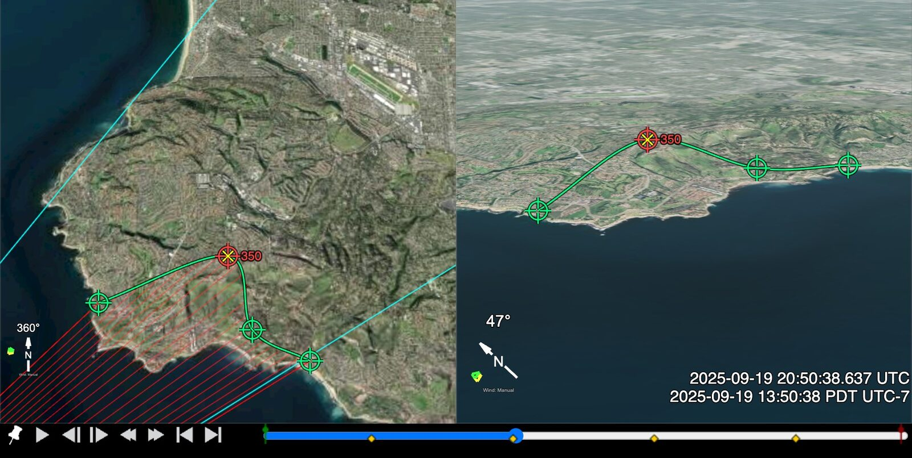

# Ground Track

**Traverse → Ground Track**

A Ground Track is a set of points you place **on the ground**, on the feature the object passes
in front of. Use it when the object crosses terrain you can recognise. Once the points are placed,
the line of sight (LOS) does not use the field of view (FOV). At each point you place on the
correct feature, the track also puts a ceiling on how far away the object was.

This works only while terrain is behind the object. If the object is above the skyline, there is
no ground to mark and no ceiling. Use another LOS source.

The idea is simple. An object seen against terrain is in front of that terrain. Mark the
hillside it crosses, the field it passes over, the stretch of coast it is silhouetted against,
and you have said two things at once:

* the object was somewhere on the line from the camera to that spot, and
* it was **no further away than that spot**.

The second property is what other LOS sources lack. Most lines of sight say only "somewhere along
here"; a ground track says "somewhere along here, and not past *that*".

## How it differs from Point Track and Object Track

Sitrec has three line-of-sight sources that follow an object, selected in **Traverse → LOS Source**:

| LOS Source | What is stored | Needs the FOV? |
|---|---|---|
| Camera + Point Track ([Point Tracking](PointTrack.md)) | a video pixel, tracked automatically | yes |
| Camera + Object Track (Traverse → Manual Tracking) | a video pixel, keyframed by hand | yes |
| **Camera + Ground Track** | **a place on the earth** | **no** |

The default source, **Camera Center**, is the middle of the frame. It follows the object only if
the camera kept the object centred.

The first two turn a tracked *pixel* into a line of sight from the camera's pointing and its
field of view (both use the same pinhole calculation), so both are only as good as the field of
view you have given the camera. A
ground track needs none of that: a place is a place, so the line of sight is simply the line from
the camera to it.

That also means a ground point can be placed **from the map** in the main view, not only from the
camera's own view — useful when the video is too ambiguous to click but you know from other
evidence which road, roof or headland the object went over.

## Placing points

Turn on **Enable Ground Track**. Handles then appear in the main and look views, and:

| Gesture | What it does |
|---|---|
| **Ctrl+click** (**Cmd+click** on a Mac also works) | place (or move) the point for the **current frame** |
| **click an unselected point** | select it — go to the frame it describes, and move nothing |
| **click and drag the selected point** | move it over the ground |
| **right-click a point** | open its menu: **Go to Frame N**, or **Delete Point** |
| **drag empty space** | move the view, exactly as if the editor were off |

Four points in the main view (left) and the look view (right), with the playhead on frame 350. The
point on that frame is red. The other points are green, and the green line is the interpolated path.
The yellow cross is the ground point for the current frame. Here it is inside the red handle; at a
frame between points it is on the line. The yellow diamonds on the timeline are the four points.
The cyan lines are the edges of the camera's view. With **Camera + Ground Track** as the LOS Source,
the red lines are the lines of sight from the camera, which is out of the picture at lower left.

**Selecting and moving are two separate presses.** The selected point is the red one, labelled with
its frame — it is the point the playhead is on, and the only one a drag can move. Reaching for a
point almost always means "show me that moment", so the first press only travels there; once you
are on its frame, a second press picks it up. Nothing you click can be nudged by the click that
took you to it.

Ctrl is what lets the editor share a 3D view with the camera. A plain press on empty space stays
with the view, which uses it to move. A Ctrl+press on the ground goes to the editor, and the view
does not move.

The usual workflow is in the **look view**, which shows the same scene the camera sees: scrub to a
frame where the object is clearly in front of something *identifiable* — a headland, a road end, a
building corner — and Ctrl+click on that feature, not on the object. Repeat at a handful of frames.
Everything in between is interpolated.

"Identifiable" is doing real work in that sentence, not just making the click easier. See
[What this is, next to tracking the object itself](#what-this-is-next-to-tracking-the-object-itself):
clicking a recognised *feature* is what makes the result independent of the camera's orientation
and field of view, while clicking the *pixel* the object sits on quietly inherits any error in
both.

Placed points appear as yellow diamonds on the timeline, and Shift+, / Shift+.
[step between them](TimeAndSync.md#keys-for-time-and-frames), like every other keyframe set.

## Between and beyond the keyframes

**Interpolation** — *Spline* moves the ground point smoothly through the keyframes; *Linear* goes
straight from one to the next.

**Between Points** decides what happens in the gaps. Your placed points never move either way.

*3D Position* (the default) runs the **Interpolation** curve through the placed positions and
leaves it there. Cheap — no terrain is queried at all — and with *Spline* the line of sight it
produces is smooth, which is the property that matters downstream. The cost is that between points
the curve is not *on* the ground: across a bay it flies over at clifftop height, so the range in
between is an interpolation rather than a measurement.

*Ground Intersection* interpolates the **direction** instead, and finds where each of those lines
of sight actually meets the ground. Frames between your first and last points then land on the
ground, but their direction is interpolated. It costs a terrain ray per frame, which is why it is
not the default, and it stands itself down while you are dragging a point so the drag stays
responsive.

There is no third option that snaps the *interpolated* points onto the terrain, and that is
deliberate. The line of sight runs from the camera to the point, so snapping puts the terrain
profile straight into the line of sight. Over a clifftop, the track would dive to the shoreline and
climb back. The line of sight would swing several degrees in a few frames, and a traverse (a 3D
path for the object, built on these lines of sight) would turn that swing into speed and
acceleration that are not in the data.

A note on *Ground Intersection*. After a point is placed, no angle enters its range: the range is
the distance to that place. Between placed points the direction is a guess, and these
rays graze. For example, at 6 km range and 6° of depression the intersection moves
about a kilometre for every degree of direction, so a fraction of a degree of interpolation error
moves it hundreds of metres, and enough of it lets a ray clear the lip it was aimed at and land far
beyond. A hit that disagrees badly with the curve is rejected for that reason. That frame, like a
frame whose ray finds no ground, uses the *3D Position* curve. **Read the ceiling at the points you
placed; treat the frames in between as interpolation.**

**Outside the first and last point the track holds still.** It does not carry on in a straight
line. A ground point extrapolated a few thousand frames past the evidence would be somewhere in
the next county, and the traverse downstream would faithfully follow it there. Holding at least
keeps the line of sight aimed at somewhere real — but it is not data. The track is data only
between the first and last placed points. **Limit A/B to Track** moves the In/Out range to that
span, plus a margin of 10% of the span on each side. (A/B in a label means the In/Out range.) The
margin frames are still held, so they are not data. To leave them out, set the In and Out frames on
the first and last point.

## What this is, next to tracking the object itself

Worth being precise about, because a ground track and an object track (Point Track, or the manual
Object Track) are the same measurement written two different ways.

**The line of sight is the same line when both are right.** The ground point is on the ray through
the object, so at a point you place, the two give the same line if the camera's orientation, the
field of view and the chosen feature are all correct.

**But they depend on different inputs**:

| The line of sight is built from | Object Track | Ground Track |
|---|---|---|
| what is stored | a video pixel | a place on the earth |
| the camera's position | yes | yes |
| the camera's **orientation** | yes | **no** |
| the **field of view** | yes | **no** |
| bounds the range | no | **yes** |

Once the points are placed, a ground track's line of sight is just `camera position → ground point`.
Nothing else enters. Not the field of view, not where the camera was aimed, so errors in
orientation or field of view do not enter it.

**The catch is that the dependency moves earlier, not away.** Placing a point means deciding *which
piece of ground* is behind the object, and you make that decision by comparing the look view to the
video — a comparison that is only meaningful if the orientation and field of view are roughly right.
So there are two ways to place a point, and they are not equally robust:

* **Match the screen position** — click the look view at the pixel the object occupies in the video.
  Quick, but the ray through that pixel is cast using the model's orientation and field of view, so
  if either is wrong you land on the wrong piece of ground and the error is baked in.
* **Identify the feature** — recognise what the object is actually against ("the tip of that
  headland", "the near end of that runway"), then click that feature wherever the render happens to
  put it. This lands on the real feature whatever the orientation and field of view are doing.

**Pick a feature, not a pixel.** That is what buys the immunity above, and it is why a recognisable
landmark is worth scrubbing to find rather than settling for open ground.

And it is why the two together say more than either alone. An object track's line of sight is a
function of (camera position, orientation, field of view, pixel); a ground track's is a function of
(camera position, ground point). Where the two agree at a point placed by identifying a feature,
the orientation and field of view that mapped that pixel to that direction have been checked by
geometry that did not use them. A point placed by matching the screen position used both, so
agreement there shows nothing.

**Only the ground track puts a ceiling on the range.** With the ceiling, an angular size gives an
upper bound on physical size.

**The interpolation choice affects derived motion.** Where the ground is steep, terrain-snapped
interpolation adds acceleration that is not in the data. For this reason the default is *3D
Position*, and no option snaps interpolated points onto the terrain.

**And it tells you where the tool applies.** A ground track only says anything while the object is
*below the skyline*. The moment it rises above the ridge there is no ground behind it, the ceiling
becomes infinite, and there is nothing to place. That is why the track holds still outside the
points you placed rather than carrying on: those frames are not covered. Outside the placed span,
another LOS source is needed.

One thing Sitrec does **not** do yet: nothing downstream consumes the ceiling as a constraint. It is
a readout, not a bound the traverse is held to. To check a traverse, go to a frame where you
placed a point, and compare **Ground Range** with the **Distance: Camera → Traverse** measurement.
The main view shows its value, and **Show → Measurements** lists it. A traverse farther away than
Ground Range puts the object behind the ground you marked.

## Placing on buildings and objects

**Place on 3D Tiles** (on by default) puts points against the 3D building geometry — roofs, walls,
trees — rather than the smooth elevation map. This matters at short range, where the recognisable
features are usually things standing *up* off the ground: a rooftop corner placed against the
elevation map instead lands at street level, tens of metres from the thing you were pointing at.
Where no 3D tiles are loaded the pick falls back to the elevation map, which covers the whole
planet. A point keeps the height it got when you placed it, so let the terrain finish loading first.

**Place on Objects** also allows points on the scene's own 3D objects (an aircraft, a balloon). It
is off by default, because a ground track is meant to land on the ground.

**Show Track** draws the interpolated ground path, and a cross at the current frame's point, even
when editing is off. **Clear All Points** deletes every ground track point.

## Reading the result

**Ground Range** shows the distance from the camera to the ground point at the current frame. At a
frame where you placed a point on the feature behind the object, that is the ceiling: if the
feature is right, the object was closer than this. Between placed points the value is an
interpolation. Outside the placed points the track holds still, so the value is not a ceiling.

Select **Camera + Ground Track** as the LOS Source, and the traverse methods that follow the LOS
Source work from these lines of sight instead of the camera centreline. *Target Object* (the
default) and *Close to Target* do not follow it: the first uses the target track, and the second
uses the camera centreline. Select another **LOS Traverse Method** to use the ground track.

The traverse methods that constrain the object to
the ground — *Ground Vehicle*, *Global Fit: Ground Object* — do not read your placed points. Both
use one elevation: the terrain under the point where the line of sight at the In frame meets a
flat plane at zero height [above the WGS84 ellipsoid (HAE)](GIS.md#three-kinds-of-height).
*Ground Vehicle* puts the object where each line of sight meets that elevation; *Ground Object*
fits one fixed point at it. For the ceiling the ground track gives, read **Ground Range**.

## Cautions

* A ground track is only as good as the camera **position** and the terrain — those are the two
  things its line of sight is built from. If the camera's own position is uncertain, so is every
  line of sight drawn from it; see [Camera → Fit Camera to Points](CameraAndTarget.md#camera--fit-camera-to-points)
  for recovering an unknown camera.
* A point marked *near* the object, rather than directly behind it, biases the line of sight by
  the angle it is off. Zoom in.
* The click that places a point is also a ray, so at a low grazing angle a small click error moves
  the point a long way along the ground. Check in the main view that the point landed on the
  feature you meant.
* The ceiling is a ceiling, not a measurement. An object can be far in front of the terrain it
  crosses, and nothing in the ground track says how far.

## See also

* [The Ideas Behind the Traverse Analysis](TraverseConcepts.md) — what a traverse is, and why a line of sight alone gives no range
* [Traverse Methods](TraverseMethods.md) — what happens to these lines of sight next
* [Point Tracking](PointTrack.md) — the automatic pixel tracker, Manual Tracking compared, and video stabilization
* [Terrain and Elevation](Terrain.md) — where the ground surface comes from
