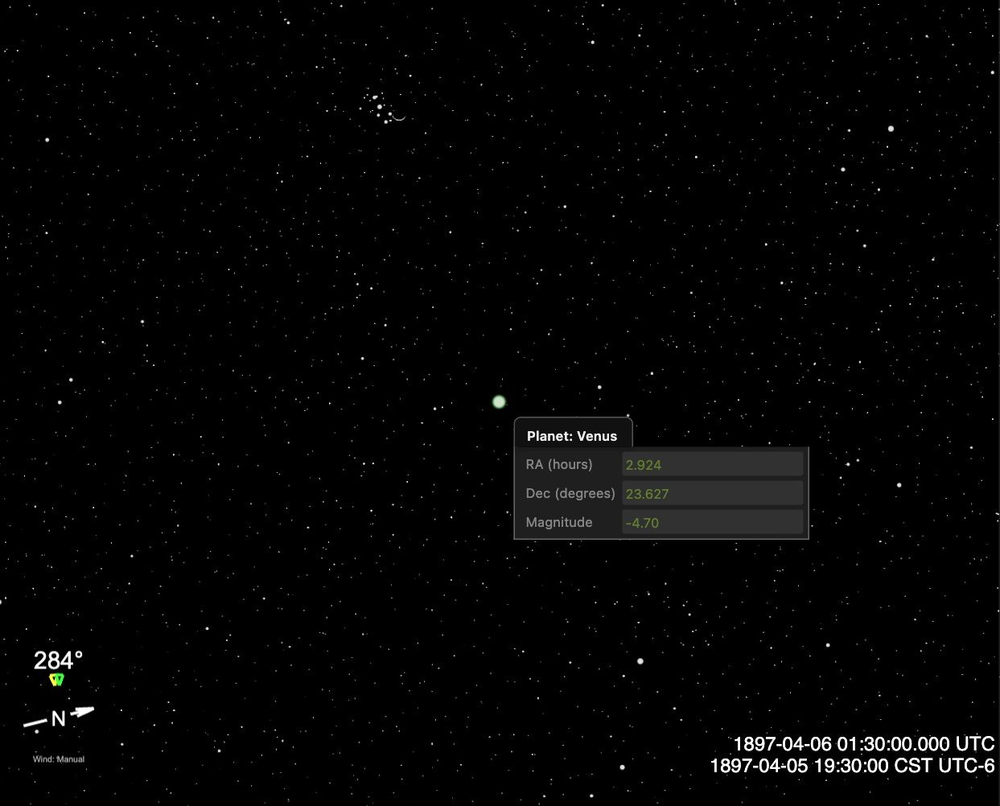

# Historic Skies

**Time → Year**

Sitrec can draw the sky for dates back to 1700. This page says how to reach an old date, how
accurate the sky is, how to set the clock before standard time, and what in the scene is modern.

The Year slider starts at 1947. To go earlier, type a year, or type a historic date into the
Go To box. The range then extends back to 1700.

Examples of earlier dates people reconstruct: the 1896–97 airship reports in California, the
midwest and Texas, and the 1909 reports in Britain and New Zealand.

---

## Reaching a historic date

Any of these work:

| How | Example |
|---|---|
| **Go To box** — press `G` | `10 April 1897 7:30pm`, or `1897-04-11 01:30 UTC` |
| **Year field** — type into it, don't drag | `1897` |
| **URL** | `?datetime=1897-04-11T01:30:00Z` |
| **Sitch definition** | `startTime: "1897-04-11T01:30:00.000Z"` |

The Go To, URL and sitch definition examples are the same moment when the Time Zone is
`CST UTC-6`. Go To reads a time in the zone that the Time menu shows, unless you add `UTC`.

Once the date is historic the Year slider's floor drops to 1700 so you can drag around
freely; it returns to 1947 as soon as you come back to a modern date.

---

## What is accurate, and to what

Sitrec's positions come from [astronomy-engine](https://github.com/cosinekitty/astronomy),
which uses a shortened form of the VSOP87 planetary model. An arcminute (′) is 1/60 of a
degree, and an arcsecond (″) is 1/60 of an arcminute.

| Quantity | In 1700–2200 |
|---|---|
| Sun, Moon, planet positions | about ±1 arcminute (the library's stated accuracy) |
| The conversion from sky coordinates to Earth coordinates, which lands the sky on the terrain | agrees with astronomy-engine's own horizon calculation to under 1″, at seven dates from 1700 to 2200 |
| Precession and nutation | applied (the shift from J2000 to 1896 is **1.45°**, nearly three lunar diameters) |
| ΔT, the Terrestrial-Time to Universal-Time offset | Espenak–Meeus polynomials: −5.8 s in 1896, +20 s in 1918 |

As a check on the Sun, the Moon and ΔT: astronomy-engine reproduces the total solar eclipses of
**28 May 1900** and **8 June 1918** at the right minute and the right place on the globe.

## What is not

**Stellar proper motion is not applied.** Stars move across the sky at their own small rates.
Sitrec's stars come from the Hipparcos satellite catalogue, which gives each position for one
date, J1991.25 (April 1991). Going back to 1897 that is about 94 years of unmodelled motion.
The figures below use the proper motions in the Yale Bright Star Catalogue:

| Star | Error in 1897 |
|---|---|
| Most bright stars (median of the 50 brightest stars) | ~0.1′ |
| Altair | ~1.0′ |
| Sirius, Procyon | ~2′ |
| Arcturus | ~3.6′ |
| Alpha Centauri | ~5.8′ |

For scale, the Moon is **30′** across, and a time uncertainty of ±30 minutes is **±7.5° of
sky rotation**. For a few nearby stars, a precise star-field match (the Star Tracker) can be
out by a few arcminutes at these dates.

**UT1−UTC is ignored.** Up to 0.9 s, so up to 0.0037° of Earth rotation. Negligible here.

---

## Clocks before standard time

A time-zone error of one hour moves the sky by 15°.

- **Set the zone first.** Select **Time Zone** in the Time menu, then type the local time.
  Save the sitch to keep the zone. A sitch definition file can name it with `timeZone`, for
  example `timeZone: "CST"`.
- **A zone change keeps the same instant.** It changes only the clock that Sitrec shows. If
  you typed the time in the wrong zone, select the zone and type the time again.
- **With no zone set, Sitrec uses the browser's own zone.** Sitrec has no location→timezone
  lookup, so this is only right if you happen to be sitting where the sighting happened. The
  zone is worked out once, from the sitch's own start time. So if you load a modern sitch and
  *then* type an 1897 date, the zone stays whatever the modern date implied — possibly an hour
  out, since daylight saving may apply to one date and not the other.
- **There was no national daylight saving before 1916** (Germany), and none in the US before
  31 March 1918. A few towns tried it earlier. Choosing `CDT` or `BST` for an 1897 date
  invents an hour that did not exist — use `CST UTC-6`, `GMT UTC+0` and so on.
- **US standard time zones date from 1883**, so for 1896–1918 American sightings the
  standard zones are the right choice. Earlier than that, or in places that kept local mean
  time longer, the nearest standard zone can be tens of minutes out.
- The zone list holds fixed offsets only; there are no historical rules and no local mean
  time entries. New Zealand, for example, kept UTC+11:30 in 1909, and the list has no such
  zone. For a time that no zone fits, work out UTC yourself and type it with `UTC` in the Go To
  box. For local mean time, UTC = local time − (longitude ÷ 15) hours, with east longitude
  positive.

---

## What is anachronistic

The Sun, Moon and planets follow the date, and the stars are out only by the amounts above.
The world around them does not follow the date:

- **Terrain elevation still applies**: landforms have not moved. **Map imagery, 3D buildings
  and OSM data are modern**, so a townscape will be wrong even where the horizon profile is
  right.
- **No satellites existed before 1957.** The satellite layer draws nothing at these dates and
  the catalogue fetch will report an error if asked for one. This is expected, not a fault.
- **Aircraft.** Sitrec has no aircraft data for these dates, so it draws only the tracks that
  you import.

The Time menu shows a one-line note when the date is outside 1700–2200, or before 1957.

---

## Worked example: Venus in spring 1897

Sitrec needs no special handling for this date range. To follow Venus from Fort Worth, Texas:

1. In **Camera → Location → Lookup**, type `Fort Worth, Texas` and press Enter.
2. In the Time menu, set **Time Zone** to `CST UTC-6`.
3. Press `G` and type a date and time, for example `5 April 1897 7:30pm`.
4. In **Camera → Heading**, set **Camera Heading** to **Celestial Lock**, and type `Venus` in
   **Celestial Object**.

Venus is now at the center of the look view. If the sky there is still blue, it hides Venus:
turn off **Lighting → Daylight Sky** to see it. The compass in the look view shows the azimuth,
and **Tilt (El)** in **Camera → Heading** shows the altitude. At 7:30 pm local:

| Date | Venus altitude | Azimuth | Magnitude |
|---|---|---|---|
| 1 March 1897 | 31.7° | 266° (W) | −4.65 |
| 22 March 1897 | 29.6° | 277° (W) | −4.78 |
| 5 April 1897 | 22.5° | 284° (WNW) | −4.70 |
| 19 April 1897 | 8.4° | 291° (WNW) | −4.21 |
| 26 April 1897 | −0.5° | 295° (WNW) | −4.19 |

Altitudes include atmospheric refraction. Magnitude is brightness on the astronomical scale,
and a lower number is brighter. Sitrec gets magnitudes from astronomy-engine. To read one,
right-click Venus in the look view: the **Planet: Venus** menu shows **Magnitude**.

*The look view after these steps on 5 April 1897, with Daylight Sky off. That setting removes the sky's blue from the picture. The Sun was about 8° below the horizon, at almost the same azimuth as Venus, so the real sky at this moment was in twilight, not black, and the faint stars here would not have been visible. Venus is the pale green disk at the center. The size and color of the disk are display choices: Venus was about 0.8′ across, and the Moon about 30′. The compass at the lower left reads 284°, and the clock at the lower right reads 19:30:00 CST UTC-6. The Planet: Venus menu shows Magnitude -4.70. The thin arc beside the star cluster at the top is the crescent Moon.*

Venus was near greatest brilliancy in March. At this hour it sank toward the horizon through
April, and on 26 April it was already below the horizon.
