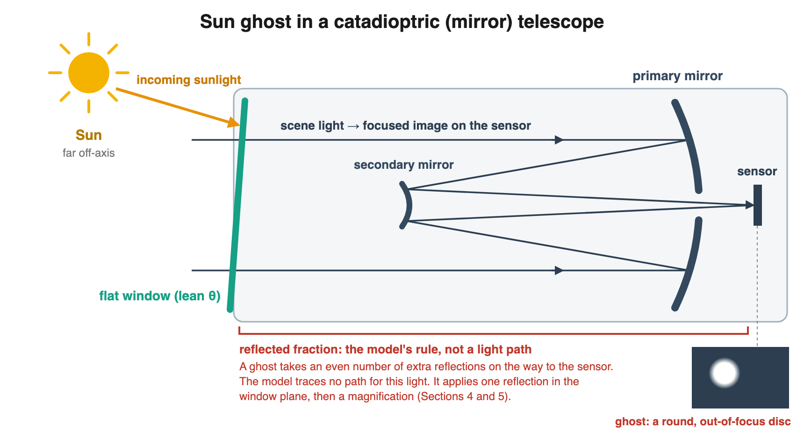
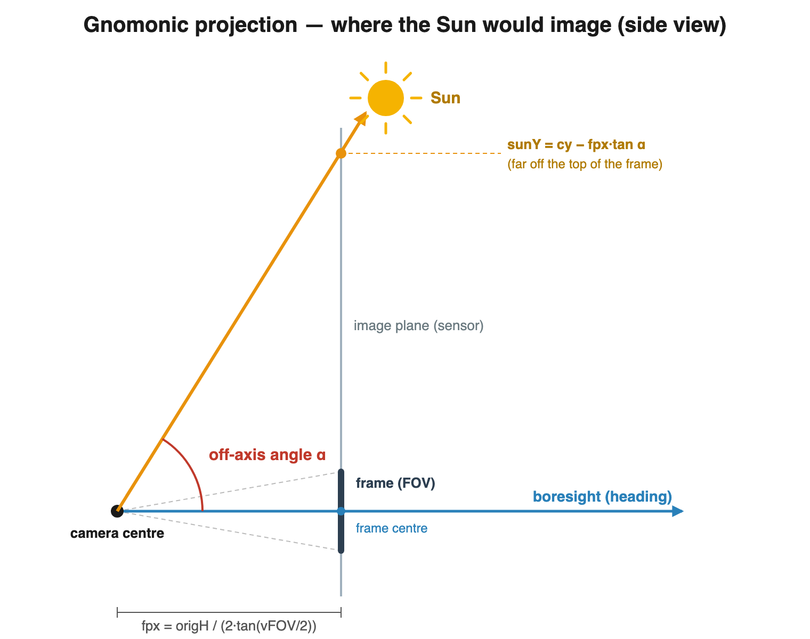
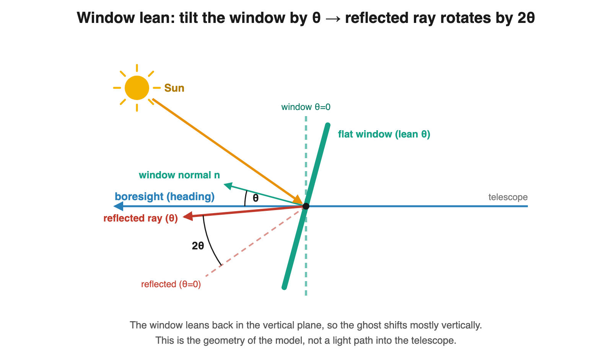
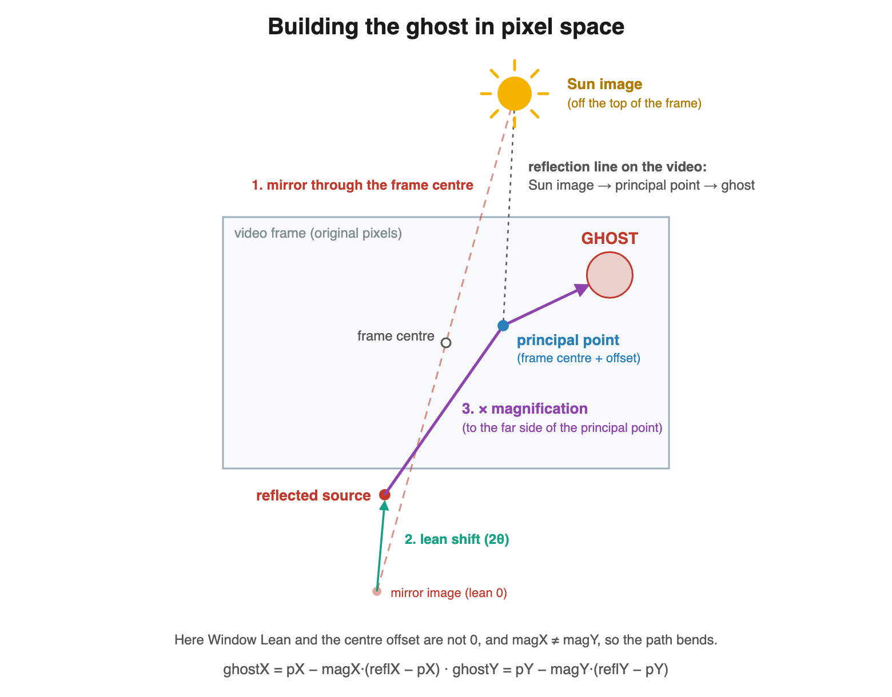
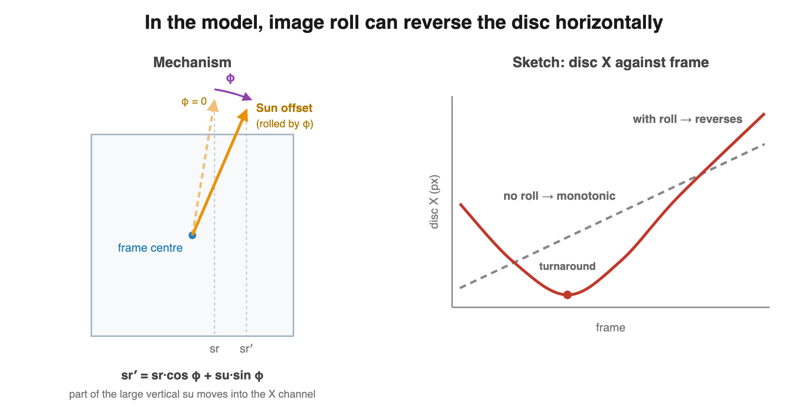
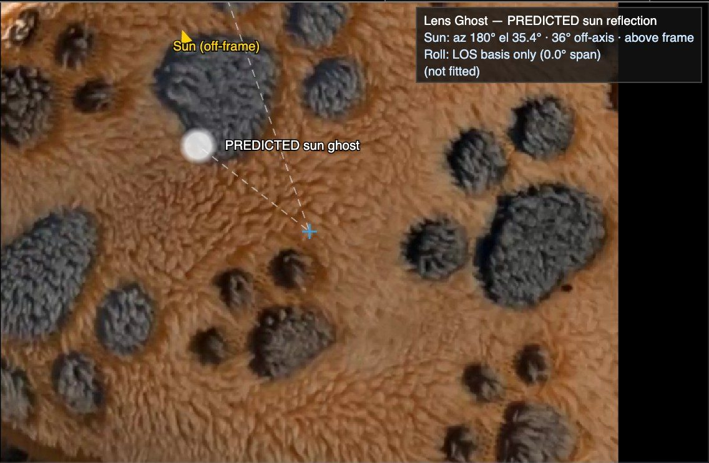
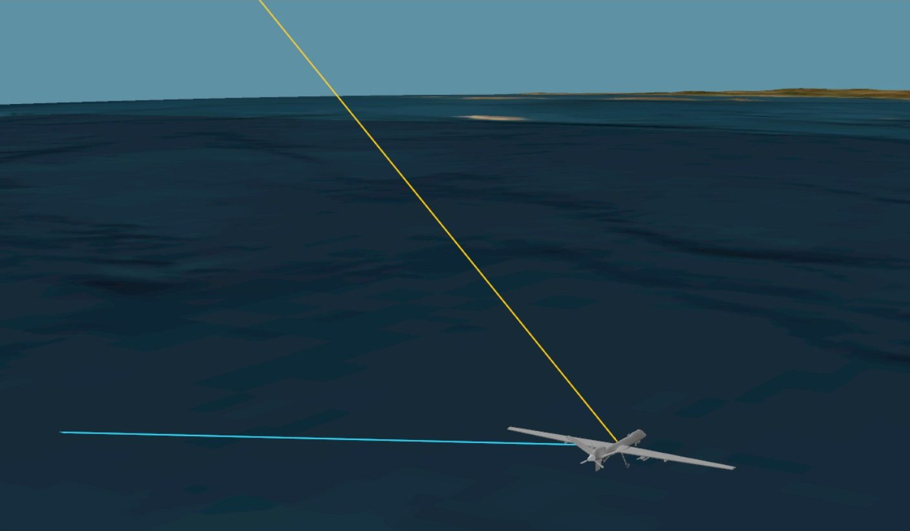

# Lens Ghost — Simulating a Sun Reflection in a Mirror Telescope

> **[BETA] — admin only.** The Lens Ghost overlay and the companion "MQ-9 Light Path"
> 3D view are experimental and currently created only for admin users. In the live UI
> both carry a "[BETA]" prefix: the overlay folder is **Video → [BETA] Lens Ghost**, and
> the 3D view is **Show → Views → [BETA] MQ-9 Light Path**.

## What this is

A [**lens ghost**](Glossary.md#images-and-brightness) is an image formed by light
that reflects off internal optical surfaces — lens faces, a window, a filter — before
it reaches the sensor. The main image of a source is formed by the designed light path
through the optics; a ghost is formed by the small fraction of the light that takes an
even number of extra reflections on the way.
Because the reflected light takes a different path, a ghost is usually out of focus
(a disc or blob rather than a point), much fainter than the source, and placed in the
frame according to the **direction of the bright source relative to the camera**,
not according to the scene. In a rotationally symmetric optic, a ghost lies on the
line through the source's image position and the optical centre. A ghost can appear
when the source itself is outside the frame.

The **Lens Ghost** tool draws a *simulated* sun (or moon) reflection — a "ghost"
disc — as an overlay on a video, and can fit that model to a tracked disc in the
footage. The overlay is labelled **"PREDICTED sun ghost"** so it is not mistaken for
anything in the video. On frames outside the track's span, the label adds
"(extrapolated)". After a fit, the disc position comes from values fitted to the
track, so the label does not mean an independent prediction.

This document explains how the ghost position is computed, what each control does,
and what the fit outputs. It is for admin users of the tool, and for readers who want
to see how a fit was computed. For a worked example on a real clip, see
[Lens Ghost Case Study](LensGhostCaseStudy.md).

For admin users, the folder appears in every custom sitch. It draws nothing until a
video is loaded. The only sources are the Sun and the Moon, and the model assumes a
mirror telescope behind a flat window, so it does not cover a streetlight, an aircraft
light or a phone camera.

## Using the tool

1. Load the video in a custom sitch. Set the date and time, the camera position, the
   camera aim (its line of sight, or LOS) and the FOV (field of view). The Sun
   direction and the ghost position depend on all of these. See
   [Getting Started with Sitrec](CustomSitchTool.md).
2. Run **Video → Camera Motion (Background) → Analyze & Build Path** on the raw,
   un-stabilized clip ([details](MotionAnalysis.md#camera-motion-background)). This
   gives the per-frame image roll that **Roll Coupling** scales. If you skip this
   step, the fit has no roll to use. It then leaves Roll Coupling at −3 and flags the
   scan edge, and the **⚠ Warning** row says that the video looks stabilized.
3. Track the disc with **Video → Point Track** ([details](PointTrack.md)) or
   **Traverse → Manual Tracking**.
4. Open **Video → [BETA] Lens Ghost** and tick the checkbox on the folder title. While
   it is off, every row except **Fit to Disc Track** is faded and does not respond.
5. Set **Source** and **Window Lean°**.
6. Press **Fit to Disc Track**, then read **Fit quality** and **⚠ Warning**.

Sections 2 to 6 give the mathematics of the model. You can skip them and use
[Section 7](#7-fitting-to-a-tracked-disc) and [Section 8](#8-parameters).

---

## 1. The optical model

The model assumes a **catadioptric** (mirror, Cassegrain-type) telescope with a long
focal length and a narrow field of view, behind a **flat protective window**. Window
materials differ in refractive index, and a higher index gives a higher surface
reflectance (for example, germanium, n ≈ 4.0, reflects much more than glass). In
daytime scenes the Sun is by far the brightest source, so even a faint internal
reflection of it can show as a bright disc.



*Schematic only: the mirrors do not follow a real design.*

In the model:

- The ghost is a **defocused disc** — the reflected cone refocuses at the wrong
  plane, so it is an out-of-focus image of the circular aperture. The tool draws a
  round disc. A central see-through hole (a "donut") can be added for the
  secondary-mirror obstruction. It is off by default.
- The ghost's position on the sensor is set by the **Sun direction relative to the
  camera**, not by the scene. As the camera slews, the ghost follows the Sun's
  position relative to the boresight (the camera's centre axis), so it can move
  *against* the background.

---

## 2. Coordinate conventions

Everything is computed in **original-video pixels**. The projections in Sections 3
and 4 use the frame centre.

```
   (0,0) ┌───────────────────────────┐
         │                           │      x → right   (increasing)
         │            • (cx,cy)      │      y → down    (increasing)
         │         frame centre      │      cx = origW/2,  cy = origH/2
         │                           │
         └───────────────────────────┘ (origW, origH)
```

The camera basis per frame comes from the camera line of sight:

```
   heading  — the boresight (optical axis), points where the camera looks
   right    — image +x axis  (already includes the camera's roll)
   up       — image −y axis  (already includes the camera's roll)
```

The focal length in pixels, where vFOV is the vertical field of view:

```
   fpx = origH / ( 2 · tan(vFOV / 2) )
```

---

## 3. Where the Sun *would* image (the gnomonic projection)

Let **s** be the unit vector toward the Sun, computed from the sitch date and time and
the camera position. Decompose it in the camera basis:

```
   sf = s · heading     (component along the boresight; sf > 0 means in front)
   sr = s · right       (horizontal component)
   su = s · up          (vertical component)
```

The Sun's *direct* image (where it would appear if it were in frame) is the standard
pinhole (gnomonic) projection, which maps a direction to the point where its ray
crosses the image plane:

```
   sunX = cx + fpx · (sr / sf)
   sunY = cy − fpx · (su / sf)      ( − because image y is down, world up is +su )
```



*Side view.*

When the Sun is far off-axis, `sunX`/`sunY` lie outside the frame. The ghost can
still be inside it.

---

## 4. The flat-window reflection (with adjustable lean)

The model does not trace light through the instrument. It treats the window as one
reflecting surface and the curved mirrors as a magnification (Section 5). It computes
where the ghost lands, not the path that the light takes inside the instrument.

The model starts from the reflection of the Sun direction in the **flat front
window**. The window normal **n** is the boresight tilted **up** (toward the top of the
frame) by the **Window Lean** angle (θ, 0–30°) about the camera's *right* axis. The top
edge of the window therefore leans back toward the telescope. In camera-basis components:

```
   n = (0, sin θ, cos θ)        in (right, up, heading)
```



*The camera looks left in this figure.*

Reflect the Sun direction across the window plane (mirror through the plane whose
normal is **n**):

```
   r = s − 2 (s · n) n
```

and project **r** the same way to get the **reflected source image**:

```
   reflX = cx + fpx · (r·right / r·heading)
   reflY = cy − fpx · (r·up    / r·heading)
```

- At **θ = 0** (window perpendicular to the boresight) this is simply the **mirror of
  the Sun image through the frame centre**.
- A tilted flat mirror obeys the **2θ rule**: tilting the window by θ rotates the
  reflected ray by **2θ**, so increasing the lean shifts the reflected image — and
  hence the ghost — mostly **vertically** (because the lean is in the vertical plane).
  In the model, the lean angle produces a vertical offset of the ghost. Window Lean is
  set by hand; it is not measured or fitted.

---

## 5. The ghost: magnify the reflection about the principal point

The curved telescope mirror(s) give the reflection optical power (a magnification).
The **principal point** is the point that the magnification scales about. It starts at
the frame centre, and **Centre Offset X/Y** moves it. Only this step uses it:

```
   pX = cx + centerOffsetX        (principal point)
   pY = cy + centerOffsetY

   ghostX = pX − magX · (reflX − pX)
   ghostY = pY − magY · (reflY − pY)
```



`magX` and `magY` are **anisotropic** — they can differ because a tilting flat window
introduces direction-dependent (keystone-like) stretching.

A defocused disc of diameter **Disc Diameter** (px) is drawn at `(ghostX, ghostY)`,
with an optional central obstruction (**Obstruction**, the secondary-mirror donut) and
a soft edge (**Edge Softness**).

---

## 6. Image roll — how the ghost can reverse horizontally

As the camera slews, the boresight can sweep **monotonically** past the Sun, so the
background only moves one way. The ghost can still move one way, stop, and come back.
In the model, this comes from image roll.

The camera's **image roll** φ (rotation about the boresight, measured from the
video's optical flow by Camera Motion (Background), and held as `imageRot`) rotates
the basis, which rotates the Sun's large *off-axis* offset between the horizontal and
vertical axes:

```
   sr' =  sr·cos φ + su·sin φ
   su' =  su·cos φ − sr·sin φ
```

When the Sun is far above (or below) the boresight, `su` is large. As φ changes, part
of that large vertical offset moves into the horizontal channel and back again. This
can produce a horizontal reversal even though the boresight never reverses.



*A sketch of one possible case, not tool output.*

The amount applied is Roll Coupling × `imageRot`. If the recreation's camera already
carries the measured roll (via **Video → Camera Motion (Background) → Look orientation
→ Recovered roll**, after **Analyze & Build Path**), the LOS basis includes it and
Roll Coupling is not needed; otherwise Roll Coupling supplies it from the motion track.
**Fit to Disc Track** always scans Roll Coupling and writes the best value. If the
camera already carries the roll and that value is non-zero, the roll is applied twice,
and the ⚠ Warning row says so.

---

## 7. Fitting to a tracked disc

`Fit to Disc Track` does a least-squares fit of the model to a tracked disc: it finds
the values that give the smallest total squared distance between the model and the
track. The track source is, in priority order:

1. **Point Track** (**Video → Point Track**), with at least two tracked positions;
2. **Manual Tracking** keyframes (**Traverse → Manual Tracking**), at least two.

The fit also needs at least two usable frames. If it fails, the **Fit quality** row
shows the reason, and the controls stay as they were.

Because the ghost is **linear** in the reflected source image position `(reflX,reflY)`
for a fixed lean and roll, the fit is cheap:

```
   for each candidate Roll Coupling k:
       compute reflX, reflY per frame  (apply roll k·imageRot, then reflect off the window)
       linear-fit  trackX = A + B·reflX   →  magX = −B,  pX = A/(1−B)
       linear-fit  trackY = A'+ B'·reflY  →  magY = −B', pY = A'/(1−B')
   keep the k with the lowest combined RMSE
```

RMSE (root mean square error) is the typical distance, in pixels, between the model
and the track. The scan runs `k` from −3 to 3 in steps of 0.1, then refines in steps
of 0.01 around the best value. Frames where the source is behind the camera, or within
5° of the focal plane, are skipped.

`Window Lean` is a **manual** parameter: the fit uses its current value. If the
track's Y position hardly changes (a standard deviation of 2 px or less), the Y fit is
skipped, and Magnification Y and Centre Offset Y stay unchanged. The X axis is always
fitted.

The fit writes its results into the controls: **Roll Coupling**, **Magnification X/Y**
and **Centre Offset X/Y**. It then turns on **Show Ghost** and **Show Geometry**. The
**Fit quality** row shows the X-axis R² and RMSE (in pixels), the number of frames
and the frame range, and the Y-axis R² (or "X only"). It also flags:

- **rollScale hit the scan edge**: the best value is at the ±3 limit. Either there is
  no usable roll signal, or the best value is outside the scan;
- **magX ≈ −1 degeneracy** (principal point indeterminate — see
  [Section 10](#10-limitations--open-questions)).

R² is the fraction of the variation in the track that the model reproduces; 1 is a
perfect match. The frame count includes frames that the track fills by interpolation,
so it is not a count of independent measurements. The fit sets five numbers: a
magnification and a centre offset for each axis, and one Roll Coupling shared by both.
A smooth track can give a high R² with a magnification far outside the ±10 slider
range.

The **⚠ Warning** row and the on-video HUD show one warning at a time, most severe
first: the Sun is behind the camera or 85° or more off-axis (no ghost is drawn); the
video looks **stabilized** (Roll Coupling is non-zero, and the applied roll, which is
the measured roll span × |Roll Coupling|, is under 0.5°); roll is applied twice
(camera-motion orientation is on and Roll Coupling is non-zero); or `magX ≈ −1`.

---

## 8. Parameters

```
   Source           celestial body (Sun / Moon)                 — COMPUTED from sitch time,
                                                                  camera position and LOS
   Window Lean°     0–30°, tilt of the flat window (default 10°) — physical / set by hand
   Roll Coupling    rollScale × imageRot applied to the basis    — FITTED
   Magnification X  horizontal magnification (curved mirror)     — FITTED (starts at 3.5)
   Magnification Y  vertical magnification (anisotropy)          — FITTED (starts at 3.5)
   Centre Offset X  principal-point offset, px                   — FITTED (n/a near magX=−1)
   Centre Offset Y  principal-point offset, px                   — FITTED (n/a near magY=−1)
   Disc Diameter    defocus disc size, px                        — ASSUMED (cosmetic)
   Obstruction      central donut ratio (secondary mirror)       — ASSUMED (cosmetic)
   Edge Softness    disc edge softness                           — cosmetic
   Opacity, Colour  appearance                                   — cosmetic
```

The formulas and readouts use short names: `rollScale` is Roll Coupling (`k` in
Section 7), and `magX`, `magY` and `centerOffsetX/Y` are Magnification X/Y and Centre
Offset X/Y.

The overlay also shows an on-video **HUD** (Sun az/el + off-axis angle, roll
provenance, fit R²/RMSE, warnings), a two-segment **reflection line** (source → optical
centre → ghost), and an off-frame **Sun arrow**. The optical centre is the principal
point of Section 5. The two segments lie in line only when Window Lean is 0, the
magnifications are equal and the centre offset is 0.



*The overlay before a fit, on a test clip of a fabric texture. The clip has no disc in
it, and the magnifications were set by hand to put the ghost in the frame. The white
disc is the ghost, with its **PREDICTED sun ghost** label. The blue cross is the optical
centre. The thin dashed line is the reflection line: it comes from the Sun, which is
above the frame, to the cross, and then goes to the disc. The yellow arrow,
**Sun (off-frame)**, points toward the Sun. The box at the top right is the HUD. Its
last line is the fit result, here "(not fitted)". A warning adds one more line.*

The display toggles:

```
   Show Ghost       the checkbox on the folder title: draw the modelled ghost
                    (off by default; a successful Fit to Disc Track turns it on)
   Show Geometry    the reflection line, the optical-centre marker, and the source
                    marker or edge arrow (on by default)
   Mark Source      draw the source marker or edge arrow when Show Geometry is off
                    (off by default)
   Show HUD         the on-video readout block (on by default)
```

Below **Fit to Disc Track** are four read-only rows: **Sun geometry**, **Roll source**,
**Fit quality** and **⚠ Warning** — the same information as the HUD. The overlay, the
other toggles, Sun geometry, Roll source and ⚠ Warning do nothing until Show Ghost is on.

---

## 9. The MQ-9 light-path 3D view

A companion 3D view (**Show → Views → [BETA] MQ-9 Light Path**) shows a close-up of
the camera platform, with the **boresight** (where the camera looks) and an **incoming
sun ray** that ends at the camera position, so the angle between them is visible in 3D
and animates over the clip. The ray always shows the Sun, whatever **Source** is set
to. If the camera object is a plain shape and not a model, the first render of this
view changes it to the MQ-9 (clean) model, and this change also shows in the other
views.



*The yellow line is the sun ray, and the cyan line is the boresight. Three options are
off in this picture, so that only these two lines show: the checkbox on the **Show →
Camera View Frustum** folder title, the checkbox on the **Show → Lines of Sight (LOS)**
folder title, and **Show → Measurements → Measurements in Main**.*

---

## 10. Limitations & open questions

- **Stabilized footage has no roll.** If the loaded video was stabilized (camera
  motion removed), `imageRot ≈ 0`, and a horizontal reversal that comes from roll
  cannot be reproduced from that clip. Fit the **raw** clip instead. The ⚠ Warning row
  flags this when Roll Coupling is non-zero. It shows the same warning if Camera Motion
  was not run.
- **Roll Coupling is fitted, not derived.** The amount of measured roll the model
  applies is a free scale factor. A value of 1 applies the roll as measured. The scan
  covers −3 to 3, so the fit can also use a larger, smaller or reversed roll. If the
  measured rotation is all camera roll, the LOS carries none of it, and the window,
  mirrors and sensor roll together, the geometry gives a value of 1. The fitted value
  is shown on screen.
- **R² measures fit to the track.** A high R² shows that the fitted numbers reproduce
  the track on the fitted frames. It does not compare the model with any other
  explanation of the motion.
- **magX ≈ −1 degeneracy.** At `magX = −1`, the formula in Section 5 gives
  `ghostX = reflX`, so the principal point has no effect and the fit cannot find it.
  When Magnification X is within 0.05 of −1, the ⚠ Warning row says so, and the Centre
  Offset X row is disabled and shows "(n/a: magX≈-1)". Its value then has no meaning.
- **Disc size is not predicted.** The model predicts position only. It has no housing,
  baffles or ray path, and it does not predict brightness. The disc **diameter** vs
  field angle is not modelled; the current model treats it as a free constant.

---

## See also

**Related checks.** [Diffraction Glare](DiffractionGlare.md): spikes around a bright
point. [Long Exposure/Stacking](LongExposure.md): what a long exposure of the simulated
sky looks like. [Video QP Graph](VideoQPGraph.md): how hard each frame was compressed.
[Video Noise Pattern Detection](VideoNoisePattern.md): noise that appears again in
later frames.
