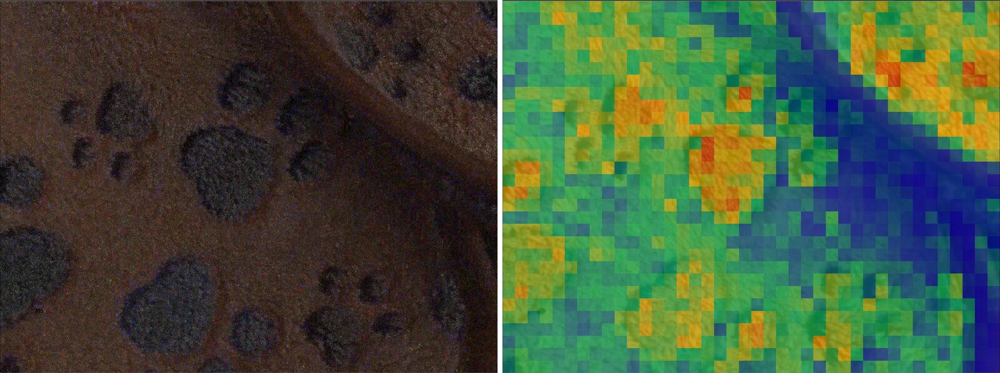

# Loading and Adjusting Video

This page covers everything between dropping a video on Sitrec and starting to analyze it:
getting the file in, checking its frame rate and length, turning it the right way up, finding
your way around the video view, and the adjustment, processing and forensic tools in the
**Video** menu. For making a video *out* of Sitrec, see
[Rendering and Exporting Video](Video.md).

A **sitch** (short for *situation*) is one Sitrec scene: a place, a span of time, and the camera,
tracks, objects and video that recreate an event. You can save and share a sitch, but it is a
sitch before you save it. To start a blank one, use **File → New Sitch**. The
[Glossary](Glossary.md#sitrec) explains this and other Sitrec terms, such as the main view and
the look view.

---

## Loading a video

### Drag and drop, or File → Import File

Drag a video file from your computer onto the Sitrec window. **File → Import File** does the
same thing through a file picker.

The first video goes straight into the video view, and the playhead goes back to frame 0. For
another video, see [Loading a second video](#loading-a-second-video).

You can also drop, or paste with Ctrl/Cmd+V, a direct link to a video file. If the other site
does not let other sites read its files, Sitrec cannot read it: save the file to your computer
and drag it in instead.

### What Sitrec can play

Sitrec decodes video with the browser's own **WebCodecs** video decoder, so you need an
up-to-date browser that has it (current Chrome, Edge, Firefox and Safari do). What matters is the *container* (the
file format that holds the video) and the *codec* (how the pictures are compressed inside it).

| File | What happens |
|---|---|
| **MP4, MOV, M4V** (the MP4/MOV family) | Loaded directly. This is the normal case |
| **Transport stream** (`.ts`, `.m2ts`, `.mts`) | Split into its streams. The H.264 video goes to the video view. A KLV metadata stream, if there is one, becomes a track: see [MISB / KLV](Tracks.md#misb--klv-csv-or-binary) |
| **Raw H.264** (`.h264`) | Loaded by the raw-stream loader. The frame rate comes from the stream's timing information, or is 30 fps if the stream has none |
| **Images** (PNG, JPEG, GIF, WebP, BMP, TIFF, HEIC and others) | Can be used as a single-frame video. See [Images as video](#images-as-video) |
| **Audio** (MP3, WAV, OGG, FLAC, AAC, M4A, AIFF, CAF) | Loaded into the video view as audio only |

**Codecs.** The browser decodes the video, so what plays depends on the browser and the
computer. H.264 is the safest codec. H.265 (HEVC) plays only where the browser and the computer
can decode it. Another codec in an MP4 or MOV file, such as Apple ProRes, stops with an error
message when the file loads. A video that the browser rejects during decoding shows
**Video Decode Failed**: see **Files that will not decode** below.

Sitrec checks the first bytes of a file, not only its name, so a `.mpg` that is really a
transport stream still loads.

**Containers that Sitrec refuses.** An MPEG program stream (most `.mpg`, `.mpeg` and `.vob`
files), MPEG-1/MPEG-2 video, AVI, MKV, FLV and Ogg video (`.ogv`) files are rejected with a message that names the
format and gives an `ffmpeg` command to convert the file to MP4. For example:

```
ffmpeg -i input.avi -c:v libx264 -c:a aac output.mp4
```

If the AVI already holds H.264, use `-c:v copy` in place of `-c:v libx264`. This keeps the
original frames. The [Video QP Graph](VideoQPGraph.md) needs that.

`ffmpeg` is a free video conversion program. Install it from [ffmpeg.org](https://ffmpeg.org),
and run the command in a terminal window.

**Files that load no picture.** Convert these to MP4 in the same way:

- Sitrec reads a `.webm` file as audio. With an audio track, it loads as audio only, and the
  video view shows no picture. With no audio track, the video view shows **Error Loading**.
- Sitrec expects 188-byte packets in a transport stream. Some `.m2ts` and `.mts` files have
  192-byte packets. A very short one can load nothing and show no error. A longer one can set
  the sitch length and then show **Video Decode Failed**.

**Files that will not decode.** If the file is an MP4 but its contents cannot be read within
two minutes, Sitrec stops with a message that the file is probably corrupt, truncated or an
unusual MP4 variant, with a re-encode command. If the hardware decoder rejects the video,
Sitrec tries again with the browser's software decoder. If that also fails, the video view
shows **Video Decode Failed** with the codec and resolution. Re-encoding to H.264 with the
command shown can fix it. If only part of a file is damaged, the damaged frames are
skipped and the rest of the video still plays.

### Images as video

When you drop an image, the **Import Image** dialog asks how to use it:

| Choice | What it does |
|---|---|
| **Video Image** | Use it as a static, single-frame video source. The same picture shows on every frame |
| **Ground Overlay** | Place it as an image overlay on the ground or map |
| **Cancel** | Do not import the image |

If a video or image is already loaded, the **Second Video** dialog then asks where the image
goes. See [Loading a second video](#loading-a-second-video).

A JPEG or HEIC photo with EXIF data can position the scene for you. When the image loads, Sitrec applies
what the EXIF provides to the camera: its GPS position, the capture date and time, the heading,
pitch and roll, and the vertical field of view. If the image has a GPS position,
**Video → Set Camera To EXIF GPS** applies the EXIF camera settings again, for example after
you have moved the camera.

### Loading a second video

A second video, dropped while one is already loaded, opens the **Second Video** dialog. An image
opens it after you choose **Video Image**.

| Choice | What it does |
|---|---|
| **Side-by-Side Videos** | Show the new video or image in the second video view, side by side with the current one (the **TwoVideos** preset in **View → View Preset**). Only offered when the sitch has a second video view |
| **Extra Video View** | Show it in the second video view, as a smaller view over the main view. The view preset does not change. Only offered when the sitch has a second video view |
| **Add to Video View** | Keep both in the same view. A **Video → Current Video** selector appears, so you can switch between them |
| **Replace Video** | Remove the current video and use the new one |
| **Cancel** | Do not import it |

If the second video view already holds a video or image, the **Media Already Loaded** dialog
then offers **Replace**, **Add** (keep both and switch with the selector) or **Cancel** for
that view.

A transport stream does not open the **Second Video** dialog. Sitrec adds it to the video view
and selects it, as **Add to Video View** does.

While the second video view holds a video or image, every view preset except **TwoVideos**
shows it as a smaller view over the main view, so it stays visible when you change presets.
It keeps the video's shape, its longer side is 75% of the main view's shorter side, and it is
in the main view's bottom-right corner. If the main view is hidden, it goes over the look view
in the same way. If both are hidden, it is in the middle of the screen, at up to 30% of the
screen's width and height. It stays there when you resize the window or the main view, or
load another video into it. To move or resize it, hold **Q** and drag; after that it stays
where you put it until you change the view preset.

A video in the second view does not define the sitch timeline. Its menu entries have
**(2)** after the name. **Video → Lock to In Frame (2)** plays it relative to the In frame
(set with the **I** key): its first frame is shown when the playhead reaches the In frame.

### Time and location in a video file

Phones write the time and place of a recording into the video file. When you load such a
video into a new sitch, Sitrec sets the Start Time and puts the camera at that place. It does
this only if the camera position and the time have not been set yet.

| File | Location | Start Time |
|---|---|---|
| iPhone `.MOV` | Latitude, longitude and altitude above [mean sea level (MSL)](GIS.md#three-kinds-of-height) | When the recording started, in the phone's local time |
| iPhone `.mp4` (exported or shared) | Latitude, longitude and altitude above MSL | When the recording started, in the phone's local time |
| Android (Pixel, Samsung and others) | Latitude and longitude, no altitude | The file gives the time the recording **stopped**. Sitrec subtracts the length of the video. The result can be a few seconds late. Samsung files also give the local time zone |
| Files written by ffmpeg | The location copied from the original, if any | With `-movflags +use_metadata_tags`, the time copied from the original, as for that file. Otherwise the file's creation time, if it has one, read as UTC |
| Other cameras and programs | The location in the file's standard location field, if any. GPS data recorded as a separate data track is not read | The file's creation time, read as UTC. Some cameras write their local time there, which puts the Start Time off by the time zone, so check it |

If the file has no altitude, or an altitude of exactly 0, the camera goes 2 m above ground
level (AGL), with **Above Ground Level** on. Otherwise the camera goes to the file's altitude
above MSL.

To check the result, look at the Start Time in the **Time** menu, and at **Cam [C] Lat** and
**Cam [C] Lon** in **Camera → Location**. If the file has no location, enter the camera position
there. See [Camera → Location](CameraAndTarget.md#camera--location).

A video that was edited, trimmed or converted can carry the time of that change, not the
time of the recording. If the video shows a clock or a known event, use it to check the Start
Time. See [Time, Frames and Syncing](TimeAndSync.md).

When you convert a phone video with ffmpeg, add `-movflags +use_metadata_tags`. Without it,
ffmpeg does not copy the iPhone's time and location keys to the new file. For example, an
iPhone video recorded in Apple ProRes must be converted, because browsers cannot decode ProRes:

```
ffmpeg -i input.mov -c:v libx264 -pix_fmt yuv420p -c:a aac -movflags +faststart+use_metadata_tags output.mp4
```

### Seeing what you loaded

**Video → Show EXIF/Metadata** opens a panel with the file's size, frame rate, codec and
bitrate, and any EXIF data. It appears for every video and image, even one with no EXIF.

**Video → Video Readout** draws information over the video: the filename, frame number,
timecode, timestamp, and dates and times in UTC or local time. **Show Video Readout**, the checkbox on the folder title, is the
master switch.

### Videos with MISB metadata

Some videos carry a metadata stream in the MISB KLV format, with the sensor position,
pointing angles and field of view for each moment. A transport stream with KLV loads as a
video *and* a track. See [MISB / KLV](Tracks.md#misb--klv-csv-or-binary) and
[MISB Track Data](Tracks.md#misb-track-data).

If the frame rate written in such a file disagrees with the rate implied by the KLV
timestamps, Sitrec shows a dialog once, asking which frame rate to use, with a recommended
choice.

### Remove Video

**Video → Remove Video** removes the video from the view and puts the view back the way it
was before a video was loaded. Sitrec asks first. The file is unloaded, the view is hidden
again, and the sitch's own duration comes back. A Start Time or camera position that the file
set stays, and the next video you load does not change the Start Time or the camera position.
Removing a video cannot be undone.

If the view holds several videos, Remove Video removes all of them.

### Large files and saving

A dropped file is read into memory and decoded in groups of frames as you need them, so a
long video does not have to be decoded in full before you can scrub it. If memory is short,
**Sitrec → Settings → Performance Tweaks → Max Resolution** limits the resolution of video
frames by the longer side (**None**, **1080P**, **720P**, **480P** or **360P**), to reduce GPU
memory use. It applies to frames loaded after you change it.

When you save to the server, Sitrec uploads (rehosts) dropped files, so the saved sitch points
at a stable copy rather than a file on your computer. See
[Saving and Loading Sitches](SavingAndLoading.md). When you open a saved sitch whose MP4 or
MOV video is on a server, playback can start before the whole file has downloaded; the rest
downloads in the background.

---

## Frame rate and length

### How the frame rate is found

- **MP4 / MOV**: the number of video frames divided by the video's duration. If that gives a
  value outside 0–240 fps, Sitrec uses 30 fps.
- **Raw H.264**: the timing information in the stream, or 30 fps if there is none.

### The sitch follows the video

When a video loads into the main video view, the sitch takes its length from the video:
**Time → Sitch Frames** becomes the number of frames in the video, and **Time → Video FPS**
becomes the video's frame rate. One sitch frame is one video frame, unless the video has a gap.
Where two frames are nearly two frame times apart or more, Sitrec keeps the sitch frames evenly
spaced and holds the last picture across the gap.

### Variable frame rate (VFR Fix)

In some videos, often from phones, the time between frames changes: for example 30 fps in one
part and 24 fps in another. Sitrec finds this from the real time of each frame. A video counts
as variable only if its frames somewhere drift more than half a frame from a constant rate.
The small timing jitter of a constant-rate file does not count. A video with a gap, as described
above, is treated as a video with dropped frames, even if its rate also changes. It gets no VFR
Fix, and the controls below do not appear.

For a variable video, **VFR Fix** is on by default. Sitrec then uses a constant frame rate equal to
the video's fastest steady rate, and each sitch frame shows the video frame nearest to its real
time. Where the video is slower, one video frame is shown for more than one sitch frame. The
video plays at its real speed, the audio stays in step, and the time of each sitch frame is
correct. **Time → Video FPS** shows the constant rate, and **Time → Sitch Frames** the new
number of frames.

Without the fix, Sitrec plays every frame at the video's mean rate, as it does for any other
video. Parts of the video then play too slow or too fast, and the time of a frame can be wrong
by a large part of a second.

**VFR Fix** is in the **Video** menu, and it is a button on the right of the video view's title
bar. Both appear only for a variable-frame-rate video. Hover over either one to see the video's
frame rates and how far its timing drifts. The video's info panel also shows the variable
frame rate and whether the fix is on.

Turning the fix on or off changes the frame numbers. Sitrec moves the current frame, the In and
Out frames, point tracks, manual tracking keyframes, timeline markers, horizon keyframes, camera
fit points, annotations, OSD data series, hand-drawn track control points, track ground
elevations and Traverse analysis snapshots with them, so they stay on the same images. A sitch
saved before VFR Fix existed is converted in the same way when it loads. If the sitch has other
frame data that Sitrec cannot yet move (chapters, ground track keyframes, camera state keys, an
FOV editor curve, a camera switch to the ground track, a star tracker camera sync, a frame number
offset, or a track-to-track stop frame), VFR Fix does not change when you click it, and a message
and the hover text say why. A sitch saved before VFR Fix existed that has such data loads with
the fix off, and only the hover text says why.

The setting is saved with the sitch.

### Changing the frame rate

**Time → Video FPS** (1 to 120) sets the frame rate by hand. Use it when the rate in the file
is wrong, for example footage that was slowed down or sped up before it reached you. It
changes the playback speed, and the duration of the sitch in seconds, because it changes how
long each frame lasts. It does not add or remove frames.

To check the rate, compare **Time → Video FPS** and **Time → Sitch Duration** with what you
expect. If the video shows a running clock or a motion of known speed, time it during playback.

A frame rate you set by hand is **saved with the sitch** and is used again when the sitch
reloads, even though the video file still reports its own rate. It belongs to that video: when
you import a *different* video, the new video starts from its own rate, but only after it has
loaded. If the import is cancelled or fails, your setting stays.

For start times, syncing video to tracks, and the In and Out frames, see
[Time, Frames and Syncing](TimeAndSync.md).

---

## Rotation and the video view

### Video Rotation

**Video → Video Rotation** turns the picture by **0°**, **90° CW**, **180°** or **90° CCW**.

Phone videos often store their orientation as a flag in the file rather than in the pixels.
Sitrec reads that flag and turns the video upright automatically; Video Rotation is applied on
top of it. Changing the rotation turns off any video stabilization, because the stabilization
offsets no longer fit the turned picture.

### Zooming and panning

| Input | What it does |
|---|---|
| Mouse wheel / pinch | Zoom in or out about the pointer |
| Drag | Pan the zoomed image |
| Middle drag | Zoom |
| Right drag | Scrub back and forward through the frames |
| Right-click | Open **Video Adjustments** as a menu at the pointer |
| Double-click | Reset the zoom to 100% and center the image |

The zoom is also **View → Video Zoom %** (5% to 2000%). You cannot pan past the edge of the
image.

Hold **Q** and drag to move or resize the video view itself. See
[Keyboard Shortcuts](KeyboardShortcuts.md).

### The view header menu

Click the **Video** title in the video view's header for the controls that belong to this view.
They are the same controls as in the main menus, not copies: a change in one place shows in the
other.


The video view's header, with its menu open. The header is hidden until you move the pointer to
the top edge of the view. Here it is pinned, so it stays on screen. See
[The View Header](UserInterface.md#the-view-header). From the left, the bar has the **Video**
title, the readout toggle, the **100%** button and the render button, which is the small camera.
At the right end are the fullscreen button, the pin and the close button. This clip has a constant
frame rate, so the menu has no **VFR Fix** row.

| Item | Same as |
|---|---|
| **Zoom %** | View → Video Zoom % |
| **Rotation** | Video → Video Rotation |
| **Readout** | Video → Video Readout (title checkbox) |
| **Grid** | Video → Grid → Show |
| **Annotations** | Video → Annotate (title checkbox) |
| **EXIF / Metadata** | Video → Show EXIF/Metadata |
| **VFR Fix** | Video → VFR Fix |
| **Remove Video** | Video → Remove Video |
| **Adjustments** → Enable Effects, Brightness, Contrast | Video → Video Adjustments |
| **Masking** → Enable Mask, Show Mask, Edit Mask | See [Masking](Masking.md) |

Items appear only when there is something for them to control, so a view with no video shows
fewer rows.

The header also has icons: a **readout** toggle, a **100%** zoom button (press it again to go
back to the previous zoom), and a **render** button that exports this view on its own
(**Render Single View Video**, see [Rendering and Exporting Video](Video.md)).

---

## Video Adjustments

**Video → Video Adjustments**

These change how the video *looks*, both on screen and in **Render Source Video**. They do not
change the file. **Enable Video Effects**, the checkbox on the folder title, switches all of them off and on together, so you can
compare with the original quickly.

| Control | Default | What it does |
|---|---|---|
| **Brightness** | 1 | Brightness multiplier (0 to 5) |
| **Contrast** | 1 | Contrast multiplier (0 to 5) |
| **Levels** | off | Input and output levels, set in a levels editor |
| **Histogram** | on | Show the live RGB histogram of the video |
| **Histogram On-Screen** | off | Limit the histogram to the pixels visible in the view (useful when zoomed in) |
| **Curves** | off | Apply a tone curve |
| **Show Curves** | on | Show the tone-curve editor while Curves is on |
| **Shadows** | 0 | Raise or lower the darker tones (−100 to 100) |
| **Highlights** | 0 | Raise or lower the brighter tones (−100 to 100) |
| **Dehaze** | 0 | Reduce or add atmospheric haze (−100 to 100) |
| **Blur Amount** | 0 | Gaussian blur radius, in source pixels |
| **Hue Shift** | 0 | Rotate the hue, in degrees |
| **Invert** | off | Invert the colors exactly (255 minus each value) |
| **Saturation** | 1 | Saturation multiplier (0 = gray) |
| **Enable Video Effects** (title checkbox) | on | Master switch for all adjustments |
| **Convolution Filter** | none | **sharpen**, **edgeDetect** or **emboss**. Each shows its own strength control: **Sharpen Amount**, **Edge Threshold** or **Emboss Depth** |
| **Reset Video Adjustments** | | Put the adjustments back to their defaults. This also resets the **Video Processing** controls, so a running **Full A-B** result is lost, and the **Error Level Analysis** and **Noise Analysis** settings |
| **Render Source Video** | | Export the video from In to Out at its original resolution and frame rate, with the adjustments applied. See [Rendering and Exporting Video](Video.md) |
| **Optimize For Star Tracking** | | Tune the adjustments on this frame for the [Star Tracker](StarTracker.md) |
| **Smooth** | off | Blend pixels when the view scales the video. Off keeps each source pixel as a hard-edged block when you zoom in |

The histogram, levels editor and curves editor show only while the Video Adjustments folder is
open.


The three windows with **Histogram**, **Levels** and **Curves** on. Here they are side by side, and
larger than when they first open. Drag a window by its title to move it, and drag its edge to
resize it.

- **Video Histogram**: the red, green and blue lines show how many pixels have each brightness
  in that color, from dark at the left to bright at the right. The two small boxes at the top
  corners are the clipping indicators, for shadows at the left and highlights at the right. A
  pixel clips when the adjustments push its red, green or blue value to 0 or 255. Click a box to
  mark those pixels on the video, in blue for shadows and red for highlights. Click it again to
  remove the marks. The title bar covers most of each box, or all of it in a small window. Make
  the window taller, then click the part of the box below the title bar.
- **Video Curve Editor**: the line sets the output brightness for each input brightness. Drag a
  square end point, or click the line to add a point and drag it. **Delete** or **Backspace**
  removes an added point that you selected.
- **Video Levels Editor**: the graph shows the brightness of the video. Drag the triangles to
  change the levels. Under **Input Levels**, the black and white triangles set the input values
  that become black and white. The gray triangle sets the midtones: 1 is no change, and a higher
  value makes the midtones brighter. Drag it to the left for a higher value. Under **Output
  Levels**, the black and white triangles set the darkest and brightest output values. The boxes
  show the values.

**Reset**, at the top right of each editor, puts that editor back to its defaults. The title bar
covers the upper part of **Reset** and of the **Levels** heading. The pin and close icons are over
the upper part of **Reset**, so click its lower part. The icons still take a click there when the
pin hides the title bar.

---

## Video Processing

**Video → Video Processing**

These combine several frames into one picture. They are useful for showing the path of a
moving light, or for bringing a faint, steady object out of the noise. A-B in a label means the
In/Out range.

| Control | Default | What it does |
|---|---|---|
| **Echo Dark** | off | Keep the darkest value of each pixel over the last few frames |
| **Echo Light** | off | Keep the brightest value of each pixel over the last few frames |
| **Echo Frames** | 10 | How many frames the echo covers (2 to 100) |
| **Full A-B Echo** | off | The echo over the whole In/Out range. Turns on Echo Light if neither echo is on |
| **Full A-B Blend** | off | The average of all frames in the In/Out range |
| **Full A-B Exposure** | off | A simulated long exposure over the In/Out range |
| **A-B Echo Opacity %** | 100 | Opacity of the **Full A-B** result over the video |
| **Show Cache** | off | Show which video frames are decoded and held in memory |
| **Make Video** | | Export the running **Full A-B** mode as a video from In to Out, built up frame by frame. Turn on one of the three modes first. Video Adjustments are not applied |

Only one of the three **Full A-B** modes can be on at a time. Changing the In or Out frame
restarts the one that is running.

---

## Grid

**Video → Grid**

A pixel grid drawn over the video, for measuring sizes and positions by eye.

| Control | Default | What it does |
|---|---|---|
| **Show** (title checkbox) | off | Show the grid |
| **Size** | 64 | Grid cell size, in pixels (1 to 128) |
| **Subdivisions** | 4 | Subdivisions within each cell (1 to 16) |
| **X Offset** / **Y Offset** | 0 | Move the grid, in pixels |
| **Color** | green | Color of the grid lines |

---

## Annotations

**Video → Annotate**

Draw on the video: arrows to point at an object, boxes, text, or an image from a file. Strokes are
stored in video pixels, so they stay in place when you zoom, pan or resize the view. They are
saved with the sitch, and they are drawn into **Render Source Video** and exported frames.

| Control | Default | What it does |
|---|---|---|
| **Show Annotations** (title checkbox) | on | Master switch. When off, the annotations are hidden and the toolbar goes away |
| **Edit Mode** | off | Show the drawing toolbar in the video view, and use the mouse for drawing. Turns Show Annotations on |
| **Fade Frames** | 0 | Frames until a stroke fades out completely. 0 = strokes stay on every frame. Otherwise a stroke shows from the frame it was drawn on and fades after it |
| **Opacity** | 1 | Opacity of the annotations |
| **Line Width** | 3 | Stroke width, in video pixels |
| **Color** | red | Stroke color |
| **Clear All** | | Delete every stroke. It can be undone |

### The toolbar and its keys

While **Edit Mode** is on, these keys pick a tool:

| Key | Tool |
|---|---|
| **S** | Select / Move: drag a stroke to move it, drag a corner to resize it |
| **P** | Pencil |
| **B** | Brush |
| **L** | Line |
| **A** | Arrow |
| **R** | Rectangle |
| **E** | Ellipse |
| **T** | Text: click where the text goes, then type it |
| **I** | Image: click to pick an image file, or drop one on the view |
| **X** | Eraser: drag over strokes to remove them |

With the Select tool, **Delete** or **Backspace** removes the selected stroke. The toolbar also
has **Undo last stroke** (Ctrl+Z) and **Clear all** buttons.

> **These keys also reach Sitrec's normal shortcuts.** While Edit Mode is on, a tool key does
> not stop the global action for the same key. For example, **I** also sets the **In frame**,
> and **E** also toggles extending tracks to the ground. See
> [Keyboard Shortcuts](KeyboardShortcuts.md). Turn Edit Mode off when you have finished
> drawing.

---

## Forensics

**Video → Forensics**

Tools that look for signs of editing or re-compression in a frame. They show a *difference*.
A difference alone does not show editing: every video that has been compressed shows some
pattern, and a camera's own processing can produce the same patterns as editing.

Use the checkbox on each tool's folder title to show or hide it. Open the folder to adjust
its controls. Closing a tool's folder or the Forensics folder keeps enabled tools visible.



One frame of a test clip, with default settings. At the left is **Error Level Analysis**. Brighter
specks are pixels that changed more, and the video shows dimly through the overlay. At the right
is **Noise Analysis** with **Noise Heatmap**, which uses the block colors in its table below. The
blue blocks lie along the dark band in the left panel. Both panels show a pattern, as every
compressed video does.

### Error Level Analysis

**Video → Forensics → Error Level Analysis**

Sitrec compresses the current frame again as a JPEG at a known quality, and shows how much each
pixel changed. Areas that were already compressed in the same way change little. Areas with a
different compression history, such as something pasted in, can stand out.

| Control | Default | What it does |
|---|---|---|
| **JPEG Quality** | 90 | The JPEG quality used for the re-compression (1 to 100) |
| **Error Scale** | 20 | Multiplier that makes small differences visible (0.1 to 80) |
| **Opacity %** | 65 | Opacity of the overlay on the video |
| **Expand Output** | None | Stretch the result to use the full brightness range: **Histogram Equalization**, **Auto Contrast**, or **Auto Contrast Channels** (each color channel separately) |
| **Clip %** | 0.5 | For the two Auto Contrast methods: the percentage of extreme values ignored when stretching |

### Noise Analysis

**Video → Forensics → Noise Analysis**

Sitrec removes the picture content with a high-pass filter (a filter that keeps only fine,
pixel-to-pixel detail), leaving mostly sensor and compression noise. A region with a different
noise level from its surroundings can show that it came from somewhere else, or was smoothed.

| Control | Default | What it does |
|---|---|---|
| **Display Mode** | Noise Heatmap | **Noise Heatmap** divides the frame into blocks and colors each by its noise level compared with the median block: blue is quieter, green about the same, yellow and red noisier. **Noise Residual** shows the filtered noise itself, on a mid-gray background |
| **Block Size** | 16 | Block size in pixels for the heatmap (4 to 128) |
| **Noise Scale** | 5 | Multiplier that amplifies the Noise Residual display |
| **Opacity %** | 65 | Opacity of the overlay on the video |

### Whole-video tools

More tools in the same folder analyze the whole video:

- **QP Graph** plots how heavily each frame of an H.264 video was compressed, read from the
  video bitstream. See [Video QP Graph](VideoQPGraph.md).
- **Tonal Range Graph** plots the brightness distribution of every frame. See
  [Video Tonal Range Graph](VideoTonalRange.md).
- **Noise Pattern Detection** finds noise that appears again in later frames, such as a
  looping noise layer. See [Video Noise Pattern Detection](VideoNoisePattern.md).
- **NPD Folder Scan**, under **Noise Pattern Detection**, runs that search on every video in a
  folder on your computer and in its subfolders. See
  [Video Noise Pattern Detection](VideoNoisePattern.md#npd-folder-scan).

---

## Where next

Once the video is loaded, set up and the right way up:

- [Point Tracking](PointTrack.md): follow an object through the video automatically, and
  turn it into a line of sight. It can also stabilize the video on that object.
- [Motion Analysis](MotionAnalysis.md): measure how the camera and the background move, and
  stabilize the whole frame.
- [Masking](Masking.md): keep tracking and analysis off overlays, trees and buildings.
- [Star Tracker](StarTracker.md): estimate the camera's field of view from the stars.
- [Rendering and Exporting Video](Video.md): make a video of the result.

---

## See also

- [Time, Frames and Syncing](TimeAndSync.md): start time, In and Out frames, syncing the video to tracks
- [Loading and Filtering Tracks](Tracks.md)
- [Saving and Loading Sitches](SavingAndLoading.md)
- [Keyboard Shortcuts](KeyboardShortcuts.md)
- [User Interface](UserInterface.md)
