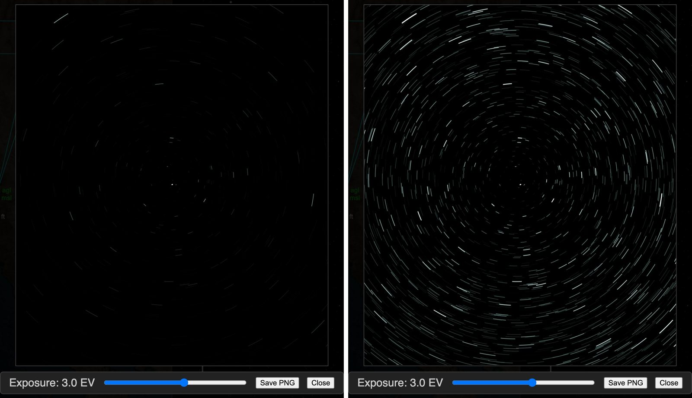
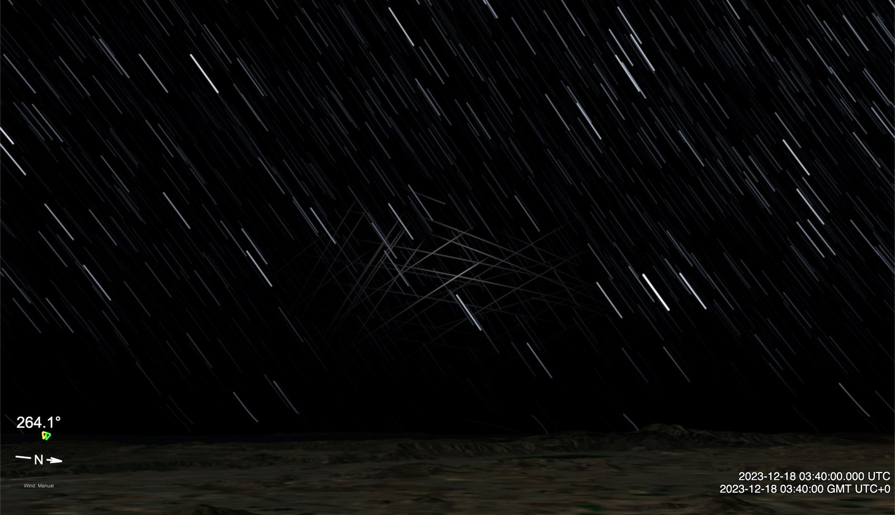
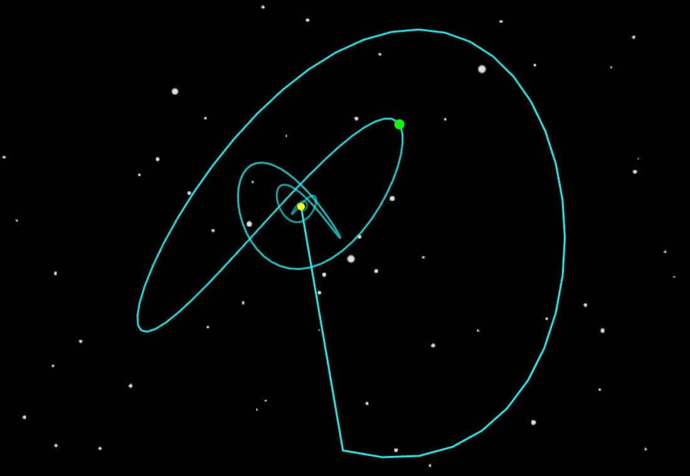
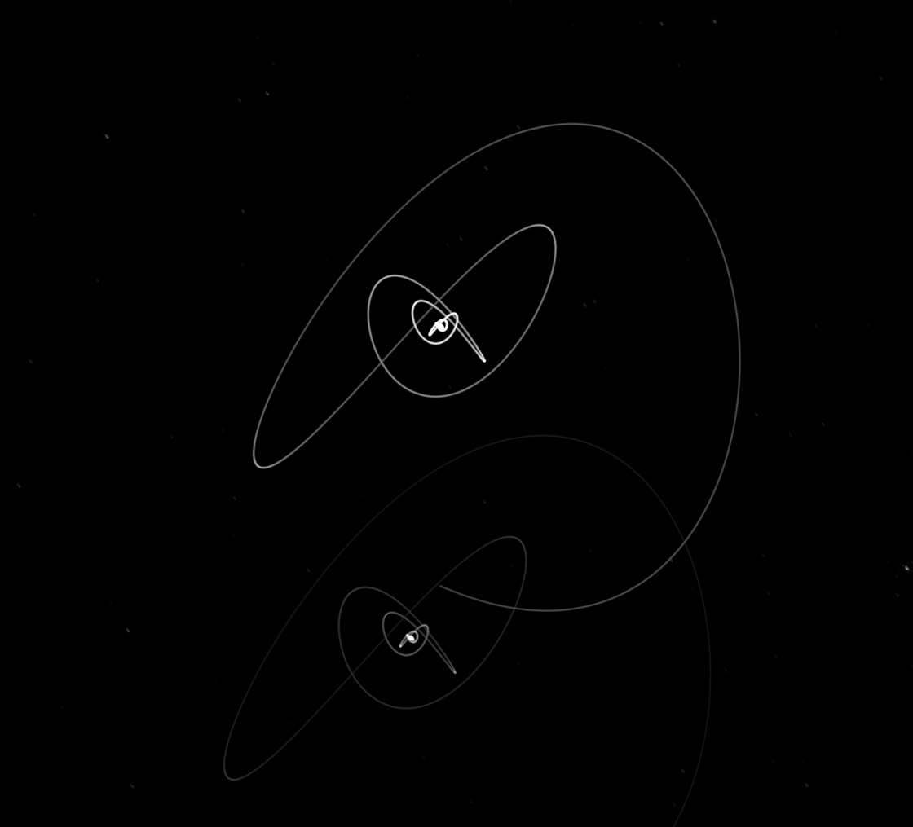
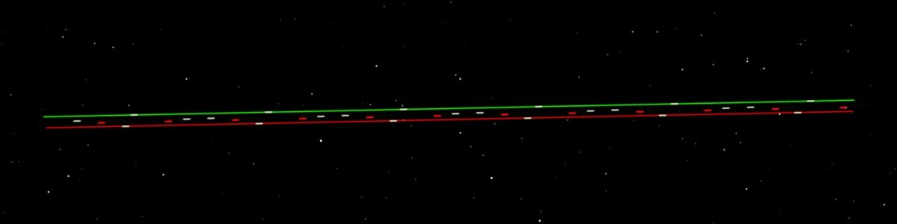
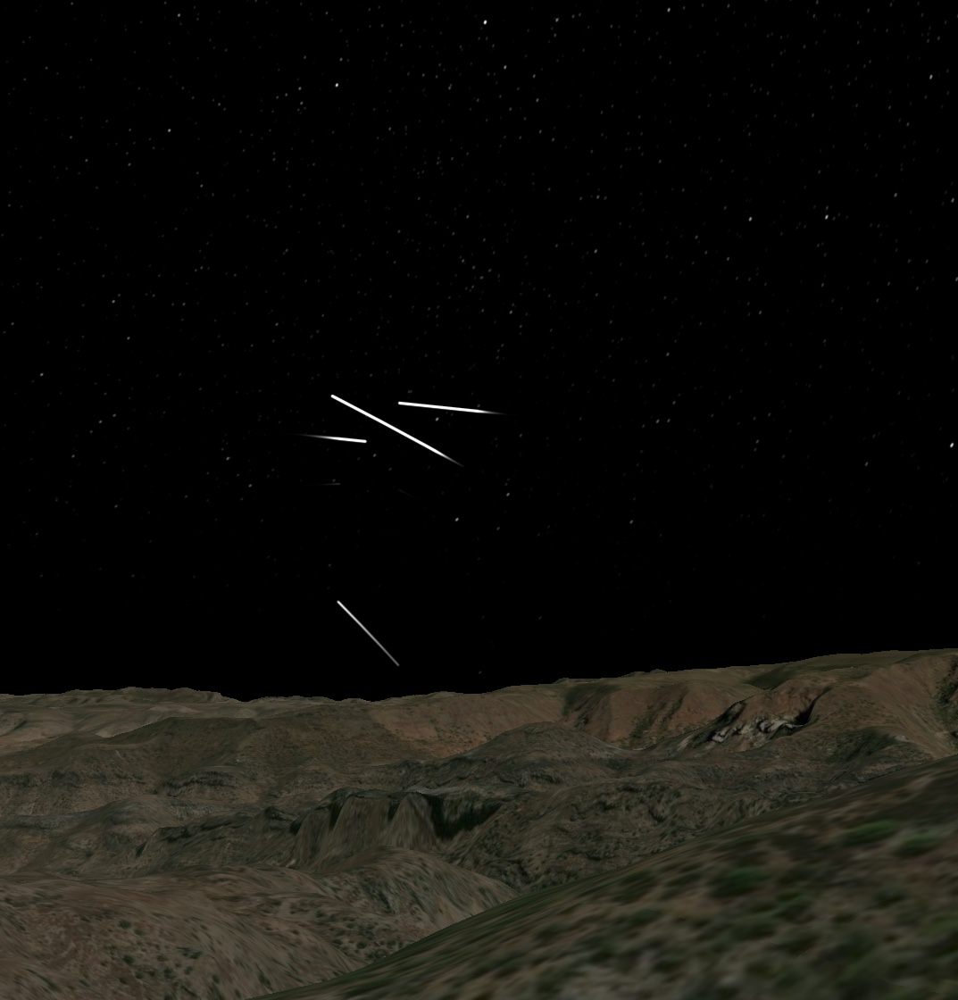

# Long Exposure/Stacking

Long Exposure/Stacking simulates what a still camera records over minutes or hours. It
renders the Sitrec 3D scene in the look view (the view from the simulated camera), and it
does not analyze a loaded video. Stars, planets, the Moon, satellites and the lights on 3D
models leave trails when they or the camera move.

There are two methods. A **continuous exposure** averages the light over the whole time.
A **brightest-pixel stack** simulates many short exposures and keeps the brightest value
at each pixel.

The brightness of a point source (a light too small to show as a disc) is computed from
its [magnitude](Glossary.md#images-and-brightness) (a star-brightness scale on which a
lower number is brighter) or its light intensity.

You'll find it under **Video → Long Exposure/Stacking**. First set up the
[sitch](Glossary.md#sitrec) (one Sitrec scene): the camera position, the date and
time, and [where the camera points](CameraAndTarget.md).

## Quick start

1. Set **Duration (Minutes)** (default 5). The exposure runs from the **start of the
   sitch** for that long — extending past the sitch's own end if necessary.
2. Choose **Capture Mode**: **Brightest-pixel stack** (the default for new scenes) or
   **Continuous exposure**. For a stack, set **Stack Exposure (s)** (default 10).
   Click **Render Long Exposure/Stacking**.
3. While it renders, the live render view shows the developing exposure, updated every
   30 frames. The progress widget's **Enough** button stops early and keeps the shorter
   exposure.
4. The result opens in a window with an **Exposure (EV)** slider and **Save PNG**. The
   slider starts at +3 [EV](Glossary.md#images-and-brightness) (with **Moonlight** on, at
   the moonlit exposure). The live render view uses the same exposure.

**EV** (exposure value) is a brightness step: +1 EV doubles the brightness.
[**HDR**](Glossary.md#images-and-brightness) (high dynamic range) means that the result
keeps values brighter than white. The EV slider
redraws the kept HDR result live — push it up to reveal faint trails and stars, down to
isolate only the brightest sources, without re-rendering. Bright values roll off through
a soft photographic shoulder rather than clipping hard.

To frame the camera before a render, use **Preview Timelapse** (below).

## Continuous exposure and brightest-pixel stacks

Brightest-pixel stacking, also called lighten blending, is a standard star-trail
workflow used by [Allsky](https://github.com/AllskyTeam/allsky/blob/master/src/startrails.cpp)
and [indi-allsky](https://github.com/aaronwmorris/indi-allsky/blob/master/indi_allsky/starTrails.py).
It is the default for new scenes. Saved capture-mode choices are preserved. Older
exposure saves that predate this option retain continuous exposure.

**Continuous exposure** integrates the whole duration and displays its time-average.
A trail dims in proportion to how fast it moves, because its dwell time (the time a source
stays on one pixel) falls. **Brightest-pixel stack** simulates a sequence of contiguous
finite exposures, then keeps the brightest value in each color channel at each pixel.
For example, 20 minutes with **Stack Exposure (s)**
set to 10 combines 120 ten-second exposures. Each subexposure integrates the same
linear source flux and background as continuous mode; it does not take a maximum
of instantaneous rendered samples.

The settings of that example give the two result windows below, for the stars around the
north celestial pole. Both are at the same EV. The left window is **Continuous exposure**, and the right
window is **Brightest-pixel stack**. Polaris, at the center, hardly moves and is bright in
both. The other stars leave much brighter trails in the stack. Raise the EV slider to show
the fainter trails of the continuous exposure.

In both modes, with **HDR Background** off, at 0 EV a static scene has the same brightness
as a single frame. **HDR Background** is on by default, so turn it off before the render if
you want to compare a result with a single frame. The result window opens at +3 EV, so also
set the slider to 0.

A brightest-pixel stack changes how moving trails compare with slowly moving stars or a
stationary background. Each subexposure retains its own dwell time, and repeated visits to
the same pixel do not add across exposures. A colored result pixel can contain
channels selected from different subexposures. Stack boundaries are sampled exactly,
even when they fall between sitch frames or the Frame Step exceeds the subexposure.
The final partial subexposure, including one stopped with **Enough**, uses the full
configured subexposure duration for normalization; a shorter shutter does not receive
extra gain.

This models contiguous exposures with fixed gain. It does not include gaps, sensor
noise, changing camera gain, or later local image processing.

To compare a render with a photograph, set **Duration (Minutes)**, **Capture Mode** and
**Stack Exposure (s)** to match how the photograph was made. That recipe must come from
outside Sitrec, for example from the image metadata or the photographer. Selecting a mode
does not establish that the photograph used it.

## Why "HDR Point Sources" matters

A plain average of the rendered frames loses the brightness of point sources. Sitrec's live
view draws stars, planets, and aircraft lights as small **fuzzy discs bright enough to see**
— a display convention. With the default Saturation Magnitude of 4, Venus (mag −4.4) has
about **2300×** the light that saturates one pixel, so its point and its trail stay bright
after averaging. If you just average the display's fuzzy discs, a moving Venus smears
into a barely-visible blob and faint stars vanish entirely.

With **HDR Point Sources** enabled (the default), the fuzzy display discs are hidden during
the exposure and each source is instead drawn with its **linear flux** (the amount of
light it delivers), computed from its astronomical magnitude or light intensity:

- **Stars** — the full catalog (not just the stars bright enough to display), with
  atmospheric extinction dimming them toward the horizon (and optionally reddening
  them too — see *Horizon Reddening*). Extinction scales with the camera's altitude —
  an airborne observer sits above most of the air — and the horizon dips
  correspondingly below 0°.
- **Planets** — at their refracted apparent positions. They are rendered white: the colored
  display sprites (green Venus, etc.) are identification aids, not photometry.
- **The Moon** — stays as the rendered textured disk, scaled so its total light matches its
  actual phase-dependent magnitude. At settings that show faint stars, the Moon disc
  saturates.
- **Aircraft / model lights** — navigation, beacon, strobe, and landing lights on 3D models,
  with light intensities in candela (about 100 cd for navigation lights and about 200 cd for
  beacons), inverse-square falloff and distance haze. **Strobes leave dashed
  trails** (the dash spacing is the strobe period), and colored lights trail in
  their own color. An object of your own leaves this kind of trail only if its 3D model
  has lights: see [Aircraft navigation lights](CustomModels.md#aircraft-navigation-lights).
- **Satellites** — with **Satellites → Satellite Brightness Model → Photometric estimate**
  (the default), continuous [flare](Glossary.md#images-and-brightness) curves (a flare is
  a sun glint from a satellite) and estimated ordinary light, including passes
  outside the flare angle. Range, phase and fractional sunlight affect their flux. The
  default **Satellite Sunlight** model includes the finite solar disk and a clear atmosphere
  at Earth's limb. The **Legacy cone** option retains the older flare-only/ISS exposure approximation. Satellite magnitudes remain
  estimates: orbital records do not give individual attitudes or optical properties. See
  [Brightness and flares](Satellites.md#brightness-and-flares).

Stars, planets, satellites and model lights are positioned **continuously between frames**
(not just at frame instants), so their trails are smooth curves even during fast camera
motion. The Moon and everything else in the rendered frame are drawn only at each sample
(see **Frame Step**). If one of them moves more than its own width between samples, it
leaves separate copies, not a smooth trail.

### Calibration controls

| Control | Meaning |
|---|---|
| **Duration (Minutes)** | The exposure (shutter) time, 0.1 to 720 minutes of sitch time, from the start of the sitch. If longer than the sitch itself, the timeline is extended for the render. |
| **Capture Mode** | **Brightest-pixel stack** or **Continuous exposure**. See [Continuous exposure and brightest-pixel stacks](#continuous-exposure-and-brightest-pixel-stacks). |
| **Stack Exposure (s)** | Shown for a brightest-pixel stack; default 10 seconds. |
| **Lock Camera Heading** | On by default: the camera holds the heading it has *right now* for the whole exposure — a tripod doesn't track. Works in any camera mode (To Target, Celestial Lock, Horizon Flare Region…), behaving as if the heading were locked (Manual) on the current spot in the sky. The Camera Nudge still applies on top. Turn off to let the active camera mode steer during the exposure. |
| **HDR Point Sources** | On by default: replaces the cosmetic star/planet/light sprites with bright points (linear flux) so bright sources stay visible in the average and leave trails. Off = the rendered frames only, with the cosmetic sprites. |
| **HDR Background** | On by default: when the first frame does not reach full scale, the lighting (Sun + Ambient) is temporarily boosted so the background renders using the full 8-bit range, then scaled back down in the HDR buffer. Pushing the EV slider up then reveals smooth ground detail instead of quantized color bands. Calibrated on the first frame; the lighting is restored after the render (including Enough and Abort). In daylight this darkens the sky: see [Nuances and limitations](#nuances-and-limitations). |
| **Moonlight** | Off by default: light the scene with ONLY the Moon — ambient light is removed and the directional light is re-aimed at the Moon with its true phase-dependent brightness (a full moon is about 18.6 EV dimmer than the sun). The point sources (stars, planets, lights) are re-calibrated to the same physical scale as the moonlit ground using the camera's plate scale (the angle that one pixel covers), so a *single* exposure shows the dim moonlit landscape **and** the brighter star trails together. The result window opens at the moonlit exposure. Surfaces facing away from the Moon go fully dark, shadows (if enabled) fall from the Moon, and a Moon below the horizon gives a dark scene (stars still record). |
| **Horizon Reddening** | Chromatic extinction (off by default): sources near the horizon redden as well as dim. Off by default, so the default is dimming only. |
| **Star Tint** | Intrinsic blue-white color of star trails (0 = flat white, 1 = bright-star population average). With Horizon Reddening on, extinction neutralizes the blue before warming. |
| **Saturation Magnitude** | The star magnitude whose total light equals the saturation level of one pixel in a single frame (the point spread shares that light among nearby pixels) — the "ISO" of the simulated camera. Default 4: Venus (−4.4) is then ~2300× saturation. Lower = a less sensitive camera. |
| **Light Brightness** | Multiplier on model-light brightness. 1 = about 100 cd effective navigation light and about 200 cd beacon, with inverse-square falloff and slant-path extinction. |
| **Moon Gain** | Multiplier on the magnitude-calibrated Moon disk (1 = physical). |
| **Point Spread (px)** | The width of the point spread of point sources: the sigma (standard deviation) of a Gaussian, in pixels, default 0.6 (not the [Diffraction Glare](DiffractionGlare.md) [PSF](Glossary.md#images-and-brightness)). |
| **Wait For Loading** | On by default: settle terrain/3D-tiles each frame before capture (slower, but stable terrain). |
| **Frame Step** | Sample every Nth frame (default 30, ~30× faster). Position and linear flux are interpolated and weighted by elapsed time, including the final partial interval. Point-source trails remain smooth, but a large step can miss rapid flares, shadow transitions or background motion. Reduce it to check short events; use 1 for full quality. |
| **Refraction** | Shows whether sky refraction is in effect — normally on when **Enable Refraction** (the title checkbox of Effects → Atmospheric Refraction) and **Sky** are both on. Ticking it changes that state directly; it is not a copy of either checkbox, and a later change in Effects → Atmospheric Refraction sets it again from those two switches. When on, point sources use refracted apparent positions, and horizon culling and extinction follow the refracted direction. |
| **Occlusion Mask** | Hide point sources in the same direction as terrain or other opaque foreground (a planet setting behind a hill stays hidden). See [Nuances and limitations](#nuances-and-limitations). |

## Preview Timelapse

**Video → Long Exposure/Stacking → Preview Timelapse** draws the trails that the render
will record as lines in the 3D scene: stars, planets and satellites, with the satellites'
flares. Turn it on with the checkbox in the folder's title bar. It uses the settings of
the Long Exposure/Stacking menu: Duration, Capture Mode, Stack Exposure, Frame Step,
Saturation Magnitude, Point Spread, Star Tint, Horizon Reddening, Refraction and the
Camera Nudge.

In the look view below, the parallel lines are star trails. The thin lines that cross them
are satellites, and each one brightens and fades along its pass. Here **Camera Heading** is
**Horizon Flare Region**, which [points the camera](CameraAndTarget.md) at the Sun's azimuth,
just above the horizon. The satellite lines are near that point. **Preview Exposure (EV)**
is below its default here, so that the fainter stars do not fill the sky.

**Positions** are those of the render: the same star catalog, annual aberration and
refraction, and for satellites the render's sample times and apparent positions. Stars
and planets are drawn on the night sky, so the terrain hides them. Satellites are drawn
at their apparent positions in the 3D world, so terrain in front of them hides them, and
the main view shows their real paths.

**Brightness** is that of the render, apart from the limits below. Each trail vertex has
the value that the render's point spread leaves at the middle of the trail: the flux of the source, dimmed by
extinction, times the part of its light that falls in one pixel along the trail. A slow
star keeps almost all of it; a fast satellite spreads it along its streak. The line
applies the same point spread across the trail, so a faint trail is a thin, dim line and
a bright flare fills a wider line. Overlapping trails show the brighter one, as in a
brightest-pixel stack.

| Control | Effect |
|---|---|
| **Segments Per Trail** | The number of straight segments in each trail, 20 by default. A star or planet trail gets fewer when its segments would be shorter than 4 pixels. A satellite's segments cover only the visible part of its pass, from where it fades in to where it fades out. Half of them are spaced by time and half by change of brightness, so the rise, the peak and the fall of a flare each get vertices. |
| **Preview Exposure (EV)** | The exposure of the look view while the preview is on, +3 EV by default. It applies to the whole view, the trails and the scene, as the EV slider of the result window does. Use the same value in both to compare them. |
| **Stars**, **Planets**, **Satellites** | Which trails to draw. |
| **Hide Live Sky** | In the look view, hide what the render hides: the star, planet and satellite sprites and the sky chart lines (constellations, grid, flare region). On by default. |
| **Recalculate Now** | Calculate the trails again, for a change that the preview does not watch, for example a new satellite filter. |
| **Status** | The number of trails drawn and the time the calculation took. In full daylight it says that the render records no sky sources (no stars, planets or satellites). |

The trails are calculated again when the view has not changed for half a second. While
the look camera moves, the old lines stay where they are, because they are fixed in the
world. The calculation runs in parallel in background workers, so it does not slow the
camera, and only for sources in the view or near it (a margin of at least 5°). A larger
pan shows the new trails when the camera stops.

Limits of the preview:

- The camera is assumed to hold still for the exposure, as with **Lock Camera Heading**
  (on by default). The current camera position and heading are used for all of it.
- The Moon's trail and aircraft lights are not drawn. The background is the current
  frame, not the stack of all the frames.
- In **Continuous exposure**, and within one subexposure of a stack, two trails that cross
  add their light in the render; the preview shows the brighter one.
- The preview ignores **Moonlight** and **HDR Point Sources**. With Moonlight on, the
  render's brightness and opening exposure differ from the preview. With HDR Point Sources
  off, the render does not record the trails that the preview draws.
- With the **Camera Nudge**, the trails follow the nudge only at their vertices. Increase
  **Segments Per Trail** to see more of a fast bounce.
- A satellite is sampled at the render's sample times while it moves fast. A slow or
  distant one is sampled less often: at most about 2 pixels or 0.3° of motion between
  samples, and at least one sample every 30 seconds. For a very long exposure or a small
  **Frame Step**, the samples are also limited to 1,500 in the exposure.

## Camera Nudge

**Video → Long Exposure/Stacking → Camera Nudge** jolts the look camera at a chosen time: it bounces
around and settles, like a tripod that's been bumped — and every light in the frame writes
that bounce into the exposure as a decaying looping trail.

- **Nudge Enabled** (the checkbox on the **Camera Nudge** title) — turn the bump on (off by default; with it off the other controls are greyed out and do nothing).
- **Nudge Time (s)** — when the bump happens (sitch time).
- **Magnitude (°)** — peak deflection of the first swing.
- **Frequency (Hz)** — how fast it oscillates (the "elasticity" of the mount).
- **Damping** — how quickly it settles: low values ring for a long time.
- **Direction (°)** — rotates the bounce pattern.

A separate **smooth roll** about the view axis, layered on top of the jolt, curves
otherwise-straight star/satellite trails into arcs:

- **Rotate Start (s)** — when the roll begins.
- **Rotate Duration (s)** — how long it takes to sweep the full angle, which is then held.
- **Rotate Ease** — eased fraction at each end (0 = constant rate, 0.5 = full ease in/out).
- **Rotate Total Angle (°)** — total roll swept over the duration, then held (0 = off).

While the Camera Nudge folder is open (and the nudge enabled), the full bounce trajectory is
drawn live on the look view: a cyan path fading as it settles, a yellow dot at the impulse
start, and a green dot showing where the camera offset is at the current frame. The nudge
also works during normal playback, so you can scrub through the bounce.

The straight part of the path, from the yellow dot, is the first jump of the camera. The
camera moves there at once, so a render leaves no trail along that line.

The nudge is deterministic — the same parameters always produce exactly the same bounce, so
renders are repeatable.

## Examples

### Stars and planets, with a camera nudge

A 5.5° telephoto view of Venus (large trail) and a second planet. The camera was nudged 2°
one second into the exposure: every point source traces the same decaying bounce, ending at
a bright settled point. Note how the trail dims where the camera was moving fastest: a
moving source spends less time on each pixel.

### Aircraft at night

An aircraft on an ADS-B track with a 737 model, seen from below. The red line is the
navigation light on the left wing, and the green line is the one on the right wing. The
white dashes on those two lines are the wing-tip strobes. The row of dashes between the
lines is from the tail strobes (white) and the beacon under the fuselage (red). Strobes
leave dashes, and the dash spacing is the flash period of the light.

The landing lights are off in this render (**Light Visible**, in the **Lights** folder of
the object). They are steady and they lie along the same line as the tail strobes, so
with them on, that row is a solid white line.

### Starlink flares

A Starlink Horizon Flares scenario rendered with the legacy cone model. The photometric
estimate also includes ordinary illuminated passes and fainter wings outside the cone.
Constellation lines and the equatorial grid are automatically excluded from exposures.

## Nuances and limitations

- **Duration is sitch time.** A 20-minute exposure covers 20 minutes of simulated time,
  whatever the playback speed. It is not the time that the render takes. The exposure
  starts at the first frame of the sitch. If it is longer than the sitch, the timeline is
  temporarily extended (the world keeps evolving: the sky turns, satellites move, and
  tracks continue in a straight line at their final speed) and restored after the render.
- Brightness in the result depends on **Saturation Magnitude**, **Point Spread (px)** and
  the EV slider. These are settings. They are not calibrated to a particular camera.
- Anything that saturates in the **base render** (bright clouds, city glow, terrain) is
  clipped at single-frame white — only catalogued point sources, model lights, satellites
  and the Moon carry HDR values.
- **HDR Background** boosts only what the scene lights illuminate. Content that doesn't
  respond to lighting (the atmosphere's sky glow, and haze over distant ground) is recorded
  proportionally darker. This is negligible at night, but the boost has no day or night
  test: it applies whenever the brightest pixels of the first frame are below full scale.
  In a daylight scene the sky can come out clearly darker than a single frame. Turn
  HDR Background off for a daylight scene.
- **Occlusion** uses a screen-space mask of opaque foreground (on by default): anything
  the look view renders as solid — terrain, buildings, models — blocks every point source
  in the same direction. The mask holds no distance, so an aircraft light in front of a
  hill is hidden too. Turn **Occlusion Mask** off to record lights that pass in front of
  terrain. With a fixed camera position there is one mask, rendered at the first sample.
  It stays exact while the camera turns, but only inside the first sample's field of view:
  outside it, sources are not hidden. A model that moves during the exposure blocks
  sources only where it was at that sample. With a moving camera, the mask is rendered
  again at each sample.
- With the **Fisheye** lens (Camera → FOV (Zoom) → Fisheye) or the **Panoramic Camera**
  on, the point sources and their trails are placed through that projection, the same
  as the rendered scene, and sources outside the fisheye's masked image circle are left
  out. With a panorama, the occlusion mask is rendered once for each panorama face.
- The point sources, their trails and the occlusion mask are placed in the view as it is
  drawn. That includes a video zoom or pan that the look view follows (View → *Video Zoom %*,
  or panning in the video pane), **Match Video Aspect** and the Camera Tweaks offsets, so a
  trail ends at the skyline that the rendered terrain shows.
- Satellite visibility depends on estimated flux, image speed, point-spread width and
  exposure response. Design and attitude are not supplied by orbital elements. Use the
  **Satellites → Starlink Design** options as sensitivity checks, with one camera calibration
  across the trails; a selected profile is not an identification of an unknown spacecraft.
- Long Exposure/Stacking and Camera Nudge settings are saved with custom sitches. Preview
  Timelapse settings are not saved.

## See also

**Related checks.** [Lens Ghost](LensGhost.md): a second image from a reflection inside the
camera. [Diffraction Glare](DiffractionGlare.md): spikes around a bright point.
[Video QP Graph](VideoQPGraph.md): how hard each frame was compressed.
[Video Noise Pattern Detection](VideoNoisePattern.md): noise that appears again in
later frames.
