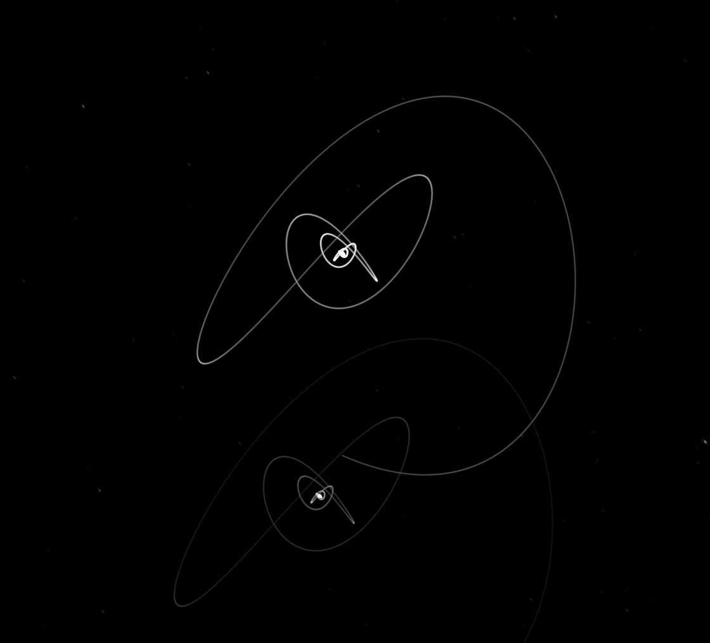
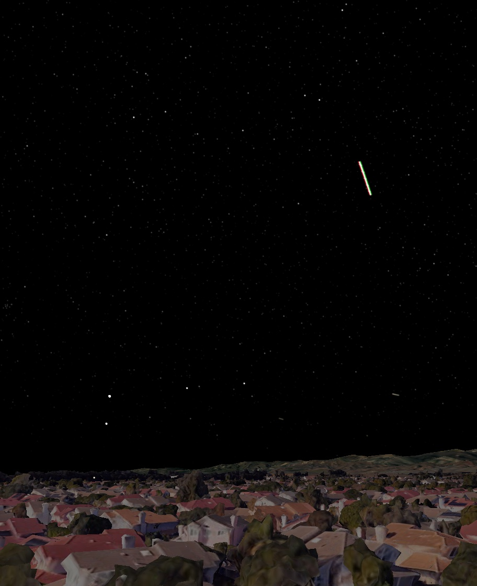
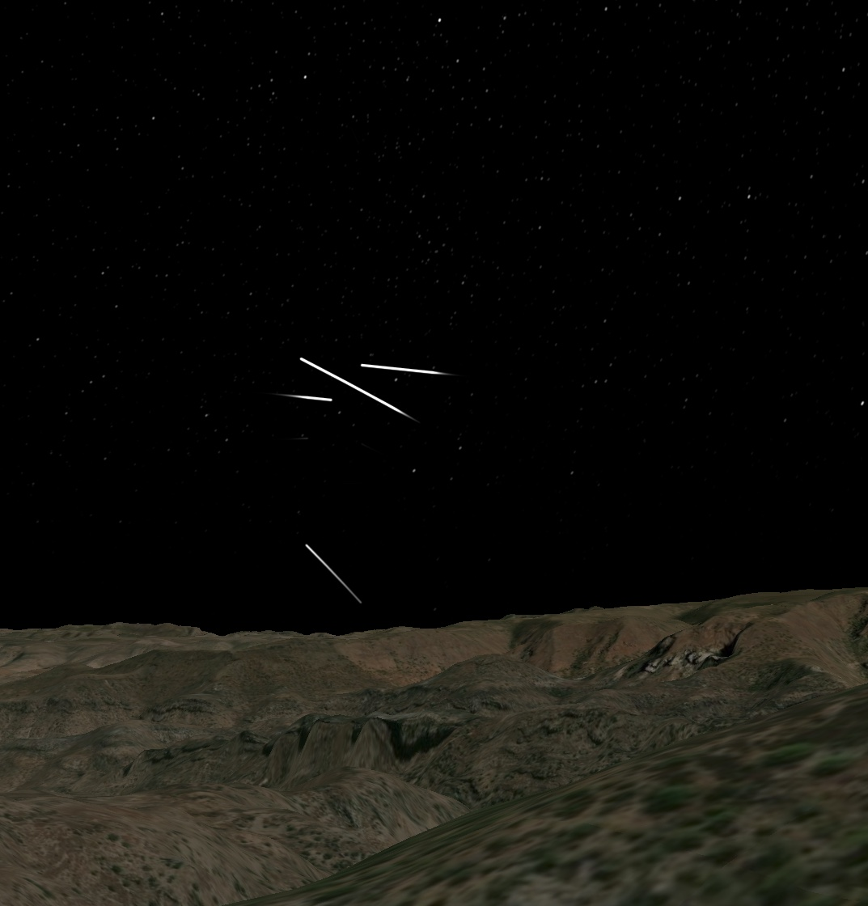

# Long Exposure/Stacking

Sitrec can simulate a **brightest-pixel stack** or a **continuous long exposure** taken
with the look camera. Anything that moves — aircraft, satellites, stars, or the camera
itself — leaves a trail. Point-source brightness is computed from each source's magnitude
or light intensity.

You'll find it under **Video → Long Exposure/Stacking**.

## Quick start

1. Set **Duration (Minutes)** (default 5). The exposure runs from the **start of the
   sitch** for that long — extending past the sitch's own end if necessary.
2. Choose **Capture Mode**: **Brightest-pixel stack** (the default for new scenes) or
   **Continuous exposure**. For a stack, set **Stack Exposure (s)** (default 10).
   Click **Render Long Exposure/Stacking**.
3. While it renders, a preview of the developing exposure is shown, updated every 30 frames.
   The progress widget's **Enough** button stops early and keeps a correctly-exposed
   shorter exposure. In stack mode, a partial final subexposure retains the
   configured gain rather than being brightened to a full exposure.
4. The result opens in a window with an **Exposure (EV)** slider and **Save PNG**.

The EV slider re-tone-maps the kept high-dynamic-range result live — push it up to reveal
faint trails and stars, down to isolate only the brightest sources, without re-rendering.
Bright values roll off through a soft photographic shoulder rather than clipping hard.

## Continuous exposure and brightest-pixel stacks

Brightest-pixel stacking, also called lighten blending, is a standard star-trail
workflow used by [Allsky](https://github.com/AllskyTeam/allsky/blob/master/src/startrails.cpp)
and [indi-allsky](https://github.com/aaronwmorris/indi-allsky/blob/master/indi_allsky/starTrails.py).
It is the default for new scenes. Saved capture-mode choices are preserved. Older
exposure saves that predate this option retain continuous exposure.

**Continuous exposure** integrates the whole duration and displays its time-average,
so a static scene has the same brightness as a single frame. **Brightest-pixel stack**
simulates a sequence of contiguous finite exposures, then keeps the brightest value
in each color channel at each pixel. For example, 20 minutes with **Stack Exposure (s)**
set to 10 combines 120 ten-second exposures. Each subexposure integrates the same
linear source flux and background as continuous mode; it does not take a maximum
of instantaneous rendered samples.

This changes how moving trails compare with slowly moving stars or a stationary
background. Each subexposure retains its own dwell time, and repeated visits to
the same pixel do not add across exposures. A colored result pixel can contain
channels selected from different subexposures. Stack boundaries are sampled exactly,
even when they fall between sitch frames or the Frame Step exceeds the subexposure.
The final partial subexposure, including one stopped with **Enough**, uses the full
configured subexposure duration for normalization; a shorter shutter does not receive
extra gain.

This models contiguous exposures with fixed gain. It does not include gaps, sensor
noise, changing camera gain, or later local image processing. The capture and stacking
recipe of a comparison photograph must be established independently; selecting this
mode does not establish that the photograph used a brightest-pixel stack.

## Why "HDR Point Sources" matters

A simple average of the rendered frames is *not* what a real camera records. Sitrec's live
view draws stars, planets, and aircraft lights as small **fuzzy discs bright enough to see**
— a display convention. With the default Saturation Magnitude of 4, Venus (mag −4.4) is
about **2300×** the level that saturates one pixel, so its point and its trail stay bright
after averaging. If you just average the display's fuzzy discs, a moving Venus smears
into a barely-visible blob and faint stars vanish entirely.

With **HDR Point Sources** enabled (the default), the fuzzy display discs are hidden during
the exposure and each source is instead drawn with its **true linear flux**, computed from
its astronomical magnitude:

- **Stars** — the full catalog (not just the stars bright enough to display), with
  atmospheric extinction dimming them toward the horizon (and optionally reddening
  them too — see *Horizon Reddening*). Extinction scales with the camera's altitude —
  an airborne observer sits above most of the air — and the horizon dips
  correspondingly below 0°.
- **Planets** — at their refracted apparent positions. They are rendered white: the colored
  display sprites (green Venus, etc.) are identification aids, not photometry.
- **The Moon** — stays as the rendered textured disk, scaled so its total light matches its
  actual phase-dependent magnitude. At settings that show faint stars, the Moon disc
  saturates.
- **Aircraft / model lights** — navigation, beacon, strobe, and landing lights on 3D models,
  with light intensities in candela (about 100 cd for navigation lights and about 200 cd for
  beacons), inverse-square falloff and distance haze. **Strobes leave dashed
  trails** (the dash spacing is the strobe period), and colored lights trail in
  their own color.
- **Satellites** — with **Satellites → Satellite Brightness Model → Photometric estimate**,
  continuous flare curves and estimated ordinary light, including passes outside the flare
  angle. Range, phase and fractional sunlight affect their flux. The default sunlight model
  includes the finite solar disk and a clear atmosphere at Earth's limb. The **Legacy cone**
  option retains the older flare-only/ISS exposure approximation. Satellite magnitudes remain
  estimates: orbital records do not give individual attitudes or optical properties. See
  [Brightness and flares](Satellites.md#brightness-and-flares).

All sources are positioned **continuously between frames** (not just at frame instants), so
trails are smooth curves even during fast camera motion.

### Calibration controls

| Control | Meaning |
|---|---|
| **Duration (Minutes)** | The exposure (shutter) time in minutes of sitch time, from the start of the sitch. If longer than the sitch itself, the timeline is extended for the render. |
| **Capture Mode** | **Continuous exposure** averages the full duration. **Brightest-pixel stack** integrates contiguous finite subexposures and keeps the per-channel maximum at each pixel. |
| **Stack Exposure (s)** | Shown for a brightest-pixel stack; default 10 seconds. The final partial exposure retains the same detector gain. |
| **Lock Camera Heading** | On by default: the camera holds the heading it has *right now* for the whole exposure — a tripod doesn't track. Works in any camera mode (To Target, Celestial Lock, Horizon Flare Region…), behaving as if the heading were locked (Manual) on the current spot in the sky. The Camera Nudge still applies on top. Turn off to let the active camera mode steer during the exposure. |
| **HDR Point Sources** | On by default: replaces the cosmetic star/planet/light sprites with physically-bright point splats (true linear flux) so bright sources stay visible in the average and leave correct trails. Off = a plain frame average. |
| **HDR Background** | On by default: in a dark scene the lighting (Sun + Ambient) is temporarily boosted so the background renders using the full 8-bit range, then scaled back down in the HDR buffer. Pushing the EV slider up then reveals smooth ground detail instead of quantized color bands. Calibrated on the first frame; the lighting is restored after the render (including Enough/cancel). |
| **Moonlight** | Off by default: light the scene with ONLY the Moon — ambient light is removed and the directional light is re-aimed at the Moon with its true phase-dependent brightness (a full moon is about 18.6 stops dimmer than the sun). The point sources (stars, planets, lights) are re-calibrated to the same physical scale as the moonlit ground using the camera's plate scale, so a *single* exposure shows the dim moonlit landscape **and** the brighter star trails together. The result window opens pre-developed at the moonlit exposure. Surfaces facing away from the Moon go fully dark, shadows (if enabled) fall from the Moon, and a Moon below the horizon gives a dark scene (stars still record). |
| **Horizon Reddening** | Chromatic extinction (off by default): sources near the horizon redden as well as dim. Off by default, so the default is dimming only. |
| **Star Tint** | Intrinsic blue-white color of star trails (0 = flat white, 1 = bright-star population average). With Horizon Reddening on, extinction neutralizes the blue before warming. |
| **Saturation Magnitude** | The star magnitude whose light just saturates one pixel in a single frame — the "ISO" of the simulated camera. Default 4: Venus (−4.4) is then ~2300× saturation. Lower = a less sensitive camera. |
| **Light Brightness** | Multiplier on model-light brightness. 1 = about 100 cd effective navigation light and about 200 cd beacon, with inverse-square falloff and slant-path extinction. |
| **Moon Gain** | Multiplier on the magnitude-calibrated Moon disk (1 = physical). |
| **Point Spread (px)** | The Gaussian point-spread width of splatted sources, in pixels. |
| **Wait For Loading** | On by default: settle terrain/3D-tiles each frame before capture (slower, but stable terrain). |
| **Frame Step** | Sample every Nth frame (default 30, ~30× faster). Position and linear flux are interpolated and weighted by elapsed time, including the final partial interval. Trails remain smooth, but a large step can miss rapid flares, shadow transitions or background motion. Reduce it to check short events; use 1 for full quality. |
| **Refraction** | Shows whether sky refraction is in effect — normally on when **Enable Refraction** (the checkbox on the View → Atmospheric Refraction title) and **Sky** are both on. Ticking it changes that state directly; it is not a copy of either View checkbox, and a later change in View → Atmospheric Refraction sets it again from those two switches. When on, splatted sources use refracted apparent positions, and horizon culling and extinction follow the refracted direction. |
| **Occlusion Mask** | Hide splatted sources behind terrain and other opaque foreground (a planet setting behind a hill stays hidden). Exact under camera rotation, and recalculated automatically whenever the camera position moves. |

## Camera Nudge

**Video → Long Exposure/Stacking → Camera Nudge** jolts the look camera at a chosen time: it bounces
around and settles, like a tripod that's been bumped — and every light in the frame writes
that bounce into the exposure as a decaying zigzag trail.

- **Nudge Enabled** (the checkbox on the **Camera Nudge** title) — turn the bump on (off by default; with it off the other controls are greyed out and do nothing).
- **Nudge Time (s)** — when the bump happens (sitch time).
- **Magnitude (°)** — peak deflection of the first swing.
- **Frequency (Hz)** — how fast it oscillates (the "elasticity" of the mount).
- **Damping** — how quickly it settles: low values ring for a long time.
- **Direction (°)** — rotates the bounce pattern.

A separate **smooth roll** about the view axis, layered on top of the jolt, curves
otherwise-straight star/satellite trails into arcs:

- **Rotate Start (s)** — when the roll begins.
- **Rotate Duration (s)** — how long it takes to sweep the full angle, which is then held.
- **Rotate Ease** — eased fraction at each end (0 = constant rate, 0.5 = full ease in/out).
- **Rotate Total Angle (°)** — total roll swept over the duration, then held (0 = off).

While the Camera Nudge folder is open (and the nudge enabled), the full bounce trajectory is
drawn live on the look view: a cyan path fading as it settles, a yellow dot at the impulse
start, and a green dot showing where the camera offset is at the current frame. The nudge
also works during normal playback, so you can scrub through the bounce.

The nudge is deterministic — the same parameters always produce exactly the same bounce, so
renders are repeatable.

## Examples

### Stars and planets, with a camera nudge

A 5.5° telephoto view of Venus (large trail) and a second planet. The camera was nudged 2°
one second into the exposure: every point source traces the same decaying bounce, ending at
a bright settled point. Note how the trail dims where the camera was moving fastest —
brightness is dwell-time-correct photometry.

### Aircraft at night

Live ADS-B aircraft with 3D models. The nearby aircraft's lights saturate and trail; strobes
leave dashes; red/green navigation lights trail in color. Distant aircraft fade with
inverse-square falloff and atmospheric extinction.

### Starlink flares

A Starlink Horizon Flares scenario rendered with the legacy cone model. The photometric
estimate also includes ordinary illuminated passes and fainter wings outside the cone.
Constellation lines and the equatorial grid are automatically excluded from exposures.

## Nuances and limitations

- **Exposures are real time.** Duration is sitch (wall-clock) time; playback speed is
  ignored. The exposure starts at the first frame of the sitch; if it is longer than the
  sitch, the timeline is temporarily extended (the world keeps evolving — sky rotation,
  satellites, tracks hold their last position) and restored after the render.
- In **Continuous exposure** the result is the **time-average** of the scene — the same brightness convention as a
  single frame. A static scene looks identical to one frame; trails dim in proportion to
  how fast they move (dwell time). Use the EV slider to "push" the exposure.
- In **Brightest-pixel stack**, each finite subexposure is normalized by its configured
  duration before taking the per-channel maximum. Gaps, sensor noise and gain changes
  are not modeled. A partial final exposure receives no compensating brightness boost.
- Anything that saturates in the **base render** (bright clouds, city glow, terrain) is
  clipped at single-frame white — only catalogued point sources, model lights, satellites
  and the Moon carry true HDR values.
- **HDR Background** boosts only what the scene lights illuminate. Content that doesn't
  respond to lighting (the atmosphere's sky glow) is recorded proportionally darker —
  negligible at night, which is the only time the boost engages (in a bright scene it
  calibrates to 1× and changes nothing).
- **Occlusion** uses a screen-space mask of opaque foreground (on by default): anything
  the look view renders as solid — terrain, buildings, models — blocks splatted sources
  behind it. The mask is sampled once per camera position (recomputed if the camera
  moves), so objects that move *during* the exposure occlude at their sampled positions
  only, and an aircraft's body still doesn't hide its own far-side lights.
- With the **Fisheye** lens (Camera → FOV (Zoom) → Fisheye) or the **Panoramic Camera**
  on, the point sources and their trails are placed through that projection, the same
  as the rendered scene, and sources outside the fisheye's masked image circle are left
  out. With a panorama, the occlusion mask is rendered once for each panorama face.
- The point sources, their trails and the occlusion mask are placed in the view as it is
  drawn. That includes a video zoom or pan that the look view follows (View → *Video Zoom %*,
  or panning in the video pane), **Match Video Aspect** and the Camera Tweaks offsets, so a
  trail ends at the skyline that the rendered terrain shows.
- Satellite visibility depends on estimated flux, image speed, point-spread width and
  exposure response. Design and attitude are not supplied by orbital elements. Use the
  available Starlink design profiles as sensitivity checks, with one camera calibration
  across the trails; a selected profile is not an identification of an unknown spacecraft.
- Long Exposure/Stacking and Camera Nudge settings are saved with custom sitches.
