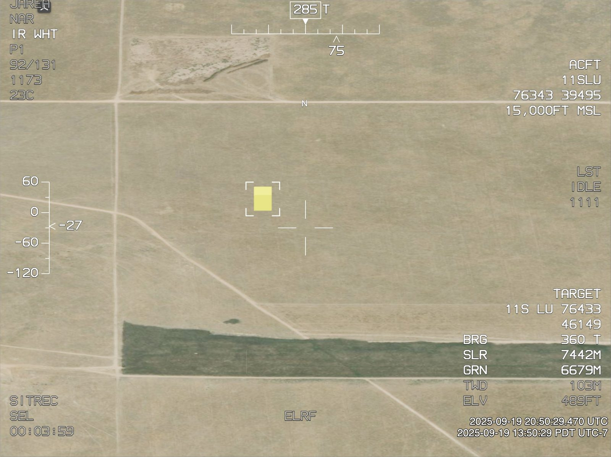

# MQ9 Tracking Simulation

The MQ-9 is a remotely piloted aircraft, and Sitrec's **MQ9UI** overlay imitates its
sensor display. **Camera → MQ9 Tracking** simulates an operator acquiring and following
a rendered scene object with this overlay, for demonstrations and test videos. The
animations and timings are an observable-behavior simulation based on reference footage
and chosen parameters. They are not a specification of a real sensor's firmware.

In a sitch with this overlay, such as a custom sitch:

1. Turn on **Show → Views → MQ9UI**. It draws the acquisition gate and tracking corners,
   and dragging in the look view works only while it is on.
2. Tick **Simulate Tracking** (the checkbox on the **MQ9 Tracking** folder title).
3. Select a **Scene Object**. The list fills after you tick the checkbox. In a custom
   sitch, the default **Target object** matches no object, so choose `traverseObject`
   or an object that you added.
4. Drag in the look view to put the object near the image center.
5. Start playback, and choose **Acquire / Box Target**. The simulation runs on sitch
   [frames](Glossary.md#sitrec), so the square does not grow while the sitch is paused.
   A new custom sitch opens paused.

The simulator uses the selected object's projected size and visibility.
Crosshairs, text, and other overlay graphics cannot become targets. Detection ignores
contrast and background, and an object of any projected size that overlaps the gate
counts as detected. Confidence is not measured from the image: it stays high unless
you tick **Simulate Low Confidence**. This mode does not perform computer vision on a
loaded video; use [Point Tracking](PointTrack.md) for that task.

## Acquisition and lock

Acquisition starts with a small square at the [boresight](Glossary.md#angles-and-pointing)
and expands over 0.9 seconds. This square is the **gate**: the tracker accepts a target
only inside it. Its metre label estimates the square's width at the range where the
boresight intersects the [terrain elevation model](Glossary.md#data-formats-and-sources).
It is not a measurement of the object's diameter, and is unavailable when the ray
misses the ground.

The square while it expands. The crosshair marks the boresight at the image center, and
the label `188M` is in the gap in the right edge of the square. The yellow box is the
selected object. The dim text, such as `NAR` and `TWD`, is fixed and does not change.

When the expansion ends, a candidate inside the gate changes the square to four
corners centered on the target's existing screen position. The camera holds the
target at that position while the corners shrink around it. If no candidate is
inside the gate at that moment, the square waits at full size for 2 more seconds.
If none enters, the loss sequence below starts, and ground tracking follows about
4.4 seconds after **Acquire / Box Target**.

The four corners after the lock, at the target's screen position. The crosshair stays at
the image center, so the target stays off center. The readout at lower right changes from
`GROUND` to `TARGET`. Its `SLR` row (slant range, the straight-line distance from the
camera) changes from `8402M`, to the ground at the boresight, to `7442M`, to the object.
The object is in the air, so its range is shorter than the range to the ground behind it.

**Refinement (seconds)** sets the required period of confident observation,
from 0.25–5 seconds, defaulting to about 1.33 seconds. The resulting gate fits the projected object
with a small pixel margin, and is never narrower than 8 pixels.
**Acquisition Box (pixels)** sets the width that the square expands to, from
20–300 pixels, defaulting to 180. Pixels are in a 640×480 sensor image.

Drag in the look view to slew. During object tracking, slewing changes the
camera's screen offset relative to the tracked object. The tracker continues
to follow the object, which can therefore remain off-centre within the image.
The target and gate stay at that screen position until the operator moves them.
**Center Tracked Object** moves both to the image center over one second,
then continues tracking there. Dragging interrupts an in-progress centering move.

## Temporary loss and recovery

If the target leaves the visible gate, disappears behind terrain or outside
the image, or has low confidence, the tracker coasts. Its corners alternate
0.25 seconds off and 0.25 seconds on. During this period the camera follows a
prediction from the last accepted position and velocity. Rejected observations
do not update that prediction.

A confident observation inside the predicted gate resumes the earlier stage,
refinement or tracking, and stops the flashing. Three unsuccessful flashes
(1.5 seconds) remove the box and select ground tracking. The ground point is
where the boresight meets the terrain elevation model at that moment. It remains
fixed as the sensor moves, so an airborne target can quickly leave the image
through [parallax](Glossary.md#angles-and-pointing). If the boresight misses the
terrain, for example above the horizon, no ground point exists and the camera
holds no ground location. **Ground Track** has the same limit.

**Simulate Low Confidence** lets you exercise temporary and permanent loss
while the object remains visible. Acquisition can also fail before refinement
finishes; a target leaving the expanding gate invokes the same loss sequence.

## Operator control

- **Manual Tracking** releases the automatic track and removes its corners.
  Dragging now slews the camera directly.
- **Ground Track** holds the current boresight's terrain intersection.
  Dragging selects a new ground point.
- **Acquire / Box Target** starts a fresh acquisition attempt.
- **Reset Simulation** clears the recorded operator actions and begins again
  at the current frame. Changing **Scene Object** does the same.
- **State** shows the current mode: `manual`, `acquiring`, `refining`, `tracking`,
  `coasting` or `ground`.

Operator actions are frame-based and saved with the sitch. Scrubbing
replays those actions; repeated renders of one frame do not consume flash
cycles or advance refinement. An action added at an earlier frame does not remove
later actions, which still replay. The simulation starts at the frame where you first
tick **Simulate Tracking**, and controls have no effect on earlier frames. To start
earlier, go to that frame and choose **Reset Simulation**.

While the simulation is on, it controls the camera pointing: the camera's heading and
look-at sources and **Tracking Wobble** do not apply until you turn it off. The simulation
reads the camera position and field of view from their sources when it runs a frame, and
replay reuses those values. A change to a source therefore does not show at a frame that
has already run, such as the paused frame.

To apply a new field of view to those frames and keep the recorded actions, untick and
tick **Simulate Tracking**. This also puts the camera back at its position from the start
of the simulation. To change the camera position on those frames, turn the simulation off,
move the camera, and choose **Reset Simulation**. This clears the recorded actions.

If **Camera → Location → Position** is an imported track, the simulation sets it to
**Manual** each time it starts or restarts, and the camera stops moving. To follow the
track, select it again after you choose the **Scene Object**.

## Demonstration videos

The [BOTBench video generator](BOTBenchScenarios.md#generating-clips-directly) has a
developer option, `--set=tracking`, that creates six 30-second scenarios: acquisition
with operator offsets, partial acquisition failure, temporary loss and recovery, loss
followed by ground hold, manual takeover, and an object leaving the acquisition gate
followed by a retry. Confidence losses, and manual following with its wobble, are
scripted for repeatable demonstrations. The automatic tracker still decides when the
candidate is inside its gate, when refinement completes, and whether recovery succeeds.

The recording includes the **MQ9UI** overlay in the MP4 and MPEG transport stream (TS)
video. Only the TS carries embedded [KLV](Glossary.md#data-formats-and-sources) metadata,
which describes the actual camera after each mode transition. The tracking corners
themselves are burned into the imagery.
