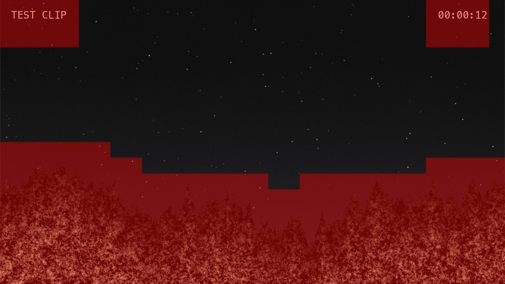

# Masking

A **mask** marks parts of the video frame that Sitrec should ignore. Anything you paint over
is excluded from the analyses that use the mask: the trees along the bottom of a night-sky shot,
the burned-in text of a camera's on-screen display, a bright streetlight, the black surround
inside a night-vision tube.

You'll find it under **Video → Masking**. The automatic methods are in its **Auto Masking**
sub-folder. **Enable Mask**, **Show Mask** and **Edit Mask** are also in the video view's own
header menu.

The mask is **shared**. There is one mask per sitch, so you paint the ground out once.
[What uses the mask](#what-uses-the-mask) lists the tools that read it and the ones that do not.
It is saved with the sitch and comes back when you reload.

The mask is one fixed shape for the whole clip. It does not follow the picture when the camera
moves. On a panning or shaky clip, check the mask at several frames and leave a margin.

## Why it matters

A mask helps when part of the frame can pull a result away from what you are measuring. Lit
foliage detects as stars in [the Star Tracker](StarTracker.md). Burned-in text does not move with
the scene, so it pulls the motion that Motion Analysis measures. Bright ground near the cursor
pulls Point Track's *Center on* methods.

On a wide night photograph with a treeline, masking the ground took the Star Tracker from a failed
identification to **221 named stars**. See
[Masking out the ground](StarTracker.md#masking-out-the-ground).

## Quick start

1. Go to a frame that shows the ground well, because **Mask Ground (auto)** reads only the current
   frame. Open **Video → Masking → Auto Masking**.
2. Click **Mask Ground (auto)**. Everything Sitrec judges to be ground, foliage or buildings is
   added to the mask. Sitrec also turns on **Enable Mask** and **Show Mask**, so the mask
   shows as a red overlay on the video.
3. Check the result. If some ground was missed, tick **Edit Mask** and paint over it — click and
   drag to add, hold **Alt/Option** to erase. `[` and `]` resize the brush. **Shift**-drag
   fills a rectangle, and **Alt/Option-Shift**-drag erases one.
4. Leave **Enable Mask** ticked, and leave each tool's own mask switch on (they are on by default).
   The tools listed under [What uses the mask](#what-uses-the-mask) skip those pixels the next
   time they run.

This is **Mask Ground (auto)** on a generated test clip, not real footage. Red shows the mask. The
mask is built from blocks, so its edge has steps, and it covers some sky above the trees. Burned-in
text is not uniform, so in this clip the method also masks the text and the sky around it: those
are the two blocks at the top.

If the automatic result is wrong rather than merely imperfect, **Clear Mask** and start again
with one of the other methods below.

## Ways to build a mask

The automatic methods **add** to the mask rather than replacing it, so you can combine them — a
detected ground region, an auto-masked OSD and some hand-painted touch-ups coexist. **Clear Mask**
removes everything, and so does importing new footage (see [Saving](#saving)).

| Control | What it does |
| --- | --- |
| **Show Mask** | Show the red exclusion overlay without painting. It is stronger with **Enable Mask** on and dimmer with it off. |
| **Edit Mask** | Show the mask and paint by hand. Drag to add, **Alt/Option**-drag to erase, `[` and `]` for brush size. **Shift**-drag fills a rectangle; **Alt/Option-Shift**-drag erases a rectangle. |
| **Mask Ground (auto)** | *(Auto Masking)* No clicks. Splits the frame into blocks and keeps as sky only what a large, uniform block can describe — so foliage, which forces the blocks to keep subdividing, is picked out. Best first thing to try. |
| **Mask Ground (click sky, then ground)** | *(Auto Masking)* Click a patch of sky, then a patch of ground. The second click lets Sitrec *measure* which of brightness or texture separates them in your particular clip rather than assuming. |
| **Auto Mask OSD** | *(Auto Masking)* Finds pixels that do not change over a window of frames and are close to **Target Color** — burned-in text, timestamps, reticles. **Target Color** is near-white by default, so set it to match green, black or other colored text. **Color Tolerance** sets how close a pixel must be. |
| **Auto Mask Redactions** | *(Auto Masking)* Finds flat rectangles that do not change over a window of frames — blanked-out regions in released footage. It ignores pixels brighter than **Redaction Max Bright**, so raise that slider for a white box. |
| **[ADMIN] Mask Ground with AI** | *(Auto Masking)* Sends the frame to an AI model and asks it to outline the sky, then follows the real foliage edge from the picture itself. Experimental, admin only. |

The two **Mask Ground** methods above turn on **Enable Mask** and **Show Mask**, so you see the
result. **Auto Mask OSD**, **Auto Mask Redactions** and **[ADMIN] Mask Ground with AI** turn on
**Enable Mask** and **Edit Mask**, so the next click on the video paints. Untick **Edit Mask** when
you finish.

Moving the sliders under **Auto Mask OSD** or **Auto Mask Redactions** runs that tool again. A new
run replaces the tool's last result, unless you changed the mask in between.

**Brush Size** is the brush radius in the video's own pixels, and the maximum scales with the
resolution — so the largest brush covers the same fraction of the picture on a 720p clip as on
a 4000-pixel-wide photograph.

### Which ground method should I use?

Try **Mask Ground (auto)** first. It needs no input and it is the one that copes with a bright
glow along the horizon, which the two-click method does not.

**Mask Ground (auto)** tests texture, not brightness. Ground as smooth as the sky, such as a calm
sea, can look like sky to it and stay unmasked with no warning.

Use **Mask Ground (click sky, then ground)** when the automatic version misjudges the scene and
you can point at unambiguous examples of each. Be aware that footage through a vignetted optic —
a night-vision tube, a telescope — can over-mask, because the sky's own brightness falls off
across the frame by more than the sky differs from the ground.

If no mask appears, the method could not find a usable split in that frame and added nothing. The
reason is in the browser console. Try the other method, or paint the mask by hand.

Either way, **check the result before relying on it**. Along the edge of the ground, both methods
mask too much instead of too little.

## What uses the mask

Most tools have their own switch, on by default, so you can mask the frame once and still choose
which analyses obey it.

| Tool | Control | Effect |
| --- | --- | --- |
| [**Star Tracker**](StarTracker.md) | **Video → Star Tracker → Use mask** | Detections inside the mask are discarded before they can be mistaken for stars. They do not appear in **Show rejected**, so if an expected star is missing, turn on **Show Mask** and check whether it is under the mask. |
| **Point Track** | **Video → Point Track → Use Mask** | Applies to Motion (Background) and the *Center on* methods only. Masked pixels are left out of the centring calculation, and Motion (Background) tracking also leaves them out of camera registration and the background model. The centring methods take a weighted average of the pixels inside the cursor, so bright masked ground drifting into the cursor would otherwise *pull* the tracked point towards it. |
| **Motion Analysis** | On whenever the mask is enabled | Motion measurements skip masked points, so a fence, a treeline or an OSD does not contribute to the estimated camera motion. |
| **Motion panorama** | **Video → Motion Analysis → Panorama → Motion Pano Options → Use Mask in Pano** | Masked pixels are written transparent instead of being stitched into the output. Works only when **Enable Mask** is on. |
| **Feature panorama** | **Video → Motion Analysis → Panorama → Feature Pano Options → Use Mask** | Masked regions are left out of feature detection and blending. Works only when **Enable Mask** is on. |
| [**Tonal Range Graph**](VideoTonalRange.md) | On whenever the mask is enabled | Masked pixels are ignored, and the graph recalculates when the mask changes. |
| [**Frequency Analysis**](FrequencyAnalysis.md) | On whenever the mask is enabled | Masked pixels are left out of the background ring. The object aperture must stay clear of the mask. |

A tool's mask switch does nothing if there is no mask painted, so leaving them on is harmless.

These do not read the mask: Point Track's Template Match, Optical Flow, High Peak and Low Peak
methods, Camera Motion (Background), De-Fence, and the administrator-only Phase Correlation and
ECC Euclidean motion techniques.

## Saving

The mask is saved inside the sitch and restored when you load it, at whatever resolution the
video turns out to be. It is stored at no more than 1024 pixels wide — a mask is a coarse region
map, not picture detail, so this keeps a saved sitch small without any visible difference to what
gets excluded.

**Importing a new video or image clears the mask.** A mask belongs to the picture it was painted
on; different footage has its horizon somewhere else. Reloading a saved sitch keeps the mask that was saved with it.

## Notes

- **Enable Mask** turns the mask on and off, without destroying it, for Motion Analysis, both
  panoramas, the Tonal Range Graph and Frequency Analysis. To compare results with and without the
  mask in the Star Tracker or Point Track, use that tool's own mask switch.
- Masking is undoable like any other edit, including the automatic methods — so trying
  **Mask Ground (auto)** on a mask you have already hand-painted costs nothing.
- The red overlay is drawn when **Show Mask** or **Edit Mask** is on. Hiding the overlay does not disable the mask. The visibility, enabled and Edit Mask settings and the brush size are saved with the sitch.
