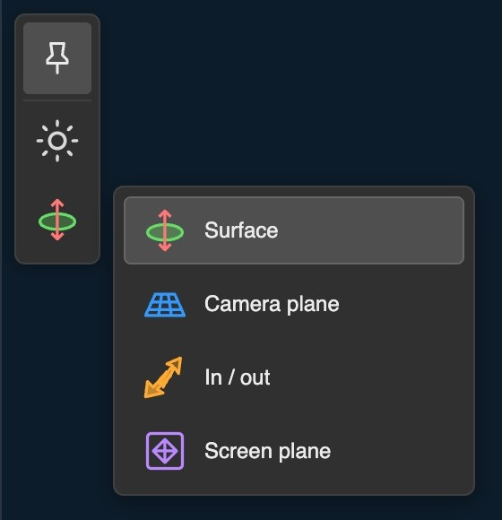
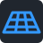
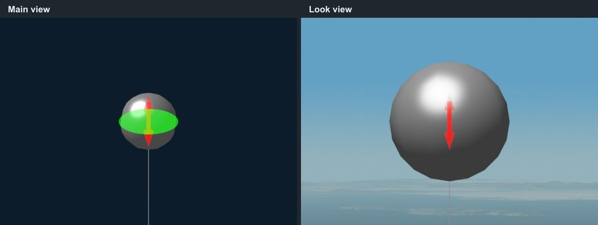
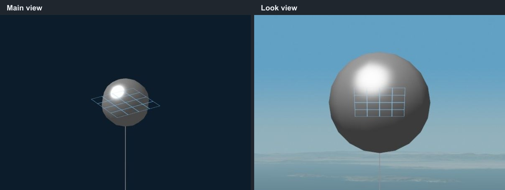
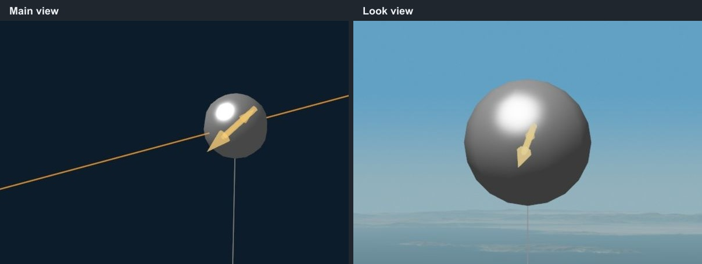
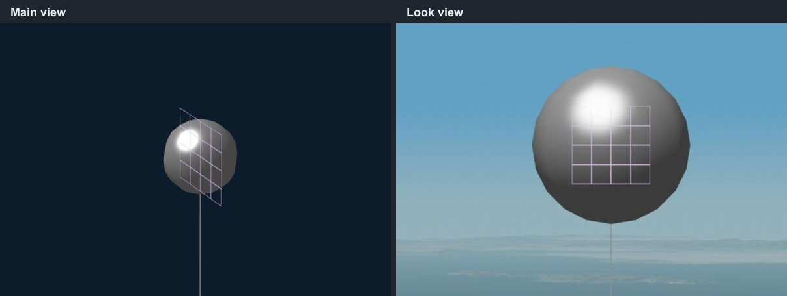

# Moving Objects

Use the move widget to position an editable 3D object in either **Main** or **Look** view.
Choose **Surface**, **Camera plane**, **In / out** or **Screen plane** to control where the
object can move. The same mode applies in both views.

The **Look camera** is the simulated camera whose picture appears in Look view. The camera
you navigate in Main view is a separate viewpoint. **Camera plane** and **In / out** always
use the Look camera, including when you drag in Main view.

## Start a move

1. Hold **Opt** (Option) on a Mac, or **Alt** on Windows or Linux, and move the pointer over
   or near an editable object. Its move widget appears. You can also right-click the object
   to open its edit window; while that window is open, the widget appears when you hover
   near the object without holding a key.
2. Left-drag the widget **or the object itself**. Keep Opt/Alt held if you used it to reveal
   the widget.
3. Release the mouse button to finish the move.

Dragging the object uses the selected mode. In Surface mode, it acts like dragging the green
disk. If the disk and an altitude arrow overlap under the pointer, the disk takes priority;
grab an exposed part of a red arrow to change altitude.

The widget stays visible on top of the object, including during a drag. Hovering and dragging
do not change the object's opacity.

To try this with a new object, right-click the ground in a Custom sitch and choose
**Add 3D Object**. See [Adding Objects and Tracks](SceneObjects.md) for other kinds of object.

## Rotate an object

With the object's edit window open, or while holding **Opt/Alt**, **Control-click**
the move widget. The green disk and red arrows change to an amber rotation ring.
Drag right to increase **Rotate Y** or left to decrease it. You can start dragging
on the same Control-click. **Esc** cancels the drag. Control-click the ring to
return to moving. Each completed rotation can be undone in one step.

## Choose a mode

Move the pointer to the **left edge** of Main or Look view to reveal its vertical toolbar.
Click the **Move mode** icon to open a menu of all four modes, then click the one you want.
The icon changes to match your choice. Pin the toolbar if you want it to stay visible.

*Click the mode icon below the sun icon in Main view to open this menu. Look view has the
same mode menu, with its button directly below the pin.*

Holding **Opt** on a Mac or **Alt** on Windows or Linux also shows the Move mode icon in
both views, at its usual toolbar position, even when the rest of the toolbar is hidden.
You can click this icon to open the same menu.

Press **Opt+M** on a Mac or **Alt+M** on Windows or Linux to cycle through
**Surface → Camera plane → In / out → Screen plane → Surface**. The shortcut does not act
while you are typing in a text field. The toolbar tooltips use the key name for your platform.

| Toolbar icon | Mode | Widget | Use it to |
|---|---|---|---|
|  | **Surface** | Green disk with red up/down arrows | Move around the Earth at the same altitude, or change altitude separately |
|  | **Camera plane** | Blue grid | Move across and toward or away from the Look camera within one plane |
|  | **In / out** | Orange perspective arrows | Change distance from the Look camera along the line through the object |
|  | **Screen plane** | Purple grid | Move across the picture at a fixed depth from the camera of the view you are using |

For both plane modes and In / out, **the constraint is fixed when you press the mouse button**
and stays fixed until you release. It does not turn as the object moves. A different mode
selected during a drag applies to the next drag.

The paired screenshots below show the same opaque sphere in Main view on the left and Look
view on the right. They are cropped around the object so you can see the handles clearly.

### Surface

Drag the **green disk** to move at constant altitude around the Earth. Drag the **red arrows**
to raise or lower the object. This is the default mode.

*The green disk is clear from the elevated Main viewpoint. From this level Look viewpoint,
the disk is edge-on. The red altitude arrows remain visible over the sphere.*

For a manual position with **Above Ground Level** enabled, the disk keeps the same height
above the ground, so the object follows changes in terrain height. Otherwise it keeps the
position's altitude. See [Three Kinds of Height](GIS.md#three-kinds-of-height).

### Camera plane

The **blue grid** represents a plane through the object and the **Look camera**, aligned
with the Look camera's left-to-right direction (its right vector). Think of a sheet extending
from the object toward the Look camera, with its width running left to right across that
camera's picture. Its tilt follows the camera and the object's position; it is not necessarily
level with the ground.

In Main view, drag across the grid to move within that plane. In Look view, you see the
plane edge-on, so Sitrec tilts the drawn grid to make it easy to grab. There:

- drag left or right to move across the plane;
- drag up to move farther from the Look camera;
- drag down to move nearer.

The same controls apply in Main view if you view the plane nearly edge-on. The grid's visible
tilt does not change the plane that constrains the move.

*Main shows the blue plane at an angle. Look shows the tilted grip: drag sideways to move
across, up to move farther, or down to move nearer. The movement plane is the same in both views.*

### In / out

The **orange arrows** move the object along a line from the **Look camera through the object**.
Drag **up to push it farther away**, or **down to pull it nearer**. Sideways mouse movement
has no effect. The arrows are drawn at an angle so you can see and grab them even when looking
along the line.

An orange guide line appears in **Main view while you drag**, whichever view you drag in,
and disappears when you release. Use this mode to adjust range while keeping the object on
the same line from the Look camera.

*During an upward drag in Look, the sphere moves farther away. Main shows its path along
the orange guide line. The arrows remain visible on top of the opaque sphere.*

### Screen plane

The **purple grid** lies in a plane through the object that faces the camera of the view
where you start the drag. Drag to move across the picture at fixed camera depth.

A drag started in Main view uses the Main viewpoint; a drag started in Look view uses the
Look camera. This is useful for adjusting the object's position in the picture without
moving it nearer or farther along that camera's viewing direction.

*This drag started in Look, so the purple grid faces the Look camera. Main sees that same
plane at an angle. The sphere can move across the Look picture while keeping its camera depth.*

## Tracks and altitude locks

What a move changes depends on what supplies the object's position:

| Position source | What the drag edits |
|---|---|
| **Manual** position | The object's latitude, longitude and altitude |
| Hand-drawn track | The control point at the current frame; a move between existing points adds a point at that frame |
| Balloon or kite | The balloon's launch position or the kite's anchor, which recalculates its generated path |
| [Spotlight projector](Spotlights.md) | The ground location of the projector. Its Surface disk follows the terrain with a fixed 5 cm clearance |
| Imported track or satellite orbit | These positions cannot be dragged with the move widget |

With **Edit Track** on, use the track's control-point widgets. They use the same movement
modes in Main and Look views. See [Hand-Drawn Tracks](Tracks.md#hand-drawn-tracks).

**Lock Altitude takes priority over the selected move mode.** A locked track shows the
Surface widget. Turn off **Path → Lock Altitude** in the hand-drawn track's folder to use
Camera plane, In / out or Screen plane. While the lock is on, dragging the red altitude
arrows changes **Lock Height** for the whole track; dragging the disk keeps the lock height.
**Add Moving Object (In→Out)** creates a track with this lock on.

Buildings, clouds, ground overlays and ground grids have their own editing handles. See
[The editors](SceneObjects.md#c-the-editors) for their controls.

## Undo and save

Press **Escape during a drag** to cancel it and restore the starting position. After a move,
use **Cmd+Z** on a Mac or **Ctrl+Z** on Windows or Linux to undo it.

The selected move mode is shared between Main and Look views and saved with the sitch,
along with the positions you edit. See [Saving, Loading and Sharing](SavingAndLoading.md).
