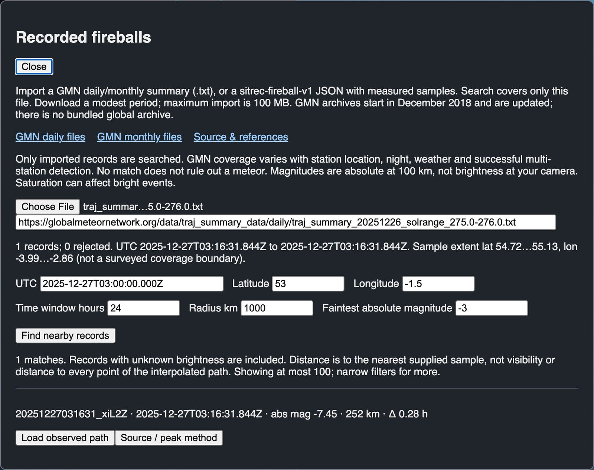
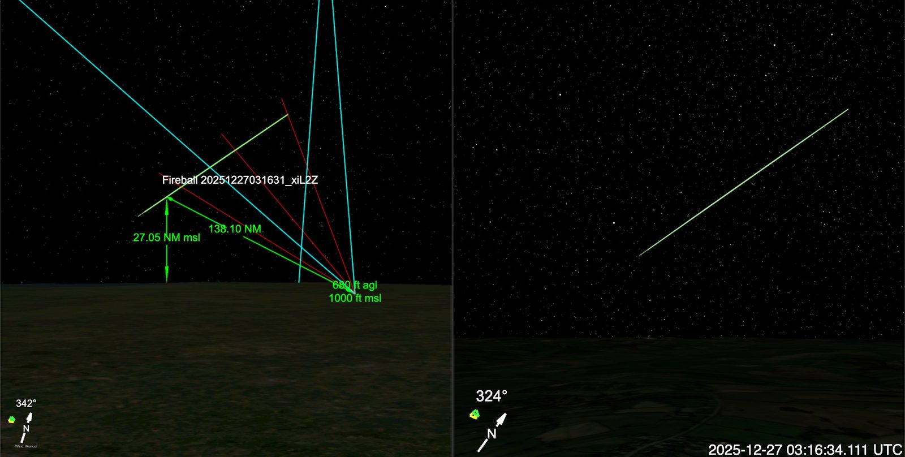

# Recorded fireballs

A fireball is a very bright meteor. Use this tool to check if a meteor recorded by the Global Meteor Network (GMN), a network of cameras, matches the time and place of a sighting, and to load its path into a custom sitch. Sitrec includes no meteor data, so you download a GMN file first. The search covers only the file that you import. No match does not rule out a meteor (see [Coverage limits](#coverage-limits)).

## Find and load a fireball

1. Open **File → Recorded fireballs…** in a custom sitch.
2. Download a GMN trajectory summary (a `.txt` file) with the **GMN daily files** or **GMN monthly files** link in the dialog.
3. Paste the file's exact download address into the **Exact original GMN .txt download URL** field. Do this before you choose the file. The address must start with `https://globalmeteornetwork.org/` and end in `.txt`. Sitrec keeps it as the source of the data and does not import a summary without it.
4. Choose the file. The dialog shows the UTC range and sample extent of the records, and runs a first search.
5. Set **UTC**, **Latitude** and **Longitude** to the sighting. They start at the sitch's current UTC and at the latitude and longitude of the look camera.
6. Adjust the other search fields. **Radius km** is 1000 by default.
   - **Time window hours** is the time on each side of the UTC, measured to each event's beginning. The default, 24, covers 48 hours.
   - **Faintest absolute magnitude** is −3 by default, with no limit on how bright an event can be. Enter a higher number to include fainter events. Events with unknown brightness stay in the results, labeled unknown.
7. Select **Find nearby records**. If nothing matches, the dialog shows **0 matches**.
8. On a result row, select **Load observed path**. The dialog stays open, so you can load another event from the file.
9. Select **Close**. This clears the imported file from the dialog. The path is under **Contents → Fireball [ID]**.



The dialog after a search of a one-record extract of a GMN daily file (data: Global Meteor Network, CC BY 4.0). The full file at this address holds more records. The **UTC**, **Latitude** and **Longitude** are example values, not a sighting. The box under **Choose File** is the **Exact original GMN .txt download URL** field. That text shows only while the box is empty. The line above **UTC** gives the UTC range and sample extent of the file. The result row gives the record ID, the beginning UTC, the peak absolute magnitude (abs mag -7.45), the distance to the nearest supplied sample (252 km) and the time from the search UTC to the beginning (Δ 0.28 h).

**Absolute magnitude** is how bright the meteor would look from 100 km. A lower number is brighter: −5 is brighter than −3. It is not the brightness at your camera.

## View the event

In a new custom sitch, the first import changes two things, unless you set the camera position, the date or the time first:

- The timeline start moves to the event beginning, and the timeline length becomes the event duration. For example, a 2.78 s event at 30 fps gives 83 frames. A later import does not change the timeline.
- **Camera → Location → Position** changes to the path, so the look camera rides along the fireball path and cannot show it from outside.

To see the event from a place on the ground:

1. Set **Camera → Location → Position** to **Manual**, and enter the place in **Cam [C] Lat**, **Cam [C] Lon** and **Cam [C] Alt**.
2. Set **Target → Target Track** to the fireball.
3. Set **Camera → Heading → Camera Heading** to **To Target**.

**Contents → Fireball [ID]** has the jump controls. If the import did not move the timeline, use them to move it to the event. **Jump to observed start** goes to the start of the path. The second control goes to the peak. It reads **Jump to estimated peak** for a GMN summary and **Jump to measured peak** for a file of measured samples, and its tooltip says where the peak time comes from. With no usable peak, it reads **Peak time unavailable** and is disabled. An in-range jump moves to the nearest frame and keeps the timeline start. An out-of-range jump moves frame zero and the timeline start to that UTC, and keeps the timeline length. Start/peak controls and source information return when you reload a saved sitch.

The path loads as a normal track, displays in the main view and the look view, and uses straight lines between supplied samples without smoothing. Outside the observed interval, its marker holds the first/last endpoint; that does not represent continued flight. The reference path and marker are geometric aids, not a simulated light curve, visibility prediction or apparent brightness prediction.



The event from the dialog picture above, after **Jump to estimated peak** (03:16:34.111 UTC), with the camera at the search location. In the look view (right), the pale green line is the path. The marker is at the center of the view, and it is too small to see at this range. This look view has a wider field of view than the default, so that the whole path fits.

In the main view (left), the white label is at the marker. The green labels give the camera height (1000 ft msl) and its height above the ground (680 ft agl), the distance from the camera to the marker (138.10 NM, nautical miles) and the marker height (27.05 NM msl). In these labels, msl is above mean sea level, and agl is above ground level. The cyan lines are edges of the look view, and the red lines are [lines of sight](Glossary.md). The yellow [traverse](Glossary.md) line lies on the path when the target track is the fireball, so the path can look yellow in the main view.

## Source and conventions

[Global Meteor Network data](https://globalmeteornetwork.org/data/) are released under [CC BY 4.0](https://creativecommons.org/licenses/by/4.0/). Credit Global Meteor Network and cite its linked methodology papers in scientific work. [Official column definitions](https://globalmeteornetwork.org/data/media/GMN_orbit_data_columns.pdf) and [official parser](https://github.com/wmpg/WesternMeteorPyLib/blob/master/wmpl/Formats/WmplTrajectorySummary.py) describe semicolon summaries with repeated uncertainty columns.

Summaries supply a UTC beginning, observed duration, the latitude, longitude and height of each endpoint with their uncertainties, peak absolute magnitude, and peak height. Heights are kilometers [above the WGS84 ellipsoid (HAE)](GIS.md#three-kinds-of-height), converted to meters with no correction to mean sea level (MSL). Source rows, generation timestamp, original fractional UTC text, station IDs/count, convergence angle, median fit error and field-of-view flags are retained in the imported asset and exposed under **Contents → Fireball [ID] → Fireball source & limits**. Sitrec keeps the source URL that you supply. It does not check the file against that URL.

GMN summary peak times are **estimated** as the beginning UTC plus `(beginHeight − peakHeight) / (beginHeight − endHeight) × duration`. This assumes constant speed and a linear height progression; height along the straight rendered path is not exactly linear. No peak UTC is recorded in a summary. A missing peak height, a peak height outside the endpoint heights, or equal endpoint heights makes the peak control unavailable. Sitrec shows times to the millisecond. This does not mean that the time is known to the millisecond.

## Coverage limits

GMN archives start in December 2018. They are not a catalog of all meteors. Search covers **only the currently imported file**, whose actual UTC and sample geographic extent appear in the dialog. Daily filenames use solar-longitude bins and can contain observations from another UTC date. Use the rows' UTC fields. File imports are limited to 100 MB. Some recent monthly files are larger than this, so use daily files for those months. Results are limited to 100 displayed matches; narrow filters or choose a smaller period. Sitrec fetches nothing automatically.

Station geography, nighttime, weather, multi-station detection and quality selection constrain coverage. Bright-event saturation affects photometry. A sample bounding box is not a surveyed network coverage boundary; a radius is distance to the nearest supplied sample, not a visibility test or distance to the entire path. No match does not rule out a meteor.

## Measured samples JSON

Drop a `.fireball.json` file on the window, or use **File → Import File**, to load its path directly. If you import it in the **Recorded fireballs** dialog, the search filters apply: set the UTC and location to match the event, then select **Find nearby records**.

Keep `kind`, `altitudeReference` and `pathMethod` exactly as shown. `id`, `source.network`, `source.url` and `source.license` are required. Supply at least two samples. Replace the other values with real source measurements and valid attribution:

```json
{
  "kind": "sitrec-fireball-v1",
  "id": "source-event-id",
  "source": {"network": "Source network", "url": "https://example.org/original-report", "license": "Source license"},
  "altitudeReference": "WGS84 ellipsoid",
  "pathMethod": "measured time-tagged samples",
  "samples": [
    {"time": "2025-01-01T00:00:00.000Z", "lat": 35, "lon": -107, "altitude": 100000, "absoluteMagnitude": -4},
    {"time": "2025-01-01T00:00:01.000Z", "lat": 34.9, "lon": -107.1, "altitude": 70000, "absoluteMagnitude": -5}
  ]
}
```

`source.url` must be an `https://` address without a user name or password. Sitrec shows it as a link only when it is on globalmeteornetwork.org; any other source URL appears as plain text that you can copy.

Samples must have increasing UTC times ending in `Z`, latitude/longitude in degrees and ellipsoidal altitude in meters. Optional `recordedPeakUTC` must be within the samples' interval and must come from the cited source. Otherwise the lowest supplied `absoluteMagnitude` identifies the brightest measured sample, and the tooltip labels the peak sampling limited. With no `recordedPeakUTC` and no source brightness, the peak control is unavailable and search shows unknown brightness. Sitrec does not check that these values came from the source that you name.
