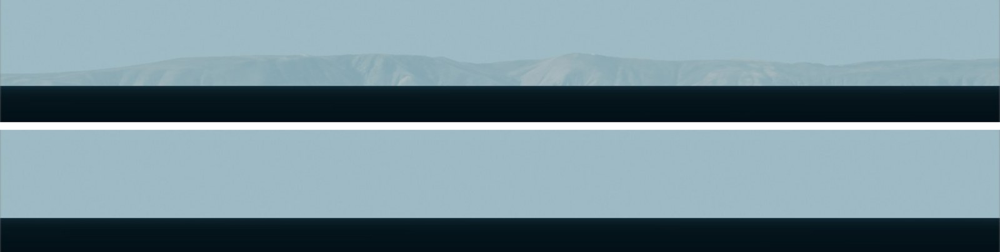

# Atmospheric Refraction

**View → Atmospheric Refraction**

Air bends light. Distant things therefore appear slightly *higher* than straight-line geometry
says they should — including things below the geometric horizon, which is why you can
sometimes see land that "should" be hidden by the Earth's curvature.

Refraction changes the answer to *could the observer have seen X from Y?* The tables below
give the size of the change. Sitrec shows that change in the rendered views, so the look view
(the view from the observer's camera) shows the lifted scene. Sitrec draws distant terrain with
less detail, so a far peak near the horizon can appear too low or not at all. Check such a
target against the lift figures below. A line of sight stays straight: it can meet a ridge
while the look view shows the target above that ridge. See
[What is *not* refracted](#what-is-not-refracted).



The same look view twice, from a camera just above the sea off the California coast, aimed at
San Clemente Island. In the top strip **Terrain and Buildings** is on, and the top of the island
stands above the horizon. The rest of the island stays hidden. In the bottom strip it is off, and
the whole island is below the horizon. Nothing else changed.

> **Refraction is ON by default.** Sitrec bends light the way the atmosphere does unless you
> turn it off. Switch it off only when you deliberately want straight-line geometry — to
> isolate the size of the effect, or to reproduce a result computed without it. A saved sitch
> keeps the setting it was saved with.

---

## How much does it matter?

The refracted horizon is further away than the geometric one by a factor of √(1/(1−k)), where
*k* is the refraction coefficient:

| From | Geometric horizon | Constant k = 0.13 | Sitrec's model at default settings |
|---|---|---|---|
| 2 m (eye level at the shore) | 5.0 km | 5.4 km | 5.6 km |
| 100 m | 35.7 km | 38.3 km | 39.3 km |
| 30,000 ft | 184.4 nm | 197.7 nm | 194 nm |

The k = 0.13 column is the formula above with the traditional surveying value at every height.
The last column starts from Sitrec's default *k* of 0.176, then reduces the bend for a high
camera and at long range. See [Understanding *k*](#understanding-k--and-why-it-is-not-a-constant).

For a target near the ground, seen from near the ground, the lift depends on how far away the
target is, because the light has only crossed the air between you and it. At Sitrec's default
*k* of 0.176 (see below):

- about **0.95 arcminutes at 20 km**
- about **4.7 arcminutes at 100 km**

At the traditional surveying value k = 0.13 these are about 0.7′ and 3.5′.

For a *star*, which is seen through the whole atmosphere, the lift at the horizon is about
**29 arcminutes** — roughly the diameter of the Sun. This is why the Sun is already
geometrically below the horizon when you watch it set.

---

## The two models

Sitrec implements refraction twice, because the two cases are genuinely different physics.

**Sky (celestial).** For the Sun, Moon, planets and stars, whose light has traversed the
entire atmosphere. Uses Saemundsson's formula, bending apparent positions toward the zenith.
About 29′ at the horizon for an observer at [mean sea level (MSL)](GIS.md#three-kinds-of-height),
and about 10′ at 5° above the horizon.

**Terrain and Buildings (terrestrial).** For things a finite distance away — distant coastline,
mountains, buildings, the sea surface, and Google Photorealistic or Cesium 3D tiles. The bend
is range-dependent:

```
angular lift  dθ = k·d / (2R)
height lift   dh = k·d² / (2R)
```

where *d* is the range and *R* the Earth's radius.

The bend is applied to everything drawn in the scene: terrain, 3D tiles, buildings, the sea,
3D models, tracks and line-of-sight lines all rise together, so a track stays on the terrain it
sits on. The main exceptions are: the satellite dots from the Satellites menu and the lines
drawn with them (the Sky model bends the dots), and photo backdrops (the picture already shows
the bend).

**Refraction moves the picture, not the ground.** Ground elevations, altitude readouts and
line-of-sight geometry stay geometric — refraction bends light, it does not raise the land.
Some results do depend on the bend: see [What is *not* refracted](#what-is-not-refracted).

---

## The controls

| Control | Default | Notes |
|---|---|---|
| **Enable Refraction** (title checkbox) | on | Master switch. Off means light travels in straight lines |
| **Terrain and Buildings** | on | The terrestrial model |
| **Sky** | on | The celestial model |
| **Refraction Pressure (hPa)** | 1010 | Feeds both models |
| **Refraction Temperature (°C)** | 10 | Feeds both models |
| **Surface Temp Gradient (K/km)** | −6.5 | Feeds the terrestrial *k*. See below |
| **Refraction Coefficient k** | derived | Shows the surface *k* for the current settings. Sitrec scales it down for sight lines above the ground (see below). Editable only with Override on |
| **Override k** | off | Set *k* by hand instead of deriving it |

All three default on, so a fresh sitch runs both models. The sub-switches exist to take one
half back out when you are deliberately isolating an effect.

---

## Understanding *k* — and why it is not a constant

The terrestrial coefficient is derived, not assumed:

```
k = 503 · (P / T²) · (0.0342 + dT/dh)
```

with *P* in hPa, *T* in kelvin, and *dT/dh* the temperature gradient in K/m. So *k* is **not**
independent of the pressure and temperature above it — changing those changes it.

The term that matters most is the temperature gradient. At 1010 hPa and 10 °C:

| Gradient | Situation | Resulting *k* |
|---|---|---|
| −13.7 K/km | Sun-warmed land surface. Gives the traditional surveying value | 0.13 |
| −9.8 K/km | Dry adiabatic | ≈ 0.155 |
| −6.5 K/km | Standard atmosphere | ≈ 0.176 |
| 0 K/km | Temperature does not change with height | ≈ 0.217 |
| +10 K/km | **Inversion** (temperature increases with height) | ≈ 0.28 |
| +45 K/km | Very strong inversion | ≈ 0.50 |

An inversion is the cause of superior mirages and looming — distant ships and coastlines
appearing well above where geometry puts them.

*k* depends on the temperature gradient, which is usually not measured. Tip: to see the range
of the effect, compare the result at −6.5 K/km with the result at a positive gradient.

The bend is capped at 34′, on the reasoning that a finite target can never be lifted by more
than the whole atmosphere would lift a star.

**Elevated observers get less bend.** A ray only curves where there is air, so Sitrec scales
*k* by the mean air density along the sight line (an 8.5 km scale height). A sight line with
both ends near the ground is unchanged. If either end is high, less of the path is in dense
air: a ground camera sees an aircraft at 10 km height and 100 km range lifted about 2.8′, not
4.7′. A camera at airliner altitude sees a smaller effective *k* than the textbook value, and a
camera in orbit lifts the scene almost not at all. The apparent lift is also capped at 25.5 km,
a guard that never applies to real ground-level geometry.

The Sky model also weakens with height. Sitrec scales it by the air density at the lowest point
of the sight line (a 7.5 km scale height). From 30,000 ft, a star at 0° elevation is bent about
8.6′. A star at the geometric horizon, about 3° lower, is bent about 30′, because its sight line
dips into dense air.

### Fitting k to an observation

If you have a photograph showing a landmark at a known distance and known height, you can
work backwards: tick **Override k**, then adjust **Refraction Coefficient k** until the render
matches. That gives you a measured *k* for those conditions, which you can then apply to another
object in the same scene. For a high camera or target, the value is a surface *k*: Sitrec scales
it by the air density along the sight line, so the *k* along the path is lower.

The value starts at 0.13, not at the derived value. With the override on, **Surface Temp
Gradient** is greyed out, and pressure and temperature affect only the Sky model.

---

## Cameras that point at a target

When the camera is pointed at a track (Camera → Heading → Camera Heading → *To Target*), it
aims at where the target is *drawn*, so the target stays at the center of the view. At long
range and narrow field of view the difference is large: from 3.5 km altitude, an aircraft at the
same height 160 km away is drawn about 0.08° above its real position, about three quarters of
the half-height of a 0.22° field of view.

The camera's view frustum in the other views follows the bent sight lines. Its edges curve
down with distance, as the light does, so the target is inside the frustum where the camera
sees it.

This aim is for the picture only. The line of sight that Sitrec calculates from this camera,
and everything built on it (traverses, azimuth and elevation, the ground track, the camera in a
KML or MISB export), is still the straight line to the target. So are the angles that the
camera hands to the Manual heading: after a switch from *To Target* to *Manual*, the camera
looks along the straight line, and the target is drawn above the center by the lift.

---

## What is *not* refracted

Refraction changes where things are *drawn*. These stay geometric:

- Ground elevations and readouts of height above ground level (AGL)
- Lines of sight, and the traverses built on them. Each line is straight (it is drawn lifted,
  like everything else in the scene)
- Horizon distances in Sitrec's calculations. They do not change with the refraction settings
- Most ground picks, such as the `C` and `X` keys and the right-click menu. They follow the
  straight ray through the cursor, so at long range they land beyond the ground drawn under it

These results do depend on refraction, because they match the drawn scene or the drawn sky:

- **Fit Camera to Points** solves through the Terrain and Buildings bend, so the fitted camera
  changes with that switch and with *k*
- A ground point that you place or drag in **Fit Camera to Points** or **Ground Track** is the
  point drawn under the cursor
- **Celestial Lock** aims along the bent direction to the body, and its line of sight follows
  that direction
- The known-object checks in **Analyze Traverse Methods** use the Sky bend

---

## Ray-traced Refraction

**Effects → Ray-traced Refraction**

The Terrain and Buildings model uses one *k* for each sight line. For non-uniform air — mirages,
ducting, folds in the horizon — use the separate ray-traced tool. Tick **Enable Ray-traced
Refraction** to apply it to one chosen 3D view, and click **Profiles, Rays & Lasers…** to open
its editor. There you pick a temperature profile preset, drag the temperature and humidity
curves, and add laser beams to see where light really goes. The settings save with the sitch.

The tool starts on `lookView`, and **Ray-traced view** in the editor changes this. In that view
the ray-traced result replaces both models above, so the View menu pressure, temperature and
*k* have no effect there. The tool has its own atmosphere settings. Other views keep the two
models.

The ray-traced view is a depth-based screen-space effect. It starts from what the view can
already see, so it can reproduce folds and mirage images of visible surfaces, but it cannot show
a target below the straight-line horizon, or anything else that is hidden or off screen.

To see lasers, enable the tool, then tick **Show lasers in the scene and cross-section** on the
**Lasers** tab. One laser is already there, and **＋ Add laser** adds more.

![The Ray-traced refraction window on its Ray paths tab. Six boxes give Local k at 1 m, Local k at 50 m, Local k at camera, Rays hitting the surface, Samples above the surface and Folded ray pairs. Below them is a side-view chart over 50.0 km. Teal rays fan out from a camera at 35 m. The higher rays go on to the right, and the lower rays curve down toward a gray curved sea. A green laser beam curves down with them. The chart background is green in its upper part and blue in its lower part, with a level edge between them](docimages/refraction-ray-paths.jpg)

The **Ray paths** tab with the **Ducting inversion** preset, a camera 35.00 m above the sea, and
one laser. The chart is a side view of the light, with the camera at the left. The teal lines are
rays traced from the camera. The chart draws only some of the rays. The bright green line is the
laser, and the two faint green lines are the edges of its beam. The gray shape is the sea, which
falls away on the chart because of the curve of the Earth. Chart heights start at sea level under
the camera and run along a flat line, so the sea goes below zero as it falls away. The background
color uses those chart heights, so it shows the air temperature only near the left edge: blue is
near the surface temperature, and green is warmer. Further right, the real air layers fall with
the sea, but the color bands stay level. Heights run from −42 m to 181 m over 50.0 km of range, so
the chart makes every curve much steeper than it is. The top three boxes give *k* for the air at
three heights. The lower three boxes count the whole fan of rays, including the rays that the
chart leaves out. The note under them explains *k* and folds.

---

## See also

- [GIS Concepts in Sitrec](GIS.md) — the Earth model the curvature comes from
- [Atmospheric Aerial Perspective](AtmosphericAerialPerspective.md) — the other way the
  atmosphere changes what a distant object looks like
