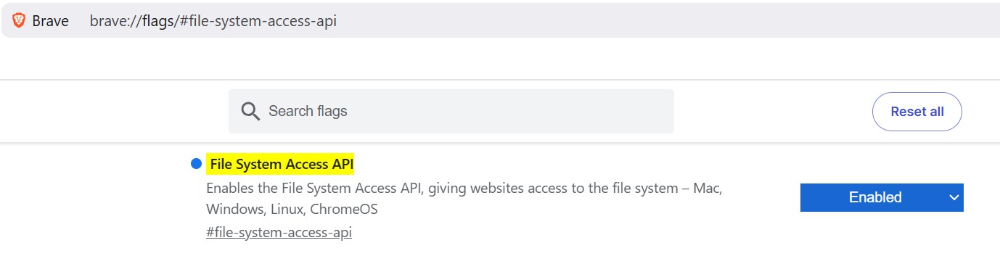
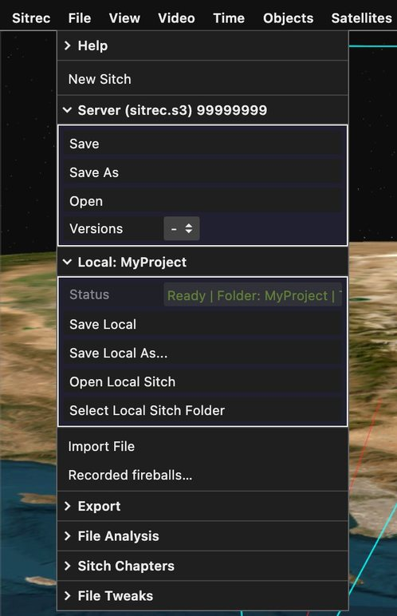
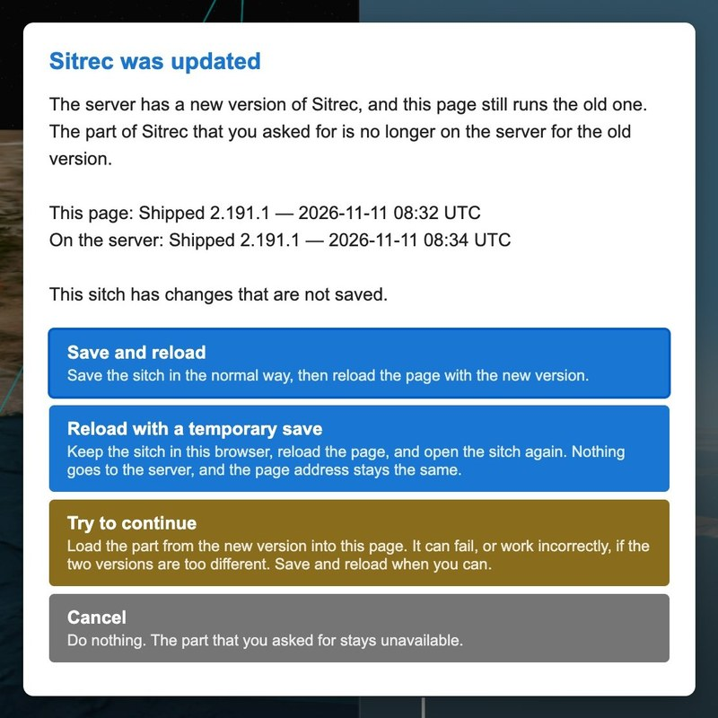

# Saving and Loading Sitches

This guide explains the main save and load workflows in Sitrec. Sitrec saves a sitch in one of two places: on the server, or in a folder on your computer.

## Choosing Between Server and Local

- Use **Server** save when you want version history and a link to share. You must be logged in.
- Use **Local folder** save when you want to keep a sitch and its files on your computer. It needs no login. The desktop app has only local saves.
- You can switch workflows anytime:
  - server → local: load from server, then `Save Local`/`Save Local As...`. Data files such as tracks stay on the server, and the local sitch still loads them from there.
  - local → server: open local sitch, then server `Save`/`Save As`

You can also open a saved sitch file directly: drag its `.json` file onto the window, or use **File → Import File**. If the sitch uses files from a local folder, first use **File → Local → Select Local Sitch Folder** to select that folder. In the desktop app, use **File → Local → Open Local...** to open the sitch from that folder.

## Saving to the Server (Versioned)

Server save is best when you want version history and easy sharing. See [Share a saved sitch](#share-a-saved-sitch).

### What the Server menu does

In **File → Server**, you will see:

- **Save**: save a new version of the current sitch. The first save of a new sitch prompts for a name.
- **Save As**: save under a new sitch name.
- **Save as Template**: save the sitch as a [template](#templates). Only an administrator has this item.
- **Open**: open the sitch browser to load your saved sitches (and featured sitches). The address changes to `?action=browse` while the sitch browser shows. See [Startup actions](URLParameters.md#startup-actions).
- **Versions**: load any saved version of the currently loaded sitch.

To remove a sitch from your list, select it in the sitch browser and press Delete, or right-click it and choose **Delete**. It moves to the **Deleted** list, and **Undelete** brings it back. The files stay on the server, and links to them still work.

If you are not logged in, the Server folder shows only **Saving Disabled (click to log in)** and **Open**, and **Open** shows only featured sitches. Click **Saving Disabled (click to log in)** to open the login page in a new tab. Log in, then go back to the Sitrec tab. The other controls then appear. The public site, www.metabunk.org, uses a Metabunk forum account. To make one, [register on the forum](https://www.metabunk.org/register/).

### How versions work

- Each **Save** creates a timestamped version in that sitch's server folder.
- **Save** does not delete old versions.
- The **Versions** dropdown shows timestamps in UTC; newest is marked **(latest)**.
- Loading a sitch from **Open** loads its latest version by default.
- If content is unchanged, Sitrec can skip creating a duplicate new version.

### Save vs Save As

- **Save** keeps the current sitch name and appends a new version. If you opened another user's sitch, such as a featured one, **Save** writes to your own account under that name. The other user's sitch does not change.
- **Save As** prompts for a sitch name. A new name starts a separate sitch history. If you already have a sitch with that name, Sitrec asks you to confirm, then adds a new version to that sitch.
- **Save** and **Save As** do not write to a [template](#templates). See [Saving and templates](#saving-and-templates).

### Templates

A template is a saved sitch that is a start point for a task. It can have menus open, menus in a sidebar, and options set. A template is a normal saved sitch with a template label. There are two labels:

- **Global Template**: every user sees the template, logged in or not. Only an administrator can add or remove this label.
- **Local Template**: only you see the template. It is one of your own sitches.

#### The start screen

When you open Sitrec with no sitch in the address, the start screen shows the templates. **Global Templates** come first, in the order in which the administrator added them. **Local Templates** come next, in name order, when you are logged in and have some.

- Click a template to open it.
- **New Sitch** starts a blank sitch.
- **Browse Sitches** shows the sitch browser, and sets the address to `?action=browse`. That address opens Sitrec at the sitch browser. The **Templates** button in the sitch browser goes back to the start screen.
- **Login** shows when you are not logged in.

When there is no template to show, Sitrec opens the sitch browser as the start screen.

When two users each have a global template with the same name, the start screen shows one card for that name: the template with the most recent save. The sitch browser shows each of them.

A sitch that you open from a template is a new sitch with no name. Your work in it does not change the template.

The address of that sitch is the template by name, for example `?template=Star%20Tracker`. That address opens the template again, at its latest version. See [template](URLParameters.md#template). After you save the sitch, the address is the address of your saved sitch.

#### A new sitch from the File menu

The File menu has two items that start a new sitch:

- **New Sitch (Empty)** starts a blank sitch. It reloads Sitrec.
- **New Sitch from Template** shows the templates, on the same screen as the start screen. Click a template to open it as a new sitch. **Cancel** closes the screen, and the sitch that you had open stays open. If there are no templates, the screen says so. The File menu has this item only when the installation saves sitches to a server, because a template is a sitch on the server.

#### Making a template

To make one of your sitches a template, open the sitch browser, right-click the sitch and select **Local Template**. You can also drag the sitch to **Local Templates** in the sidebar. Clear the label to make it a normal sitch again. An administrator has **Global Template** in the same menu, and can drag a sitch to **Global Templates**.

The sidebar links **Global Templates** and **Local Templates** show the templates. The label does not change the sitch file, and a link to a version of a template opens that version as a normal sitch.

An administrator can also use **File → Server → Save as Template**. It asks for a name and for the type of template, saves the sitch, and adds the label. The address then is the template by name, `?template=<name>`.

#### Instructions for a template

The Notes of a template are its instructions. To open the Notes, use **Show → Notes**, or press **N**.

In the Notes, `##` and a name start a section. The section ends at the next `##`, or at the end of the Notes. Text before the first `##` is in no section.

```text
##intro
Drag in or import a video.
Then press Play.
```

- The `intro` section shows in a box over the views when a sitch opens from the template. The box fades out when you click on something or drop in a file.
- The box shows only when the sitch opens from the template: from the start screen, from the sitch browser, or from a `?template=` address. It does not show for a sitch that you saved from a template, or for a link to one version of a template.
- The section name is not case-sensitive. If the Notes have two sections with the same name, Sitrec uses the first.
- The box shows the text as plain text, with its line breaks. A link in it is not a clickable link.

To change the instructions, open the template, change the Notes, and use **File → Server → Save as Template**.

The Notes stay in the sitch. A sitch that you save from a template has the same Notes, but it shows no box.

#### Saving and templates

- The first **Save** of a sitch that you opened from a template asks for a name.
- If the sitch has the name of one of your templates, **Save** asks for a new name and does not write to the template.
- **Save** and **Save As** refuse a name that is one of your templates.
- **Save as Template** is the only save that writes to a template. For a name that is a template already, it asks you to confirm, then saves a new version. The older versions stay.
- Before a server save, Sitrec asks the server if the name is a template. If the server does not answer, Sitrec does not save and shows a message. Your sitch stays open. Save again.
- A save to a local folder has no such check, because a template is on the server.

### Asset handling on server save

When you save to the server, Sitrec uploads the files you dragged in or imported, such as video, tracks and models. The saved sitch then points to the uploaded copies, so it still works when you or another person open it later.

A file over the upload limit of this Sitrec site stops the save, and the error message gives the limit. A local folder save has no such limit.

### Share a saved sitch

After a server save, the address bar shows the link to the version you saved. Copy that link to share the sitch. When you open a saved version from **Open** or **Versions**, the address bar shows its link too.

Each version has its own link, so a later save does not change what an older link opens. A sitch in a local folder has no link.

A link is not private. Anyone who can reach this Sitrec site and has the link can open that version and the files saved with it. They do not need an account.

### Satellite data in a saved sitch

Satellite data is stored with the sitch, so reopening it always shows exactly the
satellites you saw, even years later.

One case needs a little care. Orbital data is published a while after it applies, so a
set loaded within a few days of the date it covers is only partly filled in — see
[Investigating Starlink Flares With Sitrec](Starlink.md#wait-a-few-days-before-analysing-a-very-recent-event).
A sitch saved that soon after an event therefore stores an incomplete set.

When you are logged in and reopen a sitch **you** saved to the server, Sitrec notices this and offers to fetch the rest.
Choosing to refresh **adds** the missing satellites to what is already loaded rather than
replacing anything, so if you had combined several sets yourself, all of them are kept.

The refreshed data is only loaded, not stored, until you save: you can check the result
first, and save later from the File menu if you prefer. The original stored data is never
altered or deleted, so earlier versions of the sitch keep opening exactly as they always
did.

### Chapters in a saved sitch

A saved sitch includes all its [chapters](SitchChapters.md), each with its own views, cameras,
time, timeline markers and measurement points. **File → Sitch Chapters → Revert sitch to last save / load**
discards the edits made since the sitch was last saved or loaded.

## Saving to a Local Folder

Local save is best when you want to keep a sitch and its files on your computer. It needs no login and uploads nothing.

### Browser support

Local folder access uses the browser File System Access API. Not all browsers support it:

| Browser | Local Folder Access |
|---------|-----|
| Chrome  | Yes |
| Opera   | Yes |
| Edge    | Yes |
| Safari  | No  |
| Firefox | No  |
| Brave   | No by default (see below) |

If unsupported, Sitrec shows a message asking you to use Chrome or Edge. You can also use a server save.

**Brave Browser:** local filesystem access is disabled by default but can be enabled by visiting `brave://flags/#file-system-access-api` and enabling the File System Access API. Full details [can be found here](https://github.com/brave/brave-browser/issues/29411#issuecomment-1534565893).



### First-time setup

1. Open **File → Local → Select Local Sitch Folder**.
2. Pick a working folder (prefer a dedicated project subfolder).
3. Use **Open Local Sitch**, **Save Local**, or **Save Local As...**.

`Save Local`, `Save Local As...`, and `Open Local Sitch` appear after a working folder is selected. In the desktop app **Save Local**, **Save Local As...** and **Open Local...** are always shown, and there is no working folder to select: **Open Local...** opens any sitch file on disk, and **Save Local As...** saves to any path.

### Local menu actions



The **File** menu in a browser, with a working folder selected. The **Local** title shows the folder name, here `MyProject`. The **Server** title shows where this site stores saves, and your user number. **Versions** shows `-` because no server sitch is loaded. **Reconnect Folder** appears only when the folder needs access again, so it is not in this picture. The text in the **Status** row is longer than the row, so the menu cuts it off. Here the full text is `Ready | Folder: MyProject | Target: none`.

- **Select Local Sitch Folder**: select/change your working folder. Does not auto-load a sitch.
- **Open Local Sitch**: pick a `.json`/`.js` sitch from the working folder.
- **Save Local**: save to current local target.
- **Save Local As...**: save with a new filename in the working folder.
- **Reconnect Folder**: re-grant permission if the browser has remembered the folder but access is no longer granted. If Sitrec remembers your last local sitch file, this also opens that file, which replaces the current sitch.

### Important `Save Local` behavior

- After **New Sitch (Empty)** or after loading from the server, `Save Local` behaves like `Save Local As...` first.
- This prevents accidentally overwriting your last local sitch file.

### What gets copied into the local folder

Sitrec copies the files you dragged in or imported, such as video and tracks, into the working folder.

Path behavior is:

- If an asset already points to a valid relative path in the working folder, Sitrec keeps/reuses that path.
- Otherwise, Sitrec chooses a default path under `local/...`, typically:
  - `local/media`
  - `local/tracks`
  - `local/models`
  - `local/assets`

So those `local/...` folders are defaults for newly copied assets, not a guaranteed location for every local reference.

If the exact same file content already exists at the chosen path, Sitrec reuses it.
If a same-name file exists with different bytes, Sitrec keeps both (adds suffixes like `-2`, `-3`).

To give a local sitch to another person, send the whole working folder. They select it with **Select Local Sitch Folder**, then use **Open Local Sitch**.

## Keyboard Shortcuts

`Cmd/Ctrl+S` repeats your last save since the page loaded: **Save Local**, **Save Local As...** or server **Save**. Opening a sitch does not count as a save.

If you have not saved since the page loaded, the shortcut uses server **Save** in any build that has server saving. Other builds use **Save Local**. To repeat a local save instead, click **Save Local** first.

In a build with server saving, `Cmd/Ctrl+O` opens the sitch browser.

## Status and Error Feedback (Local)

The Local menu has a persistent **Status** row showing:

- local state (Ready / Needs reconnect / No folder)
- current folder name
- the file that **Save Local** writes to, or `none`. The row can be too short to show this part. Hold the pointer on **Save Local**, and the tooltip names the file if there is one.

If local save fails, Sitrec shows a user-visible error dialog with error type/code/message and recovery guidance.
For example, `NotFoundError` usually means the selected folder/file was moved, deleted, or is no longer accessible.

## When Sitrec is updated while a sitch is open

Sitrec loads some of its parts only when you first use them, for example the Custom Object
Designer. When a new version of Sitrec goes on the server, a page that was opened before that
still runs the old version, and the old version's files for those parts can be gone. The first
time that you ask for such a part, Sitrec shows the **Sitrec was updated** dialog. It gives the
version that the page runs and the version on the server, and it says if the sitch has changes
that are not saved.



| Choice | What it does |
|---|---|
| **Save and reload** | Saves the sitch as **Ctrl/Cmd+S** does (see [Keyboard Shortcuts](#keyboard-shortcuts)), then reloads the page with the new version. After a save to the server, the page opens the saved sitch. |
| **Reload with a temporary save** | Keeps the sitch in the storage of this browser, reloads the page, and opens the sitch again. Nothing goes to the server, and the page address stays the same. The sitch still has its unsaved changes after the reload, so save it when you are ready. |
| **Try to continue** | Loads the part from the new version into the page that you have. Use it when you cannot reload now. It can fail, or the part can work incorrectly, if the two versions are too different. Save and reload when you can. |
| **Cancel** | Does nothing. The part that you asked for stays unavailable, with the error message that it gave before. |

A temporary save holds what a sitch file holds. It cannot hold a file that is only in the memory
of the page: a video, a track or a model that you dragged in and did not save yet. When the
sitch has such files, the dialog names them and **Reload with a temporary save** is grayed out.
Use **Save and reload**, which saves those files.

The temporary save is for one reload of the same browser tab. Sitrec removes it when the page
opens it, and does not use one that is more than ten minutes old.

A sitch that cannot be saved (one of the built-in sitches that does not allow changes) has a
plain **Reload** in place of the two save choices. **Try to continue** is offered only when the
new version replaced the old one in the same place on the server.

## Caveats

- Server save/load options may be hidden in builds where server saving is disabled.
- Local folder permissions are browser-controlled and can be revoked between sessions.
- Avoid system/protected folders (for example certain top-level macOS folders); use a normal project subfolder.
- Local and server workflows are separate; local saves are not auto-synced to server.

## Troubleshooting

### "Local folder access is not supported"

Use Chrome or Edge.

### Local save fails with `NotFoundError`

Selected folder/file is no longer available. Use **File → Local → Select Local Sitch Folder** to select it again, then save. In the desktop app, use **Open Local...** or **Save Local As...**.

### `Open Local Sitch` is missing

Select a working folder first with **File → Local → Select Local Sitch Folder**. If the **Status** row says **Needs reconnect**, click **Reconnect Folder** instead.

### Dragged media worked before save, but fails after reload

A local sitch file does not contain its media. It reads the media from the folder where you saved it. Use **File → Local → Select Local Sitch Folder** to select that folder, then open the sitch again. In the desktop app, use **File → Local → Open Local...** to open the sitch from that folder.

If you dragged the file in after your last save, the saved sitch does not include it. Drag it in again, then save.
