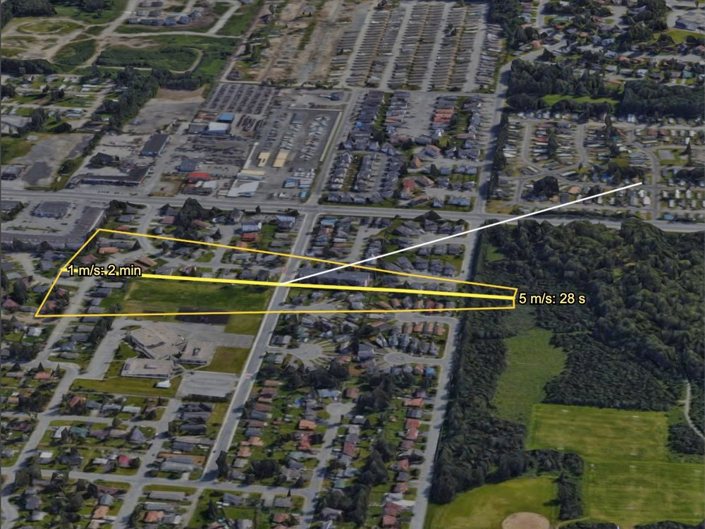
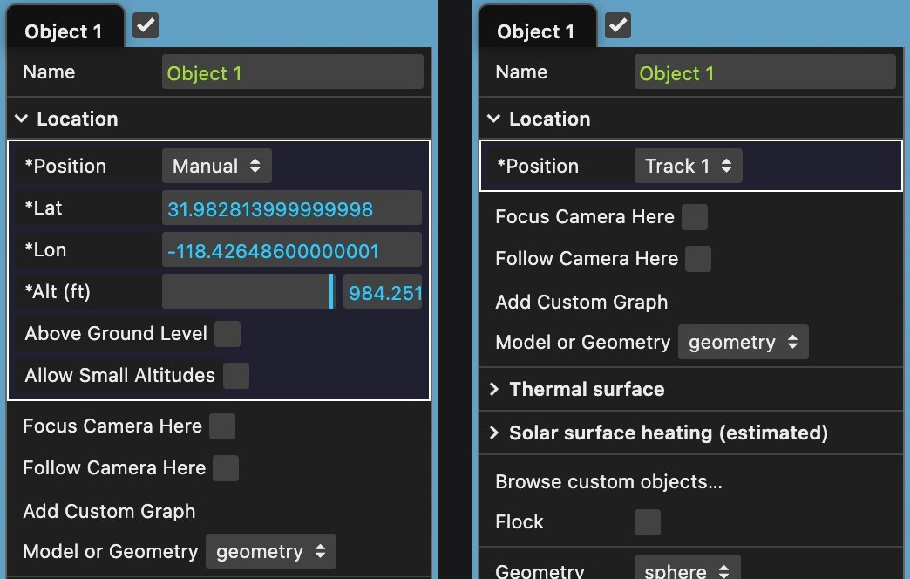
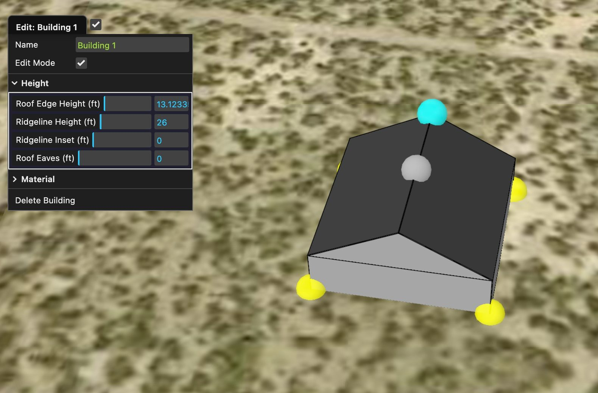
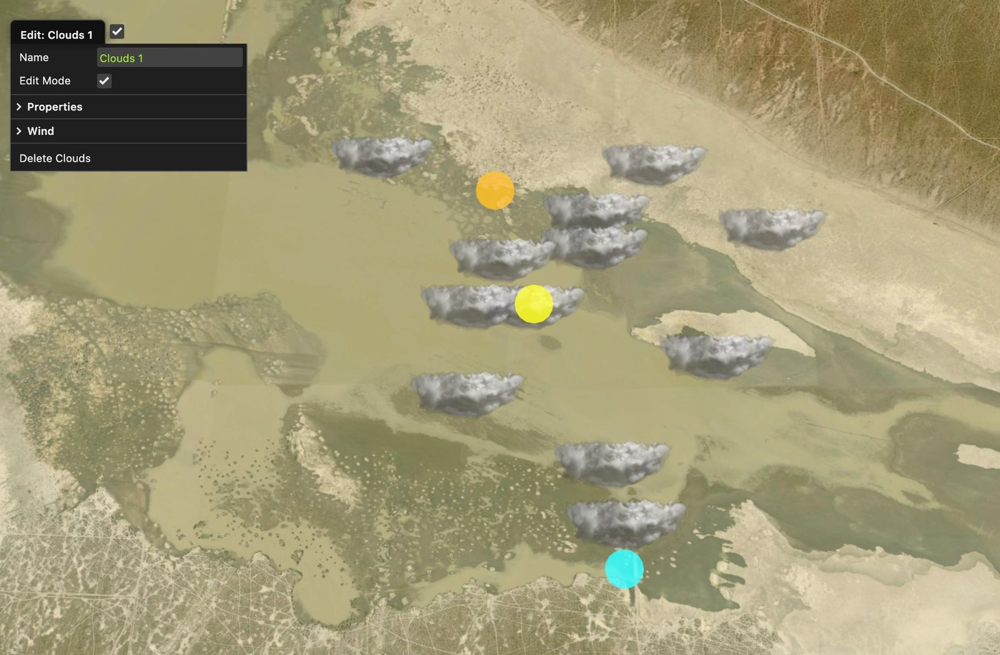
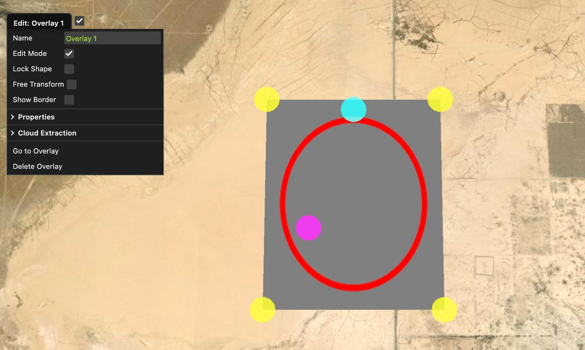

# Adding Objects and Tracks

In a Custom sitch, right-clicking the ground opens a menu that places things at that point: a
camera or target position, a pin, a 3D object, a track, a balloon, a building, a cloud layer, a
ground overlay or a measurement grid. This page describes each item in that menu, the editors for
buildings, clouds, ground overlays and ground grids, and how to find, change and remove each thing
after you make it.

This page has four parts:

- **A. [The ground menu](#a-the-ground-menu)**: every item, and where the new thing appears
- **B. [Right-clicking things that are already there](#b-right-clicking-things-that-are-already-there)**
- **C. [The editors](#c-the-editors)**: buildings, clouds, ground overlays and ground grids
- **D. [Finding, saving and removing](#d-finding-saving-and-removing)**

---

## A. The ground menu

Right-click the ground (terrain, or the globe) in the main view or the look view. The menu is
titled **Ground**. It is only available in a Custom sitch. **File → New Sitch (Empty)** starts a fresh
one, and so does the **New Sitch** button in the sitch browser.

The top of the menu shows the location of the point you clicked:

- latitude and longitude, to six decimal places
- the altitude [above mean sea level (MSL)](GIS.md#three-kinds-of-height)
- the height above the WGS84 ellipsoid (HAE), with the difference between the two in parentheses

You can select and copy this text.

### Menu items

| Item | What it does | Where the result goes |
|---|---|---|
| **Set Camera Above** | Moves the camera's fixed position to the clicked latitude and longitude. The camera keeps its current altitude | The camera position |
| **Set Camera on Ground** | Moves the camera's fixed position to the clicked point, 2 m above the ground (eye level) | The camera position |
| **Set Target Above** | Moves the target's fixed position to the clicked latitude and longitude. The target keeps its current altitude | The target position |
| **Set Target on Ground** | Moves the target's fixed position to the clicked point, on the ground | The target position |
| **Drop Pin** | Places a labelled pin (a feature marker) and opens its edit window with the label text selected, ready to type | See [Pins](#pins) |
| **Add 3D Object** | Places a grey sphere, 5 m in radius (10 m across), that stays in one place. It has no track, but you can put it on one later: see [3D objects](#3d-objects) | **Objects** menu, as *Object 1*, *Object 2*, ... |
| **Add Moving Object** | Starts a new hand-drawn track at the clicked point, at the current frame, with a grey sphere, 5 m in radius, riding on it. The track opens in edit mode | Track in **Contents** and object in **Objects**, with the same number: *Track 3* and *Object 3*, one more than the highest track or object number |
| **Add Moving Object (In→Out)** | Makes a straight track with an object riding on it, with control points at the In and Out frames. See [In→Out tracks](#in-out-tracks) | Track in **Contents**, object in **Objects**, named as above |
| **Add Flight Path** | Starts a new hand-drawn track, with no object, at the clicked point, at the current frame, in edit mode | **Contents**, as *Track 1*, *Track 2*, ... |
| **Add Balloon** | Adds a balloon that launches from the clicked point, rises and drifts with the wind. See [Balloons](#balloons) | **Contents**, as *Balloon*, *Balloon_1*, ...; its sphere in **Objects**, as *Object N* |
| **Add Kite** | Adds a kite on a line that is held at the clicked point. The kite flies downwind of that point, where the wind puts it. See [Kites](#kites) | **Contents**, as *Kite*, *Kite_1*, ...; the kite in **Objects**, as *Object N* |
| **Add Building** | Adds a 15 × 15 m building, 4 m high, centered on the clicked point, and opens its editor | **Objects**, as *Building: Building 1* |
| **Add Clouds** | Adds a round layer of clouds at 10,000 ft, 500 m in radius, centered above the clicked point, and opens its editor | **Objects**, as *Clouds: Clouds 1* |
| **Add Ground Overlay** | Adds an image overlay draped on the ground, 0.02° square, centered on the clicked point, and opens its editor. It has no image until you give it one | **Objects**, as *Overlay: Overlay 1* |
| **Add Ground Grid** | Adds a measurement grid draped on the ground, 1000 × 1000 of your current small units (meters or feet), with major lines every 100 and minor lines every 10, and opens its editor | **Objects**, as *Grid: Grid 1* |
| **Center Terrain square here** | Moves the center of the terrain square to the clicked point. Only shown when **Dynamic Subdivision** is off (see [Terrain and Elevation](Terrain.md)) | The terrain |
| **Google Maps Here** | Opens Google Maps at the clicked point in a new browser tab | A new tab |
| **Google Earth Here** | Downloads a small KML file, *Sitrec Pin.kml*, with a pin at the clicked point. Open it in Google Earth | Your downloads |

**Google Maps Here** and **Google Earth Here** are shown only on installations that enable extra
help links.

The menu shows its items in groups, each under a heading: **Camera and Target**, **Add**,
**Terrain** and **External Maps**.

Two more items can appear, under an **Edit** heading, when you right-click inside something that
already exists:

- **Edit Clouds: *name*** when the clicked point is under a cloud layer (within its radius)
- **Edit Overlay: *name*** or **Edit Grid: *name*** when the clicked point is inside a ground
  overlay or ground grid

Each one opens that item's editor. This is the usual way to edit clouds, overlays and grids from
the 3D view, because a right-click on them passes through to the ground behind.

The camera and target items move the fixed positions that the camera and target use when they are
not following a track. If the camera or target follows a track, the move has no visible effect
until you switch back to the fixed position.

If you right-clicked in the **look view**, a new track (from any of the three track items, from
**Add Balloon** or from **Add Kite**) is also shown in the look view. A track made from the main view is shown only in
the main view. You can change this later with **Show in look view** in the track's folder.

### In->Out tracks

**Add Moving Object (In→Out)** makes a track with two control points:

- the first at the **In** frame, at the point you clicked
- the second at the **Out** frame, 200 screen pixels to the right of the first in the view you
  clicked

Both ends are therefore on screen and easy to grab, and left to right matches In to Out on the
timeline. **Constant Speed** is on, so the object moves at a steady speed along the track.
**Lock Altitude** is on, at 0 above the ground, so the whole track stays at one height above the
ground and follows the terrain under it. Drag the object or either control point up, and the
whole track rises.

The control points take their frame numbers when you make the track, so set the In and Out frames
first, with **Time → In Frame [I]** and **Time → Out Frame [O]**, or the **I** and **O** keys at
those frames. See
[Keys for time and frames](TimeAndSync.md#keys-for-time-and-frames).

### Hand-drawn tracks

All three track items create a hand-drawn track: a spline through control points you place by
hand. It starts in edit mode. To add, move and delete control points, and to leave edit mode, see
[Hand-Drawn Tracks](Tracks.md#hand-drawn-tracks) in
[Loading and Filtering Tracks](Tracks.md).

A hand-drawn track's folder in **Contents** starts with **Name**, **Edit Track** and, when an
object rides the track, **Show Object Menu**. Next come **Go to Track**, **Focus Camera Here** and
**Follow Camera Here**, then the **Path**, **Smoothing** and **Display** groups.
**Add Custom Graph**, **Export Spline** and **Delete Track** are at the end.
See [Track Display Controls](Tracks.md#track-display-controls). The object's folder in
**Objects** has **Show Track Menu**. The track's menu and the object's menu can be open at the
same time.

### Balloons

**Add Balloon** makes a balloon target: a white sphere, 0.5 m in radius, on a generated track. The
balloon starts at the ground height of the clicked point, rises once launched, and drifts with the
wind (see [Wind in Sitrec](Wind.md)). The **GFS (NOAA)** wind source (Global Forecast System) gives the
balloon the wind at its altitude. So does a sounding wind source, which uses wind profiles from
weather balloons. The **Manual** wind source gives it one wind at every altitude. The balloon is
added to the camera and target track lists, so the camera can follow or look at it.

Its folder in **Contents** has these launch settings:

| Control | Default | What it does |
|---|---|---|
| **Start Altitude (m MSL)** | ground at the clicked point | Launch altitude above mean sea level |
| **Launch Delay (s)** | 0 | Seconds after the start of the sitch before the balloon lifts off |
| **Buoyancy (m/s)** | 5 | Steady ascent rate once launched. A negative value makes it descend |
| **Wind Variability (%)** | 20 | Random gustiness, as a percentage of the local wind speed |
| **Random Seed** | 1 | Change it for a different, but repeatable, flight path |

It also has **Show in look view** and **Delete Track**, which asks before it deletes the balloon.

### Kites

**Add Kite** makes a kite on a flying line. The clicked point is the anchor, where the line is
held. The kite flies downwind of the anchor, at the height where its lift, its drag, its weight
and the pull of the line are in balance. Use it to test if a kite can be at the position of an
object in a video, with the wind of that day.

A kite in the main view. The white line is the flying line, from the anchor on the ground to the tow point of the kite. The thin lines above the tow point are the bridle of the kite. The blue line is the kite's track. This kite is the **Octopus kite · 14 m, black** design.

A new kite is a small diamond kite. To change it, open the kite's folder in **Objects** and
select **Browse custom objects…**, then the **Kites** type. See
[Objects and 3D Models](CustomModels.md#procedural-custom-objects). The kite points its nose into the
wind, and its tails or tentacles move with the wind at the kite: faster in a stronger wind, and
slower for a larger kite.

**The wind.** The kite uses the same wind as a balloon (see [Wind in Sitrec](Wind.md)). With the
**Manual** wind source that is **Target Wind**. A wind is named by the direction it comes from,
so a wind from the west puts the kite east of its anchor. A new custom sitch has a Target Wind
of zero, so a new kite is on the ground until you set a wind.

**The flight model.** The lift and the drag of a kite go with the square of the wind speed, and
its weight does not change. So:

- below a minimum wind, the lift is less than the weight and the kite is on the ground
- above it, the kite rises as the wind becomes stronger
- in a strong wind, the line comes near a maximum angle, which is set by the ratio of lift to drag

The line has weight and the wind pushes on it, so it sags: it is steepest at the kite and
flattest at the anchor. A heavy or thick line holds the kite lower.

On each frame the wind gives the kite a balance position. When the wind changes, from the wind
source or from the gusts, the kite follows the new position with a delay. The delay is the time
that the wind takes to go the horizontal distance from the anchor to the kite: about 15 seconds
for a kite that is 75 m downwind in a wind of 5 m/s. The kite moves faster when it is farther
from its balance position, at up to half the wind speed. A kite that the wind cannot hold sinks
at 1 m/s or more. The delay and the two speed limits are estimates from a simple model. The
model does not include the momentum of the kite, or a person who pulls the line. A kite in a
wind near its minimum sinks in each lull and rises again in each gust.

**The gusts.** **Wind Variability (%)** is the turbulence intensity of the wind: the typical
size (the standard deviation) of the gusts along the wind, as a percentage of the wind speed.
The gusts across the wind are 0.8 of that size, and they turn the wind from side to side. A
gust is a body of air that the wind carries past the kite, so it lasts for its length divided
by the wind speed. For a kite 60 m or more above the ground in a wind of 5 m/s, a gust along the
wind lasts about one minute, and a gust across the wind about 20 seconds. Nearer the ground the
gusts are shorter. The ratio and the lengths are those of the Kaimal turbulence model in the
wind-turbine standard IEC 61400-1.

Over the frames of the sitch, the gusts have a mean of zero. So the mean wind at the kite is
the wind of the sitch, and the kite moves about the position that this wind gives. On the first
frame the kite is at that position, and the gusts then move it. A gust that
lasts longer than the sitch is not in it. Thus in a short sitch the wind changes less than
**Wind Variability (%)** gives. The mean is over all the frames of the sitch: if you change the
number of frames, the gusts change, and the kite moves at every frame.

Typical values of **Wind Variability (%)** at a height of 50 m, from the turbulence formula of
the wind-load standard EN 1991-1-4. The values are larger nearer the ground: at 20 m, by one
tenth over the sea and by one third in a town center.

| Ground upwind of the kite | Wind Variability (%) |
|---|---|
| Open sea, or a beach with the wind from the sea | 10 |
| Flat open ground: lakes, grassland | 12 |
| Open country with some trees and buildings | 15 |
| Suburbs and woods | 20 |
| Town centers | 26 |

With the default of 10%, in a wind of 5 m/s, a new kite on a 100 m line is within about 10 m of
its mean position for most of the time, and it moves at about 0.2 m/s.

The mass, the lifting area, the lift coefficient and the drag coefficient are part of the kite
design: **Edit design…** in the kite's object folder, then the **Flight** folder. The values of
the preset kites are estimates for each type of kite. They are not measurements of a real kite.

The kite's folder in **Contents** has these settings:

| Control | Default | What it does |
|---|---|---|
| **Anchor Altitude (m MSL)** | ground at the clicked point | Altitude above mean sea level of the point where the line is held |
| **Line Length (m)** | 100 | Length of the flying line, from the anchor to the kite |
| **Line Weight (g/m)** | 0.5 | Weight of one meter of line. About 0.5 for a small kite, and 5 or more for a large show kite |
| **Line Diameter (mm)** | 1 | Thickness of the line, for the push of the wind on it. About 1 for a small kite, and 3 or more for a large show kite |
| **Wind Variability (%)** | 10 | How gusty the wind is, from 0 to 40: the typical size of a gust as a percentage of the wind speed. The gusts move the kite slowly from side to side, and up and down. See **The gusts** above |
| **Random Seed** | 1 | Change it for a different, but repeatable, pattern of gusts |
| **Kite Position** (read only) | | At the current frame: the height of the kite above the anchor, its distance downwind of the anchor, and the angle of a straight line from the anchor to the kite. *On the ground* when the wind is too light |
| **Wind and Pull** (read only) | | At the current frame: the wind speed at the kite and the pull of the line. On the ground, the second value is the wind that this kite needs |

It also has the track display controls, **Show in look view** (for the track and the flying
line) and **Delete Track**, which asks before it deletes the kite and its object. To move the
anchor, drag the kite with its move widget, or hold **Option** / **Alt** and drag it: the anchor
moves by the same amount, and the kite flies from the new anchor. The kite is added to the
camera and target track lists.

### Kite Anchor Finder

**Add Kite** starts from the anchor and gives the position of the kite. The **Kite Anchor
Finder** does the reverse. It starts from an object in the video, and it shows where on the
ground the line of a kite at that position can be held. You can then see if that place is one
where a person can fly a kite, such as a park. It is the **Kite Anchor Finder** folder in the
**Traverse** menu of a custom sitch.

The Kite Anchor Finder in the main view. The white line in the air is the part of the line of sight where the kite can be. The wide yellow line and the four orange lines on the ground are the band of possible anchors. The yellow outline holds the anchors for a kite that is 2 m across, and a white line goes from that kite to the middle of the outline. The thinner white line is the flying line of a kite from **Add Kite**. Its anchor is in the band.

To use it:

1. Give Sitrec the line of sight to the object. The finder uses **Traverse → LOS Source** at the
   current frame. Point the camera at the object, with **LOS Source** at **Camera Center**. Or
   mark the object in the video: hold **Ctrl** (**Cmd** on a Mac) and click it, then set **LOS
   Source** to **Camera + Object Track**. See
   [Point Track, Manual Tracking and Ground Track](PointTrack.md#point-track-manual-tracking-and-ground-track).
2. Set the wind of that time. See [Wind in Sitrec](Wind.md).
3. In **Traverse → Kite Anchor Finder**, set **Object Size (px)** to the size of the object in
   the video, in pixels of the video frame. Measure one part of the object, for example the width
   of its head.
4. Set **Kite Size Min (m)** and **Kite Size Max (m)** to the range of real sizes of that same
   part of the kite.
5. Turn on the checkbox in the title of the folder (**Show Anchor Band**).

The finder does this calculation:

- **Object Size (px)** and the field of view of the camera give the angle that the object makes
  at the camera. A kite of one real size is then at one distance from the camera: its size
  divided by that angle in radians. The range of kite sizes gives a part of the line of sight.
- A kite flies downwind of its anchor. So, for each position of the kite, the anchor is upwind,
  at the point where a straight line that goes down at the flight angle meets the ground. Over
  flat ground, the distance to that point is the height of the kite divided by the tangent of
  the flight angle. For a kite 60 m above the ground, that is 104 m at 30°, 60 m at 45° and 35 m
  at 60°.
- The flight angle and the wind direction each have a range. So one kite size gives an area on
  the ground, and all the kite sizes give a band.

The finder draws these lines in the main view. They are drawn over the terrain and the buildings.

| Line | Meaning |
|---|---|
| White line in the air | The part of the line of sight where the kite can be, from the smallest kite size to the largest |
| Wide yellow line | The anchors for the middle flight angle and the wind direction of the sitch |
| Four orange lines | The sides of the band: the lowest and the highest flight angle, each with the wind turned to the left and to the right by **Wind Direction Error (±°)** |
| Yellow outline with a label | All the anchors for one kite size. The label gives that size and the length of a straight line from the anchor to the kite |
| White line from the air to an outline | The flying line of that kite as a straight line, for the middle flight angle and the wind direction of the sitch |

The folder has these settings. They are saved with the sitch.

| Control | Default | What it does |
|---|---|---|
| **Show Anchor Band** (the checkbox in the title) | off | Draws the band. While it is off, the finder does no work |
| **Object Size (px)** | 10 | The size of the object in the video, in pixels of the video frame |
| **Kite Size Min (m)** | 1 | The smallest real size of that part of the kite. A smaller kite is nearer to the camera |
| **Kite Size Max (m)** | 5 | The largest real size of that part of the kite. A larger kite is farther from the camera |
| **Flight Angle Min (°)** | 30 | The lowest angle above the horizontal of a straight line from the anchor to the kite. A lower angle puts the anchor farther upwind |
| **Flight Angle Max (°)** | 60 | The highest angle above the horizontal of a straight line from the anchor to the kite |
| **Wind Direction Error (±°)** | 20 | How far the wind direction at the kite can be from the wind of the sitch, to each side |
| **Max Line Length (m)** | 300 | The longest flying line. A kite that needs a longer line has no anchor in the band |
| **Angular Size** (read only) | | The angle that the object makes at the camera, in degrees and in milliradians |
| **Wind at Kite** (read only) | | The wind of the sitch at the middle of the kite positions: the direction that it comes from, and its speed |
| **Kite Distance** (read only) | | The distance from the camera to the kite, for the smallest and the largest kite size |
| **Kite Height** (read only) | | The height of the kite above the ground below it: the lowest and the highest of the kite positions. It ends with *part below the ground* when some kite positions are in the ground |
| **Line Length** (read only) | | The length of a straight line from the anchor to the kite for the middle flight angle: the shortest and the longest in the band. When only some kite sizes have an anchor, those sizes follow |

**The flight angle.** This is the angle that **Kite Position** shows for a kite from **Add
Kite**. In a strong wind, the preset kites fly at about 40° (octopus kite) to about 60° (delta
kite), from the lift and drag estimates of their designs. A kite flies lower in a light wind,
and on a heavy line. The finder does not use a kite design: the flight angle is a setting.

**The wind.** The finder uses the wind of the sitch at each position of the kite, at the current
frame. With weather profiles, that is the wind at the height of the kite. A weather report is
for a different place and height, and hills and buildings turn the wind: **Wind Direction Error
(±°)** is for that difference.

The finder has these limits:

- The ground is the elevation data of the terrain. It is not the surface of the 3D building
  tiles, which has the roofs and the trees.
- The line from the anchor to the kite is straight. A real line sags, so it is longer than the
  **Line Length**.
- A kite position that is below the ground has no anchor. This occurs where the line of sight
  goes into a hill.
- The result is for the current frame. When the object moves in the video, or the camera moves,
  the band moves.

### Reverse Balloon Launch Finder

**Add Balloon** starts from the launch point and gives the flight of the balloon. The **Reverse
Balloon Launch Finder** does the reverse. It starts from an object, and it shows where on the
ground a balloon at that position can have been launched. It is the **Reverse Balloon Launch
Finder** folder in the **Traverse** menu of a custom sitch, below the **Kite Anchor Finder**.

A balloon rises at its buoyancy, and the wind of each height moves it. The finder follows that
flight back in time: down at the buoyancy and against the wind of each height, until the path
meets the ground. A balloon that rises more slowly was in the air for a longer time, so it
comes from farther upwind.

To use it:

1. Set the wind of that time. See [Wind in Sitrec](Wind.md). With weather profiles, the finder
   uses the wind of each height.
2. In **Traverse → Reverse Balloon Launch Finder**, set **Start From**:
   - **Line of Sight**: the balloon is on the line of **Traverse → LOS Source** at the current
     frame. Set **Object Size (px)** to the size of the object in the video, and **Balloon Size
     Min (m)** and **Balloon Size Max (m)** to the range of real sizes. They give the distance,
     as in the [Kite Anchor Finder](#kite-anchor-finder).
   - **Target**: the balloon is at the position of **Target → Target Track**.
   - A track: the balloon is at the position of that track at the current frame.
   - A 3D object whose **Position** is **Manual**: the balloon is at that object. The object is
     in the list under its name. See [Location](#location-a-manual-position-or-a-track).
3. Set **Buoyancy Min (m/s)** and **Buoyancy Max (m/s)** to the range of speeds at which the
   balloon can rise.
4. Turn on the checkbox in the title of the folder (**Show Launch Sites**).

The finder draws these lines in the main view. They are drawn over the terrain and the buildings.

| Line | Meaning |
|---|---|
| Yellow outline | All the launch sites for one balloon position: each buoyancy in the range, with the wind turned to the left and to the right by **Wind Direction Error (±°)** |
| Line in the outline, with a label at each end | The launch sites for the wind direction of the sitch, from the highest buoyancy (the near end) to the lowest. Each label gives the buoyancy and the flight time. On a line of sight, the first label also gives the balloon size |
| White line from the ground to the balloon | The flight of the balloon for the middle buoyancy and the wind direction of the sitch |
| White line in the air (line of sight only) | The part of the line of sight where the balloon can be, from the smallest balloon size to the largest |
| Wide yellow line and four orange lines (line of sight only) | The middle and the sides of the area for all the balloon sizes |

The folder has these settings. They are saved with the sitch.

| Control | Default | What it does |
|---|---|---|
| **Show Launch Sites** (the checkbox in the title) | off | Draws the launch sites. While it is off, the finder does no work |
| **Start From** | Line of Sight | Where the balloon is at the current frame: on the line of sight, at the target, at the position of a track, or at a 3D object whose **Position** is **Manual** |
| **Object Size (px)** | 10 | The size of the object in the video, in pixels of the video frame. Only for **Line of Sight** |
| **Balloon Size Min (m)** | 0.3 | The smallest real size of the balloon. A smaller balloon is nearer to the camera. Only for **Line of Sight** |
| **Balloon Size Max (m)** | 2 | The largest real size of the balloon. A larger balloon is farther from the camera. Only for **Line of Sight** |
| **Buoyancy Min (m/s)** | 1 | The lowest speed at which the balloon rises. This is the **Buoyancy (m/s)** of a balloon from **Add Balloon** |
| **Buoyancy Max (m/s)** | 5 | The highest speed at which the balloon rises |
| **Wind Direction Error (±°)** | 10 | How far the wind direction can be from the wind of the sitch, to each side, at every height |
| **Resolution (steps)** | 128 | The number of steps of each flight, from the balloon down to the ground. With more steps, a flight follows the change of the wind with the height more closely, and the result takes more time to calculate. See [Resolution](#resolution) |
| **Angular Size** (read only) | | The angle that the object makes at the camera. Only for **Line of Sight** |
| **Wind at Balloon** (read only) | | The wind of the sitch at the balloon: the direction that it comes from, and its speed |
| **Balloon Distance** (read only) | | The distance from the camera to the balloon, for the smallest and the largest balloon size. Only for **Line of Sight** |
| **Balloon Height** (read only) | | The height of the balloon above the ground below it |
| **Flight Time** (read only) | | The time from the launch to the current frame: the shortest and the longest of the flights in the result. It ends with *part longer than 10 h* when a part of the buoyancy range needs more than 10 hours. It is *Longer than 10 h* when all of that range does. See [The longest flight](#the-longest-flight) |

With **Start From** at a balloon from **Add Balloon** that has a **Wind Variability (%)** of 0,
and with its buoyancy, the launch site is the same from every frame: the point where the track
of that balloon leaves the ground. That is the launch point of the balloon when its **Start
Altitude (m MSL)** is the height of the ground there. The flight time grows by the time between
the frames.

The finder has these limits:

- The wind is the wind of the sitch at the current frame, for the whole flight. The finder does
  not use the wind of an earlier time.
- The buoyancy is the same for the whole flight.
- The flight has no gusts.
- The ground is the elevation data of the terrain. It is not the surface of the 3D building
  tiles, which has the roofs and the trees.
- A balloon position that is below the ground has no launch site.

#### Resolution

Each flight goes down from the balloon in steps of equal height. A step uses the wind of its
middle height for all of the step. So where the wind changes much inside one step, the launch
site is not exact. **Resolution (steps)** is the number of steps from the balloon to the ground
below it, from 8 to 1024. A step is 5 m high at least, so a balloon that is low has fewer steps.

With more steps, the steps are smaller and the launch site is nearer to the exact one. The time
to calculate the result goes up with the number of steps.

In tests with a wind from weather profiles, the balloon was at 17.9 km and at 30 km, and the
farthest launch site was 18 km to 77 km away. At 32 steps that launch site was 0.2% to 0.6% of
its distance from the launch site at 4096 steps. At 128 steps it was 0.2% or less.

#### The longest flight

The flight time is the height of the balloon above the launch site, divided by the buoyancy. The
finder follows a flight for 10 hours at most. At 1 m/s, a balloon gets to 36 km (118,000 ft) in
that time.

When a part of the buoyancy range needs more than 10 hours, the result has only the other part.
The outline is shorter: its far end is at the buoyancy whose flight takes 10 hours, and the label
at that end shows that buoyancy, not **Buoyancy Min (m/s)**. **Flight Time** ends with *part
longer than 10 h*.

When the flight at **Buoyancy Max (m/s)** also needs more than 10 hours, there is no launch
site, and **Flight Time** shows *Longer than 10 h*.

### Pins

**Drop Pin** places a pin labelled *New Feature* and opens a window titled **Edit: *label***. In
it you can change **Label Text**, **Arrow Length**, **Arrow Color** and **Text Color**, and read
the pin's latitude, longitude and altitudes. While the window is open you can drag the pin in the
view. **Delete Pin** removes it (it asks first). **Done**, Escape, or a double-click on the window
title closes the window.

Pins do not have a folder in a menu. To edit a pin later, right-click it. **Show → Pins in Main**
and **Show → Pins in Look** show or hide all pins in each view. **Pins in Look** is off by default,
so a new pin shows only in the main view until you turn it on.

### 3D objects

**Add 3D Object** opens the new object's edit window straight away, because a grey sphere 5 m in
radius on open ground can be hard to find. While the window is open you can drag the object with
the move widget that appears when the pointer is near it. The window holds the same controls as the
object's folder in the **Objects** menu: geometry or model, size, material and so on. See
[Objects and 3D Models](CustomModels.md).

#### Location: a manual position, or a track

The folder of an object from **Add 3D Object**, **Add Moving Object** or **Add Moving Object
(In→Out)** has a **Location** group, directly below **Name**. Its **Position** control sets what
gives the object its position:

- **Manual**: the **Lat**, **Lon** and **Alt** values below it, with **Above Ground Level** and
  **Allow Small Altitudes**, as in the camera's **Location** group. You can also drag the object
  with the move widget. An object from **Add 3D Object** starts here.
- **A track**: every track of the sitch is in the list, by its name: hand-drawn tracks, loaded
  tracks, balloons and kites. The object moves along the track and points along it, and the manual
  values are hidden. An object from **Add Moving Object** starts on its own track.

So, to put an object on a path that is already there, select the path in **Position**. Several
objects can be on one track. When you change **Position** back to **Manual**, the object stays
where the track put it on the current frame. The same happens when you delete the track. A track
that you add or load later comes into the list by itself, and no object goes to it by itself.

While **Position** is **Manual**, the object is itself in the other track lists of the sitch,
under its name. Select it there as you select a track:

| List | With the object selected |
|---|---|
| **Target → Target Track** | The target is at the object |
| **Camera → Location → Position** | The camera is at the object |
| **Camera → Camera Tweaks → Orbit Target** | The Orbit camera position circles the object |
| **Position** of another object | That object is at the same place |
| **Traverse → Reverse Balloon Launch Finder → Start From** | The reverse flight starts at the object |
| **Terrain → Zoom to track** | The terrain moves to the object |

The position that these lists use is the **Lat**, **Lon** and **Alt** of the object. When you
give the object a new name, the lists show the new name, and a list that has the object selected
keeps it. When a track has the same name as the object, the object is in the lists with
*(object)* after its name.

When you put the object on a track, the object goes out of these lists, because the track is in
them. A list that had the object selected then changes to that track, so it stays with the
object. When you delete the object, a list that had it selected goes back to its first choice.

The **Banking** control of the object sets how it points on the track. With **Position** on
**Manual** the object does not move, so it keeps the heading that it has: north for a new object.
Select **Fixed Heading** in **Banking** to turn it.

A balloon's sphere and a kite stay with their own track, and have no **Location** group.

In the folder, the size of a generated shape (for example **Radius (m)**) is just below
**Geometry**, and its segment counts are in the closed **Mesh Detail** group. Sizes are in
meters in every sitch. **Delete Object**, at the end of the folder, removes an object you made;
objects that the sitch itself defines, such as the traverse object, have no delete button, and
a balloon's sphere goes with its balloon.

---

## B. Right-clicking things that are already there

A right-click in a 3D view picks the first thing it finds, in this order:

1. a **pin**: opens the pin's edit window
2. a **3D object** (including buildings): opens its edit window, as described below
3. a **track** line, within about 10 pixels of the pointer: opens the track's menu, titled
   **Track: *name***, with the same controls as the track's folder in **Contents**
4. a star, planet or satellite
5. the **ground**: opens the ground menu

**3D object.** The edit window is titled with the object's name and holds the controls of its
folder in the **Objects** menu. It stays open while you work in the view. While it is open, the
object can be dragged with its move widget. You can also move any movable object without opening
a window: hold **Option** (Mac) or **Alt** (Windows, Linux) and drag it.

**Building.** Right-clicking a building puts it in edit mode and opens its editor at the pointer.
See [Buildings](#buildings).

**Clouds, overlays and grids** do not catch the right-click. It goes through to the ground, and the
ground menu then offers **Edit Clouds**, **Edit Overlay** or **Edit Grid** for the item under the
pointer.

**While a track is in edit mode**, every right-click goes to that track's edit menus, and nothing
else opens a menu until you leave edit mode. See
[Hand-Drawn Tracks](Tracks.md#hand-drawn-tracks).

**While a track's menu or any edit window is open** (for a building, a cloud layer, an overlay, a
grid, a 3D object or a pin), right-clicking the ground does not open the ground menu. Close it
first.

---

## C. The editors

Buildings, clouds, ground overlays and ground grids share one way of working:

- **Edit mode** shows colored handles in the 3D views. Drag a handle to change the item.
- **The editor** is a floating window titled **Edit: *name***. It holds the same controls as the
  item's folder in the **Objects** menu, so a change in one shows in the other. You can drag the
  window, or dock it in a sidebar.
- **Closing the editor leaves edit mode.** Double-click its title, or press **Escape** when it is
  the top window. You can also clear **Edit Mode** in the item's folder.
- **Only one editor is open at a time.** Opening an editor closes any other editor.
- **Escape during a drag** cancels that drag and puts the item back where it was.
- **Delete** or **Backspace** deletes the item being edited, after asking you. This works for a
  building, a cloud layer, an overlay or a grid.
- **Undo** (**Cmd**/**Ctrl** + **Z**) works for creating, dragging and deleting.

Handles keep the same size on screen at any zoom. Heights and sizes are shown in your current small
units (meters or feet), and the label ends with the unit, for example **Radius (ft)**. Where a
control has a fixed unit, its row gives that unit.

### Buildings

Right-click the ground and choose **Add Building**, or right-click an existing building. You can
also turn on **Edit Mode** in **Objects → Building: *name***.

A new building is a 15 × 15 m box, 4 m high, with a flat roof. It sits on the ground: if the
terrain or 3D tiles under it change, the building moves back onto the ground.

#### Handles

*A building in edit mode, beside its editor. **Ridgeline Height** is raised to 26 ft, so the roof is pitched. The roof hides most of the fourth yellow sphere. The area outside each corner that rotates the building has no mark.*

| Handle | Drag it to |
|---|---|
| **Yellow** sphere at each bottom corner | Resize the footprint. The opposite corner stays fixed and the footprint stays a rectangle |
| Just **outside** a yellow corner, in the direction away from the building | Rotate the whole building about its center |
| **Grey** sphere at the center of the roof | Raise or lower the whole roof |
| **Cyan** sphere at one end of the ridgeline | Raise or lower the ridgeline above the roof edge. This makes a pitched roof from a flat one |
| The **building itself** | Move the building over the ground |

Hold **Option** / **Alt** and drag the building or one of its handles to make a copy and drag the
copy. Press **Escape** during that drag to cancel the copy.

A new building starts at the rotation you last gave a building, so a row of buildings along one
street comes out already aligned.

#### Controls

These are in **Objects → Building: *name*** and in the editor.

| Control | Default | What it does |
|---|---|---|
| **Name** | *Building 1*, *Building 2*, ... | The name in the menus and the editor title |
| **Visible** (title checkbox) | on | Show or hide the building |
| **Edit Mode** | on when created | Show the handles and the editor |
| **Height → Roof Edge Height** | 4 m | Height of the top of the walls, above the highest ground point under the building. The slider goes up to 1000 m. The grey roof handle has no upper limit |
| **Height → Ridgeline Height** | same as Roof Edge Height | Height of the roof ridge, up to 1000 m. When it equals Roof Edge Height, the roof is flat. It cannot be lower than the roof edge |
| **Height → Ridgeline Inset** | 0 | Moves both ends of the ridge inward, which slopes the end faces of the roof |
| **Height → Roof Eaves** | 0 | Extends the roof beyond the walls |
| **Material → Type** | lambert | Lighting model: basic, lambert, phong or physical |
| **Material → Wall Color** | light grey | Color of the walls |
| **Material → Roof Color** | dark grey | Color of the roof |
| **Material → Opacity** | 1 | 0 is invisible, 1 is solid |
| **Material → Transparent** | on | Lets Opacity below 1 take effect |
| **Material → Wireframe** | off | Draws the building as edges only |
| **Material → Depth Test** | on | Turn off to draw the building on top of everything in front of it |
| **Delete Building** | | Deletes the building, after asking you |

**Objects → Remove all Buildings** deletes every synthetic building at once. It does not ask first,
you cannot undo it, and it does not affect clouds, overlays or grids.

### Clouds

Right-click the ground and choose **Add Clouds**, or right-click the ground under an existing
cloud layer and choose **Edit Clouds: *name***. You can also turn on **Edit Mode** in
**Objects → Clouds: *name***.

A cloud layer is a round patch of cloud puffs at one altitude. The puffs always face the camera.

#### Handles

Each handle turns white when the pointer is over it.

*A new cloud layer in edit mode, seen from above, beside its editor. The grey shapes are the cloud puffs.*

| Handle | Drag it to |
|---|---|
| **Yellow**, at the center | Raise or lower the layer |
| **Cyan**, on the edge | Change the radius |
| **Orange**, opposite the cyan handle, halfway from the center to the edge | Move the layer |

#### Controls

These are in **Objects → Clouds: *name*** and in the editor.

| Control | Default | What it does |
|---|---|---|
| **Name** | *Clouds 1*, *Clouds 2*, ... | The name in the menus and the editor title |
| **Visible** (title checkbox) | on | Show or hide the layer |
| **Edit Mode** | on when created | Show the handles and the editor |
| **Properties → Altitude** | 10,000 ft | Height of the layer |
| **Properties → Radius** | 500 m | Radius of the layer |
| **Properties → Cloud Size** | 200 m | Width of each cloud puff. Its height is half its width |
| **Properties → Density** | 0.5 | How many puffs fill the layer. The number also grows with the area |
| **Properties → Opacity** | 0.8 | How solid the puffs are |
| **Properties → Brightness** | 1 | Values above 1 make the puffs glow |
| **Properties → Sun Reflection** | 0 | Brightens the clouds around the point where the Sun's reflection on the layer is seen from the camera, over this radius in meters. 0 is off |
| **Properties → Depth** | 0 | Spreads the puffs up and down over this thickness |
| **Properties → Edge Wiggle** | 0 | Makes the edge of the layer irregular. The value is a fraction of the radius |
| **Properties → Edge Frequency** | 5 | How many waves are added together to make the edge. A higher value gives a finer edge |
| **Properties → Seed** | 0 | Change it for a different, but repeatable, arrangement of puffs |
| **Properties → Feather** | 1000 m | Distance inside the edge over which the puffs thin out |
| **Wind → Wind Mode** | No Wind | *No Wind* keeps the layer still. *Use Local* and *Use Target* move it with the local or target wind. *Custom* uses the two settings below |
| **Wind → Wind From (°)** | 270 | Direction the wind blows from. Shown only for *Custom* |
| **Wind → Wind (knots)** | 50 | Wind speed. Shown only for *Custom* |
| **Delete Clouds** | | Deletes the layer, after asking you |

With wind, the layer drifts from its position at frame 0 by the wind speed times the time since
frame 0. It moves as one piece.

### Ground overlays

A ground overlay is an image draped on the terrain, such as a map, a satellite photo or a site
plan. There are two ways to make one:

- **Drag an image file** onto Sitrec and choose **Ground Overlay** in the *Import Image* dialog.
  The overlay is placed at the center of the main view, about 0.01° square, named after the file,
  and opens in edit mode. A sitch that has no name (a new sitch, or a sitch from a template,
  before its first save) does not show this dialog: use the second way there.
- **Right-click the ground → Add Ground Overlay**. The overlay has no image yet and shows a grey
  square with a red circle. Give it an image with **Image URL** or **Rehost Local Image**.

To edit an existing overlay, right-click the ground inside it and choose **Edit Overlay: *name***,
or turn on **Edit Mode** in **Objects → Overlay: *name***.

#### Handles

*A new ground overlay in edit mode, with one lock point, beside its editor. It has no image yet, so it shows the grey square with the red circle.*

| Handle | Drag it to |
|---|---|
| **Yellow** sphere at each corner | Resize. The opposite corner stays fixed and the overlay stays a rectangle. With **Free Transform** on, each corner moves by itself |
| **Cyan** sphere near the north edge | Rotate the overlay about its center |
| The **image itself** | Move the overlay |
| **Magenta** sphere (a lock point) | Warp the image so that this point of the image goes where you drop it |

**Lock points** help you match an image to the ground. In edit mode, right-click a feature on the
overlay to pin that point of the image. You can place up to three. Then drag a lock point onto the
place where that feature really is. With one lock point, the image moves.

Dragging a lock point turns on **Free Transform**. **Option** / **Alt** + right-click a lock point
removes it.

#### Controls

These are in **Objects → Overlay: *name*** and in the editor.

| Control | Default | What it does |
|---|---|---|
| **Name** | *Overlay 1*, ... or the file name | The name in the menus and the editor title |
| **Visible** (title checkbox) | on | Show or hide the overlay |
| **Edit Mode** | on when created | Show the handles and the editor |
| **Lock Shape** | off | Hides the corner and rotation handles, so you cannot change the size, shape or rotation by accident. You can still drag the overlay to move it |
| **Free Transform** | off | Lets each corner move by itself, for a perspective warp. Turning it on sets **Rotation** to 0. Turning it off returns the overlay to a rectangle |
| **Show Border** | off | Draws a red border around the overlay. The border is also shown while the pointer is over the overlay's folder |
| **Properties → Image URL** | empty | Web address of the image |
| **Properties → Rehost Local Image** | | Choose an image file on your computer. Sitrec uploads it and puts its address in Image URL. You must be logged in |
| **Properties → North**, **South**, **East**, **West** | 0.01° from the clicked point | The edges of the overlay, in degrees |
| **Properties → Rotation** | 0 | Rotation in degrees, −180 to 180 |
| **Properties → Altitude (ft)** | 0 | Always in feet. At 0 the overlay is draped over the terrain. Above 0 it is a flat sheet at that altitude, for example for clouds taken from a satellite image |
| **Properties → Wireframe** | off | Draws the overlay's triangles as lines |
| **Properties → Opacity** | 1 | 0 is invisible, 1 is solid |
| **Cloud Extraction → Extract Clouds** | off | Keeps only the parts of the image close to **Cloud Color**, and makes the rest transparent |
| **Cloud Extraction → Cloud Color** | #E0E0E0 | The color to keep |
| **Cloud Extraction → Fuzziness** | 40 | How far from Cloud Color a pixel can be and still be fully kept |
| **Cloud Extraction → Feather** | 40 | A further range over which pixels fade out, instead of a hard cut |
| **Go to Overlay** | | Moves the main view camera to look down on the overlay |
| **Delete Overlay** | | Deletes the overlay, after asking you |

### Ground grids

A ground grid is a measurement grid draped on the terrain, with major and minor lines. Lines stay
the same width on screen at any distance, and fade out when they get too close together.

Right-click the ground and choose **Add Ground Grid**. To edit an existing grid, right-click the
ground inside it and choose **Edit Grid: *name***, or turn on **Edit Mode** in
**Objects → Grid: *name***.

The grid has the same **yellow** corner, **cyan** rotation and move-by-dragging handles as a ground
overlay. It has no lock points.

#### Controls

These are in **Objects → Grid: *name*** and in the editor. The grid keeps its real size when you
change the unit system.

| Control | Default | What it does |
|---|---|---|
| **Name** | *Grid 1*, ... | The name in the menus and the editor title |
| **Visible** (title checkbox) | on | Show or hide the grid |
| **Edit Mode** | on when created | Show the handles and the editor |
| **Width**, **Height** | 1000 | Size of the grid |
| **Major Step** | 100 | Spacing of the major lines. 0 turns them off |
| **Minor Step** | 10 | Spacing of the minor lines. 0 turns them off |
| **Lat/Lon Grid** | off | Draws lines of latitude and longitude at round values instead. See below |
| **Min Pixel Spacing** | 10 | Lat/Lon Grid only: the smallest on-screen gap between minor lines |
| **Max Pixel Spacing** | 200 | Lat/Lon Grid only: the largest on-screen gap between minor lines |
| **Major Line Width** | 1.5 | Width of major lines, in screen pixels |
| **Minor Line Width** | 1 | Width of minor lines, in screen pixels |
| **Minor Brightness** | 0.4 | How bright the minor lines are, compared with the major lines |
| **Rotation** | 0 | Rotation in degrees, −180 to 180 |
| **Altitude** | 0 | At 0 the grid is draped over the terrain. Above 0 it is a flat sheet at that height |
| **Major Color** | yellow | Color of the major lines and the outline |
| **Minor Color** | same as Major Color | Color of the minor lines |
| **Lock Colors** | on | Makes Minor Color follow Major Color. Turn it off to set Minor Color by itself |
| **Opacity** | 1 | 0 is invisible, 1 is solid |
| **Go to Grid** | | Moves the main view camera to look down on the grid |
| **Delete Grid** | | Deletes the grid, after asking you |

The outline of the grid is always drawn, so a grid with both steps at 0 is still visible and can
still be dragged.

**Lat/Lon Grid.** With this on, the lines are at exact round coordinates: whole degrees, tenths,
hundredths and so on. Each view picks its own spacing as you zoom, so that the gap between minor
lines stays between **Min Pixel Spacing** and **Max Pixel Spacing**. Major lines are ten times the
minor spacing. A label at the bottom of each 3D view shows the spacing drawn there, for example
*Major: 0.001°, Minor: 0.0001°*. While it is on, **Major Step**, **Minor Step** and **Rotation**
are disabled and the grid is squared to north. Your step values are kept for when you turn it
off. The rotation is not restored.

---

## D. Finding, saving and removing

### Where things are in the menus

| Thing | Menu folder | How to remove it |
|---|---|---|
| Hand-drawn track | **Contents → *track name*** | **Delete Track** (asks first) |
| Balloon | **Contents → *Balloon*** | **Delete Track** (asks first) |
| 3D object, including the object on a track | **Objects → *object name*** | **Delete Object** (asks first). **Delete Track** on the object's track asks whether to delete the object too. A balloon's sphere has no **Delete Object**: **Delete Track** on the balloon removes both |
| Building | **Objects → Building: *name*** | **Delete Building**, or **Delete** / **Backspace** in edit mode. **Objects → Remove all Buildings** removes them all |
| Cloud layer | **Objects → Clouds: *name*** | **Delete Clouds**, or **Delete** / **Backspace** in edit mode |
| Ground overlay | **Objects → Overlay: *name*** | **Delete Overlay**, or **Delete** / **Backspace** in edit mode |
| Ground grid | **Objects → Grid: *name*** | **Delete Grid**, or **Delete** / **Backspace** in edit mode |
| Pin | none: right-click the pin | **Delete Pin** in its edit window |

You can drag the **Objects** or **Contents** menu off the menu bar to keep it open while you work.
See [The Menu System](UserInterface.md#the-menu-system).

### Saving

Tracks, balloons, 3D objects, pins, buildings, cloud layers, overlays and grids are saved with a
Custom sitch, with their settings. When you load the sitch, they come back where you left them.
An image you dragged in as a ground overlay is saved with the sitch like other files you drop in.
An overlay made with **Image URL** keeps that address. See
[Saving and Loading Sitches](SavingAndLoading.md).

---

## Tips

- **Can't see a new object?** A sphere 5 m in radius is small from far away. Use **Global Scale** in
  the **Objects** menu to make all objects larger while you find it. Set it back to 1 for real size.
- **Satellite image with clouds.** Drag the image in as a ground overlay, turn on
  **Extract Clouds**, pick the cloud color, then set **Altitude (ft)** to the cloud height.
- **Right-click does not open the ground menu?** The menu is only in a Custom sitch. Close any open
  edit window or track menu. If a track is in edit mode, right-click opens its edit menu instead, and the label at
  the top of each 3D view names the track. Press **Escape** to leave track edit mode.

## See also

- [Loading and Filtering Tracks](Tracks.md): track edit mode, and the controls in a track's folder
- [Objects and 3D Models](CustomModels.md): the controls in an object's folder
- [Terrain and Elevation](Terrain.md): the terrain square and Dynamic Subdivision
- [Wind in Sitrec](Wind.md): the wind that moves balloons and cloud layers
- [Sitrec User Interface](UserInterface.md): menus, windows and measurements
- [Saving and Loading Sitches](SavingAndLoading.md)
- [Keyboard Shortcuts](KeyboardShortcuts.md)
