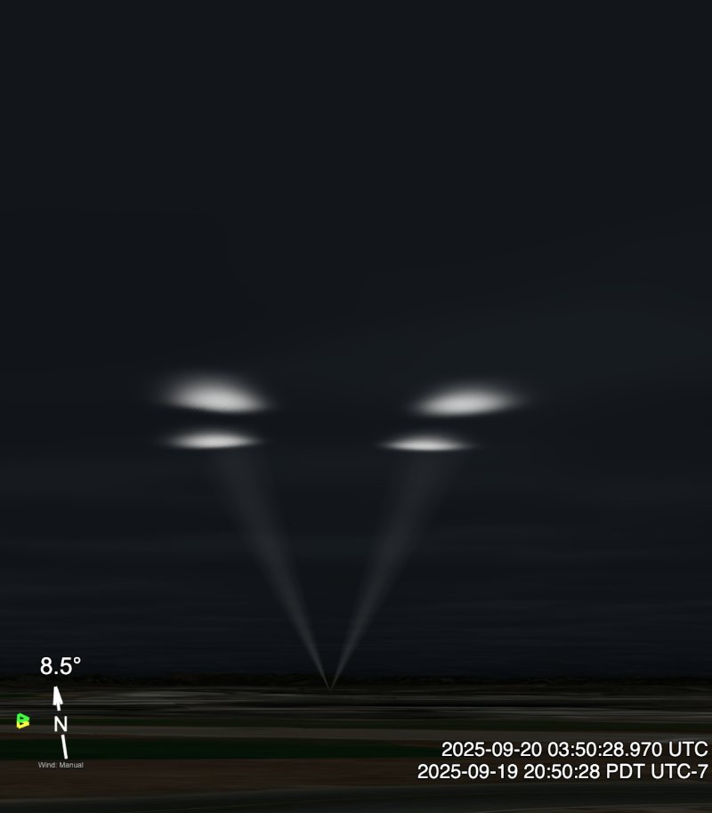
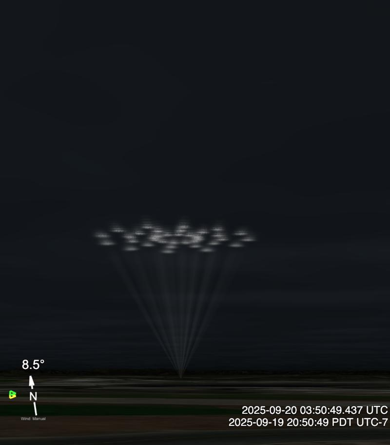

# Spotlights

A ground-based searchlight can appear in a distant video as a soft white patch moving across the underside of a cloud. Several lamps can produce patches that meet, cross or disappear into gaps. In a custom sitch, **Add Spotlight** places the projector on the ground. You can watch the pattern from the observer’s position in Look view and optionally reveal the faint shafts that connect the patches to their source.

## Make a four-beam cloverleaf

1. Start with a nighttime scene. In **Lighting → Clouds → Preset**, choose **Overcast Stratus**. This gives continuous cloud cover with a base at 400 m above the WGS84 ellipsoid. If the ground is high, raise **Base Altitude** so the layer is above your projector. Tick **L** on the Clouds folder to draw it in Look view. [Cloud layers and altitude](Clouds.md#layer-settings)
2. In Main view, right-click the ground where the lamps would stand and choose **Add Spotlight**. The projector editor opens. A new projector starts with four beams chasing each other around a circle.
3. In the projector’s **Preset** menu, choose **SkyTracker STX4 · four-beam cloverleaf**. Point the Look camera at the cloud base above that location and play the timeline. The four spots come together overhead, spread outward and meet again. Pause or scrub to compare a particular frame.
4. Turn on **Show beam cones** to see where the beams come from. Turn it off to compare just the cloud patches with the video. The cloud patches remain visible with the cones off.

*The SkyTracker halfway between meeting and reaching its widest spread. Seen from this low camera angle, the four patches look like flattened ovals.*

## Place, move and save the projector

Hold **Option** on a Mac or **Alt** on Windows or Linux to locate the projector in Main view. Hover near its base, then left-drag the housing or its green disk in Main or Look view. With the projector editor open, you can drag it without holding a key. The base stays 5 cm above the visible ground as you move across slopes. To place it at known coordinates, enter **Latitude** and **Longitude** under **Ground location**. [Moving objects](MovingObjects.md)

Right-click the housing to reopen the editor, or open **Objects → Spotlight 1**. **Visible** switches the whole projector and its light on or off. You can rename it, place additional projectors, or use **Delete projector** to remove it. Undo (**Cmd+Z** or **Ctrl+Z**) can restore a move, deletion, preset change or imported layout. Saving the sitch keeps the projector’s location, beams, motion and cone setting. [Saving and loading](SavingAndLoading.md)

**Brightness (lumens)** sets the output of every beam on this projector, from 0 to 500,000 lumens per beam. The slider changes both the cloud patches and the visible cones. Set it to zero to turn off the light while keeping the projector in place. Adding beams keeps each beam at the selected brightness.

**Spread** multiplies each beam’s angle from vertical. For a beam aimed 20° from straight up, 0.50 gives 10° and 2.00 gives 40°. The slider runs from 0.10 to 3.00 in steps of 0.01 and starts at 1.00. Use it to tighten or widen the whole show. **Beam width** controls the size of each individual patch.

## Choose a preset

A preset sets the beam count, starting brightness and the controls in each **Beam** folder. Choose the closest starting pattern, then adjust the projector’s brightness and each beam’s motion or width.

| Preset | Beams | What the patches do |
|---|---:|---|
| **SkyTracker STX4 · four-beam cloverleaf** | 4 | Meet overhead, spread into four lobes and return together. |
| **SkyTracker STX1 · single oval** | 1 | Trace an oval on a level cloud base as the head rotates on a tilted shaft. |
| **Studio Due Spaceflower · 36 rays** | 36 | Form three rings of 12 rays around one optic. The rings can open, rotate and pan. |
| **QLC+ · twin leaves (20 s)** | 2 | Trace a leaf in opposite directions, then retrace the path after each 20-second pass. |
| **Concert · two banks of six** | 12 | Follow two winding trails, peel away into independent paths, then hold a pair of arcs. The banks take turns moving again. |
| **Four-beam circle** | 4 | Chase each other around one circle, spaced a quarter-turn apart. |
| **Twin crossing sweeps** | 2 | Swing along the same line in opposite directions and pass in the middle. |
| **Four beams meet and spread** | 4 | Meet in the middle, then spread along straight paths at right angles. |
| **Six-beam fan** | 6 | Sweep together with their centers aimed in six different directions. |
| **Three figure eights** | 3 | Draw figure eights at different headings and phases. |
| **Single fixed beam** | 1 | Hold one patch still. Use it to check the position and size of a spot. |

The real STX4 uses a timing belt to synchronize four heads. Each turns around a shaft tilted 22.5° from vertical, bringing the beam from vertical to 45° off vertical once per turn. The optional DMX lighting controller switches the lamps and drive on or off. The STX1 uses a single rotating head. Sitrec models this geometry and starts both presets with an editable eight-second cycle. The timing, optical width and lumen values are simulation settings. [Strong operating manual](https://goknight.com/content/documentation/SkyTracker%20%28STX%29%20-%20Rev%2016%20Jan%202021.pdf) · [STX4 specifications](https://www.skytracking.com/images/pdf/fourhead.pdf) · [STX1 specifications](https://www.skytracking.com/images/pdf/stx1.pdf)

### Concert choreography

Choose **Concert · two banks of six** and play from frame zero. Beams 1–6 form one bank and beams 7–12 form the other. At first each spot follows the one ahead of it around a bend. One bank breaks away to wander, then the other takes its turn. At normal speed both banks settle into arcs at 13 seconds and stay still until 20.5 seconds. The second bank moves off first. Both briefly form a fan before the chase returns. The 30-second show repeats, and scrubbing to the same frame brings every spot back to the same place.

Open **Concert show** to adjust all twelve beams together. **Show speed (×)** at 2 plays the show in 15 seconds. **Show heading (°)** turns the entire formation. **Chase spacing (°)** controls the gap between successive spots along each winding path. At zero the six beams in each bank aim together during its chase. You can edit each beam’s width and aim. This preset is an interpretation of concert footage.

## Edit a beam

Set **Number of beams** to any value from 1 to 36. Open **Beam 1**, **Beam 2**, or the beam you want to change.

| Control | How to use it |
|---|---|
| **Motion** | Choose **Fixed** for a steady aim or **Rotating head** for a beam revolving around a shaft. **Circle**, **Sweep**, **Figure eight**, **Vertical figure eight**, **Diamond** and **Leaf** trace paths across a horizontal plane. **Spaceflower ray** uses the projector’s AUTO settings. **Concert sequence** follows the cues for that beam’s place in its bank. |
| **Heading (°)** and **Tilt from vertical (°)** | Heading rotates the aim clockwise from north. Tilt leans it away from straight overhead. For a **Rotating head**, tilt sets the shaft angle. |
| **Sweep amplitude (°)** | Sets how far the beam swings. Increase it to spread the patches farther apart. |
| **Pattern width / height** | Stretches or squeezes a planar path sideways. A value of 1 gives equal scaling on both axes. |
| **Cycle (s)** and **Phase (°)** | Cycle sets the time for one pass. Phase chooses where the beam starts on that pass. For two equally timed circles, a 180° phase difference keeps the spots on opposite sides. |
| **Reverse direction** and **Reverse each cycle** | The first changes which way the beam starts. The second makes it retrace the path on every other pass. |
| **Beam width (°)** | The full angle between the half-bright edges of the beam. Widen it to make the individual patch larger and softer. At the same lumens, narrowing it concentrates the light into a brighter center. |

## Program a Spaceflower

Select **Studio Due Spaceflower · 36 rays** and open **Spaceflower AUTO → Three-digit setting**. Enter all three digits, including any leading zero. On the real fixture, the left dial sets how fast the rings open and close, the middle dial sets how fast the rays rotate, and the right dial sets how fast the head pans. **Pan excursion (°)** sets the total side-to-side travel. [Studio Due operating manual, AUTO mode](https://www.eprodance.cz/user/documents/related_files/spaceflowermanual.pdf)

| Try this setting | What you’ll see in Sitrec |
|---|---|
| `050` | The three rings stay open and rotate in place. This makes it easiest to see the individual rays. |
| `550` | The rotating rings close together and open again. This is the preset’s starting setting. |
| `553` | The same opening and rotation, with a slower pan across the sky. |

Sitrec uses the fixture’s dial order and ray count. The relationship between dial speed and elapsed time is approximate. In the simulation, a digit of 0 holds that drive still and 5 completes one turn or oscillation in the beam’s **Cycle** time. The preset uses 10 seconds, and its ring spreads, beam widths and brightness are editable estimates.

*Spaceflower at `050`. The open rings overlap in perspective, so a ground observer can see fewer than 36 separate patches.*

## Import a QLC+ movement effect

In the QLC+ lighting software, a movement effect (EFX) has a path, a duration and a list of participating heads. Each head can have its own starting offset and direction. A real example is **New EFX 26** in the DJs on Wheels workspace. Its two heads trace a leaf in opposite directions and reverse after each 20-second pass. [Published workspace, function 26](https://github.com/cyberlightdev/DJs-Lighting/blob/master/Light%20Show.qxw#L339-L374) · [QLC+ EFX editor](https://docs.qlcplus.org/v5/function-manager/efx-editor)

1. Download the original [Light Show.qxw](https://raw.githubusercontent.com/cyberlightdev/DJs-Lighting/master/Light%20Show.qxw), or use your own workspace.
2. In the projector editor, choose **Import QLC+ effect…** and select the `.qxw` file. A single XML `Function` element saved as `.xml` also works. If the file contains several supported effects, choose one. The DJs on Wheels file applies its twin-leaf cue directly.
3. Play the timeline. The imported heads become editable Sitrec beams with the cue’s timing, direction, starting offsets, rotation and proportions. Sitrec maps full-scale movement to 24° from center on a horizontal cloud plane. Adjust **Sweep amplitude** to fit your scene. Undo restores the previous layout.

If your effect is missing from the chooser, check these settings in QLC+.

- Select **Circle**, **Eight**, **Diamond** or **Leaf**, with 1–36 heads in position (pan/tilt) mode.
- Use absolute, centered axes (X and Y offsets of 127 or 128), width 0–127 and height 1–127.
- Set fixture order to **Parallel**, run order to **Loop** or **PingPong**, duration to 0.25–120 seconds and both fades to zero.

## Match the view to footage

Choose a preset with the observed motion and pause on a frame where a patch is clear. Place the projector, set the cloud base and match the patch size with **Beam width**. A higher cloud base gives the beam more room to spread and makes the patch dimmer. For example, an 8° beam aimed straight up at a flat cloud 400 m above its source has a footprint about 56 m across at half its peak brightness.

Play through one repeat. Use **Sweep amplitude** to match the distance the spot travels, **Cycle** to match its repeat time and **Phase** to line up a crossing with the video frame. For a patch that fades partway through a sweep, try broken cloud cover. A beam crossing a gap can disappear from Look view while its motion continues.

If you see only the shafts, check that the cloud layer is visible in Look view and that the beams reach it above the projector. For a finite cloud patch, check its position and extent. A low **Overcast Stratus** layer makes it easier to find the spots before introducing gaps or adjusting brightness.
