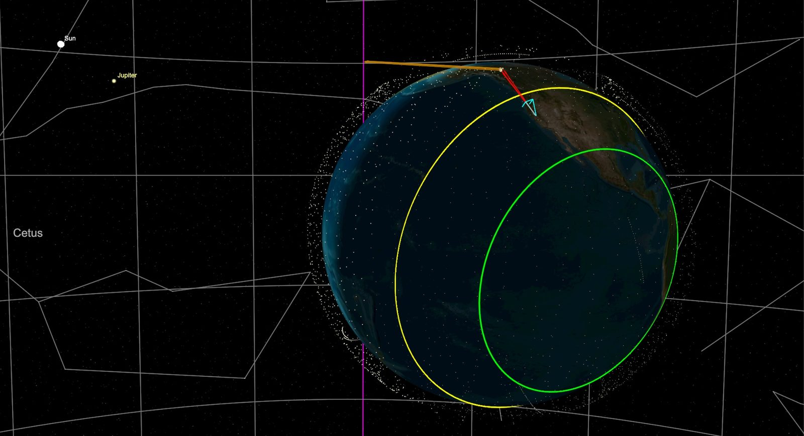
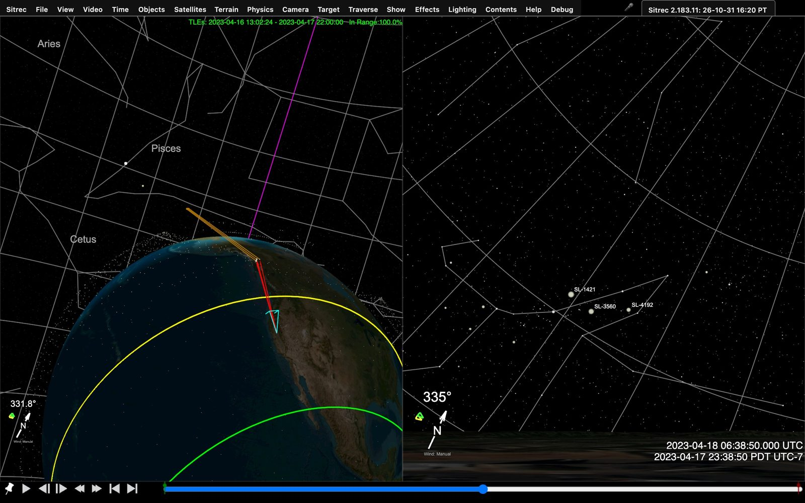
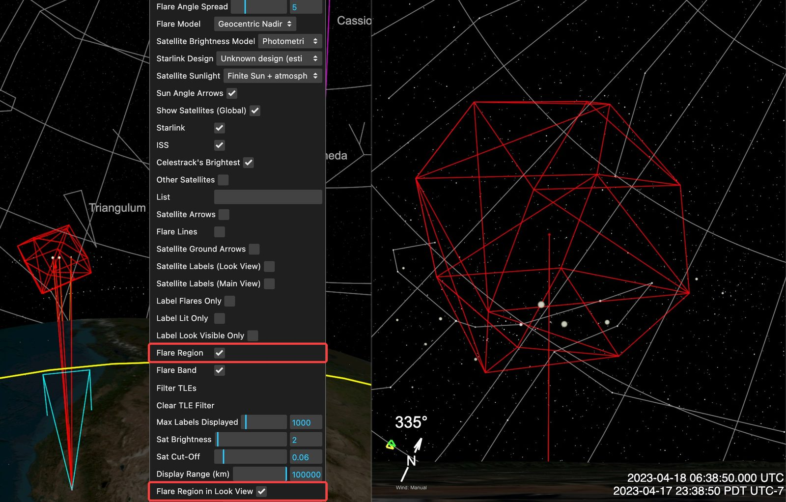
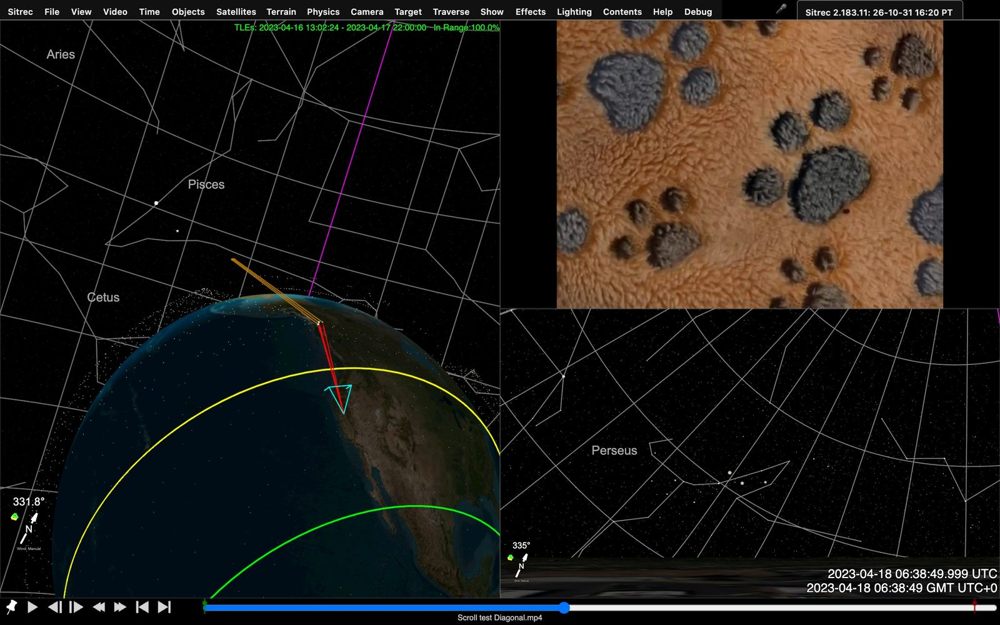

# Investigating Starlink Flares With Sitrec

This page shows how to recreate a Starlink horizon flare in Sitrec. The steps under [Recreating a Starlink Situation](#recreating-a-starlink-situation) also apply to other sightings from a fixed place on the ground, apart from the satellite and flare parts.

Starlink satellites form a huge constellation that covers the globe, most of them at altitudes of around 460 to 490 km. As of October 2026, there are over 11,000 of them in orbit. It's possible this will increase to 20,000 over the next few years.

Satellites are visible when it's dark, and the satellite is illuminated by the sun. With Starlink satellites, this happens in one of three ways. 

1 - Launch train overhead passes

The most noticeable sighting. A line of bright dots traverses the sky. These are satellites shortly after launch (in a "train" formation), at lower altitudes, and not aligned to prevent reflections.  

2 - Deployed overhead passes ("typical" satellites)

Like many satellites, Starlink satellites can be seen when close to the observer about an hour or two after sunset or before sunrise. This will be a dim moving dot that may appear or vanish as it emerges from or enters the Earth's shadow. These are not particularly notable, and the small size of Starlink satellites makes them relatively insignificant. 

3 - Deployed Horizon Flares

The antenna on a Starlink satellite is a flat panel aligned horizontally. When the satellite is low in the sky, near the horizon, the flat panel can briefly reflect sunlight, appearing as a bright dot that moves in a straight line for a few seconds before fading out.

Sitrec can simulate all three. Horizon flares look very different from the trains or typical satellite passes people are familiar with. Several can appear at once in the same patch of sky, low in the compass direction of the Sun, which is below the horizon at the time. They can be bright, and visible through light pollution and light clouds. Several satellites on crossing paths, each visible for a short time, can look like a smaller number of objects that change direction.

The rest of this page covers horizon flares only. For a train or a typical pass, Steps 1 to 3 still apply, but set the direction from the sighting, not from the flare region.

The following discussion assumes the use of the Metabunk.org installation of Sitrec. URLs and some menu options may differ slightly on other installations. 

## Configuring Sitrec for Starlink

This assumes you are familiar with the basic UI in Sitrec, as described here: 
[Sitrec User Interface](UserInterface.md)

A **sitch** (short for *situation*) is one Sitrec scene: a place, a span of time, and the camera, tracks, objects and video that recreate an event. You can save and share a sitch, but it is a sitch before you save it.

The default Sitrec needs a few additional configurations to effectively recreate a Starlink sighting. For convenience, these are gathered in a default sitch at:

<https://www.metabunk.org/sitrec/?sitch=starlink>

The Starlink sitch is a custom sitch with the Starlink setup preloaded, so everything in [Getting Started](CustomSitchTool.md) applies.

You can also get to this from the default Sitrec by going to the Sitrec menu and clicking on "Starlink Horizon Flares (LIVE)", or you can enable the various options if you find you need Starlink analysis in an existing sitch. 

This does the following for you:

- Enables "Live Mode" **(Time Menu)**, which locks the time to your computer clock until you change it. This will show you flares as they are happening, and can be used on a mobile device in AR mode. 
- Loads the current satellites from CelesTrak's supplemental Starlink feed. **(Satellites Menu)**
- Turns on constellation lines and the horizon compass to aid with orienting where you are looking in the sky. The equatorial grid is available under **Sky guides** or **Show → Celestial**.
- Enables "Sun Angle Arrows" and "Flare Band", two vital tools for recreating flare situations. **(Satellites Menu)**

### Starlink Viewing Controls

The Starlink scene opens with a large sky view and a small globe overview. The viewing controls are available in every custom sitch, including older saves, and start invisible. Enable **View → Starlink Viewing Controls** to show them. Turning that checkbox off hides the panel, its launcher, and its sky readouts.

The panel's open/closed state is separate: **‹** collapses it to **Starlink controls**, and that button expands it again. The View checkbox remembers this state when hiding and showing the controls; both settings are saved with the sitch. On narrow screens the panel initially opens collapsed. Ordinary custom scenes keep their view layout until you select **Sky + overview** or **Split views**.

- **Observer location:** search for a place or paste coordinates, or edit latitude, longitude, and height directly. Panel heights are in meters; select above ground or above sea level explicitly.
- **Time & playback:** **Live now** follows the current clock. **Pause** freezes it. Enter a viewing date and press **Set**, step backward or forward by one minute, or choose a playback speed. **UTC** uses UTC; **Local** uses the zone selected in the Time menu, with its name shown above the date field.
- **Satellites:** search by name or exact NORAD catalog number. The search narrows the checked categories; clearing it restores them. **Other loaded** shows other satellites already in the loaded catalog, and does not download another catalog. Enable **Magnitude limit** to show only satellites whose estimated magnitude is at or brighter than the threshold. Lower numbers mean brighter objects.
- **Look direction:** edit azimuth, elevation, and vertical field of view, or drag the sky and scroll to zoom. **Look toward flare band** makes a one-time turn toward the Sun's azimuth, 10 degrees above the horizon. It does not establish that flares are visible at that place and time.
- **Sky guides** exposes constellation lines, star names, the grid, the horizon compass, and flare guides. **Orbit data** shows the loaded epoch range and provides current Starlink and dated LEO downloads. When investigating an old sighting, load orbit data near its date.

The sky readout counts modeled satellite points inside the view after filtering and Earth-horizon checks. Terrain, daylight, and observing conditions can still make these points invisible to an observer. The normal menus remain available, and their settings stay synchronized with the panel.

### Flare Band and Sun Angle Arrows

The Flare Band is the region of the globe from which you can see horizon flares at any given time. It's surprisingly large. In Sitrec, it's denoted as the region between a smaller green circle and a larger yellow circle. These are fixed guides: they do not change with the satellites you load. The band covers about 16% of the globe at all times.

Above, we see the Earth, with a thin layer of Starlink satellites. The pictures on this page use Starlink data from April 2023, so they show fewer satellites than the current set. On the left, we see the Sun, 93 million miles away, so the rays of sunlight are nearly parallel. The Sun is the white dot with the label, and Jupiter is close to it at this time. These labels are off by default: they come from Star/Planet Names in Main, Planets Only in Main and Name Filter, in Show → Celestial. The magenta line is part of the equatorial grid, at right ascension zero. The center of the two circles that outline the flare band is the point on Earth that is directly opposite the sun. You can see that the yellow circle is parallel to the Earth's terminator (the line between day and night that divides the globe in two)

The light blue triangle is the view frustum, a pyramid that shows what direction the "look" camera is looking in, and the field of view. In this image, we see red lines from the camera position (at the apex of the frustum) to some nearby satellites, and orange lines from those satellites towards the sun. Sunlight reflects off the bottom of the satellites along this path. These are the Starlink satellites that are currently flaring when viewed from that camera position. At this scale the lines run so close together that they look like one red line and one orange line. The next picture shows the lines and the frustum from nearer. The orange lines have a fixed length, so they stop before they reach the Sun. In this view, they end at the magenta line by chance.

Above,  we see the view from the look camera on the right. Three satellites are flaring. Each has a name label because Satellite Labels (Look View) and Label Flares Only are checked. Pressing the play button (or pressing the space bar) will show them slowly moving. Scrubbing the timeline will let you see the motion faster.

## Understanding Starlink Frequency and Location

To get a good sense of when and where (and how often) Starlink Horizon Flares happen, I recommend you play with the default setup.  Open the Time menu and drag the "Month" slider to see how the position of the flare band varies through the year with the seasons (due to the tilt of the Earth's axis).

While doing this, you can move the look camera around by holding down "C" while moving the mouse. You can also adjust the camera altitude in the Camera menu. 

You will notice that since the sunward edge is always the same distance from the terminator, in northern summer, the flare band is much further south in the middle of the night.  You can visualise this by noting that the north pole is in constant daylight in summer. The flare band has a minimum distance it needs to be away from daylight, so the sunny north pole can be thought of as pushing the flare band south.

Then, at different times of the year, experiment with moving the "Minute" slider. Note that around the equinoxes (March and September), there exist regions that are in the flare region all through the middle of the night, some for five hours or more.

This differs significantly from typical satellite views, which occur an hour or so after sunset, much closer to the terminator. Horizon flares can appear in the middle of the night, when you will not see typical satellites.

To predict the times and sky directions of horizon flares for a place or along a flight, use Sitrec → Extra Tools → Starlink Flare Predictor. Its "Open in Sitrec" button loads the prediction into Sitrec.

## Recreating a Starlink Situation

Like any sitch, you need the DTLDs:  the Date, Time, Location, and Direction. Often one or more of these will be missing, and you'll have to experiment a bit to find the others. Sometimes these are eyewitness accounts, but we often have a video. We can break down the process into a few simple steps. 

### Step 1 - Set the date (and time)

Open the Time menu and set the Year, Month, Day, Hour, Minute and Second. Drag a slider, or type a value in its box. Any change turns off Live Mode.

Time in Sitrec is UTC (also called Zulu time). But it can also be displayed in a local time zone. If you have "Use Time Zone in UI" checked, the sliders use the zone in the "Time Zone" control. This starts as the time zone of your browser, not of the sighting, so set it to match the sighting before you set the time. When the camera is at the sighting location, **Set Time Zone from Camera Location** in the Time menu does this. Ensure you understand what the actual time is, and in what time zone (including daylight saving time).

### Step 2 - Load the satellites

The Starlink sitch will load the **current** satellites, but often we are investigating a past event. If it's more than a day or two, set the date first, then click "Load LEO Satellites For Date" in the Satellites menu. The button uses the sitch date. For an event in the last five days, see "Wait a few days" below.

Note the text in the top right of the main view. It shows the date range of the loaded TLEs (two-line element sets, the orbital data), then In Range, the percentage of the shown satellites that Sitrec can place at the current time. Check that the date range is close to the time of the event. In Range does not measure accuracy: a set several days from the event can still show In Range:100.0%. If the text is red (In Range below 95%), the data is far from the current time, so load the satellites for the date.

You can also drag in your own satellite data file.

#### Wait a few days before analysing a very recent event

Orbital data is not published the instant it applies. Space-Track works out where a
satellite was and releases that a while afterwards, so a very recent set is incomplete.
For this reason, "Load LEO Satellites For Date" never asks for a very recent set. Each
set covers two days:

| Age of the event | Set that Sitrec asks for        | Where the set ends                                 |
| ---------------- | ------------------------------- | -------------------------------------------------- |
| Less than 5 days | Starts 6 days before today      | 4 days before today, which can be before the event |
| 5 days or more   | Starts the day before the event | The end of the day of the event (UTC)              |

For a flare investigation this matters. If the set ends before the event, the positions
are calculated forward from older elements, and a satellite launched after the set ends
is not in it. For an event in the last day or two, the **current** satellites that the
Starlink sitch loads are closer to the event than this set. Compare the dates in the top
right of the main view with the time of the event. When the event is more than five days
old, load the date again.

#### Reopening a saved sitch

Saving a sitch stores a copy of the satellite data with it, so it always reopens showing
exactly what you saw. A sitch saved by an older version of Sitrec can hold a partly-filled
set, because older versions could ask for a very recent date.

When you reopen your own sitch, Sitrec checks for this and offers to fetch the rest. It
**adds** the missing satellites to what is already there rather than replacing anything,
so any data you combined yourself is kept. Nothing changes on the server until you choose
to save: you can look over the result first, and the sitch as you originally saved it
still opens exactly as it did before.

This does not change a complete set that ends before the event. To use a newer set, load
the date again and save.

### Step 3 - Set the camera location

The location will either be a fixed location (on the ground), or a moving location (usually in the air). 

If you don't know the exact location, just use the best guess. For a fixed location you can just move the camera with the "C" key, or enter a specific Lat/Lon in the camera menu (Tip: if you have a lat, lon pair, you can paste them both in the Lat box and the Lon will also be updated.)

You can look up a city or street address using the "Lookup" option in the Camera menu. 

The camera's altitude defaults to 6m (about 20 feet) [above ground level (AGL)](GIS.md#three-kinds-of-height), with the "Above Ground Level" box checked, to clear the inaccurate terrain. You might want to raise this a bit or lower it to eye level as you refine things. Hold Shift as well as "C" to move the camera and set it to eye level, which in Sitrec is 7 ft (about 2.1 m) above the ground. If you're recreating an aerial sighting without a track file (ADS-B, the position signal an aircraft broadcasts, or MISB FMV, video with embedded position metadata), then you should uncheck Above Ground Level, and set the altitude to whatever was reported, or a typical 30,000 feet if unknown (less for small planes)

If the camera is on a plane, then you can drag in the track (see [Loading and Filtering Tracks](Tracks.md)). The camera will automatically be set to follow that track if you've not edited anything yet. But you'll usually want to set the time first. So drag it in, then under the Camera menu, select the track from the "Position" drop-down (in the Location sub-folder).

If the camera is off in space, that means you've got the date/time very wrong. You can go to the Time menu and then Sync Time to (select track) to sync to the start time of the track to figure out what went wrong.  

### Step 4 - Set the Direction

You can move the camera direction in the look view by dragging it. Use the mouse wheel to zoom in and out (or the "VFOV (deg)" slider in the Camera → FOV (Zoom) sub-folder).

Set the direction from the evidence first: landmarks in the video, recognizable stars, or a witness report. Then compare it with the region of the sky where flares occur. To show that region, turn on "Flare Region" in the Satellites menu. Sitrec marks it with a red wire sphere (the region is drawn for a 550 km shell; see [Flare Region](Satellites.md#arrows-lines-and-labels)). To see it in the look view as well, also turn on "Flare Region in Look View". The region is valid only when the camera is inside the Flare Band. Outside the band, Sitrec still draws it, but no reflection need be close to it.

If you have no direction to start from, set "Camera Heading" to "Horizon Flare Region" (Camera menu, Heading sub-folder). The camera then points at the Sun's azimuth (its compass direction), 9 degrees above the horizon, and follows the Sun as time changes. In this mode, a drag in the look view does not move the camera, and Pan (Az), Tilt (El) and Relative Heading are disabled. To adjust the direction, set "Camera Heading" back to "Manual". The camera keeps its direction, and stops following the Sun.

Above, red boxes mark the two rows. The menu sits over the main view on the left, and the look view is on the right. Two red lines belong to the region: one runs from the camera to the center of the sphere, and one runs from that center towards the Sun. In the look view, the first line points straight away from the camera, so you see only the second. The other long red lines and the orange lines in the main view are the Sun Angle Arrows for the flaring satellites.

You can also scrub the time with the "Second" slider, and you'll see the satellites flaring.

If you are on a plane, it works the same. But you can also check "Relative Heading" in the Camera menu (Heading sub-folder) if you want to simulate looking in a particular direction relative to the plane (e.g., if the plane is turning, and you want to look forward)

If dealing with FMV video, you can use the recorded camera direction with the "Camera Heading" selector in the Camera menu (in the Heading sub-folder). 

### Step 5 - Add Video

To add a video (or a photo) just drag it in. The viewports will reconfigure to the appropriate layout and orientation. Or you can adjust this with the 1-8 keys, or View → View Preset.

Above, the video is at the top right, directly above the look view, so you can compare the two. The video here is a test clip of a fabric texture, not a sighting. This shows the layout only.

### Step 6 - Refine the DTLDs

You will often be missing the exact time, location, direction, and field of view, so you will have to adjust one or more of these to match. Even if you have the time down to the second, you may need to adjust the millisecond (ms) value to get things perfectly aligned. 

Record which values you know and which you adjusted. Each adjusted value gives more ways for a satellite to line up by chance, so compare the whole video: the number of dots, their direction and speed, and when each one appears and fades.

A helpful tool is the video overlay, in the View menu as "Vid Overlay Trans %". This allows you to overlay the video on the live view. 

You can often use stars to line things up. Be aware that this might not be a perfect match if the original video was cropped or the lens introduces distortion. 

The field of view always needs adjusting. If this is zoomed in a lot, type the value in the VFOV (deg) box, or use the mouse wheel in the look view.

To help find the time, if stars are visible, then use their orientation and how far they are above the horizon. 

If there's another plane in the view, then it's very helpful to drop in the track for that plane. To get nav lights, open the folder for that track in the Objects menu, set "Model or Geometry" to "model", and set "Model" to "737 MAX 8 BA". Note that there might be minor discrepancies between the plane position and the satellite position. The plane position is generally more accurate as it's recorded, whereas the satellite positions are calculated.

### Step 7 - Adjust Visuals

Satellite and star visibility vary with lighting conditions, the weather, and the camera used. To match it, you can adjust the star brightness (View Menu) and limits (a cut-off for dim stars). For satellites, use Sat Brightness and Sat Cut-Off in the Satellites menu. Adjust these to get a good visual match with the video. They change the display only: a brightness that you set this way is not a measurement.

You can also adjust the video itself under Video → Video Adjustments, mostly just for brightness in this case, but some of the other options (like the emboss convolution filter) can be helpful in spotting stars and satellites.

Star names can be turned on with Show → Celestial → Labels → Star/Planet Names in Look and Star/Planet Names in Main. Satellite names can be toggled with Satellite Labels (Look View) and Satellite Labels (Main View) in the Satellites menu. Note that only the nearest satellites are labeled; raise the "Max Labels Displayed" slider in the Satellites menu to show more.

To display _just_ the flaring satellite labels, turn on one of these, then check "Label Flares Only" in the Satellites menu. To see the name and catalog number of a satellite, right-click it in a 3D view. See [The Satellites Menu](Satellites.md).
