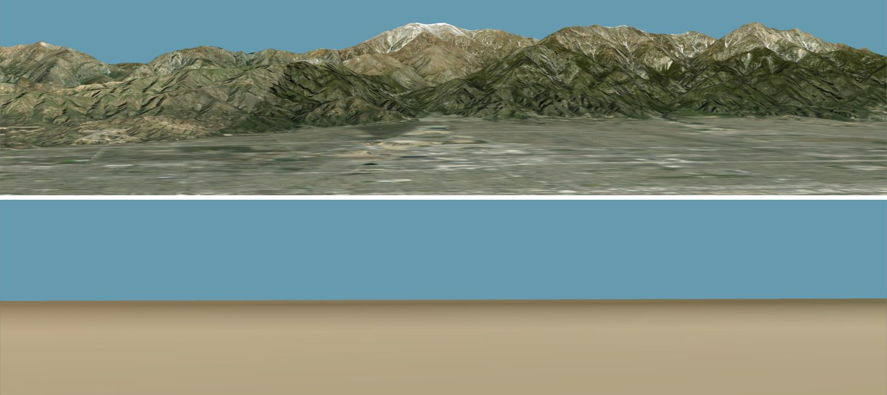

# Terrain and Elevation

**Terrain menu**

The terrain is not just scenery. Every ground-relative number Sitrec prints — an altitude
[above ground level (AGL)](GIS.md#three-kinds-of-height), a "does this line of sight clear the
ridge" answer (a geometric answer: with refraction on, the look view can show a target above a
ridge that the straight line meets; see
[What is not refracted](Refraction.md#what-is-not-refracted)), a terrain
traverse — comes from it. This document covers what the controls do and, more importantly, **which surface a given number
actually came from**, because there is more than one and they disagree.

---

## Two dropdowns that are easy to confuse

| Control | What it changes |
|---|---|
| **Map Type** | The *imagery* painted onto the ground. It does not change elevation queries |
| **Elevation Type** | The *shape* of the ground — the digital elevation model (DEM). This drives every measurement |

Changing Map Type changes what you see. Changing Elevation Type changes your results.

### Map Type

The available list depends on the installation's configuration. A typical Metabunk install
offers ESRI World Imagery (the default), ESRI World Hillshade, World Topo Map and Shaded Relief;
MapBox; Open Streetmap; MapTiler; EOX; USGS Topographic, Imagery and Shaded Relief; the Naval
Research Laboratory WMS layers; Black Marble city lights; and daily MODIS and VIIRS true-color
mosaics. A few built-in types are always present as well: Blue Marble (No Clouds), Wireframe,
Flat Shading, Ocean Surface, Elevation Pseudo-Color and some debug views.

The daily mosaics are useful for a specific reason: they let you see roughly what the ground
cover actually looked like on the date of the event — snow, flooding, fires. A tile takes the
sitch date at the moment it loads. If you change the date afterwards, press **Refresh**. Other
imagery and the 3D building tiles are not from the date of your video, so buildings, trees and
roads may differ from what the camera saw.

Map Type does limit the drawn ground. The terrain mesh refines only to the map's maximum zoom, so
Blue Marble and the daily mosaics draw peaks lower than the elevation data. Elevation queries do
not change, but a point picked in a view lands on the drawn ground, so a pick does change.

The same camera and the same **AWS Terrarium** elevation, looking north at the San Gabriel Mountains in California. Top: **ESRI World Imagery**. Bottom: **Blue Marble (No Clouds)**. The range is missing from the drawn ground, but an elevation query at the peak returns the same height in both.

While Google 3D tiles are on, the terrain is hidden and its imagery is not fetched, so Map Type
has no visible effect. Elevation Type still drives the queries.

### Elevation Type

| Source | Native datum | Grid spacing at full zoom |
|---|---|---|
| **AWS Terrarium** (the Metabunk default) | mixed — SRTM (EGM96), 3DEP (NAVD88), GMTED, ETOPO1 | ~3.7 m posts at 40° N |
| **National Map 3DEP GeoTIFF** (US only) | NAVD88 | ~7.3 m posts at 40° N |
| **Flat** | the WGS84 ellipsoid | no relief — the default when a server install configures no elevation source |
| **Local** | as the stored tiles | elevation tiles stored with an offline install, zoom 6 at most (about 2.4 km posts at the equator) |

Two things the numbers do not tell you:

- A post is one elevation sample, and this spacing is the tile grid, not the detail in the data.
  Terrarium's source data is about 10 m over most of the US and about 30 m over most other land,
  so its full-zoom tiles hold interpolated values. Above the maximum zoom, tiles are **upsampled
  from their parent**. Zooming further in gives you a smoother picture, not better data.
- Terrarium is a mosaic. Its vertical datum is not uniform, and Sitrec applies a single EGM96
  correction to all of it. The result is approximate where the source datum is not EGM96.

Vertical accuracy depends on the source data, and that error goes directly into every AGL number.

---

## Which surface did that number come from?

The interface does not show which surface a number came from.

There are **five** surfaces in play:

1. **The WGS84 ellipsoid** — height [above the WGS84 ellipsoid (HAE)](GIS.md#three-kinds-of-height)
   is 0. "Flat" terrain is drawn here, but with Flat
   selected, ground queries still return (2). AGL is then not measured from the drawn surface.
   In Los Angeles the two are about 35 m apart.
2. **The EGM96 geoid** — mean sea level (MSL). The ocean mesh sits here, and every terrain query is
   clamped *up* to it.
3. **The elevation model surface** — the DEM, i.e. `max(DEM, geoid)`.
4. **The rendered 3D-tile surface** — Google Photorealistic geometry, which includes
   **buildings and trees** and is a different surface again. Cesium OSM tiles add buildings
   only, on top of the terrain.
5. **The drawn terrain mesh** — (3) sampled at the mesh vertices. Its detail depends on camera
   distance, the Map Type's maximum zoom and **Tile Segments** (Sitrec → Settings → Performance
   Tweaks). On a peak seen from far away it can sit tens of meters or more below (3).

This table gives the surface behind the numbers you read:

| Number or action | Terrain drawn | Under Google 3D tiles |
|---|---|---|
| Altitude in **Above Ground Level** mode, and the **Traverse Alt (AGL)** readout | (3) | (4) where a usable tile is loaded, otherwise (3) |
| A point picked in a view: the cursor, `C`, `X` | (5) | (4), or (5) where the pick misses the tiles |
| A camera or object on a track, kept above the ground | (3) | (4) where a usable tile is loaded, otherwise (3) |
| **Lock Altitude** with **Height From** set to Ground, and track altitudes imported as AGL | (3) | (3) |
| Traverse analysis: the underground test and the ground contact modes | (3) | (3) |
| The frame-center ground point in a [MISB](Glossary.md) CSV export of a line of sight | (3) | (3) |

Cesium OSM buildings leave the terrain drawn, so the **Terrain drawn** column applies, except over
a building. There, the first row uses a roof within about 40 m of (3), and the second row uses the
building that the pick hits.

To find (4), Sitrec traces a ray straight down through the loaded tile meshes, picks the hit
nearest the elevation-map ground, and **rejects the tile answer entirely if the best hit is
more than 40 m from it**. That gate throws out coarse tiles while they stream in, because those
can sit tens of kilometers off the true surface. The tiles are one draped mesh, so over a
building the only hit is the roof. A roof under about 40 m passes the gate, and the number is
then height above the roof, not the street. A spot measurement over a single city block in
Athens (recorded in the source, `threeExt.js`) had the DEM about 12 m above the tile surface in
most columns and up to 6 m below it in a fifth of them — indicative of the scale of the
disagreement rather than a general figure.

**Things you place on the ground follow the visible surface.** A synthetic building snaps its
base to (4) while the 3D tiles are the rendered ground, and to (3) otherwise. No tile has
streamed in at the moment a saved sitch loads, so the first snap can only reach (3); the base
drops onto the tile surface as soon as the tileset settles, and re-snaps again each time you
toggle the tiles on or off. Measured under the synthetic buildings of an Arizona test site,
(3) sat 1.7-2.3 m **above** (4) — most of a small building's own height, which is why a base
left on the DEM visibly floats.

**The ground under each view's camera is kept fine.** Elsewhere, elevation detail follows what
is on screen, so a hillside the camera looks across is refined and the ground behind it is not.
While Dynamic Subdivision is on, elevation tiles under the camera refine, whatever the camera
looks at, until a tile is about twice as wide as the camera's height above the ground — because
the camera's own AGL height, WASD walking and the C-key eye-level placement are all measured
from it. With Terrarium at 40° N, a camera below about 900 m reaches the finest zoom, and a
camera at 10 km gets at least zoom 11, about 59 m posts. After you move the camera somewhere
new, its height settles onto the fine ground within a few seconds, as those tiles arrive.

**Summary.** Under Google 3D tiles, different parts of the app can give different heights for
the same point. Tip: compare an AGL number with a known reference — a building of known
height, a runway elevation.

---

## The sea

Sitrec's sea is the **geoid**, not HAE = 0. Terrarium encodes negative seafloor elevations
from global bathymetry, and Sitrec discards them: every ground query clamps to
`max(terrain, geoid)`, so over water the ground is sea level and depth is thrown away. The
clamp does not test for water. Dry land below sea level, such as Death Valley, is raised to sea
level too, in the drawn terrain and in every query.

The separate **Ocean Surface (Beta)** mesh renders only when Google 3D tiles are active. It
draws water wherever the terrain is no more than about 2 m above the geoid, so very low land
gets water too.

Note the asymmetry: "Flat" terrain is built at HAE = 0 (the ellipsoid), while the ocean mesh
is built at the geoid. Two surfaces both reasonably called "sea level", separated by the geoid
undulation, the height of the geoid above the ellipsoid. Over continental US land it runs from
about −40 m at the North Carolina coast to about −8 m at Yellowstone; worldwide about −107 m to
+85 m. See [The Fundamental Relationship](GIS.md#the-fundamental-relationship).

---

## The controls

The top level of the Terrain menu holds the main controls. The rest are in the **Terrain
Tweaks** sub-folder, which is closed by default.

**Dynamic Subdivision** is on in the custom sitch. The terrain then covers the whole globe, and
**Latitude**, **Longitude**, **Zoom Level**, **Tiles per Side** and **Zoom to track** are hidden. To see terrain at a place, use
**Go To the above position** in the Camera menu, or press `G` and enter the place. To show the
hidden controls, turn Dynamic Subdivision off in Terrain Tweaks. 3D Buildings must be off first.

The 3D building rows and **Tile Edges** appear only if your account has access to 3D tiles, or
you have added your own Google or Cesium Ion key. An own key shows the rows after a reload, but
3D tiles load only for a logged-in account with access; see
[Adding a key](APIKeys.md#adding-a-key).

| Control | Where | Notes |
|---|---|---|
| **Map Type** / **Elevation Type** | top | See above |
| **Layer** | top | The image layer of the current Map Type. A source with one layer shows only that layer |
| **Latitude** / **Longitude** / **Zoom Level** / **Tiles per Side** | top | Where the terrain square sits and how big it is. A lower Zoom Level covers more ground per tile; Tiles per Side (1–8) sets how many tiles across, so the two together decide the area. Hidden while Dynamic Subdivision is on |
| **Refresh** | top | Re-request the tiles. Use after a network glitch |
| **Zoom to track** | top | Move the terrain to the extents of the selected track over the sitch's frames. Hidden while Dynamic Subdivision is on |
| **3D Buildings** | top | Cesium Ion or Google tiles. Turning this on forces the ellipsoid Earth model, because the tiles are true-ECEF, and forces Dynamic Subdivision on |
| **Buildings Source** | top | Which provider supplies the 3D building tiles. Shown only when both are available |
| **Ocean Surface (Beta)** | top | Sea-level water surface under Google 3D tiles |
| **Debug Grids** | Tweaks | Green = ground texture tiles, blue = elevation tiles. Shows which tiles are loaded |
| **Elevation Scale** | Tweaks | **Changes measurements too — see the warning below** |
| **Terrain Opacity** | Tweaks | Useful for seeing tracks that pass underground. Also fades the 3D tiles |
| **Dynamic Subdivision** | Tweaks | Camera-adaptive tiling for globe-scale viewing. With it off, hold `T` and move the cursor: the terrain square follows it. Cannot be turned off while 3D Buildings is on |
| **Building Edges** | Tweaks | Wireframe edges on the 3D building tiles |
| **Tile Edges** | Tweaks | A magenta outline around each terrain tile, to show tile boundaries |
| **Building Material** / **Building Flat Color** | Tweaks | Photo, Flat or Half-photo shading for the building tiles, and the color used for Flat. Applies to newly loaded tiles |
| **Use Ellipsoid Earth Model** | Tweaks | Sphere (fast, legacy) or the WGS84 ellipsoid. Forced on while 3D Buildings is on. See [GIS Concepts in Sitrec](GIS.md) |
| **Texture Detail** / **Elevation Detail**, **Disable Dynamic Subdivision** | Tweaks | Subdivision multipliers (1 is normal) and a level-of-detail freeze. **Shown only on a local host** (such as localhost or a 192.168.x.x address) — not present on the public site |

Three more sub-folders sit just above Terrain Tweaks:

- **Remove Geometry** (Google 3D tiles only) — **Manual Remove** paints over the tiles to snap
  geometry down to the ground or delete it (**Edit Action**), with **Brush Radius (m)**,
  **Apply Edits** and **Restore Geometry**. The **Automatic Tree Removal** sub-folder
  (**Flatten Trees**, plus its tuning parameters) detects and flattens trees automatically.
- **Paint On Ground** — **Paint Mode** paints a color (**Paint Color**, **Brush Radius (m)**)
  onto the ground imagery and the 3D tiles; **Apply Paint** turns the saved strokes on and off.
  **Clear Paint** discards all strokes. Works with any map type and needs no API key.
- **Street View Pano** — fetch a Google Street View panorama at a location (or at the camera)
  and show it as a background sphere, with heading, elevation and opacity adjustments. Not
  available in serverless builds.

Geometry edits and paint strokes save with the sitch.

**Debug Grids** draws the tile grid over the terrain, with colored marks on the tiles.

Debug Grids over Los Angeles, just after **Refresh**. On the left, the large cells have a magenta mark and no large red mark. Their texture has loaded, and the imagery is sharp. On the right, cells of the same size have a large red mark. Their texture is still loading, so lower-zoom imagery stays on screen and looks blurred. The small marks belong to the small cells. They are yellow and red, and none is magenta: the look view uses the small cells, and the main view does not. The area at the top right is one larger cell. Its texture has loaded, but at a lower zoom, so it looks blurred too.

| Mark | Meaning |
|---|---|
| Green lines | Ground texture tiles, drawn at a height of 10 km |
| Blue lines | Elevation tiles, drawn at a height of 11 km |
| Magenta mark | The tile is in use in the main view |
| Yellow mark | The tile is in use in the look view |
| Red mark | The ground texture of the tile is still loading |
| Blue mark | The elevation data of the tile is still loading |

Each cell is one tile, and a smaller cell is a tile at a higher zoom. A mark sits near the south-west corner of its tile, so with north up it belongs to the cell above and to the right of where the lines cross. A larger tile has a larger mark. The shape of a mark has no meaning. Red and blue marks go when the load ends. A magenta or yellow mark can stay after the view stops using the tile. The lines float above the ground, so they shift against the map when the camera moves. The arrows on the lines and at the corners only show the tile edges.

> ### Elevation Scale is for looking, not measuring
>
> Exaggerating the relief with **Elevation Scale** is a good way to see subtle terrain. But every
> ground query uses the scaled value, not only the drawing. The scale factor is applied to the
> *whole* elevation value, including the geoid correction baked into it, and the sea-level clamp
> is not scaled. With the scale at 2 in Los Angeles, where the geoid is about 35 m below the
> ellipsoid, the land drops about 35 m relative to the sea, and land below about 17.5 m above
> sea level goes flat at the clamp. Shallow water can also stop being flat: at a scale below 1
> where the geoid is below the ellipsoid, or above 1 where it is above. The 3D-tile surface is
> not scaled at all, so the 40 m gate above starts rejecting genuine ground.
>
> **Set it back to 1 and press Refresh before taking any measurement.**

---

## Settings that change elevation without looking like they do

- **Performance Preset** (Sitrec → Settings → Performance Preset) and **Max Details** (Sitrec →
  Settings → Performance Tweaks) cap the maximum elevation zoom. With the standard sources, the
  cap has an effect only on Potato (zoom 10, about 117 m posts at 40° N), or with a Max Details
  below the source's maximum zoom. Switching to Potato for frame rate silently changes every
  ground elevation, every AGL readout and every terrain intersection.

---

## Common problems

| Symptom | Likely cause |
|---|---|
| Object is underground | Check the altitude type first: see [GIS Concepts in Sitrec](GIS.md). Then check Elevation Type, Performance Preset and Elevation Scale, which all move the ground. From far away, the drawn mesh (5) can also differ from the ground the object uses |
| Ground height changed when nothing else did | Performance Preset or Max Details changed the elevation zoom cap |
| AGL disagrees with what you can see | Under 3D tiles, the visible surface includes buildings and trees; the query may have used the bare-earth DEM |
| Terrain never loads | Network — try Refresh; check Debug Grids to see which tiles are missing |
| Terrain went flat and AGL numbers jumped | The elevation service failed and Elevation Type switched to Flat. It does not switch back. Choose the source again |
| Map Type changed to Blue Marble by itself | The map service failed and Sitrec switched to **Blue Marble (No Clouds)**. It asks the service once a minute and goes back to your map when the service answers. If you pick another map first, it stays on that map |
| Low coastal land is flat, or shallow water is not flat | Elevation Scale was changed. Set it to 1 and press Refresh |

---

## See also

- [GIS Concepts in Sitrec](GIS.md) — datums, and recognising a datum error
- [Atmospheric Refraction](Refraction.md) — why distant terrain renders higher than geometry
- [Custom map, elevation, and water sources](dev/CustomTerrainSources.md) — configuring your own
  elevation and imagery sources
