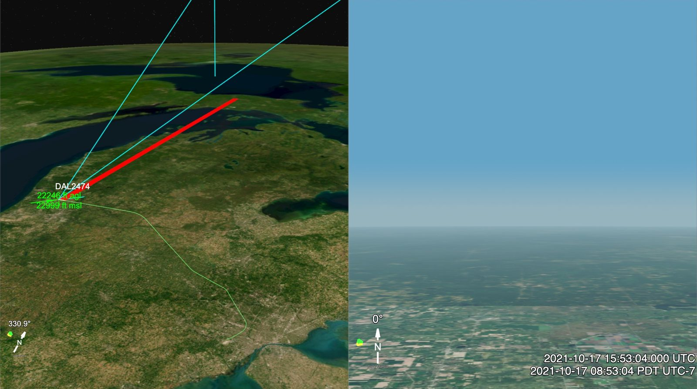
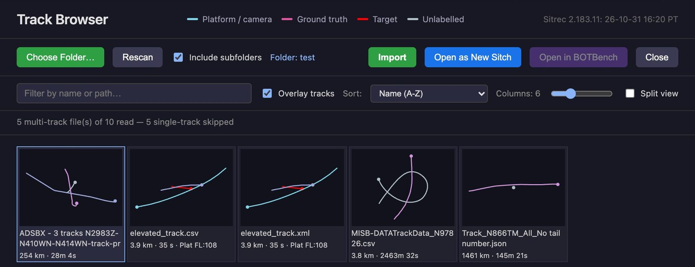
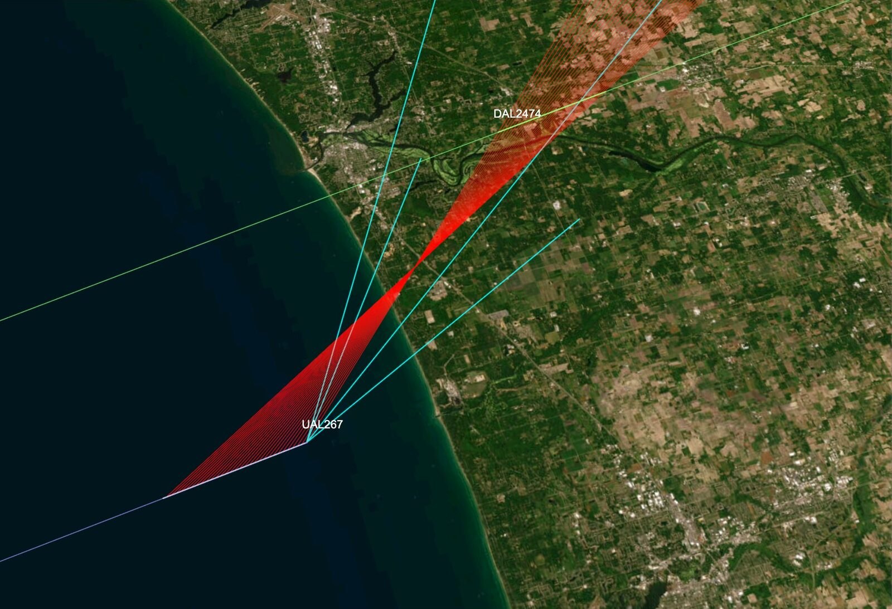
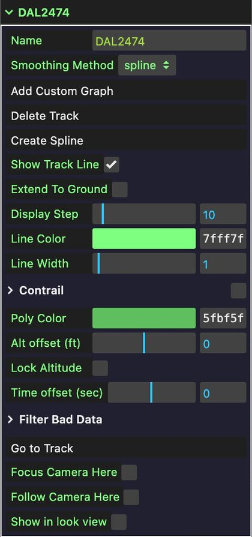
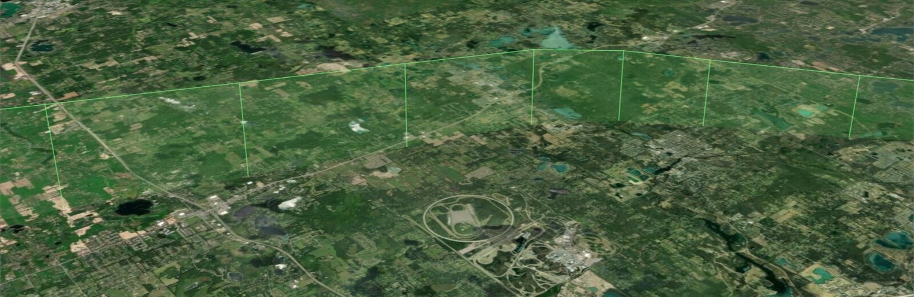
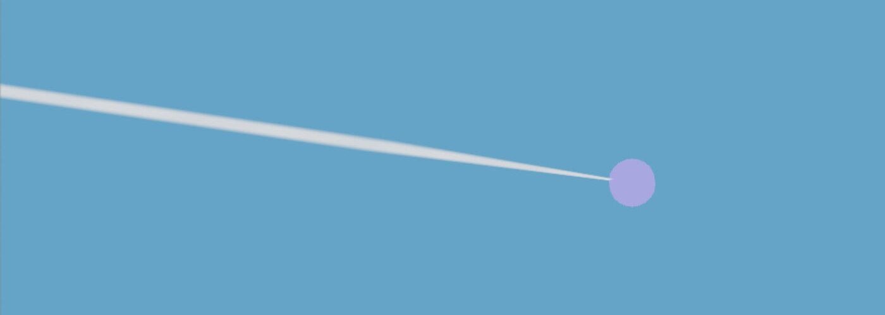
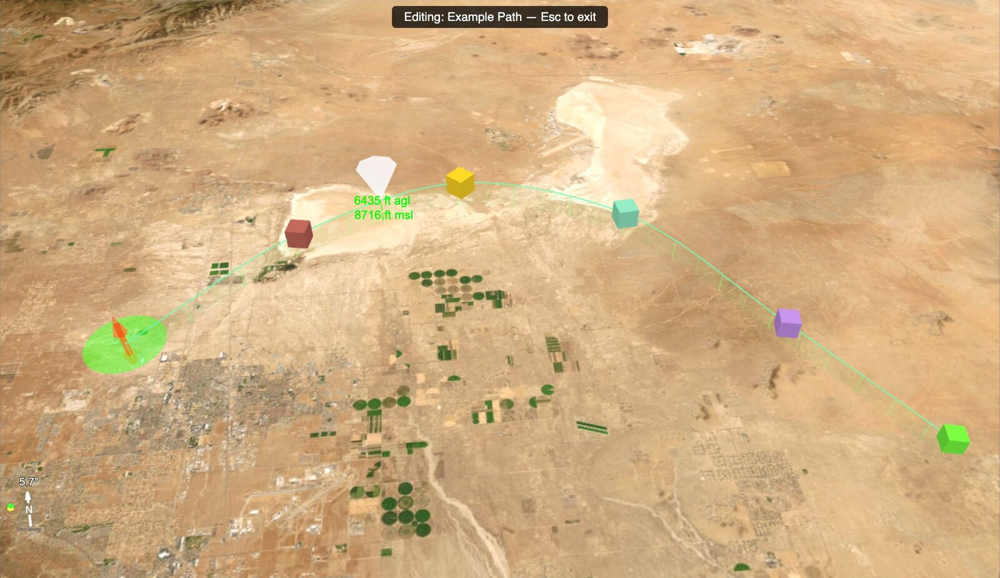

# Loading and Filtering Tracks

Tracks are the core data type in Sitrec. A track is a time-series of 3D positions (latitude, longitude, altitude) that represents the path of an aircraft, drone, satellite, balloon, or other object. Most sitches are built around one or more tracks.

A **sitch** (short for *situation*) is one Sitrec scene: a place, a span of time, and the camera, tracks, objects and video that recreate an event. You can save and share a sitch, but it is a sitch before you save it. The main view shows the scene from a camera that you move. The look view shows what the simulated camera sees, which is the view you compare with a video. See the [Glossary](Glossary.md) for other terms, such as ADS-B, KML and MISB.

This guide covers:
- [Importing tracks](#importing-tracks)
- [Working with multiple tracks](#working-with-multiple-tracks)
- [Track display controls](#track-display-controls), including [hand-drawn tracks](#hand-drawn-tracks)
- [Filtering bad data](#filtering-bad-data)
- [Smoothing and interpolation](#smoothing-and-interpolation)
- [Altitude handling](#altitude-handling)
- [Timing and synchronization](#timing-and-synchronization)
- [Exporting tracks](#exporting-tracks)
- [Live feeds](#live-feeds)
- [Supported track formats](#supported-track-formats), including [MISB track data](#misb-track-data)
- [Other Sitrec data files](#other-sitrec-data-files)

## Importing Tracks

Open Sitrec. **File → New Sitch (Empty)** starts a fresh custom sitch. See [Getting Started with Sitrec](CustomSitchTool.md).

To load a track from a file, drag it in or use **File → Import File**. Sitrec detects the format. See [Supported Track Formats](#supported-track-formats). You can also fetch an aircraft by its hex address ([Import ADS-B Track](#ads-b-trace-by-aircraft-adsblol)), click an aircraft in [Live ADS-B Traffic](#live-ads-b-traffic-adsblol), or draw a track by hand ([Hand-Drawn Tracks](#hand-drawn-tracks)).

### Drag and Drop

Drag a track file from your desktop directly into the Sitrec browser window. This is the quickest method.


*The view after you drag in a track, here DAL2474, with the main view turned so that the altitude text is clear. The main view is on the left and the look view is on the right. The thin green line is the track. The camera is at the label DAL2474, at the start of the track. The cyan lines are the edges of the camera's view. The red band is the lines of sight. The green text is the camera's altitude, from **Show → Measurements**. The short, bright green line to the left of the camera is **Distance: Camera → Traverse**, a default row in the same menu. Its far end is at the default target, which is far away here, so the line slopes down and stops at the ground.*

When you load a track into a new sitch, Sitrec centers the 3D view over the track and sets up a camera that follows it.

### File Menu Import

Use **File → Import File** to open a file picker. This works identically to drag and drop.

### Browsing a Folder of Tracks

**File → File Analysis → Browse Track Folder...** opens the **Track Browser**, for a local folder of multi-track files. Click **Choose Folder…** and Sitrec reads every track file in it (CSV, KML, KMZ, KSV, XML, SRT, JSON, GeoJSON and TXT) without loading anything into the scene. Each file that holds two or more tracks is drawn as a north-up plan view; files with fewer tracks are counted in the status line but not listed.

Each card shows the file's path in the folder, its extent and duration, and **Plat FL**: the mean altitude of the platform (camera) track in hundreds of feet, rounded. Plat FL comes from the track's own altitude, with no pressure correction, so it is not a true flight level. It appears only for a file that says which track is the camera. Turn on **Split view** to show a larger preview of the selected file, with the same figures.


*The Track Browser with a folder of 10 files. It lists the 5 multi-track files, and the status line counts the 5 single-track files. The key at the top gives the color of each track role. A track with no role has the **Unlabelled** color, or another color that the key does not list. A dot marks the start of each track. The two `elevated_track` cards show **Plat FL** because those files say which track is the camera.*

- **Include subfolders** (on by default) reads the folders inside the chosen folder too. **Filter by name or path…**, **Sort**, and **Columns** control the grid.
- **Overlay tracks** (on by default) centers each track in the box so their shapes sit on top of each other, still at one shared scale. Turn it off to see the true distance between the tracks.
- Select a file with a click; shift-click, cmd/ctrl-click, or drag a box to select several.
- **Import** adds the selected files to the current sitch, exactly as dragging them in would. Double-click or **Enter** does the same. **Open as New Sitch** opens the file in a fresh custom sitch in a new tab, and **Open in BOTBench** sends the selection to [BOTBench](BOTBench.md).

The menu item appears only in browsers that can pick a folder. To open the Track Browser directly, add `?action=trackbrowser` to the Sitrec address, for example `https://www.metabunk.org/sitrec/?action=trackbrowser`. Sitrec then opens the Track Browser instead of the sitch browser.

### What Happens When a Track Loads

1. Sitrec detects the file format automatically
2. The track data is parsed and converted to an internal representation
3. The 3D view centers over the track
4. A colored track line appears in the scene
5. A folder for the track appears in the **Contents** menu, in the menu bar at the top

If a track's data covers only part of the sitch, what happens on the frames before the first
point and after the last depends on its **Smoothing Method**. With **spline**, the default for the
first track in a file, the object stays at the first or last data point. With any other method,
including **none**, the position is extrapolated in a straight line from the first two or the last
two data points. A recorded fireball track also stays at its first or last data point. To hide the
object on those frames, turn on **Hide Outside Track Data** in the object's folder in the
**Objects** menu.

## Working with Multiple Tracks

### Two-Track Setup (Camera + Target)

A common setup for analyzing a video uses two tracks:

- **First track** = camera platform (the aircraft filming)
- **Second track** = target object (the UAP or other aircraft)

With one track in a new sitch, the camera rides that track. **Camera Heading** is **Manual**, unless the file records the platform's angles, as a MISB file can. Then it is `<name> angles`. To aim the camera, see [The Camera and Target Menus](CameraAndTarget.md). If the track is the aircraft you filmed, not the aircraft you filmed from, select it in **Target → Target Track** and choose another camera position in **Camera → Location → Position**.

To use a second track from another file, select it in **Target → Target Track** and set the **Camera Heading** to **To Target**.

When one file holds two aircraft tracks, Sitrec sets up the pair (see [Camera and Target from One File](#camera-and-target-from-one-file)). It finds the time of closest approach between the two tracks and re-times the sitch so it starts there, moves the main view over the closest approach, and sets the **Camera Heading** to **To Target** so the camera points at the second track. A MISB file with a frame-center track, a STANAG file and a BOT file do not re-time the sitch to a closest approach, because Sitrec does not treat their tracks as separate aircraft.

Sitrec re-times the sitch only when the two tracks overlap in time. If they have no time in common (for example, one track ends before the other starts, or ends at the same moment the other starts), the start time of the sitch does not change and the main view is not moved to a closest approach.



The blue track, UAL267, is the camera. The green track, DAL2474, is the target. Each label shows where that aircraft is on the current frame. The cyan lines are the edges of the camera's view. The red lines are the lines of sight, from the camera through the target. The thick part of each line is the length of the sitch.

### Camera and Target from One File

When the first thing you import into a new sitch is one file with two or more tracks (an ADS-B Exchange KML of an area, for example), and the file does not say which track is the camera, Sitrec asks before it uses the first two tracks as the camera and the target:

- For a file with two tracks, the **Camera and Target** question opens. **Use as camera and target** does what the Two-Track Setup above describes. **Only load the tracks** loads the tracks, but does not change the camera position, the target or the **Camera Heading**. If you close the question, Sitrec uses the tracks as camera and target.
- For a file with three or more tracks, the **Multiple Tracks Detected** dialog has a **Use the first two tracks as camera and target** box. It is on by default. Turn it off to load the tracks without changing the camera position, the target or the **Camera Heading**.

Either way, Sitrec sets the start time from the tracks and moves the main view to them. You can select any track later in **Camera → Location → Position** and **Target → Target Track**. Sitrec does not ask for a file that declares its own camera and target (STANAG, BOT, NITF), for two one-track files that you import one after the other, or when it loads a saved sitch.

Once you have set up the camera, time or position yourself, imported tracks do not change them, even after **Remove All Tracks**.

### Loading a Track and a Video

A video with a recorded date or location sets up the sitch when you load it first. A track that you import after it does not become the camera and does not change the Start Time. The track only joins the camera and target lists. To use it, select it in **Camera → Location → Position** and **Time → Sync Time to**.

If you load the track first, it becomes the camera and sets the Start Time. A video that you load after it keeps both, and sets the length of the sitch to the length of the video. To line the two up, follow [Sync a video to a flight track](TimeAndSync.md#sync-a-video-to-a-flight-track).

### Selecting from Multi-Track Files

When you import a file containing **three or more tracks** (common with ADS-B KML exports covering an area), Sitrec shows a **Multiple Tracks Detected** dialog with four buttons:

- **Load All** loads every track in the file
- **Select...** opens a **Select Tracks** list: each track is shown with its callsign/name and altitude range (in feet), with a checkbox to choose it
- **Filter...** opens the filter panel (see below), then shows the **Select Tracks** list with the tracks that pass the filters already checked
- **Cancel** loads nothing from the file

When the import would use the first two tracks as the camera and the target, the dialog also has a **Use the first two tracks as camera and target** box. See [Camera and Target from One File](#camera-and-target-from-one-file).

### Multi-Track Filter Panel

During a multi-track import, the filter panel narrows down which tracks to load. Later, **Filter Tracks** in the Contents menu opens the same filters and shows or hides the loaded tracks and their objects. Its **Preview** box (on by default) shows the result as you change the filters.

| Filter | Description |
|--------|-------------|
| **Altitude Range (ft)** | Only show tracks with points within the specified altitude range |
| **Crosses Frustum** | Only show tracks with a sampled point inside the look camera's view at the current frame. The point's time does not have to match that frame |
| **Towards Camera** | Only show tracks whose start-to-end movement goes towards the main view camera |
| **Away From Camera** | Only show tracks whose start-to-end movement goes away from the main view camera |

In a sitch that is already set up, these filters read only the data inside the sitch time. On the first import into a new sitch they read the whole track.

The altitudes in the **Select Tracks** list and the **Altitude Range (ft)** filter are above mean sea level. For a track whose altitudes are above ground (a KML `relativeToGround` track, or a CSV with only an AGL column), Sitrec adds the height of the terrain that it has loaded at each point. Where no terrain is loaded, it uses the ellipsoid instead. In the [Track Browser](#browsing-a-folder-of-tracks), such a track shows its height above ground, marked **m AGL**.

### Managing Loaded Tracks

Each loaded track gets its own folder in the **Contents** menu. You can:

- **Show/hide** individual tracks with the **Show Track Line** title checkbox, at the right end of the folder title. Drag over several title checkboxes to set them all
- **Recolor** tracks using the Line Color picker (the folder label color updates to match)
- **Delete** a track with the **Delete Track** button (with confirmation). This removes the track from the sitch; the file you loaded does not change
- **Highlight** a track by hovering over its folder label (the track line turns white temporarily)
- **Center camera** on a track using the **Go to Track** button
- **Create Spline** makes an editable hand-drawn copy of the track, with 10 control points, named `<name>_sp`

### Limiting Tracks to In/Out

An imported track is drawn twice: one line through all of its data points, and a second line over the length of the sitch. **Show → Limit Tracks In/Out** (off by default) draws each track only between the [In and Out frames](Glossary.md), and does not draw the line through all of the data. In and Out are the green and red lines on the timeline. Drag a line to move it, or press `I` or `O` to set it to the current frame. The tracks are drawn again each time you change In or Out. When **Extend To Ground** is on, the wall covers the same part of the track; on an imported track its vertical lines are then at least 20 pixels apart on screen. The setting is saved with the sitch.

## Track Display Controls


*The folder of an imported track, here DAL2474. The **Contrail** and **Filter Bad Data** sub-folders are closed.*

Each track has a folder in the Contents menu. The sections below list its controls. A hand-drawn track has most of the same controls, in groups: see [Hand-Drawn Tracks](#hand-drawn-tracks).

### Name

**Name**, at the top of the folder, is the name shown for the track: the folder title, the track's menus, the camera and target track lists, graphs and measurements. You can change it at any time, and it is saved with the sitch. Renaming changes only what you see. The track's short name (such as `synth_01_d`) stays the same underneath, so choices saved in the sitch, such as which track is the target, keep working.

Every track has its own name. A track you make in Sitrec is named **Track 1**, **Track 2** and so on, and an object is named **Object 1**, **Object 2** and so on. A track made with an object, and that object, get the same number: one more than the highest track or object number in use, so a number can be skipped (with *Track 1*, *Object 1* and *Track 2*, the next pair is *Track 3* and *Object 3*). Each can be renamed on its own. The object's **Name** is at the top of its folder in the Objects menu. An imported track and its sphere share one name, so renaming one renames the other. A track from a KLV stream in a TS file is named by its stream number, its tag 65 (the "local set" number) and its tail number, for example `S1 LS7 AF00371`, or `S0 LS5 Platform` when the stream has no tail number. A track derived from that stream has its kind in place of the tail number, for example `S1 LS7 Frame Center` (where the line of sight through the image center meets the ground) and `S1 LS7 Target Location` (where the platform says the target is). The [Timing Analysis](TimeAndSync.md#tracks) report explains each part. A sitch saved with the older names, such as `Center_AF00371`, keeps them. If you give a track a name that another track has, Sitrec adds `-1` (or the next free number) when you finish typing. A sitch saved with two tracks of one name loads with the later one renamed in the same way.

### Visibility and Appearance

| Control | Description |
|---------|-------------|
| **Show Track Line** | The title checkbox of the track's folder. Show or hide the track line and its wall. The object on the track and the contrail do not change. When it is off, the rows that change only the line are grey: **Line Color**, **Color Mode**, **Line Width**, **Poly Color**, **Extend To Ground**, **Display Step** and **Show in look view**. The other rows still work |
| **Line Color** | Color picker for the track line |
| **Color Mode** | Radiosonde tracks only: color the track by **Temperature**, **Altitude** or **Pressure**, or **Flat (Line Color)** |
| **Line Width** | Width of the track line in pixels (0.5-10) |
| **Poly Color** | Color for the ground extension polygons |
| **Extend To Ground** | Draw semi-transparent vertical walls from the track down to the terrain. On by default for a hand-drawn track. An imported track has a vertical line at each data point. A hand-drawn or balloon track has lines at least 20 pixels apart on screen; finer lines fade in as you zoom in |
| **Display Step** | Frame spacing (1-100). Higher values skip frames for sparser display |
| **Show in look view** | Also draw the track in the look view. Off by default for most tracks. On a hand-drawn track this control is in the **Display** group |
| **Focus Camera Here** | Keep the main camera looking at this track and orbiting around it |
| **Follow Camera Here** | Move the main camera with this track's position and heading (the same as **View → Lock Track**) |


*An imported track with **Extend To Ground** on. The line at the top is the track. The translucent wall goes from the line down to the terrain. Each vertical line is at a data point.*

### Contrails

Contrails simulate the visual appearance of condensation trails behind aircraft, adjusted for wind. These controls are in the track's **Contrail** sub-folder:

| Control | Range | Description |
|---------|-------|-------------|
| **Contrail** (title checkbox) | on/off | Enable contrail ribbon rendering |
| **Contrail Secs** | 2-5000 | Duration of the contrail in seconds |
| **Contrail Width m** | 10-200 | Maximum ribbon width in meters |
| **Contrail Initial Width m** | 0-100 | Width at the exhaust point |
| **Contrail Ramp m** | 0-2000 | Distance over which width ramps up |
| **Contrail Spread m/s** | 0-20 | Rate of outward spread |


*A contrail in the look view. The ribbon is narrowest at the track's sphere. **Contrail Ramp m** is the distance over which it reaches its full width. **Contrail Spread m/s** makes it wider as it gets older.*

### Altitude Adjustments

| Control | Range | Description |
|---------|-------|-------------|
| **Alt offset** | -1000 to +1000 ft (scales with your display units) | Manual altitude adjustment, applied in the source's own datum |
| **Lock Altitude** | on/off | Hold the whole track at one height. When you switch it on, the lock height starts at the track's height at that time (for a hand-drawn track, the height of its first point) |
| **Lock Height** | 0 to 100,000 ft | The height of the lock. Shown only while **Lock Altitude** is on. Shown in your display units; stored in meters |
| **Height From** | Ground / Ellipsoid (HAE) | **Ground**: the height above the ground below. **Ellipsoid (HAE)**: the height above the WGS84 ellipsoid (HAE), *not* above mean sea level (MSL); see [Three Kinds of Height](GIS.md#three-kinds-of-height). The default is **Ground**. Shown only while **Lock Altitude** is on |

> **Dragging a locked hand-drawn track.** When a hand-drawn track has its altitude locked, the
> lock sets the height of all of its control points. Drag a control point's up/down arrows, or the object
> that rides the track, and you change the **Lock Height**: the full track moves up or down
> as one, and no control point is added. A sideways drag keeps the control point at the lock height. The
> lock does not go below 0. Right-click the ground → **Add Moving Object (In→Out)** to make such a
> track: an object on a straight track from the clicked point, with control points at the In and
> Out frames, **Constant Speed** on, and the altitude locked at ground level.

> **With Ellipsoid (HAE), the altitude lock is not MSL.** Locking an object to "10,000 ft" with **Height From**
> set to **Ellipsoid (HAE)** puts it at 10,000 ft above the ellipsoid, which in Los Angeles is about 10,115 ft above
> mean sea level (MSL). Over the contiguous US the geoid is below the ellipsoid everywhere, by about 8 m
> (near Yellowstone) to about 40 m (the North Carolina coast); see
> [GIS Concepts in Sitrec](GIS.md) for the value at your location.

> **What Alt offset changes.** Alt offset adds the same constant to every altitude of the
> track. It changes the track's absolute altitudes, and its height relative to the terrain and
> to other tracks. It does not change altitude differences inside the track or its vertical
> speed. If a track sits underground, [How to tell you have a datum error](GIS.md#how-to-tell-you-have-a-datum-error) lists the usual
> datum mismatches and how each one looks.

### Hand-Drawn Tracks

To make a hand-drawn track, right-click the ground and choose **Add Flight Path** or **Add Moving Object**. See [Adding Objects and Tracks](SceneObjects.md).

A hand-drawn track's folder puts its controls in groups. At the top are **Name**, **Edit Track**,
**Show Object Menu** (when an object rides the track), **Go to Track**, **Focus Camera Here**
and **Follow Camera Here**. Then come three groups: **Path** (Constant Speed, Extrapolate Track,
Curve Type and the altitude controls; open), **Smoothing** (Smoothing Method first, then its
values; closed) and **Display** (the line, wall, contrail and look-view controls; closed). At
the end are **Add Custom Graph**, **Export Spline** and **Delete Track**. When the track has an
object, **Delete Track** asks whether to delete the object too; the object can stay without the
track. Right-click the track line to open the track's menu, titled **Track: *name***.

**Curve Type** sets how a hand-drawn track goes through its control points: **Straight lines**,
**Smooth (chordal)** (round turns), **Smooth (centripetal)** (never makes a
loop or a sharp point between control points) or **Smooth (Catmull-Rom)** (can overshoot or loop where
control points are unevenly spaced). A track needs at least four control points to curve. A track made from
the ground right-click menu stays straight as you add control points, even though **Curve Type** shows
**Smooth (chordal)**. To make it curve, choose another **Curve Type**. To use chordal, then
choose **Smooth (chordal)** again.

Turn on **Edit Track** in the track's folder to edit it. Edit mode is modal: while it is
on, a label at the top of each 3D view names the track, and right-click acts only on that
track. Press **Escape**, or choose **Exit Edit Mode** from either menu, to leave it.


*A hand-drawn track with **Edit Track** on. Each cube is a control point, in a random color. The selected control point has no cube. It has a green disc, which you drag to move the point sideways, and orange arrows, which you drag to move it up or down. When you turn on **Edit Track**, the first control point is selected. Move the pointer over a cube to select it. The white cone marks the track's position at the current frame, and the green text gives its altitude. The faint vertical lines below the track are **Extend To Ground**, which is on by default for a hand-drawn track.*

- **Right-click a control point** to open its menu: **Go to Frame N**, **Delete Point**
  and **Exit Edit Mode**. This is the only way to delete a control point. Opening or dismissing
  the menu leaves the track unchanged. Deletion supports undo, and the last control point
  cannot be deleted.
- **Right-click anywhere else** (the ground, the track line, another track) to open the
  edit menu. When the playhead is not on a control point, it offers **Add Point Here**
  (at the ground under the pointer) and **Add Point on Track** (on the track's current
  path, which splits the segment without moving it). When the playhead is on a control
  point, it offers **Move Point N Here** instead. All three support undo.

Both menus also have **Show Track Menu**, which opens the track's menu, and **Show Object
Menu** when an object rides the track, which opens the object's menu. You stay in edit mode.
An item is not shown when its menu is already open. The track's menu and the object's menu
can be open at the same time, side by side below the menu bar. Closing the track's menu does
not end edit mode.

Only one of the two right-click menus is on screen at a time. Other tracks and objects do not
open their menus until you exit edit mode.

## Filtering Bad Data

ADS-B and other track data sources sometimes contain **spurious data points** — sudden position jumps caused by, for example, reception errors, multipath interference, or encoding issues. Sitrec includes a g-force filter that detects and removes these bad points.

> **The Bad Data Filter prompt.** The filter treats any point that needs more than *Max G* to
> reach as bad data. When you import a file whose first track has a maximum g above *Max G*, a
> **Bad Data Filter** dialog appears: *"Bad points in track data 'X'. Max g-force: Ng. Enable
> Bad Data Filter?"* Yes turns on **Enable Filter** for that track. Tracks that look like
> rockets (a FlightClub trajectory, a file name with the word "stage" in it, or a maximum
> altitude of 50 km or more) do not get the prompt. Loading a saved sitch never asks; it restores
> the saved filter setting. Filtered points are hidden, not deleted: turn the filter off and
> they come back.
>
> Tip: compare the track with the filter on and off.

### How the G-Force Filter Works

At each point, the filter computes the acceleration in g from the velocity before and after the point, using neighbors at least 0.5 seconds away. A point above **Max G** is flagged as bad data.

Max G is an assumption that you set about the object. It is not a test of what is physically possible. On a target track, real motion above Max G is hidden in the same way as a reception error.

The result depends on the spacing of the points. A single point 50 nautical miles off the path gives about 19,000 g when the points are 1 second apart. The same point gives about 5 g when they are 60 seconds apart, which the default Max G does not flag.

### Filter Controls

Each data track has a **Filter Bad Data** folder with:

| Control | Default | Description |
|---------|---------|-------------|
| **Enable Filter** | off | Turn the g-force filter on or off |
| **Try Altitude First** | on | Before removing a point entirely, try fixing just its altitude by interpolating from neighbors |
| **Max G** | 10.0 | Acceleration threshold in g (0.1-10). Points exceeding this are filtered. 10g allows for sparse curved tracks where computed g can be high |

### What Gets Filtered

- The filter runs **multiple passes**, until no point is above **Max G**
- If "Try Altitude First" is enabled, the filter attempts to **correct** altitude before removing the point entirely

## Smoothing and Interpolation

Track data is often noisy or sparse. Sitrec provides several smoothing methods to clean up track paths:

### Available Methods

The **Smoothing Method** dropdown shows these option keys directly. The default is **spline** for the first track in a file and **none** for the other tracks in the same file (for example, a MISB file's frame-center track). A hand-drawn track defaults to **movingPolyEdge** with a **Smoothing window** of 0, which leaves the track unchanged until you raise the window:

| Method | Description |
|--------|-------------|
| **none** | No smoothing — raw data points |
| **moving** | Rolling moving average |
| **movingPolyEdge** | Moving average, as **moving**, with **Edge Fit Order** and **Edge Fit Window** that you can set |
| **sliding** | Sliding window average |
| **savgol** | Savitzky-Golay polynomial-fitting filter that preserves peaks better than simple averaging |
| **spline** | Catmull-Rom spline. With no associated data track it fits a smooth curve through interpolated control points; when a data track is present it does a chordal Catmull-Rom spline through the actual data points |

### Smoothing Parameters

Only the parameters that the selected method uses are shown. **spline** on a track loaded from a file goes through the data points themselves, so it has no parameters.

| Parameter | Range (default) | Description |
|-----------|-----------------|-------------|
| **Smoothing window** | 0-200 (0) | Rolling window size (larger = smoother) |
| **SavGol Poly Order** | 1-5 (3) | Polynomial degree for Savitzky-Golay |
| **Catmull Intervals** | 2-100 (10) | Number of control points for spline fitting |
| **Edge Fit Order** | 1-5 (2) | Polynomial order used for the edge fit at the ends of the track |
| **Edge Fit Window** | 3-400 (100) | Window size for the edge fit |

### What smoothing costs you

The window methods (**moving**, **movingPolyEdge**, **sliding**, **savgol**) are low-pass filters
on position. They reduce peak acceleration and turn rate, and a wider window reduces them more.
**spline** on a track loaded from a file goes through every data point, so it does not reduce
noise in the data.

The traverse analysis grades candidates on maximum kinematic acceleration, with tier limits
stated in g (see [How the tiles are ranked](TraverseAnalysis.md#how-the-tiles-are-ranked)), so a change of smoothing can move a
candidate across a tier limit.

Smoothing the *camera* track moves the point each line of sight starts from. With **Camera
Heading** set to **To Target** it also changes their directions. Both change every fit computed
from them.

Tip: compare the results with the raw track and the smoothed track.

## Altitude Handling

Track altitudes come in several reference systems. Understanding these is important for accurate 3D reconstruction. See also [GIS Concepts in Sitrec](GIS.md) for a full reference.

### Altitude Types

| Type | Reference | Common Sources |
|------|-----------|---------------|
| **HAE** (Height Above Ellipsoid) | WGS84 ellipsoid | Raw GPS, ADS-B `alt_geom`, STANAG 4676, MISB tags 75/78, Generic CSV `TPHAE` |
| **MSL** (Mean Sea Level) | Geoid (EGM96) | KML `absolute`, MISB Tag 15, most map software |
| **Pressure Altitude** | Standard atmosphere (1013.25 hPa) | ADS-B `alt_baro`, flight instruments |
| **AGL** (Above Ground Level) | Local terrain | A CSV column headed `AGL` or `ALT (m/agl)`, KML `relativeToGround` |

### How Sitrec Handles Altitude

- Internally, Sitrec works in **HAE** (ellipsoid height) for 3D rendering
- Terrain tiles are loaded as **MSL** and converted to HAE using the **EGM96** geoid model
- KML `absolute` altitudes are **MSL** (measured from the EGM96 geoid, per OGC KML 2.2/2.3)
  and are converted to HAE on the way to the 3D scene, on both import and export
- Sitrec reads a KML track altitude as MSL, unless the track's `altitudeMode` makes it relative to
  the ground. A KML that holds pressure altitude is therefore wrong by the pressure error, and
  Sitrec cannot detect this. See [Altitude in the file](KMLDataSources.md#altitude-in-the-file)
- Sources whose altitudes are **already HAE** are flagged so the MSL→HAE conversion is
  skipped: STANAG 4676 (`cs="WGS_84"`), MISB ellipsoid-height tags 75/78 (used
  automatically when the MSL tag 15/25 is absent), the Generic CSV `TPHAE` column, recorded
  fireballs, and an adsb.lol trace that uses geometric altitude
- If a track has only AGL altitude, Sitrec adds the local terrain elevation
- The **Alt offset** slider lets you manually correct a constant altitude error

### Common Altitude Issues

- **Track appears underground**: The altitude reference may not match Sitrec's expectation. Use the table in [How to tell you have a datum error](GIS.md#how-to-tell-you-have-a-datum-error) to find which datum mistake it is before you change anything.
- **Track is too high or too low**: Some ADS-B sources report pressure altitude, which can differ from geometric altitude by hundreds of feet near the ground and up to a few thousand feet at cruise, depending on the weather. The difference changes with altitude, so a constant **Alt offset** does not remove it on a track that climbs or descends. Use a geometric-altitude source if one is available. See [Altitude in the file](KMLDataSources.md#altitude-in-the-file) for the ADS-B Exchange export.
- **Inconsistent altitude between tracks**: Different sources use different references (HAE vs MSL vs pressure). The EGM96 geoid height N (the height of mean sea level above the ellipsoid) is between about −8 m and −40 m over the contiguous US, and between about −107 m and +85 m worldwide.

## Timing and Synchronization

To line a track up with a video, follow [Sync a video to a flight track](TimeAndSync.md#sync-a-video-to-a-flight-track).

### Absolute Timestamps

Most track formats include absolute timestamps (UTC). Sitrec uses these to:

- Determine the sitch time window automatically
- Synchronize multiple tracks on the same timeline
- Sync tracks with a video that has a recorded start time, as phone videos do. See [Time and location in a video file](LoadingVideo.md#time-and-location-in-a-video-file)

### Relative Timestamps

Some formats (frame numbers, seconds from zero) don't have absolute times. For these tracks:

- A **Start Time** field appears in the track's GUI folder
- Enter an ISO datetime (e.g., `2024-03-15T14:30:00Z`) or partial time (e.g., `14:30`) to anchor the track
- Sitrec uses the [chrono-node](https://github.com/wanasit/chrono) library to parse flexible date/time input

### Time Offset

Every track loaded from a file has a **Time offset (sec)** slider (-600 to +600 seconds) in its folder in the Contents menu, for fine-tuning synchronization. A positive value moves the track earlier: each frame shows the position recorded that many seconds later. For a larger difference, change the Start Time (see [Time, Frames and Syncing](TimeAndSync.md)). The slider is useful when:

- Video and track timestamps are slightly out of sync
- Different data sources have clock drift
- You need to manually align events

## Exporting Tracks

Sitrec can export tracks in several formats via the export buttons in **File → Export** (each track gets its own sub-folder there):

### Export Formats

| Format | Contents |
|--------|----------|
| **CSV** (*Per-frame array with frame and time (ms)*) | Frame, Time, Lat, Lon, Alt(m) — simple tabular data. File `sitrecArray-<name>.csv` |
| **KML** (*KML Track Export*) | Google Earth compatible with `<gx:Track>`, timestamps, and altitude mode. File `<sitch>-<name>.kml` |
| **MISB CSV** (*MISB Compliant CSV*) | 12 per-frame MISB columns: time, sensor position, FOV, platform heading/pitch/roll and gimbal angles. Hand-drawn tracks, computed tracks (such as a line-of-sight track) and tracks loaded from a file have it. A line-of-sight track also gets the frame-center columns. File `MISB-<name>.csv` |
| **MISB CSV** (*MISB CSV Export*) | The raw data of a track loaded from a file, one row per source sample, with every MISB column. File `MISB-DATA<name>.csv` |
| **Spline JSON** (*Spline Control Points (JSON)*) | Control points of a hand-drawn track — see [Sitrec Spline](#sitrec-spline-splinejson). Also available as the **Export Spline** button in the track's **Contents** folder |
| **FOV JSON** | Camera zoom keyframes — see [Sitrec Camera FOV](#sitrec-camera-fov-fovjson). Exported with **Camera → FOV (Zoom) → Export for FOV Editor** |

Exported files are downloaded directly to your browser's download folder. The name comes
from the track's internal id (for a track loaded from a file, something like
`Track_N123AB_unsmoothed`), not from its display **Name**. A hand-drawn track uses
its spline name instead (e.g. `MISB-Aguadilla Ground Spline.csv`).

An object in the **Objects** menu that uses a geometry, not a 3D model, has an **Export to KMZ with Track** button. It
writes a KMZ holding the object as a 3D model at its current position and, when the
object rides a track (a track's object, or the traverse object), that track as a
time-stamped `<gx:Track>` sampled once per second of sitch time, drawn in the
object's color. Google Earth plays the path on its time slider, and Sitrec reads the
file back as a track. Seconds at which the track has no position (a constant-altitude
traverse where the line of sight never reaches that altitude) break the line rather
than being joined across.

A hand-drawn track — one made from the ground right-click menu (**Add Moving Object**,
**Add Moving Object (In→Out)** or **Add Flight Path**), dropped in as a
`.spline.json`, or built into a sitch — exports its control points (Spline JSON) and its
per-frame track (CSV, MISB CSV and KML). The per-frame formats export the **smoothed** track, so they
match the line drawn on screen and reflect the track's Smoothing window, altitude offset
and altitude lock. The control points do not carry the altitude offset, which is stored
separately in the file and re-applied on import.

For a track loaded from a file, the per-frame formats export the unsmoothed track (its export
folder ends in `_unsmoothed`), so they do not reflect **Smoothing Method**. They do include Alt
offset and altitude lock.

### Export Altitude Datums

Exports write each format's conventional datum, converting via the EGM96 geoid as needed:

- **KML** exports use `altitudeMode` `absolute`, whose altitudes are **MSL** (EGM96)
  per the KML spec — so exported tracks land at the correct height in Google Earth.
- **CSV** (*Per-frame array*) exports write `Alt(m)` as **HAE** (height above the WGS84
  ellipsoid) for a track computed from 3D positions, which is most tracks. It is not MSL.
- **MISB CSV** exports keep the MISB column conventions: `SensorTrueAltitude` (tag 15)
  and `FrameCenterElevation` (tag 25) are **MSL**. *MISB Compliant CSV* always converts
  to MSL. *MISB CSV Export* (the raw data) handles a track whose source altitudes are
  HAE (e.g. STANAG 4676) differently: it writes them unconverted into the
  **ellipsoid-height columns** (`SensorEllipsoidHeight` / `FrameCenterHeightAboveEllipsoid`,
  tags 75/78) instead — re-importing such a CSV detects the HAE column and preserves the
  datum, so a STANAG → MISB CSV Export → Sitrec round trip is loss-free.

There is no STANAG 4676 exporter (XML or CSV); STANAG-derived tracks export through the
formats above.

## Live Feeds

Live feeds overlay live data on the world. They are not tracks.

### Live ADS-B Traffic (adsb.lol)

**Contents → Live Feeds → Live ADS-B Traffic** shows **the aircraft adsb.lol can currently see** around wherever the main camera is, updated every few seconds. Each aircraft is a small aircraft shape pointing along its course, colored by altitude, with a short trail showing where it has just been:

| Color | Altitude |
|---|---|
| Grey | On the ground, or altitude unknown |
| Red | Below 1,000 ft |
| Orange | 1,000 – 5,000 ft |
| Yellow | 5,000 – 10,000 ft |
| Green | 10,000 – 20,000 ft |
| Cyan | 20,000 – 30,000 ft |
| Violet | Above 30,000 ft |

**Traffic Radius (nm)** sets how far to look, in nautical miles, up to 250. The **Traffic** readout below it says how many aircraft the feed reported, so an empty sky over open ocean can be told apart from a feed that is not working. Sitrec draws at most 512 of them.

Some things worth knowing:

- **It follows the main camera, not the sitch origin.** The search is centered on the point under the main camera, not on the point it looks at. Moving the camera brings up that area's traffic on the next update.
- **It sets the clock to now and pauses playback.** The feed is the live present, so the scene has to be the present too — otherwise the sun, the sky and the traffic would all disagree. Scrubbing the playhead has no meaning while it is on. Switching it off does not restore the old date and time. Note the Start Time first if you use this feed in a sitch that you want to keep.
- **The aircraft are not saved with the sitch.** The layer is a view of the live present. If you save after you use the feed, the sitch keeps the new date and time.
- **It is drawn in the main view only.** The markers are sized for the main view's zoom, so the look view, which shows the recreation, does not draw them. To see one aircraft in the look view, click it to import it as a track.
- **It needs the Sitrec server**, so it is unavailable in the desktop app and other serverless builds.

**Click an aircraft to promote it to a real track.** A single click on any of the aircraft fetches that aircraft's full ~24-hour trace and adds it as an ordinary Sitrec track, with all the usual measurement tools — the same thing **Import ADS-B Track...** does, without needing to know the hex address. The Traffic readout says `importing …` while the trace is fetched, which takes a second or two.

Dragging is unaffected: a press that moves before you release is a camera drag, not a click, so you can still orbit and pan starting from anywhere on screen.

The live layer is for situational awareness; promote an aircraft when you want to analyze it.

Data is ODbL-licensed (Open Database License) by adsb.lol; credit "adsb.lol" when publishing imagery made with it.

### Other Live Feeds

**Contents → Live Feeds** also overlays other live data on the world. Each has its own on/off switch and a count underneath it, so an empty result can be told apart from a feed that is not working — the count reads `loading…` before the first answer, a number once it has one, and says so plainly when the source is unreachable.

| Feed | What | Coverage | Needs a key | Source |
|---|---|---|---|---|
| **Military Aircraft** | Aircraft flagged military or government, as magenta darts | Worldwide | no | adsb.lol (ODbL) |
| **Marine Traffic (AIS)** | Live ship positions, as teal boxes | Worldwide | **yes** — AISStream | aisstream.io |
| **Webcams** | Live webcams near the main camera; click one for its current image | Worldwide | **yes** — Windy | Windy.com |
| **Road Traffic Incidents** | Jams, closures and roadworks near the main camera | Worldwide | **yes** — TomTom | TomTom |
| **Weather Balloons** | Radiosondes currently aloft, with altitude and climb rate | Worldwide | no | SondeHub |
| **Rocket Launches** | The last 40 launches, at their pads | Worldwide | no | Launch Library 2 |
| **Earthquakes** | Magnitude 2.5+ in the last 24 hours, sized by magnitude | Worldwide | no | USGS |

**Three of these need your own API key.** The ship, webcam and road-traffic feeds need a key from their provider (AISStream, Windy, TomTom). Add one under **Sitrec → Settings → API Keys…**. The feed's count line tells you when a key is missing.

Those three talk to their provider **straight from your browser**, so your key never reaches the Sitrec server — the same rule as every other key Sitrec holds (see [Your API Keys](APIKeys.md)). A useful side effect: unlike the keyless feeds, they also work in the desktop app and other serverless builds, because no Sitrec server is involved.

Some notes on reading them:

- **Shape as well as color.** Ships are boxes, balloons spheres and aircraft darts. Webcams and earthquakes are both octahedra, and launches and road incidents are both cones, so those pairs differ only by color.
- **Ships, webcams and road incidents are local.** "Worldwide" in the table means that the provider covers the world. Ships are shown in a box 5° each way around the point under the main camera, set when you switch the feed on. To see another area, move the camera, then switch the feed off and on. Webcams (up to 50 within 250 km) and road incidents (a box 0.5° each way) follow the camera every few minutes.
- **Clicking does something different per feed.** A military aircraft imports its full track, exactly like a civil one. A webcam opens its live image. A launch or earthquake opens its source page. A ship, balloon or road incident shows its details in the count line for ten seconds.
- **Weather balloons are live only.** The feed shows the radiosondes that SondeHub has received in the last hour, each at its latest reported position, with altitude and climb rate. It shows only sondes that the SondeHub network tracks, and it does not show past flights.
- **Earthquakes are drawn at the epicentre**, on the surface. Depth is in the details rather than the position — a quake plotted at its true hypocentre is inside the Earth and invisible.
- **None of it is saved with your sitch.** These are views of the live present, not part of a recreation.
- **They are drawn in the main view only**, like Live ADS-B Traffic; the look view does not show them.
- **The keyless feeds need the Sitrec server**, so they are unavailable in the desktop app and other serverless builds. The three keyed feeds work everywhere.

Credit the source shown in the table when publishing imagery made with one of these feeds.

## Supported Track Formats

Sitrec auto-detects the format of imported files. You don't need to specify the type — just drag and drop.

### ADS-B / Flight Tracking (KML/KMZ)

Export a KML or KMZ file from a flight tracking service, such as the three in [Recognised track sources](KMLDataSources.md#recognised-track-sources-the-common-providers):

- **FlightRadar24** (flightradar24.com)
- **FlightAware** (flightaware.com)
- **ADS-B Exchange** (adsbexchange.com)

KML files can contain **multiple tracks** (e.g., all flights in an area during a time window). When you import a KML with three or more tracks, Sitrec shows a selection dialog so you can choose which tracks to load.

### ADS-B Trace by Aircraft (adsb.lol)

If you know the aircraft's ICAO 24-bit hex address (shown on most flight trackers, e.g. `a1b2c3`), **Contents → Import ADS-B Track...** fetches roughly the **last 24 hours** of its positions directly from [adsb.lol](https://adsb.lol) — no file export needed. The track is named from the aircraft's callsign or registration. You can also drag in a downloaded readsb/tar1090 `trace_full_*.json` file. Geometric (GPS) altitude is used when most of the trace carries it. Otherwise the whole track uses barometric altitude. Data is ODbL-licensed by adsb.lol; credit "adsb.lol" when publishing imagery made with it.

### DJI Drone Data (CSV)

DJI drone flight logs exported from [Airdata](https://airdata.com) in CSV format. These include full IMU (inertial measurement unit) data: position, altitude, heading, pitch, roll, and gimbal orientation.

### DJI Drone Subtitles (SRT)

SRT metadata files extracted from DJI drone video. These contain per-frame position and gimbal angles embedded as video subtitles.

### MISB / KLV (CSV or binary)

MISB ST 0601 metadata (the KLV metadata standard carried in STANAG 4609 motion imagery) from surveillance platforms. Contains sensor position, gimbal angles, field of view, frame center coordinates, and slant range. Can be in CSV form (with MISB column headers) or binary KLV format.

### MISB Track Data

MISB (Motion Imagery Standards Board) tracks contain rich metadata beyond simple position. When a MISB track is loaded, Sitrec can use:

- **Sensor position** (lat, lon, alt) — where the camera is
- **Platform attitude** (heading, pitch, roll) — orientation of the aircraft
- **Gimbal angles** (azimuth, elevation, roll) — where the camera is pointing relative to the aircraft
- **Field of view** (vertical) — zoom level of the camera
- **Frame center** (lat, lon, elevation) — where the camera footprint hits the ground

Sitrec uses this data to build the camera frustum (the pyramid-shaped field of view) and project it onto the terrain. The result is as accurate as the metadata.

For a detailed walkthrough of importing MISB data, see the [Getting Started](CustomSitchTool.md) guide.

### STANAG 4676

NATO track exchange format, accepted as **XML** (the standard's own container) and as a
flattened **CSV** export of the same data — both load identically. The track point's
`dynamics/pos` is the standard's authoritative estimate of the tracked object and
imports as the **primary track**,
labelled **(Target)**. Files produced by GXP InMotion also carry two proprietary
positions per point — the endpoints of the sensor's line of sight through the tracked
pixel — which import as supplementary reference tracks: **(Platform)** (`posHigh`, the
sensor end of the ray — its altitude varies per frame like an aircraft track) and
**(Ground)** (`posLow`, the ray's ground intersection). On a direct load these
auto-select the **camera** track (Platform) and the **target** track (Target); Ground is
a reference track with no role. (The three positions are collinear, so the camera at
Platform points identically whether it aims at Target or Ground.) When the tracker
ground-locks the target, `dynamics/pos` coincides with `posLow` and the duplicate is
dropped automatically, so such files yield two tracks instead of three (the surviving
Target track is on the ground in that case).

If a camera track with line-of-sight data is already loaded when you drop a STANAG file,
a **Load STANAG Track** dialog asks what to load: **Target track only** (the **(Platform)** and
**(Ground)** tracks repeat the loaded camera's line of sight) or **Load all tracks**. Closing
the dialog loads all tracks.

The **CSV** flavour carries one row per track point, with the three positions in parallel
column families:

| Columns | Meaning |
|---------|---------|
| `UTC0` | file base time, epoch milliseconds (constant on every row) |
| `UTC` / `t` | epoch milliseconds for this point / its time in seconds relative to `UTC0` |
| `FRM` | source video frame number (not used — the pipeline is time-based) |
| `TPLAT`, `TPLON`, `TPHAE` | the tracked object — XML `dynamics/pos` → **(Target)** |
| `SLAT`, `SLON`, `SHAE` | the sensor end of the ray — XML `posHigh` → **(Platform)** |
| `GLAT`, `GLON`, `HAE` | the ground intersection — XML `posLow` → **(Ground)** |

Header matching is case-insensitive and order-independent, and extra columns are ignored.
Detection requires the `TP*` family plus at least one of the `S*`/`G*` families, so a CSV
carrying only a target position keeps loading as a [generic CSV](#generic-csv). A missing
`UTC` column falls back to `UTC0` + `t`.

STANAG heights are WGS-84 ellipsoidal (HAE) — declared in XML by the `<dynamics cs="...">`
attribute, and stated outright by the CSV's `HAE`/`SHAE`/`TPHAE` column names. Sitrec
reads this and skips the MSL→HAE geoid conversion that other (MSL) sources get — without
this the track would be off by N metres, where N is the local EGM96 geoid undulation. In
Colorado N ≈ −19 m, which puts the track 19 m too low. Note the **(Ground)** point is the
*producer's* line-of-sight/DEM intersection: it can sit a few metres above or below
Sitrec's terrain wherever the two elevation models disagree, which is normal.

### ASTERIX radar (PCAP)

EUROCONTROL ASTERIX surveillance data (CAT-048 and CAT-062) captured as network packets — `.pcap` or `.pcapng` files (and raw ASTERIX byte streams). A single capture typically contains many aircraft, so it is imported as a multi-aircraft file: Sitrec extracts one track per detected target.

CAT-048 gives each target as a range and bearing from the radar, and the data does not say where the radar is. Sitrec holds one radar site, near Zagreb, Croatia, and it plots every CAT-048 capture as if the radar were there. A capture from any other radar is therefore in the wrong place. Altitude comes from the reported flight level, treated as MSL.

CAT-062 gives latitude and longitude, so it does not have this limit. Sitrec does not decode its altitude field, so every CAT-062 point is at altitude 0.

### Generic CSV

A flexible format for **position tracks**, with auto-detected columns. Header names are matched case-insensitively, and most fields accept several aliases:

| Data | Recognized column headers |
|------|---------------------------|
| **Time** (required) | `DATETIMEUTC`, `DATETIME_UTC`, `DATE_TIME_UTC`, `DATETIME UTC`, `UTC`, `DATETIME`, `DATE_TIME`, `TIMESTAMP`, `TIME`, `DATE`, `DTG`, `DT`, or `FRAME` (a frame number) |
| **Latitude / Longitude** | `LAT` / `LATITUDE` / `TPLAT` / `LATITUDEDEGS`, and `LON` / `LONG` / `LONGITUDE` / `TPLON` / `LONGITUDEDEGS` |
| **Grid** (instead of lat/lon) | `MGRS` / `GRID` / `GRIDREF` / `GRID_REF` (military grid), or `REGGRID` / `REG_GRID` (Maidenhead / ham-radio locators). An optional `GRID56` / `GRID_56` column adds extra locator characters; it is not enough on its own |
| **Altitude** | `ALTITUDE` / `ALT` / `ALTITUDE (m)*` (the `*` is part of the header) / `TPHAE` / `alt_m` (metres), `ALTITUDE (FT)` / `ALT (FT)` / `ALTITUDE(FT)` / `ALT(FT)` (feet), `ALTITUDEKM` (km), or `AGL` / `ALT (m/agl)` (above ground level) |
| **Identification** | `AIRCRAFT` / `AIRCRAFTSPECIFICTYPE`, `CALLSIGN` / `TAILNUMBER` / `BALLOON_CALLSIGN` |
| **Multiple tracks** | `TRACK_ID` / `THRESHERID` / `STAGENUMBER` (one track per distinct ID) |
| **Speed** | `SPEED_KTS` (knots; stored as airspeed) |

A generic CSV needs, at minimum, a **time** column plus either **lat + lon** or a **grid** column. Altitude defaults to ground/sea level if absent. If a file has more than one altitude column, `ALTITUDEKM` is used first, then the feet columns, then the metre columns.

One exception: if the first three headers are `Frame`, `Latitude` and `Longitude`, in that order, Sitrec reads a column whose header starts with `Alt` as **feet**, and ignores track-ID, callsign and speed columns. To give metres in a frame-numbered file, use `Lat` and `Lon` as the headers.

**Multiple tracks in one CSV**: if a track-ID column is present, Sitrec splits the data into separate tracks by ID.

**Time formats**: Sitrec auto-detects ISO dates, Unix epoch (seconds, milliseconds, or microseconds), relative seconds, and `FRAME` numbers (converted to time using the sitch's fps). A plain-number time column is read as relative seconds only when its first value is less than 1 (for example, a column that starts at `0`); otherwise it is read as an epoch time.

**Grid coordinates**: both MGRS and Maidenhead (ham radio) grid locators are accepted in place of lat/lon.

> A generic position CSV says *where the camera (or object) is*, not where it is **looking**. To give the look-camera a track of pointing angles (azimuth/elevation), use a Camera Angle Track — see below.

### Camera Angle Tracks (Az / El / Heading / FOV)

This is how you give the look-camera a **track of azimuth/elevation** (or field of view). The CSV's first column is `frame` (a frame number) or `time`, followed by one or more angle columns:

| Header | Drives |
|--------|--------|
| `az` | Azimuth, in degrees |
| `el` | Elevation, in degrees |
| `heading` | Heading of the simulated jet in **Physics → Simple Flight Sim**, in degrees (select it with **Heading Source**). It does not point the camera |
| `fov` or `zoom` | Vertical field of view, in degrees. A `zoom` column is read the same way; it is not a zoom factor |

You can combine several columns in one file — e.g. a header of `frame,az,el` with one row per frame:

```
frame,az,el
0,123.4,5.2
1,123.6,5.3
```

Sitrec loads `az` and `el` into the look camera's Az/El controller and adds a **Custom Az/El** option to the **Camera Heading** menu. That option is not selected for you: choose **Custom Az/El** as the Camera Heading to make the camera pan/tilt to follow your angles. Sitrec smooths the angles with a rolling average of 20 frames by default. To change this, set **Az Smooth** and **El Smooth** under **Physics → Scenarios → Gimbal Analysis** (0 uses the raw values). An `fov` or `zoom` column, by contrast, is selected as the camera's FOV source as soon as it loads. If the first column is `time`, the values may be ISO datetimes or seconds, and are converted to frames using the sitch's fps. Import it by dragging it in (or **File → Import File**), exactly like any other track.

### FlightRadar24 CSV

Direct CSV export from FlightRadar24 with fixed columns: Timestamp, UTC, Callsign, Position, Altitude, Speed, Direction.

### GeoJSON

GeoJSON FeatureCollections of Point features, each with a `dtg` timestamp, a `thresherId`, and the position in `lat`, `lon` and `alt` properties. Sitrec makes one track for each distinct `thresherId`; a file with no `thresherId` gives no tracks.

### Radiosonde / Weather Balloon

Atmospheric sounding data from weather balloons:

- **IGRA2** format (NOAA fixed-width text)
- **UWYO** format (University of Wyoming, TEXT:LIST or TEXT:CSV)
- **XML** wind profiles in a layout that the installation defines (see [XML wind profiles](Wind.md#xml-wind-profiles))

These reconstruct 3D trajectories from atmospheric profiles and include wind, pressure, and temperature data. Sonde tracks display wind direction arrows, and their folder has a **Color Mode** menu that colors the track by **Temperature**, **Altitude** or **Pressure**, or **Flat (Line Color)** for a single color.

### FlightClub JSON

Rocket trajectory data from FlightClub. Sitrec makes one track for each stage and adds the mission details to the Notes view. A stage that ends in orbit is extended along that orbit.

### NITF

National Imagery Transmission Format files with embedded metadata.

### Sitrec Spline (.spline.json)

Sitrec's own interchange format for a **hand-drawn** track — the control points of a
spline, not a per-frame path. Dropping one in creates a hand-drawn track with no object,
identical to one made with the ground right-click menu's **Add Flight Path**, with the
control points already placed and editable. To edit it, see
[Hand-Drawn Tracks](#hand-drawn-tracks).

This is how a hand-drawn track moves between sitches as a data file instead of
being hard-coded in a `Sit*.js`. Write one out with the **Export Spline** button, found
in a hand-drawn track's folder under **Contents** and in the spline editor's own folder
under **Physics**, or as **Spline Control Points (JSON)** in the track's sub-folder
under **File → Export** — where it sits alongside the per-frame exports of the track
the spline generates.

```json
{
  "fileType": "sitrec-spline",
  "version": 1,
  "name": "Aguadilla UAP Spline",
  "sourceSitch": "agua",
  "fps": 29.97,
  "frames": 7028,
  "curveType": "chordal",
  "constantSpeed": false,
  "extrapolateTrack": true,
  "altitudeLock": -1,
  "altitudeLockAGL": true,
  "altitudeDatum": "HAE",
  "columns": ["frame", "lat", "lon", "alt"],
  "points": [
    [0, 18.503705640095387, -67.1504289887557, 29.22562827449292],
    [121, 18.500549008435044, -67.14880906435559, 57.510756713338196]
  ]
}
```

Control points are `[frame, lat, lon, alt]`. Being geodetic, the file survives a change of Earth
model or sitch origin — unlike the raw ECEF arrays older sitches embed. Altitude is
**HAE** (height above ellipsoid), so the round trip is exact with no geoid lookup.
`color` is optional: omit it and the importer takes the next palette color.

The file is validated on import and refused with a message naming the problem, so
hand-editing is safe to attempt. In particular **frame numbers must strictly
increase** — the spline's frame-to-curve mapping divides by the gap between
adjacent control points, so a repeated frame would put NaN into every frame of the
track. `curveType` must be one of `linear`, `catmull`, `centripetal`, `chordal`.

Two things to watch:

- **Frames are video frames.** The track covers only the frames in the sitch, so a spline
  whose control points run to frame 7027 is cut off in a 900-frame sitch. The track follows the
  sitch length, so you can load the video before or after you drop the spline.
- **The file is consumed, not kept.** Once imported, the control points belong to the
  hand-drawn track and are saved with the sitch, so the `.spline.json` itself is not
  persisted or re-uploaded — otherwise reloading would import a second copy.

## Other Sitrec Data Files

These files drop into Sitrec in the same way, but they are not tracks.

### Sitrec Camera FOV (.fov.json)

Not a track — camera zoom keyframes — but it is a droppable Sitrec data file, so it
is listed here with the rest. Dropping one loads it into the **FOV Editor** and
selects that editor as the camera's FOV source.

Write one with **Camera → FOV (Zoom) → Export for FOV Editor**. That samples
whatever is *currently* driving the camera FOV — the selected Camera FOV source in a
custom sitch, or the camera itself in a legacy sitch that computes zoom in code —
across every frame, then reduces those samples to keyframes that reproduce them
under the editor's linear interpolation to within a small tolerance (1e-4 degrees).
Each straight run of samples is collapsed to its two endpoints, so a constant zoom
becomes two keyframes rather than one.

```json
{
  "fileType": "sitrec-fov",
  "version": 1,
  "name": "agua-fov",
  "sourceSitch": "agua",
  "sourceNode": "lookCamera.preRenderFunction",
  "fps": 29.97,
  "frames": 7028,
  "units": "degrees",
  "axis": "vertical",
  "interpolation": "linear",
  "columns": ["frame", "fov"],
  "keyframes": [[0, 0.8], [6, 0.8], [7, 4], [634, 4], [635, 0.8]]
}
```

`fov` is the **vertical** field of view in degrees, matching both the editor's y
axis and Three.js's `PerspectiveCamera.fov`.

An **instant** zoom change — a real camera stepping between discrete zoom levels —
comes out as two keyframes one frame apart, as in the sample above (frame 6 at 0.8°,
frame 7 at 4°). Under linear interpolation that is a step, not a ramp. A gradual
zoom reduces to just the endpoints of each linear segment.

This is how the Aguadilla sitch's zoom track, which lives in code as a CSV column
read per frame, becomes 12 editable keyframes in a custom sitch.

Keyframe frame numbers are absolute, so a file authored over a different frame count
will not line up with the video. The importer accepts such a file and writes a warning only
to the browser console, so check the frame count yourself.

### Sitrec Cloud Field (.json)

Not a track either — a cloud made of soft, glowing spheres — but it is a droppable
Sitrec data file. Dropping one adds a **Cloud Field: *name*** folder to the **Objects**
menu, where *name* is the file's `name`.
The file is kept with the sitch, and the folder's settings are saved with it.

The spheres are fixed in a local frame that drifts with one wind. The frame's origin
is a latitude, longitude and height (metres above the ellipsoid). Its +y axis points
to the true bearing `headingDeg`, +x is 90° clockwise from that, and +z is up. Sphere
rows are `[x, y, z, radius, emission]`, in metres except for `emission`, which has no
unit.

```json
{
  "type": "SitrecCloudField",
  "version": 1,
  "name": "Example",
  "frame": {"origin": {"lat": 28.5, "lon": -79.5, "alt": 7620}, "headingDeg": 315},
  "wind": {"fromDeg": 240, "knots": 17, "epochFrame": 2},
  "profile": "thinEmission",
  "display": {"gain": 0.25, "minEmission": 0, "refraction": false},
  "spheres": [[-130964.9, 95055.1, -6093.7, 15.8, 0.08]]
}
```

- **wind** moves the whole field. `fromDeg` is where the wind comes *from*. At
  `epochFrame` the spheres are exactly where the file puts them. Optional; the
  default is no wind.
- **profile** `thinEmission` is the only one so far. Each sphere is an optically
  thin glowing volume with density (1 − r²/R²)^(3/2). A ray that passes a distance
  *b* from its centre collects emission × (1 − b²/R²)². Overlapping spheres add.
  There is no shadowing or absorption.
- **display** sets the starting **Brightness**, **Minimum Emission** and **Refraction**.
  Optional. Set `refraction` to `false` for a field fitted to a video: its positions
  are where the clouds *appear*, so bending them again would count refraction twice.
  Leave it `true` (the default) for true positions.

The folder has **Brightness**, **Minimum Emission** (hides spheres fainter than the
value), **Refraction**, **Color**, **Blend** and the wind. **Add** makes the clouds brighten the scene,
as on a white-hot display. **Subtract** makes them darken it, as on a black-hot display.

Sitrec shows the scene in sRGB, which lifts faint light. A field fitted to a linear
video display therefore looks hazier in Sitrec than in the video. Raise **Minimum
Emission** to hide the weakest spheres.

### Sitrec Photo Backdrop (.json)

A photo backdrop is a picture of the background around a camera that only turns. Each
pixel has an azimuth and an elevation. Because the camera does not move, the background
depends only on where the camera points. A mosaic of photos from that camera, laid out
by azimuth and elevation, therefore matches every photo in the look view, and no terrain
model is needed. Drop the file on Sitrec. A **Photo Backdrop: *name*** folder appears in
the **Objects** menu, where *name* is the file's `name`. The file is kept with the sitch, and the folder's settings are saved
with it.

```json
{
  "type": "SitrecPhotoBackdrop",
  "version": 1,
  "name": "Ridge",
  "image": "data:image/png;base64,...",
  "terrainMask": "data:image/png;base64,...",
  "coverageMask": "data:image/png;base64,...",
  "origin": {"lat": 33.525, "lon": -106.093, "altMSL": 1429.5},
  "azMin": 75.6, "azMax": 87.8, "elMin": 1.9, "elMax": 4.7,
  "range": 15000,
  "fillColor": "#888888"
}
```

- **image**: the picture, as a PNG, JPEG or WebP data URL. The left edge of column 0 is
  at `azMin` and the right edge of the last column is at `azMax`. The top edge of row 0
  is at `elMax` and the bottom edge of the last row is at `elMin`. Both axes are linear
  in degrees. Azimuth is clockwise from true north. Elevation is above the local
  horizontal at the camera. These are the same angles that **Camera → Heading → Camera Heading → Custom
  Az/El** uses.
- **origin**: where the camera stood, with altitude above mean sea level.
- **terrainMask** (optional): an image the same size as the picture. White is ground and
  black is sky. The ground hides objects that are farther away than `range` meters.
- **coverageMask** (optional): an image the same size as the picture. White marks the
  pixels that came from a photo. The main view draws only those pixels.
- **range** (optional, default 15000): how far away the ground is taken to be. In the look
  view this decides only which objects the ground hides; the picture itself does not move.
  The main view draws the picture this far from the camera.
- **fillColor** (optional): one color for the rest of the look view.

In the look view the backdrop is drawn behind everything, at the angles the pixels were
photographed at. In the main view it is a curved panel **Range (m)** meters from the camera, at
those same angles, so you can see where the photographed ground is assumed to be. The folder has
**Show Photo**, **Ground Hides Objects** (only with a `terrainMask`), **Range (m)**, **Fill**, **Fill Color**, **Show in Main
View**, **Main View Opacity**, **Hide Terrain in Look View** and **Center on Look Camera**. **Hide Terrain in Look View** is on by default: the picture already shows the real
ground, so the terrain model is not drawn in the look view. The main view still shows it. When
**Center on Look Camera** is on, the picture stays centered on the look camera, so its
angles stay exact when the camera track is a few meters from `origin`. The picture
already shows where things appeared, so terrestrial refraction does not bend it. Turn off
the title checkbox of **Effects → Atmospheric Refraction** if the objects were also placed where they appeared in the photos.
