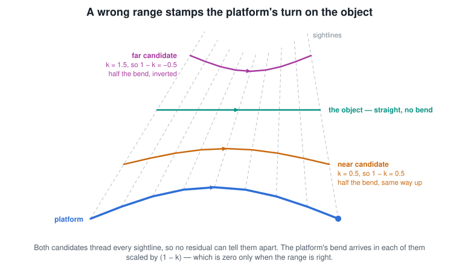
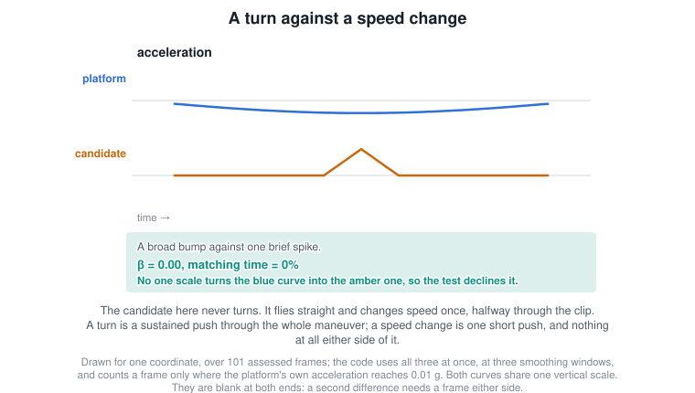
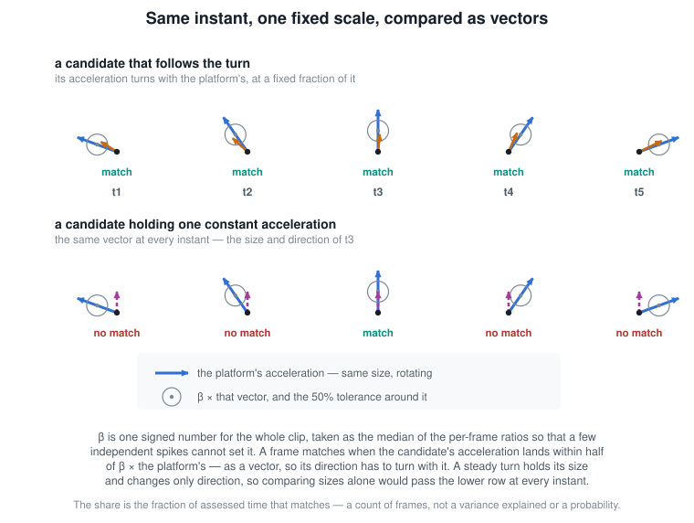
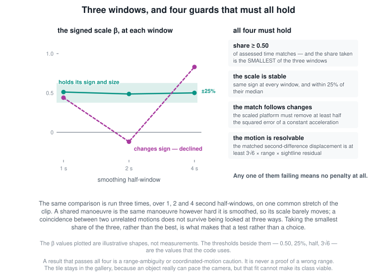

# Traverse Analysis and the Verdict

This page explains what you see after you press **Traverse → Analyze Traverse
Methods...**: the verdict, the gallery, the ranking and the report. The button runs a
fixed set of fits at once, ranks the results and issues an executive verdict.
**Global Fit: Wind Tracer** is not in that set. The astronomy, satellite, GPU Monte
Carlo and range-band checks run only when you turn them on in *Traverse → Traverse
Analysis Tweaks*.

If residual, prior or screen are new terms, read
[The Ideas Behind the Traverse Analysis](TraverseConcepts.md) first. Its
[word list](TraverseConcepts.md#words-used-without-pictures) defines terms such as
RK4, DE and IRLS.

For how each individual method computes a path, see [Traverse Methods](TraverseMethods.md).

[How the Balloon Algorithms Work](BalloonAlgorithms.md) gives a detailed
explanation of the Balloon results, including the three wind treatments,
motion equations, numerical search, model selection and interpretation limits.

To characterize recorded pointing against a known target and generate fresh
operator-style or statistical errors, see [LOS Error Analysis](LOSErrorAnalysis.md).

---

## The Analyze button

**Traverse → Analyze Traverse Methods...** runs the full battery against the current
LOS data and opens a single flat, best-first hypothesis gallery. Which tile leads is
decided by the screen, not by its name. This is a screening order, not an object
verdict. **Use exact “*name*”** (the button names the selected result) installs that
trajectory as a frozen Analysis Snapshot; it does not silently rewrite the speed/range assumptions used by the next run. The **✕** at
the top left of a tile sets that result aside. It moves below the others and leaves
**Compare leaders**. **Restore set-aside** brings all of them back.

**Range and speed.** The verdict gives no range or speed. Each tile shows one
selected path, and that path depends on the tile's model. **Slant range (min–max)**
is the range over the clip, not an uncertainty. **Horizontal air speed (mean / max)**
and **Vertical air speed (mean / range)** are relative to the air, in that result's
wind. A Balloon tile therefore shows a horizontal air speed near zero even when the
object crosses the sky. No tile line gives ground speed. To see which ranges a model
allows, turn on [Solution families](#solution-families--the-range-band-a-model-admits).

Each interactive graph has two display controls below the magnifier. **T**
shows or hides the truth path and starts on. **g** shows acceleration peaks
and starts off. Both controls apply to thumbnails, the detail graph and
the expanded graph together; they do not change scores or ranking. Hiding truth also
hides its peak labels and preserves the graph's scale.
Magenta is reserved for truth; solution paths use other colors.

Peak labels use two decimal places, such as **4.30g**, in the path's color. They use the
same smoothed acceleration and trimmed time interval as **Max g-Force**,
including the valid overlap interval for truth. These are kinematic
accelerations, not total load including gravity. The candidate, truth and
camera paths can each show up to three local maxima. Maxima must be at least
one second or 5% of the measured interval apart, whichever is greater, and
at least 48 screen pixels apart. Labels that would overlap are omitted.

Every graph has a timeline at its foot: a slider, a play button, and the frame
number and time. **Space** plays or pauses. The timeline moves the current-position
markers on all graphs and a yellow line on the frame-by-frame graphs, across the
analyzed frames. It is local to the gallery and does not change the main
playhead or refit anything.

The **camera icon** switches the graphs to perspective views from the scene camera's
position, heading and roll at the selected frame. The projected candidate and
truth paths are magnified to fit each graph: this is an image-plane crop, not
a change of camera position. In camera mode, the timeline also moves the camera.
A filled point marks the
candidate; a larger ring marks truth, so coincident positions remain visible.
The markers use the exact frame's track samples.
With **g** enabled, camera mode labels only the current point on each visible
track with that frame's smoothed g-force, to two decimal places. The values
update as you scrub; peak labels return in the rotatable 3D view. No value is
shown when acceleration is unavailable for the current frame.

Camera mode, the timeline, T and g stay synchronized across thumbnails, detail
and the expanded graph. Press the **camera icon** again to restore the rotatable 3D view.
Camera mode is unavailable for direction-only hypotheses and bulk results
that have no scene camera pose.

The expand button (the top-right button on each graph) enlarges that graph to
fill the left side of the results page, in place of the list of results. The
details panel stays on the right and shows the same result, even if a different
result was selected before. The expanded graph does not scroll. **Enter**
expands the graph of the selected result, and pressing it again returns to the
list. You can also return with the expand button, the top-right **X**, or
**Escape**. The
**X** on the results page closes the analysis, and **Escape** follows the same
order.

The **Left** and **Right** arrow keys select the previous or next result in the
order the tiles are shown, with set-aside results last, and wrap at the ends.
The **Up** and **Down** arrow keys select the result above or below in the grid
(the nearest one in that row), and stop at the top and bottom rows. While a
graph is expanded, the arrow keys step the expanded graph and the details panel
together, and the list is at the same result when you return to it. They do
nothing while a slider or other field has focus, or while the comparison is
open. If you have scrolled down the details
panel, a new selection keeps its frame-by-frame graphs at the same position on
the screen, so you can step through the results and compare the graphs in place.

The four frame-by-frame graphs (**Kinematic acceleration**, **Horizontal air
speed** in kt, **Vertical air speed (+ up / − down)** in ft/min, and **LOS fit
error**) can have two scales. The left scale starts at zero. If **Vertical air
speed** has a negative value, the scale starts at the lowest value rounded down
to a whole step. Its top rounds up to a
whole step, and it spans at least a minimum: 2 g in steps of 1 g, 40 kt in steps of 10 kt,
1000 ft/min in steps of 500 ft/min, and 0.5° in steps of 0.5°. Graphs of
different results therefore usually share a scale, and a small value draws as a
small line. The acceleration and LOS graphs use the result's color; horizontal
air speed is always blue and vertical air speed always green. A grey copy of the
main line, drawn behind it, uses the **Fine scale** on
the right, which has grey numbers. The Fine scale fits the main line's own
range, but never spans less than one hundredth of the left minimum (0.02 g,
0.4 kt, 10 ft/min, 0.005°), so it shows the detail without making numerical noise look
like motion. A graph shows the Fine scale only when its span is less than 20%
of the left scale's; otherwise the grey line would only repeat the main line,
and the graph has one scale. Secondary lines — truth and the generic-fit
reference — are dashed and use the left scale only. The legend is in
the title row of each graph.

**Open Full Report**, at the foot of the details panel, builds the standalone HTML
report on demand. The report opens with an overview figure (plan views of the platform and the
leading paths) and **Key findings**, then **Source files and video context** and
**Candidate results — without truth**, using the same screening order as the
gallery with **Use Truth Track** off. **Supplied and fitted wind** follows. If a
usable reference track is available, **Comparison with truth** orders the same
paths by search completion, then mean 3D distance from the reference. No
candidate is refitted, and both sections appear regardless of the gallery toggle. The report's
assessment, candidate cards and detailed rank explanations use the ranking
without truth; any reference measurements there are comparison only.

Expand **Filtering and interpolation** at the top of the gallery to see every
filter on the selected input paths, the filters used by the candidate fits and
metrics, and the live traverse output filter. The same summary appears in the
full report. It records the settings when Analyze ran, with effective durations
in seconds, including simulation speed, repeated passes and shorter end windows.
Spline and Kalman stages show their control spacing or full fitting interval
where there is no fixed averaging window.

Imported tracks with recorded camera angles have an **Angle Smooth Window
(frames)** control in their Contents folder. This filters the platform and camera
angles before constructing sightlines, independently of position smoothing;
set it to zero to disable it. Ordinary MISB imports, including TS video metadata,
default to 120 frames for smooth playback. Saved sitches retain their saved window;
older saves without this control use the original 120-frame default. Bearings-only
analysis interchange files keep their zero default.

**Analyze Traverse Methods** temporarily sets recorded-angle smoothing on the selected
sightline path to zero. The dataset, fits and filtering summary use those unfiltered
angles. The viewing setting is restored when analysis finishes, fails or is cancelled.
Position and tracked-pixel smoothing settings are unaffected. Set the angle window
to zero yourself when inspecting unfiltered sightlines or running a live traverse
outside the analysis dialog.

At 30 fps and simulation speed 1, a window of 120 averages up to
121 samples spanning four seconds, shortening symmetrically at the source ends.
This can suppress real camera motion as well as measurement noise. A sightline
built from tracked target pixels needs the camera attitude of the same frame.
Position smoothing methods and angle windows are saved with the sitch. A zero position
window does not disable spline interpolation; choose **none** for that stage.
Exact analysis snapshots bypass the live traverse position filter, and the
displayed line, object, distance graph and traverse exports use the same output.

The analyzed frames can be fewer than the In/Out range. A track holds its last
sample past the end of its data, so the analysis drops frames at the end of the
range where the camera position does not change. It does not drop frames at the
start or in the middle. A camera that really stops before the range ends also
loses those last frames. The browser console reports how many frames were dropped
and which frames were analyzed. If half or more of the range would be dropped,
nothing is trimmed and the console shows a warning: check that the clip's In/Out
range covers real data.

The report shows three of the battery's searches:

1. **Constant-air-speed sweep** — a grid over (start distance × air speed,
   15–650 kt log-spaced so slow drifters are representable alongside jets).
   Each combo is solved as the smoothest ray-following path that holds that
   air speed (a spline solve), then
   scored for smoothness (kinematic acceleration, turn-rate variability, climb) plus how well
   the requested speed could actually be held. Surfaces the valley of
   straight-flight solutions (on the Gimbal sitch: ~30–32 NM, speed loosely
   400–550 kt).
2. **Range profile** — for each assumed start range, the least-maneuvering
   spline solution with a fast-object (cruise speed) and a slow-object
   (drifting) speed target. Quantifies what an object at any given distance
   would *have* to do — e.g. on the Gimbal sitch, the 6–8 NM range profile
   requires a near stop and a rapid heading reversal, or a continuous banked turn.
3. **Aircraft fit** — the differential-evolution fixed-wing fit, reported as
   interpretable parameters (range, origin-ENU heading, horizontal airspeed,
   turn, climb).

The constant-air-speed (CAS) sweep is drawn as two heatmaps, supplied and fitted wind, and the range
profiles include a fitted-wind slow profile. The remaining sections are
**Constant air speed: supplied versus fitted wind**, **Trajectory comparison**,
**CAS candidate diagnostics**, **Range profiles**, **Candidate measurements and
explanations**, **Inputs, filtering and angular-size evidence**, **Methods and
interpretation limits**, three appendices (lowest-score CAS grid cells,
fixed-wing search runs, run audit and reproducibility) and **Glossary — terms
and units**. **Download HTML** and **Download run data** save the report and its
manifest. Criteria are deliberately loose checks; scores
order model-conditioned hypotheses and are not posterior probabilities.

Unchanged analyses are cached by their LOS, In/Out range, timing, wind, model
options, priors, and stable terrain-data configuration. Choosing **Use exact “*name*”**
or orbiting a render camera does not change those inputs and reopens the prior
gallery immediately. Render-camera terrain LOD (active tiles/revision) is kept
out of the scientific key. A surface change above 0.1 m from an equal- or
higher-resolution sample, an explicit terrain reload, or a source change
invalidates the cache. If terrain tiles merely finish loading
*while* an analysis is running, the run is **not** discarded — it completes using
the ground samples consumed while building and grading the candidates, and
the gallery shows a small note that terrain finished loading, which you can act
on by re-running once it settles if you need the ground samples exact. Starting
an analysis while terrain is still doing its initial load is still blocked, since
a half-loaded start could be genuinely wrong rather than marginally off.

Notes on the gallery tiles:

- The ray-following tiles (Constant Air Speed, Constant Altitude, Minimum
  Acceleration) show their analyzed, lightly smoothed paths. **Use exact “*name*”**
  installs that exact sampled path as a snapshot, so preview, metrics, and
  applied output refer to the same result.
- Each tile carries a colored **category label** — *Physically based* (balloon,
  drone, aircraft), *LOS Constrained* (constant air speed / altitude / minimum
  acceleration), *Geometric* (stationary, ground, at-infinity), *Geometric
  Approximations* (the curve/Kalman/least-squares fits), or *Known Object* (star,
  planet, satellite) — and its rank within that category ("#1 of 4 within physically
  based"). The gallery order comes from the keys in
  [How the tiles are ranked](#how-the-tiles-are-ranked), which end with the **BOT
  Score** (BOT means bearings-only traversal): a weighted score where lower is
  better. Solver category gives no preference. Angular-only checks use a separate
  score basis. The 0.05 display-tie threshold is a formatting convention, not a
  statistical claim. The exception to this order is the polynomial-order sweep: only
  the best-ranked order of each strategy stays in it, and the other orders go below
  an **Extras** separator at the end.
- **Mean LOS error** is the mean angular separation between the observed
  sightline and the camera-to-candidate direction, over the analyzed frames.
  It measures agreement in direction, not 3D position error. Small residuals
  show five decimal places to distinguish close results; those extra digits
  do not establish measurement accuracy. Expand **What the LOS error means** in
  the details panel for the reference comparison. When a truth track covers the clip, the ratio is
  **candidate mean LOS error / truth-track mean LOS error**. The truth residual
  is a measured reference, not a guaranteed minimum or a confidence score:
  a fit that follows measurement noise can score below the truth track.
  Otherwise a generic constant-acceleration fit provides context; it is not
  a noise estimate. Neither reference replaces the raw value.
- **Max g-Force** (kinematic acceleration) is the rate of change of smoothed
  air-relative velocity, divided by gravitational acceleration. It is not aircraft load
  factor and does not include the ordinary 1 g supporting level flight.
- **True heading** is the compass direction of the candidate's horizontal
  velocity over the ground — its absolute motion, wind included — measured
  clockwise from true north. It is not the air-relative direction behind the
  speed line: a drifting balloon has no motion through the air, but it heads
  where the wind carries it. Its mean and range are circular, so a heading
  that wanders across north reads as the narrow band it is, and they use the
  same frames as the other lines (the smoothing window is trimmed at each
  end). The range is highlighted yellow when it is wider than 30° and red
  when it is wider than 45°: a straight path holds its heading, so a wide
  range marks a candidate that turns or wanders; one that turns through every
  direction reads "full circle". When the headings cancel out (a circling or
  back-and-forth path, where the unit heading vectors add up to less than a
  quarter of their count), the mean reads "no mean direction" instead of a
  direction that rounding happened to leave. Frames with no horizontal motion have no
  heading and are skipped; the line gives the share of frames that had one
  when that is not all of them, and reads "n/a" when none did (a stationary
  or ground object).
- **Constant Altitude** searches the altitude band and scores each candidate
  on the smoothed path plus its LOS residual. If the sightlines are
  near-horizontal, so that they miss the constant-altitude plane on more than 20%
  of frames, the fit fails and no Constant Altitude tile appears.
- **Minimum Speed**'s family note has two modes: with a genuine low-motion
  window (the classic saddle) it reports the range band that fits equally
  well over that window; on a continuously rotating LOS (the camera's own
  motion triangulates the range) it reports how sharply the full-clip cost
  valley pins the range instead.
- **Physical compatibility** and **Implied object size** are disclosure lines,
  not ranking inputs. See [Physical compatibility](#physical-compatibility). With
  angular-size judging on, **Implied object size** converts
  the angular-size bounds, from the file or the **Angular size** dialog, to metres at
  the candidate's range. A published angular diameter is an **upper** bound, so
  the line reads `≤ X m from size bounds; no measured lower bound` rather than
  printing a fictitious lower end. Bounds with a lower limit read `lo–hi m at this
  range`. Neither line moves
  the order of the tiles — the **Platform acceleration match** line, which is
  shown whenever the statistic could be computed at all, is the one disclosure line
  that does, except that with angular-size judging on a size conflict also
  demotes a tile.
  See
  [How ordinary is the answer?](BOTBench.md#how-ordinary-is-the-answer) for the
  definition and the measured behaviour.
- The balloon runs as **Balloon (fitted wind)**, **Balloon (supplied wind)**,
  which holds the drift to the complete supplied wind series (calm included),
  and **Balloon (supplied wind + correction)**. A tile whose fitted lifecycle
  shows a rise then a fall takes the name **Possible sky lantern (rise then fall)**,
  followed by its wind label; this is a wording hint, not an identification.
- **The criteria ribbon**: a row of small squares under each tile's heading, one
  per criterion, each carrying one white letter — **P** physically admissible,
  **L** line-of-sight fit, **S** speed, **A** acceleration, **Z** size,
  **M** platform acceleration match, **C** convergence, **W** wind, **T** truth — colored
  green, yellow or red, with grey for anything that was not evaluated. Hovering
  a square says what it measures, what this candidate scored, and why it is that
  color. It is a reading aid, not an input: nothing in the ribbon moves the
  order, and every number in it appears in full in the stats and the **Screening and
  score** text below.

  **The speed, acceleration and size squares are judged against an object class,
  not only an absolute threshold**, because almost none of these quantities has a
  threshold that is right for every candidate: 1 g is unremarkable for a multirotor
  (limit 2 g) and twice the balloon class limit (0.5 g). A square is green inside
  the class limits, yellow outside them, and red at about twice the limit or more.
  A tile that names an object type — the balloon, drone and
  fixed-wing models — is graded against *the class it claims to be*, so a
  "balloon" that needs 1 g shows red rather than being quietly re-judged as
  the drone that would admit the number. Every other tile claims no object type,
  so it is graded against the closest tested class envelope, even if no class
  admits it, and the tooltip names that class. Speed and acceleration are additionally held to the
  absolute kinematic limits, and the worse of the two verdicts wins, so the
  ribbon can never show green where the tier badge shows a kinematic problem.

  **Grey is not a pass.** It means either that the check could not run — no
  angular size in the file, angular-size judging switched off, no truth track loaded, no manoeuvre by the platform
  to compare against — or that it ran and settled nothing, such as an
  inconclusive wind comparison. Each grey tooltip says which. The first square
  shows outright rejection: a candidate rejected outright (underground,
  non-physical, off-mode) carries no ranks at all, so without it such a tile
  would show mostly grey.

## The executive verdict

The analysis ends with an **executive verdict** strip above the gallery: a
one-sentence headline, then a detail paragraph. It is hidden while **Use Truth Track** orders the gallery. It has
five codes and eight headlines:

| Code | Headline |
|---|---|
| insufficient | *Insufficient independent evidence to discriminate.* (circular LOS) |
| insufficient | *Insufficient evidence to discriminate.* (no usable parallax) |
| probably-balloon | *Probably a wind-blown balloon.* |
| consistent-one | *Consistent with a …, but not identified.* |
| consistent-one | *Object type unresolved — close-fitting paths meet several physical class limits.* |
| consistent-several | *Consistent with several conventional interpretations.* |
| unresolved | *Unresolved — no completed tested conventional model passes the current screen.* |
| unresolved | *Object type unresolved — close-fitting paths meet tested physical class limits.* |

The *Object type unresolved* wordings replace the others when path
compatibility finds several classes (consistent-one) or any class (unresolved);
the detail then lists them under "Within tested limits" and notes that these
are path compatibility checks, not extra fits or identifications.

The two *Insufficient* gates run first
([The verdict is a survivor count](TraverseConcepts.md#9-the-verdict-is-a-survivor-count)).
A camera that passes the second gate can still leave range to the priors. The test
for *Probably a wind-blown balloon*, the only affirmative verdict, runs next. It
needs all three of: a viable free-wind balloon fit whose wind agrees with the loaded
winds aloft (wind rating **supports**), balloon consistency of at least 0.75 on that
fit, and no viable catalogued-object class. *Probably* is fixed wording: no
probability is computed, and a viable aircraft or drone class does not block it.

Otherwise the analysis counts the viable interpretation classes. A tile is viable
when its search is complete, it reaches the top fit and kinematic grades, and it has
no platform acceleration match. With angular-size judging on, a size conflict makes
it non-viable. A Satellite or Astronomical tile has no kinematic grade. It needs an
angular offset of at most 0.15° or 0.10° respectively, and must not be in Earth's
shadow or too faint to see. A class is viable when any one of its tiles is viable.
Tiles not listed here count in no class.

| Interpretation class | Tiles counted |
|---|---|
| wind-blown balloon | Balloon, Possible sky lantern |
| conventional fixed-wing aircraft | Fixed-Wing Aircraft |
| multirotor drone | Quadcopter, Drone (flown inputs) |
| stationary or ground-bound object | Stationary Point in Space, Ground Object, Ground Vehicle |
| catalogued satellite or astronomical object | Satellite, Astronomical (the clip's own time) |

A *Consistent with* headline means that a model fits, not that others are excluded:
very different ranges and speeds can fit the same bearings.

A strip with the code unresolved also lists the causes that are not modelled at all:
birds and insects, airborne debris, helicopters and rockets, reflections, glare and bokeh, and video-processing
artefacts. Those are not ruled out, because nothing tests them. The strip is green
for probably-balloon, blue for consistent-one and consistent-several, and neutral
grey for unresolved and insufficient.

## How the tiles are ranked

Each tile shows a short status and its own score, for example
**Broad gates passed · BOT Score: 2.905**. These are the shared ranking screens;
physical compatibility with a tested object class is reported separately.
A result that does not pass shows its
screening status instead. Hover over the status for the placement explanation.
The BOT Score is a weighted sum of motion and sightline-fit terms, plus a platform
acceleration adjustment when that match is significant. **Lower is better.** It
compares finite paths regardless of solver category and does not use truth. It
is not an object probability. Hover over **BOT Score** for the calculation,
including the numeric contribution of each term for that result.
All measurements and the screening indicators remain visible above
**Explanations and BOT Score calculation**, which expands the LOS and physical
compatibility explanations and the numeric components of the BOT Score. The selected tile's
explanation also appears above its large graph.

**Compare leaders** opens a side-by-side comparison of the two leading finite
trajectories still in consideration. It always uses ranking **without truth**,
even when the gallery is ordered by truth. The selectors let you compare any
other pair. Angular-only checks are excluded because their scores use different
units. Set-aside candidates are excluded until restored.

The panel shows each weighted BOT contribution and the difference between the
two candidates. Positive differences favor the left candidate; negative ones
favor the right. The largest contribution to the gap is highlighted. The gate
table gives measured values, limits and margins, plus search-completion and
model-limit warnings. The physical-compatibility table applies the same class
limits to both paths and marks missing measurements as unassessed. These class
checks do not change the BOT Score. A result that passes the available checks
names any missing inputs, for example **Passes measured checks · size unknown**
(or **· size judging off** when size data exists but judging is off).
**Results**, **X**, or **Escape** returns to
the gallery with its selection and chart settings intact.

The gallery mixes unlike questions — object models, LOS-constrained
trajectory families, fixed-geometry checks, curve fits, catalogue matches —
and there is no cross-model likelihood that could rank them as competing
object probabilities. The flat best-first order is instead decided
**lexicographically**, by a cascade of keys that *are* comparable across
categories, before anything model-specific is consulted:

1. **Truth separation** (only when **Use Truth Track** is on): completed fits
   first, then mean 3D separation from the truth in metres — the one score
   that is soundly comparable across every category.
2. **Not rejected** — anything rated *Kinematically extreme* / *Poor fit* (5× the
   reference scale or more, above 9 g, or above 900 kt), or flagged invalid,
   underground or off-mode, sorts below everything else, even an incomplete
   result. Because this comes before completeness, a broad slow family flagged
   *Search incomplete* can lead an extreme solution that converged cleanly. This
   is a rejection bar. The label **Passes broad screen** and the verdict's survivor
   count both need the top tier: within 1.2× the scale, at most 1.5 g and 650 kt,
   and no platform acceleration match.
3. **Angular-size conflict** (only with angular-size judging on) — a tile whose
   path breaks the size bounds under the constant projected-size assumption, or
   whose implied size is outside every class its motion allows, sorts below the rest.
4. **Eligibility** — complete *and* top tier.
5. **Completeness** — no search-boundary or optimizer-incomplete flags.
6. **Tier** (see below), then the count of load-bearing model limits.
7. **Score basis** — finite trajectories use the BOT Score;
   angular-only checks use raw degrees. When all earlier keys tie, finite
   trajectories are displayed first to avoid comparing numbers with different
   units. This is a display convention, not a preference for an object type.
8. **BOT Score** for finite paths, or angular score for angular-only
   checks, then raw LOS residual. A physical-model solver gets no priority over
   an LOS-constrained or geometric solver.

Three worked examples. A *Minimum Acceleration* path that threads the rays
at 0.03° but needs 6 g is rated *Low*, so a complete balloon fit at 0.04°
and 0.3 g — top tier and eligible — leads it at the eligibility key; their
scores are never compared. A slow drifting family flagged *Search
incomplete* because its range band touches the grid edge still leads a
cleanly-converged 900 kt / 12 g solution: the extreme candidate is rejected at
key 2, which is decided *before* completeness. And a catalogued planet with a close
angular match (say 0.08°, the top catalogue grade) ties a passing drone fit on every key down
through tier and limit count — but its angular score is 0.08 (raw
degrees) while the drone's smoothness-plus-residual composite is several
units. Compared directly the planet would "win" purely on units, so
score basis separates that pair and those different units are never compared.

**The tier** for trajectory tiles is the worst of three independent 0–3
grades, and the badge names whichever one is binding.

*Fit quality*, from the raw LOS residual for every solver, graded **relative
to the scene**: the boundaries are 1.2×, 2× and 5× the flexible constant-acceleration
reference residual for that clip, clamped to a scale between 0.02° and 0.20°.
Inside 1.2× is the top grade, then *Fair fit*, *Weak fit*, and worse is a *Poor
fit*. The scale exists because scenes do not resolve equally well: on the
Aguadilla ground-track sitch every fitted candidate lands between 0.07° and
0.19° while the reference itself leaves 0.14°, so fit quality is not
distinguishing anything there and a fixed ladder would only sort noise. The
clamp limits the scale at both ends. At the upper end, a residual of 0.24° or more
cannot reach the top grade, and 1.0° or more is always a *Poor fit*. At the lower
end, the scale stays at 0.02° or more, so a noiseless synthetic file, where a truth
track threads its own rays, does not fail every real model. The scale is
deliberately **not** taken from a loaded truth track's
residual, so that blind evaluation sees exactly the tiers an analyst sees.

*Kinematic grade*: peak acceleration ≤ 1.5 g and peak air speed ≤ 650 kt is the top
grade; up to 4 g (still ≤ 650 kt) is *Moderate*; above 4 g or 650 kt is *Low*; above
9 g or 900 kt is *Kinematically extreme*. This is not the
[ordinariness cost](TraverseConcepts.md#7-ordinariness-cost-what-a-candidate-would-have-to-be),
which is reported but does not set the tier.

*Platform acceleration match*: the share of the assessed time whose acceleration
matches a single fixed scaling of the platform's, at the same timestamps — 0.85
and above is *Strong platform acceleration match*, 0.50 and above is *Partial
platform acceleration match*, when the guards in
[Does it fly the camera's path?](#does-it-fly-the-cameras-path) hold. It never reaches
the bottom grade, because an object can pace the camera (a chase aircraft,
a drone). On a tie it does not take the label: a model that both fits poorly
and matches is reported as fitting poorly, with the match still spelled out in
the tile's **Screening and score** text.

One locally load-bearing model limit, other than a wind limit
(label *Not fully tested* when it binds) caps the tier at 2, two or more at 1, and an unconverged optimizer caps it
at 1 as a *Provisional fit*. Two iteration-limit stops are **not** counted as
unconverged: a Nelder-Mead simplex that has collapsed to its position tolerance
on every parameter has converged even if the cost spread has not settled (no
further iteration can move it), and a fit whose cost has settled while some
parameters stay wide is reported as settled but unidentifiable on the named
parameters (currently the balloon lifecycle's vSink, tauCool and tBurn, when
the burn outlasts the clip) — an identifiability limit of the clip, not an optimizer failure.
See [Why a good fit can still read "Unresolved"](BOTBench.md#why-a-good-fit-can-still-read-unresolved). Catalogue and at-infinity tiles have no
kinematics to grade: they are tiered on angular offset alone, with the
visibility / illumination check folded in for catalogue objects.

**Badges.** When the fit is the limit the labels read `Passes broad screen` / `Fair
fit` / `Weak fit` / `Poor fit`; when the motion is the limit they read `Passes broad
screen` / `Moderate` / `Low` / `Kinematically extreme`; when the solved path
follows the camera's own changes of acceleration they read `Partial platform
acceleration match` / `Strong platform acceleration match`. Beside that label, each
on its own test, a tile can show **Search incomplete** (**Wind search edge** for a wind
parameter), **Model limit hit**, **Unconstrained at bound**, **Internal clamp reached**
and **Optimizer incomplete**; a tier is never relabelled upward. **Internal clamp
reached** does not change the tile's label, but the verdict does not count that tile. Three more
labels can appear on a graded tile. **Provisional fit** replaces the tier label,
with its tier capped at the *Low* / *Weak fit* level, when an optimizer did not
finish. **Not fully tested** replaces a tier label only when a model
limit is the binding constraint — the fit and the motion would both grade
higher, but a pinned bound stopped the search, so the model was never fully
tested rather than measured and found wanting (a fit that pins *and* fits
poorly keeps the stronger "Poor fit"). Either way the tile shows **Model limit hit**,
and the verdict counts it as search incomplete. **Co-leader** marks tiles that tie on
keys 2 through 6. Their remaining order is a heuristic BOT Score tie-break, not a
finding that one object type is more likely. Applying a truth track orders
them by truth separation instead.

**The BOT Score** for trajectory tiles is a smoothness composite plus
the residual: `4·rms(g) + max(g) + 0.05·std(turn rate) + 0.02·(mean
vertical speed beyond 5 m/s)`, plus the scored residual divided by 0.05 —
so one score unit equals 0.05° of LOS residual, putting "how much
manoeuvring does this require" and "how well does it thread the rays" on
one scale. The composite prices exactly the things a wrong assumed
distance forces on a solution: sustained and peak acceleration, erratic
turning, and implausible climb or descent. A tile that matches the platform's
acceleration carries a further demotion of up to about 0.3° of
residual-equivalent, in proportion to the matching share.

**Physical compatibility and forward models are separate.** Close-fitting,
complete paths from every solver, including Horizontal Speed Valley (HSV), receive
the same physical class checks. The detail text after the headline lists compatible
envelopes under "Within tested limits", separately from the forward models that fitted successfully. The generic multirotor model
and compatibility check share a 60 m/s horizontal speed limit (about 117 kt); vertical motion does not count
against that horizontal limit. These are broad tested envelopes, not universal
limits on all objects in a class.

## Does it fly the camera's path?

Range is the hard part of a bearings-only reconstruction. If the platform
manoeuvres, a wrong range can leave a recognisable mark.

**Where the blend comes from.** Every point on frame `f`'s sightline is
`P(f) + R·u(f)`, where `P` is the platform's position and `u` the unit direction
it recorded. So a true object at range `R_t` and a candidate at range `R_c` are
both on that ray:

    X_t(f) = P(f) + R_t(f)·u(f)
    X_c(f) = P(f) + R_c(f)·u(f)

Divide the second by the first, after subtracting `P` from each, and the
direction cancels — which is exactly the trouble with a bearing. Writing
`k(f) = R_c(f) / R_t(f)` for the range ratio and rearranging:

    X_c(f) = k(f)·X_t(f) + (1 − k(f))·P(f)

That is exact, frame by frame. Over a clip where the range ratio holds roughly
steady it reads as a single blend with a constant `k`, and the coefficient on
the platform is `(1 − k)`: **guess the range wrong and the camera aircraft's own
motion is added into the solved trajectory**, scaled by how wrong the guess is,
and reversed in sign when the guess is too far. For a constant-velocity
target, the resulting bend is the platform's turn, scaled. If the target
also accelerates, its scaled acceleration and the platform's contribution
combine; the whole bend need not match the platform. The bend introduced
by the platform's contribution is called a *Coryat curve*.



The fit need not show this. Such a candidate can follow the sightlines as closely as
any other, and its speeds and accelerations can be unremarkable. For example, a path
at 51 kt and 0.48 g passes the top kinematic grade (at most 1.5 g), so the screen
alone cannot show whether the platform contributes to a bend. A comparison with the
**platform's** motion can flag it.

**What a finding says, and what it does not.** A result that passes all four guards
below is reported as *Partial platform acceleration match* at a share of 0.50 or
better, and *Strong platform acceleration match* at 0.85 or better. Both are cautions
about **range ambiguity or coordinated motion**. Neither is a proof that the range
is wrong, and neither identifies an object. The analysis does not convert a match
into a range.

A finding has three effects. It caps the tile's tier at 2 (Partial) or 1 (Strong), so
the tile is not eligible. It adds 6 × the share to the BOT Score. That fit also
cannot make its object class viable in the executive verdict, so the class counts only if another of its tiles is viable. Path
compatibility checks do not use the match. A matching tile is never called invalid:
an object *can* pace the camera — a chase aircraft, a drone flown to follow it — so
it stays in the gallery and moves down.

**Why the comparison is made on acceleration.** The blend survives
differentiation. If `k` holds roughly steady then the candidate's acceleration is
`k` times the object's plus `(1 − k)` times the platform's, exactly as its
position was, so the imprint is there to be found in acceleration as well.

Position alone can mislead, because two paths can look alike in position when their
motion differs. A turn is a sustained push that lasts as long as the turn does; a
speed change is one short push with nothing at all either side of it. Acceleration
separates the two, because it asks *when* as well as *what shape*.



**How the comparison is made.** Acceleration is estimated by a second difference
over a half-window `h` — `(X(t+h) − 2X(t) + X(t−h)) / h²` — for both paths, and
the two are compared **at the same timestamps**. No time shift, rotation or
per-frame gain is fitted. One signed number `β` scales the platform's acceleration
for the whole clip.

`β` is the **median** of the per-frame ratios `aX·aP / |aP|²`, taken over the
frames where the platform's own acceleration reaches 0.01 g. A median rather than
a least-squares fit, because a handful of independent acceleration spikes in the
candidate must not be allowed to set the scale for everything else.

A frame counts as **matching** when the candidate's acceleration lands within half
of `β` times the platform's:

    |aX − β·aP|  ≤  0.5 · |β·aP|

and that is a comparison of **vectors**, not of sizes. The distinction is the
point of the whole test. A steady turn holds its acceleration *magnitude* constant
and changes only its *direction*, so a test on magnitudes alone would pass any
candidate whose acceleration happened to be the right size, whichever way it
pointed. Requiring the direction to turn with the platform's is what makes a
steady turn testable at all.



The **share** is the fraction of assessed frames that match. It is a count of
frames — not a variance explained, and not a probability. Frames in which the
platform is not accelerating carry no information either way, and are not counted.

**Four guards, all of which must hold.** The comparison is run three times over,
at half-windows of 1, 2 and 4 seconds — the 2, 4 and 8 second windows the tooltip
names — on one common interior stretch of the clip (on a clip under 16 s, the
longest half-window is a quarter of the clip, and the other two are a half and a
quarter of that). Each window needs six active frames and 0.01 g
RMS platform variation, or the line reads *Not assessable*. A finding needs all four of
the following, and any one of them failing means no penalty at all.

- **A majority of the time matches.** The share must reach 0.50, and the share
  taken is the **smallest** of the three windows rather than the best of them.
- **The scale is stable.** The three windows' `β` values must share one sign and
  sit within 25% of their median. This rejects matches that depend on one
  smoothing scale.
- **The match follows changes.** On the matching frames, the scaled platform
  acceleration must remove at least half of the squared error that a *constant*
  candidate acceleration would leave, at every window. Without this, a candidate
  holding one steady acceleration that resembles the middle of the platform's turn could be credited
  with following the turn.
- **The motion is resolvable.** The matched acceleration must produce a
  second-difference displacement of at least `3√6` times the positional scale the
  candidate's own residual can resolve — about `R × ε` metres at range `R` for a
  residual of `ε` radians. The `√6` is the noise gain of a second difference,
  which combines three samples with weights 1, −2, 1, so an independent
  per-sample error of size `σ` arrives as `√6 σ`.



That last guard is what stops a few metres of platform-shaped wander being treated
as evidence. The residual is also floored at 0.01°, and the positional scale at 1 m,
before the comparison, because
the exact-ray Straight Line candidate reaches 3 × 10⁻⁷ degrees by construction and
would otherwise make any matched metre infinitely significant.

BOTBench grades this test again whenever it reuses a cached battery, so an older
cached result can change order.

## Solution families — the range band a model admits

*Traverse Analysis Tweaks → "Solution families (range bands)". Off by default;
it re-fits each physics model several times.*

How tightly bearings constrain range depends on camera motion and the
target model. For **any** distance profile R(t), the path
`S(t) + R(t)·D(t)` reproduces the sightlines exactly — so a distance is only
pinned once you assume something about how the object moves, and then only
as far as that assumption actually constrains it. See
[when a constant-speed turn can constrain range](TraverseConcepts.md#when-a-constant-speed-turn-can-constrain-range).

With this enabled, three fits are re-fitted at a ladder of **held** ranges: the
fitted-wind balloon, the fitted-wind quadcopter, and the supplied-wind fixed-wing
fit. Other wind variants and **Drone (flown inputs)** show no band. The ladder has
11 log-spaced ranges inside the search bounds, plus the fit's own range. The start
distance is locked to each rung and every other parameter is re-solved under the
same model. The rungs whose fit stays acceptable are the model's **admitted band**.

- Admitted members are drawn as faint tracks in the tile's own color, with
  the headline solution solid on top. A member that follows the sightlines but
  fails the physical screen (underground, extreme kinematics) is drawn dashed
  and dimmer, so that it is visible and distinct from admitted members.
- The tile reports the band in a **Range band (model-conditional)** line, with the
  number of rungs **sampled**: "3.0–3.6 NM (2 of 12 sampled)". Read a band with its
  bracketing rejected ranges. Band width cannot resolve anything finer than the rung
  spacing, so a one-rung band can still have true edges anywhere out to its rejected
  neighbours.
- **The ladder is a sample, not a measurement of the boundary.** An admitted
  rung shows that distance works; it never shows that the untested ground
  between it and its rejected neighbour does not. So a band's edges are where
  the *sampling* changed answer, and the details panel says so rather than quoting a
  distance: "2.2 NM was the only sampled range admitted (rejected below 1.1 NM,
  above 4.3 NM); each band's true edges lie between it and its bracketing rejected
  sample — the ladder's spacing is the resolution limit". Nothing here ever reports a resolved or
  exact distance, however few rungs survive.
- Admitted ranges are reported as **separate intervals** when they are not
  contiguous, and filling a gap in would invent solutions the analysis never
  found. Each gap is described on its own terms — with three bands there are
  two gaps and they can mean different things:
  - every sampled rung in it rejected → **those samples** are excluded (the
    untested ground between them is not — the ladder is discrete);
  - a rung in it produced no fit → that part is **untested, not ruled out**,
    because a failure to solve is not evidence the range is unavailable.

Four cautions. The details panel states the first and gives the cut. It adds the
third and the re-search note when they apply:

1. **The band is conditional on its model.** It is not a general uncertainty
   on the object's distance. A balloon band and a drone band answer different
   questions and are never merged.
2. **The acceptance cut is empirical, not derived.** There is no calibrated
   sightline noise floor here (the constant-acceleration reference residual is
   explicitly not one), so the cut is set relative to the model's own best fit: the
   largest of 1.5 times the best fit, the best fit plus 0.02°, and 0.05°. These
   values are fixed, not calibrated. A
   [benchmark test](https://github.com/MickWest/Sitrec2/blob/main/benchmarks/botbench/verdict.bench.test.js)
   measures how often a band contains the true path. A band can miss the true path.
3. **A band that reaches the searched bracket's edge is a bound, not a
   result.** Widen Min/Max Dist to find where it really ends.
4. **The search marches outward from the best fit, seeded from each
   neighbour.** The fixed-wing fit runs its own search at each rung. Marching is far
   cheaper than a global search per rung, but these
   landscapes are multimodal — so a global re-search runs at each end of the
   ladder, and if it finds a better basin the band is re-traced from there and
   says so.

The band is reporting only. It never enters the ranking: a model with a
tighter band does not sort higher, because "the more determined model wins"
would be exactly the calibrated object-probability claim this analysis
declines to make.

## Physical compatibility

Every finite candidate not rejected as underground, off-mode or non-physical
receives the same physical-class checks, regardless of whether it came from a
physical-model fit, HSV, or a geometric curve. The
**Physical compatibility** line lists every class within the tested limits,
instead of choosing whichever class happens to be first in a zero-score tie.
It checks minimum and peak air speed, peak manoeuvring acceleration, and size
when measured. Missing size or motion information is stated explicitly.

The balloon check also uses the horizontal part of **Balloon consistency**: net
horizontal displacement divided by distance travelled. Once travel exceeds 20 m, a
ratio below 0.45 removes the balloon from the compatible list. Consistency itself is
the smaller of this ratio and the vertical one (net height change divided by total
vertical travel), so 0.45 appears in both places. This is a heuristic check of the
steady-drift interpretation, not a claim that no changing wind field could produce a curved balloon path.
A changing-wind explanation needs separate support. Low g alone is insufficient.

These are capability screens, not fits of every object's full dynamics to the
recovered path, and not identifications. For example, a circling HSV result can
fit the multirotor speed and acceleration envelope without being representable
by the Quadcopter solver's particular constant-acceleration, smoothly varying
turn model. Expanded details name each class's limiting quantities. With
angular-size judging off, these class checks do not alter the ranking. With it on,
a size conflict can demote a tile (see
[How the tiles are ranked](#how-the-tiles-are-ranked)).

## Optional angular-size evidence

Use **Angular size: on|off (N)…** in the results browser to inspect or enter size bounds.
**Use angular size to judge and order results** and **Also use size during supported
fits** are separate options, both off by default. The dialog accepts
an initial diameter, start/end diameters, sparse per-frame bounds, and relative
size ratios. An interval ratio bound applies at every frame from its first frame
to its last frame. Isolated samples apply only at their stated frames. Frame 0 is the In frame.

**Assume constant projected physical size** is an explicit optional assumption,
recommended when shape and orientation stay stable. It is not enabled automatically.
Rotation, inflation, occlusion or a changing measurement axis can invalidate it.
With this assumption off, absolute measurements still constrain the projected
size required by a path, but relative size does not constrain its range changes.

For projected extent `d`, range `R`, and angular diameter `theta`, the check uses
`d = 2 R tan(theta / 2)`. A candidate supplies `R`; it does not supply a known
physical size. Under the constant-size assumption, the implied diameter intervals
must share at least one common diameter. Relative observations instead check
`R(reference) / R(frame)` against the measured extent-ratio bounds. At small angles
these are the usual angular-size ratios. One absolute sample alone does not fix
range; the same proportional change in diameter and range leaves the angle unchanged.

Absolute size is also checked against the existing broad object-class size
intervals, using the same motion-compatible classes for every solver. A conflict
means the proposed path and these assumptions do not agree. It is not an object
identification or a proof that no other path fits. Results retain conflicting
candidates so the reason remains inspectable. Unknown size checks do not count as evidence
of compatibility. Truth comparison remains a separate, requested ordering.

The **Angular size** measurement names bounds passed, conflicts or unavailable
evidence and states the projected-size assumption. The BOT Score formula and
reported LOS residual do not absorb this check. Reports include the options and
observations in their run audit, and recompute their ranking from the current
settings.

### Optional fitting

In a live analysis, **Also use size during supported fits** requests a new analysis
when size inputs or fitting assumptions change. BOTBench has a separate **Fit
angular size (experimental)** checkbox for subsequent runs. Size fitting needs
the constant projected-size assumption and size-change evidence. A single absolute
sample with unknown physical size adds no range-change fitting information.

The supported searches are fixed-wing aircraft, balloon, quadcopter, drone control
inputs, constant altitude, horizontal speed valley, constant air speed and minimum
acceleration. The existing dynamics or path construction stay in use. For the last
two, size helps select the searched range/speed; it does not add a size equation to
the inner spline solve. The range-profile search also includes the loss. Minimum
Speed's representative, fixed/ground points, CV, CA, polynomial, Kalman, Monte Carlo
and sky/catalogue fits remain LOS-only during fitting. Each result states its mode.
All finite paths can still receive the optional judging check, regardless of solver.

The additional fit loss is the mean squared violation of log size intervals,
divided by `log(1.1)^2`. For absolute samples, one unknown log diameter is fitted
jointly to the intervals. Values inside bounds cost zero. This is a fixed
heuristic, not a calibrated likelihood or confidence score. More correlated
samples do not become independent evidence merely because there are more frames.
Reported LOS error is still calculated from sightlines alone. Supported size fits
use CPU objectives; their GPU kernels do not yet include this loss.
Results show the final path's size loss separately. HSV's speed-only bootstrap is
unavailable in this mode because it does not resample the size evidence. Each
candidate keeps its own fitting mode and final size loss. The report's options and
observations show the current settings.

### Available measurement sources

BOT input/all CSVs and generic MISB CSVs accept `AngularDiameterMinDeg` and
`AngularDiameterMaxDeg`. The minimum is optional: a published maximum alone means
`[0, maximum]`, even if camera FOV is known. Blank cells are missing observations.
BOT imports carry these columns into the live camera track. Truth tracks do not
supply size observations automatically.

With **LOS Source** set to **Camera + Object Track**, size points placed with **Use
Size Point** supply their measured angular separation at those keyframes only. Their
initial bounds are explicitly labelled **provisional ±10%** and can be edited in the analysis dialog. Untouched B handles and interpolated
frames supply no measurement. These bounds do not use the **Assumed Size**
setting. Recorded rows repeated over multiple scene frames are counted once.

In BOTBench, a BOT `.scenario.json` sidecar can also contain an `angularSize`
observation block. A direct import of the CSV into a sitch does not read the sidecar,
so the block has no effect there:

```json
{
  "angularSize": {
    "source": "Measured image extent",
    "samples": [{"frame": 0, "minDeg": 0.02, "maxDeg": 0.03}],
    "relative": [{"frame": 100, "referenceFrame": 0, "minRatio": 0.8, "maxRatio": 1.2}],
    "relativeBound": {"referenceFrame": 0, "startFrame": 0, "endFrame": 100, "minRatio": 0.5, "maxRatio": 1.5}
  }
}
```

This block is added to a valid scenario sidecar; it does not replace the frame and
timing metadata. Indices refer to original CSV data rows, starting at zero. Cropping
remaps retained observations and drops relative pairs whose reference was removed.
Bounds refer to projected extent, not brightness, bloom or an uncorrected pixel box.

Size bounds imported with a camera track also follow the default **Camera Center**
sightline when that track drives it. The Angular size button shows the
available count and whether judging is on. Open it to inspect the recorded
samples; the blank **Add an initial angular-diameter measurement** and **Add a final
angular-diameter measurement** fields are for additional observations.

An `AngularDiameterMaxDeg` column alone contains upper bounds, not measured
diameters or ratios. These bounds can reject physical class sizes at a
candidate range. They do not constrain range changes on their own, so size
fitting is unavailable until informative size-change observations are supplied.

## The fits behind the Analyze button

LOS-only data never uniquely determines a trajectory: near-perfect fits exist
at many ranges, provided the object is allowed to maneuver. The tools in this
section make that ambiguity explicit. Most fits add one *stated assumption* (a
nominal speed, roughly straight and level flight, low kinematic acceleration)
as a soft target rather than an exact constraint. The report's range profiles
show how much maneuvering each range forces on the smoothness fits. For the
physics fits, this needs **Solution families (range bands)**, which is off by
default. The targets define the question each fit asks; they are not a
preference of the analysis.

### Global Fit: Minimum Acceleration

Saved sitches still serialize the old menu key, "Global Fit: Plausible".

**Model**: the range along each LOS ray is a smooth cubic B-spline λ(f)
(25 control points). The trajectory follows the rays, with a soft range floor
(to keep it in front of the camera) and a light output smoothing that
sheds frame-scale pointing jitter; the acceleration objective is measured
over ~half-second strides so that jitter cannot dominate it.

**Method**: two-stage. Stage 1 solves a pure-smoothness (no speed target)
coarse sweep over range: when the camera itself maneuvers (an orbit, a hard
turn), its motion can give a decisive smoothness-vs-range valley under the
minimum-acceleration assumption. In that case the speed target is *not used*
(the Minimum Acceleration Fit Results folder shows "not needed (geometry)").
Stage 2 uses the soft air-speed target `((airspeed − Target Speed)/σ)²` with
σ ≈ 60 kt (IRLS) when Stage 1 does not pin one range: the valley is flat (for
example on the Gimbal sitch, where range is unobservable from geometry) or too
wide, it keeps falling toward a range limit, a second range scores as well, or
it rests on the soft range floor. The speed target then gives the
cost-versus-range curve a real minimum. Stage 2 also runs when the pinned range
implies a mean air speed above twice Target Speed; the folder then shows the
speed, not "not needed (geometry)". The winner is refined
and re-solved at full quality (the result appears as **Found Range**; the
**Min Dist** / **Max Dist** limits in Traverse Analysis Tweaks bound the
search). Where Constant Air Speed holds a speed *exactly*, Minimum
Acceleration treats speed (when used at all) as a loose target and finds the
smoothest path consistent with the rays.

"Not needed (geometry)" means no speed target was used; the smoothness
assumption still applies. With a constant-velocity camera, scaling each
camera-to-target vector by one positive constant keeps every bearing and scales
the target's acceleration by that constant
([curved targets and constrained turns](TraverseConcepts.md#a-curved-target-with-a-straight-flying-camera)).
The acceleration tends to zero with the range, so a low acceleration cost near
the camera does not establish the true range or independently enforce a
constant-speed turn model.

**When to use**: as the smoothest path under a speed hypothesis such as "a
~350 kt aircraft". The fit picks its own range. Target Speed applies only
in Stage 2. To hold it near a range such as 30 NM, set **Min
Dist** and **Max Dist** around that range. Its acceleration and turn metrics show
how demanding the path is.

### Global Fit: Minimum Speed

**Model**: the same on-the-rays B-spline range profile as Minimum
Acceleration, but the
objective is inverted: instead of the least-maneuvering path near a target
speed, it searches for the **slowest** object consistent with the sightlines, then
applies a curvature-penalized smoothing pass that sheds camera pointing
jitter (which would otherwise read as enormous kinematic acceleration on a slow object).

**When to use**: to look for a slow path on the sightlines. When the
camera orbits or passes a slow, close object, most of the apparent motion is
the camera's own parallax, and this fit shows a near-static path. A low air speed
here shows that a slow path exists in that result's wind. It is not a limit on the
object's speed or a test of any object type. Its one input is the target wind,
because it minimizes air speed through it; the range follows from where the sightlines let an object move
least. A final few IRLS passes level the air speed over the first/last 15%
of the clip (the spline endpoints are data-starved, so without this the
speed graph of an exactly-constant-speed object read as a ±5 kt end wobble).
The Analyze gallery's **Minimum Speed** candidate uses this same fit, so
applying it reproduces exactly the previewed path.

### Global Fit: Physics — the dynamics models

The Physics fit integrates a kinematic motion model forward with RK4 and fits
its parameters to the sightlines with **differential evolution** (a
genetic-style global search) followed by Nelder-Mead polish. Three models are
available via the **Physics Model** dropdown in the Traverse menu:

**Sky Lantern** — pure wind-drift kinematics. This full model runs only for
**Global Fit: Physics**. Analyze fits simpler stages instead: see **Balloon model
selection** below. A sky lantern is a
near-perfect wind tracer (grams of mass, large drag area), so its horizontal
velocity *is* the wind at its current altitude: a solved wind vector with a
linear altitude shear (clamped so it can never reverse or blow up — the wind
aloft is allowed to be stronger, e.g. "wind from the east, increasing with
altitude"). The wind may also **vary smoothly across the clip** (a duration-
invariant linear + quadratic drift, priced by a variability prior so it cannot
wander without support), letting the balloon follow a gently curving drift as
real wind veers over minutes — a constant wind can only produce a straight
path over the ground. Vertical motion follows the lantern life cycle — rise while the
flame burns, exponential buoyancy decay after flame-out, terminal sink — and
the solved flame-out time can fall before the clip (a lantern already in its
cooling descent), inside it, or after it (still climbing
throughout). The base-wind components are bounded to ±40 m/s, the shear
multiplier to 0.25–3, and rise/sink parameters to 4 m/s. Those are broad search
constraints, not a certified lantern envelope: the wind box is wide enough to
reach ordinary winds aloft from any bearing, and along its diagonal it admits
110 kt, which is not lantern-like. Excluding non-lantern motion is the job of
the light-wind speed prior and the kinematic grade, not of the
box. Its residual measures
compatibility with this particular wind-tracer/life-cycle model, not the
probability that the object is a lantern. On the gallery's Balloon tile, bound
pins and shear clamps are flagged.

**Fixed Wing Aircraft** — constant horizontal airspeed, a linearly-varying turn rate,
constant climb rate, and wind advection. Parameters (initial range, heading,
horizontal airspeed, turn rate, turn acceleration, climb, wind E/N) share the same DE +
polish recipe; the cost combines LOS angular error with explicit soft targets
for speed, turn, climb, and (when supplied) wind. **Global Fit: Physics**
searches 25–360 m/s horizontal airspeed. The gallery's Fixed-Wing Aircraft fit
searches 25–700 kt (about 13–360 m/s). Both search ±40 m/s climb. The generic
prior does not cover every fighter in the catalog, and a result on a bound makes this test
incomplete rather than excluding every possible fixed-wing aircraft.

**Quadcopter** — a hover-capable multirotor drone. Unlike a fixed-wing, it
needs no forward airspeed to stay aloft, so ground speed is free to fall to
zero (hover) or rise, the heading can swing on a wide turn budget, and it can
climb or descend far more steeply than a plane. Parameters (initial range,
heading, speed, along-track acceleration, turn rate/acceleration, climb, wind
E/N) fit with the same DE + polish recipe. A selected make/model bounds initial
speed and vertical rate and penalizes full-clip overspeed. The generic fit
permits initial ranges from 50 m to 20 km and air-relative horizontal speed up
to 60 m/s. This is a broad kinematic compatibility test: acceleration can push
the trajectory beyond nominal speed during the clip, so it is not a hard
flight-envelope certification.

**Make / model (Fixed-Wing and Quadcopter).** When Fixed Wing or Quadcopter is
selected, a second dropdown (**Fixed-Wing Model** or **Quadcopter Model**) chooses
a specific airframe/drone whose approximate
performance envelope tightens the fit bounds — Cessna 172, Boeing 737-800,
MQ-9 Reaper, F/A-18E/F, F-35, F-16; DJI Mini 4 Pro, Air 3, Mavic 3, Phantom 4
Pro, DJI FPV, Racing FPV. These dropdowns and **Physics Model** apply only to
**Global Fit: Physics**. Analyze always fits the generic envelopes. Both default to **Auto** ("Auto (generic conventional prior)", "Auto (any multirotor)"), which fits a generic
envelope and can report the closest compatible catalog envelope from speed,
climb, g, and altitude where available. Quadcopter climb capability is
direction-aware: a solved descent is checked against the drone's maximum
descent rate (usually the smaller number), not its climb rate. Catalog
figures are approximate values used to bracket and describe the search, not
exact specifications or IDs.

Solved parameters (wind, rates, fit error, and any selected/compatible catalog
envelope) appear in the Physics Fit Results folder. Residuals from different
models are not directly comparable object-type probabilities: the models have
different parameter counts, priors, bounds, and wind freedom. Use them as
model-conditioned diagnostics and inspect bound hits and sensitivity.

**Drone (flown inputs)** — a gallery-only companion to the free Quadcopter that
asks a different question. The free Quadcopter asks "is there *any* path inside
the envelope that fits?", which is how it can produce a
many-revolution corkscrew that buys a tiny residual. The flown-inputs fit instead
models a drone as a *few held control inputs* (forward speed, yaw, climb, changed
occasionally): it seeds from the best geometric path, inverts it into the control
history needed to fly it, and refines while paying for control **effort** — how
much the inputs must move — rather than for path shape. Holding an input is free,
a steady orbit is cheap, and an aggressive-but-deliberate manoeuvre stays
reachable; only motion that buys no residual (the corkscrew) is priced out.
The tile reports the residual gap between the flown-inputs fit and the free
Quadcopter.

### Ground contact and underground rejection

LOS-only geometry can produce trajectories that pass **underground**. The
analysis samples each candidate against loaded terrain (falling back to the
reference surface) and labels a candidate **Underground** when at least 5% of its
samples lie more than 40 m below the surface. This is a rejection check, not a
terrain-following solve.

Beyond that always-on check, the **Ground contact** selector in *Traverse
Analysis Tweaks* constrains the solution space to how the object touches the
ground:

- **Airborne (any)** — the default; no ground contact required (underground
  is still rejected).
- **On the ground** — adds a dedicated **Ground Vehicle** candidate: the point
  where each sightline meets a curved, constant-elevation shell near the local
  terrain height (distinct from the stationary *Ground Object*), then checks
  samples against the actual terrain. It does not follow changing DEM height
  over slopes or ridges.
- **Starts on ground** — takeoff, or a released balloon: the trajectory begins
  on the surface, then a portion is airborne.
- **Ends on ground** — landing, or a descending balloon: the trajectory ends on
  the surface.

A candidate that does not meet the selected mode shows **Off-mode** and sorts
below the tiles that pass. *On the ground* needs no sampled point more than 150 m
above the terrain. *Starts on ground* tests the first point, and *Ends on ground*
tests the last point.

The non-airborne modes also add a soft **ground prior** to the fixed-wing,
balloon and quadcopter fits, pulling the relevant endpoint(s) toward the
surface so the physics fits find takeoff/landing/release/descent solutions
rather than purely mid-air ones. In the default Airborne mode the fits have no
ground prior.

### Analysis integrity

The analysis includes these controls on what LOS-only data can and cannot
determine:

- **Paired wind fits**: every wind-dependent analysis method has a **supplied
  wind** result and an independent wind treatment. This covers Fixed-Wing Aircraft,
  Balloon, Quadcopter, Constant Air Speed, Constant Altitude,
  Minimum Acceleration and Minimum Speed, in both live analysis and BOTBench.
  Supplied wind is held fixed to the complete per-frame input series, including
  calm if selected; it is not a soft constraint. Choose the input in *Traverse
  Analysis Tweaks → Wind for analysis*: **Sitch wind** (the default) or **Zero
  wind**. Zero wind also turns off the comparison with independent weather. The
  second run searches wind
  without consuming that series when the objective can constrain it. Each result's air-relative metrics use its
  own wind. Agreement from the supplied-wind result is not independent wind
  evidence. Both candidates share their object class, so they do not count as
  two independent explanations.
  Free winds share ±40 m/s east/north search bounds and a 20 m/s component
  regularization scale centered on calm. These are analysis assumptions, not
  weather measurements or vehicle speed limits. Wind is conditional on the
  motion model and is labelled **fitted wind**; no confidence interval is claimed.
  The speed-based spline methods solve wind and range together. Constant
  Altitude and pure-smoothness Minimum Acceleration cannot determine a constant
  wind and say **wind undetermined**. Their ground-frame paths are retained;
  physical compatibility uses the supplied wind assumption. An eight-direction
  perturbation of that wind shows airspeed sensitivity, not statistical uncertainty.
  Wind that reaches a search edge is disclosed separately from vehicle limits.
  Ground-frame geometric/control fits whose objective does not use wind retain
  one trajectory.
- **Balloon model selection**: analysis starts with constant horizontal drift
  and a signed constant vertical speed (four free parameters including range).
  If needed, the fitted-wind balloon tries linear wind change, a rise/cooling/descent
  lifecycle, altitude shear, and quadratic wind change as separate alternatives;
  the supplied-wind variants try only the lifecycle. It never
  fits time variation and altitude shear together. Among completed fits it
  selects the fewest parameters within the larger of 0.002° or 10% of the best
  mean LOS residual. This is a practical tolerance, not a statistical test.
  Incomplete searches and all attempted alternatives remain in the diagnostics.
  Range bands retain the selected model. Vertical speed is separate from
  horizontal drift and horizontal air-relative speed in the results.
  [How the Balloon Algorithms Work](BalloonAlgorithms.md) covers these calculations
  with diagrams and a numerical example.
- **Supplied wind plus correction**: balloon analysis also adds a constant
  east/north correction to the complete supplied series, with a quadratic
  penalty on the correction alone. *Wind correction scale* defaults to 15 kt
  per component and is explicitly an analyst assumption, not measured weather
  uncertainty. BOTBench can instead use its wind sidecar's `sigmaMS`.
  The comparison table shows supplied, fitted, and supplied-plus-correction
  winds with their LOS errors. Available independent weather is evaluated along each
  candidate's own locations and altitudes for balloon, aircraft and quadcopter.
- **Deterministic global search**: the analysis uses repeatable pseudorandom
  sequences in its stochastic searches and records optimizer metadata. This
  makes supported runs repeatable for the same code and inputs; it does not
  prove that a retained basin is the global optimum.
- **GPU search**: *Traverse Analysis Tweaks → GPU search (WebGPU)* is enabled
  by default. When the browser supports WebGPU, the fixed-wing and
  quadcopter fits search on the graphics card when their kernel supports the wind treatment. Many independent searches with large
  populations run at once, and they test about 90 times more candidate solutions
  for the fixed-wing fit and about 140 times more for the quadcopter fit. The
  graphics card scores
  candidates in single precision. The best candidates are then refined on the
  CPU, and every reported number (parameters, residual, track, bound checks)
  is computed there in double precision, as it is without this option. A larger
  search can find a better-fitting basin than the normal search, so results can
  differ from a CPU run, and they can differ slightly between graphics cards.
  The balloon model selection, drone-control fit and supplied-wind quadcopter fit use the CPU,
  as do all fits when angular-size fitting is on and the quadcopter under a ground-contact prior. Range bands run on the CPU: the balloon
  and quadcopter bands start from the selected fit, and the fixed-wing band refits
  at each held range. Without
  WebGPU, or if the graphics card reports an error, the analysis uses the normal
  search. The report's run audit records which search each fixed-wing run used.
- **GPU Monte Carlo presets**: *Traverse Analysis Tweaks → Monte Carlo GPU*
  adds a selected trial budget, or all five budgets, to the gallery. The presets
  `mc_50k` through `mc_1M` use order 1 and 0.1° LOS uncertainty, sampling blind
  ranges independently of the range anchor. They require WebGPU and report
  failures explicitly. The same presets are selectable in the traverse menu
  and [BOTBench](BOTBench.md#choosing-the-solvers). They compare fitting methods;
  the trial count is a search budget, not a confidence level.
- **Physical fits are seeded from the smoother**: the balloon and the drone
  control-input candidate start from the best geometric approximation — the
  Kalman-smoother path (or, if the smoother fails, the Minimum Acceleration
  track; with neither, the Balloon fitter can use default parameters) — and refine from
  there, rather than searching their high-dimensional parameter spaces blind.
  The smoother is regularised, and its constant-velocity start is given an
  explicit 500 m range floor because regularisation alone cannot remove an LOS
  fit's degeneracy along range. The seed carries no truth and no object
  assumptions, but it can still affect convergence and which local basin is
  retained; the free
  Quadcopter is deliberately left unseeded as the unconstrained, anomaly-reachable
  fit. Because the drone fit then starts on a good path it needs only local
  refinement (Nelder-Mead from the seed).
- **Circular-LOS detection**: when the sightlines are *constructed* from the
  target being tested (Camera Heading = "To Target" with an LOS built on the
  camera center — the raw Camera Center, or a pixel-tracked LOS built on it), the gallery and verdict carry a prominent
  "Constructed LOS — validation only" banner. Fits recovering the target then
  confirm internal consistency, not an independent discovery.
- **A ground answer must be visible**: the *Ground Object* is rejected unless its
  fitted surface point lies in front of the camera and inside its horizon on at
  least 98% of frames. The *Ground Vehicle* is rejected unless at least 98% of its
  sightlines meet the ground. The fit treats each sightline as a whole line, so upward
  sightlines can put the point behind the camera. And when the camera flies
  nearly straight toward or away from the object with the sightlines within
  about 2 degrees of horizontal, the curved-surface refinement pushes the point
  out without limit, measured at 10^20 m and more. The horizon allows 10% for
  atmospheric refraction.
- **Balloon consistency**: a balloon tile's own fitted motion is checked for
  self-consistency with a passive wind tracer. A steady climb, level, or descent
  drifting in one direction (consistency 0.75 or more) and a "balloon" that had
  to yo-yo vertically or curve back on itself (0.45 or less) each add a reason
  line. It is a diagnostic only: it does not change the BOT Score or the order.
  It does gate the verdict — *Probably a wind-blown balloon* needs 0.75 or more.
- **Family bands**: flat solution valleys are reported as bands ("50–650 kt at
  19–41 NM fit about equally") with a deterministic representative (nearest
  the Target Speed prior), instead of a knife-edge argmin that flips with
  last-bit input changes. With Min Dist and Max Dist at their defaults, the range
  bracket expands when the winner touches a grid edge. A pinned band does not
  expand. A result still on the edge shows **Search incomplete**.
- **Bounds are sensitivity-checked**: a parameter merely landing within 1% of
  a numerical bound is not treated as a capability failure. The fitter probes
  it inward and demotes only locally load-bearing constraints. Flat/inactive
  parameters are reported as unconstrained; an inward improvement is reported
  as optimizer-incomplete. Duplicate manifestations of the same constraint
  (such as a speed parameter and derived overspeed) count once. This prevents a
  pre-burn lantern's unused terminal-sink parameter from being counted against
  it.
- **Curved-Earth geometry**: displayed altitudes/climb are geodetic, and the
  constant-altitude and ground candidates include Earth curvature. Dynamics
  still use one fixed-origin ENU frame, so headings and wind axes are
  origin-frame approximations over large/high-latitude scenes.
- **Physical time**: dataset speeds/accelerations honor **Simulation Speed**, and
  track-driven winds are sampled historically per frame (not the playhead
  value repeated; frames in a wind-data gap use the nearest row with data).
  Velocity/acceleration differentiation uses an approximately 0.5-second
  physical window rather than 15 frames, so changing source frame rate does
  not change the screen. For an In/Out range too short to hold that window, the
  differentiation window clamps to the selection length — short analyses
  report real (noisier) metrics; a window too short for any statistics reads
  as invalid, never as zeros.
- **Make/model labels are envelopes, not identifications**: "Closest containing envelope:
  Boeing 737-800 (not an ID)" means the solved speed/climb sits nearest that
  catalog entry's performance envelope — nothing more.
