# The Ideas Behind the Traverse Analysis

Read this before [Traverse Analysis and the Verdict](TraverseAnalysis.md) or the
[BOTBench](BOTBench.md) page if words like *residual*, *prior*, *simplex*,
*conditioning* or *relSep* are new to you. Each idea below gets one picture,
a one-line definition, and the sentence that connects it to the next. The
order is deliberate: each idea is built from the one before it.

The whole problem in one line: **a camera tells you which way it was looking,
never how far.** Everything else follows from that.

## 1. A camera gives a direction, not a distance

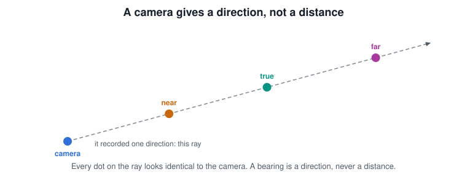

A **ray** (also *sightline* or *line of sight*, LOS) is the line from the camera
through whatever it saw. Every point on that line looks identical to the
camera, so one frame of video places the object somewhere along a line, and
nowhere in particular on it. A *bearing* is the direction of that line.

The **target** is the object being observed. The **platform** is the vehicle
or other support carrying the camera. In these examples, the camera's
positions and sightline directions are known inputs; the target's positions
are unknown. A camera's direction of travel is different from the direction
it points: panning or rotating the camera without moving it adds no parallax.
**Velocity** means speed and direction together, measured in the common
world coordinate system, rather than motion across the image.

## 2. Many rays over time: the exact-ray family

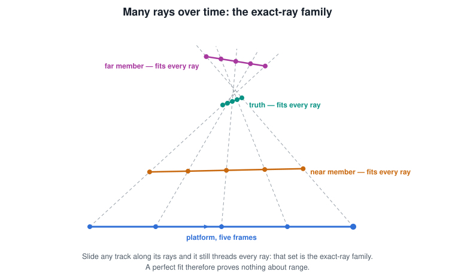

Over a clip the camera records one ray per frame. Take any track that passes
through every ray and slide the whole thing closer to the camera along those
rays, or farther away: it still passes through every ray. The camera cannot
tell the difference. The set of all such tracks is the **exact-ray family**, and
a fit that matches the rays perfectly has therefore proved nothing about
range. This is the fact the rest of the analysis is built around.

## 3. Residual: how far a candidate misses the rays

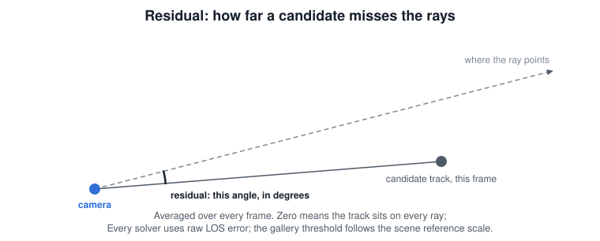

The **residual** of a candidate track is the angle, at the camera, between
where a ray points and where the candidate is at that frame, averaged over the
clip, in degrees. Zero means the candidate sits on every ray. Real sightlines
carry pointing noise, so a small residual is normal. The gallery's screen
(section 9) uses the same raw angular residual for every solver. Its close-fit
threshold is 1.2 times a scene reference scale. The scale is clamped between
0.02° and 0.20° and is not a measured noise level. A catalogued star has a 0.10°
limit (0.15° for a satellite) and no motion screen. The
benchmark's existence test (section 14) uses a tighter resolving floor of
0.02°, about what the truth itself scores. Because every member of the
exact-ray
family has the same (zero) residual, **residual alone can never choose a
range**.

## 4. Parallax: the rays pivot about the object

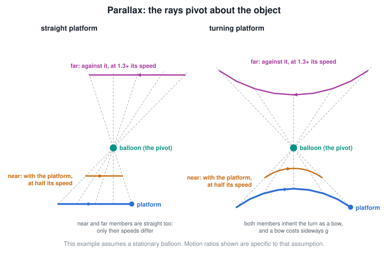

Moving the camera changes the motion implied by different ranges. At half
the range, an alternative track blends half the reference target's motion
with half the camera's motion. Beyond the reference range, the camera's
contribution reverses direction. These alternatives still reproduce every
bearing.

If **both camera and target move straight at constant velocity**, the
alternatives do too. Their positions and velocities differ, but the
straight-line, constant-velocity assumption cannot select a range. If the
camera's *flight path turns* while the reference target keeps constant velocity, that turn
is stamped on wrong-range members as a bend. That bend costs sideways
acceleration (g) that a real object may not be able to produce. That is what
**parallax buys under this target assumption**: a price on wrong ranges,
rather than a range independently of how the target can move.

The g cost can be small. On the Aguadilla sitch the stamped bend cost a
wrong-range member 0.48 g at 51 kt, which passes the broad kinematic screen.
The *shape* of that bend is the platform's own turn, scaled. So the analysis
also compares the candidate's acceleration with the platform's, and reports
the share of time that matches one fixed scaling of it. It does not convert
that match into a range. See
[Does it fly the camera's path?](TraverseAnalysis.md#does-it-fly-the-cameras-path).

### A curved target with a straight-flying camera

**Knowing only that the target curves does not determine its range.** Suppose
the camera position is `C(t)`, one possible target path is `T(t)`, and `k` is
any positive constant. Another possible path is:

    T_k(t) = C(t) + k·[T(t) − C(t)]

Its camera-to-target vector is `k` times the original vector, so it has
exactly the same bearing at every instant. `k = 0.5` puts it at half the range;
`k = 2` puts it at twice the range. This construction works for curved paths
as well as straight ones. It is one family among all the possible range
profiles; the bearings do not require the range ratio to stay constant.

When the camera moves at **constant velocity**, its acceleration is zero, so:

    a_k(t) = k·a_T(t)

The half-range target has half the acceleration, and the double-range target
has twice the acceleration, with the same timing and direction. Alternatives
generally remain curved. A smooth bend, or even a constant but unknown
acceleration, therefore supplies no absolute range scale. The target's
velocity is a blend of target and camera velocities; its speed does not
simply multiply by `k`.

Here, straight flight must include constant speed. A camera that speeds up
or slows down has acceleration even on a straight path. The general
constant-ratio relation is `a_k = k·a_T + (1 − k)·a_C`; known camera
acceleration can help constrain range under a stated target-motion model.

### When a constant-speed turn can constrain range

A **specified turn model** adds more information than "the target curves":

- **A circular arc at constant speed about one fixed centre.** With a moving,
  constant-velocity camera, changing `k` generally adds a uniform drift to the
  scaled circle. The alternative is then a drifting circular motion rather
  than another circle about a fixed centre. Requiring a fixed-centre,
  constant-speed turn can constrain range without supplying its numeric
  speed or radius in advance.
- **Two straight, constant-velocity legs joined continuously at the same
  ground speed.** Most range changes give the two legs different speeds, so
  requiring their speeds to agree can select a range. This fails in special
  geometries, including when the target's velocity component along the
  camera's direction is unchanged by the turn.

**Constant speed alone, with an otherwise unrestricted curved path, does not
guarantee a unique range.** It still leaves freedom to vary range over time.
The speed here is ground speed; applying an airspeed constraint also requires
a wind model. A stationary camera retains the scale ambiguity even for a
constant-speed circle of unknown size. With a moving camera, short or noisy
arcs can still constrain range very weakly.

A range found this way is conditional on the turn model being right. It does
not follow from curvature alone. A supplied start range in the sequential
Constant Ground Speed or Constant Air Speed traverse is still an input;
those methods do not independently fit a circular turn or a pair of legs.

## 5. Conditioning: can the rays pin a range at all?

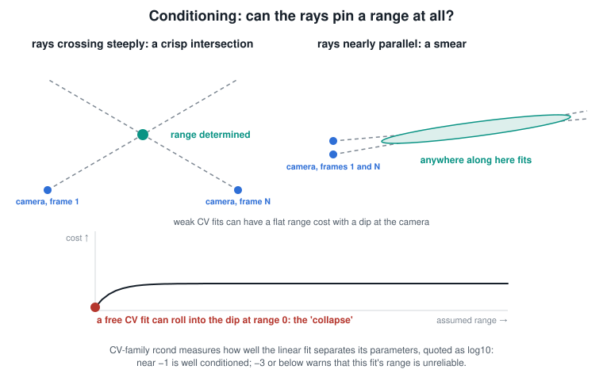

For a stationary point, two rays that cross steeply meet at a crisp point;
nearly parallel rays leave a long smear. A moving-target fit has a similar
question: can it separate the trajectory parameters, including range?
The **CV-family conditioning** diagnostic measures this for the
constant-velocity design system. It is reported as `rcond` on a 0–1 scale,
usually quoted as its log10: near −1 is well conditioned; −3 or below warns
that the CV family's range is unreliable.

In weak geometry, a free fit can **collapse onto the camera**, returning a
very small range with a low residual. That result reflects the fitting
arithmetic rather than a measured distance. The warning belongs to this
solver family: it does not establish that every target model is unable to
constrain range. A constrained turn or another physical model can still be
informative. See [CV-family conditioning and its limits](TraverseMethods.md#range-observability-and-collapse-cv-family-conditioning).

## 6. Priors: how a choice gets made when the rays cannot choose

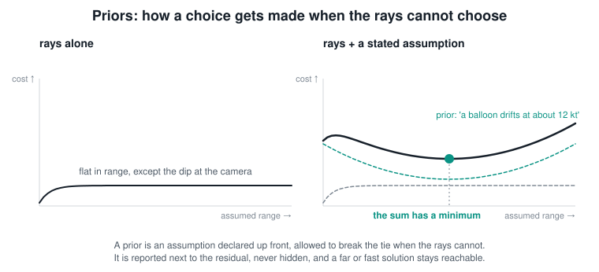

A **prior** is an assumption declared up front — "a balloon drifts at about
12 kt", "an aircraft holds roughly constant air speed" — added to the cost as a
gentle bowl. Where the rays leave the cost flat, the bowl gives it a minimum,
and that is the range the fit reports. The analysis applies three rules to
priors: the assumption is stated, not hidden; what it cost at the solution is
reported next to the residual; and a fast, far or manoeuvring solution stays
*reachable* — a prior may make it less favoured, never impossible. Each fit's
prior defines the assumption that fit tests.

## 7. Ordinariness cost: what a candidate would have to be

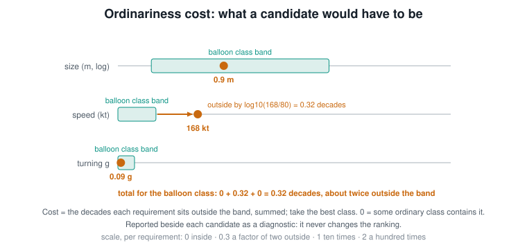

Every candidate track implies a speed and a turning acceleration, and — when
there is an angular-size bound to use — a size (from the object's angular size
at that range). With no bound the size is reported as unmeasured. Measured
angular sizes are used only when angular-size judging is turned on; otherwise
an imported benchmark file's published maximum angular diameter, if present,
gives an upper bound. Each ordinary object **class** —
balloon, bird, multirotor (a quadcopter), small fixed-wing, light aircraft, jet,
airliner — has a band for all three. The **ordinariness cost** is how far the
candidate's three requirements sit outside the nearest class's bands, measured
in decades (a factor of ten is one decade) and added up — the code and older
write-ups call the same quantity the *mundaneness cost*. Zero means some
ordinary class contains it. A cost of 0.3 is what one requirement a factor of
two outside its band costs (or smaller excesses on two or three requirements
adding to the same); 1 is one requirement ten times outside; 2, a hundred
times. It is reported beside each candidate and it **never
moves the ranking** — it says how ordinary an explanation is, not which one to
prefer. The one exception is size: with angular-size judging on, a tile whose
implied size is outside every class its motion allows is marked as a size
conflict, and that conflict demotes it in the ranking and in the verdict.

## 8. A search box is not a physical envelope

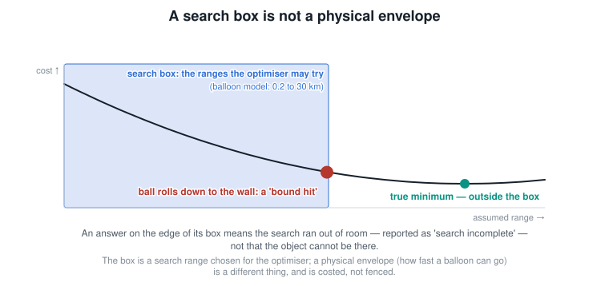

Each model's optimiser is allowed to try values inside a declared **search
box** — for the balloon model, first-ray ranges from 0.2 to 30 km. If the best
answer lies outside the box, the optimiser ends up pressed against the wall: a
**bound hit**, reported as *search incomplete*. That is a gap in the search,
not a finding about the object: the search did not go beyond the bound. The physical limits of a class (how fast a balloon can go) are a
different thing, the *envelope*, and they are costed (section 7), not fenced.

## 9. The verdict is a survivor count

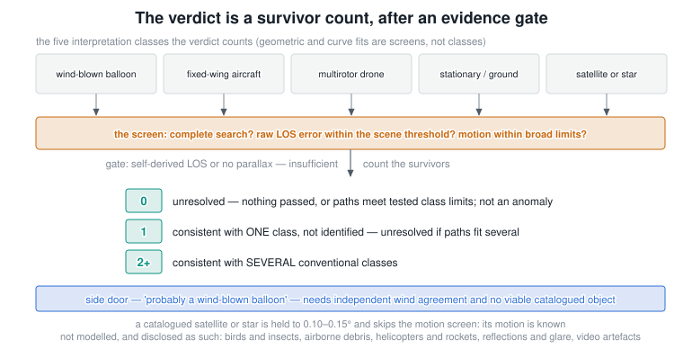

The gallery shows one **tile** per candidate explanation: the physics models,
grouped into five **interpretation classes** — wind-blown balloon, fixed-wing
aircraft, multirotor drone, stationary or ground-bound object, catalogued
satellite or astronomical object — plus the *geometric constructions*, tracks
built straight from the rays with no physics model (a straight line at
constant speed, say), which are compatibility screens rather than classes. An
interpretation class is not a class of section 7: one fixed-wing fit may come
out as a small drone, a light aircraft or an airliner, depending on the size
and speed it implies. Some ordinary causes have no model at all — birds and
insects, airborne debris, helicopters and rockets, reflections and glare,
video artefacts — and the verdict lists them as *not modelled*. Tiles first compare screening
outcomes. When those tie, the BOT Score combines motion and raw LOS residual.
Physical compatibility is shown separately and does not add a class preference
to that score. Each tile passes or fails a **screen**: was the search complete,
does it fit the rays (the same scene-relative threshold for every solver),
and is motion within the broad limits (at most 1.5 g and 650 kt). These broad
limits are separate from each physical class's limits.

The **verdict** first applies an evidence gate: if the sightlines were built
from the same target track being tested, the test would be circular — it
would compare the track with observations generated from itself. The label
*circular LOS* refers to that dependence, not a circular camera flight path.
If this applies, or the sensor's motion gives no usable parallax, the live
gate reports *Insufficient evidence to discriminate*. Otherwise it
counts the interpretation classes with a viable tile: none gives *Unresolved*,
one gives *Consistent with a …, but not identified*, and two or more give
*Consistent with several conventional interpretations*. It also distinguishes
complete **forward-model fits**, which simulate assumed target dynamics,
from compatible path envelopes, which only meet limits on a reconstructed
path. For example, a path from **Horizontal Speed Valley (HSV)** can meet
bird or multirotor speed and acceleration limits without demonstrating that
a simulation of either object's dynamics fits. Several compatible classes leave the object type
unresolved even if only one forward model passed, and the headline then reads
*Object type unresolved — close-fitting paths meet several physical class
limits*. The affirmative wording *Probably a wind-blown balloon* needs a viable
balloon tile, independent wind corroboration, a balloon-like motion
consistency of at least 0.75, and no viable catalogued satellite or astronomical object. Note what
the verdict does not contain: a range. Every wording is listed
in [The executive verdict](TraverseAnalysis.md#the-executive-verdict).

## 10. relSep: how far the found track is from the truth

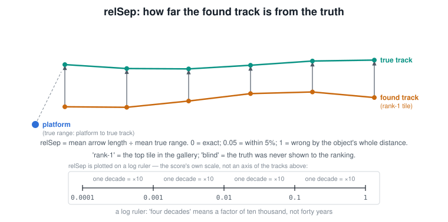

The verdict carries no range, so how is the analysis tested at all? On
benchmark scenarios the true track is known, so a result can be scored.
**relSep** is the average separation between the found track and the true one,
divided by the average true range: 0 is exact, 0.05 is "within 5%", 1 is wrong
by the object's whole distance. **Rank-1** is the top tile in the gallery;
**blind** means the truth was never shown to the ranking, so the score measures
what the analysis concluded on its own. Scores are usually plotted on a log
axis, where "four decades" means a factor of ten thousand.

## 11. Simplex: the optimiser's triangle of guesses

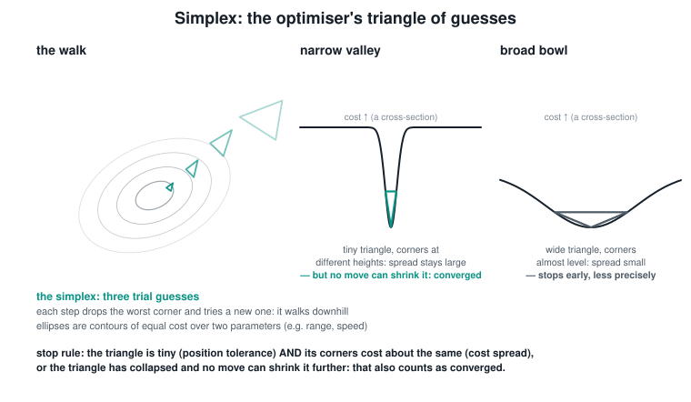

The physics models are fitted by **Nelder–Mead**, which keeps a small set of
trial guesses — in two parameters, a triangle, called the **simplex** — and at
each step drops the worst corner and tries a new one, walking downhill on the
cost. It stops when the triangle is tiny (the *position tolerance*) and its
corners cost about the same (the *cost spread*). In a narrow valley the
triangle can shrink to nothing while its corners still sit at different
heights; no further move could change that, so it has converged even though
the spread test never passed. The analysis treats this as converged, not as
*search incomplete*.

## 12. IFOV: what one pixel can and cannot say about size

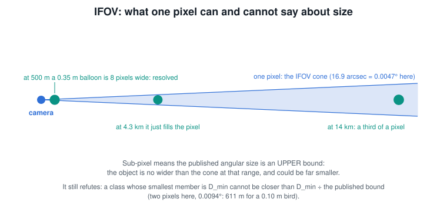

The **IFOV** is the angle one pixel spans — a thin cone from the camera,
16.9 arcseconds for a 3° field on 640 pixels (an *arcsecond* is 1/3600 of a
degree, so 0.0047°). An
object smaller than a pixel is *sub-pixel*: the video only says it is no wider
than the cone at its range, and it could be far smaller, so the published
angular size is an **upper bound** with no lower end (the benchmark publishes
a two-pixel bound, 0.0094°). That bound still refutes: a class whose smallest
member is D_min cannot be closer than D_min divided by the bound, which is why
a collapsed solution pressed against the near end of its search — 500 m, say,
implying an object under 8 cm — pays a size cost no class accepts.

## 13. Two ladders, and two kinds of range

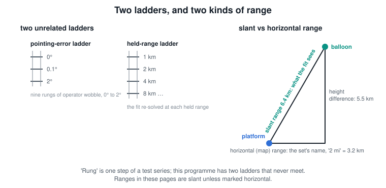

Several numbers on a result page come from a test series rather than from one
fit. A **rung** is one step of such a series, and this work has two ladders
that never meet: the *pointing-error ladder* (an operator model added to the
sightlines, at nine amplitudes from 0.01° to 2°: the aim drifts off the object,
the operator notices and recentres, so the rays wander about the object over
the clip — the observation-error model) and the *held-range ladder* (a model
re-solved with its range held at 1, 2, 4, 8 … km, which maps a solution
family). Ranges are **slant** (straight-line) unless marked horizontal; the
benchmark's balloon sets are named by horizontal miles, so the "2 mi" row is
6.4 km slant once the 5.5 km height difference between platform and balloon
is included (the figure draws the platform low by this page's convention;
in the sets it is the aircraft that is high).

## 14. The existence test: success is not finding the truth

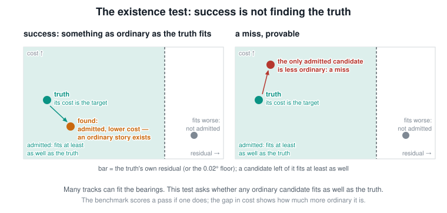

With the scoring of section 10 in hand, what counts as a pass? Different
tracks can fit the same bearings, so this existence test does not require
the true track to be found. Instead the truth sets a bar (its own residual,
or the 0.02° floor) and
its own ordinariness cost; among the candidates that fit at least as well, the
benchmark takes the lowest cost. **A pass is finding something as ordinary as
the truth**, not the truth. If no admitted candidate is as ordinary as a
mundane truth, the benchmark scores a miss.

## 15. Dynamics order: which target-motion models pass the check

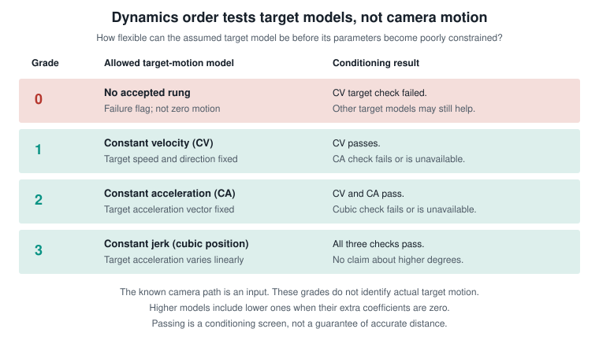

**The order describes the target-motion model allowed in a fit. It does not
describe the camera's motion or identify the target's actual motion.** The
camera track is a known input. Before solving for a target track, the
benchmark uses the observed directions and sample times to check the
conditioning of three target-position models. This is the *pre-fit triage*:
a preliminary check on whether those models' unknown parameters can be
separated by the observations.

| Reported value | Assumed target motion | What the reported maximum means |
|---|---|---|
| **0** | No accepted model in this ladder | The constant-velocity check failed. This is a failure flag, not a motion model. |
| **1** | **Constant velocity (CV)**: one fixed velocity vector, so straight 3D motion at constant speed | CV passes; the constant-acceleration model does not pass or could not be checked. |
| **2** | **Constant acceleration (CA)**: one fixed acceleration vector; target velocity may change | CV and CA pass; the cubic model does not pass or could not be checked. |
| **3** | **Constant jerk**: the target's acceleration vector changes linearly with time | All three tested models pass. Jerk is the rate of change of acceleration. |

The models are **nested**: a constant-velocity path is also a CA path with
zero acceleration, and a CA path is also a constant-jerk path with zero jerk.
A higher order *allows* more target motion; it does not require the target
to accelerate. For example, a grade of 2 allows an unknown constant
acceleration in the fit without making the range parameters too poorly
conditioned by this check. It does not show that the target accelerated.

**Grade 0 means "this distance-conditioning check failed", not "the target's
velocity is nonconstant".** It is not the degree-0 polynomial for a
stationary target. A stationary-target, constrained-turn or physical model
can still constrain range when this polynomial ladder reports 0. Similarly,
grade 3 does not cover arbitrary changing acceleration or arbitrary turns:
the target position is a cubic polynomial in time, and its acceleration
changes at one constant rate. Models above degree 3 are not tested here.

The recorded field is `maxObservableOrder`: the highest consecutive passing
step, starting at CV. A pass uses `log10(rcond) >= −3`; using that threshold
for CA and cubic motion is provisional, not a measured accuracy guarantee.
A missing value means the sampling was insufficient to compute the ladder.
Even a passing grade does not show that the target obeys the assumed model
or that a fitted range will be accurate. The live verdict uses the separate
evidence gate in section 9, not this benchmark grade.

The *fast-far trap* illustrates why these limits matter: a Mach-5 object at
116 km and a 330 kt aircraft at 7 km can fit the same bearings. A confident
ordinary-object verdict can therefore miss the fast, distant target. In the
benchmark, an ordinary verdict on a declared anomaly is a *false negative*;
grade 0 warns that the polynomial conditioning check provides no basis for
resolving that ambiguity. **Identifiability** asks whether the observations
constrain the unknown parameters under a stated model; **attributability**
asks whether they distinguish an object class.

## 16. The benchmark: a deck of scenarios with answer keys

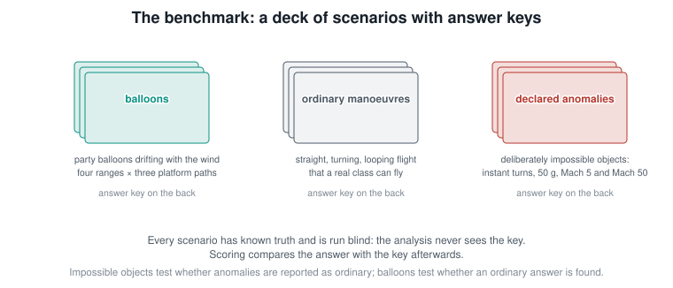

The **botsets** are generated scenarios with known truth: balloons drifting at
four ranges on three platform paths, ordinary manoeuvres a real class can fly,
and *declared anomalies* — deliberately impossible objects (instant turns,
50 g, Mach 5, Mach 50) — which test whether the analysis reports them as
ordinary when the rays could separate them. Every run is
blind. "Clean" means no pointing error was
added; an *error rung* adds the operator wobble of section 13. Named cases you will
meet in the other pages — Gimbal, Go Fast, Aguadilla — are real videos that
have sitches in Sitrec.

## Words used without pictures

- **LOS** — line of sight; a ray. **A–B range** — the frame interval selected
  for analysis. **Sitch** — a Sitrec situation file: the scene, tracks and video.
- **Kalman smoother** — a sequential filter that estimates a track frame by
  frame and then smooths it backwards; one of the curve fits.
- **B-spline** — a smooth curve built from control points; the flexible fit.
  **IRLS** — iteratively re-weighted least squares, a way of fitting that
  down-weights outlying frames.
- **RK4** — a standard way of integrating a physics model forward in time.
  **DE** — differential evolution, a global optimiser used to seed the physics
  fits before Nelder–Mead polishes them.
- **Gallery / tile / screen / price** — the results view, one card per
  candidate, the pass/fail test on each card, and turning a motion requirement
  into a cost.
- **Seed** — the starting guess handed to an optimiser. **Tractability set**
  — a benchmark subset selected by a stated feasibility check. In the
  dynamics-order screening, order 1 or more means the CV conditioning check
  passed; it is not proof that a fit will recover range, or that other
  target models fail on the excluded cases.
- **Plate** — a numbered explanatory figure in the analysis write-ups.

## Read next

- [Traverse Methods](TraverseMethods.md) — each fitting method in turn.
- [How the Balloon Algorithms Work](BalloonAlgorithms.md) — the drift models,
  wind assumptions and search, explained with diagrams and a worked example.
- [Traverse Analysis and the Verdict](TraverseAnalysis.md) — the gallery, the
  ranking and the badges.
