# The Ideas Behind the Traverse Analysis

Read this before [Traverse Analysis and the Verdict](TraverseAnalysis.md) or the
[BOTBench](BOTBench.md) page if words like *residual*, *prior*, *simplex*,
*conditioning* or *relSep* are new to you. A **traverse** is a 3D path for an
object, found by combining the camera's sightlines with a physical assumption.
Sections 1 to 9 build the analysis in order, one idea and one picture each.
Sections 10 to 16 each add one further topic.

The whole problem in one line: **each frame gives a direction to the object,
not a distance.** Everything else follows from that.

## 1. A camera gives a direction, not a distance

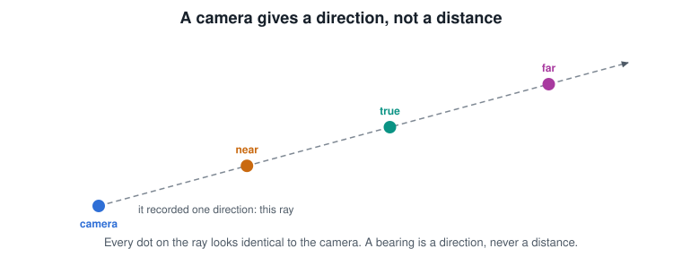

A **ray** (also *sightline* or *line of sight*, LOS) is the line from the camera
through whatever it saw. Every point on that line looks identical to the
camera, so one frame of video places the object somewhere along a line, and
nowhere in particular on it. A *bearing* is the direction of that line.

The **target** is the object being observed. The **platform** is the vehicle
or other support carrying the camera. In these examples, the camera's
positions and sightline directions are known inputs; the target's positions
are unknown. A camera's direction of travel is different from the direction
it points. Panning or rotating the camera without moving it adds no
**parallax**, the change in viewing direction caused by a change in camera
position.
**Velocity** means speed and direction together, measured in the common
world coordinate system, rather than motion across the image.

## 2. Many rays over time: the exact-ray family

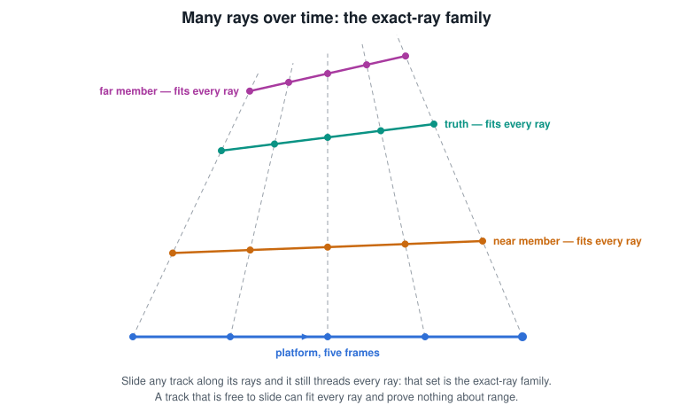

Over a clip the camera records one ray per frame. Take any track that passes
through every ray. Each frame's point can slide along its own ray, closer to the
camera or farther away, by its own amount, and the track still passes through
every ray. That is one unknown per frame, and the camera cannot tell the
difference. The set of all such tracks is the **exact-ray family**. A track that
is free to do this can match the rays perfectly and prove nothing about range.
A motion model can reject wrong ranges, but only conditional on that model
(section 4). This is the fact the rest of the analysis is built around.

## 3. Residual: how far a candidate misses the rays

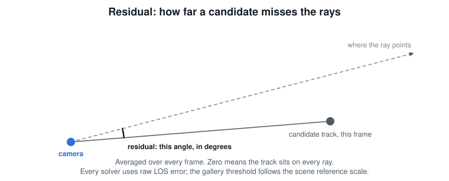

The **residual** of a candidate track is the angle, at the camera, between
where a ray points and where the candidate is at that frame, averaged over the
clip, in degrees. Zero means the candidate sits on every ray. Real sightlines
carry pointing noise, so a small residual is normal. Every member of the
exact-ray family has the same residual, zero, so **among tracks free to follow
the rays, residual alone cannot choose a range**. Section 9 shows how the
gallery uses the residual.

## 4. Parallax: the rays pivot about the object

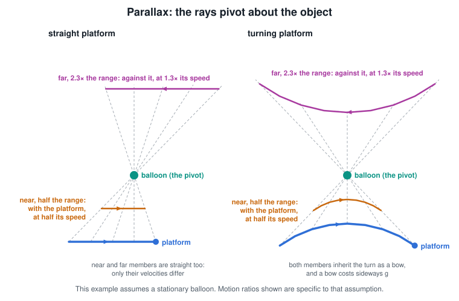

Moving the camera changes the motion implied by different ranges. Take one
track that fits the rays as the reference. At half its range, an alternative
track blends half the reference motion with half the camera's motion. Beyond
the reference range, the camera's contribution reverses direction. These
alternatives still reproduce every bearing. The figure uses a stationary
reference, so its rays pivot about one point.

If **both camera and target move straight at constant velocity**, the
alternatives do too. Their positions and velocities differ, but the
straight-line, constant-velocity assumption cannot select a range. If the
camera's *flight path turns* while the reference keeps constant velocity, that
turn is stamped on wrong-range members as a bend. That bend needs sideways
acceleration, in **g** (one g is 9.8 m/s²), that a real object may not be able
to produce. That is what **parallax buys under this target assumption**: a
price on wrong ranges, rather than a range independently of how the target can
move. The price depends on range. A member at `k` times the reference range
needs `|1 − k|` times the platform's acceleration, so a nearer member never needs
more acceleration than the platform, and a far member needs more as range grows.

The acceleration needed can be small. On the Aguadilla sitch (a saved Sitrec
scene) the stamped bend asked a wrong-range member for 0.48 g at 51 kt (knots),
which is inside the motion limits of section 9. The *shape* of that bend is the platform's own turn,
scaled. So the analysis also compares the candidate's acceleration with the
platform's, and reports the share of time that matches one fixed scaling of it.
A significant match over half or more of the assessed time fails the screen of
section 9 and adds to the BOT Score defined there. The analysis does not convert that match
into a range. See
[Does it fly the camera's path?](TraverseAnalysis.md#does-it-fly-the-cameras-path).

What a turning *target* can and cannot show is covered under
[curved targets](#a-curved-target-with-a-straight-flying-camera), after
section 16.

## 5. Conditioning: can the rays pin a range at all?

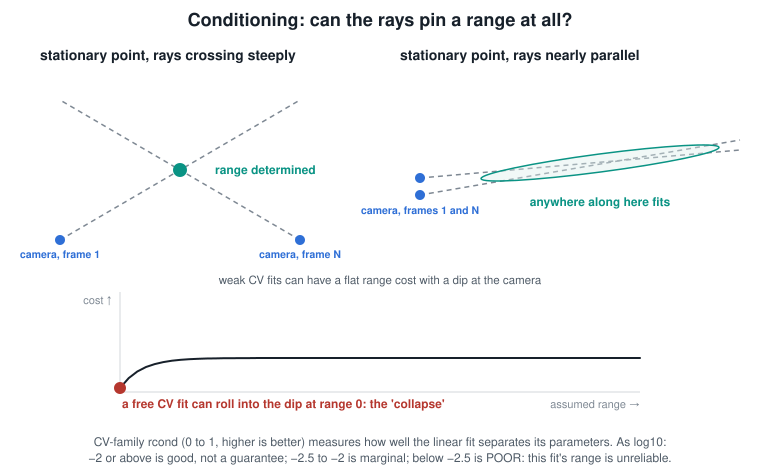

For a stationary point, two rays that cross steeply meet at a crisp point;
nearly parallel rays leave a long smear. A moving-target fit has a similar
question: can it separate the trajectory parameters, including range?
The **CV-family conditioning** diagnostic asks this for **constant-velocity
(CV)** fits, which assume one fixed velocity. It is reported as `rcond`
(reciprocal condition number), a number from 0 to 1 where higher is better, quoted as its log10: −1 means 0.1 and −2
means 0.01. At −2 or above the label is *good*. From −2.5 to −2 it is
*marginal*. Below −2.5 it is *POOR*: the CV family's range is unreliable.

`rcond` is a one-way warning. It uses the observed directions and times, not
the camera positions, so a *good* label does not show that the rays pin a range.
Pointing error and target turns raise `rcond`, so a noisier clip can score
higher.

In weak geometry, a free fit can **collapse onto the camera**, returning a
very small range with a low residual. Every ray starts at the camera, so a track
that stays with the camera touches every ray. That result reflects the fitting
arithmetic rather than a measured distance. The warning belongs to this
solver family: it does not establish that every target model is unable to
constrain range. A constrained turn or another physical model can still be
informative. See [CV-family conditioning and its limits](TraverseMethods.md#range-observability-and-collapse-cv-family-conditioning).

## 6. Priors: how a choice gets made when the rays cannot choose

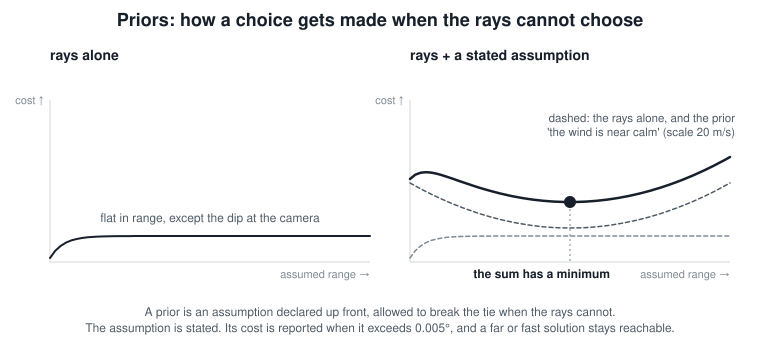

A fit's **cost** is the number it tries to make small. The residual is part of
it. A **prior** is an assumption declared up front, such as "the wind is near
calm" on a 20 m/s scale for a balloon, or "the aircraft cruises near a target
speed, straight and level", added to the cost as a gentle bowl. Each assumed
range implies a wind or a speed, so the bowl has a shape in range too. Where the
rays leave the cost flat, the bowl gives it a minimum, and that is the range the
fit reports. There, the fit adopts the prior and does not test it.

The analysis applies three rules to priors. The assumption is stated, not
hidden. What it cost at the solution is reported next to the residual, in
degrees, when it exceeds 0.005° (one unit of cost equals 0.02° of residual). A
fast, far or manoeuvring solution stays *reachable*: a prior
may make it less favoured, never impossible. The reported number is the penalty,
not the prior's effect, and a small penalty can still decide the range.

## 7. Ordinariness cost: what a candidate would have to be

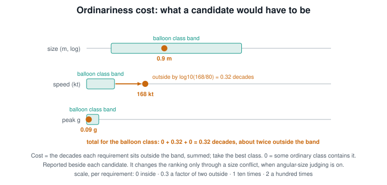

Every candidate track implies a speed and a peak acceleration. With angular-size
judging turned on (an analysis option), it also implies a size, from the object's angular size at
that range. With judging off, the size is not assessed, even when the file
records an angular size. Each ordinary object **class** — balloon, bird,
multirotor (a quadcopter), small fixed-wing, light aircraft, jet, airliner — has
a band for all three.

The **ordinariness cost** is how far the candidate's requirements sit outside
the bands of the nearest class, measured in decades (a factor of ten is one
decade) and added up. It is separate from a fit's cost (section 6). The code and
older write-ups call it the *mundaneness cost*. Zero means some ordinary class
contains the candidate. For one requirement, 0.3 means a factor of two outside
its band; 1, ten times; 2, a hundred times. Smaller excesses on two or three
requirements add up to the same totals.

The cost is reported beside each candidate. It says how ordinary an explanation
is, not which one to prefer, and it does not move the ranking. The one exception
is size: with angular-size judging on, a candidate whose implied size is outside
every class its motion allows is marked as a size conflict, and that conflict
demotes it in the ranking and in the verdict.

## 8. A search box is not a physical envelope

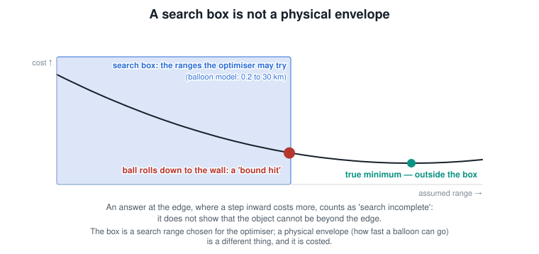

Each model's optimiser is allowed to try values inside a declared **search
box** — for the balloon model, first-ray ranges from 0.2 to 30 km. If the best
answer lies outside the box, the optimiser ends up pressed against the wall: a
**bound hit**. That is a gap in the search, not a finding about the object: the
search did not go beyond the bound. A bound counts only when a step inward makes
the fit worse. It then fails that tile as *search incomplete*, and the tile
shows *Model limit hit*, or *Wind search edge* for a wind parameter. Section 11
gives the other way a search can be incomplete.

The physical limits of a class (how fast a balloon can go) are a different
thing, the *envelope*, and they are costed (section 7). A box can share a number
with an envelope, as the multirotor speed limit does, but it remains a search
limit.

## 9. The verdict is a survivor count

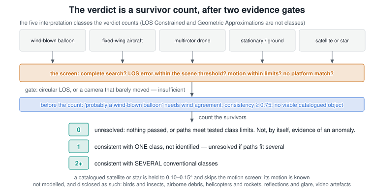

**The gallery.** The gallery shows one **tile** per candidate explanation. The
tiles that count are grouped into five **interpretation classes**: wind-blown
balloon, fixed-wing aircraft, multirotor drone, stationary or ground-bound
object, and catalogued satellite or astronomical object. The other tiles are
labelled *LOS Constrained* and *Geometric Approximations*: tracks built straight
from the rays with no physics model (a straight line at constant speed, say).
Apart from the ground-vehicle track, which counts in the stationary class, they
describe motion the rays permit, not object types. An interpretation class is
not a class of section 7: one fixed-wing fit may come out as a small drone, a
light aircraft or an airliner, depending on the size and speed it implies. Some
ordinary causes have no model at all — birds and insects, airborne debris,
helicopters and rockets, reflections and glare, video artefacts — and the report
lists them as *not modelled*.

Each tile passes or fails a **screen**:

- Was the search complete?
- Does it fit the rays? A **solver** is any method that produces a track, and
  every solver uses the same raw residual. The close-fit threshold is 1.2 times
  a scene reference scale: the residual left by a free constant-acceleration
  track, clamped between 0.02° and 0.20°. That scale is not a measured noise
  level. A catalogued star has a 0.10° limit (0.15° for a
  satellite) and no motion screen.
- Is the motion within the broad limits, at most 1.5 g and 650 kt? These are
  separate from each physical class's limits.
- Does it avoid a sustained match to the platform's acceleration (section 4)?

A tile that passes the screen is **viable**: a survivor. With angular-size
judging on, a size conflict (section 7) also removes viability, and the tile
keeps its *Passes broad screen* label. Tiles first compare screening outcomes. When those tie, the **BOT Score** orders them (BOT means
bearings-only traversal). It adds weighted acceleration, turn-rate and climb
terms, so gentler motion ranks higher, plus the residual divided by 0.05° and a
penalty for a platform match. It has no pass/fail limit and no class preference.
Tiles that tie the top tile on every pass/fail key are marked co-leaders: the BOT
Score orders them only as a heuristic tie-break.

**The verdict.** The **verdict** first applies two evidence gates:

- If the sightlines were built from the same target track being tested, the test
  would be circular: it would compare the track with observations generated from
  itself. The label *circular LOS* refers to that dependence, not a circular
  camera flight path. The gate reports *Insufficient independent evidence to
  discriminate*.
- If the camera barely moved (its track spans under 0.1% of the analysis start
  distance, with a 2 m minimum), the gate reports *Insufficient evidence to
  discriminate*. This gate does not detect a straight, constant-speed camera,
  which can still leave range to the priors.

It then tests for *Probably a wind-blown balloon*. That wording needs a viable
balloon tile, independent wind corroboration, a balloon-like motion consistency
of at least 0.75, and no viable catalogued satellite or astronomical object. A
viable aircraft or drone class does not block it. No probability is computed.
The corroboration is agreement between the fitted wind and the loaded winds
aloft, and a steady-drift path meets the consistency test by construction. On a
straight, constant-speed camera path with steady drift, the rays fix one wind component at every
range, and range sets the other. A mismatch in the second component counts only
against the fitted range. A mismatch in the first counts against steady drift at
every range, unless the weather wind changes with height.

Otherwise it counts the interpretation classes with a viable tile. The count
distinguishes two kinds of evidence. A **forward-model fit** simulates assumed
target dynamics. A **compatible path** only meets a class's limits on a
reconstructed path: a path from **Horizontal Speed Valley (HSV)**, a geometric
method with no object model, can meet bird or multirotor speed and acceleration
limits without showing that a simulation of either object's dynamics fits.

- None gives *Unresolved — no completed tested conventional model passes the
  current screen*. If a compatible path exists, it gives *Object type unresolved
  — close-fitting paths meet tested physical class limits*. The verdict states
  that this is not, by itself, evidence of an anomalous object: the pointing noise
  is not calibrated, the envelopes were not exhaustively excluded, and the
  not-modelled causes remain open.
- One gives *Consistent with a …, but not identified*. If compatible paths meet
  several classes, it gives *Object type unresolved — close-fitting paths meet
  several physical class limits*.
- Two or more give *Consistent with several conventional interpretations*.

The headline states no range, but each tile is judged at its fit's one selected
range, which a prior can set. Every wording is listed in
[The executive verdict](TraverseAnalysis.md#the-executive-verdict).

## 10. relSep: how far the found track is from the truth

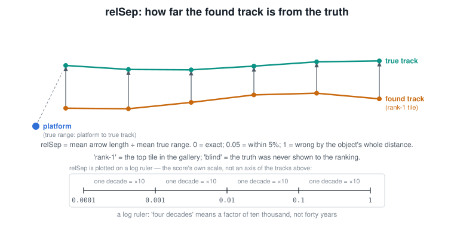

The verdict carries no range, so how is the analysis tested at all? On
benchmark scenarios the true track is known, so a result can be scored.
**relSep** is the average separation between the found track and the true one,
divided by the average true range: 0 is exact, 0.05 is "within 5%", 1 is wrong
by the object's whole distance. **Rank-1** is the top tile in the gallery;
**blind** means the truth was never shown to the ranking, so the score measures
what the analysis concluded on its own. Scores are plotted on a log
axis, where "four decades" means a factor of ten thousand.

## 11. Simplex: n + 1 trial guesses in n-dimensional parameter space

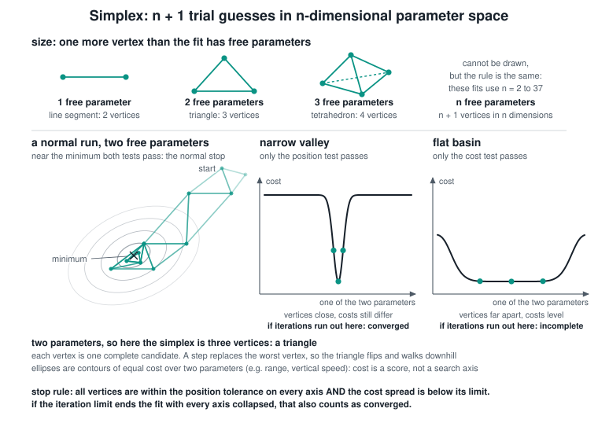

The physics fits in the table below use **Nelder–Mead**, an optimiser that keeps
a set of trial guesses and moves them downhill on the fit's cost (section 6).
The set of guesses is the **simplex**. **The simplex is a shape in parameter
space, not in the sky, and it is a triangle only when a fit has exactly two free
parameters.**

**The dimensions are the fit's free parameters.** A *free parameter* is one
number the fit is allowed to change, such as the range on the first ray or the
east wind. Each free parameter is one axis of **parameter space**, so a fit
with *n* free parameters searches an *n*-dimensional space. These axes are not
the three dimensions of the scene, and they have different units: metres on
one, metres per second on the next. One point in this space gives a value for
every parameter, so one point is one complete candidate track. Cost is not a
dimension. It is the score calculated for a point, and the search cannot set
it directly.

**The simplex is *n* + 1 of those points.** Each point is a **vertex** (a
corner). *n* + 1 is the smallest number of points that can span *n* dimensions.
With fewer, the shape would be flat, and the search could not step along the
missing direction. One parameter gives a line segment, two give a triangle and
three give a tetrahedron, a solid with four triangular faces. Above three, the
shape cannot be drawn, but the rule and the arithmetic stay the same.

| Fit | Free parameters, *n* | Vertices, *n* + 1 |
|---|---|---|
| Balloon, by stage and wind treatment | 2 to 8 | 3 to 9 |
| Quadcopter, supplied or fitted wind | 7 or 9 | 8 or 10 |
| Fixed Wing Aircraft, in the Physics method | 8 | 9 |
| Sky Lantern, in the Physics method | 12 | 13 |
| Drone control inputs, by clip length | 13 to 37 | 14 to 38 |

A triangle is therefore the smallest case here: a steady Balloon fit with
supplied wind, which searches only range and vertical speed. Holding a
parameter fixed, as the held-range ladder of section 13 does with range,
removes that axis, so *n* falls by one.

Two fits do not follow this section. The gallery's fixed-wing tiles use a
separate fit from the Physics method's Fixed Wing Aircraft: differential
evolution followed by a pattern search, which improves one point and keeps no
simplex. The Wind Tracer has its own Nelder–Mead on up to 9 parameters, and it
stops on a cost test alone.

**How a simplex starts.** The start point is the first vertex. Each parameter
then adds one vertex: a copy of the start with only that parameter changed, by
a step size the model sets for it. Here is the starting simplex of a steady
Balloon fit with fitted wind, from the model's default values. It has four
dimensions and five vertices. Each row is a vertex and each column is a
dimension:

| Vertex | Range (m) | East wind (m/s) | North wind (m/s) | Vertical speed (m/s) |
|---|---|---|---|---|
| 1, the start | 3000 | 0 | 0 | 0 |
| 2 | 3500 | 0 | 0 | 0 |
| 3 | 3000 | 2 | 0 | 0 |
| 4 | 3000 | 0 | 2 | 0 |
| 5 | 3000 | 0 | 0 | 0.5 |

In the analysis the start is a differential evolution result, a seed track or
an earlier fit, not the defaults. If a step would leave the search box of
section 8, it goes the other way along that axis.

**How it moves.** Each iteration ranks the vertices by cost and tries to replace
the worst one. It reflects that vertex through the **centroid**, the average of
the others. A reflection changes all *n* coordinates in one step, so range and
wind can change together. A longer step (*expansion*) or a shorter step
(*contraction*) can replace the reflection. If nothing helps, every vertex except
the best moves halfway toward the best (*shrink*). The search uses only the costs
at the vertices, so it needs no derivative. Section 7 of
[How the Balloon Algorithms Work](BalloonAlgorithms.md) draws one step.

**How it stops.** A fit ends normally only when two tests pass at the same
iteration:

- **Position tolerance.** On every axis, every vertex lies within one millionth
  of the search box width from the best vertex. Each axis is measured against
  its own box width, so axes with different units can use the same test.
- **Cost spread.** The highest and lowest vertex costs differ by less than
  10⁻⁸.

These limits decide when the search stops. They do not measure accuracy. One
test alone does not end the fit: on the figure's *flat basin*, vertices far apart
cost the same, so the search continues. If the two tests never pass at the same
iteration, the iteration limit ends the fit, at 5000 iterations by default, 600
on the held-range ladder and 400 for drone control inputs. If every axis has
collapsed by then, as on the figure's *narrow valley*, the gallery treats the fit
as converged. Otherwise the fit keeps the *Optimizer incomplete* warning and
counts as *search incomplete*, with one exception that
[Why a good fit can still read "Unresolved"](BOTBench.md#why-a-good-fit-can-still-read-unresolved)
explains. The live Physics method does not report this outcome.

## 12. IFOV: what one pixel can and cannot say about size

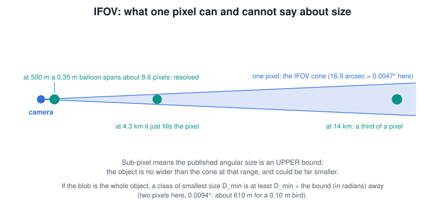

The **IFOV** is the angle one pixel spans — a thin cone from the camera,
16.9 arcseconds for a 3° field on 640 pixels (an *arcsecond* is 1/3600 of a
degree, so 0.0047°). An object smaller than a pixel is *sub-pixel*: the video
only says it is no wider than the cone at its range, and it could be far
smaller, so the published angular size is an **upper bound** with no lower end
(the benchmark publishes a two-pixel bound, 0.0094°).

The bound still limits near ranges, on two conditions: angular-size judging is
on, and the blob covers the whole object. A light or a hot spot on an unseen body
breaks the rule. A class whose smallest member is D_min is then no closer than
D_min divided by the bound in radians: about 610 m for a 0.10 m bird at the
two-pixel bound. A collapsed solution pressed against the near end of its search,
500 m say, implies an object at most about 8 cm wide. That is below every class's
smallest member, narrowly for a bird, so it adds a size cost. Size alone can put
a candidate outside a class. A size conflict (section 7) needs a size outside
every class its motion allows.

## 13. Two ladders, and two kinds of range

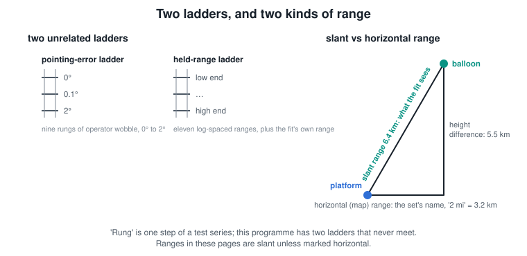

Several numbers on a result page come from a test series rather than from one
fit. A **rung** is one step of such a series, and this work has two ladders that
never meet:

- The *pointing-error ladder* adds an operator model to the sightlines, at nine
  rungs from 0° (no added error) to 2°. The aim drifts off the object, the
  operator notices and recentres, so the rays wander about the object over the
  clip. This is the observation-error model.
- The *held-range ladder* re-solves a model with its range held at eleven
  log-spaced ranges across the searched bracket, plus the fit's own range. This
  maps a solution family.

Ranges are **slant** (straight-line) unless marked horizontal. The benchmark's
balloon sets are named by horizontal miles, so the set named "2 mi" is 6.4 km
slant once the 5.5 km height difference between platform and balloon is included.
The figure draws the platform low, by this page's convention; in the sets the
aircraft is above the balloon.

## 14. The existence test: success is not finding the truth

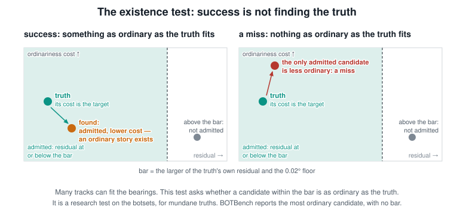

With the scoring of section 10 in hand, what counts as a pass? Different tracks
can fit the same bearings, so this research test on the botsets (section 16) does
not require the true track to be found. BOTBench does not score it. Its table
shows **OrdMin**, the most ordinary candidate in the gallery, with no residual
bar.

The truth sets two things: its own ordinariness cost, and a bar on the residual,
which is the larger of the truth's own residual and a 0.02° floor. The floor is a
chosen resolution limit; on a clean set the truth's residual is far below it.
Among the candidates at or below the bar, the test takes the lowest ordinariness
cost. For a mundane truth, **a pass is finding something as ordinary as the
truth**, not the truth. If no admitted candidate is as ordinary as a mundane
truth, the test scores a miss.

For a declared anomaly the question reverses. An ordinary candidate can exist
even so, and it is not a pass: BOTBench marks *Unresolved* as the correct outcome
on that row.

## 15. Dynamics order: which target-motion models pass the check

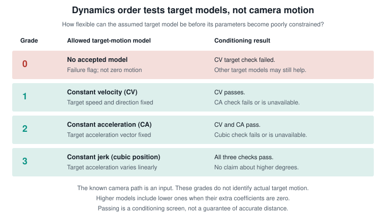

**The dynamics order, or grade, describes the target-motion model allowed in a
fit. It does not describe the camera's motion or identify the target's actual
motion.** The camera track is a known input. Before solving for a target track,
the benchmark uses the observed directions and sample times to check the
conditioning of three target-position models. This is the *pre-fit triage*. Like
`rcond` in section 5, it is a one-way warning: it does not use the camera
positions, and pointing noise can raise a grade.

| Grade | Assumed target motion | What the grade means |
|---|---|---|
| **0** | No accepted model | The constant-velocity check failed. This is a failure flag, not a motion model. |
| **1** | **Constant velocity (CV)**: one fixed velocity vector, so straight 3D motion at constant speed | CV passes; the constant-acceleration model does not pass or could not be checked. |
| **2** | **Constant acceleration (CA)**: one fixed acceleration vector; target velocity may change | CV and CA pass; the cubic model does not pass or could not be checked. |
| **3** | **Constant jerk**: the target's acceleration vector changes linearly with time | All three tested models pass. Jerk is the rate of change of acceleration. |

The models are **nested**: a constant-velocity path is also a CA path with
zero acceleration, and a CA path is also a constant-jerk path with zero jerk.
A higher grade *allows* more target motion; it does not require the target
to accelerate. For example, a grade of 2 allows an unknown constant
acceleration in the fit without making the range parameters too poorly
conditioned by this check. It does not show that the target accelerated.

**Grade 0 means "this distance-conditioning check failed", not "the target's
velocity is nonconstant".** It is not the degree-0 polynomial for a
stationary target. A stationary-target, constrained-turn or physical model
can still constrain range when this polynomial check reports 0. Similarly,
grade 3 does not cover arbitrary changing acceleration or arbitrary turns:
the target position is a cubic polynomial in time, and its acceleration
changes at one constant rate. Models above degree 3 are not tested here.

The recorded field is `maxObservableOrder`: the highest consecutive passing
model, starting at CV. A pass uses `log10(rcond) >= −3`. This limit is separate
from the live labels in section 5, so a value of −2.8 reads *POOR* there and
passes here. Using that threshold for CA and cubic motion is
provisional, not a measured accuracy guarantee. A missing value means the
sampling was insufficient to compute the grade. Even a passing grade does not
show that the target obeys the assumed model or that a fitted range will be
accurate. The live verdict uses the separate evidence gates in section 9, not
this benchmark grade.

The *fast-far trap* illustrates why these limits matter: a 1700 m/s glide at
116 km and a 330 kt aircraft at 7 km can fit the same bearings. A confident
ordinary-object verdict can therefore miss the fast, distant target. The
benchmark scorer counts one named ordinary class on a declared anomaly as a
false identification; grade 0 warns that the polynomial conditioning check provides no basis for resolving
that ambiguity. **Identifiability** asks whether the observations constrain the
unknown parameters under a stated model; **attributability** asks whether they
distinguish an object class.

## 16. The benchmark: a deck of scenarios with answer keys

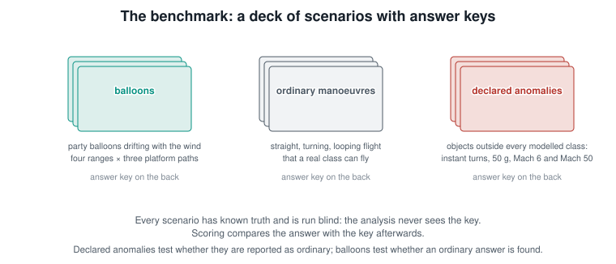

The **botsets** are generated scenarios with known truth: balloons drifting at
four ranges on three platform paths, ordinary manoeuvres a real class can fly,
and *declared anomalies* — objects outside every modelled class (instant turns,
50 g, Mach 6, Mach 50) — which test whether the analysis reports them as
ordinary. Every run is blind. "Clean" means no pointing error was added; an
*error rung* adds the operator wobble of section 13. The named recordings you
will meet in the other pages — Gimbal, Go Fast, Aguadilla — are real videos that
have sitches in Sitrec.

## Curved targets and constrained turns

This part extends section 4.

### A curved target with a straight-flying camera

**Knowing only that the target curves does not determine its range.** Suppose
the camera position is `C(t)`, one possible target path is `T(t)`, and `k` is
any positive constant. Another possible path is:

    T_k(t) = C(t) + k·[T(t) − C(t)]

Its camera-to-target vector is `k` times the original vector, so it has
exactly the same bearing at every instant. `k = 0.5` puts it at half the range;
`k = 2` puts it at twice the range. This construction works for curved paths
as well as straight ones. It is one family among all the possible range
profiles; the bearings do not require the range ratio to stay constant.

When the camera moves at **constant velocity**, its acceleration is zero, so:

    a_k(t) = k·a_T(t)

The half-range target has half the acceleration, and the double-range target
has twice the acceleration, with the same timing and direction. Alternatives
generally remain curved. A smooth bend, or even a constant but unknown
acceleration, therefore supplies no absolute range scale. The target's
velocity is a blend of target and camera velocities; its speed does not
simply multiply by `k`.

Here, straight flight must include constant speed. A camera that speeds up
or slows down has acceleration even on a straight path. The general
constant-ratio relation is `a_k = k·a_T + (1 − k)·a_C`; known camera
acceleration can help constrain range under a stated target-motion model.

### When a constant-speed turn can constrain range

A **specified turn model** adds more information than "the target curves":

- **A circular arc at constant speed about one fixed centre.** With a moving,
  constant-velocity camera, changing `k` generally adds a uniform drift to the
  scaled circle. The alternative is then a drifting circular motion rather
  than another circle about a fixed centre. Requiring a fixed-centre,
  constant-speed turn can constrain range without supplying its numeric
  speed or radius in advance.
- **Two straight, constant-velocity legs joined continuously at the same
  ground speed.** Most range changes give the two legs different speeds, so
  requiring their speeds to agree can select a range. This fails in special
  geometries, including when the target's velocity component along the
  camera's direction is unchanged by the turn.

**Constant speed alone, with an otherwise unrestricted curved path, does not
guarantee a unique range.** It still leaves freedom to vary range over time.
The speed here is ground speed. A real aircraft holds air speed, so in steady
wind its level turn is a drifting circle. With a straight, constant-speed camera,
every `k` gives another such turn, with air speed `k·v` and wind
`k·W + (1 − k)·V_C`, where `v` and `W` are the reference air speed and wind and
`V_C` is the camera velocity. **An unknown steady wind and air speed therefore
leave range free.** A stationary camera retains the scale ambiguity even for a constant-speed
circle of unknown size. With a moving camera, short or noisy
arcs can still constrain range very weakly.

A range found this way is conditional on the turn model being right. It does
not follow from curvature alone. A supplied start range in the sequential
Constant Ground Speed or Constant Air Speed traverse of
[Traverse Methods](TraverseMethods.md) is still an input;
those methods do not independently fit a circular turn or a pair of legs.

## Words used without pictures

- **LOS** — line of sight; a ray. **A–B range** — the frame interval selected
  for analysis. **Sitch** — a Sitrec situation file: the scene, tracks and video.
- **Kalman smoother** — a sequential filter that estimates a track frame by
  frame and then smooths it backwards; one of the curve fits.
- **B-spline** — a smooth curve built from control points; the flexible fit.
  **IRLS** — iteratively re-weighted least squares, a fit that repeats a weighted
  solve and updates the weights to handle a nonlinear cost.
- **RK4** — a standard way of integrating a physics model forward in time.
  **DE** — differential evolution, a global optimiser used to seed the physics
  fits before Nelder–Mead polishes them.
- **Gallery / tile / screen / price** — the results view, one card per
  candidate, the pass/fail test on each card, and turning a motion requirement
  into a cost.
- **Seed** — the starting guess handed to an optimiser.

## Read next

- [Traverse Methods](TraverseMethods.md) — each fitting method in turn.
- [How the Balloon Algorithms Work](BalloonAlgorithms.md) — the drift models,
  wind assumptions and search, explained with diagrams and a worked example.
- [Traverse Analysis and the Verdict](TraverseAnalysis.md) — the gallery, the
  ranking and the badges.
