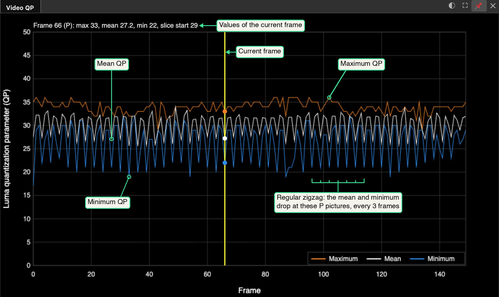

# Video QP Graph

The **QP Graph** shows how hard each frame of an H.264 video was compressed. H.264 is a video
compression format. The graph plots the **maximum**, **mean** and **minimum**
[quantization parameter (QP)](Glossary.md#images-and-brightness) of every frame, against the
frame number. Use it to find the frames that were compressed most coarsely, for example before
you read small on-screen text.

Use the checkbox on the **Video → Forensics → QP Graph** folder to show or hide it.

## What QP is

An H.264 encoder divides each picture into 16×16-pixel areas called **macroblocks**. For each
macroblock it selects a **quantization parameter** (QP) from 0 to 51. QP sets how coarsely the
encoder rounds the image data of that block:

- A **low QP** keeps fine detail and uses more bits.
- A **high QP** discards detail and uses fewer bits. Small text and thin lines become blurred or
  blocky.

An increase of 6 in QP doubles the rounding step. The visible loss at a given QP also depends on
the picture, so no single QP value marks a frame as good or bad.

An encoder can use one QP for a whole frame, or it can change QP from block to block. So a frame
can have a *range* of QP values, and the graph shows that range:

| Line | Meaning |
|---|---|
| **Maximum** (orange) | The highest QP of any macroblock in the frame: the coarsest quantization |
| **Mean** (white, or black in a light theme) | The average QP of all macroblocks in the frame. Every block has the same weight |
| **Minimum** (blue) | The lowest QP of any macroblock in the frame: the finest quantization |

There is one value for each frame and no smoothing. These are luma (brightness) QP values. The
graph does not show chroma (color) QP.

## How to use it

1. Load an H.264 video. It can be in an `.mp4`, `.mov` or `.ts` file, or a raw `.h264` file.
2. Set **Video → Forensics → QP Graph** to on.
3. Sitrec reads the video in the background. The graph fills in as the data arrives. In a test,
   a 7,000-frame standard-definition video of 50 MB took approximately 10 seconds.

The yellow line is the current frame. **Click or drag in the graph** to move to a frame. The
text above the graph gives the values of the current frame: the picture type, the three QP
values, and the **slice start** QP of the first slice. The picture type is I (stored on its own),
or P or B (predicted from other pictures).

*The graph of a test clip, with green labels added. The three dots on the yellow line mark the
values of the current frame. After the first frame, this clip has two B pictures and then one P
picture, again and again. The mean and minimum lines drop at the P pictures, so these two lines
make a regular zigzag. The maximum line does not. Another encode can give a different pattern.*

Double-click an empty part of the header bar of the graph, or click its ⛶ button, to make the
graph fill the window. Do the same again to restore it. Drag its edges to change its size. Drag
its header bar, or the margin around the plot, to move it.

The **◐** button in the header of the graph, to the left of the fullscreen button, changes
between a **dark** theme (white on black) and a **light** theme (black on white). The light
theme is better for a printed document: the mean line becomes black, the maximum and minimum
lines become a darker orange and a darker blue, and the yellow line becomes amber. Many other
graphs and 2D panels have this button, and **Sitrec → Settings → Theme** sets all of those
together: see [Dark and light themes](UserInterface.md#dark-and-light-themes).

The graph and its position are saved with the sitch while the graph is shown. Its theme is
saved when you set it with the ◐ button, or when it is different from your Theme setting.

## What it tells you

- **Changes in QP through a clip.** A step up in all three lines for a range of frames means
  that the encoder used coarser quantization for those frames, so fine detail such as small
  on-screen text is reproduced less accurately. The graph does not show why the QP changed.
- **Picture types.** An encoder can use a different QP for I, P and B pictures, so a regular
  pattern in the lines can follow the picture types. The text above the graph gives the type of
  the current frame.

### What it does not tell you

- **Last encode only.** The graph shows the QP of the file you loaded. If a video was compressed
  more than once (for example, a download from a video-sharing site), the graph shows only the
  last encode. Damage from an earlier, heavier encode does not show in it, so a low QP does not
  show that the video was never heavily compressed.
- **No position.** The graph gives three values for each frame, not a value for each area of the
  picture. The highest QP can be anywhere in the frame, so the graph does not show the QP at a
  particular light or object.
- **No test for editing.** The graph reports QP. It does not test for editing or re-encoding.

## Where the numbers come from

The values are **read from the video bitstream**. They are not an estimate made from how the
picture looks.

A browser's video decoder does not give access to QP, so Sitrec has its own reader for this
part of the H.264 format. For each slice (a coded part of a picture), the bitstream gives a
**slice start** QP. Then each macroblock can carry a change to that value (`mb_qp_delta`), and
the new value carries forward to the next block. Sitrec follows these changes through every
block of every frame. It does not rebuild any pixels, which is why it is fast.

These are the same values that FFmpeg's decoder prints with its `-debug qp` option. The Sitrec
reader was checked against FFmpeg for every macroblock of several test videos, and the results
were the same.

Three details:

- A macroblock that stores no new image detail has no QP data of its own. An example is a
  **skipped** macroblock, which the encoder predicts from other pictures. It is reported with
  the QP that was in effect at that point. So its QP does not mean that new detail was saved
  there at that quality.
- A macroblock stored as raw samples (`I_PCM`, which is rare) is reported as QP 0.
- For video with more than 8 bits per sample, the values include the bit-depth offset, as in
  FFmpeg (for 10-bit video the range is 0 to 63).

## What it cannot read

The graph shows a message when it cannot read a video:

- **HEVC / H.265**, which some phones record. The QP data of this format is different, and
  Sitrec does not read it.
- H.264 streams that use **CAVLC** entropy coding, one of the two ways that H.264 packs its data
  into bits. All Baseline profile streams use it, and Main and High profile streams can use it.
  Sitrec reads only the other way, **CABAC**.
- **Interlaced** H.264 (field pictures or MBAFF).
- 4:2:2 and 4:4:4 chroma formats, and some rare stream features (slice groups, data
  partitioning, SP / SI slices).
- Still images and image sequences, which have no encoded video frames.

AV1, VP9 and ProRes video does not load in Sitrec, so the graph cannot read it.

If you re-encode a video to H.264 so that the graph can read it, the graph shows the QP of your
re-encode, not of the original. The `ffmpeg` command that Sitrec suggests for an AVI file also
re-encodes the video. For H.264 video in an AVI file, copy the video stream instead, which keeps
the original QP values: `ffmpeg -i input.avi -c:v copy -c:a aac output.mp4`. If `ffmpeg` prints
`pts has no value`, the video has B pictures. The MP4 then has its frames in decoding order, not
display order, so the video and the graph show them out of order.

## See also

**Related checks.** [Lens Ghost](LensGhost.md): a second image from a reflection inside the
camera. [Diffraction Glare](DiffractionGlare.md): spikes around a bright point.
[Long Exposure/Stacking](LongExposure.md): what a long exposure of the simulated sky looks like.
[Video Noise Pattern Detection](VideoNoisePattern.md): noise that appears again in later frames.

- [Rendering and Exporting Video](Video.md): the **Compression** section sets the container,
  bitrate and keyframe interval of an export.
- [Error Level Analysis](LoadingVideo.md#error-level-analysis) and
  [Noise Analysis](LoadingVideo.md#noise-analysis): these tools show a result for each place in a
  frame.
- [Video Tonal Range Graph](VideoTonalRange.md)
