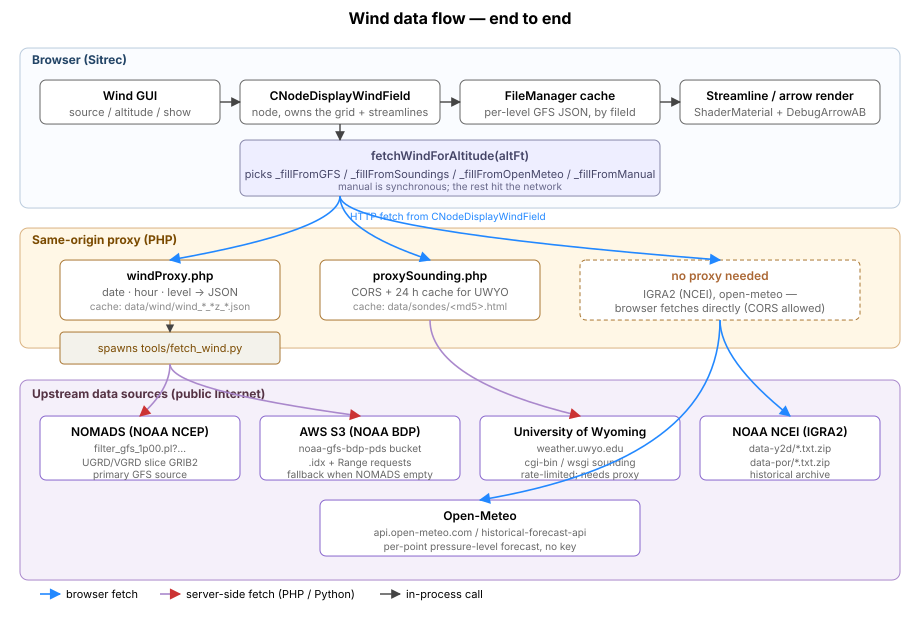
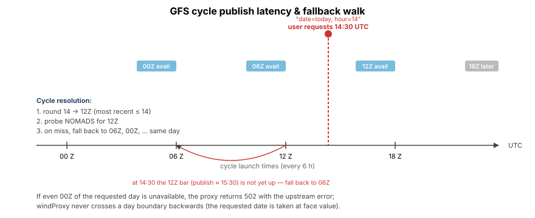
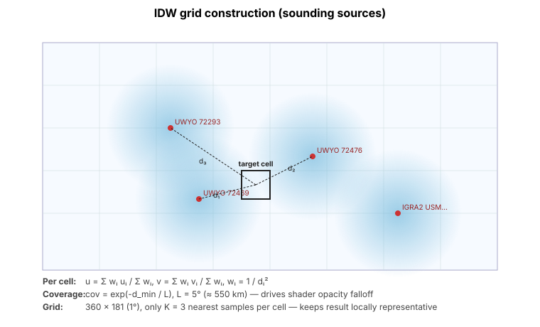
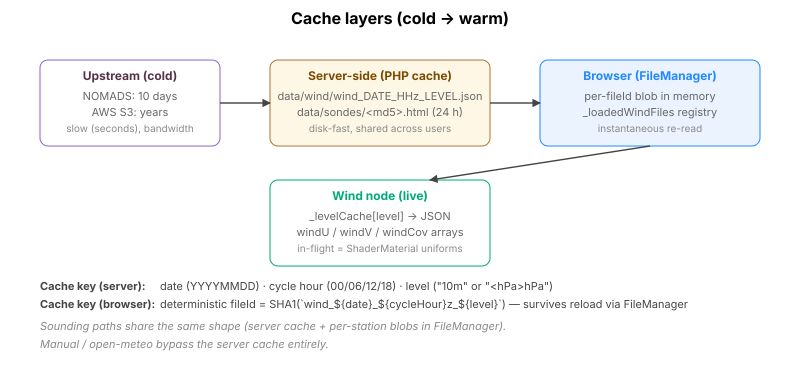

# Wind: data flow, formats, and sources

Companion to [Wind.md](Wind.md). That doc explains what each control does; this one explains the implemented data sources, how data moves through the stack, and what the on-disk and in-memory formats look like.

## Conventions used below

A few short names recur:

- **`wn`** — shorthand for "the wind node", `NodeMan.get("windField")` (an instance of `CNodeDisplayWindField` defined in `src/nodes/CNodeDisplayWindField.js`). The Wind GUI binds directly to its fields.
- **`par`** — Sitrec's global runtime-parameter object (`import {par} from "../par"`). `par.windStatus` is a view of `wn.statusText` (a write goes through `wn.setStatusMessage`); `par.balloonCount` controls how many nearby sounding profiles are requested.
- **GFS** — the NOAA Global Forecast System. Numerical weather prediction model run four times daily.
- **MISB** — Motion Imagery Standards Board. Standard 0601 defines the tag set used by aircraft pod metadata, including wind direction (tag 35, degrees the wind blows **from**) and wind speed (tag 36, **metres per second**).
- **eccodes** — ECMWF's GRIB decoding library (`pip install eccodes` + a system shared lib). `tools/fetch_wind.py` imports it.

## End-to-end flow



Three lanes:

1. **Browser (Sitrec)** — `CNodeDisplayWindField` (`src/nodes/CNodeDisplayWindField.js`) is the wind node. It owns the wind grid, the streamline mesh's `ShaderMaterial`, the screen-space arrow grid, and the arrows and readouts of **Show Wind at** (its `inspect*` fields). The Wind GUI binds directly to its fields.
2. **Same-origin proxy (PHP)** — two scripts in `sitrecServer/`:
   - `windProxy.php` — wraps `tools/fetch_wind.py` to give the browser a stable JSON endpoint for GFS data, and caches every result in `data/wind/` keyed by date / cycle hour / level.
   - `proxySounding.php` — CORS-bridges the University of Wyoming sounding endpoints (the browser cannot fetch them directly because UWYO sets no CORS headers). 24 h disk cache keyed by URL hash in `sitrec-cache/`.
3. **Upstream public sources** — NOMADS (NOAA NCEP), AWS S3 (NOAA Big Data Program), University of Wyoming, NOAA NCEI (IGRA2), Open-Meteo.

IGRA2 and Open-Meteo are fetched *directly from the browser* — both serve `Access-Control-Allow-Origin: *`, so no PHP proxy is required. Manual and Manual-Soundings sources never touch the network at all.

## The live wind: `windAt` and the wind nodes

Sitrec has one wind function, `CNodeDisplayWindField.windAt(sourceKey, lat, lon, altM, f)`: the wind from one source at a place, a height (metres MSL) and a frame. It returns `{u, v, status}` (u east, v north, m/s). Everything that uses a wind reads it, directly or through a wind node. It is synchronous: data that is not loaded is asked for, and the answer is marked until it arrives.

| `status` | Meaning |
|---|---|
| `ok` | Inside the data. |
| `held-above` / `held-below` | Above the highest or below the lowest data; that end's wind is held. For a sounding source, `held-above` is above every station's top, and `held-below` is below the lowest wind of every station used. |
| `below-ground` | More than 10 m under the terrain (`TerrainModel.elevationMap`; no terrain, no such status). |
| `pending` | Data for this point is loading. `u`/`v` are from the nearest loaded data, or null. |
| `no-data` | Nothing for this source here (or a level failed to load). |

Per source: a sounding source uses `_blendSoundingProfiles` (three nearest stations, `windAtAltitude` by binary search); `gfs` and `custom` use `_sampleGridColumn` (below); `openmeteo` uses a column per point (see [Open-Meteo](#open-meteo)); `manual` is Target Wind's From/Knots; a telemetry `track:` key is `_telemetryWindAt(f)`, the same at every place. `sampleWindAtAltitude(lat, lon, altM, f)` is `windAt` for the Target source returning only `{u, v}` or null; the balloon, contrails, thermal view and traverse wind evidence use it.

**GFS on a point.** `_sampleGridColumn(sourceKey, lat, lon, altM, f)` reads the two grid times around the time of frame f (`gridTimesAround(ms, cadenceH)`: the cycle at or before it and the next one, 6 h apart for GFS) and blends them by time (`blendGridSamples`; decision D5, 2026-11-03). A later cycle that cannot be had (not published yet) leaves the earlier one alone; one that is loading makes the status `pending`. Each time is read by `_sampleGridColumnAt`, which builds the column with `gridColumnBracket(altM, groundM, heights)` (`WindHelpers.js`): the 10 m product at ground + 10 m, then each pressure level above that at its real height there (`_columnHeights`: the bilinear sample of the level's `hgt` field, the GFS geopotential height, which `fetch_wind.py` writes since 2026-11-03). When a loaded level of that time has no `hgt` (a file cached before, a source that gives none), every level of the column takes its standard-atmosphere height, so one column never mixes the two. Measured against radiosondes, the real heights changed little in mild weather (−0.9 to +0.4 kt, 2.5–12 km, Colorado December 2021 and the Southwest in June 2023; near the ground in the Great Lakes storm of 2022-12-23, two stations better and two worse by up to 1.1 kt) and helped in cold air aloft: 2023-02-04 00Z, 2.5–12 km, Gray ME 10.9 → 8.9 kt and Maniwaki 8.2 → 6.2 kt (`private/probes/GfsNearGroundMeasure.js` gives the rules side by side). A level under the terrain is left out: its value is the model's extrapolation, not a wind. Before 2026-11-03 the 10 m product sat at 33 ft MSL everywhere. Measured against radiosondes 10–2,000 m above the ground, the new column was better or equal in 6 of 7 station-days: on the Colorado windstorm of 2021-12-16 00Z, mean vector error at Flagstaff (2,179 m) went from 9.9 to 6.3 kt (11.0 to 4.5 kt in the lowest 300 m), at Denver from 8.8 to 9.7 kt; on 2023-06-15 12Z it improved by 0.2–0.8 kt at three stations. The largest remaining error near high ground is the 1° grid itself (Grand Junction: about 15 kt by either rule). A missing level is put in a queue (`_requestLevels`: three at a time, a failed level is not asked for again for 60 s); `_fetchLevel` changes `_sourceDataVersion` when a level arrives. The level cache key is `levelKey(sourceKey, dateStr, hour, level)`, so GFS and an installation's grid source never share a level.

**The wind nodes.** `CNodeWind` (`targetWind`, `localWind`) has a `role` ("target", "local"); `sourceKeyFor(role)` on the wind field gives its source. `windStateAt(f, position)` returns `{from, knots, status, sourceKey}`, in this order:

1. Target Wind with **Lock Target Wind to Local** on: Local Wind's `windStateAt` at the same position.
2. **Override** on: its own From/Knots, status `override`.
3. A telemetry `trackSource`: `trackWindAt(f)`.
4. A source other than Manual: `windAt` at the position's latitude, longitude and MSL height. With no wind there, its last From/Knots with that status.
5. Otherwise (Manual): its own From/Knots, status `manual`.

`getValueFrame(f, position)`, `windVectorAt(f, position)` and `v(f)` all come through `windStateAt`. `CNodeWind.getValue` is overridden to read frame f: a wind node has no frames of its own, and `CNode.getValue` read frame 0 for every f, so until 2026-11-03 the users that call `setPosition(pos)` then `v(f)` (Flight Sim `CNodeJetTrack`, the Constant Ground Speed and Straight Line traverses, `CNodeTurnRateFromClouds`) had the frame-0 wind of a telemetry track.

`update(f)` writes the value at the node's own track (`originTrack`) into From/Knots for display, makes the sliders read-only while it reads a source, and shows the Override checkbox under any source except Manual. Users never read From/Knots, so this needs no recalculation. A recalculation of the users (`recalculateCascade`) comes only when `windSignature()` changes: the source, Override, a lock, the trackSource, the wind field's `_sourceDataVersion` or `sondeProfileSignature(key)`. `_sourceDataVersion` changes when a grid level or an Open-Meteo column arrives or the grids are dropped; `_windDataVersion` changes on every rebuild of the displayed grid (an **Altitude** step) and must not drive a recalculation. Caches of results that used the wind key on `windCacheKey()` (the signature, plus From/Knots under Manual or Override): the balloon bake fingerprint and the traverse analysis fingerprint. The analysis reports the per-frame series in its dataset (`datasetWindSeries`, `describeWindSeries` in `AnalyzeTraverse.js`).

`propagateToWindNodes()` copies nothing now: it loads the data at each node's track (`loadDataFor`), so the first value after a load is a loaded one. **Show Wind at** reads the Camera and Target readouts through `localWind.windStateAt` and `targetWind.windStateAt`, and the other readouts through `windAt` for the Target source; it never falls back to the display altitude. A held value (`held-above`, `held-below`) carries `limitM`, the height (m MSL) of the data it is held from, and the readout gives it.

### Where the wind comes from: Status and the readouts

`sourceFacts(sourceKey, lat, lon)` describes the data that a source gives near a point: its menu name (`windSourceShortLabel`), the data time (the GFS cycle from the `refTime` of a loaded level of the current cycle, the launch of the nearest sounding from `CNodeAtmosphericProfile.launchTimeMs()`, the Open-Meteo hour), the count of soundings, the distance to the nearest data, the grid spacing, and the heights of the lowest and highest wind. `provenanceText()` makes the **Status** line from it, at the target (with Separate Wind Sources and two sources, also at the camera). After a load, `fetchWindForAltitude` calls `_showProvenance()`, and `update()` makes the line again at most twice a second, because the distance changes as the target moves and data arrives. A message (loading, an error, a fit result) goes through `setStatusMessage()`, which stops that until the next load. `readoutSourceText()` gives the short form for a readout. `windProvenance(role)`, the sentence in the analysis report, takes the GFS cycle from `sourceFacts` too, not from the displayed lines.

Every wind speed on the Wind panel is in one unit: `windSpeedUnit(Units, wn.windInKnots)` in `WindHelpers.js` gives the abbreviation and the factor from knots (Units' speed unit, or knots with **Wind in Knots** or **Feet only**). Every height is in Units' height ("small") unit: `windHeightUnit(Units)` and `heightText(m, unit)` (feet, or metres for Metric); **Wind in Knots** does not change heights. The Altitude row keeps `wn.windAltFt` in feet (saves and the GFS level table use feet) and shows it through a proxy row in the height unit, as **Altitude (ft)** or **Altitude (m)** (`wn.onWindHeightUnitChanged`). The nodes keep knots (`CNodeWind`) and m/s (the grids, `maxWindSpeed`); `CNodeWind.speedInUnit` and the Max Speed row convert at the GUI. A change of Units reaches `changeUnits()` on the nodes (CUnits calls it on every node that has it); **Wind in Knots** calls `wn.refreshWindSpeedRows()`.

The readout boxes are placed by `placeReadoutBoxes()` (`WindHelpers.js`): each goes to the first corner around its point that covers no other box and no menu (`_menuRects()`, the root lil-gui panels on the screen), else to the corner that covers least, then down past a box it still covers. They are at z-index 8000, under the menu bar (9000).

**Show Wind at** turns on by itself the first time the user changes the wind in a sitch, if it was never on there (`noteWindChanged()`, called from the source rows, Override, the Target and Local Wind values and Local from Constant Camera; `showAtEverOn` is saved).

## Per-source pipelines

Each entry in `WIND_SOURCES` (`src/nodes/WindSources.js`) maps to one branch inside `CNodeDisplayWindField.fetchWindForAltitude(altFt)`:

| Internal key | Branch | Upstream | Goes through | Grid build |
|---|---|---|---|---|
| `gfs` | `_fillFromGridSource(altFt)` | NOMADS GRIB filter, AWS S3 fallback | `windProxy.php` → `fetch_wind.py` → eccodes | direct (already gridded) |
| `custom` | `_fillFromGridSource(altFt)` | env `CUSTOM_WIND_URL` template | `customWindProxy.php` | direct (already gridded) |
| `uwyo` | `_fillFromSoundings(altFt, "uwyo")` | weather.uwyo.edu WSGI endpoint | `proxySounding.php` (CORS, caching, rate limiting) | **IDW** |
| `igra2` | `_fillFromSoundings(altFt, "igra2")` | ncei.noaa.gov IGRA2 zips | direct browser `fetch()` | **IDW** |
| `manual-soundings` | `_fillFromSoundings(altFt, "manual-soundings")` | files the user dropped in (IGRA2, UWYO-CSV, or UWYO-LIST — content-detected; or an XML profile in a configured layout) | `FileManager.parseResult()` → `CTrackFileSonde` / `CTrackFileSoundingXML` | **IDW** |
| `openmeteo` | `_fillFromOpenMeteo(altFt)` | api.open-meteo.com / historical-forecast-api.open-meteo.com | direct browser `fetch()` | **IDW** |
| `manual` | `_fillFromManual(altFt)` | nothing — reads `targetWind.from` / `.knots` | none | IDW (or uniform if no wind-node positions) |
| `track:<id>` | `_fillFromTrackSource(altFt)` | MISB columns 35 / 36 on the named track | none | IDW (or uniform if no wind-node positions) |

The `custom` source row is only present when `SITREC_USE_CUSTOM_WIND=true`; its dropdown label comes from `SITREC_CUSTOM_WIND_MENU_NAME` (default "Custom Wind"). It shares `_fillFromGridSource` with `gfs` — both expect the same earth.nullschool-format gridded JSON. The `manual-soundings` key is resolved internally to "accept all loaded profiles" (`_resolveSoundingProfiles` maps it to `_gatherSondeProfiles(null)`).

The four IDW sources land in **`_buildGridFromSamples(samples, sourceLabel)`**; manual usually does too (it anchors its one vector at the wind-node positions), falling back to `_buildUniformGrid(u, v, sourceLabel)` only when there are no such positions; GFS calls `_applyWindJSON` directly with the gridded JSON the proxy returns. The IDW path produces a 1° / 360×181 grid like GFS's native one, and the uniform path a 5° / 72×37 grid (a uniform field needs no detail) — but either way the streamline mesh and arrow overlay sample it identically. **The shader code never sees source-specific logic** — by the time it's drawing, every source looks identical.

### GFS (the heavy path)

```
Browser:
  CNodeDisplayWindField._fillFromGridSource(altFt)   // shared by gfs + custom
  ├ pick pressure level bracketing altFt (10 m, 1000, 925, 850, 700, 500, 300, 250, 200 hPa…)
  ├ pick the two grid times around the playhead's time (gridTimesAround; the weight is
  │   taken to the half hour, and update() fills again when it or the interval changes,
  │   then drops the grids of times more than two intervals away: _pruneGridTimes)
  ├ for each time: check FileManager for cached fileId  → hit: parse and apply
  └ miss: fetch  sitrecServer/windProxy.php?date=YYYYMMDD&hour=HH&level=…

windProxy.php:
  ├ check ../data/wind/wind_<date>_<HH>z_<level>.json
  │    ├ exact-cycle hit  → readfile + exit
  │    └ earlier-cycle hit (<4 h old)  → readfile + exit  (tolerates upstream lag)
  └ shell out: python3 ../tools/fetch_wind.py --date … --hour … --level …

fetch_wind.py:
  ├ try NOMADS GRIB-filter URL (small partial download — UGRD/VGRD, and HGT on a pressure level)
  │    https://nomads.ncep.noaa.gov/cgi-bin/filter_gfs_1p00.pl?file=…&dir=/gfs.YYYYMMDD/HH/atmos
  ├ on miss, fall back to AWS S3 with byte-ranged .idx slicing
  │    https://noaa-gfs-bdp-pds.s3.amazonaws.com/gfs.YYYYMMDD/HH/atmos/gfs.tHHz.pgrb2.1p00.f000
  ├ cycle fallback walk: requested HH → HH-6 → HH-12 → … → 00 (same day only)
  ├ decode GRIB2 with eccodes (extract Ni, Nj, lon0, lat0, dlon, dlat, U/V values, and the
  │   geopotential height "gh" of a pressure level as `hgt`)
  └ write JSON to the cache directory

Browser (continued):
  ├ compress JSON with pako and FileManager.add(fileId, json, compressed.buffer)
  │   — `skipSerialization = true`; save only the level/date/cycle catalog
  ├ this._levelCache[levelKey(sourceKey, dateStr, hour, level)] = json
  ├ this.windU / windV = the two levels blended by height, the two times by time
  └ rebuildStreamlines() + propagateToWindNodes()   // loads the data at the wind nodes' tracks
```

#### GFS cycle timing



GFS launches at 00 / 06 / 12 / 18 Z. Each cycle takes **~3.5–4 h** to publish to NOMADS — so a request submitted at, say, 14:30 UTC for the 12 Z cycle of *today* may find the data not yet uploaded. Two layers of fallback handle this:

- **`windProxy.php` cache layer** — earlier cycles for the same day, already cached, are served if they're less than 4 h old. This avoids hammering NOMADS with retries while the upstream slowly publishes.
- **`fetch_wind.py` cycle walk** — if the requested hour is genuinely missing, the script tries `HH - 6`, `HH - 12`, … down to 00 of the same day, on both NOMADS and AWS in turn.

**The fallback walk is same-day only.** There is no automatic walk *backwards across days* — if the browser asks for date 20260427 hour 00 and even AWS doesn't have it, the proxy returns a 502 with the upstream error in the body, and the wind node surfaces it through `wn.statusText`.

#### Worked example

Browser asks for `date=20260427&hour=14&level=500` at 14:30 UTC same day:

1. windProxy.php rounds 14 → 12Z (the most recent ≤ 14).
2. Looks for `data/wind/wind_20260427_12z_500hPa.json` — miss (12Z published ≈ 15:30, not yet).
3. Looks for `data/wind/wind_20260427_06z_500hPa.json` — hit (cached when an earlier user requested 06Z), modified 4 h ago, **served**.

If the 06Z cache hadn't existed, fetch_wind.py would have shelled out: NOMADS for 12Z (404), AWS for 12Z (404), NOMADS for 06Z (200), JSON written, served. Net result the same — the user sees 06Z data with a status line they can read.

If they request data 12 hours later for the same date, the cycle walk lands on 12Z directly and 18Z if they request the next morning's data.

#### GFS resolution

`fetch_wind.py --resolution` defaults to `1p00` (1 °) — the most reliably-cached level on NOMADS. `0p25` and `0p50` are also accepted by the URL builder but are not currently surfaced through `windProxy.php`. The 1 ° grid (`Ni = 360, Nj = 181`) is plenty for visualization at typical viewport scales. Sitrec uses the GFS grid *at its native resolution* — it does **not** downsample it to 72 × 37; `_fillFromGridSource` applies the proxy JSON's `nx`/`ny` verbatim. The 72 × 37 (5 °) grid is exclusive to the IDW sources and Manual. The streamline shader and arrow overlay sample whatever grid is loaded (full-res for GFS, 72 × 37 for the IDW sources) bilinearly via `sampleWind()`.

#### GFS retention

- **NOMADS** keeps a rolling ~10 days of cycles. Older requests will 404.
- **AWS S3 (noaa-gfs-bdp-pds)** is the deeper archive — years of data, but not infinite. The bucket is read-only public, no key required. The `atmos/` layout that `fetch_wind.py` reads starts with the 12Z cycle of **2021-03-22**, so `windProxy.php` refuses earlier dates with a 400.
- For dates outside both windows, the user has to switch to one of the sounding sources.

### Soundings (UWYO / IGRA2 / Manual)

```
Browser:
  CNodeDisplayWindField._fillFromSoundings(altFt, sourceKey)
  ├ _gatherSondeProfiles(sourceKey) — walks every loaded SondeProfile node,
  │   filters to the requested source (or accepts all if sourceKey===null)
  ├ for each profile, sample (u, v) at altFt → samples[]
  │   (a station more than 305 m above the top of its wind data gives no sample,
  │   as in the point blend; above every station's top, the highest station's
  │   top wind is held)
  ├ if samples.length === 0 → throw a real error (fetchWindForAltitude shows it)
  └ _buildGridFromSamples(samples, label)

User-side fetching (separate from the above):
  CustomManagerSetup._ensureSoundingsForWind(sourceKey)
  ├ if profiles of that kind already exist → return true
  └ else: getNearbyWeatherBalloons(par.balloonCount, autoKey)
            ├ pick K nearest stations from data/igra2-stations.json
            │   (one station database for both UWYO and IGRA2 — UWYO has no separate file)
            ├ for each: fetchUWYOSounding(...) or fetchIGRA2Data(...)
            │   on UWYO 429 → uwyoRateLimitUntil = now + 66 s, retry later
            │   on no-data or fewer than two usable wind levels → try the next station
            │   stop after count × 3 attempts (or the end of the station list)
            └ FileManager.add(filename, parsedProfile) → creates a CNodeAtmosphericProfile
```

#### UWYO

UWYO's web endpoints don't allow cross-origin requests, so the browser hits `sitrecServer/proxySounding.php` instead. The proxy:

1. Builds a WSGI URL for either `TEXT:LIST` or `TEXT:CSV`. The retired CGI endpoint is no longer used.
2. Hashes the URL with MD5 and looks for `sitrec-cache/<md5>.html`. A positive response is cached for 24 hours.
3. Checks a negative-cache marker, `sitrec-cache/<md5>.miss`, before contacting UWYO. A missing sounding older than 12 hours is cached for 30 days; a recent miss is retried after one hour.
4. On a cold cache miss, applies a per-client limit of 20 real upstream requests per minute, fetches with curl, and stores either the response or a missing marker. Positive and negative cache hits do not consume the request budget.
5. Returns `X-Sounding-Cache: hit`, `miss`, `miss-hit`, or `miss-store`, which distinguishes the four cache outcomes.

The browser also enforces a **client-side rate limit**: after a 429, all UWYO calls in the tab pause for 66 s (`RATE_LIMIT_DELAY_MS`) and update the status field with a countdown.

#### IGRA2

IGRA2 (Integrated Global Radiosonde Archive v2) is hosted by NOAA NCEI at `https://www.ncei.noaa.gov/data/integrated-global-radiosonde-archive/access/` and serves `Access-Control-Allow-Origin: *`. The browser fetches the per-station `.txt.zip` directly:

```
data-y2d/<station>-data-beg<currentYear>.txt.zip   (year-to-date)
data-y2d/<station>-data-beg<currentYear-1>.txt.zip (previous year, sometimes still open)
data-por/<station>-data.txt.zip                    (period-of-record, full history)
```

The zip is decompressed in-browser, the requested sounding is selected from the (potentially huge) archive, and the parsed profile is added to FileManager.

#### Manual Soundings

A pass-through. The user drag-and-drops a sounding file in one of three text formats: IGRA2, UWYO-CSV (the per-second GPS CSV), or UWYO-LIST (the older HTML table). As the parse pipeline runs, `CTrackFileSonde.canHandle()` calls `detectSondeFormat()` to figure out which format it is — detection is **content-based**, not by file extension — and picks the matching parser. The result is a `CNodeAtmosphericProfile` node, same as if it had been fetched. Picking **Manual Soundings** in the source dropdown disables the auto-fetch, leaving whatever the user has already loaded.

A fourth format is an XML file whose layout the installation defines. `.xml` files go through `parseXml()` first, so the handler is a separate class, `CTrackFileSoundingXML` (a `CTrackFileSonde` subclass). Its `canHandle()` reads the `SITREC_CUSTOM_SOUNDING_<NAME>_*` settings from `Globals.env` with `soundingXMLLayoutsFromEnv()` and hands them to `findSoundingXML()`, which picks the layout and reads the file with `parseSoundingXML()`; with no layout set it matches nothing. These are in `tools/xml-wind/soundingLayout.js`, which `src/ParseSoundingXML.js` wraps to pass Sitrec's coordinate reader: the XML Wind Profile Analyzer tool runs the same file in its page, and a tool is served unbundled, so the shared code is on that side. A layout is picked by its `_XMLNS_CONTAINS` substrings, looked for in the value of every `xmlns` / `xmlns:prefix` attribute that `parseXml()` kept, or by its `_FILE_CONTAINS` substrings, looked for in the raw file text. That text does not survive `parseXml()` (comments and processing instructions are dropped), so `parseAsset` passes it to `detectTrackFile(filename, data, sourceText)`, which passes it on to each handler's `canHandle` and constructor. The first layout identified is the only one tried. A layout with neither list is tried on structure alone, after the identified ones. `detectTrackFile` asks every handler at once, so if such a layout fits a file that another handler (KML, STANAG) also claims, no handler reads the file, and a development build reports an assertion. A layout gives element names, matched on the local name without regard to namespace prefix or case, and the units, which are converted to metres, m/s, hPa and °C. An altitude in flight levels (`_ALT_UNITS=fl`) is pressure altitude, converted as FL × 30.48 m: the standard-atmosphere height for that pressure, which is also the height a level with only a pressure gets. The parser takes the levels that share a parent with the first level element, and the latitude/longitude pair in the nearest element that encloses them. The result is a `SondeData` with `source: "xml"`, which `TrackManager` files under the `manual` profile source. Its profile node has `evidenceClass: "model"` unless the layout sets `_DATA_KIND=measured`, which makes it `"observation"` like a radiosonde; the traverse wind evidence takes a sounding source's class from its profiles (`windSourceEvidenceClass` in `src/AnalyzeTraverse.js`). At the end of `TrackManager.addTracks()`, an import that made a track from such a file calls `CustomManager.useTrackAsWindSource()`, which selects that track's own `track:TrackData_<name>` entry through the Wind Source control. This is skipped while `Globals.deserializing` is set, so a saved sitch keeps its own wind source. It then calls `_reportProfileImport()`, which waits for the load and shows the import message in the main view (`showViewMessage`), with a warning above 200 km from the target or 3 h from the current frame's time.

A file with no time takes the sitch start (`readTime` returns `fromFile: false`, and the `SondeData` has `timeFromFile: false`). `TrackManager` passes that to the profile node, and `CNodeAtmosphericProfile.update()` keeps the track at the sitch start: when the start and the first row's time differ, it moves every row's `UnixTimeStamp` by the difference and recalculates the track. A sounding with no position at each level (`hasGPS` false: every XML profile, and IGRA2 and UWYO files without GPS) has a disabled **Path: Reconstructed ascent** row in its Contents folder, because `reconstructTrajectory` makes its path.

A `track:` source normally reads the track row for the current time (`CNodeWind.trackWindAt`), which suits aircraft telemetry. For a sounding track that row is the wind where the balloon is, not at the target, so a sounding track's entry is read by altitude instead. `TrackManager` marks every sounding's `CNodeAtmosphericProfile` with `windByAltitude`; `altitudeProfileForSourceKey()` in `WindSources.js` finds that profile from a source key; and `CNodeDisplayWindField._soundingSet()` treats the key as a sounding source with that one profile, so it goes through `_fillFromSoundings` and `windAt` like the others. The wind nodes get no `trackSource` for such a key, and `trackWindAt` returns null for one if a saved sitch set it before the track loaded. The settings reach the browser the same way as the custom map sources: the fetched server configuration in a server build, the `SITREC_CUSTOM_SOURCES` build-time blob in a serverless build, and `docker/entrypoint.sh` forwards them from the container environment.

### Open-Meteo

Open-Meteo gives a point, not a grid. One request (`fetchOpenMeteoColumn`) gets every pressure level, with its geopotential height, for every hour of a UTC day:

```
isHistorical = (date < today)
baseUrl = isHistorical
  ? https://historical-forecast-api.open-meteo.com/v1/forecast
  :            https://api.open-meteo.com/v1/forecast

GET ${baseUrl}?latitude=${lat}&longitude=${lon}
    &hourly=wind_speed_<L>hPa,…,wind_direction_<L>hPa,…,geopotential_height_<L>hPa,…
    &wind_speed_unit=ms&timezone=GMT&start_date=YYYY-MM-DD&end_date=YYYY-MM-DD
```

`<L>` is every level from 1000 to 30 hPa. The reply becomes a column for each hour, `[{altM, u, v}]`, which `columnWindAt` reads at any height (u/v interpolation, the end levels held). `windAt` uses the nearest loaded column of the day within 0.25° (about 25 km); a point farther from every column asks for its own (`_requestOpenMeteoColumn`) and is `pending` until it arrives. `_fillFromOpenMeteo` loads the columns at the wind-relevant track points and seeds the [IDW grid](#idw-grid-sounding-sources--open-meteo) from them. **Refresh Wind Data** drops the columns (`_clearOpenMeteoColumns`).

### Track-derived winds

If a sitch has a track file with MISB columns **35 (WindDirection)** and **36 (WindSpeed)**, the dropdown automatically gets a **Track: \<shortName\>** entry. Picking it sets `this.source` to the `track:TrackData_<shortName>` key. `_fillFromTrackSource(altFt)` reads the row for the current frame's time, through the wind node bound to the track (`CNodeWind.trackWindAt`, the same row rule as Target Wind), converts WindSpeed from metres per second (the ST 0601 unit) to knots through `knotsFromMISBWindSpeed`, converts the direction and speed to `(u, v)` in m/s, and builds the wind grid — uniform if there are no wind-node positions, otherwise IDW over the wind-relevant track points. During playback the field is rebuilt when direction changes by more than 2° or speed changes by more than 1 knot.

## Debugging wind end-to-end

A checklist for "wind isn't working" reports, pre-checked against the layers above:

1. **What does the browser say?** Read `wn.statusText` (also displayed as **Status** in the GUI). Errors there name the failing source — start there.
2. **Is the wind node actually trying?** In the browser console: `NodeMan.get("windField").source` and `.windAltFt`. Confirm they match what the user thinks they picked.
3. **Did the request reach the proxy?** Network tab → filter `windProxy` (or `proxySounding`). Status code, response size. For `windProxy.php`, the [status table below](#windproxyphp-replies) gives the meaning of each status; a 200 with empty / wrong content means cache or parse problem.
4. **Did the proxy cache miss / hit?** Server logs show the Python invocation; for soundings, inspect `X-Sounding-Cache` for `hit`, `miss`, `miss-hit`, or `miss-store`.
5. **Did `fetch_wind.py` succeed?** Run it by hand: `python3 tools/fetch_wind.py --date 20260427 --hour 12 --level 500 --output /tmp/`. If eccodes import fails, the deployer's missing the system library.
6. **Did the JSON make it back?** `ls -la data/wind/` for an entry matching the date / hour / level. Truncated files (`size < 1KB`) usually mean a partial GRIB decode — delete and retry.
7. **Did the browser register it in FileManager?** `FileManager.list[fileId]` should be present after a successful load. Stale `_levelCache` entries can survive a source switch — `wn._levelCache = {}` followed by **Refresh Wind Data** is the nuclear option.
8. **Does the grid have the expected shape?** Check against the source: IDW/Manual sources produce `wn.windU.length === 72*37 === 2664`, while GFS/custom keep the native 1 ° grid `360*181 === 65160`. If the length doesn't match the active source's expected shape, the source-specific `_fillFrom*` wrote a non-standard grid.

External dependencies that can fail silently:
- **PHP `curl` extension** — without it, `proxySounding.php` fails to talk to UWYO. Some minimal PHP installs omit it.
- **eccodes shared library** — Python `import eccodes` fails if `libeccodes.so` isn't on the system. Linux: `apt install libeccodes0`. macOS: `brew install eccodes`.
- **Python `certifi`** — used to validate NOMADS/AWS HTTPS. The fetcher falls back to unverified HTTPS if certifi isn't importable; this is acceptable for local dev but not great in production.

### windProxy.php replies

Every error reply is JSON with an `error` field.

| Status | Meaning | `Retry-After` |
|---|---|---|
| 200 | The wind JSON, from the cache or from a new fetch. | — |
| 400 | A bad request: `date` is not a real `YYYYMMDD` date, is before 2021-03-22 or is after tomorrow (UTC); `hour` is not 0–23; or `level` is not `surface` or a level in `PRESSURE_LEVELS` in `fetch_wind.py`. Python does not start. | — |
| 429 | The miss budget is used up: 120 uncached requests per 10 minutes per client address. | The seconds until the budget refills. |
| 500 | `tools/fetch_wind.py` is missing. | — |
| 502 | No file was written for the requested cycle or an earlier cycle on the same day: upstream did not supply the data, or the fetcher could not start. `details` holds the fetcher's output (at most 32 KB). | — |
| 503 | All 4 fetch slots are busy, or no `python3` was found. | 10 when the slots are busy; none when Python is missing. |
| 504 | The fetch took longer than 100 s and was stopped. | — |

The proxy checks in this order: the request values (400), the disk cache (200), the fetcher script (500), Python (503), a free fetch slot (503), then the miss budget (429). Cache hits therefore use no slot and no budget. A request takes a budget token only after it claims a fetch slot, so a 503 for busy slots does not use the budget. The budget is keyed on the address that PHP sees as the client. Behind a reverse proxy that does not give PHP the visitor's address, all visitors have the same address, and the budget is shared by the whole site.

## On-the-wire formats

### Wind JSON (server → browser, `data/wind/*.json`)

```json
{
  "source": "GFS",
  "refTime": "2025-09-19T18:00:00Z",
  "nx": 360, "ny": 181,
  "lon0": 0, "lat0": 90,
  "dlon": 1, "dlat": -1,
  "level": "10m",
  "u": [<360*181 floats>],
  "v": [<360*181 floats>],
  "hgt": [<360*181 integers>]
}
```

Compatible with earth.nullschool.net's wind format. `hgt`, the level's geopotential height in metres at each grid point (GFS `HGT`), is on pressure levels only, and only in files that `fetch_wind.py` wrote since 2026-11-03; a source without it gets the standard-atmosphere heights. It adds about half to the size of a level file. `dlat = -1` means the grid scans south as Y increases (north pole at top). The shader treats `(lon0, lat0)` as the top-left corner.

### IDW grid (sounding sources + Open-Meteo)

**IDW** stands for **Inverse Distance Weighting** — a classical spatial-interpolation method that turns a handful of scattered point samples into a continuous field by averaging the samples around each output cell, weighting each sample by `1 / dⁿ` where `d` is the distance from the cell to the sample. Closer samples count more; faraway samples count vanishingly little.

Sitrec uses IDW because the relevant data sources don't deliver pre-gridded fields:

- **Soundings** (UWYO, IGRA2, Manual Soundings) come from radiosonde launches at fixed stations. Each station gives one vertical profile at one (lat, lon). After picking out the wind vector at the requested altitude from each profile, you have N (typically 1–10) scattered samples on the globe.
- **Open-Meteo** is a per-point pressure-level forecast API. Sitrec calls it once per wind-relevant track point (target track, jet/camera track), again producing a handful of scattered samples.

In both cases the streamline shader and the arrow overlay want a *grid* to read from — same shape regardless of source. `_buildGridFromSamples(samples, sourceLabel)` runs IDW over the samples to produce that grid:



The implementation choices in `_buildGridFromSamples` (`src/nodes/CNodeDisplayWindField.js`):

- **Grid: 360 × 181 cells (1°), as GFS.** The streamline integrator and the arrows interpolate bilinearly between cells, so the cell size sets how far the lines can be from the blend itself, which the readouts and Target/Local Wind read at a point. The grid adds no data: the blend is defined at every point. Until 2026-11-03 the cells were 5° (72 × 37), and with three soundings that disagreed (93°, 205° and 206° within 400 km) the lines at a camera between them gave 176° at 6.1 kt where the readout gave 190° at 8.1 kt; at 1° they give 189° at 7.8 kt. A build takes a few milliseconds.
- **Distance: haversine on the sphere, in degrees.** Treats the globe as a unit sphere; close enough at this resolution.
- **Power: `wᵢ = 1 / dᵢ²`.** A common choice (sometimes called *Shepard's method* with p = 2). Higher `p` makes the field hug each sample more tightly; lower `p` smears them. `p = 2` strikes the standard balance.
- **`u = Σ wᵢ uᵢ / Σ wᵢ`, same for `v`.** Wind is a 2-D vector, so each component IDW's independently.
- **K = 3 nearest only** (`K = min(3, samples.length)`). Plain IDW averages every sample into every cell, which smears one distant sounding's wind into the whole globe at low weight. Restricting to the 3 nearest keeps each region's value driven by its locally relevant samples and lets the field actually vary across the map. With fewer than 3 samples we just use what we have.
- **Coverage: `cov = exp(-d_min / L)`, `L = 5°` (≈ 550 km).** A separate per-cell number (not a wind value) representing "how trustworthy is this cell's estimate". 1.0 at a sample, ≈ 0.37 at L degrees away, ≈ 0.14 at 2L. The shader multiplies streamline alpha by `cov` so streamlines fade out smoothly in regions far from any sample, and streamline *seeding* skips cells with `cov < 0.02` (effectively zero coverage). This is what stops the IDW field from producing confident-looking wind in oceans where there are no soundings. (The screen-space arrow overlay doesn't use coverage — it only drops cells whose wind speed is below a ~0.5 m/s noise floor.)

**Why not GFS?** GFS already arrives as a regular 1° lat/lon grid covering the entire globe — there's nothing to interpolate. `_fillFromGridSource` (the shared gfs/custom path) skips IDW entirely and applies the proxy JSON's grid as-is (at its native 360×181 resolution — no downsampling). Coverage is a flat 1.0 everywhere because GFS has data everywhere (the `windCov` array is simply absent, and `sampleCoverage()` returns 1.0).

**Why not Manual?** Manual is a single user-typed (from, knots) value. When target/local wind-node track positions exist, `_fillFromManual` anchors that one (u, v) at those positions and runs IDW via `_buildGridFromSamples` — just like the sounding sources — so the field fades with distance via coverage. Only when there are no wind-node positions does it fall back to `_buildUniformGrid`, which writes the same (u, v) into every cell.

### Cache layers



- **Server disk cache** — `data/wind/wind_<DATE>_<HH>z_<LEVEL>.json` (no expiry on exact-cycle hits, 4 h staleness on fallback hits), `sitrec-cache/<md5>.html` (positive soundings, 24 h), and `sitrec-cache/<md5>.miss` (missing soundings, one hour or 30 days depending on age).
- **Browser FileManager** — every successful GFS or custom level is compressed with pako and registered under a deterministic `fileId = "windGrid_${source}_${cycle}_${suffix}"` (the cycle of the data, `YYYYMMDDHH`, is in the id since 2026-11-03, because two cycles are loaded at once). The entry is marked `compressed`, `dynamicLink`, and `skipSerialization`, so the grid blob does not bloat save files. Save metadata retains the date, cycle, level, and source; reloads re-fetch those levels through the proxy and repopulate FileManager.
- **In-flight node state** — `wn._levelCache["<date>_<hour>_<level>"]` holds the last-applied JSON, keyed by a composite `dateStr_hour_level` string (e.g. `"20260427_12_500"`); `wn.windU`, `wn.windV`, `wn.windCov` are the three flat arrays the shader and `sampleWind()` read from.

### Time / units

- All timestamps round-trip as ISO 8601 UTC.
- GFS uses **m/s** internally (eccodes returns SI). Sounding parsers normalize whatever the source format provides into m/s before building (u, v).
- Track-derived rows carry direction in degrees and speed in **metres per second**, the MISB ST 0601 units. `_fillFromTrackSource` converts the speed to knots with `knotsFromMISBWindSpeed` for the status text and the change detector, then to `(u, v)` in m/s before grid construction. Sounding profiles keep metres per second throughout and never use that conversion, because `CNodeAtmosphericProfile` feeds `fromDirSpeedToUV` directly.
- The GUI displays speeds in the Wind panel's unit (`windSpeedUnit`: Units, or knots), but every internal value (windU, windV, sampleWind) is m/s, and the wind nodes keep knots. The conversion is at the GUI boundary only.

### Coordinate systems

- Wind grid: regular lat/lon, geographic, north-up. `(lon, lat) → (u, v)` where u is east-positive and v is north-positive.
- Streamline integration runs in lat/lon space (degrees) using a step size derived from `dtSeconds` and the local meridional/zonal speeds.
- The streamline mesh is then placed on a thin shell at altitude `renderAltitude = max(10, altFt × 0.3048)` metres MSL, ECEF-space, sitting on top of the WGS84 ellipsoid.

## Concurrency / coalescing

Two layers of coalescing keep things sane when the user drags the altitude slider or flips sources mid-fetch:

1. **In `fetchWindForAltitude`** — `this.fetching` flag plus `_pendingAltFt` / `_pendingSource` slots. While a fetch is in flight, new requests update the slots; the in-flight call's tail re-runs once with the latest values when it lands.
2. **In `CustomManagerSetup._loadWindForCurrentSource`** — `this._windLoadInFlight` promise. Subsequent calls forward through `Promise.allSettled`, ensuring the GUI's `par.windStatus` mirror ends up reflecting the wind node's final `statusText`, not whatever the first fetch said.

The combination means rapid slider drags collapse to one network round-trip per cached level, and rapid source flips don't end up showing the old source's status text.

## Unsupported / deliberately missing

- **Time-varying GFS** — only the f000 analysis is fetched; forecasts (f003, f006, …) are not currently used.
- **Forecast hours between cycles** — between two cycles Sitrec blends the two analyses linearly in time (decision D5); it does not read the forecast hours (f001…f005) between them.
- **Real level heights in the displayed lines** — the streamlines and arrows place the two levels around **Altitude** at their standard heights (`bracketingLevels`); only a point (Target and Local Wind, the readouts) uses the real heights.
- **Interactive display above 60,000 ft** — the GUI altitude slider and track-altitude lock clamp at 60,000 ft. The GFS/custom level table itself reaches 10 hPa (about 101,000 ft), and balloon baking calls `ensureLevelsUpToAltitude()` to prefetch every level through one bracket above the requested climb altitude, with at most three level requests in flight at once. Sounding coverage at those altitudes still depends on the loaded profile.
- **Resolution > 1°** — code paths exist (`build_nomads_url(... resolution="0p25")`) but PHP doesn't expose a `resolution` parameter to the browser.

---

## Extending the implemented source list

The built-in entries are defined in `src/nodes/WindSources.js`. Adding another built-in source requires a source declaration there and a matching fetch branch in `CNodeDisplayWindField.fetchWindForAltitude()`; sources that produce scattered samples can reuse `_buildGridFromSamples()`, while gridded sources must return the Wind JSON shape above.

One deployment-configured gridded source is implemented already:

- Set `SITREC_USE_CUSTOM_WIND=true` to add it to the dropdown.
- Set `SITREC_CUSTOM_WIND_MENU_NAME` to choose its label.
- Set `CUSTOM_WIND_URL` to a server-side URL template containing `{YYYY}`, `{MM}`, `{DD}`, `{HH}`, and `{LEVEL}`.
- Optionally set `SITREC_CUSTOM_WIND_CADENCE_HOURS` to the hours between the source's grids (1, 2, 3, 4, 6, 8, 12 or 24; default 6).
- Optionally set `CACHE_CUSTOM_WIND=true` to cache responses in `data/wind/`.

The browser calls `sitrecServer/customWindProxy.php`; the upstream URL and any credentials in it remain server-side. If the browser sends an `Authorization` header, the proxy forwards it to the upstream, so the source can sit behind the same sign-on as the site. The upstream must return the same gridded JSON used by GFS. The proxy waits at most 20 seconds for the upstream (5 seconds to connect) and answers HTTP 502 when it does not respond in time. The browser asks for the two grid times on each side of the time it needs, at the source's cadence (`gridCadenceHours`, from `SITREC_CUSTOM_WIND_CADENCE_HOURS`), and blends them as for GFS. The proxy snaps the hour to the same cadence, and puts it into `{HH}` and into its cache key; so an hourly upstream is read every hour. (Until 2026-11-03 the hour was always snapped to 6 hours.) The proxy expands `{LEVEL}` to `10m` for the surface or `<n>hPa` for a pressure level.

This hook adds one GFS-shaped source. It is not a general runtime source registry: changing the wire format, adding source-specific controls, or adding a new fetch strategy still requires code and a build.
