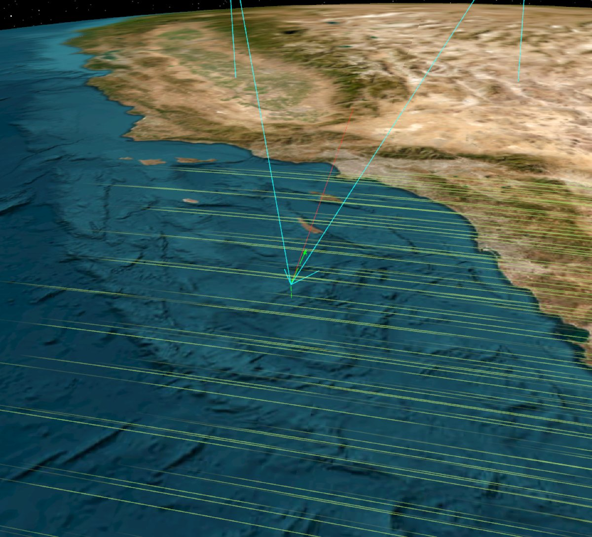
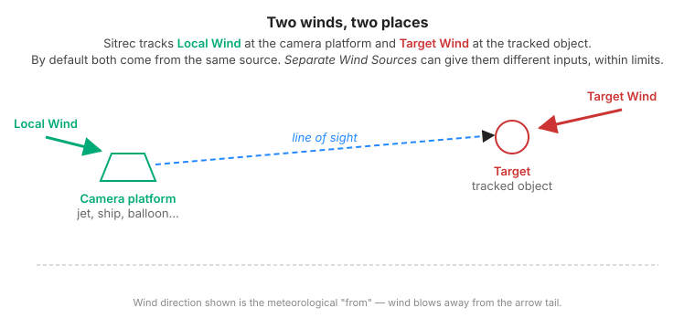
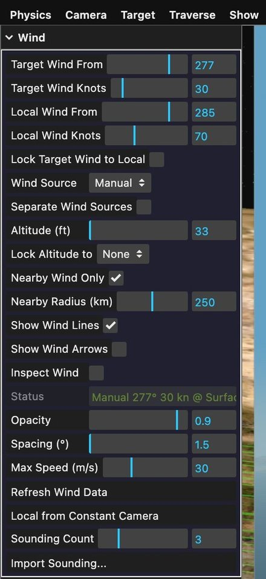
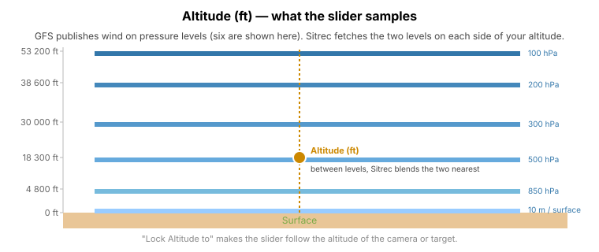
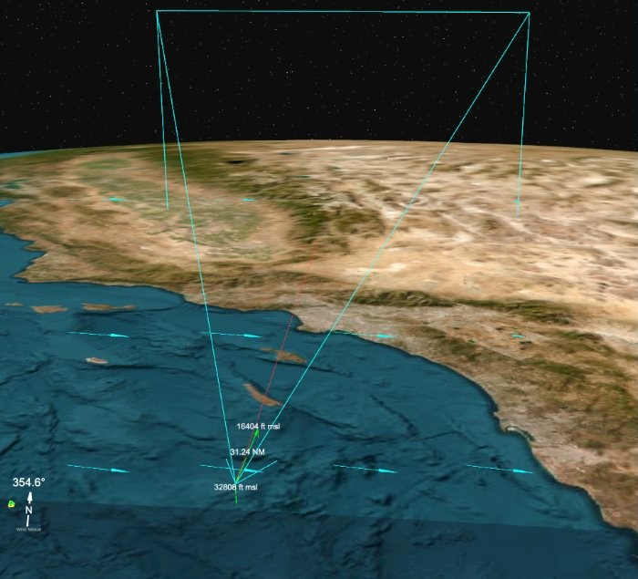
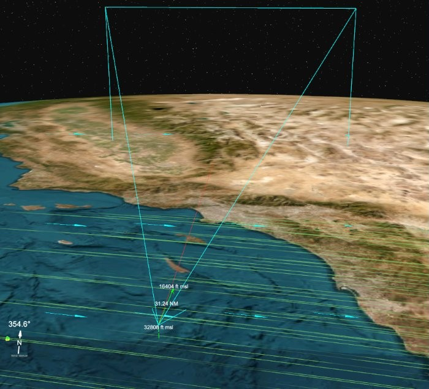
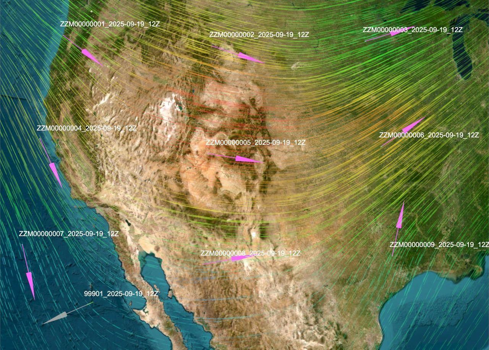
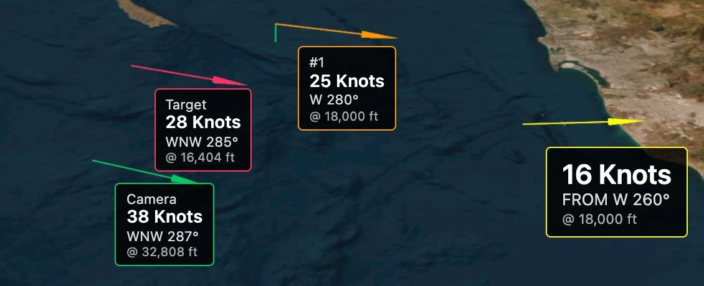

# Wind in Sitrec

The **Wind** folder in the **Physics** menu sets the wind at the camera platform and at the target, pulls atmospheric data from real-world sources, and draws streamlines and arrows in the main view. **Flight Sim** cameras, **Manual + Wind** targets and traverse methods that work in air speed use this wind.

*Animated wind streamlines (green) flowing across the Pacific. The cyan view-frustum and red LOS belong to the camera tracking a target offshore.*

> **Just here for the controls?** Jump to [GUI reference](#gui-reference). For data-flow internals see [Wind: data flow, formats, and sources](Wind-Internals.md).

## Quickstart

1. Set the sitch date, time and camera position first. Sitrec fetches wind for that date, and soundings near that position.
2. Open the **Physics** menu in the top menubar, then expand the **Wind** folder.
3. From **Wind Source**, pick **GFS (NOAA)** for any date from 22 March 2021 to today, or **UWYO Soundings** / **IGRA2 Soundings** for earlier dates.
4. Set **Altitude (ft)** to the height where you want to see the wind. It sets the level of the streamlines and arrows. Target Wind and Local Wind are read at the altitude of each track, not from this slider.
5. **Show Wind Lines** is auto-toggled on the first time you pick one of the sources in step 3 — the streamlines appear once the data has loaded (allow up to a minute the first time; after that it's cached). **Status** then shows the source, for example `GFS 2023-06-15 18,000 ft`.

That's the common path. The rest of this doc fills in everything around it.

## Glossary

A few terms used throughout. If you've used Sitrec before some of these will be obvious; defining them up front saves having to guess.

- A **sitch** (short for *situation*) is one Sitrec scene: a place, a span of time, and the camera, tracks, objects and video that recreate an event. You can save and share a sitch, but it is a sitch before you save it.
- **target** — the object the user is tracking (a UFO, an aircraft, a satellite).
- **camera platform / local** — the observer's vantage point (the jet, ship, balloon, or fixed station the camera lives on).
- **From** — meteorological convention. "Wind from 270°" means the wind is *blowing from the west*. Sitrec follows this everywhere.
- **wind field** — a global 2D grid of wind vectors, sampled by the streamlines and the arrow overlay.
- **sounding** — one profile of wind, temperature and pressure against height, measured by a radiosonde, the instrument that a weather balloon carries.
- **MISB track** — a track file containing per-frame metadata in the MISB ST 0601 standard, optionally including wind direction and wind speed (tags 35 and 36).
- **IDW** — inverse-distance weighting; how Sitrec turns scattered sounding samples into a continuous grid.

## Concepts

Sitrec keeps two kinds of wind state side by side:

- **Target Wind** — the wind acting on the *target* (the thing you are tracking). Used by traverse methods that compute target motion through the air (e.g. **Constant Air Speed**) and by **Manual + Wind** targets. In [Traverse Analysis and the Verdict](TraverseAnalysis.md#analysis-integrity), Target Wind is the **supplied wind**: each wind-dependent fit runs once with it and once with a wind of its own.
- **Local Wind** — the wind acting on the *camera platform* (the jet, ship, balloon you are looking from). Used by the **Flight Sim** camera, which it blows along.

Each has a direction (true degrees, north = 0, blowing **from** that direction) and a speed in knots. By default both come from the same **Wind Source**; [Separate Wind Sources](#separate-wind-sources) can give them different inputs, within limits.

Behind the controls is a third object: the **wind field**, a coarse global 2D grid of wind vectors. This is what the streamlines and arrow overlay sample. Every source fills the wind field.

An **atmospheric source** is any source except **Manual** or a telemetry **Track:** entry. Each load from an atmospheric source also sets Target Wind and Local Wind, at the position and altitude of each track. They then hold those values until the next load: playing the clip does not by itself change them. A telemetry **Track:** entry sets them from the track row on every frame. With **Manual**, you set them with the sliders.

*An atmospheric source sets Target and Local Wind by itself, not through the wind field. With **Manual**, the Target Wind sliders fill the field. A telemetry **Track:** entry sets Target and Local Wind directly, and fills the field from the same track.*

### What the wind data is

**GFS** is a weather-model result on a 1° grid, about 110 km. Sitrec reads the cycle at or before the sitch time. A **sounding** is one balloon flight, launched near 00Z or 12Z (00:00 or 12:00 UTC), and the station can be far from your scene. Neither is a measurement at your object, and local effects such as valley or coastal winds can be missing. To see how much a result depends on the wind, run it again with a second source.

## GUI reference

The Wind folder lives under **Physics**. Controls below appear in roughly the order they are shown.

*The Wind folder in the **Physics** menu, expanded, with a **Manual** wind.*

### Manual override sliders

The four sliders show the current Target and Local wind. You can type a value at any time, and it takes effect at once. How long it lasts depends on the source:

- **Manual**: it stays. **Target Wind From** and **Target Wind Knots** also define the wind field; the Local sliders do not change the field. See [Manual source vs. manual override](#manual-source-vs-manual-override) below.
- **An atmospheric source**: the next wind load replaces it. A load comes from a change to **Altitude (ft)**, a **Lock Altitude to** step, a source change, **Refresh Wind Data** or a new GFS cycle.
- **A telemetry Track: entry**: the track replaces it on every frame.

| Control | What it does |
|---|---|
| **Target Wind From** | Direction (true degrees) the *target's* wind is blowing **from**. North = 0, east = 90. |
| **Target Wind Knots** | Speed in knots at the target. |
| **Local Wind From** | Same as above, for the camera platform. |
| **Local Wind Knots** | Same as above, for the camera platform. |
| **Lock Target Wind to Local** | Forces Target Wind to equal Local Wind and hides the Target sliders until you turn it off. |

> **"Lock Target Wind to Local" vs. "Separate Wind Sources" — they sound similar; they aren't.**
>
> | | Same source | Separate source |
> |---|---|---|
> | Values free | default | turn on **Separate Wind Sources** |
> | Values locked | turn on **Lock Target Wind to Local** | rarely useful (Lock would override Separate) |
>
> "Lock" ties the *numbers* together. "Separate" gives each side its own *source dropdown*, within the limits in [Separate Wind Sources](#separate-wind-sources).

### Wind Source

Single dropdown when **Separate Wind Sources** is off. The label changes to **Target Wind Source** when the toggle is on, and a second dropdown (**Local Wind Source**) appears below it.

Available sources:

| Source | What it is | When to use it |
|---|---|---|
| **GFS (NOAA)** | Global atmospheric grid from the NOAA Global Forecast System. Whole-Earth coverage, 6-hour cycles. | Any date from 22 March 2021 to today. Good when you need wind at altitudes other than the ground. |
| **UWYO Soundings** | Radiosonde profiles from University of Wyoming. Auto-fetches the nearest stations and IDW-blends them. | Historical dates, good vertical resolution near launch sites. |
| **IGRA2 Soundings** | NOAA NCEI's Integrated Global Radiosonde Archive. Same idea as UWYO but a different upstream archive. | A different archive from UWYO. Can have dates or stations that UWYO does not. |
| **Manual Soundings** | Every loaded sounding, blended together: files you dragged in (a UWYO `.csv`/`.txt`, an IGRA2 `.txt`, or an XML wind profile) and any fetched earlier. | When you want curated profiles instead of automatic nearest-station fetches. |
| **open-meteo** | Per-track-point fetches from the Open-Meteo public API (no key, rate-limited). | Useful for one-off lookups; not great for filling a whole grid. |
| **Manual** | A single uniform wind defined by **Target Wind From / Knots**. | Quick experiments, sitches without specific weather, or when the real data is missing/wrong. |
| **Track: \<name\>** | If your sitch has a track file with embedded wind columns (MISB-formatted WindDirection / WindSpeed), each loaded track shows up as its own option. For a telemetry track the wind value comes straight from the track row at the current frame. For a sounding track (IGRA2, UWYO, or an XML wind profile) the entry reads that one profile at the altitude of the target, and of the camera for Local Wind, with no blend with other soundings. WindSpeed is read as metres per second, the MISB standard unit, and shown in knots. | Aircraft data files (e.g. military pod metadata) that already contain wind telemetry; or one particular sounding, used alone. If no track carries wind, no Track: entry appears. |

**Selecting GFS, UWYO, IGRA2, Manual Soundings or a Track: source for the first time** auto-toggles **Show Wind Lines** on once and triggers the data load — both happen in one step, so the streamlines appear as soon as the data arrives. If you turn the lines off explicitly, that auto-show won't fire again for that source in the same session.

#### Manual source vs. manual override

These are easy to confuse — they share the Target sliders.

- **Manual override sliders** (Target/Local Wind From/Knots) take a typed value at any time, for what-ifs. [Under an atmospheric source](#manual-override-sliders), the value lasts only until the next wind load.
- **Manual source** (the dropdown choice **Manual**) tells the wind field "there is no atmospheric data — synthesize one wind from the Target sliders." The value is the same everywhere, but the lines fade with distance from the target and camera. With **Target Wind Knots** = 0, the default in a new custom sitch, the field is all zero and the streamlines are invisible, even if **Local Wind Knots** is not zero.

#### Manual Soundings

A pass-through. Drag a UWYO `.csv`/`.txt` or an IGRA2 `.txt` (a zipped `.txt.zip` is auto-extracted) onto the page; Sitrec parses it and adds it to the loaded-soundings pool. An IGRA2 file with more than 10 soundings imports only the first one in the file, whatever its date: to get a specific launch, use **Import Sounding…**. An installation can also read its own XML weather files: see [XML wind profiles](#xml-wind-profiles).

Picking **Manual Soundings** blends every sounding that is loaded, including any that **UWYO Soundings** or **IGRA2 Soundings** fetched earlier. It starts no fetch of its own. To use one sounding alone, pick its **Track:** entry.

### Separate Wind Sources

Off (default): a single Wind Source feeds both target and local. Toggling it on reveals **Local Wind Source** so the two can use different inputs.

A common reason to turn this on: a sitch where the camera platform has a track-file wind (MISB-derived) and you want the target to use real GFS data instead of inheriting from the platform.

Limitation: only one atmospheric data set is loaded at a time, and it follows the Target Wind Source. Each load writes Local Wind from that data set at the camera position, even if Local Wind Source is **Manual**, a different atmospheric source or a sounding **Track:** entry. If Target Wind Source is **Manual**, no load writes Local Wind, so an atmospheric Local Wind Source has no effect: set Local Wind with its sliders. Only a telemetry **Track:** entry gives the local side its own input.

When you turn **Separate** off again, Local Wind Source snaps back to whatever Target is set to, so the two pipelines don't quietly drift out of sync.

### Altitude (ft)

The altitude, in feet [above mean sea level (MSL)](GIS.md#three-kinds-of-height), that the streamlines and arrows show. The slider ranges from 0 to 60 000 ft. Target Wind and Local Wind do not use it: they are read at the altitude of each track.

For GFS, Sitrec blends the two pressure levels above and below this altitude. It places each level at its standard-atmosphere height, so the match to the real pressure surface is approximate. When you release the slider, Sitrec fetches any levels that are not cached and rebuilds the streamlines.

*GFS pressure levels. hPa (hectopascal) is a unit of air pressure, which falls as altitude rises.*

### Lock Altitude to

| Value | Effect |
|---|---|
| **None** | Altitude is whatever you typed in the slider. |
| **Camera** | Slider tracks the camera's current altitude every frame. |
| **Target** | Slider tracks the target's current altitude every frame. |

Lock-to-Camera/Target is useful when you want the streamlines to always be at the altitude of the camera or target as the scene plays. Setting it back to None freezes the slider at whatever value it last had.

### Nearby Wind Only / Nearby Radius (km)

Sitrec's wind grid is global: 1° for GFS, 5° for the sounding, open-meteo, Manual and Track sources. **Nearby Wind Only** is on by default (**Nearby Radius (km)** = 250): it restricts streamline seeding to a lat/lon box of that radius around the camera position, which is faster to compute and easier to read when you're zoomed in close. Turn it off to seed streamlines everywhere that the source has coverage: the whole globe for GFS. For the 5° sources, the lines fade with distance from the data points and stop about 2,200 km away.

The arrows overlay (see below) is unaffected.

### Show Wind Lines

The animated streamline mesh in the main view. First toggle-on triggers the data load (slight delay if the network is involved); subsequent toggles just flip visibility.

If the first load failed (no network, no soundings nearby, etc.), toggling Show off and on again retries the load instead of showing an empty mesh forever. If older wind data is still in place, this does not retry: pick another source, then pick the failed source again.

### Show Wind Arrows

A screen-space grid of arrows in the main view, ray-cast onto the ellipsoid at the current wind altitude. Independent of the streamlines — either or both can be on. Arrows are usually clearer at low zoom; streamlines tell you more about flow structure when you're up close.

*Wind arrows alone, from a Manual wind. Each arrow points the way the wind blows.*

*Streamlines and arrows together, from the same Manual wind.*

**Sounding arrows.** While the wind field shows, each loaded sounding has one arrow at the wind altitude. The arrow is at the balloon's position at that altitude and points in the direction that the wind blows to. A pink arrow is a sounding that the current **Wind Source** uses. A gray arrow is a sounding that it does not use: for example, an XML file or an IGRA2 sounding when the source is **UWYO Soundings**, or every sounding when the source is **GFS**. **Manual Soundings** uses every loaded sounding.

*Generated test soundings, with **Wind Source** set to **IGRA2 Soundings**. The pink arrows are IGRA2 soundings. The gray arrow is a UWYO sounding, which this source does not use. Each label gives the station and the launch. The color of a streamline shows the wind speed: see **Max Speed (m/s)** below.*

### Inspect Wind

Turns on a cursor-driven readout. Move the mouse over the main view to see speed and direction at the cursor; **Shift-click** drops a persistent inspection point (a labelled vertical stalk to the surface), **Alt-click** removes the closest one. Inspection points are saved with the sitch.

Inspect Wind also shows a **Camera** and a **Target** readout. These use each track's own altitude, while the cursor and dropped points use **Altitude (ft)**. Every readout shows the altitude it used.

*Inspect Wind with generated test soundings. The large yellow readout follows the cursor. **#1** is a dropped point, with its green stalk. The **Camera** and **Target** readouts show the altitude of each track. The cursor and **#1** show the **Altitude (ft)** value, 18,000 ft. Each arrow points the way the wind blows. Each readout gives the direction that the wind blows from.*

### Status

A short read-only string, for example "Loading...", "GFS 2023-06-15 18,000 ft", "UWYO (3) 18,000 ft", "Manual 277° 30 kn @ Surface", or an error message. Just feedback — you can't edit it.

### Opacity / Spacing / Max Speed

Visual tuning for the streamlines.

- **Opacity** — overall alpha (0–1).
- **Spacing (°)** — seed density in degrees of latitude/longitude. Higher value = fewer, more spread-out streamlines.
- **Max Speed (m/s)** — clamps the color ramp. The ramp runs from blue (slow) through cyan, green and yellow to red. Wind faster than this paints at the high end of the gradient.

### Refresh Wind Data

Re-runs the current source's load. Useful if:
- You moved the scene (different camera lat/lon) and want the fetcher to pick new nearby soundings;
- A GFS or open-meteo load failed and you want to retry. After a failed UWYO or IGRA2 fetch, this does not fetch again: pick another source, then pick the sounding source again.

### Local from Constant Camera

Estimates the wind at the camera platform from the camera track, on the assumption that the platform flew at a constant airspeed. It finds the single horizontal wind that makes the airspeed along the track most nearly constant, and writes it into **Local Wind From** / **Local Wind Knots**. It then switches the source to **Manual** — the **Local Wind Source** only when **Separate Wind Sources** is on, otherwise the shared **Wind Source**. With **Separate Wind Sources** on and an atmospheric Target Wind Source, the next wind load replaces the result. **Status** then shows the result, e.g. `Local wind: 270° / 45 kt (σ=3.2 kt, …)`, where σ is the remaining spread in airspeed.

### Sounding Count

How many of the nearest soundings to fetch when an auto-loading sounding source (UWYO / IGRA2) is picked. Default 3, max 10. At each point Sitrec blends the three nearest soundings, so a higher count widens the area covered. It does not add stations to the blend at one point. It also makes more network requests.

### Import Sounding…

Opens a dialog to fetch a *specific* sounding by station + date + launch. Four steps:

1. **Station picker** — type to filter, pick from the list (sorted by distance to your camera).
2. **Source** — UWYO (fastest) or IGRA2 (NCEI archive).
3. **Date** — defaults to the date of the 00Z or 12Z launch closest to the sitch start.
4. **Launch** — UWYO asks for 00Z or 12Z. IGRA2 shows a list of the launches nearest that date.

After fetching, Sitrec auto-switches your Wind Source to **Manual Soundings** so you can keep dropping more in without each one being clobbered by an auto-fetch.

If UWYO has nothing for that station and date, Sitrec tries the next 4 nearest stations, and a message names the station it used. If all five fail, a message gives the last error.

## Workflows

### Quick wind for a synthetic sitch
1. Leave Wind Source on **Manual**.
2. Type the wind you want into **Target Wind From / Knots**.
3. (Optional) Toggle **Show Wind Lines** to see the uniform field.

### Real wind for a known date/place
1. Set the sitch date, time and camera position.
2. Pick **GFS (NOAA)** (any date from 22 March 2021 to today).
3. Set **Altitude (ft)** to the height where you want to see the wind.
4. Optionally lock altitude to the camera or target track.

### Real wind for a sounding-friendly date
1. Set the sitch date, time and camera position.
2. Pick **UWYO Soundings** or **IGRA2 Soundings**.
3. Sitrec fetches the most recent launch at or before one hour after the sitch start, from the nearest *N* stations that have usable wind (*N* is **Sounding Count**).
4. **Refresh Wind Data** if you move the scene a long way.

### One specific sounding
1. **Import Sounding…**
2. Pick the station and date.
3. Sitrec auto-switches you to **Manual Soundings**; you can now import more, and it blends them all.

### Camera and target on different inputs
1. Turn on **Separate Wind Sources**.
2. Pick the **Target Wind Source** (e.g. GFS).
3. Pick the **Local Wind Source** (e.g. a Track:* option from a MISB-equipped track).

## XML wind profiles

An installation can also teach Sitrec to read its own XML weather files. The file must hold a position (latitude, longitude, elevation) and a vertical profile: one element for each reporting altitude, with the altitude, wind direction and wind speed inside it. Air pressure and temperature are read too if they are there; everything else in the file is ignored.

The person who runs the installation describes the file layout once, with `SITREC_CUSTOM_SOUNDING_<NAME>_*` settings: the element names for the level and for each field, and the units. An altitude can be in metres, feet, kilometres or flight levels; a flight level is read as the standard-atmosphere height for its pressure (FL100 is 3,048 m). The settings and an example are in `config/shared.env.example`, under **Custom Sounding Files**. With a container, put them in the env file that the container starts with. A namespace prefix on an element name (`<xyz:Value>`) does not matter.

Sitrec identifies the format of a dropped file by itself. A layout has a list of substrings (`_XMLNS_CONTAINS`); if any one of them is in a namespace declaration in the file (`xmlns="..."` or `xmlns:prefix="..."`), the file is that format. An optional second list (`_FILE_CONTAINS`) is looked for anywhere in the file text, and one match there is also enough.

To find the settings for a file, open **Sitrec → Extra Tools → XML Wind Profile Analyzer** and load the file. The tool finds the position and the levels, proposes the settings, and shows what Sitrec reads with them. It reads the file in the browser and uploads nothing. It can also make a report of the file structure (tag names, namespace addresses and unit names, with no measurements, positions or times) to send to the person who sets up Sitrec.

To try settings without a change to the installation, paste them into **Sitrec → Settings → SITREC_ ENV Override…** and save. They then apply to you only, and you can import the file at once. This works only if the installation allows it: its `ALLOW_OVERRIDE` setting must list these names. The example configuration allows `SITREC_CUSTOM_SOUNDING_*`; when the installation allows no setting, the menu entry is not shown.

To use a file, drag the `.xml` file onto the page, or use **File → Import File**. It appears as a sounding track at the position in the file, named after the file. Sitrec also sets **Wind Source** to the file's own entry, **Track: \<filename\>**, so Target Wind comes from that profile at once, at the target's altitude. You can select a different source afterwards. When you open a saved sitch, its saved wind source is kept.

Sitrec reads one position and one profile from a file. Wind direction is taken as degrees true. If the file has no time (or no time setting), the profile takes the start time of the sitch. If a file does nothing when you drop it, open the browser console. A layout with an unknown unit or a missing setting is reported there by name, and so is a file that was identified as a layout but has no position and levels where the settings say they are. If the console has neither message, no layout identified the file: check the two lists against the file.

## Notes, gotchas, and troubleshooting

### Date-related

- **GFS dates.** Sitrec reads GFS for any date from 22 March 2021 to today: NOMADS keeps about the last 10 days, and older dates come from the AWS archive. For an earlier date, **Status** shows `Error: HTTP 400 for level ...`. Use soundings for those dates.
- **Cycle latency.** A GFS cycle (00Z, 06Z, 12Z, 18Z) takes ~3.5–4 hours to publish. If you ask for an hour that hasn't been processed yet, Sitrec falls back to the previous cycle on the same day.
- **Wind and the sitch's date/time.** GFS follows the sitch time: when the time enters a new 6-hour cycle, Sitrec loads that cycle by itself. UWYO and IGRA2 soundings do not, and **Refresh Wind Data** keeps the old launches. Set the date (Time menu) before you load soundings. After a date change, delete the old sounding tracks in the **Contents** menu, pick another source, then pick the sounding source again.

### Display issues

- **"Show Wind Lines" doesn't show anything.** Check **Status**. Common causes: Manual source with **Target Wind Knots** = 0; sounding fetch returned nothing for that location/date; GFS not yet published for that hour; network blocked.
- **Wind direction looks 180° off.** "From" is the meteorological convention — a north wind blows *from* the north. Sitrec reads imported directions as "from". For an XML wind profile that gives the direction the wind blows to, the layout must set `SITREC_CUSTOM_SOUNDING_<NAME>_WIND_DIR_CONVENTION=to`. If you're typing values, check the convention.
- **Lock Altitude isn't tracking.** The slider follows the track in steps of 50 ft, and it updates while the sitch is paused too. While a lock is on you cannot set the altitude by hand: the next update puts it back.
- **Arrows do not show.** Check the **Wind Field** entry in the **Show** menu. It hides all wind drawing.

### Sources

- **Sounding rate limits.** Sitrec's server allows 20 UWYO fetches a minute; if you hit the limit, Sitrec waits ~66 s and retries, showing the countdown in the loading-progress overlay.
- **No PHP server?** GFS and UWYO both need the Sitrec server, and GFS also needs Python on that server. In serverless / static-build deployments, the main Wind Source dropdown still lists both, but they won't load. Use **IGRA2 Soundings** (fetched directly from NCEI), open-meteo or **Manual**. The **Import Sounding…** dialog's Source step skips the UWYO/IGRA2 prompt and silently defaults to IGRA2.
- **Sounding count slider doesn't seem to change anything.** Sounding Count only takes effect on the *next* fetch — change it, then press **Refresh Wind Data**. Changing the source fetches again only if no sounding of that source is loaded.
- **Track: \<name\> isn't there.** That entry only appears for tracks that carry wind: telemetry files with MISB-format WindDirection / WindSpeed columns, and soundings (IGRA2, UWYO or an XML wind profile). Most generic GPS / KML tracks don't.

### Save / load

- **The chosen source persists with the sitch.** Saving a sitch with `Wind Source = GFS` and `Altitude = 18000 ft` saves those settings; reloading restores them and re-fetches the data (cache-served if available).
