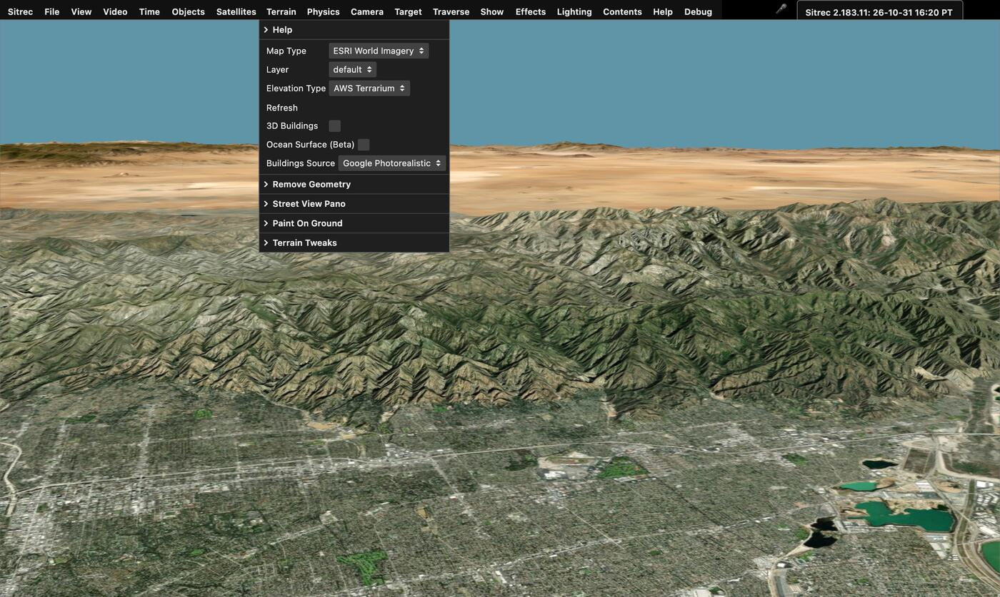
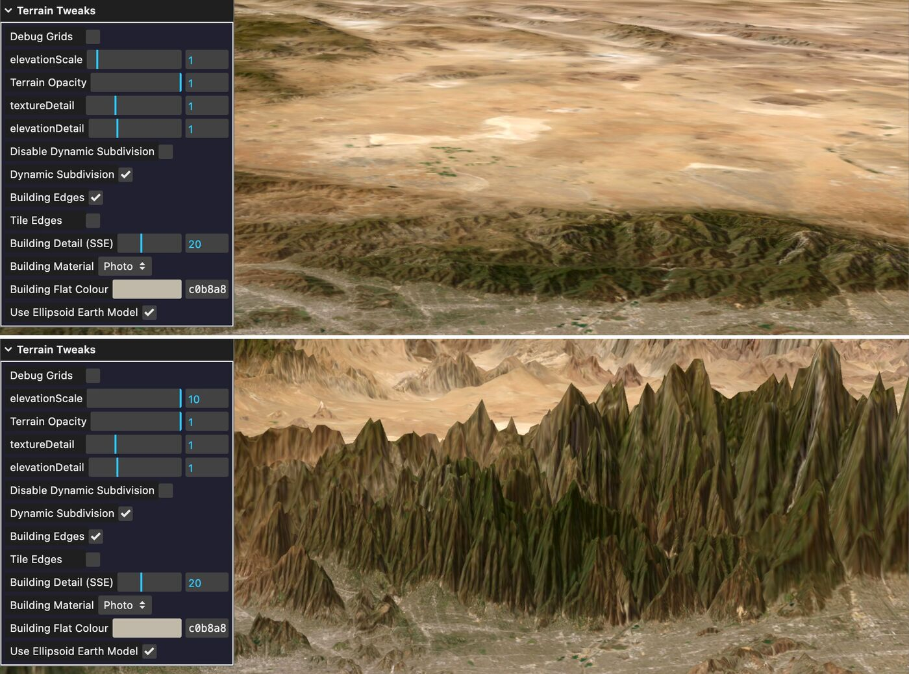
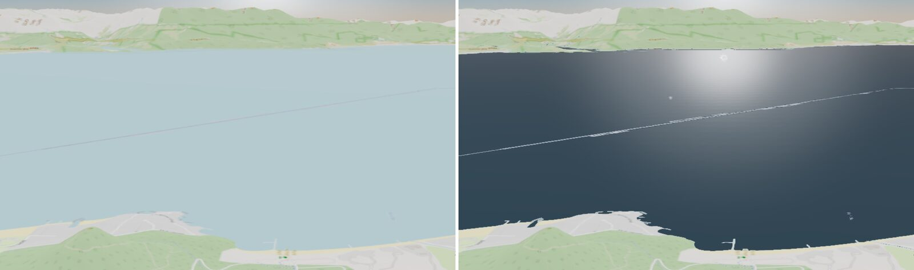

# Custom map, elevation, and water sources

Sitrec terrain combines two independent tile layers:

- a **map source**, the image draped over the ground; and
- an **elevation source**, the height samples used to shape the ground.



*The **Terrain** menu selects both layers. Here **Map Type** is ESRI World Imagery and
**Elevation Type** is AWS Terrarium.
[Imagery powered by Esri](https://www.esri.com/en-us/legal/terms/data-attributions).*

Sitrec supports the usual Web Mercator slippy-map grid (`EPSG:3857`, the default), an
equirectangular/GoogleCRS84Quad-style grid selected with `mapping: 4326`, custom URL
templates, and limited WMS/WMTS adapters.

A `mapping: 4326` map works over a `3857` or a `4326` elevation source. A `3857` map needs a
`3857` elevation source: over a `4326` source, the drawn ground does not follow the height
data.

There are two ways to add a source:

1. add a URL-template source through `config/shared.env`; or
2. add a JavaScript source definition to the per-install `config/config.js`, based on
   [config/config.js.example](https://github.com/MickWest/Sitrec2/blob/main/config/config.js.example).

Use the environment form for ordinary `{z}/{x}/{y}` tile servers. Use `config.js` when the
URL needs computed bounds, a date, a layer-dependent extension, or other JavaScript logic.
A `config.js` source is compiled into the build, so a change to it needs a rebuild.

## URL-template sources from `shared.env`

Map variables use `SITREC_CUSTOM_MAP_<NAME>_*`; elevation variables use
`SITREC_CUSTOM_ELEVATION_<NAME>_*`. `<NAME>` becomes part of the internal source key and is
normally written in upper case for readability.

```dotenv
SITREC_CUSTOM_MAP_IMAGERY_URL="https://tiles.example.org/imagery/{z}/{x}/{y}.jpg"
SITREC_CUSTOM_MAP_IMAGERY_NAME="Internal imagery"
SITREC_CUSTOM_MAP_IMAGERY_MAX_ZOOM=18
SITREC_CUSTOM_MAP_IMAGERY_ATTRIBUTION="Example imagery service"
SITREC_CUSTOM_MAP_IMAGERY_TERMS_URL="https://tiles.example.org/terms"

SITREC_CUSTOM_ELEVATION_TERRAIN_URL="https://tiles.example.org/terrain/{z}/{x}/{y}.png"
SITREC_CUSTOM_ELEVATION_TERRAIN_NAME="Internal elevation"
SITREC_CUSTOM_ELEVATION_TERRAIN_MAX_ZOOM=15

DEFAULT_MAP_TYPE=CustomMap_IMAGERY
DEFAULT_ELEVATION_TYPE=CustomElevation_TERRAIN
```

The container entrypoint forwards arbitrary custom map and elevation variables to the
browser, so these settings can be supplied at container start as well as build time.

### Supported suffixes

| Suffix | Map default | Elevation default | Meaning |
|---|---:|---:|---|
| `_URL` | required | required | Template containing `{z}`, `{x}`, and `{y}`. |
| `_NAME` | `Custom Map (<NAME>)` | `Custom Elevation (<NAME>)` | Label shown in the Terrain menu. |
| `_MAX_ZOOM` | `20` | `15` | Deepest source zoom. At greater terrain zooms Sitrec reuses ancestor data. |
| `_MIN_ZOOM` | `0` | `0` | Lowest source zoom. Below it Sitrec uses a placeholder and makes no request. |
| `_MAPPING` | `3857` | `3857` | Tile grid: normally `3857`, or `4326` for a GoogleCRS84Quad-style source. |
| `_ZOFFSET` | `0` | `0` | Integer added to the value substituted for `{z}`. `{x}` and `{y}` are unchanged. |
| `_ATTRIBUTION` | empty | empty | On-screen source credit. |
| `_TERMS_URL` | empty | empty | Link opened from the attribution. |
| `_WATER_COLOR` | unset | not used | Flat map color used by Water Reflection; see below. |

A negative `_ZOFFSET` automatically raises the effective minimum zoom to at least its
absolute value, and the substituted zoom is clamped to zero. This prevents negative tile
URLs. The offset changes only the `{z}` value; it does not rescale `{x}` or `{y}`.

To remove the built-in internet providers from the menus, set:

```dotenv
SITREC_ENABLE_DEFAULT_MAP_SOURCES=false
SITREC_ENABLE_DEFAULT_ELEVATION_SOURCES=false
```

Only `SITREC_CUSTOM_*` sources and the built-in offline-safe sources stay. Your own
`config.js` sources are also removed, unless an entry sets `offlineSafe: true`. The
remaining map choices include local/debug/flat sources; elevation retains Flat and Local.
The [secure build](Secure-Build.md) forces both settings to `false`.

### Elevation format detection

Every elevation source is decoded as Terrarium RGB when its generated URL ends
exactly in `.png`, or as Mapbox Terrain-RGB when the URL contains `.pngraw`. Any other URL
is sent to the GeoTIFF decoder. Consequently, a Terrarium URL with a query string after
`.png` will currently be misclassified; use a URL that ends in `.png`, or define a
`config.js` function that returns one.

The projection setting does not select the elevation encoding.

## JavaScript source definitions

`config/config.js` is installation-specific and is not tracked. Its
`customMapSources` and `customElevationSources` objects are merged into the Terrain menus.
The object key is the source type used by `DEFAULT_MAP_TYPE` or
`DEFAULT_ELEVATION_TYPE`. In a serverless or desktop build, a `config.js` source appears only
if it sets `allowInServerless: true`. `SITREC_CUSTOM_*` sources always appear.

A basic map source is:

```javascript
customMapSources: {
    osm: {
        name: "OpenStreetMap",
        mapURL: (z, x, y) =>
            `https://tile.openstreetmap.org/${z}/${x}/${y}.png`,
        minZoom: 0,
        maxZoom: 19,
        mapping: 3857,
        waterColor: [170, 211, 223],
        attribution: "© OpenStreetMap contributors",
        requiredAttribution: true,
        termsURL: "https://www.openstreetmap.org/copyright",
    },
},
```

The function receives Sitrec's tile `z, x, y` and returns one URL. A browser fetch requires
the tile server to permit cross-origin image requests. Follow the provider's attribution,
caching, request-volume, and credential rules. In particular, the standard OpenStreetMap
tile service has a
[published usage policy](https://operations.osmfoundation.org/policies/tiles/) and is not
an offline or bulk-download service.

Common map-definition fields include:

| Field | Purpose |
|---|---|
| `name` | Menu label. |
| `mapURL(z, x, y, layerName, layerType)` | Returns the tile URL. |
| `minZoom`, `maxZoom` | Source coverage. Defaults are `0` and `14`. |
| `mapping` | `3857` by default; `4326` for an equirectangular grid. |
| `layer` | Default layer name. Required when `capabilities` is used. |
| `layers` | Static layer definitions, including file type when the URL function needs it. If `layer` is not set, the first entry is the default. |
| `capabilities` | WMS/WMTS capabilities URL from which Sitrec builds the layer menu. |
| `requiredToken` | `MAPBOX_TOKEN` or `MAPTILER_KEY`. Hides the source until that setting has a real value. No other name is supported. |
| `attribution`, `termsURL` | On-screen credit and its link. |
| `requiredAttribution` | `true` keeps the map credit on screen when the user turns off **Show Attribution**. |
| `waterColor` | Flat RGB water fill used by color-based water reflection. |
| `offlineSafe` | `true` keeps the source when the default sources are turned off. |
| `allowInServerless` | `true` shows the source in a serverless or desktop build. |

The tracked Mapbox and MapTiler sources read their browser-visible credentials through
`getEnv()`, which prefers a runtime value and falls back to the build-time one. They declare
the corresponding supported name (`MAPBOX_TOKEN` or `MAPTILER_KEY`) as `requiredToken`. This
hides the source when the setting is absent or is still `EXAMPLEKEY`. Never put a real value
directly in `config.js`:

```javascript
import {getEnv} from "../src/envUtils"; // at the top of config.js

maptiler: {
    name: "MapTiler",
    requiredToken: "MAPTILER_KEY",
    layers: {
        "satellite-v2": {type: "jpg"},
    },
    layer: "satellite-v2",
    mapURL: (z, x, y, layerName, layerType) =>
        `https://api.maptiler.com/tiles/${layerName}/${z}/${x}/${y}.${layerType}` +
        `?key=${getEnv("MAPTILER_KEY", process.env.MAPTILER_KEY)}`,
    maxZoom: 16,
    attribution: "© MapTiler © OpenStreetMap contributors",
    termsURL: "https://www.maptiler.com/copyright/",
},
```

The value is necessarily visible to the browser. Restrict it by origin and service in the
provider console.

## WMS and WMTS map sources

`src/WMSUtils.js` supplies two adapters on the active map projection:

- `wmsGetMapURLFromTile(base, layer, z, x, y)` converts a Sitrec tile to a WMS 1.1.1
  `GetMap` request for a 256×256 JPEG in `EPSG:4326` bounds.
- `wmtsGetMapURLFromTile(base, layer, z, x, y)` builds the path used by a
  GoogleCRS84Quad WMTS service.

The tracked example contains working WMS and WMTS definitions. In abbreviated form:

```javascript
NRL_WMS: {
    name: "NRL WMS",
    mapURL: function (z, x, y, layerName) {
        return this.mapProjectionTextures.wmsGetMapURLFromTile(
            "https://geoint.nrlssc.org/nrltileserver/wms/category/Imagery?",
            layerName, z, x, y);
    },
    capabilities: "https://geoint.nrlssc.org/nrltileserver/wms/category/Imagery?REQUEST=GetCapabilities&SERVICE=WMS",
    layer: "ImageryMosaic",
    maxZoom: 12,
},

NRL_WMTS: {
    name: "NRL WMTS",
    mapURL: function (z, x, y, layerName) {
        return this.mapProjectionTextures.wmtsGetMapURLFromTile(
            "https://geoint.nrlssc.org/nrltileserver/wmts",
            layerName, z, x, y);
    },
    capabilities: "https://geoint.nrlssc.org/nrltileserver/wmts?REQUEST=GetCapabilities&VERSION=1.0.0&SERVICE=WMTS",
    layer: "BlueMarble_AUTO",
    mapping: 4326,
    maxZoom: 12,
},
```

`capabilities` is fetched by the browser and parsed for layer names, so that server must
allow cross-origin requests. If the fetch fails, Sitrec logs a console error and sets
**Map Type** to **Debug Info**. The source must also provide a default `layer`; omitting it
stops the source with an alert.

The adapters are intentionally narrow rather than general WMS/WMTS clients. If a service
uses a different matrix set, axis order, image format, style, dimensions, or request
syntax, construct its URL in `mapURL()` instead.

## Elevation sources

Sitrec's standard RGB elevation format is Terrarium:

```text
height metres = (R × 256 + G + B / 256) - 32768
```

The public Tilezen/Mapzen terrain archive is one example:

```javascript
customElevationSources: {
    AWS_Terrarium: {
        name: "AWS Terrarium",
        mapURL: (z, x, y) =>
            `https://s3.amazonaws.com/elevation-tiles-prod/terrarium/${z}/${x}/${y}.png`,
        minZoom: 0,
        maxZoom: 15,
        tileSize: 256,
        attribution: "Elevation: USGS, NOAA & contributors",
        termsURL: "https://github.com/tilezen/joerd/blob/master/docs/attribution.md",
    },
},
```

See the [Registry of Open Data terrain entry](https://registry.opendata.aws/terrain-tiles/)
and the linked attribution terms before redistributing or mirroring tiles.

Sitrec also has a specialized adapter for the National Map 3DEP `exportImage` service:

```javascript
NationalMap: {
    name: "National Map 3DEP GeoTIFF",
    mapURL: function (z, x, y) {
        return this.mapProjectionElevation.getWMSGeoTIFFURLFromTile(
            "https://elevation.nationalmap.gov/arcgis/rest/services/3DEPElevation/ImageServer/exportImage",
            z, x, y);
    },
    minZoom: 0,
    maxZoom: 14,
    tileSize: 256,
    attribution: "Data: U.S. Geological Survey",
    termsURL: "https://www.usgs.gov/faqs/what-are-terms-uselicensing-map-services-and-data-national-map",
},
```

`getWMSGeoTIFFURLFromTile()` keeps the terrain on Sitrec's Web Mercator tile grid but asks
the service for the tile's latitude/longitude bounds. It expands the bounds by half a pixel
to align adjacent samples and requests a 256×256 TIFF.

The current GeoTIFF elevation decoder is deliberately limited. It expects a tiled,
little-endian, uncompressed 32-bit floating-point raster like the response above; it reads
raw tile offsets rather than using the general raster decoder. Strip-organized TIFFs,
compressed tiles, integer samples, and other layouts are not supported by this path.
`src/QuadTreeTile.js` coordinates the fetch and height conversion;
`src/TIFFUtils.js` reads the tiled float data.

Elevation tiles must hold height [above mean sea level (MSL)](../GIS.md#three-kinds-of-height).
Sitrec adds the [geoid](../Glossary.md) offset to every tile, in all three formats, to give height
above the WGS84 ellipsoid (HAE). Tiles that already hold ellipsoidal heights are corrected twice.

Keep **Terrain → Terrain Tweaks → Elevation Scale** at `1` for measurements. Raising it is a
debugging aid: every ground query also uses the scaled value, and after you set it back to
`1`, press **Terrain → Refresh**. It exaggerates the terrain and currently scales the geoid
correction too, so geometry is no longer geodetically accurate.



*The same view with **Elevation Scale** at `1` (top) and `10` (bottom). At `10`, the terrain is
ten times too tall. [Imagery powered by Esri](https://www.esri.com/en-us/legal/terms/data-attributions).*

## Local terrain mirror

The **Local** map and elevation sources read a folder of pre-downloaded tiles, laid out as
`imagery/esri/{z}/{y}/{x}.jpg` (`y` before `x`) and `elevation/{z}/{x}/{y}.png`. To build it,
run `SITREC_TERRAIN_DIR=<folder> MAX_IMG=8 node scripts/download_local_tiles.js`. This reaches
imagery zoom 8 and elevation zoom 6, the deepest that Local reads. It downloads about 93,000
tiles. The imagery is Esri World Imagery, so check that licence first. Put the folder beside the
application as `sitrec-terrain/`. In a container, mount it at `/var/www/html/sitrec-terrain`.
For a serverless build, see [Sitrec Serverless Build](https://github.com/MickWest/Sitrec2/blob/main/SERVERLESS.md#terrain).

## Water Reflection source metadata

The **Effects → Water Reflection** effect can identify water in three ways.

### Flat map color

For a cartographic map with a uniform water fill, declare the source's RGB value:

```javascript
waterColor: [170, 211, 223], // #AAD3DF
```

Environment-defined maps use either form:

```dotenv
SITREC_CUSTOM_MAP_HOUSE_WATER_COLOR="#AAD3DF"
# or: SITREC_CUSTOM_MAP_HOUSE_WATER_COLOR="170,211,223"
```

The standard OpenStreetMap tile hosts are recognized by URL and get the standard OSM fill
automatically. Existing `config.js` entries keyed `osm` or `osmHighlight` are backfilled when
`waterColor` is undefined. An explicit value always wins. An invalid `_WATER_COLOR` is ignored.



*The **Open Streetmap** source with **Water Reflection** off (left) and on (right). Pixels that
match the water color become dark water that reflects the sky. The map's boundary line across
the lake does not match, so it stays a map color. The effect shows only in the look view.
Map data © [OpenStreetMap contributors](https://www.openstreetmap.org/copyright).*

Do not assign a flat water color to satellite imagery. Similar-colored ground would be
misclassified. Use a vector mask or **Combine Terrain with OSM** instead. The combine uses
the `osm` source when available, otherwise a compatible non-4326 map source that declares
a water color.

### Vector water polygons

**Vector Water Mask** and **Water on 3D Tiles** use a `water` polygon layer in OpenMapTiles
Mapbox Vector Tile (`.pbf`) format. The `swimming_pool` class is omitted; other polygon
classes are rasterized to an antialiased coverage mask. **Vector Water Mask** works only on
Web Mercator map sources. On a `mapping: 4326` source it has no effect, although the control
stays enabled.

With a valid `MAPTILER_KEY`, MapTiler is the default. It is not required: point Sitrec at a
self-hosted or compatible service with:

```dotenv
SITREC_VECTOR_WATER_URL="https://tiles.example.org/water/{z}/{x}/{y}.pbf"
SITREC_VECTOR_WATER_MAX_ZOOM=14
SITREC_VECTOR_WATER_ATTRIBUTION="Water: © Example data provider"
SITREC_VECTOR_WATER_TERMS_URL="https://tiles.example.org/terms"
```

These settings are read when Sitrec is built. The container entrypoint does not forward them
and the [secure build](Secure-Build.md) drops them, so a value set at container start, or in
a secure build, has no effect.

`SITREC_VECTOR_WATER_MAX_ZOOM` defaults to `14`. Above it, Sitrec magnifies the appropriate
ancestor polygons. Setting it higher than the server supports is a quiet failure: a 404 is
treated as a tile with no water, so water disappears. The URL is fetched by the browser;
any credential embedded in it is visible and must be scoped accordingly.

Custom OpenMapTiles-schema data defaults to an OpenStreetMap attribution. Override it when
the data has different terms. An explicitly empty `SITREC_VECTOR_WATER_ATTRIBUTION` means
no credit and should be used only when the data genuinely requires none.

### Photorealistic 3D tiles

Photorealistic 3D tiles replace the terrain surface instead of sitting on top of it, so
there is no map texture on which color matching or a terrain mask can operate. **Water on
3D Tiles** shades the tiles' own material. It requires the same vector water source, then
combines the polygon mask with a height band around the water surface and an upward-facing
surface test. **3D Tile Water Band (m)** sets the height band. **3D Tile Mask Span (m)** sets
the width of ground that the polygon mask covers.

## Testing a source

1. Load `?action=new`, select the new map and elevation types, and move across tile
   boundaries at several zoom levels.
2. In browser developer tools, verify generated `z/x/y`, status codes, response content
   types, CORS headers, and attribution.
3. Test the minimum and maximum zooms. Below `minZoom` there should be no request; above
   `maxZoom` ancestor data should remain aligned.
4. Switch between map sources and press **Terrain → Refresh** to retry tiles that failed.
   Refresh does not clear the browser's HTTP cache. GeoTIFF elevation tiles also stay in
   browser storage for 7 days. After a change on the server, clear the site data before you
   test again.
5. For elevation, keep **Terrain → Terrain Tweaks → Elevation Scale** at `1` while comparing
   known heights and tile seams.
6. For water, test the color mask, vector mask, and 3D-tile path separately. A missing
   vector source should disable **Vector Water Mask** and **Water on 3D Tiles** rather than
   silently use a map color.
