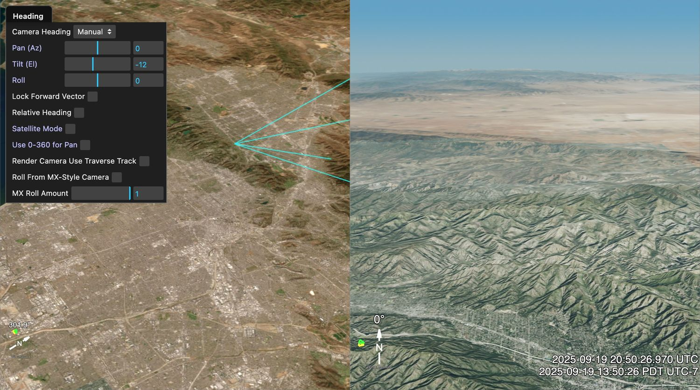
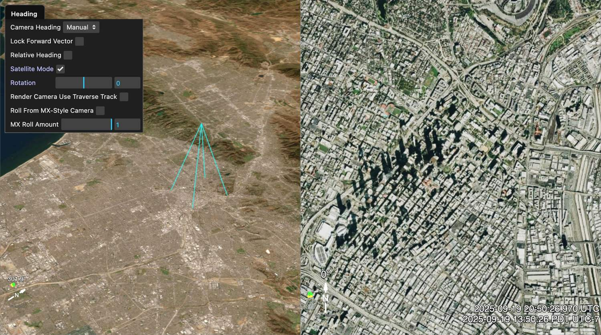

# Camera View Modes: Normal and Satellite

Sitrec's look camera supports two orientation modes for the PTZ (Pan-Tilt-Zoom) controller. Use **Normal** mode for a view toward the horizon. Use **Satellite** mode for a view straight down (nadir) or straight up (zenith). Satellite mode is only a way to point the camera. It is not related to the **Satellites** menu. To turn it on, see [Manual Toggle](#manual-toggle).

## When to Use Each Mode

| Scenario | Recommended Mode |
|---|---|
| Aircraft FLIR (forward-looking infrared) video analysis | Normal |
| Satellite imagery comparison | Satellite |
| Drone nadir footage | Satellite |
| Horizontal scene reconstruction | Normal |
| Near-vertical viewing angles | Satellite (see [Automatic Switching](#automatic-switching)) |
| General-purpose look camera pointing | Normal |

---

## Normal Mode (default)

Normal mode uses conventional **Azimuth/Elevation** angles to point the camera. Drag left/right to pan horizontally, drag up/down to tilt vertically.

**Visible sliders:**
- **Pan (Az)**: Horizontal heading in degrees (0 = north, 90 = east)
- **Tilt (El)**: Vertical tilt from the horizon (-89 to +89 degrees)
- **Roll**: Camera roll around the viewing axis

The vertical field of view is set separately by **VFOV (deg)** in **Camera → FOV (Zoom)**. The mode switch does not change it.

*Normal mode over Los Angeles. The left panel shows the main view; the right panel shows the look camera view toward the horizon. The window at the top left is the **Camera → Heading** folder, dragged out of the menu. The cyan lines in the main view start at the camera and follow the edges of its view.*

### Pan: -180 to +180, or 0 to 360

An azimuth is an angle on a circle, so 270 and -90 are the same direction — one is a compass bearing, the other is signed. Pan (Az) shows the signed spelling by default, and the **Use 0-360 for Pan** checkbox in the Heading folder switches it to the compass one.

The checkbox changes only how the angle is *written*. It does not move the camera, and it does not change anything else in Sitrec: the angle is stored signed either way, so the angle in a saved sitch, a traverse, an exported track and a photo match comes out identical whichever box is ticked.

Type a bearing above 180 into Pan and the box ticks itself, because that is the only way the number you typed can be shown — enter 270 and it stays 270 rather than turning into -90 under you. It works the other way round too: with the box ticked, entering -90 shows 270. The slider wraps at both ends in either mode, so dragging past the end of the track continues round from the other end.

The setting is saved with the sitch, and a sitch written with a pan above 180 opens showing the convention it was written in.

### When Normal Mode Breaks Down

Normal mode stops **Tilt (El)** at -89 and +89 degrees, so it cannot point straight down or straight up. Near those limits a horizontal drag still changes azimuth, so the view spins around the vertical instead of moving sideways on screen. Near vertical, azimuth and roll turn the view about almost the same axis. This is **gimbal lock** (not related to the Gimbal video). It is a fundamental limitation of Euler angles, which store an orientation as separate turns such as azimuth, elevation and roll. It is not a bug.

---

## Satellite Mode

Satellite mode stores the orientation as a **quaternion** (four numbers that describe an orientation, with no gimbal lock), referenced to the local nadir. It is designed for overhead viewing, where normal mode stops at -89 and +89 degrees and a horizontal drag spins the view.

When satellite mode is enabled, the Pan/Tilt/Roll sliders and the **Use 0-360 for Pan** checkbox are hidden and replaced with:

- **Rotation**: Screen-space spin around the camera's look axis (like rotating a photograph).

**VFOV (deg)** in **Camera → FOV (Zoom)** sets the field of view in both modes. It is hidden while [Fisheye (Allsky) Projection](Fisheye.md) or [Panoramic Camera](PanoramicCamera.md) is on, because those projections have their own field-of-view controls.

Mouse dragging pans the view in screen space — left/right and up/down always match the screen directions regardless of orientation.

*Satellite mode with the camera in the same place. The look camera (right panel) points almost straight down, with north at the top. The cyan lines in the main view now run down from the camera. In the Heading folder, Rotation replaces Pan (Az), Tilt (El) and Roll.*

---

## Switching Between Modes

### Seamless Transitions

Toggling **Satellite Mode** keeps the camera orientation as closely as possible. **Rotation** returns to 0 at each switch, and the view keeps its spin, except when the camera is exactly vertical (see below). In Normal mode the spin is part of **Roll**.

**Note**: Normal mode limits Tilt (El) to -89 to +89 degrees. If the camera is closer than 1 degree to straight down or straight up when you return to Normal mode, the view moves until it is 1 degree from vertical. The line of sight moves at most 1 degree: about 1/30 of the frame height at a 30 degree VFOV, and a full frame height at a 1 degree VFOV.

If the camera is exactly vertical when you return to Normal mode, Pan and Roll go to 0, so the view can also turn around its center, by up to 180 degrees. **Point Straight Up (Allsky)** in [Fisheye (Allsky) Projection](Fisheye.md) puts the camera in this state, and so does [Automatic Switching](#automatic-switching) after you switch Camera Heading to **Manual**.

### Automatic Switching

When another controller (such as a track) is driving the camera, Sitrec keeps the Pan/Tilt/Roll values in step with the camera. If the camera reaches a near-vertical orientation (within ~0.08 degrees of nadir or zenith), Sitrec **automatically enables satellite mode** to prevent gimbal lock, and it turns satellite mode off again when the camera is not near vertical, even if you ticked it yourself. This happens while another **Camera Heading** source drives the camera, and once when you switch Camera Heading back to **Manual** or turn off Free Look. It does not trigger during manual mouse dragging.

### Manual Toggle

The **Satellite Mode** checkbox appears in the **Camera → Heading** folder. Check it to enter satellite mode; uncheck to return to normal mode. Normal mode shows Pan, Tilt and Roll in this folder. Satellite Mode shows Rotation instead. **Camera Heading** must be set to **Manual**: for any other heading source, Satellite Mode, Pan, Tilt, Rotation and Use 0-360 for Pan are greyed out.

---

## Mouse Interaction

These drags apply when **Camera Heading** is **Manual** and Free Look is off. With another heading source, that source sets the direction and a drag does not change it.

| | Normal Mode | Satellite Mode |
|---|---|---|
| **Horizontal drag** | Changes azimuth (world-space pan) | Rotates around camera Y axis (screen-space pan) |
| **Vertical drag** | Changes elevation (world-space tilt) | Rotates around camera X axis (screen-space tilt) |
| **Reference frame** | World north/up | Camera-local axes |
| **Rotation control** | Roll slider | Rotation slider |

In normal mode, a horizontal drag always changes azimuth (a turn about the local vertical), whatever the camera roll. With no roll, dragging left raises azimuth, so the camera turns right, toward east when it faces north, and the scene follows the mouse. In satellite mode, the scene follows the mouse in screen directions at any orientation, because the rotation is applied in camera-local space. The Rotation slider spins the view without affecting drag behavior, because it is part of the same quaternion.

---

## Technical Details

### Nadir Reference Frame

Satellite mode constructs a local reference frame at the camera position:
- **X axis** = local east
- **Y axis** = local north
- **Z axis** = local up — the true ellipsoid normal at that point, not the direction away from the Earth's centre. The two differ by up to 11.5 arc-minutes at mid-latitudes.

### Quaternion Composition

The camera orientation is: `nadirFrame * satQuat`

`satQuat` encodes all satellite-mode state in a single quaternion built from intrinsic ZXY Euler angles (heading, tilt, pan) with the Rotation value composed as an additional Z rotation around the look axis. Because Rotation is baked into `satQuat`, incremental mouse drags (which also modify `satQuat` directly) naturally operate in the screen-aligned frame.

The two modes use different parameterizations of the same rotation:
- **Normal → Satellite**: The camera quaternion is factored into a nadir reference frame and a satellite quaternion, from which the internal roll/elevation/azimuth are extracted.
- **Satellite → Normal**: Azimuth, elevation, and roll are extracted from the camera's world-space direction and up vector.

### Serialization

The satellite mode state (on/off, internal angles, rotation) is saved and restored with custom sitches.
